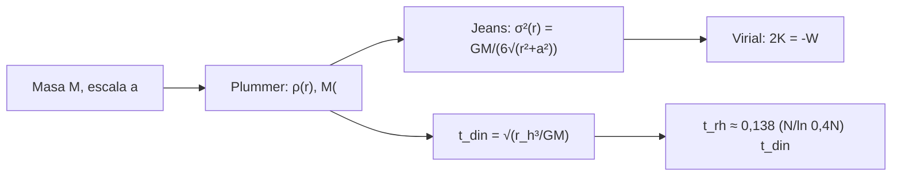

# B25-C06 — Cúmulos estelares

<!-- nav:top -->
[🏠 Programa](../../../../README.md) · [📚 Bloque B25](../../../tronco-comun/B25-galaxias-y-medio-interestelar.md) · [← Anterior: B25-C05 — Regiones de formación estelar](../B25-C05-regiones-de-formacion-estelar/CLASE.md) · [Siguiente: B25-C07 — Dinámica de poblaciones estelares →](../B25-C07-dinamica-de-poblaciones-estelares/CLASE.md)
<!-- /nav -->

## 1. Ubicación, nivel y alcance

Clase 6 del bloque B25. Nivel N3. Continúa C05 (dónde nacen las estrellas) con los grupos en que nacen, y usa la edad de cúmulos de [B24-C19](../../B24/B24-C19-cumulos-y-edades-estelares/CLASE.md), la gravitación ([B05-C10](../../B05/B05-C10-gravitacion-universal/CLASE.md)) y la integración numérica ([B11](../../../tronco-comun/B11-ecuaciones-diferenciales-y-simulacion-numerica.md)). Aquí aprendes a **describir un cúmulo como un sistema autogravitante en equilibrio**: su perfil de densidad, su dispersión de velocidades y las escalas de tiempo que dicen si sobrevive. Se usa el perfil de Plummer; la evolución dinámica real (segregación, marea, evaporación) solo se menciona.

## 2. Por qué esta clase existe

La mayoría de las estrellas nace en grupos. Los cúmulos son laboratorios: sus estrellas comparten edad, distancia y composición. Para entender si un grupo sobrevive o se disuelve hay que comparar escalas de tiempo y saber cuánta masa y velocidad hay en él. La decisión central: **dados la masa y el tamaño de un cúmulo, ¿cuál es su dispersión de velocidades y cuánto tarda en cruzarse y en relajarse?**

## 3. Lo que podrás hacer al terminar

1. Distinguir cúmulo abierto, globular y masivo joven, y nombrar sus rangos de edad y masa citados.
2. Describir un cúmulo con el perfil de Plummer: masa interior, radio de media masa, densidad central.
3. Calcular la dispersión de velocidades y la velocidad de escape.
4. Aplicar el teorema del virial a un cúmulo.
5. Estimar el tiempo dinámico y un orden de magnitud del tiempo de relajación.
6. Decidir qué conclusiones sobre la supervivencia admite el modelo.

La evidencia es la **ficha de un cúmulo** del ejercicio 12 (sección 20).

## 4. Con qué llegas y cómo comprobarlo

1. ¿Qué es la velocidad de escape de una masa `M` a distancia `r`?
2. ¿Qué es el tiempo de cruce de un sistema de radio `R` y velocidad `v`?
3. ¿Qué dice el teorema del virial para un sistema en equilibrio?
4. ¿Qué es una derivada numérica por diferencias centrales?
5. ¿Cómo se halla la raíz de una función creciente por bisección?

<details>
<summary>Ver respuestas</summary>

1. `v_esc = √(2GM/r)`. 2. `t = R/v`. 3. `2K + W = 0` con `K` la energía cinética y `W` la potencial gravitatoria. 4. `(f(x+h) − f(x−h))/(2h)`. 5. Se parte el intervalo por la mitad quedándose con la mitad que contiene el cambio de signo.
</details>

Con cuatro o cinco aciertos, sigue; si no, repasa B05-C10 y B11.

## 5. Un caso real: tres familias de cúmulos

Harris (S1) cataloga `157` objetos clasificados como cúmulos globulares de la Vía Láctea, con coordenadas, metalicidades, parámetros estructurales y dispersión central de velocidades. Portegies Zwart, McMillan y Gieles (S2) revisan los **cúmulos jóvenes masivos**: más jóvenes que unos `100 Myr` y más masivos que unos `10⁴ M☉`. Los cúmulos abiertos son grupos menos masivos del disco. El **ejemplo conductor** es un cúmulo **sintético** (no observado) de Plummer con `M = 2 × 10⁴ M☉` y radio de escala `a = 1,5 pc`, con masa media estelar `0,5 M☉` (ilustrativa).

## 6. Vocabulario

Un **cúmulo abierto** es un grupo ligado de estrellas jóvenes y poco masivo del disco; un **cúmulo globular** es un grupo masivo, esférico y viejo; un **cúmulo masivo joven** (S2) tiene menos de ~100 Myr y más de ~10⁴ M☉. El **perfil de Plummer** es una distribución esférica de densidad `ρ(r) = 3Ma²/(4π(r²+a²)^{5/2})`, con `a` el radio de escala. El **radio de media masa** `r_h` contiene la mitad de la masa. La **dispersión de velocidades** `σ` mide la agitación de las estrellas. El **tiempo dinámico** `t_din = √(r_h³/(GM))` es el tiempo característico de una órbita. El **tiempo de relajación** `t_rh` es el tiempo en que los encuentros entre estrellas cambian sus velocidades en una fracción grande de la inicial. La **ecuación de Jeans** relaciona el gradiente de presión del sistema con la gravedad; el **virial** relaciona energías.

## 7. Modelo mental: una nube de abejas ligadas

Un enjambre de abejas permanece compacto mientras vuela a velocidades comparables con las que la atracción mutua permite; si cada abeja ganara velocidad, el enjambre se disolvería. Analogía: la velocidad de las abejas es `σ` y la cohesión, la masa. Su límite: las abejas no se atraen por gravedad, y en un cúmulo los encuentros intercambian energía, de modo que unas estrellas escapan y el núcleo se contrae.



*Descripción textual:* de la masa y la escala se obtiene la densidad; de ella, la dispersión por la ecuación de Jeans; el virial comprueba el equilibrio; el tiempo dinámico y la relajación dan las escalas temporales.

## 8. La explicación, paso a paso

### 8.1 El perfil de Plummer

La masa dentro de `r` es `M(<r) = M r³/(r² + a²)^{3/2}`. La mitad de la masa cae dentro de `r_h = a/√(2^{2/3} − 1) = 1,3048 a`. Para el ejemplo, `r_h = 1,96 pc`. En `r = a` hay `M/2^{3/2} = 0,354 M`. La densidad central es `ρ₀ = 3M/(4πa³) = 1,4 × 10³ M☉/pc³`.

### 8.2 Dispersión de velocidades

Si el sistema es isótropo y está en equilibrio, la ecuación de Jeans `d(ρσ²)/dr = −ρ GM(<r)/r²` tiene solución `σ²(r) = GM/(6√(r² + a²))` para el perfil de Plummer. En el centro `σ₀ = 3,09 km/s` en el ejemplo. La velocidad de escape en el centro es `√(2GM/a) = 10,7 km/s = √12 σ₀`.

### 8.3 Virial

La energía potencial de la esfera de Plummer es `W = −3πGM²/(32a)`. El virial exige `2K = −W`, con `2K = 3∫ρσ² dV`. El laboratorio integra numéricamente el primer miembro y reproduce el segundo con error de `10⁻⁷`: es la comprobación de que la solución de Jeans es consistente con el equilibrio. En el ejemplo, `K = 3,4 × 10⁴¹ J`.

### 8.4 Escalas de tiempo

`t_din = √(r_h³/(GM)) = 0,29 Myr`. Con `N = M/0,5 M☉ = 4 × 10⁴` estrellas, la relajación se estima como `t_rh ≈ 0,138 (N/ln(0,4N)) t_din ≈ 165 Myr`. Esta fórmula es una **estimación estándar de orden de magnitud que no se contrasta con una fuente en esta clase**; sirve para ordenar escalas, no para predecir. Un cúmulo con `t_rh` mucho menor que su edad habrá experimentado muchos encuentros.

### 8.5 Lo que el modelo deja fuera

Plummer supone masas iguales, isotropía, equilibrio, ausencia de gas y de marea de la Galaxia. Un cúmulo joven (S2) aún conserva gas y no está relajado: su estado de equilibrio requiere estar «más allá de unos pocos tiempos de cruce» (S2). Los cúmulos reales tienen espectro de masas, segregación y pérdida de estrellas.

## 9. Magnitudes, símbolos y unidades

| Símbolo | Qué es | Unidad | Valor / nota |
|---|---|---|---|
| `G`, `GM☉` | gravitación; parámetro solar | `m³ kg⁻¹ s⁻²`; `m³ s⁻²` | `6,674 30 × 10⁻¹¹` (S3); `1,327 124 4 × 10²⁰` (S4) |
| `M`, `a` | masa y radio de escala | `M☉`; pc | `2 × 10⁴`; `1,5` (sintético) |
| `r_h` | radio de media masa | pc | `1,96` (cálculo propio) |
| `σ₀`, `v_esc` | dispersión central y escape | km/s | `3,09`; `10,7` (cálculo propio) |
| `t_din`, `t_rh` | tiempos dinámico y de relajación | Myr | `0,29`; `≈165` (orden de magnitud) |
| `N` | número de estrellas | adimensional | `4 × 10⁴` (ilustrativo) |

## 10. Convenciones y referencias

Esfera de Plummer isótropa; `1 pc = 3,0856776 × 10¹⁶ m`; `1 Myr = 3,15576 × 10¹³ s`. Se rotulan **observados** el número de cúmulos globulares y el rango de los jóvenes masivos (S1, S2), **sintéticos** el cúmulo y su masa media, y **cálculo propio** los demás.

## 11. De dónde sale lo que afirmamos

| ID | Fuente | Localizador | Respalda | Estado |
|---|---|---|---|---|
| S1 | Harris, *A New Catalog of Globular Clusters in the Milky Way*, arXiv:1012.3224 | https://arxiv.org/abs/1012.3224 | 157 objetos y parámetros del catálogo | Solo resumen, consultado el 2026-11-09 |
| S2 | Portegies Zwart, McMillan y Gieles, *Young Massive Star Clusters*, arXiv:1002.1961 | https://arxiv.org/abs/1002.1961 | Cúmulos `< ~100 Myr` y `> ~10⁴ M☉`; más allá de unos pocos tiempos de cruce | Solo resumen, consultado el 2026-11-09 |
| S3 | NIST, *Fundamental Physical Constants — Complete Listing* (CODATA 2022) | https://physics.nist.gov/cuu/Constants/Table/allascii.txt | `G` | Consultada el 2026-11-09 |
| S4 | Mamajek et al., *IAU 2015 Resolution B3*, arXiv:1510.07674 | https://arxiv.org/abs/1510.07674 | `GM☉` nominal | Texto del PDF extraído el 2026-11-09 |

Límites: de S1 y S2 solo se leyó el resumen; las fórmulas de Plummer y de Jeans se verifican numéricamente aquí, no se citan de un texto; la fórmula de `t_rh` no se contrastó.

## 12. Cómo ver el cúmulo

Equivalente accesible a un perfil de densidad (cúmulo **sintético**, cálculo propio):

| Radio `r` | Masa interior | `σ(r)` |
|---|---|---|
| `0,5 a` | `0,089 M` | `2,9 km/s` |
| `a` | `0,354 M` | `2,6 km/s` |
| `r_h = 1,30 a` | `0,5 M` | `2,4 km/s` |
| `3 a` | `0,854 M` | `1,7 km/s` |

Descripción larga: la masa se concentra en pocos radios de escala y la dispersión disminuye hacia fuera.

## 13. Ejemplo trabajado: ¿qué tan relajado está?

**Paso 1 · Datos.** `M = 2 × 10⁴ M☉`, `a = 1,5 pc`, `m̄ = 0,5 M☉`.

**Paso 2 · Radio.** `r_h = 1,3048 × 1,5 = 1,96 pc`.

**Paso 3 · Tiempo dinámico.** `GM = 2,654 × 10²⁴ m³ s⁻²`, `r_h = 6,04 × 10¹⁶ m`: `t_din = √(r_h³/GM) = 9,1 × 10¹² s = 0,29 Myr`.

**Paso 4 · Relajación.** `N = 4 × 10⁴`; `ln(0,4N) = 9,68`; `t_rh = 0,138 × 4 × 10⁴/9,68 × 0,29 = 165 Myr`.

**Paso 5 · Sentido.** Un cúmulo de 10 Myr está lejos de la relajación (`10 ≪ 165`), pero uno de 10 Gyr habría vivido unos 60 tiempos de relajación. La conclusión depende de una fórmula no verificada en esta clase y de un `N` ilustrativo; es una escala, no una predicción.

## 14. Distintas descripciones de un cúmulo

**Plummer (esta clase):** analítico, con núcleo plano y cola; no tiene radio finito. **King:** corta en el radio de marea; se ajusta a globulares pero exige resolver una ecuación. **Simulaciones de N cuerpos:** siguen los encuentros, pero cuestan más. Para una escala sirve Plummer; para un cúmulo concreto hay que ajustar un modelo a su perfil observado.

## 15. Práctica guiada

**Ejercicio 1 · con los pasos indicados.** Calcula `r_h` del ejemplo. *Pasos:* `2^{2/3} = 1,5874`; `√(0,5874)`; `a/√…`.

<details><summary>Solución comentada</summary>

`√0,5874 = 0,7664`; `r_h = 1,5/0,7664 = 1,957 pc` (8.1).
</details>

**Ejercicio 2 · con una pista.** ¿Qué masa hay dentro de `r = a`? *Pista:* `a³/(2a²)^{3/2}`.

<details><summary>Solución comentada</summary>

`1/2^{3/2} = 0,3536`: `7,1 × 10³ M☉` (8.1).
</details>

**Ejercicio 3 · casi autónomo.** Calcula `σ₀`. 

<details><summary>Solución comentada</summary>

`σ₀² = GM/(6a) = 2,654 × 10²⁴/(6 × 4,63 × 10¹⁶) = 9,56 × 10⁶`; `σ₀ = 3,09 km/s` (8.2).
</details>

## 16. Práctica autónoma, transferencia e integrador

**Ejercicio 4.** Calcula la velocidad de escape central y su cociente con `σ₀`.

<details><summary>Solución comentada</summary>

`√(2GM/a) = 10,7 km/s`; cociente `√12 = 3,46` (8.2).
</details>

**Ejercicio 5.** Calcula `t_din`.

<details><summary>Solución comentada</summary>

`0,29 Myr` (13, paso 3).
</details>

**Ejercicio 6.** Calcula la densidad central.

<details><summary>Solución comentada</summary>

`3 × 2 × 10⁴/(4π × 3,375) = 1,4 × 10³ M☉/pc³` (8.1).
</details>

**Ejercicio 7.** Calcula la energía cinética `K = 3πGM²/(64a)`.

<details><summary>Solución comentada</summary>

`GM²/a = 2,28 × 10⁴²` J; `× 3π/64 = 0,147` da `3,4 × 10⁴¹ J` (8.3).
</details>

**Ejercicio 8.** Si el mismo cúmulo tuviera `M = 10⁴ M☉` con la misma `a`, ¿cómo cambian `σ₀` y `t_din`?

<details><summary>Solución comentada</summary>

`σ₀ ∝ √M`: ×0,707 (2,18 km/s); `t_din ∝ M^{−1/2}`: ×1,414 (0,41 Myr) (8.2, 8.4).
</details>

**Ejercicio 9 · transferencia.** Un compañero dice: «todos los cúmulos son iguales y se llaman globulares». Respóndele con la fuente.

<details><summary>Solución comentada</summary>

S2 distingue cúmulos jóvenes masivos (`< ~100 Myr`, `> ~10⁴ M☉`) de los globulares, viejos; S1 cataloga 157 globulares; y existen cúmulos abiertos menos masivos (sección 5).
</details>

**Ejercicio 10 · transferencia.** Un cúmulo de 10 Gyr con el `t_rh` de 8.4, ¿cuántos tiempos de relajación ha vivido?

<details><summary>Solución comentada</summary>

`10 000/165 = 61`. Con una fórmula no verificada: indica que ha tenido tiempo de relajarse y de perder estrellas, no que lo haya hecho en esa medida (8.4).
</details>

**Ejercicio 11 · transferencia.** Un cúmulo joven de 5 Myr, con `t_din = 0,29 Myr`: ¿cuántos tiempos dinámicos tiene y puede considerarse en equilibrio?

<details><summary>Solución comentada</summary>

`5/0,29 = 17` tiempos dinámicos: satisface la condición de S2 de ser mayor que unos pocos tiempos de cruce, aunque aún puede tener gas (8.5).
</details>

**Ejercicio 12 · integrador.** Elabora la *ficha de un cúmulo*: elige `M` y `a` (sintéticos), calcula `r_h`, `σ₀`, `v_esc`, `t_din`, `t_rh` y la comprobación del virial; indica qué es observado, qué es modelo y qué fórmula no se contrastó.

<details><summary>Solución modelo</summary>

Con `M = 2 × 10⁴ M☉`, `a = 1,5 pc`: `1,96 pc`, `3,09`, `10,7 km/s`, `0,29 Myr`, `≈165 Myr`, `2K/|W| = 1,0000`. Observado: solo los conteos y rangos de S1 y S2; modelo: Plummer; no contrastado: `t_rh`.
</details>

## 17. Laboratorio: Plummer, Jeans y virial

El script [plummer.py](plummer.py) calcula `r_h`, `σ₀`, `t_din` y `t_rh`, y **comprueba** que la masa integrada por Simpson coincide con la forma cerrada (`10⁻⁸`), que `r_h = 1,3048 a` por bisección (`10⁻⁹`), que se cumple la ecuación de Jeans por diferencias centrales en tres radios (`10⁻⁶`) y que `2K = −W` (`10⁻⁶`).

**Datos:** `G` de NIST, `GM☉` de la IAU; cúmulo **sintético**. **Predice antes de ejecutar:** ¿cuánto vale `2K/|W|`? (1.) **Ejecución del 2026-11-09 (Python 3.12.9):**

```text
Python 3.12.9 (biblioteca estandar)
r_h = 1.957 pc (1.3048 a) ; sigma(0) = 3.09 km/s
masa por cuadratura / cerrada = 1.0000000000
2K/|W| = 0.99999997
t_din = 0.29 Myr ; N = 40000 ; t_rh = 165 Myr (orden de magnitud)
Pruebas superadas.
```

```bash
python programa/clases/B25/B25-C06-cumulos-estelares/plummer.py
```

**Límites:** Plummer isótropo de masas iguales, sin marea; `t_rh` sin contrastar.

## 18. Errores frecuentes y cómo corregirlos

**Confundir `a` con `r_h`.** Se corrige con el ejercicio 1.

**Usar `σ` central como dispersión de todo el cúmulo.** Se corrige con la tabla de la sección 12.

**Olvidar que `t_rh` es una estimación.** Se corrige en 8.4 y el ejercicio 10.

**Pensar que el virial vale en cualquier cúmulo.** Se corrige en 8.5 y el ejercicio 11.

**Suponer un radio finito en Plummer.** Se corrige en la sección 14.

## 19. Cómo sabrás que vas bien

Tras 8.1: ¿qué masa hay dentro de `a`? Ejercicio 2. Tras 8.3: ¿qué comprueba el virial? Ejercicio 7. Tras el laboratorio: ¿por qué se comprueba Jeans en tres radios? (para cubrir núcleo, escala y cola).

## 20. Qué entregas y cómo se evalúa

El producto es tu **ficha de un cúmulo** (ejercicio 12).

| Criterio | Inicial | En desarrollo | Logrado | Destacado |
|---|---|---|---|---|
| Definiciones | Las confunde | Parciales | Plummer, `r_h`, `t_din` | Distingue las tres familias |
| Cálculo | Sin unidades | Con errores | Valores correctos | Propone casos límite |
| Interpretación | Sin comparar | Sin razón | Concluye sobre equilibrio | Discute la relajación |
| Numérico | Sin comprobar | Un caso | Cuatro pruebas superadas | Explica cada prueba |
| Fuentes | Sin fuente | Sin fecha | S1–S4 con fecha | Rotula lo no contrastado |

**Condiciones críticas (no se compensan con promedio):** rotular el cúmulo como sintético; no presentar `t_rh` como predicción; citar solo lo consultado.

## 21. Ética, seguridad y límites

La clase es educativa y no sustituye a un ajuste a datos de un cúmulo. Accesibilidad: tablas equivalentes a los perfiles, fórmulas en texto, ejercicios sin conexión.

## 22. Para cerrar y seguir

Un cúmulo de Plummer queda fijado por `M` y `a`: tiene `r_h = 1,3 a`, `σ₀² = GM/6a` y satisface el virial; su tiempo dinámico es de décimas de Myr y su relajación, de cientos. Queda una pregunta: ¿qué dice la distribución de edades y movimientos de las estrellas de una galaxia entera?

**Glosario español–inglés.** cúmulo abierto · *open cluster*; cúmulo globular · *globular cluster*; perfil de Plummer · *Plummer profile*; dispersión de velocidades · *velocity dispersion*; tiempo de relajación · *relaxation time*; virial · *virial*.

**Continuidad.** [B25-C07](../B25-C07-dinamica-de-poblaciones-estelares/CLASE.md) pasa de un cúmulo a las poblaciones estelares de la galaxia.

**Referencias:** ver sección 11.

<!-- nav:bottom -->
---

[← Anterior: B25-C05 — Regiones de formación estelar](../B25-C05-regiones-de-formacion-estelar/CLASE.md) · [📚 Bloque B25](../../../tronco-comun/B25-galaxias-y-medio-interestelar.md) · [Siguiente: B25-C07 — Dinámica de poblaciones estelares →](../B25-C07-dinamica-de-poblaciones-estelares/CLASE.md)
<!-- /nav -->
