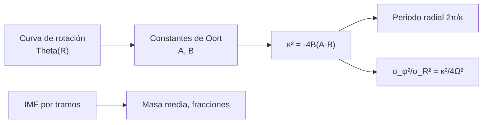

# B25-C07 — Dinámica de poblaciones estelares

<!-- nav:top -->
[🏠 Programa](../../../../README.md) · [📚 Bloque B25](../../../tronco-comun/B25-galaxias-y-medio-interestelar.md) · [← Anterior: B25-C06 — Cúmulos estelares](../B25-C06-cumulos-estelares/CLASE.md) · [Siguiente: B25-C08 — Curvas de rotación de galaxias →](../B25-C08-curvas-de-rotacion-de-galaxias/CLASE.md)
<!-- /nav -->

## 1. Ubicación, nivel y alcance

Clase 7 del bloque B25. Nivel N3. Parte de la estructura de [C01](../B25-C01-estructura-de-la-via-lactea/CLASE.md), de los cúmulos de [C06](../B25-C06-cumulos-estelares/CLASE.md), de las ecuaciones diferenciales ([B11](../../../tronco-comun/B11-ecuaciones-diferenciales-y-simulacion-numerica.md)) y de la estadística ([B12](../../../tronco-comun/B12-probabilidad-estadistica-e-incertidumbre.md)). Estudia **cómo se mueven y cuántas son las estrellas de una población**: las órbitas casi circulares con pequeñas oscilaciones (epiciclos), las constantes de Oort y la función de masa inicial. Se supone el plano galáctico con una curva de rotación plana; no se incluyen los brazos, la barra ni el movimiento vertical.

## 2. Por qué esta clase existe

Las estrellas de una galaxia no giran en círculos perfectos: oscilan alrededor de una órbita circular, y su agitación revela la edad y la historia de la población. Además, no nacen todas con la misma masa: la función de masa inicial fija cuántas hay de cada tipo y cuánta luz y metales producirán. La decisión central: **dada la curva de rotación, ¿con qué frecuencia oscilan las estrellas alrededor de su órbita y cómo se reparte la agitación; y dada una función de masa, ¿qué fracción de estrellas y de masa son masivas?**

## 3. Lo que podrás hacer al terminar

1. Definir población estelar, órbita circular, epiciclo, frecuencia epicíclica y constantes de Oort.
2. Calcular `A`, `B` y `κ` a partir de la curva de rotación.
3. Calcular el periodo de oscilación radial y el cociente de dispersiones `σ_φ/σ_R`.
4. Describir una función de masa inicial por tramos y calcular su masa media y fracciones.
5. Comprobar un resultado analítico con una integración numérica de órbitas.
6. Distinguir entre lo medido, lo calculado y lo ilustrativo.

La evidencia es la **ficha de dinámica de una población** del ejercicio 12 (sección 20).

## 4. Con qué llegas y cómo comprobarlo

1. ¿Qué es la frecuencia angular `Ω = Θ/R`?
2. ¿Cuál es la fuerza por unidad de masa en el potencial `Φ = Θ² ln R`?
3. ¿Qué es la dispersión de velocidades?
4. ¿Cómo se integra una ecuación diferencial con Runge–Kutta?
5. ¿Qué es una ley de potencias `dN/dm ∝ m^{−α}`?

<details>
<summary>Ver respuestas</summary>

1. La velocidad angular de una órbita circular. 2. `−dΦ/dR = −Θ²/R`. 3. La desviación típica de las velocidades. 4. Avanzando el estado con promedios ponderados de pendientes (B11). 5. Una distribución cuya cantidad por intervalo cae como una potencia de la masa.
</details>

Con cuatro o cinco aciertos, sigue; si no, repasa B05-C10, B11 y B12.

## 5. Un caso real: el movimiento alrededor del Sol

Bland-Hawthorn y Gerhard (S1) adoptan `R₀ = 8,2 kpc` y `Θ₀ = 238 km/s`, y definen las constantes de Oort por `A − B = Θ₀/R₀` y `A + B = −(∂Θ/∂R)_{R₀}`; recogen valores medidos de `A − B` entre `27` y `32 km s⁻¹ kpc⁻¹`, y describen una curva de rotación casi plana entre `5` y `13 kpc`. Kroupa (S2) halla cambios de pendiente de la función de masa inicial hacia `0,5` y `0,08 M☉`. El **ejemplo conductor**: estrellas en órbita casi circular en el radio solar con una curva plana, y una población **sintética** con la función de masa de la sección 8.4.

## 6. Vocabulario

Una **población estelar** es un conjunto de estrellas con propiedades comunes (edad, composición, cinemática). La **órbita circular** es la que mantiene constante el radio con velocidad `Θ`. Un **epiciclo** es la pequeña oscilación radial de una estrella alrededor del **radio guía** `R_g`, el de la órbita circular con su mismo momento angular `L = Θ R_g`. La **frecuencia epicíclica** `κ` es la de esa oscilación radial. Las **constantes de Oort** `A` y `B` miden la rotación y la cizalla locales. La **función de masa inicial** (IMF) `ξ(m) = dN/dm` da cuántas estrellas nacen por intervalo de masa. La **dispersión de velocidades** `σ_R` y `σ_φ` mide la agitación radial y azimutal.

## 7. Modelo mental: un péndulo que da vueltas

Piensa en una canica que rueda en una pista circular con un pequeño valle: oscila de lado a lado mientras avanza. Analogía: la canica es la estrella y el valle, la atracción del resto de la galaxia. Su límite: la «pista» es un potencial continuo y la estrella puede ir cambiando de radio guía por el paso de brazos o nubes, que aquí no se incluyen.



*Descripción textual:* de la curva de rotación se obtienen `A` y `B`, de ellas `κ`, y de `κ` el periodo de oscilación y el cociente de dispersiones; aparte, la función de masa da masa media y fracciones.

## 8. La explicación, paso a paso

### 8.1 Constantes de Oort y curva plana

Con `A = ½(Θ/R − dΘ/dR)` y `B = −½(Θ/R + dΘ/dR)`, una curva plana (`dΘ/dR = 0`) da `A = Ω/2 = 14,5` y `B = −Ω/2 = −14,5 km s⁻¹ kpc⁻¹`; su diferencia `A − B = 29,0` cae dentro del intervalo `27–32` de S1.

### 8.2 Frecuencia epicíclica

`κ² = −4B(A − B)`. Para una curva plana `κ = √2 Ω = 41,0 km s⁻¹ kpc⁻¹`, y el periodo radial `2π/κ = 150 Myr`, frente al periodo orbital `2π/Ω = 212 Myr`: la estrella hace `1,41` oscilaciones radiales por vuelta y la órbita es una roseta, no una elipse cerrada.

### 8.3 Cómo se reparte la agitación

En la aproximación epicíclica, `σ_φ²/σ_R² = κ²/(4Ω²)`; para una curva plana vale `1/2` y `σ_φ/σ_R = 0,707`. La amplitud de la oscilación radial es `σ_R/κ`: con `σ_R = 40 km/s` (ilustrativo), `≈ 1 kpc`. El laboratorio comprueba la fórmula integrando una órbita real en el potencial `Φ = Θ² ln R`: el periodo numérico es `149,68 Myr`, frente a `149,7` del epiciclo (cociente `1,00003`), y el cociente de dispersiones medido es `0,5002`.

### 8.4 La función de masa inicial

Se modela `ξ(m) ∝ m^{−α}` con dos tramos y ruptura en `0,5 M☉` (S2), con pendientes **ilustrativas** `α₁ = 1,3` (entre `0,08` y `0,5 M☉`) y `α₂ = 2,3` (entre `0,5` y `100 M☉`), continuas en la ruptura. Resultan una masa media `0,574 M☉`, una fracción en número de estrellas de `≥ 8 M☉` de `0,63 %` y una fracción de la masa en esas estrellas de `20,9 %`. Pocas estrellas masivas contienen una quinta parte de la masa formada: por eso dominan la luz y la química (C16, C17).

### 8.5 Lo que el modelo deja fuera

No hay brazos ni barra que muevan el radio guía, ni movimiento vertical, ni dependencia de la dispersión con la edad. Tampoco hay evolución de la función de masa: las masivas mueren antes. La IMF de S2 solo está confirmada en sus rupturas; las pendientes usadas son ilustrativas y, según S2, la IMF de los cúmulos jóvenes difiere de la del campo en `Δα = 0,5` entre `0,1` y `1 M☉`.

## 9. Magnitudes, símbolos y unidades

| Símbolo | Qué es | Unidad | Valor / nota |
|---|---|---|---|
| `R₀`, `Θ₀` | radio y velocidad circular del Sol | kpc; km/s | `8,2`; `238` (S1) |
| `Ω` | frecuencia angular | `km s⁻¹ kpc⁻¹` | `29,0` (cálculo propio) |
| `A`, `B` | constantes de Oort | `km s⁻¹ kpc⁻¹` | `14,5`; `−14,5` (cálculo propio, curva plana) |
| `κ` | frecuencia epicíclica | `km s⁻¹ kpc⁻¹` | `41,0` (cálculo propio) |
| `σ_R`, `σ_φ` | dispersiones | km/s | `σ_φ/σ_R = 0,707` |
| `ξ(m)`, `α` | IMF y pendientes | `M☉⁻¹`; adimensional | rupturas de S2; `1,3`, `2,3` ilustrativas |
| `1 kpc/(km/s)` | conversión | Gyr | `0,9778` (cálculo propio) |

## 10. Convenciones y referencias

Coordenadas planas `(R, φ)`; `v_R` es la velocidad radial y `v_φ` la azimutal. Se rotulan **observados** `R₀`, `Θ₀` y el intervalo de `A − B`; **ilustrativos** las pendientes, el intervalo de masas y `σ_R`; **sintéticas** las órbitas; **cálculo propio** el resto. La fórmula `κ² = −4B(A − B)` es un resultado estándar que aquí se verifica con la integración numérica, no se cita de un texto.

## 11. De dónde sale lo que afirmamos

| ID | Fuente | Localizador | Respalda | Estado |
|---|---|---|---|---|
| S1 | Bland-Hawthorn y Gerhard, arXiv:1602.07702 | https://arxiv.org/abs/1602.07702 | `R₀`, `Θ₀`, definición de `A`, `B`, intervalo `A − B`, curva plana 5–13 kpc | Texto del PDF extraído el 2026-11-09 |
| S2 | Kroupa, *On the variation of the Initial Mass Function*, arXiv:astro-ph/0009005 | https://arxiv.org/abs/astro-ph/0009005 | Rupturas hacia `0,5` y `0,08 M☉`; `Δα = 0,5` | Solo resumen, consultado el 2026-11-09 |

Límites: S2 solo en resumen (sin pendientes absolutas); el límite superior de `100 M☉` y las pendientes son ilustrativos; la fórmula de `κ` se verifica solo para curva plana.

## 12. Cómo ver las oscilaciones

Equivalente accesible a un dibujo de la roseta (cálculo propio):

| Magnitud | Valor |
|---|---|
| Periodo orbital `2π/Ω` | 211,7 Myr |
| Periodo radial `2π/κ` | 149,7 Myr |
| Oscilaciones radiales por vuelta | 1,41 |
| `σ_φ/σ_R` | 0,707 |

Descripción larga: la órbita se cierra tras muchas vueltas y forma una roseta con pétalos desplazados.

## 13. Ejemplo trabajado: el periodo de oscilación del Sol

**Paso 1 · Datos.** `Θ₀ = 238`, `R₀ = 8,2` en curva plana.

**Paso 2 · Oort.** `A = 14,5`, `B = −14,5`.

**Paso 3 · κ.** `κ² = −4B(A − B) = 4 × 14,5 × 29,0 = 1682`; `κ = 41,0 km s⁻¹ kpc⁻¹`.

**Paso 4 · Periodo.** `2π/41,0 = 0,1532 kpc/(km/s)`; por `0,9778 Gyr` da `149,8 Myr`.

**Paso 5 · Sentido.** El Sol oscila radialmente cada ~150 Myr mientras da una vuelta en ~212 Myr. El resultado vale para una órbita de pequeña amplitud en curva plana; con otra curva cambia, como muestra el ejercicio 9.

## 14. Distintas formas de estudiar las órbitas

**Epiciclos (esta clase):** analíticos, válidos para pequeñas amplitudes. **Integración numérica en un potencial:** exacta para el modelo, más costosa. **Modelos de distribución completa (Jeans, función de distribución):** describen poblaciones enteras. Para una estimación de la frecuencia sirve el epiciclo; para amplitudes grandes o poblaciones, hay que integrar.

## 15. Práctica guiada

**Ejercicio 1 · con los pasos indicados.** Calcula `A` y `B` para curva plana con `Ω = 29,0`. *Pasos:* `A = ½ Ω`; `B = −½ Ω`.

<details><summary>Solución comentada</summary>

`A = 14,5`; `B = −14,5 km s⁻¹ kpc⁻¹` (8.1).
</details>

**Ejercicio 2 · con una pista.** Calcula `κ` para esa curva. *Pista:* `κ² = −4B(A−B)`.

<details><summary>Solución comentada</summary>

`4 × 14,5 × 29,0 = 1682`; `κ = 41,0` (8.2).
</details>

**Ejercicio 3 · casi autónomo.** Calcula el periodo radial en Myr con `1 kpc/(km/s) = 977,8 Myr`.

<details><summary>Solución comentada</summary>

`2π/41,0 × 977,8 = 149,8 Myr` (8.2).
</details>

## 16. Práctica autónoma, transferencia e integrador

**Ejercicio 4.** ¿Cuántas oscilaciones radiales hace una estrella por vuelta?

<details><summary>Solución comentada</summary>

`κ/Ω = √2 = 1,41` (8.2).
</details>

**Ejercicio 5.** Si `σ_R = 40 km/s`, ¿cuánto vale `σ_φ`?

<details><summary>Solución comentada</summary>

`40 × 0,707 = 28,3 km/s` (8.3).
</details>

**Ejercicio 6.** Calcula la amplitud epicíclica `σ_R/κ` para `σ_R = 40 km/s`.

<details><summary>Solución comentada</summary>

`40/41,0 = 0,98 kpc` (8.3).
</details>

**Ejercicio 7.** ¿Cuánta masa tiene una población sintética de `10⁴` estrellas con la IMF de 8.4?

<details><summary>Solución comentada</summary>

`10⁴ × 0,574 = 5,7 × 10³ M☉` (8.4).
</details>

**Ejercicio 8.** ¿Cuántas estrellas de `≥ 8 M☉` hay en esa población?

<details><summary>Solución comentada</summary>

`10⁴ × 0,0063 = 63` (8.4), y suman `0,209 × 5,7 × 10³ ≈ 1,2 × 10³ M☉`.
</details>

**Ejercicio 9 · transferencia.** Una curva con `dΘ/dR = −10 km s⁻¹ kpc⁻¹` (ilustrativo) y `Ω = 29,0`: calcula `A`, `B` y `κ`.

<details><summary>Solución comentada</summary>

`A = ½(29,0 + 10) = 19,5`; `B = −½(29,0 − 10) = −9,5`; `κ² = 4 × 9,5 × 29,0 = 1102`; `κ = 33,2`. Una curva descendente da un periodo radial más largo (8.1, 8.2).
</details>

**Ejercicio 10 · transferencia.** Un compañero dice: «las estrellas giran en círculos perfectos alrededor del centro». Respóndele con números.

<details><summary>Solución comentada</summary>

Con `σ_R = 40 km/s` la amplitud es ~1 kpc y hay 1,4 oscilaciones por vuelta: la órbita es una roseta (8.2, 8.3).
</details>

**Ejercicio 11 · transferencia.** Si la IMF tuviera `α₂ = 2,0` en vez de `2,3`, ¿qué esperas para la fracción de masa en estrellas masivas?

<details><summary>Solución comentada</summary>

Una pendiente menos negativa da más estrellas masivas: la fracción de masa en `≥ 8 M☉` sube por encima del `20,9 %`. (Se puede comprobar cambiando `alpha2` en el script.)
</details>

**Ejercicio 12 · integrador.** Elabora la *ficha de dinámica de una población*: tabla con `A`, `B`, `κ`, periodos, `σ_φ/σ_R`, masa media y fracción de masa en `≥ 8 M☉`, rotulando observado, ilustrativo y propio; indica qué comprobó la integración de órbitas.

<details><summary>Solución modelo</summary>

`14,5`, `−14,5`, `41,0`, `212` y `150 Myr`, `0,707`, `0,574 M☉`, `20,9 %`. La integración reprodujo el periodo (`1,00003`) y el cociente de dispersiones (`0,5002`).
</details>

## 17. Laboratorio: epiciclos e IMF

El script [epiciclos_e_imf.py](epiciclos_e_imf.py) calcula `A`, `B`, `κ`, integra una órbita con Runge–Kutta de cuarto orden en `Φ = Θ² ln R` y calcula momentos de la IMF. **Comprueba** que `A − B = Θ₀/R₀` y `κ = √2 Ω` (`10⁻¹²`), que el periodo radial numérico coincide con `2π/κ` (`10⁻³`), que el cociente de dispersiones coincide con `1/2` (`10⁻²`) y que la cuadratura de la IMF coincide con su forma cerrada (`10⁻⁸`).

**Datos:** `R₀`, `Θ₀` de S1; rupturas de S2; pendientes ilustrativas; órbitas sintéticas. **Predice antes de ejecutar:** ¿qué cociente espera entre el periodo radial y el orbital? (`1/√2 = 0,71`.) **Ejecución del 2026-11-09 (Python 3.12.9):**

```text
Python 3.12.9 (biblioteca estandar)
A = 14.51, B = -14.51 km/s/kpc ; A - B = 29.02 ; kappa = 41.0 km/s/kpc
T_epiciclo (2 pi/kappa) = 149.7 Myr ; periodo orbital 2 pi/Omega = 211.7 Myr
periodo radial numerico = 149.68 Myr (cociente con 2 pi/kappa = 1.00003)
<vphi'^2>/<vR^2> = 0.5002 (teoria 0.5)
IMF: masa media = 0.574 Msol ; fraccion en numero de estrellas >= 8 Msol = 0.00627
fraccion de la masa en estrellas >= 8 Msol = 0.2091
Pruebas superadas.
```

```bash
python programa/clases/B25/B25-C07-dinamica-de-poblaciones-estelares/epiciclos_e_imf.py
```

**Límites:** plano, curva plana, amplitud pequeña (0,05 kpc), IMF ilustrativa.

## 18. Errores frecuentes y cómo corregirlos

**Confundir periodo orbital y periodo radial.** Se corrige con los ejercicios 3 y 4.

**Usar `A` con signo equivocado.** Se corrige en 8.1 y el ejercicio 1.

**Tomar las pendientes de la IMF como datos de la fuente.** Se corrige en 8.4 y la sección 10.

**Extrapolar el epiciclo a grandes amplitudes.** Se corrige en la sección 14.

**Pensar que una población masiva domina en número.** Se corrige con el ejercicio 8.

## 19. Cómo sabrás que vas bien

Tras 8.2: ¿por qué la órbita es una roseta? Ejercicio 4. Tras 8.4: ¿qué fracción de masa llevan las estrellas masivas? Ejercicio 8. Tras el laboratorio: ¿qué valida la integración? (que `κ` describe la oscilación real).

## 20. Qué entregas y cómo se evalúa

El producto es tu **ficha de dinámica de una población** (ejercicio 12).

| Criterio | Inicial | En desarrollo | Logrado | Destacado |
|---|---|---|---|---|
| Definiciones | Las confunde | Parciales | `A`, `B`, `κ`, IMF | Distingue radio guía y radio actual |
| Cálculo | Sin unidades | Con errores | Valores correctos | Propone casos límite |
| Interpretación | Sin comparar | Sin razón | Explica la roseta | Discute los límites del epiciclo |
| Numérico | Sin comprobar | Un caso | Cuatro pruebas superadas | Explica cada prueba |
| Fuentes | Sin fuente | Sin fecha | S1–S2 con fecha | Rotula lo ilustrativo |

**Condiciones críticas (no se compensan con promedio):** rotular las pendientes de la IMF como ilustrativas; no presentar `κ` como medida; citar solo lo consultado.

## 21. Ética, seguridad y límites

La clase es educativa y no sustituye a un análisis cinemático con datos de Gaia. Accesibilidad: tablas equivalentes a los dibujos, fórmulas en texto, ejercicios sin conexión.

## 22. Para cerrar y seguir

En una curva plana, `A = −B = Ω/2`, `κ = √2 Ω` y las estrellas oscilan radialmente cada ~150 Myr; con una IMF ilustrativa, un 0,6 % de las estrellas lleva un 21 % de la masa. Queda una pregunta: ¿qué dicen las velocidades de las estrellas sobre la masa total de otras galaxias?

**Glosario español–inglés.** población estelar · *stellar population*; epiciclo · *epicycle*; radio guía · *guiding radius*; constantes de Oort · *Oort constants*; función de masa inicial · *initial mass function*; dispersión de velocidades · *velocity dispersion*.

**Continuidad.** [B25-C08](../B25-C08-curvas-de-rotacion-de-galaxias/CLASE.md) usa la velocidad circular de una galaxia para medir su masa.

**Referencias:** ver sección 11.

<!-- nav:bottom -->
---

[← Anterior: B25-C06 — Cúmulos estelares](../B25-C06-cumulos-estelares/CLASE.md) · [📚 Bloque B25](../../../tronco-comun/B25-galaxias-y-medio-interestelar.md) · [Siguiente: B25-C08 — Curvas de rotación de galaxias →](../B25-C08-curvas-de-rotacion-de-galaxias/CLASE.md)
<!-- /nav -->
