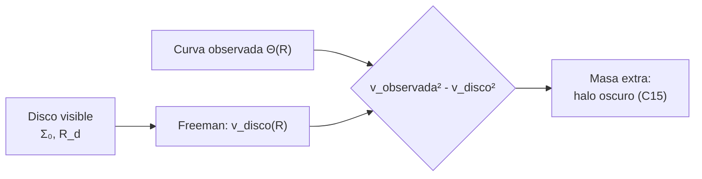

# B25-C08 — Curvas de rotación de galaxias

<!-- nav:top -->
[🏠 Programa](../../../../README.md) · [📚 Bloque B25](../../../tronco-comun/B25-galaxias-y-medio-interestelar.md) · [← Anterior: B25-C07 — Dinámica de poblaciones estelares](../B25-C07-dinamica-de-poblaciones-estelares/CLASE.md) · [Siguiente: B25-C09 — Galaxias elípticas y espirales →](../../../tronco-comun/B25-galaxias-y-medio-interestelar.md#b25-c09)
<!-- /nav -->

## 1. Ubicación, nivel y alcance

Clase 8 del bloque B25. Nivel N3. Cierra el tramo de la Vía Láctea y su gas y abre el de las galaxias en general. Usa la masa interior de [C01](../B25-C01-estructura-de-la-via-lactea/CLASE.md), las órbitas de [C07](../B25-C07-dinamica-de-poblaciones-estelares/CLASE.md), la gravitación ([B05-C10](../../B05/B05-C10-gravitacion-universal/CLASE.md)) y las funciones especiales y la integración numérica ([B09](../../../tronco-comun/B09-calculo-diferencial-e-integral.md), [B11](../../../tronco-comun/B11-ecuaciones-diferenciales-y-simulacion-numerica.md)). Aquí comparas **la velocidad circular que produce un disco de estrellas con la medida** y deduces cuánta masa falta. El disco es exponencial y delgado; el halo, esférico.

## 2. Por qué esta clase existe

Si la masa estuviera donde brilla, la velocidad de rotación debería caer en las afueras de una galaxia, como la de los planetas lejanos del Sol. Que una curva de rotación se mantenga plana indica más masa de la que se ve. Este fue uno de los argumentos históricos de la materia oscura (se trata en C15). La decisión central: **dado el disco estelar de una galaxia, ¿qué fracción de la velocidad observada explica y cuánta masa extra hace falta?**

## 3. Lo que podrás hacer al terminar

1. Definir curva de rotación, velocidad circular, masa interior y halo oscuro.
2. Calcular la masa interior desde una velocidad circular y compararla con la parte luminosa.
3. Calcular la curva de rotación de un disco exponencial con la fórmula de Freeman.
4. Identificar el máximo de la curva de un disco y el límite kepleriano lejos de él.
5. Calcular la masa extra que corrige una curva y plantear un halo.
6. Señalar los supuestos que separan «falta masa» de «hay materia oscura».

La evidencia es la **ficha de una curva de rotación** del ejercicio 12 (sección 20).

## 4. Con qué llegas y cómo comprobarlo

1. ¿Qué relación liga velocidad circular y masa interior?
2. ¿Qué hace la velocidad de un cuerpo en órbita kepleriana cuando el radio se duplica?
3. ¿Qué es la masa del disco `M_d = 2πΣ₀R_d²` en C01?
4. ¿Qué es una función de Bessel modificada? (idea general)
5. ¿Qué es el wronskiano de dos funciones?

<details>
<summary>Ver respuestas</summary>

1. `M(<R) = Θ²R/G`. 2. Se divide por `√2`. 3. La masa total de un disco con `Σ = Σ₀e^{−R/R_d}` (C01). 4. Solución de una ecuación diferencial que aparece al resolver la gravedad de un disco; se evalúan con integrales. 5. Una combinación `f g′ − f′ g` que para algunas parejas conocidas vale una expresión simple.
</details>

Con cuatro o cinco aciertos, sigue; si no, repasa B05-C10, C01 y B09.

## 5. Un caso real: una Galaxia con curva plana

Bland-Hawthorn y Gerhard (S1) describen la curva de rotación de la Vía Láctea como casi plana entre `5` y `13 kpc`, con `Θ₀ = 238 km/s` en el Sol, y en sus modelos dinámicos con disco, bulbo, barra y gas encuentran que la componente bariónica aporta (86 %, 73 %, 65 %) de la velocidad circular a `2,2 R_d` según la escala de longitud del disco (`2,15`, `2,6` y `3,0 kpc`). Sofue y Rubin (S2) presentan el panorama de las curvas de rotación de espirales y su relación con tipo, estructura y entorno. Lelli, McGaugh y Schombert (S3) reúnen 175 galaxias de disco con fotometría a `3,6 μm` y curvas precisas, y muestran que el cociente entre velocidad bariónica y observada varía: las galaxias brillantes y de alto brillo superficial son «casi máximas» y las de baja masa y bajo brillo, «submáximas». El **ejemplo conductor**: el disco estelar de C01 (`Σ₀ = 890 M☉/pc²`, `R_d = 2,6 kpc`, `M_d = 3,78 × 10¹⁰ M☉`) frente a `Θ₀ = 238 km/s` en `R₀ = 8,2 kpc`.

## 6. Vocabulario

La **curva de rotación** `v(R)` da la velocidad circular en función del radio. La **velocidad circular** de una componente es la que tendría una partícula en órbita circular dentro de su sola atracción. Las componentes se suman en cuadratura: `v_total² = v_disco² + v_halo² + …`. Un **disco exponencial delgado** tiene `Σ(R) = Σ₀e^{−R/R_d}`. Las funciones `I_n` y `K_n` (n = 0, 1) son las **funciones de Bessel modificadas**; aparecen en la solución de Freeman. Un **halo pseudo-isotermo** tiene velocidad `v² = v_∞²[1 − (r_c/R) arctan(R/r_c)]`, con `r_c` el radio del núcleo y `v_∞` la velocidad asintótica. La **relación masa–luz** `Υ` convierte luz en masa estelar; S3 usa valores de `0,2`, `0,5` y `0,7 M☉/L☉` a `3,6 μm`.

## 7. Modelo mental: el peso que sostiene la rotación

Piensa en una cuerda con una bola que gira: la tensión equilibra la fuerza centrífuga. Si la bola gira más rápido sin que la cuerda cambie, habrá que tirar más fuerte. Analogía: la tensión es la gravedad de la masa interior y la bola es la estrella. Su límite: la gravedad de un disco no es la de un punto, y la masa de las capas exteriores también influye; por eso se usa la fórmula de Freeman y no solo `GM/R`.



*Descripción textual:* del disco visible se calcula su curva de rotación; la diferencia de cuadrados con la observada indica la masa que falta, que se modela como un halo.

## 8. La explicación, paso a paso

### 8.1 Masa interior desde la velocidad

Para curva plana, `M(<R) = Θ²R/G` crece linealmente con `R`: duplicar el radio duplica la masa interior. En el ejemplo, `1,08 × 10¹¹ M☉` a `8,2 kpc` (C01). La masa del disco estelar es `3,78 × 10¹⁰ M☉`, de modo que sin añadir nada, una curva kepleriana a partir de esa masa daría `√(GM_d/R₀) = 141 km/s`, no `238`.

### 8.2 La curva de un disco exponencial

La fórmula de Freeman para un disco exponencial delgado es `v² = 4πGΣ₀R_d y² [I₀(y)K₀(y) − I₁(y)K₁(y)]`, con `y = R/(2R_d)`. El laboratorio calcula `I_n` y `K_n` con integrales numéricas, las verifica contra sus valores tabulados en `x = 1` y contra el wronskiano `I₀K₁ + I₁K₀ = 1/x`, y obtiene: máximo `155,6 km/s` en `R = 2,15 R_d` (≈ `5,6 kpc`), y `148,0 km/s` en `R₀`, es decir `0,62` de `Θ₀`. Lejos del disco la curva tiende al límite kepleriano `GM_d/R` (prueba a `100 R_d`, error menor del 2 %).

### 8.3 Cuánta masa falta

El cuadrado de la velocidad del disco aporta `(148/238)² = 0,39` de `Θ₀²` en `R₀`; el 61 % restante hay que atribuirlo a otras componentes. Con un halo pseudo-isotermo de núcleo `r_c = 5 kpc` (ilustrativo), cuadrar `Θ₀` exige `v_∞ = 304 km/s`. La curva total resultante vale `135`, `209`, `238`, `258` y `276 km/s` en `2`, `5`, `8,2`, `15` y `30 kpc`.

### 8.4 Qué indica y qué no

El modelo no es plano: es demasiado bajo en el interior (`209` a `5 kpc` frente a los `~238` observados). La razón es que el modelo omite el bulbo, la barra y el gas: la masa que falta en el interior, `ΔM = (238² − 209²)R/G ≈ 1,5 × 10¹⁰ M☉` a `5 kpc`, es comparable a la diferencia entre la masa estelar total (`5 × 10¹⁰`) y la del disco (`3,8 × 10¹⁰`, C01). Es una consistencia de orden de magnitud, no un ajuste.

### 8.5 Lo que el modelo deja fuera

No hay bulbo, barra ni gas, y el halo es una forma elegida, no ajustada. La relación masa–luz del disco cambia su peso (S3 adopta `0,5` como valor de referencia y analiza `0,2` y `0,7`). Que falte masa depende de que la gravedad sea newtoniana en esas escalas; esta clase no evalúa explicaciones alternativas.

## 9. Magnitudes, símbolos y unidades

| Símbolo | Qué es | Unidad | Valor / nota |
|---|---|---|---|
| `Θ₀`, `R₀` | velocidad circular y radio solar | km/s; kpc | `238`; `8,2` (S1) |
| `Σ₀`, `R_d`, `M_d` | disco estelar | `M☉ pc⁻²`; kpc; `M☉` | `890`; `2,6`; `3,78 × 10¹⁰` (C01, derivado de S1) |
| `v_disco` | curva de Freeman | km/s | `148,0` en `R₀`; máx. `155,6` (cálculo propio) |
| `r_c`, `v_∞` | halo pseudo-isotermo | kpc; km/s | `5` (ilustrativo); `304` (cálculo propio) |
| `Υ` | masa–luz a `3,6 μm` | `M☉/L☉` | `0,2`; `0,5`; `0,7` (S3) |
| `G` | constante de gravitación | `m³ kg⁻¹ s⁻²` | `6,674 30 × 10⁻¹¹` (S4) |

## 10. Convenciones y referencias

Disco delgado, simetría axial, órbitas circulares. Se rotulan **observados** `Θ₀`, `R₀` y las fracciones bariónicas de S1; **estimados de modelo** `Σ₀`, `R_d`; **ilustrativo** `r_c`; **cálculo propio** `v_disco`, `v_∞` y las masas. La fórmula de Freeman se verifica por su límite kepleriano y por las funciones de Bessel, no se cita de un texto.

## 11. De dónde sale lo que afirmamos

| ID | Fuente | Localizador | Respalda | Estado |
|---|---|---|---|---|
| S1 | Bland-Hawthorn y Gerhard, arXiv:1602.07702 | https://arxiv.org/abs/1602.07702 | Curva plana 5–13 kpc; `Θ₀`; fracciones bariónicas (86, 73, 65 %) a `2,2 R_d` | Texto del PDF extraído el 2026-11-09 |
| S2 | Sofue y Rubin, *Rotation Curves of Spiral Galaxies*, arXiv:astro-ph/0010594 | https://arxiv.org/abs/astro-ph/0010594 | Las curvas de rotación como herramienta de la distribución de masa | Solo resumen, consultado el 2026-11-09 |
| S3 | Lelli, McGaugh y Schombert, *SPARC*, arXiv:1606.09251 | https://arxiv.org/abs/1606.09251 | 175 galaxias; `Υ` de 0,2, 0,5 y 0,7; bariones casi máximos o submáximos | Solo resumen, consultado el 2026-11-09 |
| S4 | NIST, *Fundamental Physical Constants — Complete Listing* (CODATA 2022) | https://physics.nist.gov/cuu/Constants/Table/allascii.txt | `G` | Consultada el 2026-11-09 |

Límites: S2 y S3 solo en resumen; la interpretación «materia oscura» no se desarrolla (C15); las fracciones de S1 se dan a `2,2 R_d` e incluyen bulbo, barra y gas que el modelo de esta clase omite, por lo que no son comparables 1 a 1 con el disco solo.

## 12. Cómo ver la curva

Equivalente accesible a una gráfica `v(R)` (cálculo propio; halo con `r_c = 5 kpc`, ilustrativo):

| `R` (kpc) | Disco | Halo | Total |
|---|---|---|---|
| 2 | 117 | 67 | 135 |
| 5 | 155 | 141 | 209 |
| 8,2 | 148 | 186 | 238 |
| 15 | 113 | 232 | 258 |
| 30 | 75 | 266 | 276 |

Descripción larga: el disco alcanza su máximo cerca de 5,6 kpc y luego decae; el halo crece y sostiene la curva total en las afueras.

## 13. Ejemplo trabajado: ¿cuánto de 238 km/s es disco?

**Paso 1 · Datos.** `Σ₀ = 890 M☉/pc²`, `R_d = 2,6 kpc`, `R₀ = 8,2 kpc`, `Θ₀ = 238 km/s`.

**Paso 2 · Disco.** Freeman en `y = 1,577`: `v_disco = 148,0 km/s`.

**Paso 3 · Fracción de velocidad.** `148/238 = 0,62`; de la velocidad al cuadrado, `0,39`.

**Paso 4 · Resto.** Quedan `0,61` de `Θ₀²` por explicar.

**Paso 5 · Sentido.** El disco estelar solo no sostiene la rotación. En el máximo del disco (`2,2 R_d ≈ 5,7 kpc`) este aporta `156 km/s` frente a unos `238` observados (`0,65`), por debajo del `73 %` que S1 da a `2,2 R_d` para todos los bariones (disco, bulbo, barra y gas) con `R_d = 2,6 kpc`, como cabe esperar al faltar aquí bulbo, barra y gas. El resto lo aportaría un halo.

## 14. Distintas formas de pesar una galaxia

**Rotación y curva de un disco (esta clase):** directa y sencilla, pero supone órbitas circulares. **Dispersión de velocidades de las estrellas:** sirve cuando no hay disco (C09). **Lentes gravitacionales:** miden la masa por su efecto sobre la luz (C14). Para una espiral de disco sirve la curva de rotación; para elípticas, dispersiones o lentes.

## 15. Práctica guiada

**Ejercicio 1 · con los pasos indicados.** Calcula la velocidad de una masa puntual de `3,78 × 10¹⁰ M☉` a `8,2 kpc`. *Pasos:* `GM = 3,78 × 10¹⁰ × 1,327 × 10²⁰`; `R = 2,53 × 10²⁰ m`; raíz de `GM/R`.

<details><summary>Solución comentada</summary>

`GM = 5,02 × 10³⁰`; `GM/R = 1,98 × 10¹⁰`; `v = 1,41 × 10⁵ m/s = 141 km/s` (8.1).
</details>

**Ejercicio 2 · con una pista.** Calcula la masa interior de `Θ = 238`, `R = 8,2 kpc`. *Pista:* `Θ²R/G`.

<details><summary>Solución comentada</summary>

`1,08 × 10¹¹ M☉` (8.1; C01).
</details>

**Ejercicio 3 · casi autónomo.** ¿Qué fracción de `Θ₀²` aporta el disco?

<details><summary>Solución comentada</summary>

`(148,0/238)² = 0,387`: el halo y el resto aportan `0,61` (8.3).
</details>

## 16. Práctica autónoma, transferencia e integrador

**Ejercicio 4.** Si la curva es plana, ¿cuánto vale `M(<2R₀)/M(<R₀)`?

<details><summary>Solución comentada</summary>

`2` (8.1).
</details>

**Ejercicio 5.** Para una masa puntual, ¿cuánto cae la velocidad al pasar de `R` a `2R`? ¿Qué implica una curva plana?

<details><summary>Solución comentada</summary>

Cae a `1/√2 = 0,71`. Una curva plana exige que la masa interior crezca con `R` (8.1).
</details>

**Ejercicio 6.** ¿En qué radio está el máximo del disco?

<details><summary>Solución comentada</summary>

`2,15 R_d = 5,6 kpc` (8.2).
</details>

**Ejercicio 7.** A `30 kpc` el disco da `75,1 km/s`. Compáralo con el valor kepleriano de `3,78 × 10¹⁰ M☉`.

<details><summary>Solución comentada</summary>

`GM/R = 5,02 × 10³⁰/9,26 × 10²⁰ = 5,42 × 10⁹`; `v = 73,6 km/s`; diferencia `2 %`: ya casi kepleriano (8.2).
</details>

**Ejercicio 8.** Calcula la masa que falta a `5 kpc` si el total es `209` y el observado `~238 km/s`.

<details><summary>Solución comentada</summary>

`(238² − 209²) = 1,28 × 10⁴ (km/s)² = 1,28 × 10¹⁰ m²/s²`; `R = 1,54 × 10²⁰ m`; `ΔM = 1,28 × 10¹⁰ × 1,54 × 10²⁰/6,674 × 10⁻¹¹ = 2,96 × 10⁴⁰ kg = 1,5 × 10¹⁰ M☉` (8.4).
</details>

**Ejercicio 9 · transferencia.** Una galaxia enana tiene curva plana de `60 km/s` hasta `10 kpc`. ¿Qué masa interior tiene?

<details><summary>Solución comentada</summary>

Relativa a C01: `(60/238)² × (10/8,2) × 1,08 × 10¹¹ = 8,4 × 10⁹ M☉` (8.1).
</details>

**Ejercicio 10 · transferencia.** Un compañero dice: «una curva plana prueba que hay materia oscura». Respóndele.

<details><summary>Solución comentada</summary>

Prueba que, con gravedad newtoniana y una relación masa–luz razonable, falta masa; el resultado depende de `Υ` (S3 usa `0,2`–`0,7`) y de esas hipótesis. Descartar alternativas requiere más pruebas (C14, C15) (8.5).
</details>

**Ejercicio 11 · transferencia.** El periodo de una estrella a `30 kpc` con `276 km/s`.

<details><summary>Solución comentada</summary>

`2π × 30 kpc = 188,5 kpc = 5,82 × 10¹⁸ km`; entre `276` da `2,1 × 10¹⁶ s = 668 Myr` (8.3).
</details>

**Ejercicio 12 · integrador.** Elabora tu *ficha de una curva de rotación*: tabla con `v_disco`, `v_halo` y total en cinco radios, fracción de `Θ₀²` del disco, masa que falta a `5 kpc`, y una frase sobre qué suposiciones lo debilitan.

<details><summary>Solución modelo</summary>

La tabla de la sección 12; fracción `0,39`; `1,5 × 10¹⁰ M☉`; debilitan: `r_c` elegido, ausencia de bulbo y barra, `Υ`.
</details>

## 17. Laboratorio: disco de Freeman y halo

El script [curva_de_rotacion.py](curva_de_rotacion.py) calcula `I₀`, `I₁`, `K₀`, `K₁` por integrales numéricas, la curva de Freeman y un halo. **Comprueba** los valores tabulados de Bessel en `x = 1` (`10⁻⁹`), el wronskiano `I₀K₁ + I₁K₀ = 1/x` en tres puntos (`10⁻⁹`) y el límite kepleriano a `100 R_d` (`2 %`).

**Datos:** `Σ₀`, `R_d`, `Θ₀`, `R₀` de C01 y S1; halo ilustrativo. **Predice antes de ejecutar:** ¿en qué radio estará el máximo del disco? (≈ 2,15 `R_d`.) **Ejecución del 2026-11-09 (Python 3.12.9):**

```text
Python 3.12.9 (biblioteca estandar)
M_disco = 3.780e+10 Msol ; v_disco(R0) = 148.0 km/s (0.62 de Theta0)
maximo del disco: 155.6 km/s en R = 2.15 R_d
halo necesario (r_c = 5 kpc): v_inf = 304 km/s ; fraccion de v^2 del halo en R0 = 0.61
R =   2.0 kpc: disco  117.3 ; halo   67.1 ; total  135.1 km/s
R =   5.0 kpc: disco  155.0 ; halo  140.8 ; total  209.4 km/s
R =   8.2 kpc: disco  148.0 ; halo  186.4 ; total  238.0 km/s
R =  15.0 kpc: disco  112.9 ; halo  232.2 ; total  258.2 km/s
R =  30.0 kpc: disco   75.1 ; halo  266.0 ; total  276.4 km/s
Pruebas superadas.
```

```bash
python programa/clases/B25/B25-C08-curvas-de-rotacion-de-galaxias/curva_de_rotacion.py
```

**Límites:** disco delgado sin bulbo, barra ni gas; halo con `r_c` elegido; la curva total no es plana.

## 18. Errores frecuentes y cómo corregirlos

**Usar `GM_d/R` para un disco cerca del centro.** Se corrige con el ejercicio 1 frente a 8.2.

**Sumar velocidades en vez de sus cuadrados.** Se corrige en la sección 6 y el ejercicio 3.

**Atribuir toda la masa que falta al halo.** Se corrige en 8.4.

**Olvidar que `Υ` es una hipótesis.** Se corrige con el ejercicio 10.

**Leer «curva plana» como «velocidad constante en cualquier galaxia».** Se corrige con la sección 14 y S3.

## 19. Cómo sabrás que vas bien

Tras 8.1: ¿qué crece con `R` en una curva plana? Ejercicio 4. Tras 8.3: ¿qué fracción de `Θ₀²` es disco? Ejercicio 3. Tras el laboratorio: ¿por qué sirve el wronskiano? (es una identidad exacta que las integrales numéricas deben reproducir).

## 20. Qué entregas y cómo se evalúa

El producto es tu **ficha de una curva de rotación** (ejercicio 12).

| Criterio | Inicial | En desarrollo | Logrado | Destacado |
|---|---|---|---|---|
| Definiciones | Las confunde | Parciales | Curva, `Υ`, halo | Distingue disco y total |
| Cálculo | Sin unidades | Con errores | Valores correctos | Calcula la masa que falta |
| Interpretación | Sin comparar | Sin razón | Concluye sobre el déficit | Discute lo que omite el modelo |
| Numérico | Sin comprobar | Un caso | Tres pruebas superadas | Explica cada prueba |
| Fuentes | Sin fuente | Sin fecha | S1–S4 con fecha | Declara resúmenes |

**Condiciones críticas (no se compensan con promedio):** rotular el halo como ilustrativo; no equiparar «falta masa» con «hay materia oscura» sin más; citar solo lo consultado.

## 21. Ética, seguridad y límites

La clase es educativa y no sustituye a un ajuste de curva de rotación con datos. Accesibilidad: tablas equivalentes a las gráficas, fórmulas en texto, ejercicios sin conexión.

## 22. Para cerrar y seguir

Un disco estelar de `3,8 × 10¹⁰ M☉` solo explica el `0,62` de la velocidad solar; con un halo ilustrativo se cierra el balance, y con bulbo, barra y gas faltantes se reduce el exceso. Queda una pregunta: ¿qué formas y tamaños tienen las galaxias cuyas curvas medimos?

**Glosario español–inglés.** curva de rotación · *rotation curve*; velocidad circular · *circular speed*; masa interior · *enclosed mass*; halo oscuro · *dark halo*; relación masa–luz · *mass-to-light ratio*; función de Bessel · *Bessel function*.

**Continuidad.** [B25-C09](../B25-C09-galaxias-elipticas-y-espirales/CLASE.md) clasifica las galaxias según su forma y su cinemática.

**Referencias:** ver sección 11.

<!-- nav:bottom -->
---

[← Anterior: B25-C07 — Dinámica de poblaciones estelares](../B25-C07-dinamica-de-poblaciones-estelares/CLASE.md) · [📚 Bloque B25](../../../tronco-comun/B25-galaxias-y-medio-interestelar.md) · [Siguiente: B25-C09 — Galaxias elípticas y espirales →](../../../tronco-comun/B25-galaxias-y-medio-interestelar.md#b25-c09)
<!-- /nav -->
