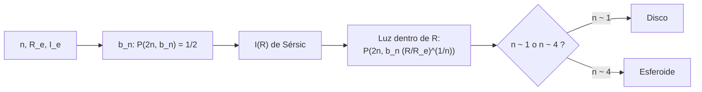

# B25-C09 — Galaxias elípticas y espirales

<!-- nav:top -->
[🏠 Programa](../../../../README.md) · [📚 Bloque B25](../../../tronco-comun/B25-galaxias-y-medio-interestelar.md) · [← Anterior: B25-C08 — Curvas de rotación de galaxias](../B25-C08-curvas-de-rotacion-de-galaxias/CLASE.md) · [Siguiente: B25-C10 — Galaxias irregulares y enanas →](../B25-C10-galaxias-irregulares-y-enanas/CLASE.md)
<!-- /nav -->

## 1. Ubicación, nivel y alcance

Clase 9 del bloque B25. Nivel N3. Con las curvas de rotación de [C08](../B25-C08-curvas-de-rotacion-de-galaxias/CLASE.md) ya sabes pesar una galaxia; ahora la **clasificas por su forma y movimiento**. Usa el disco exponencial de [C01](../B25-C01-estructura-de-la-via-lactea/CLASE.md), el logaritmo ([B03](../../../tronco-comun/B03-matematica-elemental-para-ciencias-espaciales.md)) y la integración numérica ([B09](../../../tronco-comun/B09-calculo-diferencial-e-integral.md)). Describes el brillo con el perfil de Sérsic, un modelo de simetría circular sin isofotas ni polvo. Las galaxias irregulares y enanas son tema de [C10](../B25-C10-galaxias-irregulares-y-enanas/CLASE.md).

## 2. Por qué esta clase existe

Las galaxias parecen muy distintas: discos con brazos y gas, o bolas suaves de estrellas viejas. Esa diferencia guarda su historia (formación estelar, fusiones) y exige un lenguaje común para compararlas. La decisión central: **dado el índice de Sérsic y el radio efectivo, ¿cuánta luz hay dentro de un radio, qué tan concentrada es y a qué tipo de galaxia se parece?**

## 3. Lo que podrás hacer al terminar

1. Definir elíptica, espiral, lenticular, bulbo, disco y perfil de Sérsic.
2. Calcular `b_n` y la fracción de luz dentro de un radio para un perfil de Sérsic.
3. Relacionar el radio efectivo de un disco exponencial con su escala de longitud.
4. Comparar la concentración de luz de `n = 1` y `n = 4`.
5. Describir qué distingue rotadores rápidos y lentos entre las galaxias de tipo temprano.
6. Explicar cómo el entorno cambia el tipo de galaxia.

La evidencia es la **ficha de dos galaxias** del ejercicio 12 (sección 20).

## 4. Con qué llegas y cómo comprobarlo

1. ¿Cuánto vale la fracción de masa de un disco exponencial dentro de `R`? (C01)
2. ¿Qué es la magnitud de una diferencia de brillo `Δm = 2,5 log₁₀(F₁/F₂)`?
3. ¿Qué es la función gamma `Γ`?
4. ¿Qué es una integral numérica de Simpson?
5. ¿Qué es un cociente de velocidades `v/σ`?

<details>
<summary>Ver respuestas</summary>

1. `1 − (1 + R/R_d) e^{−R/R_d}`. 2. Es la diferencia de brillo en magnitudes: cinco magnitudes son un factor 100 (C04). 3. La generalización del factorial, `Γ(n) = (n−1)!`. 4. Una aproximación del área con parábolas. 5. El cociente entre rotación ordenada y agitación aleatoria.
</details>

Con cuatro o cinco aciertos, sigue; si no, repasa C01, C04 y B09.

## 5. Un caso real: dos familias y su entorno

Blanton y Moustakas (S1) agrupan las galaxias cercanas en cuatro tipos aproximados (espirales, lenticulares, elípticas y sistemas en fusión) y señalan un cambio de tipos «tardíos» en regiones poco densas a «tempranos» en regiones densas, que persiste incluso en la densidad de grupos pequeños. Cappellari (S2), con espectroscopía de campo integral, separa las galaxias de tipo temprano en rotadores **rápidos** y **lentos**: los lentos son débilmente triaxiales y dominan por encima de una masa crítica de unos `2 × 10¹¹ M☉`; los rápidos, por debajo, se parecen a las espirales. El **ejemplo conductor** son dos galaxias **sintéticas**: una elíptica con `n = 4` y `R_e = 5 kpc`, y un disco con `n = 1` y la escala de longitud de la Vía Láctea (`R_d = 2,6 kpc`, C01 y Bland-Hawthorn y Gerhard, S3).

## 6. Vocabulario

Una **galaxia espiral** tiene un disco con brazos, gas y formación estelar; una **elíptica** es un sistema de estrellas viejas sin disco notable; una **lenticular** tiene disco pero sin brazos (S1). El **bulbo** es la componente central abultada. El **perfil de Sérsic** describe el brillo superficial: `I(R) = I_e exp{−b_n [(R/R_e)^{1/n} − 1]}`, donde `R` es el radio proyectado, `R_e` el **radio efectivo** (contiene la mitad de la luz), `I_e` el brillo en `R_e`, `n` el **índice de Sérsic** y `b_n` una constante que depende de `n` y que garantiza que `R_e` contiene la mitad de la luz. Un **rotador rápido** tiene rotación ordenada comparable a su dispersión; uno **lento**, poca rotación (S2). La **luz total** es `L = 2π n e^{b_n} b_n^{−2n} Γ(2n) I_e R_e²`.

## 7. Modelo mental: cuánta luz cabe en cada anillo

Piensa en una pizza más gruesa en el centro: la mitad del queso (la luz) cae dentro de un cierto radio, que define `R_e`. Un `n` grande es una pizza con un pico central muy alto y una orilla muy extendida. Analogía: `n` mide cuán puntiaguda es la distribución. Su límite: las galaxias reales tienen varias componentes, y un solo perfil de Sérsic solo describe una de ellas.



*Descripción textual:* de `n` y `R_e` se obtiene `b_n`, de ahí el perfil y la fracción de luz dentro de cualquier radio; valores cercanos a 1 se asocian a discos y cercanos a 4 a esferoides.

## 8. La explicación, paso a paso

### 8.1 La constante `b_n`

Se define por la condición de media luz: `P(2n, b_n) = 1/2`, con `P` la función gamma incompleta inferior regularizada. Hay dos casos exactos: `n = 1/2` da `P(1, x) = 1 − e^{−x}`, de modo que `b = ln 2 = 0,6931`; `n = 1` da `P(2, x) = 1 − (1 + x)e^{−x}`, la misma fracción del disco exponencial de C01, y `b_1 = 1,67835`. De ese último resultado se deduce que `R_e = 1,678 R_d`: con `R_d = 2,6 kpc`, `R_e = 4,36 kpc`. Para otros índices se resuelve numéricamente: `b₂ = 3,672` y `b₄ = 7,669`.

### 8.2 Luz dentro de un radio

La fracción de luz dentro de `R = x R_e` es `P(2n, b_n x^{1/n})`. Resulta, para `n = 1, 2, 4`: dentro de `0,1 R_e`, `1,3 %`, `3,1 %` y `7,2 %`; dentro de `R_e`, `50 %`; dentro de `3 R_e`, `96,1 %`, `87,8 %` y `78,8 %`. El perfil de `n = 4` concentra más luz en el centro y tiene una cola más larga: `21 %` de la luz queda fuera de `3 R_e`.

### 8.3 Brillo central

El cociente `I(0)/I_e = e^{b_n}` es `5,36` para `n = 1` y `2141` para `n = 4`: en magnitudes, el centro es `2,5 log₁₀ 5,36 = 1,82` y `2,5 log₁₀ 2141 = 8,33` mag más brillante que en `R_e`. Esas diferencias extremas explican por qué un perfil con `n` alto necesita excelente resolución para medirse.

### 8.4 Qué diferencia a los tipos

La clasificación por forma se completa con la cinemática. Para los de tipo temprano, S2 propone dos vías: los rápidos nacen como discos con formación estelar y evolucionan por acreción de gas, crecimiento del bulbo y apagado de la formación; los lentos, cerca del centro de halos masivos, por formación temprana intensa y crecimiento por fusiones sin gas. Eso se resume en el resultado citado: por encima de `~2 × 10¹¹ M☉` dominan los lentos.

### 8.5 Lo que el modelo deja fuera

El perfil de una sola componente ignora el bulbo en un disco y los brazos; no incluye elipticidad ni polvo. S1 y S2 son revisiones: la clasificación en cuatro tipos y las dos vías evolutivas son resúmenes, no definiciones únicas.

## 9. Magnitudes, símbolos y unidades

| Símbolo | Qué es | Unidad | Valor / nota |
|---|---|---|---|
| `n` | índice de Sérsic | adimensional | `1` (disco), `4` (esferoide) (sintético) |
| `R_e`, `R_d` | radio efectivo; escala de longitud | kpc | `5` (sintético); `2,6` (C01) |
| `b_n` | constante de media luz | adimensional | `1,678`; `3,672`; `7,669` (cálculo propio) |
| `I(R)` | brillo superficial | `L☉ pc⁻²` o mag arcsec⁻² | relativo a `I_e` |
| `L(<R)/L` | fracción de luz | adimensional | tabla de 8.2 |
| `M_crit` | masa crítica rápidos/lentos | `M☉` | `~2 × 10¹¹` (S2) |

## 10. Convenciones y referencias

Brillo proyectado en el plano del cielo, simetría circular. Se rotulan **observados** los tipos y la masa crítica (S1, S2), **sintéticas** las dos galaxias, **cálculo propio** `b_n` y las fracciones. La forma de Sérsic y su `b_n` se verifican con dos casos exactos y una cuadratura, no se citan de un texto.

## 11. De dónde sale lo que afirmamos

| ID | Fuente | Localizador | Respalda | Estado |
|---|---|---|---|---|
| S1 | Blanton y Moustakas, *Physical Properties and Environments of Nearby Galaxies*, arXiv:0908.3017 | https://arxiv.org/abs/0908.3017 | Cuatro tipos; cambio tipo-densidad | Solo resumen, consultado el 2026-11-09 |
| S2 | Cappellari, *Structure and Kinematics of Early-Type Galaxies from Integral-Field Spectroscopy*, arXiv:1602.04267 | https://arxiv.org/abs/1602.04267 | Rotadores rápidos y lentos; masa crítica; dos vías | Solo resumen, consultado el 2026-11-09 |
| S3 | Bland-Hawthorn y Gerhard, arXiv:1602.07702 | https://arxiv.org/abs/1602.07702 | `R_d = 2,6 kpc` de la Vía Láctea | Texto del PDF extraído el 2026-11-09 |

Límites: de S1 y S2 solo se leyeron los resúmenes; no se consultó la clasificación original de Hubble ni valores de `n` medidos para galaxias reales.

## 12. Cómo ver las galaxias

Equivalente accesible a un perfil de brillo (cálculo propio):

| Índice `n` | `b_n` | Luz dentro de `0,1 R_e` | Luz dentro de `3 R_e` | `I(0)/I_e` |
|---|---|---|---|---|
| 1 | 1,678 | 1,3 % | 96,1 % | 5,4 |
| 2 | 3,672 | 3,1 % | 87,8 % | 39 |
| 4 | 7,669 | 7,2 % | 78,8 % | 2141 |

Descripción larga: al subir `n`, el centro se vuelve más brillante en relación con `R_e` y la luz de las afueras se extiende más.

## 13. Ejemplo trabajado: ¿qué radio contiene la mitad de la luz del disco de la Vía Láctea?

**Paso 1 · Datos.** `n = 1`, `R_d = 2,6 kpc`.

**Paso 2 · Condición de media luz.** `1 − (1 + x)e^{−x} = 1/2`.

**Paso 3 · Solución.** Por tanteo: `x = 1,678` da `2,678 × 0,1867 = 0,4999`. 

**Paso 4 · Radio.** `R_e = 1,678 × 2,6 = 4,36 kpc`.

**Paso 5 · Sentido.** La mitad de la luz de un disco exponencial cae dentro de `1,68 R_d`, no dentro de `R_d`, que contiene solo el `26 %` de la luz. Es el resultado de un modelo sintético con una escala de la Vía Láctea, no una medida de su luz.

## 14. Distintas formas de describir una galaxia

**Morfología visual (S1):** simple, pero subjetiva. **Perfil de Sérsic (esta clase):** cuantifica la concentración con un parámetro. **Cinemática (S2):** distingue rápidos y lentos aunque la forma sea parecida. Para una descripción rápida sirve la forma; para el origen, la cinemática.

## 15. Práctica guiada

**Ejercicio 1 · con los pasos indicados.** Comprueba que `x = 1,678` es la solución de `1 − (1 + x)e^{−x} = 1/2`. *Pasos:* `e^{−1,678}`; `(1 + x)`; producto.

<details><summary>Solución comentada</summary>

`e^{−1,678} = 0,1867`; `2,678 × 0,1867 = 0,5000`; `1 − 0,5000 = 0,5` (8.1).
</details>

**Ejercicio 2 · con una pista.** ¿Qué `R_e` tiene un disco con `R_d = 3,5 kpc`? *Pista:* `R_e = 1,678 R_d`.

<details><summary>Solución comentada</summary>

`5,87 kpc` (8.1).
</details>

**Ejercicio 3 · casi autónomo.** Para `n = 1/2`, escribe el perfil con `b = ln 2`.

<details><summary>Solución comentada</summary>

`I = I_e exp{−ln 2 [(R/R_e)² − 1]} = I_e 2^{1 − (R/R_e)²}` (8.1): una gaussiana.
</details>

## 16. Práctica autónoma, transferencia e integrador

**Ejercicio 4.** ¿Qué fracción de luz está dentro de `0,1 R_e` para `n = 4` y para `n = 1`?

<details><summary>Solución comentada</summary>

`7,2 %` y `1,3 %` (8.2): la proporción es de casi 6 a 1.
</details>

**Ejercicio 5.** ¿Qué fracción de la luz de `n = 4` queda fuera de `3 R_e`?

<details><summary>Solución comentada</summary>

`1 − 0,788 = 21 %` (8.2).
</details>

**Ejercicio 6.** Calcula `I(0)/I_e` y la diferencia en magnitudes para `n = 4`.

<details><summary>Solución comentada</summary>

`e^{7,669} = 2141`; `2,5 log₁₀ 2141 = 8,33 mag` (8.3).
</details>

**Ejercicio 7.** ¿Qué fracción de luz queda dentro de `R_d` en un disco exponencial?

<details><summary>Solución comentada</summary>

`1 − 2e^{−1} = 0,264` (C01).
</details>

**Ejercicio 8.** La elíptica sintética tiene `R_e = 5 kpc`. ¿Cuánta luz hay dentro de `0,5 kpc`?

<details><summary>Solución comentada</summary>

`0,5/5 = 0,1 R_e`: `7,2 %` de la luz total (8.2).
</details>

**Ejercicio 9 · transferencia.** Un bulbo con `n = 4` y `R_e = 1 kpc` aporta `30 %` de la luz y un disco con `n = 1` y `R_d = 3 kpc` el `70 %`. ¿Qué fracción de la luz total hay dentro de `1 kpc`?

<details><summary>Solución comentada</summary>

Bulbo: `0,5 × 0,30 = 0,150`. Disco: `x = 1/3`; `1 − (1 + x)e^{−x} = 0,0446`; `× 0,70 = 0,0312`. Total `0,181`: el bulbo domina el centro (8.2).
</details>

**Ejercicio 10 · transferencia.** Un compañero dice: «todas las elípticas son iguales y sin estructura». Respóndele con S2.

<details><summary>Solución comentada</summary>

S2 las separa en rápidas y lentas: las lentas, débilmente triaxiales, dominan sobre unos `2 × 10¹¹ M☉`; las rápidas se parecen a espirales. Tienen historias distintas (8.4).
</details>

**Ejercicio 11 · transferencia.** ¿Qué mensaje de S1 esperas encontrar en un cúmulo denso frente a una región poco densa?

<details><summary>Solución comentada</summary>

Predominio de tipos tempranos (elípticas y lenticulares) en la región densa y de tardíos (espirales) en la poco densa; S1 añade que ya se nota en grupos pequeños (sección 5).
</details>

**Ejercicio 12 · integrador.** Elabora la *ficha de dos galaxias*: una con `n = 4` y otra con `n = 1` (sintéticas); da `b_n`, `R_e`, fracción de luz dentro de `0,1 R_e` y `3 R_e`, `I(0)/I_e`; indica a qué tipo se parecen y qué falta para clasificarlas.

<details><summary>Solución modelo</summary>

La tabla de la sección 12 con `R_e` de 5 kpc (elíptica) y 4,36 kpc (disco). Faltan: cinemática (S2), color y entorno (S1).
</details>

## 17. Laboratorio: perfil de Sérsic

El script [perfil_sersic.py](perfil_sersic.py) calcula `b_n` y las fracciones de luz mediante la gamma incompleta, y **comprueba** `b(1/2) = ln 2` (`10⁻⁹`), `b_1` contra la raíz independiente de `1 − (1 + x)e^{−x} = 1/2` (`10⁻⁹`) y que la cuadratura de la luz total, hecha en la variable suave `u = (R/R_e)^{1/n}`, coincide con la forma cerrada para `n = 1` y `n = 4` (`10⁻⁶`).

**Datos:** ninguno medido; galaxias sintéticas. **Predice antes de ejecutar:** ¿qué `R_e` sale para `R_d = 2,6 kpc`? (≈ 4,4 kpc.) **Ejecución del 2026-11-09 (Python 3.12.9):**

```text
Python 3.12.9 (biblioteca estandar)
n = 1: b_n = 1.67835 ; L(<0.1 Re)/L = 0.0126 ; L(<Re)/L = 0.5000 ; L(<3 Re)/L = 0.9607
n = 2: b_n = 3.67206 ; L(<0.1 Re)/L = 0.0305 ; L(<Re)/L = 0.5000 ; L(<3 Re)/L = 0.8782
n = 4: b_n = 7.66925 ; L(<0.1 Re)/L = 0.0720 ; L(<Re)/L = 0.5000 ; L(<3 Re)/L = 0.7881
n = 1: R_e / R_d = b_1 = 1.67835  (R_d = 2.6 kpc -> R_e = 4.36 kpc)
I(0)/I_e: n = 1 -> 5.36 ; n = 4 -> 2141
Pruebas superadas.
```

```bash
python programa/clases/B25/B25-C09-galaxias-elipticas-y-espirales/perfil_sersic.py
```

**Límites:** una sola componente, simetría circular, sin polvo ni seeing.

## 18. Errores frecuentes y cómo corregirlos

**Confundir `R_e` con `R_d`.** Se corrige con el ejercicio 2.

**Pensar que `b_n = n`.** Se corrige en 8.1.

**Usar el perfil de Sérsic como definición de tipo.** Se corrige en la sección 14.

**Olvidar que la masa crítica es un resultado de S2 y no una frontera exacta.** Se corrige en 8.4.

**Leer «tardío» como «más joven en edad».** Es una convención histórica de nombres; se evita en la sección 6.

## 19. Cómo sabrás que vas bien

Tras 8.1: ¿qué `R_e` tiene tu disco? Ejercicio 2. Tras 8.2: ¿cuánta luz cae fuera de `3 R_e` en `n = 4`? Ejercicio 5. Tras el laboratorio: ¿por qué sirve el caso `n = 1/2`? (porque tiene solución exacta y valida el código).

## 20. Qué entregas y cómo se evalúa

El producto es tu **ficha de dos galaxias** (ejercicio 12).

| Criterio | Inicial | En desarrollo | Logrado | Destacado |
|---|---|---|---|---|
| Definiciones | Las confunde | Parciales | Sérsic, `R_e`, tipos | Distingue rápidos y lentos |
| Cálculo | Sin unidades | Con errores | Valores correctos | Propone casos límite |
| Interpretación | Sin comparar | Sin razón | Compara concentraciones | Discute lo que falta |
| Numérico | Sin comprobar | Un caso | Tres pruebas superadas | Explica cada prueba |
| Fuentes | Sin fuente | Sin fecha | S1–S3 con fecha | Declara que son resúmenes |

**Condiciones críticas (no se compensan con promedio):** rotular las galaxias como sintéticas; no presentar una clasificación como definitiva; citar solo lo consultado.

## 21. Ética, seguridad y límites

La clase es educativa y no sustituye a un ajuste fotométrico de imágenes reales. Accesibilidad: tablas equivalentes a los perfiles, fórmulas en texto, ejercicios sin conexión.

## 22. Para cerrar y seguir

Un perfil de Sérsic con `n = 1` corresponde a un disco y con `n = 4` a un esferoide concentrado; la mitad de la luz de un disco cae dentro de `1,68 R_d`. Queda una pregunta: ¿qué pasa con las galaxias pequeñas e irregulares que no encajan en esos tipos?

**Glosario español–inglés.** espiral · *spiral*; elíptica · *elliptical*; lenticular · *lenticular*; perfil de Sérsic · *Sérsic profile*; radio efectivo · *effective radius*; rotador rápido/lento · *fast/slow rotator*; bulbo · *bulge*.

**Continuidad.** [B25-C10](../B25-C10-galaxias-irregulares-y-enanas/CLASE.md) trata las galaxias irregulares y enanas.

**Referencias:** ver sección 11.

<!-- nav:bottom -->
---

[← Anterior: B25-C08 — Curvas de rotación de galaxias](../B25-C08-curvas-de-rotacion-de-galaxias/CLASE.md) · [📚 Bloque B25](../../../tronco-comun/B25-galaxias-y-medio-interestelar.md) · [Siguiente: B25-C10 — Galaxias irregulares y enanas →](../B25-C10-galaxias-irregulares-y-enanas/CLASE.md)
<!-- /nav -->
