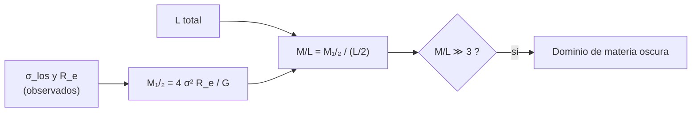

# B25-C10 — Galaxias irregulares y enanas

<!-- nav:top -->
[🏠 Programa](../../../../README.md) · [📚 Bloque B25](../../../tronco-comun/B25-galaxias-y-medio-interestelar.md) · [← Anterior: B25-C09 — Galaxias elípticas y espirales](../B25-C09-galaxias-elipticas-y-espirales/CLASE.md) · [Siguiente: B25-C11 — Núcleos activos de galaxias →](../B25-C11-nucleos-activos-de-galaxias/CLASE.md)
<!-- /nav -->

## 1. Ubicación, nivel y alcance

Clase 10 del bloque B25. Nivel N3. Completa la tipología de [C09](../B25-C09-galaxias-elipticas-y-espirales/CLASE.md) con las galaxias más numerosas y pequeñas, y reutiliza el cúmulo de Plummer de [C06](../B25-C06-cumulos-estelares/CLASE.md) y la masa dinámica de [C08](../B25-C08-curvas-de-rotacion-de-galaxias/CLASE.md). Aprendes a **pesar una galaxia enana con la dispersión de velocidades de sus estrellas** y a interpretar su relación masa–luz. Se supone un sistema esférico sostenido por agitación, sin rotación. El estimador se contrasta con un caso analítico, para conocer su sesgo.

## 2. Por qué esta clase existe

Las galaxias enanas son las más abundantes y las más ricas en materia oscura según su masa dinámica; además son los sitios donde las predicciones del modelo cosmológico se ponen a prueba. Pero con pocas estrellas medidas y sin rotación ordenada, su masa depende de un estimador. La decisión central: **dadas la dispersión de velocidades y el tamaño de una enana, ¿cuánta masa hay dentro de su radio de media luz y qué relación masa–luz implica?**

## 3. Lo que podrás hacer al terminar

1. Definir galaxia irregular, enana esferoidal, enana ultratenue y radio de media luz.
2. Calcular la masa dentro del radio de media luz con el estimador de Wolf.
3. Calcular la relación masa–luz resultante.
4. Medir el sesgo del estimador con un caso analítico (Plummer).
5. Nombrar los desafíos de la escala de enanas para el modelo cosmológico.
6. Distinguir lo medido de lo sintético.

La evidencia es la **ficha de una galaxia enana** del ejercicio 12 (sección 20).

## 4. Con qué llegas y cómo comprobarlo

1. ¿Qué es la dispersión de velocidades? (C06, C07)
2. ¿Qué es el perfil de Plummer y cuánto vale su `R_e` en función de `a`?
3. ¿Qué es la masa dentro del radio de media luz?
4. ¿Cuántos metros tiene un parsec?
5. ¿Qué es la relación masa–luz `M/L`?

<details>
<summary>Ver respuestas</summary>

1. La desviación típica de las velocidades. 2. Una esfera de densidad `ρ ∝ (r² + a²)^{−5/2}`; su radio efectivo proyectado es `a` (C06). 3. La masa contenida dentro del radio que encierra la mitad de la luz. 4. `3,0857 × 10¹⁶ m`. 5. El cociente entre masa y luminosidad, en `M☉/L☉` (C08).
</details>

Con cuatro o cinco aciertos, sigue; si no, repasa C06, C08 y B05-C10.

## 5. Un caso real: las enanas de alrededor

McConnachie (S1) cataloga más de 100 galaxias cercanas, con distancias estimadas dentro de 3 Mpc del Sol, con sus parámetros estructurales y dinámicos tabulados. Wolf y colaboradores (S2) muestran que la masa dentro del radio de media luz tridimensional se obtiene con `M₁/₂ = 3σ²_los r₁/₂ / G ≈ 4σ²_los R_eff / G`, donde `σ²_los` es el cuadrado de la dispersión en la línea de visión ponderado por luminosidad, `r₁/₂` el radio de media luz 3D y `R_eff` el 2D; encuentran que todas las enanas esferoidales de la Vía Láctea son compatibles con formarse en un halo de ~`3 × 10⁹ M☉`, y que la relación masa–luz frente a la masa de media luz tiene forma de U, con un mínimo de `M/L ≈ 3` y valores de ~`3200` en las ultratenues y ~`800` en cúmulos de galaxias. El **ejemplo conductor** es una enana **sintética** (no es una galaxia observada) con `σ = 7 km/s`, `R_e = 300 pc` y `L = 10⁶ L☉`.

## 6. Vocabulario

Una **galaxia irregular** es una galaxia sin forma regular, con mucho gas y formación estelar. Una **galaxia enana** es una galaxia de baja masa y luminosidad; las **enanas esferoidales** (dSph) son pobres en gas y se sostienen por agitación; las **ultratenues** son las menos luminosas. El **radio de media luz** `r₁/₂` (3D) o `R_e` (2D, proyectado) contiene la mitad de la luz. La **dispersión en la línea de visión** `σ_los` es la desviación típica de las velocidades radiales de sus estrellas. El **estimador de Wolf** es `M₁/₂ = 3σ²_los r₁/₂/G ≈ 4σ²_los R_e/G` (S2). La **relación masa–luz** `M/L` mide cuánta masa hay por unidad de luz.

## 7. Modelo mental: una colmena sin cohesión visible

Imagina un enjambre cuyo tamaño y agitación conoces: de ellos deduces cuán fuerte es lo que lo mantiene unido. Analogía: la agitación es `σ_los` y lo que sostiene el enjambre es la masa. Su límite: el enjambre solo da la masa dentro de un radio concreto, el de media luz, no la masa total.



*Descripción textual:* de la dispersión y el radio se obtiene la masa dentro del radio de media luz; dividida por la mitad de la luminosidad da la relación masa–luz, y si es mucho mayor que el valor mínimo de S2 domina la materia oscura.

## 8. La explicación, paso a paso

### 8.1 El estimador

Si el sistema es esférico y se sostiene por agitación, la ecuación de Jeans liga la dispersión con la masa. Wolf y colaboradores demuestran que la masa dentro de `r₁/₂` se obtiene con poca sensibilidad a la anisotropía (S2): `M₁/₂ = 3σ²_los r₁/₂/G`, y como `r₁/₂ ≈ (4/3) R_e`, `M₁/₂ ≈ 4σ²_los R_e/G`. Para el ejemplo: `σ = 7 km/s`, `R_e = 300 pc`; `M₁/₂ = 1,37 × 10⁷ M☉` y `M/L (<r₁/₂) = 27 M☉/L☉` si la mitad de `10⁶ L☉` está dentro. Es mayor que el mínimo `≈ 3` de S2: la masa dinámica supera con mucho a la que aportarían estrellas de relación masa–luz típica.

### 8.2 ¿Cuánta confianza da el estimador?

Se mide en un caso analítico: una esfera de Plummer (C06) isótropa, que se sostiene por su propia gravedad. Sus `R_e = a` y `r₁/₂ = 1,3048 a` son exactos, de modo que `r₁/₂/R_e = 1,305`, no exactamente `4/3 = 1,333`; el cuadrado de la dispersión global vale `π G M/(32 a) = 0,0982 GM/a`. El estimador da `0,769 M₁/₂` con `3σ²r₁/₂/G` y `0,785 M₁/₂` con `4σ²R_e/G`, es decir, subestima la masa un ~`22 %` en este caso. Esto no evalúa la exactitud que S2 afirma en su resumen para su muestra; solo mide el sesgo en un sistema autogravitante simple, y muestra que el resultado depende de la distribución de masa.

### 8.3 La relación masa–luz

La enana sintética tiene `M/L = 27`. S2 ubica el mínimo en `≈ 3` y el máximo en `≈ 3200` para ultratenues: un valor de `27` está entre ambos. Si el sesgo de Plummer se aplicara (no hay motivo para hacerlo sin conocer la forma del sistema), la masa subiría a `1,74 × 10⁷ M☉`. En una enana se infiere materia oscura de que `M/L` sea mucho mayor que el de una población estelar.

### 8.4 El contexto cosmológico

Bullock y Boylan-Kolchin (S3) resumen tres desafíos del modelo ΛCDM a escalas por debajo de ~1 Mpc y de masas por debajo de ~`10¹¹ M☉`: halos con núcleo menos denso que el previsto, un Grupo Local con muchos menos satélites que halos de baja masa, y el problema de «demasiado grande para fallar». Qué pesa más —física bariónica, de la materia oscura, o ambas— sigue abierto según S3.

### 8.5 Lo que el modelo deja fuera

Supone equilibrio, esfericidad y que `σ_los` global representa al sistema; no considera rotación, marea de una galaxia mayor, binarias que inflan la dispersión ni estrellas de otra procedencia. La muestra de S1 se limita a 3 Mpc.

## 9. Magnitudes, símbolos y unidades

| Símbolo | Qué es | Unidad | Valor / nota |
|---|---|---|---|
| `σ_los` | dispersión en la línea de visión | km/s | `7` (sintético) |
| `R_e`, `r₁/₂` | radios de media luz 2D y 3D | pc | `300`; `r₁/₂ ≈ 4R_e/3` |
| `L` | luminosidad | `L☉` | `10⁶` (sintético) |
| `M₁/₂` | masa dentro de `r₁/₂` | `M☉` | `1,37 × 10⁷` (cálculo propio) |
| `M/L` | masa–luz | `M☉/L☉` | `27` (cálculo propio); mínimo `~3` (S2) |
| `G` | constante de gravitación | `m³ kg⁻¹ s⁻²` | `6,674 30 × 10⁻¹¹` (S4) |

## 10. Convenciones y referencias

`M₁/₂` es la masa dentro del radio de media luz **3D**. `1 pc = 3,0857 × 10¹⁶ m`; `GM☉` de la IAU. Se rotulan **observados** los resultados de S1 y S2, **sintética** la enana, **cálculo propio** `M₁/₂` y el sesgo. La relación `3σ²r₁/₂/G ≈ 4σ²R_e/G` es de S2; su sesgo en Plummer es de esta clase.

## 11. De dónde sale lo que afirmamos

| ID | Fuente | Localizador | Respalda | Estado |
|---|---|---|---|---|
| S1 | McConnachie, *The observed properties of dwarf galaxies in and around the Local Group*, arXiv:1204.1562 | https://arxiv.org/abs/1204.1562 | Más de 100 galaxias dentro de 3 Mpc | Solo resumen, consultado el 2026-11-09 |
| S2 | Wolf et al., *Accurate masses for dispersion-supported galaxies*, arXiv:0908.2995 | https://arxiv.org/abs/0908.2995 | Estimador de masa; forma de U de `M/L` | Solo resumen, consultado el 2026-11-09 |
| S3 | Bullock y Boylan-Kolchin, *Small-Scale Challenges to the ΛCDM Paradigm*, arXiv:1707.04256 | https://arxiv.org/abs/1707.04256 | Desafíos a pequeña escala | Solo resumen, consultado el 2026-11-09 |
| S4 | NIST, *Fundamental Physical Constants — Complete Listing* (CODATA 2022) | https://physics.nist.gov/cuu/Constants/Table/allascii.txt | `G` | Consultada el 2026-11-09 |

Límites: S1–S3 solo en resumen; no se leyó la validación del estimador de S2, y el sesgo medido en Plummer no es una evaluación de su exactitud en halos de materia oscura.

## 12. Cómo ver la enana

Equivalente accesible a una gráfica `M/L` frente a masa (valores citados de S2 y el ejemplo sintético):

| Sistema | `M/L` |
|---|---|
| Enanas elípticas a elípticas normales (mínimo) | `≈ 3` |
| Enana sintética de esta clase | `27` |
| Cúmulos de galaxias (esferoides) | `≈ 800` |
| Ultratenues | `≈ 3200` |

Descripción larga: la relación masa–luz tiene un mínimo cerca de 3 y sube en ambos extremos de masa; la enana de la clase queda en un valor intermedio.

## 13. Ejemplo trabajado: ¿cuánta masa hay en la enana?

**Paso 1 · Datos.** `σ = 7 km/s`, `R_e = 300 pc`, `L = 10⁶ L☉`.

**Paso 2 · Masa.** `4σ²R_e/G = 4 × (7 × 10³)² × 300 × 3,0857 × 10¹⁶/6,674 × 10⁻¹¹ = 2,72 × 10³⁷ kg`.

**Paso 3 · En masas solares.** `2,72 × 10³⁷/1,989 × 10³⁰ = 1,37 × 10⁷ M☉`.

**Paso 4 · Masa–luz.** `M/(L/2) = 1,37 × 10⁷/5 × 10⁵ = 27`.

**Paso 5 · Sentido.** Mucho más masa que luz: la masa dinámica es unas nueve veces la que cabría con `M/L ≈ 3`. Pero la cifra es una estimación con un sesgo posible del orden de un 20 % y con un `σ` y un `R_e` sintéticos; no es una galaxia medida.

## 14. Distintas formas de pesar una enana

**Estimador de Wolf (esta clase):** sencillo y casi independiente de la anisotropía, según S2. **Modelo de Jeans completo:** ajusta el perfil de masa, con más supuestos. **Cinemática de gas (para irregulares):** permite curva de rotación si hay disco de gas. Para una enana sin gas sirve el estimador; para una irregular con gas, la curva de rotación (C08).

## 15. Práctica guiada

**Ejercicio 1 · con los pasos indicados.** Calcula `M₁/₂` con `σ = 7 km/s` y `R_e = 300 pc`. *Pasos:* `σ² = 4,9 × 10⁷`; `R_e = 9,257 × 10¹⁸ m`; `4σ²R_e/G`; entre `M☉`.

<details><summary>Solución comentada</summary>

`4 × 4,9 × 10⁷ × 9,257 × 10¹⁸/6,674 × 10⁻¹¹ = 2,72 × 10³⁷ kg = 1,37 × 10⁷ M☉` (8.1).
</details>

**Ejercicio 2 · con una pista.** Calcula `M/L` si la luminosidad es `10⁶ L☉`. *Pista:* la mitad de la luz está dentro de `r₁/₂`.

<details><summary>Solución comentada</summary>

`1,37 × 10⁷/(5 × 10⁵) = 27` (8.1).
</details>

**Ejercicio 3 · casi autónomo.** Si `σ` se duplica con el mismo `R_e`, ¿cuánto cambia `M₁/₂`?

<details><summary>Solución comentada</summary>

Se multiplica por 4 (`∝ σ²`): `5,5 × 10⁷ M☉` (8.1).
</details>

## 16. Práctica autónoma, transferencia e integrador

**Ejercicio 4.** Comprueba que `3σ²r₁/₂/G = 4σ²R_e/G` si `r₁/₂ = 4R_e/3`.

<details><summary>Solución comentada</summary>

`3 × 4/3 = 4` (8.1).
</details>

**Ejercicio 5.** Para Plummer, ¿cuánto vale `r₁/₂/R_e` y qué diferencia hay con `4/3`?

<details><summary>Solución comentada</summary>

`1,3048`; `4/3 = 1,3333`: diferencia del `2,2 %` (8.2).
</details>

**Ejercicio 6.** En el Plummer del laboratorio, el estimador da `0,785` de la masa verdadera dentro de media luz. Si la enana sintética fuera un Plummer, ¿qué masa verdadera tendría?

<details><summary>Solución comentada</summary>

`1,37 × 10⁷/0,785 = 1,74 × 10⁷ M☉`. Solo es válido si el sistema es realmente Plummer (8.3).
</details>

**Ejercicio 7.** ¿Qué factor separa `M/L = 27` del mínimo `≈ 3`?

<details><summary>Solución comentada</summary>

`27/3 = 9` (8.3).
</details>

**Ejercicio 8.** ¿Qué fracción de un halo de `3 × 10⁹ M☉` es la masa `M₁/₂` de la enana?

<details><summary>Solución comentada</summary>

`1,37 × 10⁷/3 × 10⁹ = 0,46 %`. La masa de media luz es solo una fracción pequeña del halo, que se extiende mucho más (S2) (8.1).
</details>

**Ejercicio 9 · transferencia.** Una enana tiene `σ = 3 km/s`, `R_e = 50 pc` y `L = 10³ L☉` (sintética). Calcula su `M₁/₂` y su `M/L`.

<details><summary>Solución comentada</summary>

`4 × 9 × 10⁶ × 1,543 × 10¹⁸/6,674 × 10⁻¹¹ = 8,32 × 10³⁵ kg = 4,2 × 10⁵ M☉`; `M/L = 4,2 × 10⁵/500 = 840`: un valor de tipo ultratenue (S2) (8.1).
</details>

**Ejercicio 10 · transferencia.** Un compañero dice: «las enanas son pequeñas y no importan». Respóndele con las fuentes.

<details><summary>Solución comentada</summary>

S1 cuenta más de 100 galaxias dentro de 3 Mpc, la mayoría enanas; S3 muestra que los desafíos al modelo cosmológico aparecen justo a su escala (8.4).
</details>

**Ejercicio 11 · transferencia.** ¿Por qué una binaria cercana podría sesgar `σ_los` y qué haría con `M₁/₂`?

<details><summary>Solución comentada</summary>

Su movimiento orbital añade velocidad a la línea de visión y aumenta `σ_los`; como `M ∝ σ²`, la masa sale sobreestimada (8.5).
</details>

**Ejercicio 12 · integrador.** Elabora la *ficha de una galaxia enana*: elige `σ`, `R_e` y `L` (sintéticos), calcula `M₁/₂` y `M/L`, ubícalos respecto de los valores de S2, e indica el sesgo del estimador y dos supuestos que lo debilitan.

<details><summary>Solución modelo</summary>

Con `7 km/s`, `300 pc`, `10⁶ L☉`: `1,37 × 10⁷ M☉`, `27`, entre `3` y `3200`; sesgo hasta ~`−22 %` en Plummer; supuestos: equilibrio y ausencia de binarias.
</details>

## 17. Laboratorio: sesgo del estimador en Plummer

El script [masa_enana.py](masa_enana.py) calcula `M₁/₂` de la enana sintética y **mide el sesgo** del estimador sobre una esfera de Plummer. **Comprueba** que la proyección numérica de `ρ` coincide con `Σ(R) = M a²/(π(R² + a²)²)` en tres radios (`10⁻⁶`), que `R_e = a` (`10⁻⁹`) y que la dispersión global numérica coincide con `πGM/(32a)` (`10⁻⁶`).

**Datos:** `G` de NIST; enana sintética; Plummer analítico. **Predice antes de ejecutar:** ¿el estimador sobreestimará o subestimará la masa? (aquí, subestima.) **Ejecución del 2026-11-09 (Python 3.12.9):**

```text
Python 3.12.9 (biblioteca estandar)
R_e = 1.000000 a ; r_1/2 = 1.3048 a ; r_1/2/R_e = 1.3048 (4/3 = 1.3333)
sigma_los^2 = 0.09817 G M / a (pi/32 = 0.09817)
M_est(3 s^2 r_1/2)/M_1/2 = 0.769 ; M_est(4 s^2 R_e)/M_1/2 = 0.785
enana sintetica: M_1/2 = 4 sigma^2 R_e / G = 1.367e+07 Msol ; M/L(<r_1/2) = 27 Msol/Lsol
Pruebas superadas.
```

```bash
python programa/clases/B25/B25-C10-galaxias-irregulares-y-enanas/masa_enana.py
```

**Límites:** el sesgo vale para Plummer isótropo, no es general.

## 18. Errores frecuentes y cómo corregirlos

**Tomar `M₁/₂` como masa total.** Se corrige con el ejercicio 8.

**Confundir `R_e` (2D) con `r₁/₂` (3D).** Se corrige con el ejercicio 5.

**Olvidar el cuadrado de `σ`.** Se corrige con el ejercicio 3.

**Atribuir el sesgo de Plummer a todo sistema.** Se corrige en 8.2 y el ejercicio 6.

**Presentar `M/L` sin decir que la luz se divide por 2.** Se corrige con el ejercicio 2.

## 19. Cómo sabrás que vas bien

Tras 8.1: ¿cómo cambia `M₁/₂` con `σ`? Ejercicio 3. Tras 8.3: ¿dónde queda una enana de `M/L = 27`? Ejercicio 7. Tras el laboratorio: ¿qué valida la proyección numérica? (que el método de proyección da la fórmula exacta).

## 20. Qué entregas y cómo se evalúa

El producto es tu **ficha de una galaxia enana** (ejercicio 12).

| Criterio | Inicial | En desarrollo | Logrado | Destacado |
|---|---|---|---|---|
| Definiciones | Las confunde | Parciales | `σ_los`, `R_e`, `M₁/₂` | Distingue 2D y 3D |
| Cálculo | Sin unidades | Con errores | Valores correctos | Cuantifica el sesgo |
| Interpretación | Sin comparar | Sin razón | Ubica el `M/L` | Discute supuestos |
| Numérico | Sin comprobar | Un caso | Tres pruebas superadas | Explica cada prueba |
| Fuentes | Sin fuente | Sin fecha | S1–S4 con fecha | Declara resúmenes |

**Condiciones críticas (no se compensan con promedio):** rotular la enana como sintética; no presentar `M₁/₂` como masa total; citar solo lo consultado.

## 21. Ética, seguridad y límites

La clase es educativa y no sustituye a un análisis de velocidades de una enana real. Accesibilidad: tablas equivalentes a las gráficas, fórmulas en texto, ejercicios sin conexión.

## 22. Para cerrar y seguir

Con `σ = 7 km/s` y `R_e = 300 pc` una enana sintética tiene `1,4 × 10⁷ M☉` dentro de media luz y `M/L = 27`; el estimador puede errar un ~20 % según la distribución de masa. Queda una pregunta: ¿qué ocurre cuando una galaxia tiene en su centro una fuente de energía mucho mayor que sus estrellas?

**Glosario español–inglés.** galaxia irregular · *irregular galaxy*; galaxia enana · *dwarf galaxy*; enana esferoidal · *dwarf spheroidal*; radio de media luz · *half-light radius*; dispersión en la línea de visión · *line-of-sight dispersion*; relación masa–luz · *mass-to-light ratio*.

**Continuidad.** [B25-C11](../B25-C11-nucleos-activos-de-galaxias/CLASE.md) estudia los núcleos activos, que pueden dominar la luz de una galaxia.

**Referencias:** ver sección 11.

<!-- nav:bottom -->
---

[← Anterior: B25-C09 — Galaxias elípticas y espirales](../B25-C09-galaxias-elipticas-y-espirales/CLASE.md) · [📚 Bloque B25](../../../tronco-comun/B25-galaxias-y-medio-interestelar.md) · [Siguiente: B25-C11 — Núcleos activos de galaxias →](../B25-C11-nucleos-activos-de-galaxias/CLASE.md)
<!-- /nav -->
