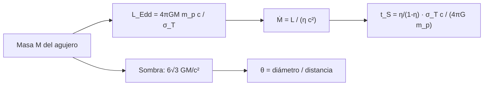

# B25-C11 — Núcleos activos de galaxias

<!-- nav:top -->
[🏠 Programa](../../../../README.md) · [📚 Bloque B25](../../../tronco-comun/B25-galaxias-y-medio-interestelar.md) · [← Anterior: B25-C10 — Galaxias irregulares y enanas](../B25-C10-galaxias-irregulares-y-enanas/CLASE.md) · [Siguiente: B25-C12 — Interacciones y fusiones galácticas →](../B25-C12-interacciones-y-fusiones-galacticas/CLASE.md)
<!-- /nav -->

## 1. Ubicación, nivel y alcance

Clase 11 del bloque B25. Nivel N3. Reúne el límite de Eddington de [B24-C09](../../B24/B24-C09-atmosferas-y-opacidades/CLASE.md), la energía y la masa ([B05-C06](../../B05/B05-C06-trabajo-y-energia/CLASE.md)) y la dispersión de velocidades de [C10](../B25-C10-galaxias-irregulares-y-enanas/CLASE.md). Estudia los **núcleos activos de galaxias (AGN)**: qué los alimenta, cuánta luz pueden dar sin dispersarse a sí mismos y cómo crece el agujero negro que los sostiene. La relatividad de los agujeros negros se trata en el bloque [B26](../../../tronco-comun/B26-relatividad-y-cosmologia.md) y en [B27](../../../tronco-comun/B27-objetos-compactos-y-altas-energias.md); aquí solo se usan dos resultados de la métrica de Schwarzschild, comprobados numéricamente. No se modela rotación del agujero ni el disco de acreción real.

## 2. Por qué esta clase existe

Algunas galaxias tienen en el centro una fuente que supera a todas sus estrellas, y casi todas las galaxias grandes albergan un agujero negro supermasivo. Entender el AGN une el centro de la galaxia, su gas y su evolución. La decisión central: **dada la masa de un agujero negro, ¿cuál es la luminosidad máxima razonable de su núcleo, cuánto tardaría en crecer hasta esa masa y qué tamaño aparente tendría su sombra?**

## 3. Lo que podrás hacer al terminar

1. Definir AGN, acreción, eficiencia radiativa, luminosidad de Eddington y sombra de un agujero negro.
2. Calcular la luminosidad de Eddington y la tasa de acreción asociada.
3. Calcular el tiempo de crecimiento (tiempo de Salpeter) y los e-pliegues necesarios.
4. Obtener la eficiencia radiativa de un agujero sin rotación desde la órbita estable más interna.
5. Calcular el tamaño angular de la sombra de un agujero con masa y distancia conocidas.
6. Explicar por qué los tipos de AGN no son todos el mismo objeto visto desde otro ángulo.

La evidencia es la **ficha de un núcleo activo** del ejercicio 12 (sección 20).

## 4. Con qué llegas y cómo comprobarlo

1. ¿Cuánto vale la fuerza gravitatoria sobre un protón a distancia `r` de una masa `M`?
2. ¿Qué es la sección eficaz de Thomson?
3. ¿Qué es una función exponencial `e^{t/τ}`?
4. ¿Qué es la energía en reposo `mc²`?
5. ¿Qué es un radián en microsegundos de arco?

<details>
<summary>Ver respuestas</summary>

1. `GMm_p/r²`. 2. El área efectiva con que un electrón libre dispersa luz, `6,652 × 10⁻²⁹ m²`. 3. Una cantidad que crece un factor `e` cada `τ`. 4. La energía asociada a una masa, `E = mc²`. 5. `1 rad = 2,06265 × 10¹¹ μas`.
</details>

Con cuatro o cinco aciertos, sigue; si no, repasa B24-C09, B05-C06 y B03.

## 5. Un caso real: la sombra de M87\*

La Colaboración Event Horizon Telescope (S1) midió un anillo de `42 ± 3 μas` de diámetro alrededor del agujero negro del centro de M87, y dedujo una masa `M = (6,5 ± 0,7) × 10⁹ M☉`. Padovani y colaboradores (S2) revisan el «zoológico» de AGN: las clases de la literatura reflejan solo en parte diferencias intrínsecas y dependen sobre todo de unos pocos parámetros astrofísicos y del método de selección. Kormendy y Ho (S3) resumen una correlación estrecha entre la masa del agujero y la dispersión del bulbo de la galaxia anfitriona, y una conexión muy débil con pseudobulbos de disco o con el halo de materia oscura. El **ejemplo conductor** es un agujero de `6,5 × 10⁹ M☉` y su núcleo, con un crecimiento **ilustrativo** a Eddington.

## 6. Vocabulario

Un **núcleo activo de galaxia (AGN)** es una región central cuya luminosidad no procede de estrellas sino de la acreción de gas sobre un agujero negro supermasivo. La **acreción** es la caída de materia sobre un cuerpo compacto. La **eficiencia radiativa** `η` es la fracción de la energía en reposo acretada que se emite como luz: `L = η Ṁ c²`, con `Ṁ` la masa acretada por unidad de tiempo. La **luminosidad de Eddington** `L_Edd = 4πGMm_p c/σ_T` es aquella en que la fuerza de la radiación sobre los electrones iguala la atracción gravitatoria sobre los protones (`G` gravitación, `M` masa del agujero, `m_p` masa del protón, `c` velocidad de la luz, `σ_T` sección eficaz de Thomson). El **tiempo de Salpeter** `t_S` es el tiempo de e-pliegue del crecimiento a Eddington. La **órbita circular estable más interna (ISCO)** es la más próxima al agujero con órbita estable; en un agujero sin rotación está en `r = 6GM/c²`. La **sombra** es la región oscura que el horizonte y la captura de la luz dejan sobre un fondo brillante. En unidades `GM/c² = 1`, el **parámetro de impacto crítico** `b_c` es el mínimo de `b(r) = r/√(1 − 2/r)`.

## 7. Modelo mental: un horno con la puerta bloqueada por su propia luz

Imagina una estufa de gas que arde con más intensidad cuanto más gas recibe; si el calor expulsa el gas que llega, la llama se frena. Analogía: el calor es la luz del AGN, que empuja el gas; el equilibrio fija el máximo. Su límite: el gas real puede entrar por discos y desde direcciones distintas a las de la luz, de modo que el límite no es absoluto.



*Descripción textual:* de la masa se obtiene el límite de luminosidad, de él la tasa de acreción y el tiempo de crecimiento; por otro lado, la masa fija el tamaño de la sombra y, con la distancia, su tamaño angular.

## 8. La explicación, paso a paso

### 8.1 Luminosidad de Eddington

Un electrón libre dispersa la luz con la sección eficaz de Thomson y recibe un empuje `L σ_T/(4πr²c)`; la gravedad actúa sobre el protón que lo acompaña con `GMm_p/r²`. Igualándolas, la `r²` se cancela: `L_Edd = 4πGMm_pc/σ_T = 1,257 × 10³¹ W (M/M☉)`. Para `6,5 × 10⁹ M☉`, `8,2 × 10⁴⁰ W`. Este límite supone hidrógeno ionizado y emisión esférica.

### 8.2 Tasa de acreción y tiempo de crecimiento

Con `L = ηṀc²` y `η = 0,1` (ilustrativo), mantener `L_Edd` en un agujero de `10⁸ M☉` exige `Ṁ = 2,2 M☉/año`. El agujero crece como `Ṁ(1 − η)`, de modo que `M ∝ e^{t/t_S}` con `t_S = [η/(1 − η)] σ_Tc/(4πGm_p) = 50 Myr` para `η = 0,1`. Crecer de una semilla sintética de `100 M☉` a `6,5 × 10⁹ M☉` pide `ln(6,5 × 10⁷) = 18,0` e-pliegues, o `0,90 Gyr` a Eddington continuo: una cota ilustrativa, que supone acreción sin interrupción.

### 8.3 La eficiencia: la órbita estable más interna

En la métrica de Schwarzschild, en unidades `GM/c² = 1`, la energía específica de una órbita circular es `E(r) = (1 − 2/r)/√(1 − 3/r)`. Su mínimo está en `r = 6` (ISCO) con `E = √(8/9)`. La energía que el gas puede ceder al descender desde lejos hasta el ISCO es la fracción `η = 1 − E(6) = 1 − √(8/9) = 0,0572` de su energía en reposo. El valor newtoniano `1/12 = 0,0833` sobreestima la eficiencia; y con `η = 0,0572`, `t_S = 27 Myr`. Los agujeros con rotación alcanzan eficiencias mayores, que no se calculan aquí.

### 8.4 La sombra

El parámetro de impacto de un rayo de luz que orbita en `r` es `b(r) = r/√(1 − 2/r)`; su mínimo está en `r = 3` (anillo de fotones) con `b_c = 3√3 = 5,196`. El diámetro de la sombra es `2b_c GM/c² = 6√3 GM/c² = 10,39 GM/c² = 5,196 R_s`, con `R_s = 2GM/c²`. Para `6,5 × 10⁹ M☉`, `GM/c² = 9,60 × 10¹² m`. Con el anillo de `42 μas` de S1, la distancia implícita es `15,9 Mpc`: es un cálculo propio con el diámetro de la sombra, y no la distancia medida por S1; la incertidumbre relativa combinada es de ~`13 %` (`11 %` de la masa y `7 %` del anillo).

### 8.5 Lo que el modelo deja fuera

No hay rotación, ni disco real, ni vientos, ni chorros, ni luz absorbida. El anillo observado de S1 no es exactamente la sombra: depende del plasma. Las correlaciones con el bulbo (S3) y la unificación (S2) se mencionan sin desarrollarse; esta clase no concluye que todos los tipos de AGN sean el mismo objeto visto bajo otro ángulo.

## 9. Magnitudes, símbolos y unidades

| Símbolo | Qué es | Unidad | Valor / nota |
|---|---|---|---|
| `G`, `c`, `m_p`, `σ_T` | constantes | SI | NIST: `6,674 30 × 10⁻¹¹`; `299 792 458`; `1,672 62 × 10⁻²⁷`; `6,652 459 × 10⁻²⁹` (S4) |
| `M` | masa del agujero | `M☉` | `6,5 × 10⁹` (S1) |
| `L_Edd` | luminosidad de Eddington | W | `1,257 × 10³¹ (M/M☉)` (cálculo propio) |
| `η` | eficiencia radiativa | adimensional | `0,1` (ilustrativa); `0,0572` (ISCO) |
| `t_S` | tiempo de Salpeter | Myr | `50,1` (η = 0,1); `27,3` (η = 0,0572) |
| `θ` | diámetro angular de la sombra | μas | `42 ± 3` (anillo observado, S1) |

## 10. Convenciones y referencias

Agujero sin rotación; unidades `GM/c² = 1` en 8.3 y 8.4. `1 rad = 206 264,8 × 10⁶ μas`; `1 Mpc = 3,0857 × 10²² m`. Se rotulan **observados** la masa y el anillo de M87\* (S1), **ilustrativos** `η = 0,1` y el crecimiento continuo, **sintética** la semilla de `100 M☉` y **cálculo propio** el resto. La métrica de Schwarzschild no se consultó en una fuente; sus dos resultados usados (ISCO y radio crítico) se verifican numéricamente en el laboratorio.

## 11. De dónde sale lo que afirmamos

| ID | Fuente | Localizador | Respalda | Estado |
|---|---|---|---|---|
| S1 | Event Horizon Telescope Collaboration, *First M87 Event Horizon Telescope Results. I.*, arXiv:1906.11238 | https://arxiv.org/abs/1906.11238 | Anillo `42 ± 3 μas`; `M = (6,5 ± 0,7) × 10⁹ M☉` | Solo resumen, consultado el 2026-11-09 |
| S2 | Padovani et al., *Active galactic nuclei: what's in a name?*, arXiv:1707.07134 | https://arxiv.org/abs/1707.07134 | Clases de AGN y unificación | Solo resumen, consultado el 2026-11-09 |
| S3 | Kormendy y Ho, *Coevolution (Or Not) of Supermassive Black Holes and Host Galaxies*, arXiv:1304.7762 | https://arxiv.org/abs/1304.7762 | Correlación masa–dispersión del bulbo | Solo resumen, consultado el 2026-11-09 |
| S4 | NIST, *Fundamental Physical Constants — Complete Listing* (CODATA 2022) | https://physics.nist.gov/cuu/Constants/Table/allascii.txt | `G`, `c`, `m_p`, `σ_T` | Consultada el 2026-11-09 |
| S5 | Mamajek et al., *IAU 2015 Resolution B3*, arXiv:1510.07674 | https://arxiv.org/abs/1510.07674 | `GM☉` nominal | Texto del PDF extraído el 2026-11-09 |
| S6 | GRAVITY Collaboration, *The mass distribution in the Galactic Centre from interferometric astrometry of multiple stellar orbits*, arXiv:2112.07478 | https://arxiv.org/abs/2112.07478 | `M = 4,30 × 10⁶ M☉` (±0,25 %) | Solo resumen, consultado el 2026-11-09 |

Límites: de S1–S3 solo se leyó el resumen; la distancia a M87 no se tomó de una fuente (se deduce); `η = 0,1` y la semilla son ilustrativos; ISCO y radio crítico se verifican, no se citan.

## 12. Cómo ver el núcleo

Equivalente accesible a un diagrama (cálculo propio):

| Magnitud | Valor |
|---|---|
| `L_Edd` de 1 `M☉` | `1,26 × 10³¹ W` |
| `L_Edd` de `6,5 × 10⁹ M☉` | `8,2 × 10⁴⁰ W` |
| `t_S` con `η = 0,1` | 50 Myr |
| ISCO, eficiencia | `6 GM/c²`, `0,0572` |
| Diámetro de la sombra | `10,39 GM/c² = 5,20 R_s` |

Descripción larga: la luminosidad máxima crece linealmente con la masa; el tiempo de crecimiento no depende de la masa y la sombra mide poco más de cinco radios de Schwarzschild.

## 13. Ejemplo trabajado: ¿qué distancia implica el anillo de M87\*?

**Paso 1 · Datos.** `M = 6,5 × 10⁹ M☉`, anillo `θ = 42 μas = 2,036 × 10⁻¹⁰ rad`.

**Paso 2 · Longitud gravitacional.** `GM/c² = 6,5 × 10⁹ × 1,4766 × 10³ m = 9,60 × 10¹² m`.

**Paso 3 · Diámetro de la sombra.** `6√3 × 9,60 × 10¹² = 9,98 × 10¹³ m`.

**Paso 4 · Distancia.** `d = diámetro/θ = 9,98 × 10¹³/2,036 × 10⁻¹⁰ = 4,9 × 10²³ m = 15,9 Mpc`.

**Paso 5 · Sentido.** La distancia deducida, con una incertidumbre cercana al 13 %, es de la magnitud esperada para una galaxia vecina de un cúmulo. Hemos supuesto que el anillo es la sombra del agujero sin rotación, lo que S1 no afirma tal cual; es un orden de magnitud consistente, no una medida de distancia.

## 14. Distintas formas de pesar un agujero negro

**Dinámica de estrellas o gas cerca del agujero (S1 y C10):** directa, requiere resolución. **Correlación masa–dispersión (S3):** barata, pero es empírica y su relevancia para el crecimiento conjunto es discutida en S3. **Luminosidad de Eddington:** da un mínimo de masa para una luminosidad dada si el núcleo no supera su límite. Para una masa aproximada de un agujero distante sirven las correlaciones; para uno cercano, la dinámica o la sombra.

## 15. Práctica guiada

**Ejercicio 1 · con los pasos indicados.** Calcula `L_Edd` de `4,3 × 10⁶ M☉` (masa del agujero central de la Vía Láctea según S6). *Pasos:* `1,257 × 10³¹ × 4,3 × 10⁶`.

<details><summary>Solución comentada</summary>

`5,4 × 10³⁷ W` (8.1).
</details>

**Ejercicio 2 · con una pista.** Calcula `Ṁ` para mantener `L_Edd` de `10⁸ M☉` con `η = 0,1`. *Pista:* `Ṁ = L/(ηc²)`.

<details><summary>Solución comentada</summary>

`L = 1,257 × 10³⁹ W`; `Ṁ = 1,257 × 10³⁹/(0,1 × 8,988 × 10¹⁶) = 1,40 × 10²³ kg/s = 2,2 M☉/año` (8.2).
</details>

**Ejercicio 3 · casi autónomo.** ¿Cuántos e-pliegues hay entre `100 M☉` y `6,5 × 10⁹ M☉` y cuánto tiempo son a `t_S = 50 Myr`?

<details><summary>Solución comentada</summary>

`ln(6,5 × 10⁷) = 17,99`; `× 50 Myr = 0,90 Gyr` (8.2).
</details>

## 16. Práctica autónoma, transferencia e integrador

**Ejercicio 4.** Calcula `η` del ISCO sin rotación y compáralo con el valor newtoniano `1/12`.

<details><summary>Solución comentada</summary>

`1 − √(8/9) = 0,0572` frente a `0,0833`: la relatividad reduce la eficiencia un 31 % (8.3).
</details>

**Ejercicio 5.** Calcula `t_S` con `η = 0,0572`.

<details><summary>Solución comentada</summary>

`0,0572/0,9428 × 450,6 Myr = 27,3 Myr` (8.3).
</details>

**Ejercicio 6.** ¿Cuántos radios de Schwarzschild mide el diámetro de la sombra?

<details><summary>Solución comentada</summary>

`6√3 GM/c²/(2GM/c²) = 3√3 = 5,196` (8.4).
</details>

**Ejercicio 7.** Propaga las incertidumbres de masa (`0,7/6,5`) y del anillo (`3/42`) a la distancia implícita.

<details><summary>Solución comentada</summary>

`d ∝ M/θ`: `√(0,108² + 0,071²) = 0,129`: `15,9 ± 2,1 Mpc` (8.4).
</details>

**Ejercicio 8.** Calcula el diámetro angular de la sombra de un agujero de `4,3 × 10⁶ M☉` a `8,2 kpc`.

<details><summary>Solución comentada</summary>

`GM/c² = 6,35 × 10⁹ m`; diámetro `6,60 × 10¹⁰ m`; `8,2 kpc = 2,53 × 10²⁰ m`; `θ = 2,6 × 10⁻¹⁰ rad = 54 μas`. Cálculo propio para un agujero sin rotación, no una medida (8.4).
</details>

**Ejercicio 9 · transferencia.** Un compañero dice: «todos los AGN son el mismo objeto visto desde otro ángulo». Respóndele con S2.

<details><summary>Solución comentada</summary>

S2 señala que las clases reflejan solo en parte diferencias intrínsecas; dependen de unos pocos parámetros y de la selección. El ángulo es uno de ellos, no el único (8.5).
</details>

**Ejercicio 10 · transferencia.** Un núcleo emite `10⁴⁰ W`. ¿Qué masa mínima tiene el agujero si no supera Eddington?

<details><summary>Solución comentada</summary>

`10⁴⁰/1,257 × 10³¹ = 8,0 × 10⁸ M☉` (8.1).
</details>

**Ejercicio 11 · transferencia.** S3 resume una correlación estrecha entre la masa del agujero y la dispersión del bulbo. ¿Qué puedes inferir de la masa de un agujero si mides `σ` del bulbo?

<details><summary>Solución comentada</summary>

Que se puede estimar la masa sin resolver su esfera de influencia, con el error de la correlación; S3 advierte que con pseudobulbos de disco o con el halo la conexión es muy débil, de modo que no vale para todas las galaxias (sección 5).
</details>

**Ejercicio 12 · integrador.** Elabora la *ficha de un núcleo activo*: elige `M` (sintética o la de M87\*), calcula `L_Edd`, `Ṁ`, `t_S`, tamaño de la sombra y distancia implícita; indica qué es dato y qué es ilustrativo.

<details><summary>Solución modelo</summary>

Para `6,5 × 10⁹ M☉`: `8,2 × 10⁴⁰ W`, `Ṁ = 144 M☉/año` (η = 0,1), `50 Myr`, `10,39 GM/c²`, `15,9 Mpc`. Datos: masa y anillo (S1); ilustrativos: `η`, crecimiento continuo.
</details>

## 17. Laboratorio: Eddington, ISCO y sombra

El script [agn_basico.py](agn_basico.py) calcula `L_Edd`, `t_S`, el ISCO y la sombra. **Comprueba** que el equilibrio de fuerzas en `L_Edd` se cumple (`10⁻¹²`), que `t_S` sale igual por dos caminos (`10⁻¹²`), que el mínimo numérico de `E(r)` está en `r = 6` y da `η = 1 − √(8/9)` (`10⁻⁶`, `10⁻¹²`) y que el mínimo de `b(r)` está en `r = 3` con `b = 3√3` (`10⁻⁶`).

**Datos:** constantes de NIST, `GM☉` de la IAU; masa y anillo de S1. **Predice antes de ejecutar:** ¿qué radio tiene el ISCO? (`6 GM/c²`.) **Ejecución del 2026-11-09 (Python 3.12.9):**

```text
Python 3.12.9 (biblioteca estandar)
L_Edd(1 Msol) = 1.257e+31 W ; L_Edd(6.5e9 Msol) = 8.171e+40 W
t_Salpeter(eta = 0.1) = 50.1 Myr ; eta_ISCO = 0.0572 -> 27.3 Myr
de 100 Msol a 6.5e9 Msol: 17.99 e-pliegues = 0.90 Gyr (eta = 0.1, a Eddington)
ISCO en 6.0000 GM/c2 ; eficiencia = 0.0572 (Newton: 0.0833)
sombra: diametro = 10.3923 GM/c2 = 5.1962 R_s (R_s = 2GM/c2)
M87*: GM/c2 = 9.598e+12 m ; con 42 microarcsec la distancia implicada es 15.9 Mpc
Pruebas superadas.
```

```bash
python programa/clases/B25/B25-C11-nucleos-activos-de-galaxias/agn_basico.py
```

**Límites:** sin rotación, sin disco real, sin vientos; `η` y crecimiento ilustrativos.

## 18. Errores frecuentes y cómo corregirlos

**Confundir la luminosidad de Eddington con la luminosidad real.** Se corrige con el ejercicio 10.

**Olvidar el factor `1 − η`.** Se corrige en 8.2 y el ejercicio 5.

**Tomar la distancia deducida como medida.** Se corrige en 8.4 y 13.

**Equiparar la sombra con el horizonte.** Se corrige con el ejercicio 6.

**Creer que la correlación con el bulbo vale para todas las galaxias.** Se corrige con el ejercicio 11.

## 19. Cómo sabrás que vas bien

Tras 8.1: ¿por qué se cancela `r²`? Ejercicio 1. Tras 8.3: ¿cuánto vale `η` en Schwarzschild? Ejercicio 4. Tras el laboratorio: ¿qué demuestra el doble cálculo de `t_S`? (que las dos expresiones son equivalentes).

## 20. Qué entregas y cómo se evalúa

El producto es tu **ficha de un núcleo activo** (ejercicio 12).

| Criterio | Inicial | En desarrollo | Logrado | Destacado |
|---|---|---|---|---|
| Definiciones | Las confunde | Parciales | `L_Edd`, `η`, ISCO, sombra | Distingue sombra y anillo |
| Cálculo | Sin unidades | Con errores | Valores correctos | Propaga incertidumbre |
| Interpretación | Sin comparar | Sin razón | Concluye sobre crecimiento | Discute los supuestos |
| Numérico | Sin comprobar | Un caso | Cuatro pruebas superadas | Explica cada prueba |
| Fuentes | Sin fuente | Sin fecha | S1–S5 con fecha | Declara resúmenes |

**Condiciones críticas (no se compensan con promedio):** rotular `η` y el crecimiento como ilustrativos; no presentar la distancia deducida como medición; citar solo lo consultado.

## 21. Ética, seguridad y límites

La clase es educativa y no sustituye a un análisis de datos de interferometría. Accesibilidad: tablas equivalentes a los diagramas, fórmulas en texto, ejercicios sin conexión.

## 22. Para cerrar y seguir

La luminosidad de Eddington crece como `1,26 × 10³¹ W (M/M☉)`, el tiempo de e-pliegue es de ~50 Myr con `η = 0,1`, la eficiencia sin rotación es `0,057` y la sombra mide `5,2 R_s`. Queda una pregunta: ¿qué ocurre cuando dos galaxias, cada una con su agujero, se acercan?

**Glosario español–inglés.** núcleo activo de galaxia · *active galactic nucleus (AGN)*; acreción · *accretion*; luminosidad de Eddington · *Eddington luminosity*; tiempo de Salpeter · *Salpeter time*; órbita circular estable más interna · *innermost stable circular orbit (ISCO)*; sombra · *shadow*.

**Continuidad.** [B25-C12](../B25-C12-interacciones-y-fusiones-galacticas/CLASE.md) trata de las interacciones que llevan gas al centro y de las fusiones.

**Referencias:** ver sección 11.

<!-- nav:bottom -->
---

[← Anterior: B25-C10 — Galaxias irregulares y enanas](../B25-C10-galaxias-irregulares-y-enanas/CLASE.md) · [📚 Bloque B25](../../../tronco-comun/B25-galaxias-y-medio-interestelar.md) · [Siguiente: B25-C12 — Interacciones y fusiones galácticas →](../B25-C12-interacciones-y-fusiones-galacticas/CLASE.md)
<!-- /nav -->
