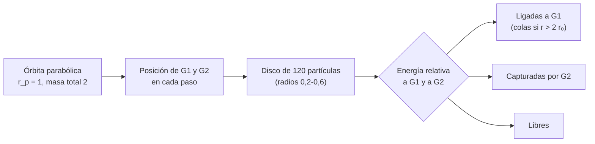

# B25-C12 — Interacciones y fusiones galácticas

<!-- nav:top -->
[🏠 Programa](../../../../README.md) · [📚 Bloque B25](../../../tronco-comun/B25-galaxias-y-medio-interestelar.md) · [← Anterior: B25-C11 — Núcleos activos de galaxias](../B25-C11-nucleos-activos-de-galaxias/CLASE.md) · [Siguiente: B25-C13 — Cúmulos de galaxias →](../B25-C13-cumulos-de-galaxias/CLASE.md)
<!-- /nav -->

## 1. Ubicación, nivel y alcance

Clase 12 del bloque B25. Nivel N3. Cierra el tramo de tipos de galaxias con su transformación por encuentros. Usa la gravitación y las órbitas ([B05-C10](../../B05/B05-C10-gravitacion-universal/CLASE.md), [B71](../../../tronco-comun/B71-mecanica-orbital-fundamental.md)), la integración numérica de [B11](../../../tronco-comun/B11-ecuaciones-diferenciales-y-simulacion-numerica.md) y los discos de [C08](../B25-C08-curvas-de-rotacion-de-galaxias/CLASE.md). Aprendes a **simular un encuentro parabólico entre dos galaxias** con partículas de prueba para ver cómo se forman colas y capturas. Las galaxias son masas puntuales y el disco es de partículas sin masa; no hay gas, halo extenso ni fricción dinámica, por lo que el resultado es cualitativo.

## 2. Por qué esta clase existe

Las galaxias no evolucionan aisladas: se atraen, se deforman y a veces se funden. Muchas elípticas masivas pueden provenir de fusiones, y los encuentros llevan gas al centro, alimentando la formación estelar y los núcleos activos de C11. La decisión central: **dado un encuentro parabólico entre dos masas iguales, ¿qué fracción del disco de una galaxia queda ligada, se pierde o es capturada por la otra?**

## 3. Lo que podrás hacer al terminar

1. Definir interacción, fusión, marea, cola de marea y encuentro parabólico.
2. Calcular el tiempo de una aproximación parabólica con la ecuación de Barker.
3. Integrar un encuentro con un integrador simpléctico (leapfrog) y comprobar su energía.
4. Clasificar las partículas del disco como ligadas, capturadas o libres.
5. Convertir unidades de simulación (`G = 1`) a unidades físicas.
6. Reconocer lo que una simulación sin gas ni halo no puede decir.

La evidencia es la **ficha de un encuentro galáctico** del ejercicio 12 (sección 20).

## 4. Con qué llegas y cómo comprobarlo

1. ¿Cuál es la energía de una órbita parabólica?
2. ¿Qué es la velocidad de escape a una distancia `r`?
3. ¿Qué es un paso del método *leapfrog*?
4. ¿Qué es una unidad natural con `G = 1`?
5. ¿Qué es una partícula de prueba?

<details>
<summary>Ver respuestas</summary>

1. Cero: la energía específica `v²/2 − GM/r` es nula. 2. `√(2GM/r)`. 3. Medio paso de velocidad, un paso de posición y otro medio paso de velocidad (B11). 4. Elegir longitud, masa y tiempo de modo que `G = 1`. 5. Una partícula sin masa que siente la gravedad de las masas pero no la ejerce.
</details>

Con cuatro o cinco aciertos, sigue; si no, repasa B05-C10, B11 y B71.

## 5. Un caso real: qué sabemos de las fusiones

Blanton y Moustakas (S1) incluyen los **sistemas en fusión** como uno de cuatro tipos aproximados de galaxias cercanas. Conselice (S2) revisa que los métodos estructurales permiten medir la historia de fusiones y su actividad hasta un corrimiento al rojo de `z ≈ 3`, y que a alto corrimiento los tamaños son hasta 2–5 veces menores que los locales para una masa estelar dada. Cappellari (S3) propone que las galaxias de rotación lenta crecen principalmente mediante fusiones sin gas. El **ejemplo conductor** es una simulación **sintética**: dos galaxias puntuales de igual masa en órbita parabólica con pericentro `r_p`, y 120 partículas de prueba en el disco de una de ellas.

## 6. Vocabulario

Una **interacción** es un encuentro gravitatorio que deforma a las galaxias sin fundirlas; una **fusión** las une. La **fuerza de marea** es la diferencia de atracción entre dos puntos de un cuerpo extenso. Una **cola de marea** es un chorro de estrellas arrancado por la marea. Una **órbita parabólica** es la de energía nula entre dos cuerpos: apenas ligados. El **pericentro** `r_p` es la distancia mínima. La **ecuación de Barker** da el tiempo desde el pericentro en una parábola. Una **partícula de prueba** es una partícula sin masa. Una órbita es **prógrada** si el disco gira en el mismo sentido que el encuentro. Una partícula está **ligada** a una galaxia si su energía relativa a ella es negativa.

## 7. Modelo mental: un baile de dos con las estrellas como acompañantes

Piensa en dos bailarines que pasan cerca; las personas que giran alrededor de cada uno quedan arrastradas o cambian de pareja. Analogía: las personas alrededor son las estrellas del disco y el paso cercano, el pericentro. Su límite: los bailarines no se atraen con una ley de gravitación, y aquí no hay halos que frenen al par por fricción dinámica, de modo que la simulación subestima las fusiones reales.



*Descripción textual:* se integran las dos galaxias en su órbita parabólica y las partículas de prueba bajo ambas; al final se clasifica cada partícula según su energía relativa a cada galaxia.

## 8. La explicación, paso a paso

### 8.1 La órbita parabólica y la ecuación de Barker

Con masa total `M_t`, la distancia en una parábola de semilado recto `p = 2 r_p` y anomalía verdadera `ν` es `r = p/(1 + cos ν)`. El tiempo desde el pericentro es `t = ½ √(p³/M_t) [tan(ν/2) + tan³(ν/2)/3]` en unidades `G = 1`. Con `r_p = 1`, `M_t = 2` (dos masas de 1) y `r = 10`: `cos ν = −0,8`, `tan(ν/2) = 3`, y `t = ½ × 2 × (3 + 9) = 12` exactamente. La velocidad en el pericentro es `√(2M_t/r_p) = 2`.

### 8.2 El disco y las unidades

Las 120 partículas de prueba se reparten en cinco anillos circulares (radios `0,2` a `0,6`, con `12, 18, 24, 30` y `36` partículas) alrededor de la galaxia 1, con velocidad circular `√(1/R)` y giro prógrado. Si se toma como unidad de longitud `10 kpc` y de masa `10¹¹ M☉`, la unidad de tiempo es `47,1 Myr` y la de velocidad `207 km/s`. Entonces los anillos miden `2–6 kpc`, el pericentro `10 kpc`, la velocidad en el pericentro es `415 km/s` y los `t = 12` unidades son `566 Myr`. Son números **de simulación**, no de un par observado.

### 8.3 Integración

Se usa *leapfrog* con paso `0,002`. Es simpléctico: no acumula deriva sistemática en la energía. Sobre la órbita parabólica, la energía específica final es `5 × 10⁻⁷` (cero teórico) y el tiempo hasta `r = 10` coincide con el de Barker (`12,0000`).

### 8.4 Resultado

Tras `t = 40` unidades (el pericentro ocurre en `t = 12`; `1,9 Gyr` en las unidades de arriba), las 120 partículas quedan así: `78` (65 %) ligadas a la galaxia 1, de las cuales `6` están a más de dos veces su radio inicial (cola o halo extendido); `18` (15 %) capturadas por la galaxia 2; y `24` (20 %) no ligadas a ninguna. Las galaxias están a `18,2` unidades, `182 kpc`, y se alejan: una órbita parabólica sin pérdida de energía orbital no produce fusión en este modelo.

### 8.5 Lo que el modelo deja fuera

Sin fricción dinámica ni halos, la órbita parabólica no se vuelve ligada, y la fusión no ocurre; en galaxias reales la transferencia de energía a los halos sí ligaría el par. Tampoco hay gas, que sería la fuente de brotes de formación estelar; ni autogravedad del disco; ni diferencias de masa. Los porcentajes dependen de `r_p`, de la masa relativa y de la orientación, y solo sirven como ilustración.

## 9. Magnitudes, símbolos y unidades

| Símbolo | Qué es | Unidad | Valor / nota |
|---|---|---|---|
| `G`, `M₁`, `M₂` | gravitación y masas | unidades de simulación | `1`, `1`, `1` (sintético) |
| `r_p` | pericentro | `10 kpc` | `1` (sintético) |
| `t` | tiempo | `47,1 Myr` | pericentro en `12` (Barker) |
| `v` | velocidad | `207 km/s` | `2` en el pericentro |
| `R` | radios de los anillos | `10 kpc` | `0,2–0,6` (sintético) |
| `N` | partículas de prueba | adimensional | `120` (sintético) |

## 10. Convenciones y referencias

Unidades `G = 1`, `[L] = 10 kpc`, `[M] = 10¹¹ M☉` (elección propia, ilustrativa), `[T] = √(L³/GM) = 47,1 Myr`. Todo el cálculo es **simulado**; los resultados sobre fusiones de S1–S3 son **observados o interpretados** y no se comparan numéricamente con la simulación. `GM☉` de la IAU se usa solo para la conversión.

## 11. De dónde sale lo que afirmamos

| ID | Fuente | Localizador | Respalda | Estado |
|---|---|---|---|---|
| S1 | Blanton y Moustakas, arXiv:0908.3017 | https://arxiv.org/abs/0908.3017 | Sistemas en fusión como un tipo de galaxia | Solo resumen, consultado el 2026-11-09 |
| S2 | Conselice, *The Evolution of Galaxy Structure over Cosmic Time*, arXiv:1403.2783 | https://arxiv.org/abs/1403.2783 | Historia de fusiones hasta `z ≈ 3`; tamaños 2–5 veces menores | Solo resumen, consultado el 2026-11-09 |
| S3 | Cappellari, arXiv:1602.04267 | https://arxiv.org/abs/1602.04267 | Rotadores lentos crecen por fusiones sin gas | Solo resumen, consultado el 2026-11-09 |
| S4 | Mamajek et al., *IAU 2015 Resolution B3*, arXiv:1510.07674 | https://arxiv.org/abs/1510.07674 | `GM☉` nominal | Texto del PDF extraído el 2026-11-09 |

Límites: de S1–S3 solo se leyó el resumen; no se consultó el trabajo clásico de Toomre y Toomre sobre mareas, de modo que no se compara con él; la ecuación de Barker se verifica numéricamente en el laboratorio, no se cita.

## 12. Cómo ver el encuentro

Equivalente accesible a un dibujo de la trayectoria (simulado):

| Instante (unidades) | Separación de las galaxias |
|---|---|
| 0 | 10 (aproximación) |
| 12 | 1 (pericentro) |
| 24 | 10 (alejándose) |
| 40 | 18,2 |

Descripción larga: las galaxias se acercan durante 12 unidades de tiempo, pasan a una distancia igual a 1 y se alejan en la otra rama de la parábola.

## 13. Ejemplo trabajado: ¿cuándo se produce el pericentro?

**Paso 1 · Datos.** Parábola con `r_p = 1`, `M_t = 2`; partimos de `r = 10`.

**Paso 2 · Anomalía.** `cos ν = p/r − 1 = 2/10 − 1 = −0,8`.

**Paso 3 · Tangente.** `tan(ν/2) = √((1 − cos ν)/(1 + cos ν)) = √(1,8/0,2) = 3`.

**Paso 4 · Barker.** `t = ½ √(8/2) (3 + 27/3) = ½ × 2 × 12 = 12`.

**Paso 5 · Sentido.** El pericentro llega a `t = 12` unidades (566 Myr en las unidades de 8.2). La simulación numérica lo reproduce, lo que valida el integrador y las condiciones iniciales; no valida el resultado físico.

## 14. Distintas formas de estudiar una fusión

**Partículas de prueba (esta clase):** barato y claro, sin autogravedad. **Simulaciones de N cuerpos con halo y gas:** realistas pero costosas. **Observación de colas y morfología (S2):** da fracciones de fusiones, con las limitaciones de la clasificación. Para ver la idea sirve el modelo restringido; para predecir una fusión concreta, las simulaciones completas.

## 15. Práctica guiada

**Ejercicio 1 · con los pasos indicados.** Calcula la velocidad en el pericentro para `r_p = 1`, `M_t = 2` y pásala a km/s. *Pasos:* `√(2M_t/r_p)`; por `207 km/s`.

<details><summary>Solución comentada</summary>

`√4 = 2`; `2 × 207 = 415 km/s` (8.1, 8.2).
</details>

**Ejercicio 2 · con una pista.** Convierte `t = 12` a Myr con `[T] = 47,1 Myr`.

<details><summary>Solución comentada</summary>

`12 × 47,1 = 565 Myr` (8.2).
</details>

**Ejercicio 3 · casi autónomo.** Calcula el tiempo desde el pericentro hasta `r = 20`.

<details><summary>Solución comentada</summary>

`cos ν = 2/20 − 1 = −0,9`; `tan(ν/2) = √(1,9/0,1) = 4,359`; `t = (4,359 + 4,359³/3) = 4,359 + 27,61 = 31,97` unidades, o `1,5 Gyr` (8.1).
</details>

## 16. Práctica autónoma, transferencia e integrador

**Ejercicio 4.** ¿Cuál es la energía específica relativa de una órbita parabólica y qué implica para el par?

<details><summary>Solución comentada</summary>

Cero: apenas ligado/no ligado; en el modelo sin fricción el par se aleja otra vez (8.5).
</details>

**Ejercicio 5.** ¿Qué fracción del disco queda ligada a la galaxia 1 y cuál es el total de partículas no ligadas a la 1?

<details><summary>Solución comentada</summary>

`78/120 = 65 %` ligadas; no ligadas a la 1: `42` (`35 %`) = `18` capturadas + `24` libres (8.4).
</details>

**Ejercicio 6.** ¿Qué fracción de las partículas ligadas a la 1 está en la cola o el halo extendido?

<details><summary>Solución comentada</summary>

`6/78 = 7,7 %` (8.4).
</details>

**Ejercicio 7.** Convierte la separación final `18,2` a kpc y estima la velocidad relativa final con `v = √(2M_t/r)`.

<details><summary>Solución comentada</summary>

`182 kpc`; `v = √(4/18,2) = 0,469` unidades `= 97 km/s` (8.2, 8.4).
</details>

**Ejercicio 8.** ¿Cuántos radios del anillo exterior (`0,6`) caben en el pericentro?

<details><summary>Solución comentada</summary>

`1/0,6 = 1,7`: el pericentro es menos de dos veces el radio del disco, un encuentro profundo (8.2).
</details>

**Ejercicio 9 · transferencia.** Un compañero dice: «cuando dos galaxias chocan, sus estrellas chocan entre sí». Respóndele con números.

<details><summary>Solución comentada</summary>

La separación típica entre estrellas se toma como ~1 pc (valor ilustrativo): `3,09 × 10¹⁶ m`; el radio solar nominal es `6,957 × 10⁸ m` (IAU 2015 B3); el cociente es `4,4 × 10⁷`. Las estrellas casi nunca colisionan; lo que cambia son sus órbitas por la gravedad conjunta.
</details>

**Ejercicio 10 · transferencia.** El script permite cambiar el pericentro. Si `r_p` fuera mayor (por ejemplo 2), ¿qué esperas para la fracción de partículas perdidas?

<details><summary>Solución comentada</summary>

Menos perdidas y menos cola: la marea disminuye con la distancia. Se puede comprobar editando `rp` en el script (no se ejecutó aquí; es una predicción).
</details>

**Ejercicio 11 · transferencia.** S3 dice que los rotadores lentos crecen por fusiones sin gas. ¿Qué componente de esta simulación se parece a esa situación y cuál difiere?

<details><summary>Solución comentada</summary>

Se parece: no hay gas, así que las partículas solo siguen órbitas gravitatorias. Difiere: aquí no hay fusión (órbita parabólica sin fricción) ni masa ejercida por el disco (8.5).
</details>

**Ejercicio 12 · integrador.** Elabora la *ficha de un encuentro galáctico*: tiempo al pericentro, velocidad, fracciones ligada/capturada/libre, unidades físicas y tres razones por las que el resultado no predice una fusión real.

<details><summary>Solución modelo</summary>

`t = 12 (566 Myr)`, `415 km/s`, `65/15/20 %`, unidades de `10 kpc` y `10¹¹ M☉`. Razones: sin fricción dinámica, sin gas, sin autogravedad del disco.
</details>

## 17. Laboratorio: encuentro parabólico con partículas de prueba

El script [encuentro.py](encuentro.py) integra la órbita de dos masas y 120 partículas con *leapfrog*. **Comprueba** que el tiempo numérico hasta `r = 10` coincide con el de Barker (`10⁻³`), que la energía de la parábola se conserva (`10⁻⁶`) y que, sin perturbador, los anillos conservan su radio (`10⁻⁴`).

**Datos:** todo **simulado**; `G = 1`. **Predice antes de ejecutar:** ¿cuánto vale el tiempo de Barker? (12.) **Ejecución del 2026-11-09 (Python 3.12.9; unos 7 s):**

```text
Python 3.12.9 (biblioteca estandar)
Barker: t(pericentro -> r = 10) = 12.0000 ; leapfrog = 12.0000 ; energia final = 5.00e-07
t = 40 desde r = 10, con pericentro en t = 12 (parabolica, r_p = 1, masas iguales, N = 120):
  ligadas a la galaxia 1: 78 (65 %), de ellas extendidas (> 2 x radio inicial): 6
  capturadas por la galaxia 2: 18 (15 %) ; no ligadas a ninguna: 24 (20 %)
  separacion final de las galaxias = 18.2
Pruebas superadas.
```

```bash
python programa/clases/B25/B25-C12-interacciones-y-fusiones-galacticas/encuentro.py
```

**Límites:** masas puntuales, partículas de prueba, sin gas ni halos; clasificación simple por energía.

## 18. Errores frecuentes y cómo corregirlos

**Pensar que una órbita parabólica produce una fusión.** Se corrige en 8.5 y el ejercicio 4.

**Olvidar convertir las unidades de simulación.** Se corrige con los ejercicios 1 y 2.

**Tomar los porcentajes como universales.** Se corrige en 8.5.

**Confundir «ligada a la 1» con «en el disco».** Se corrige con el ejercicio 6.

**Creer que las estrellas chocan.** Se corrige con el ejercicio 9.

## 19. Cómo sabrás que vas bien

Tras 8.1: ¿cuánto tarda en llegar al pericentro? Ejercicio 3. Tras 8.4: ¿qué fracción se pierde? Ejercicio 5. Tras el laboratorio: ¿qué valida la ecuación de Barker? (el integrador y las condiciones iniciales).

## 20. Qué entregas y cómo se evalúa

El producto es tu **ficha de un encuentro galáctico** (ejercicio 12).

| Criterio | Inicial | En desarrollo | Logrado | Destacado |
|---|---|---|---|---|
| Definiciones | Las confunde | Parciales | Parábola, marea, pericentro | Distingue ligada/capturada/libre |
| Cálculo | Sin unidades | Con errores | Valores y conversión correctos | Propone cambios de parámetros |
| Interpretación | Sin comparar | Sin razón | Concluye sobre fracciones | Discute fricción dinámica |
| Numérico | Sin comprobar | Un caso | Tres pruebas superadas | Explica cada prueba |
| Fuentes | Sin fuente | Sin fecha | S1–S4 con fecha | Declara resúmenes |

**Condiciones críticas (no se compensan con promedio):** rotular la simulación como simulada; no presentar los porcentajes como predicción de una fusión real; citar solo lo consultado.

## 21. Ética, seguridad y límites

La clase es educativa y no sustituye a un código de N cuerpos con gas. Accesibilidad: tablas equivalentes a los dibujos, fórmulas en texto, ejercicios sin conexión.

## 22. Para cerrar y seguir

Un encuentro parabólico de dos masas iguales llega al pericentro en `t = 12` (566 Myr en las unidades elegidas) y, sin fricción dinámica, deja ligadas a la primera galaxia un 65 % de las partículas de su disco, con colas y capturas. Queda una pregunta: ¿cómo se agrupan cientos o miles de galaxias que se atraen entre sí?

**Glosario español–inglés.** interacción · *interaction*; fusión · *merger*; cola de marea · *tidal tail*; órbita parabólica · *parabolic orbit*; pericentro · *pericentre*; fricción dinámica · *dynamical friction*; partícula de prueba · *test particle*.

**Continuidad.** [B25-C13](../B25-C13-cumulos-de-galaxias/CLASE.md) estudia los cúmulos de galaxias, donde esas interacciones son frecuentes.

**Referencias:** ver sección 11.

<!-- nav:bottom -->
---

[← Anterior: B25-C11 — Núcleos activos de galaxias](../B25-C11-nucleos-activos-de-galaxias/CLASE.md) · [📚 Bloque B25](../../../tronco-comun/B25-galaxias-y-medio-interestelar.md) · [Siguiente: B25-C13 — Cúmulos de galaxias →](../B25-C13-cumulos-de-galaxias/CLASE.md)
<!-- /nav -->
