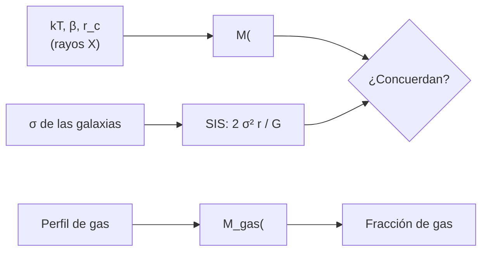

# B25-C13 — Cúmulos de galaxias

<!-- nav:top -->
[🏠 Programa](../../../../README.md) · [📚 Bloque B25](../../../tronco-comun/B25-galaxias-y-medio-interestelar.md) · [← Anterior: B25-C12 — Interacciones y fusiones galácticas](../B25-C12-interacciones-y-fusiones-galacticas/CLASE.md) · [Siguiente: B25-C14 — Lentes gravitacionales galácticas →](../B25-C14-lentes-gravitacionales-galacticas/CLASE.md)
<!-- /nav -->

## 1. Ubicación, nivel y alcance

Clase 13 del bloque B25. Nivel N3. Sube de la escala de una galaxia a la de cientos o miles de ellas. Usa los gases ([B05-C14](../../B05/B05-C14-gases-y-presion/CLASE.md)), el equilibrio hidrostático de las estrellas ([B24-C04](../../B24/B24-C04-equilibrio-hidrostatico-estelar/CLASE.md)), la dispersión de velocidades de [C06](../B25-C06-cumulos-estelares/CLASE.md) y la unidad de energía electronvoltio. Aprendes a **pesar un cúmulo con el gas caliente que lo llena**, y a comprobar el resultado con la dispersión de velocidades de sus galaxias. El cúmulo del ejemplo es sintético, esférico, isotermo y en equilibrio.

## 2. Por qué esta clase existe

Los cúmulos de galaxias son las mayores estructuras ligadas por la gravedad. Contienen galaxias, un gas a decenas de millones de kelvin y mucha más masa de la que ambos aportan; por eso sirven para estudiar la materia oscura y poner a prueba el modelo cosmológico. La decisión central: **dadas la temperatura y la forma de la distribución de gas de un cúmulo, ¿cuánta masa contiene en un radio dado y cuánto de ella es gas?**

## 3. Lo que podrás hacer al terminar

1. Definir cúmulo de galaxias, medio intracúmulo, equilibrio hidrostático y perfil beta.
2. Convertir una temperatura en keV a energía en julios y a dispersión de velocidades.
3. Calcular la masa hidrostática dentro de un radio con un perfil beta isotermo.
4. Comparar esa masa con la de una esfera isoterma singular obtenida de la dispersión de las galaxias.
5. Calcular una fracción de gas y un tiempo de cruce.
6. Nombrar los supuestos que sesgan la masa hidrostática.

La evidencia es la **ficha de un cúmulo de galaxias** del ejercicio 12 (sección 20).

## 4. Con qué llegas y cómo comprobarlo

1. ¿Qué dice el equilibrio hidrostático sobre `dP/dr`?
2. ¿Qué es la presión de un gas ideal `P = n k T`?
3. ¿Cuántos julios son `1 keV`?
4. ¿Qué es la masa de una esfera de densidad `ρ(r)`?
5. ¿Qué es una derivada logarítmica `d ln f/d ln r`?

<details>
<summary>Ver respuestas</summary>

1. Que la presión compensa la gravedad: `dP/dr = −ρ g`. 2. Con `n` el número de partículas por volumen. 3. `1 keV = 1,602 × 10⁻¹⁶ J` (la carga elemental por 1000 voltios). 4. `∫4πr²ρ dr`. 5. La pendiente de `f` en escala logarítmica.
</details>

Con cuatro o cinco aciertos, sigue; si no, repasa B05-C14, B24-C04 y C06.

## 5. Un caso real: lo que las fuentes dicen de los cúmulos

Allen, Evrard y Mantz (S1) revisan que los cúmulos son sistemas grandes, de varios componentes y cercanos al equilibrio, y que su estudio ha sido decisivo para establecer el modelo cosmológico estándar con materia oscura y energía oscura. Kravtsov y Borgani (S2) señalan que existe un rango radial en el que las propiedades del plasma intracúmulo son más regulares, y que permite obtener indicadores de la masa total; añaden aplicaciones cosmológicas y encuestas futuras. El **ejemplo conductor** es un cúmulo **sintético**: gas isotermo a `kT = 5 keV`, perfil beta con `β = 2/3` y `r_c = 0,2 Mpc`, y densidad electrónica central `3 × 10⁻³ cm⁻³`, valores típicos **ilustrativos** (no de un cúmulo real).

## 6. Vocabulario

Un **cúmulo de galaxias** es un sistema ligado de cientos a miles de galaxias, gas caliente y materia oscura. El **medio intracúmulo (ICM)** es ese gas caliente, ionizado, que emite en rayos X. La **temperatura** `kT` se expresa en keV: `1 keV = 1,602 177 × 10⁻¹⁶ J`. El **equilibrio hidrostático** iguala el gradiente de presión del gas con la gravedad. El **perfil beta** es `ρ_gas(r) = ρ₀ [1 + (r/r_c)²]^{−3β/2}`, con `r_c` el radio del núcleo y `β` un parámetro de forma. La **masa hidrostática** es `M(<r) = −(kT r/(G μ m_p)) d ln ρ/d ln r`, con `μ = 0,6` la masa media por partícula en unidades de `m_p` (valor ilustrativo). La **esfera isoterma singular (SIS)** tiene `ρ ∝ r⁻²` y `M(<r) = 2σ² r/G`. La **fracción de gas** es `M_gas/M`. El **tiempo de cruce** es `r/σ`.

## 7. Modelo mental: un globo caliente en un pozo

Piensa en un globo de gas caliente apoyado en el fondo de un pozo: la presión lo sostiene contra la gravedad del pozo; si sabes cuánto se calienta y cómo cae su densidad, puedes deducir lo profundo que es el pozo. Analogía: la temperatura es la «altura» del gas y la caída de densidad, la pendiente. Su límite: el pozo real incluye materia que no se ve y el gas puede tener movimientos internos que lo sostienen además de la presión térmica.



*Descripción textual:* con la temperatura y la forma del gas se obtiene la masa hidrostática; con la dispersión de las galaxias, la de una esfera isoterma; se comparan, y el perfil de gas da su masa y la fracción respecto del total.

## 8. La explicación, paso a paso

### 8.1 De keV a velocidades

`kT = 5 keV = 8,01 × 10⁻¹⁶ J`. Un gas con esa energía térmica, de masa media por partícula `μ m_p = 1,0036 × 10⁻²⁷ kg`, tiene `kT/(μ m_p) = 7,98 × 10¹¹ m²/s²`, es decir, una «dispersión» `σ = √(kT/(μ m_p)) = 893 km/s`. Valores de esa magnitud son típicos de las galaxias de un cúmulo, y que coincidan se interpreta como que gas y galaxias comparten el mismo pozo de potencial.

### 8.2 Masa hidrostática con el perfil beta

La pendiente logarítmica del perfil es `d ln ρ/d ln r = −3β (r/r_c)²/(1 + (r/r_c)²)`. Con ella,

`M(<r) = 3β kT r³ / (G μ m_p (r_c² + r²))`.

Con `β = 2/3` y `r = 1 Mpc`: `M = 3,57 × 10¹⁴ M☉`. El laboratorio comprueba esta fórmula con la derivada numérica del perfil en cuatro radios (error menor de `10⁻⁶`).

### 8.3 Comparación con la esfera isoterma

Si `r_c → 0` y `β = 2/3`, el perfil es `ρ ∝ r⁻²` y `M = 2σ²r/G`: para `r = 1 Mpc`, `3,71 × 10¹⁴ M☉`. Cuando `r_c = 0,2 Mpc`, el factor `r²/(r_c² + r²) = 0,962` reduce la masa un `3,8 %`, hasta `3,57 × 10¹⁴`. Los dos métodos coinciden por construcción en este ejemplo sintético: en un cúmulo real, comparar la masa del gas con la de la dispersión de galaxias es una verificación de los supuestos.

### 8.4 Fracción de gas

La masa de gas dentro de `x = r/r_c` para `β = 2/3` es `4πρ₀ r_c³ (x − arctan x)`. Con `n_e = 3 × 10⁻³ cm⁻³` y `μ_e = 1,17` (valor ilustrativo): `M_gas(<1 Mpc) = 3,2 × 10¹³ M☉` y `f_gas = 0,089`. El resto, `91 %`, es materia oscura y galaxias en este ejemplo; las cifras son sintéticas.

### 8.5 Lo que el modelo deja fuera

Supone esferidad, isotermia y equilibrio, sin presión no térmica (turbulencia, rayos cósmicos, campo) que, si existe, hace que la masa hidrostática subestime la verdadera. Tampoco considera gradientes de temperatura, subestructura ni fusiones de cúmulos. El tiempo de cruce de `1,09 Gyr` indica que el sistema ha podido cruzarse varias veces, pero no que esté relajado.

## 9. Magnitudes, símbolos y unidades

| Símbolo | Qué es | Unidad | Valor / nota |
|---|---|---|---|
| `kT` | energía térmica del gas | keV; J | `5`; `8,01 × 10⁻¹⁶` (sintético) |
| `μ`, `μ_e` | masas medias por partícula y por electrón | adimensional | `0,6`; `1,17` (ilustrativos) |
| `β`, `r_c` | forma y núcleo del perfil | adimensional; Mpc | `2/3`; `0,2` (sintéticos) |
| `σ` | dispersión equivalente | km/s | `893` (cálculo propio) |
| `M(<r)` | masa hidrostática | `M☉` | `3,57 × 10¹⁴` en 1 Mpc |
| `f_gas` | fracción de gas | adimensional | `0,089` (sintético) |
| `G`, `k`, `m_p` | constantes | SI | `6,674 30 × 10⁻¹¹`; `1,380 649 × 10⁻²³`; `1,672 62 × 10⁻²⁷` (S3) |

## 10. Convenciones y referencias

`1 Mpc = 3,0857 × 10²² m`. Gas ideal, totalmente ionizado. Se rotulan **observados** solo las afirmaciones de S1 y S2 (cualitativas), **sintético** el cúmulo y **cálculo propio** el resto. No se citan cifras de cúmulos reales.

## 11. De dónde sale lo que afirmamos

| ID | Fuente | Localizador | Respalda | Estado |
|---|---|---|---|---|
| S1 | Allen, Evrard y Mantz, *Cosmological Parameters from Observations of Galaxy Clusters*, arXiv:1103.4829 | https://arxiv.org/abs/1103.4829 | Cúmulos y el modelo cosmológico estándar | Solo resumen, consultado el 2026-11-09 |
| S2 | Kravtsov y Borgani, *Formation of Galaxy Clusters*, arXiv:1205.5556 | https://arxiv.org/abs/1205.5556 | Indicadores de la masa; aplicaciones cosmológicas | Solo resumen, consultado el 2026-11-09 |
| S3 | NIST, *Fundamental Physical Constants — Complete Listing* (CODATA 2022) | https://physics.nist.gov/cuu/Constants/Table/allascii.txt | `G`, `k`, `m_p`, eV | Consultada el 2026-11-09 |
| S4 | Mamajek et al., *IAU 2015 Resolution B3*, arXiv:1510.07674 | https://arxiv.org/abs/1510.07674 | `GM☉` nominal | Texto del PDF extraído el 2026-11-09 |

Límites: S1 y S2 solo en resumen y sin cifras; no se consultó ninguna medida de un cúmulo real; la masa hidrostática se verifica numéricamente, no se cita.

## 12. Cómo ver el cúmulo

Equivalente accesible a un perfil de masa (cúmulo **sintético**, cálculo propio):

| Magnitud en 1 Mpc | Valor |
|---|---|
| Masa hidrostática (β-modelo) | `3,57 × 10¹⁴ M☉` |
| Masa SIS (`2σ²r/G`) | `3,71 × 10¹⁴ M☉` |
| Masa de gas | `3,2 × 10¹³ M☉` |
| Fracción de gas | `0,089` |
| Tiempo de cruce | `1,09 Gyr` |

Descripción larga: la masa total dentro de un megaparsec supera diez veces la del gas, y el tiempo para cruzar el cúmulo es de unos mil millones de años.

## 13. Ejemplo trabajado: ¿cuánto pesa el cúmulo sintético?

**Paso 1 · Datos.** `kT = 5 keV`, `β = 2/3`, `r_c = 0,2 Mpc`, `r = 1 Mpc`.

**Paso 2 · Energía.** `kT = 8,01 × 10⁻¹⁶ J`; `μ m_p = 1,0036 × 10⁻²⁷ kg`.

**Paso 3 · Masa.** Con `β = 2/3`, `3βkT/(μ m_p) = 2σ²`, de modo que `M = 2σ² r/(G × 1,04) = 2 × 7,98 × 10¹¹ × 3,0857 × 10²²/(6,674 × 10⁻¹¹ × 1,04) = 7,10 × 10⁴⁴ kg`.

**Paso 4 · En masas solares.** `7,10 × 10⁴⁴/1,989 × 10³⁰ = 3,57 × 10¹⁴ M☉`.

**Paso 5 · Sentido.** El gas pesa `3,2 × 10¹³ M☉` (9 %): la mayor parte de la masa no es gas. Con un cúmulo sintético y supuestos de isotermia y equilibrio, es solo un orden de magnitud.

## 14. Distintas formas de pesar un cúmulo

**Hidrostática con rayos X (esta clase):** requiere temperatura y perfil de gas. **Dispersión de velocidades de las galaxias:** requiere espectros de muchas galaxias. **Lentes gravitacionales (C14):** no depende del equilibrio. Para una estimación rápida sirve la hidrostática, pero la presión no térmica puede sesgarla; el mejor control es comparar al menos dos métodos.

## 15. Práctica guiada

**Ejercicio 1 · con los pasos indicados.** Pasa `5 keV` a julios. *Pasos:* `5 × 10³ × 1,602 × 10⁻¹⁹`.

<details><summary>Solución comentada</summary>

`8,01 × 10⁻¹⁶ J` (8.1).
</details>

**Ejercicio 2 · con una pista.** Calcula `σ = √(kT/(μ m_p))` con `μ = 0,6`.

<details><summary>Solución comentada</summary>

`8,01 × 10⁻¹⁶/1,0036 × 10⁻²⁷ = 7,98 × 10¹¹`; raíz `8,93 × 10⁵ m/s = 893 km/s` (8.1).
</details>

**Ejercicio 3 · casi autónomo.** Calcula la masa de una SIS con `σ = 893 km/s` dentro de `1 Mpc`.

<details><summary>Solución comentada</summary>

`2 × 7,98 × 10¹¹ × 3,0857 × 10²²/6,674 × 10⁻¹¹ = 7,38 × 10⁴⁴ kg = 3,71 × 10¹⁴ M☉` (8.3).
</details>

## 16. Práctica autónoma, transferencia e integrador

**Ejercicio 4.** Calcula el factor `r²/(r_c² + r²)` en `1 Mpc` y la masa del perfil beta.

<details><summary>Solución comentada</summary>

`1/(1 + 0,04) = 0,9615`; `3,71 × 10¹⁴ × 0,9615 = 3,57 × 10¹⁴ M☉` (8.3).
</details>

**Ejercicio 5.** Si el cúmulo tuviera `kT = 10 keV`, ¿qué masa daría a la misma `r`?

<details><summary>Solución comentada</summary>

`M ∝ T`: el doble, `7,1 × 10¹⁴ M☉` (8.2).
</details>

**Ejercicio 6.** Calcula la fracción de gas con `M_gas = 3,2 × 10¹³` y `M = 3,57 × 10¹⁴`.

<details><summary>Solución comentada</summary>

`3,16/35,7 = 0,089` (8.4).
</details>

**Ejercicio 7.** Calcula el tiempo de cruce `1 Mpc/σ`.

<details><summary>Solución comentada</summary>

`3,0857 × 10²²/8,93 × 10⁵ = 3,46 × 10¹⁶ s = 1,09 Gyr` (8.5).
</details>

**Ejercicio 8.** ¿Qué pendiente logarítmica tiene el perfil beta en `r = r_c`?

<details><summary>Solución comentada</summary>

`−3β(1)/(1 + 1) = −β·3/2 = −1` para `β = 2/3` (8.2).
</details>

**Ejercicio 9 · transferencia.** Un cúmulo sintético tiene galaxias con `σ = 1200 km/s`. Calcula la masa de una SIS dentro de `1,5 Mpc`.

<details><summary>Solución comentada</summary>

`2 × (1,2 × 10⁶)² × 1,5 × 3,0857 × 10²²/6,674 × 10⁻¹¹ = 2,0 × 10⁴⁵ kg = 1,0 × 10¹⁵ M☉` (8.3).
</details>

**Ejercicio 10 · transferencia.** Un compañero dice: «la masa de un cúmulo es la suma de sus galaxias». Respóndele con el ejemplo.

<details><summary>Solución comentada</summary>

En el cúmulo sintético el gas ya pesa 9 % de la masa dinámica; las galaxias, una fracción aún menor de lo que queda; el resto necesita materia oscura. S1 describe los cúmulos como sistemas de varios componentes (8.4).
</details>

**Ejercicio 11 · transferencia.** Si el 20 % del soporte del gas fuese no térmico (valor ilustrativo), ¿cuál sería la masa verdadera si la hidrostática da `3,57 × 10¹⁴`?

<details><summary>Solución comentada</summary>

La presión térmica sostiene solo el `80 %` de lo necesario: `M = 3,57 × 10¹⁴/0,8 = 4,5 × 10¹⁴ M☉`. Es el «sesgo hidrostático» (8.5).
</details>

**Ejercicio 12 · integrador.** Elabora la *ficha de un cúmulo de galaxias*: elige `kT`, `β`, `r_c`, densidad central (sintéticos); calcula `σ`, la masa hidrostática y la SIS, `M_gas`, `f_gas`, tiempo de cruce y un sesgo posible.

<details><summary>Solución modelo</summary>

Con `5 keV`, `2/3`, `0,2 Mpc`, `3 × 10⁻³ cm⁻³`: `893 km/s`, `3,57` y `3,71 × 10¹⁴ M☉`, `3,2 × 10¹³ M☉`, `0,089`, `1,09 Gyr`; sesgo por presión no térmica.
</details>

## 17. Laboratorio: masa hidrostática y SIS

El script [masa_cumulo.py](masa_cumulo.py) calcula `σ`, la masa del perfil beta, la de la SIS y la fracción de gas. **Comprueba** que la masa del perfil, obtenida con la derivada numérica de `ln ρ`, coincide con la forma cerrada en cuatro radios (`10⁻⁶`), que el límite `r_c → 0` da `2σ²r/G` (`10⁻⁹`) y que la masa de gas por cuadratura coincide con `4πρ₀r_c³(x − arctan x)` (`10⁻⁸`).

**Datos:** constantes de NIST; cúmulo **sintético**. **Predice antes de ejecutar:** ¿qué `σ` equivale a `5 keV`? (≈ 900 km/s.) **Ejecución del 2026-11-09 (Python 3.12.9):**

```text
Python 3.12.9 (biblioteca estandar)
sigma = sqrt(kT/(mu mp)) = 893 km/s
M_hidrostatica(<1 Mpc) = 3.569e+14 Msol ; SIS 2 sigma^2 r/G = 3.712e+14 Msol
M_gas(<1 Mpc) = 3.163e+13 Msol ; fraccion de gas = 0.089
t_cruce = 1 Mpc / sigma = 1.09 Gyr
Pruebas superadas.
```

```bash
python programa/clases/B25/B25-C13-cumulos-de-galaxias/masa_cumulo.py
```

**Límites:** esferidad, isotermia, equilibrio hidrostático; parámetros ilustrativos.

## 18. Errores frecuentes y cómo corregirlos

**Olvidar convertir keV a julios.** Se corrige con el ejercicio 1.

**Confundir `μ` y `μ_e`.** Se corrige en la sección 6.

**Tomar la masa hidrostática como exacta.** Se corrige con el ejercicio 11.

**Confundir masa de gas con masa total.** Se corrige con el ejercicio 6.

**Usar `r` en parsecs con constantes en SI.** Se corrige con el ejercicio 3.

## 19. Cómo sabrás que vas bien

Tras 8.2: ¿qué pasa con `M` si `T` se duplica? Ejercicio 5. Tras 8.4: ¿qué fracción es gas? Ejercicio 6. Tras el laboratorio: ¿qué comprueba el límite SIS? (que el perfil beta incluye la esfera isoterma como caso límite).

## 20. Qué entregas y cómo se evalúa

El producto es tu **ficha de un cúmulo de galaxias** (ejercicio 12).

| Criterio | Inicial | En desarrollo | Logrado | Destacado |
|---|---|---|---|---|
| Definiciones | Las confunde | Parciales | ICM, beta, hidrostática | Distingue masa de gas y total |
| Cálculo | Sin unidades | Con errores | Valores correctos | Propaga el sesgo |
| Interpretación | Sin comparar | Sin razón | Compara con la SIS | Discute presión no térmica |
| Numérico | Sin comprobar | Un caso | Tres pruebas superadas | Explica cada prueba |
| Fuentes | Sin fuente | Sin fecha | S1–S4 con fecha | Declara que no hay datos reales |

**Condiciones críticas (no se compensan con promedio):** rotular el cúmulo como sintético; no presentar la masa hidrostática como exacta; citar solo lo consultado.

## 21. Ética, seguridad y límites

La clase es educativa y no sustituye al análisis de datos de rayos X o de lentes. Accesibilidad: tablas equivalentes a los perfiles, fórmulas en texto, ejercicios sin conexión.

## 22. Para cerrar y seguir

Un gas de `5 keV` con perfil beta pesa un cúmulo en `3,6 × 10¹⁴ M☉` dentro de 1 Mpc, de los que solo ~9 % es gas en el ejemplo. Queda una pregunta: ¿cómo se mide la masa sin suponer equilibrio, a través de lo que hace a la luz?

**Glosario español–inglés.** cúmulo de galaxias · *galaxy cluster*; medio intracúmulo · *intracluster medium*; equilibrio hidrostático · *hydrostatic equilibrium*; perfil beta · *beta model*; fracción de gas · *gas fraction*; tiempo de cruce · *crossing time*.

**Continuidad.** [B25-C14](../B25-C14-lentes-gravitacionales-galacticas/CLASE.md) pesa cúmulos y galaxias a través de la deflexión de la luz.

**Referencias:** ver sección 11.

<!-- nav:bottom -->
---

[← Anterior: B25-C12 — Interacciones y fusiones galácticas](../B25-C12-interacciones-y-fusiones-galacticas/CLASE.md) · [📚 Bloque B25](../../../tronco-comun/B25-galaxias-y-medio-interestelar.md) · [Siguiente: B25-C14 — Lentes gravitacionales galácticas →](../B25-C14-lentes-gravitacionales-galacticas/CLASE.md)
<!-- /nav -->
