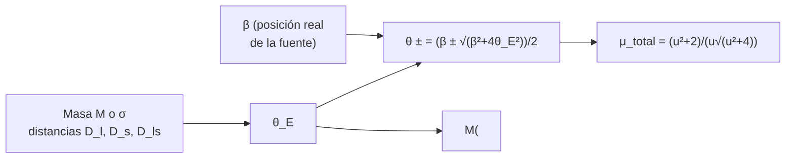

# B25-C14 — Lentes gravitacionales galácticas

<!-- nav:top -->
[🏠 Programa](../../../../README.md) · [📚 Bloque B25](../../../tronco-comun/B25-galaxias-y-medio-interestelar.md) · [← Anterior: B25-C13 — Cúmulos de galaxias](../B25-C13-cumulos-de-galaxias/CLASE.md) · [Siguiente: B25-C15 — Materia oscura en galaxias →](../B25-C15-materia-oscura-en-galaxias/CLASE.md)
<!-- /nav -->

## 1. Ubicación, nivel y alcance

Clase 14 del bloque B25. Nivel N3. Mide la masa de una galaxia o de un cúmulo sin suponer equilibrio: usa cómo desvían la luz. Se apoya en la masa de [C13](../B25-C13-cumulos-de-galaxias/CLASE.md) y [C10](../B25-C10-galaxias-irregulares-y-enanas/CLASE.md), en la geometría de ángulos pequeños ([B04](../../../tronco-comun/B04-algebra-trigonometria-y-geometria-espacial.md)) y en la relatividad general del bloque [B26](../../../tronco-comun/B26-relatividad-y-cosmologia.md), de la que solo se toma el ángulo de desviación en campo débil como dato. Aprendes la **ecuación de la lente**, el radio de Einstein, las imágenes y su magnificación para una lente puntual y una esfera isoterma. Las distancias del ejemplo son ilustrativas y no salen de un cálculo cosmológico.

## 2. Por qué esta clase existe

La luz de una galaxia lejana se curva al pasar cerca de una masa, y la masa interior se deduce del tamaño de la distorsión sin importar si es luminosa u oscura ni si está en equilibrio. Por eso las lentes son una prueba directa de la distribución de masa. La decisión central: **dada una masa, o una dispersión de velocidades, y las distancias, ¿qué tamaño tiene el anillo de Einstein, dónde aparecen las imágenes y cuánto amplifican la fuente?**

## 3. Lo que podrás hacer al terminar

1. Definir lente, fuente, ángulo de desviación, radio de Einstein, imagen y magnificación.
2. Calcular el radio de Einstein de una masa puntual y de una esfera isoterma.
3. Hallar las posiciones de las imágenes de una lente puntual y su magnificación total.
4. Obtener la masa proyectada dentro del radio de Einstein.
5. Explicar cómo cambian las imágenes al alejar la fuente del eje.
6. Reconocer lo que supone el modelo (lente delgada, sin cizalla).

La evidencia es la **ficha de una lente** del ejercicio 12 (sección 20).

## 4. Con qué llegas y cómo comprobarlo

1. ¿Cuántos radianes tiene un segundo de arco?
2. ¿Qué es una distancia angular `D`?
3. ¿Cómo se resuelve `x − a/x = b`?
4. ¿Qué es la masa dentro de un cilindro, o masa proyectada?
5. ¿Cuánto vale `c²/4G` en `M☉/m`?

<details>
<summary>Ver respuestas</summary>

1. `4,848 × 10⁻⁶ rad`. 2. La distancia tal que el tamaño físico dividido entre `D` da el ángulo subtendido. 3. Multiplicando por `x`: `x² − bx − a = 0`, con soluciones `(b ± √(b² + 4a))/2`. 4. La masa que se encuentra en la visual dentro de un círculo del cielo. 5. `c²/4G = 3,37 × 10²⁶ kg/m`, es decir `1,7 × 10⁻⁴ M☉/m`.
</details>

Con cuatro o cinco aciertos, sigue; si no, repasa B04 y C13.

## 5. Un caso real: qué hacen las lentes fuertes

Treu (S1) presenta las lentes fuertes por galaxias como herramienta para tres temas: la distribución de masa a escalas de kiloparsec y menores, la geometría y el contenido del universo, y el estudio de objetos lejanos y débiles (galaxias, agujeros negros y núcleos activos), con una revisión de los fundamentos. El **ejemplo conductor** es una lente **sintética**: una galaxia de `10¹¹ M☉` o de dispersión `250 km/s`, con distancias angulares ilustrativas al observador `D_l = 1000 Mpc` (lente), `D_s = 2000 Mpc` (fuente) y `D_ls = 1200 Mpc` (entre ambas). No es una lente observada ni sus distancias están calculadas con un modelo cosmológico.

## 6. Vocabulario

Una **lente gravitacional** es una masa que desvía la luz de una fuente más lejana. El **ángulo de desviación** de un rayo que pasa a distancia `b` de una masa puntual `M` es, en campo débil, `4GM/(c²b)` (dato de la relatividad general, B26). La **ecuación de la lente** liga la posición angular real de la fuente `β` con la de la imagen `θ`. El **radio de Einstein** `θ_E` es el ángulo del anillo que se forma cuando la fuente está justo detrás de la lente. Para una masa puntual, `θ_E = √(4GM D_ls/(c² D_l D_s))`. Para una **esfera isoterma singular (SIS)** con dispersión `σ`, `θ_E = 4π(σ/c)² D_ls/D_s`. La **magnificación** `μ` es el cociente entre el brillo de la imagen y el de la fuente sin lente. Una **imagen** con `θ < 0` queda al otro lado de la lente (paridad invertida). Se define `u = β/θ_E`.

## 7. Modelo mental: una lupa que mide su propio peso

Una lente de vidrio desvía la luz según su forma; una lente gravitacional la desvía según su masa. Analogía: cuanto más pesa, más grande el anillo. Su límite: el vidrio tiene un foco; la lente gravitacional puntual no (desvía más los rayos cercanos que los lejanos), y su efecto sobre la imagen depende de cómo se reparte la masa.



*Descripción textual:* de la masa y las distancias se obtiene el radio de Einstein; con la posición de la fuente se resuelve la ecuación de la lente (dos imágenes) y se calcula la magnificación; a la inversa, de un anillo medido se deduce la masa interior.

## 8. La explicación, paso a paso

### 8.1 La ecuación de la lente

Para una masa puntual, en la aproximación de ángulos pequeños, `β = θ − θ_E²/θ`. Multiplicando por `θ`: `θ² − βθ − θ_E² = 0`, con soluciones `θ_± = ½(β ± √(β² + 4θ_E²))`. Siempre hay dos imágenes: una exterior (`θ_+ > θ_E`, misma paridad) y otra interior de signo contrario (`θ_- < 0`, `|θ_-| < θ_E`). Si `β = 0`, `θ = ±θ_E`: un anillo (la simetría completa hace que todas las direcciones sean equivalentes).

### 8.2 El radio de Einstein de una masa puntual

Con `M = 10¹¹ M☉`, `4GM/c² = 5,91 × 10¹⁴ m`; el factor geométrico `D_ls/(D_l D_s) = 1,94 × 10⁻²⁶ m⁻¹`; `θ_E = 3,39 × 10⁻⁶ rad = 0,699″`; el radio físico en la lente, `R_E = θ_E D_l = 3,4 kpc`.

### 8.3 Magnificación

La magnificación de cada imagen es el cociente entre el área de la imagen y la de la fuente: `μ = (θ/β)(dθ/dβ)`. Su valor absoluto total vale `μ = (u² + 2)/(u√(u² + 4))`. Para `u = 0,1`, `10,0`; para `u = 0,5`, `2,18`; para `u = 1`, `1,34`; para `u = 2`, `1,06`. Cuando `u → 0` la magnificación crece sin límite (en la realidad la fuente es extensa y está limitada). La imagen interior es la más tenue: a `u = 1` las magnificaciones individuales son `1,17` y `0,17`.

### 8.4 La esfera isoterma y la masa proyectada

Para la SIS con `σ = 250 km/s`, `θ_E = 4π(σ/c)² D_ls/D_s = 1,08″` (`R_E = 5,24 kpc`). La masa proyectada dentro de `R_E` es `M = (c²/4G) θ_E² D_l D_s/D_ls = πσ²R_E/G = 2,4 × 10¹¹ M☉`. Es un resultado general: **la masa dentro del radio de Einstein sale solo del tamaño del anillo y de las distancias**, sin suponer el perfil. Esa masa es proyectada (cilíndrica); la esférica de una SIS dentro del mismo radio, `2σ²R_E/G`, es `2/π` veces menor.

### 8.5 Lo que el modelo deja fuera

La lente es delgada y axisimétrica, sin cizalla de los alrededores (que produce cuatro imágenes), sin retrasos temporales y sin fuente extensa. Los factores de masa se interpretan con cuidado: la masa de Einstein es proyectada, y su descomposición entre estrellas y materia oscura requiere más información (S1). Las distancias del ejemplo no son de un modelo cosmológico.

## 9. Magnitudes, símbolos y unidades

| Símbolo | Qué es | Unidad | Valor / nota |
|---|---|---|---|
| `D_l`, `D_s`, `D_ls` | distancias angulares | Mpc | `1000`, `2000`, `1200` (ilustrativas) |
| `θ_E` | radio de Einstein | arcsec; rad | `0,699″` (masa puntual); `1,08″` (SIS) |
| `R_E` | radio de Einstein físico | kpc | `3,4`; `5,24` |
| `β`, `u` | posición de la fuente; `u = β/θ_E` | arcsec; adimensional | libre |
| `μ` | magnificación | adimensional | tabla de 8.3 |
| `σ`, `M` | dispersión; masa | km/s; `M☉` | `250`; `10¹¹` (sintéticas) |
| `G`, `c` | constantes | SI | `6,674 30 × 10⁻¹¹`; `299 792 458` (S2) |

## 10. Convenciones y referencias

Aproximación de ángulos pequeños; `1″ = 4,848 × 10⁻⁶ rad`; `1 Mpc = 3,0857 × 10²² m`. Se rotulan **sintéticos** la masa, `σ` y las distancias, y **cálculo propio** los resultados. La fórmula del radio de Einstein de la masa puntual y la de la SIS se verifican en el laboratorio por coherencia entre sí y con el cálculo numérico de las imágenes, no se citan de un texto.

## 11. De dónde sale lo que afirmamos

| ID | Fuente | Localizador | Respalda | Estado |
|---|---|---|---|---|
| S1 | Treu, *Strong Lensing by Galaxies*, arXiv:1003.5567 | https://arxiv.org/abs/1003.5567 | Los tres usos de las lentes fuertes por galaxias | Solo resumen, consultado el 2026-11-09 |
| S2 | NIST, *Fundamental Physical Constants — Complete Listing* (CODATA 2022) | https://physics.nist.gov/cuu/Constants/Table/allascii.txt | `G`, `c` | Consultada el 2026-11-09 |
| S3 | Mamajek et al., *IAU 2015 Resolution B3*, arXiv:1510.07674 | https://arxiv.org/abs/1510.07674 | `GM☉` nominal | Texto del PDF extraído el 2026-11-09 |

Límites: S1 solo en resumen y sin cifras; el ángulo de desviación en campo débil se toma como resultado de la relatividad general sin consultar su fuente en esta sesión; el ejemplo no usa lentes ni distancias reales.

## 12. Cómo ver la lente

Equivalente accesible a un dibujo de imágenes (lente puntual de `10¹¹ M☉`, cálculo propio, posiciones en unidades de `θ_E`):

| `u = β/θ_E` | Imagen exterior | Imagen interior | `μ` total |
|---|---|---|---|
| 0,1 | `+1,051` | `−0,951` | 10,0 |
| 0,5 | `+1,281` | `−0,781` | 2,18 |
| 1 | `+1,618` | `−0,618` | 1,34 |
| 2 | `+2,414` | `−0,414` | 1,06 |

Descripción larga: al alejar la fuente del eje, la imagen exterior se aleja de la lente, la interior se acerca y se debilita, y la magnificación total tiende a 1.

## 13. Ejemplo trabajado: la masa de un anillo de 1″

**Paso 1 · Datos.** Un anillo de `θ_E = 1″ = 4,848 × 10⁻⁶ rad` con las distancias de la sección 5.

**Paso 2 · Fórmula.** `M = (c²/4G) θ_E² D_l D_s/D_ls`.

**Paso 3 · Geometría.** `D_l D_s/D_ls = 1000 × 2000/1200 = 1667 Mpc = 5,14 × 10²⁵ m`; `θ_E² = 2,35 × 10⁻¹¹`.

**Paso 4 · Cálculo.** `c²/4G = 3,37 × 10²⁶ kg/m`; `M = 3,37 × 10²⁶ × 2,35 × 10⁻¹¹ × 5,14 × 10²⁵ = 4,07 × 10⁴¹ kg = 2,0 × 10¹¹ M☉`.

**Paso 5 · Sentido.** Un anillo de un segundo de arco encierra unas `2 × 10¹¹ M☉` en un radio de `4,8 kpc`; sin importar el tipo de materia. Con distancias ilustrativas, la cifra es solo un orden de magnitud.

## 14. Distintas formas de pesar una galaxia

**Lente fuerte (esta clase):** masa proyectada dentro del anillo, sin suponer equilibrio. **Dinámica (C08, C10):** masa dentro de un radio con supuestos de equilibrio. **Lente débil:** estadística de distorsiones; permite masas de cúmulos. Para la masa total dentro de un radio pequeño, la lente fuerte es directa; para separar estrellas y materia oscura, hay que combinarla con la dinámica (S1).

## 15. Práctica guiada

**Ejercicio 1 · con los pasos indicados.** Calcula `θ_E` de `10¹¹ M☉`. *Pasos:* `4GM/c²`; factor `D_ls/(D_l D_s)`; raíz.

<details><summary>Solución comentada</summary>

`4 × 1,327 × 10³¹/8,988 × 10¹⁶ = 5,91 × 10¹⁴ m`; `1200/(1000 × 2000 × 3,0857 × 10²²) = 1,94 × 10⁻²⁶ m⁻¹`; `θ_E = √(1,148 × 10⁻¹¹) = 3,39 × 10⁻⁶ rad = 0,699″` (8.2).
</details>

**Ejercicio 2 · con una pista.** Calcula `θ_E` de una SIS con `σ = 250 km/s`. *Pista:* `D_ls/D_s = 0,6`.

<details><summary>Solución comentada</summary>

`4π × (8,339 × 10⁻⁴)² × 0,6 = 5,24 × 10⁻⁶ rad = 1,08″` (8.4).
</details>

**Ejercicio 3 · casi autónomo.** Pasa el `θ_E` de la SIS a kiloparsecs en la lente.

<details><summary>Solución comentada</summary>

`5,24 × 10⁻⁶ × 1000 Mpc = 5,24 × 10⁻³ Mpc = 5,24 kpc` (8.4).
</details>

## 16. Práctica autónoma, transferencia e integrador

**Ejercicio 4.** ¿Dónde aparecen las imágenes si `β = 0,5 θ_E`?

<details><summary>Solución comentada</summary>

`θ_± = ½(0,5 ± √(0,25 + 4)) = 1,281` y `−0,781` en unidades de `θ_E` (8.1).
</details>

**Ejercicio 5.** Calcula la magnificación total a `u = 0,1`.

<details><summary>Solución comentada</summary>

`(0,01 + 2)/(0,1 × √4,01) = 2,01/0,2002 = 10,04` (8.3).
</details>

**Ejercicio 6.** Calcula las magnificaciones individuales a `u = 1`.

<details><summary>Solución comentada</summary>

`½[1,342 ± 1] = 1,171` y `0,171`; cociente de brillos `6,9` (8.3).
</details>

**Ejercicio 7.** Calcula la masa proyectada de la SIS en su radio de Einstein.

<details><summary>Solución comentada</summary>

`πσ²R_E/G = π × 6,25 × 10¹⁰ × 1,617 × 10²⁰/6,674 × 10⁻¹¹ = 4,76 × 10⁴¹ kg = 2,4 × 10¹¹ M☉` (8.4).
</details>

**Ejercicio 8.** ¿Qué razón hay entre la masa esférica `2σ²R/G` y la proyectada `πσ²R/G`?

<details><summary>Solución comentada</summary>

`2/π = 0,64` (8.4).
</details>

**Ejercicio 9 · transferencia.** Una galaxia tiene `σ = 300 km/s`; con las mismas distancias, ¿cuál es su `θ_E`?

<details><summary>Solución comentada</summary>

`θ_E ∝ σ²`: `(300/250)² × 1,08″ = 1,56″` (8.4).
</details>

**Ejercicio 10 · transferencia.** Un compañero dice: «una lente siempre da dos imágenes». Respóndele.

<details><summary>Solución comentada</summary>

La masa puntual da dos (una muy débil si `u` es grande); el anillo aparece cuando `β = 0`; con cizalla externa pueden verse cuatro; y la SIS da una sola imagen si `β > θ_E`. El número depende de la geometría y del perfil (8.1, 8.5).
</details>

**Ejercicio 11 · transferencia.** Si la lente estuviera más cerca de la fuente (`D_ls = 600 Mpc`), ¿cómo cambia `θ_E`?

<details><summary>Solución comentada</summary>

`θ_E ∝ √(D_ls)` para masa puntual: `×0,707`; para SIS `θ_E ∝ D_ls`: `×0,5` (8.2, 8.4).
</details>

**Ejercicio 12 · integrador.** Elabora la *ficha de una lente*: elige masa o `σ` y distancias (sintéticas); calcula `θ_E`, `R_E`, imágenes y magnificación para dos valores de `β`, y la masa proyectada; indica qué supone el modelo.

<details><summary>Solución modelo</summary>

Con `10¹¹ M☉` y las distancias de la sección 5: `0,699″`, `3,4 kpc`; para `u = 0,5` y `1`: imágenes `+1,281, −0,781` y `+1,618, −0,618`; `μ = 2,18` y `1,34`; supone lente delgada y axisimétrica.
</details>

## 17. Laboratorio: lente puntual y SIS

El script [lente.py](lente.py) calcula el radio de Einstein, las imágenes y las magnificaciones. **Comprueba** que la bisección de la ecuación de la lente coincide con la forma cerrada (`10⁻⁹`), que la magnificación calculada con la derivada numérica coincide con `(u² + 2)/(u√(u² + 4))` para cuatro valores de `u` (`10⁻⁶`) y que la masa proyectada de Einstein de la SIS coincide con `πσ²R_E/G` (`10⁻⁹`).

**Datos:** `G`, `c` de NIST; `GM☉` de la IAU; lente y distancias **sintéticas**. **Predice antes de ejecutar:** ¿qué `μ` da `u = 1`? (1,34.) **Ejecución del 2026-11-09 (Python 3.12.9):**

```text
Python 3.12.9 (biblioteca estandar)
masa puntual 1e11 Msol: theta_E = 0.699 arcsec ; R_E = 3.39 kpc
  u = 0.1: imagenes a +1.051 y -0.951 theta_E ; mu_total = 10.04
  u = 0.5: imagenes a +1.281 y -0.781 theta_E ; mu_total = 2.18
  u = 1.0: imagenes a +1.618 y -0.618 theta_E ; mu_total = 1.34
  u = 2.0: imagenes a +2.414 y -0.414 theta_E ; mu_total = 1.06
SIS sigma = 250 km/s: theta_E = 1.081 arcsec ; R_E = 5.24 kpc ; M(<R_E) = 2.394e+11 Msol
Pruebas superadas.
```

```bash
python programa/clases/B25/B25-C14-lentes-gravitacionales-galacticas/lente.py
```

**Límites:** lente delgada axisimétrica, sin cizalla, distancias ilustrativas.

## 18. Errores frecuentes y cómo corregirlos

**Confundir masa proyectada y esférica.** Se corrige con el ejercicio 8.

**Usar las distancias en la fórmula del radio con unidades mezcladas.** Se corrige con el ejercicio 1.

**Creer que la imagen interior tiene el mismo brillo.** Se corrige con el ejercicio 6.

**Olvidar el signo de `θ_-`.** Se corrige en 8.1.

**Suponer que la masa de Einstein da el perfil.** Se corrige en 8.4 y 8.5.

## 19. Cómo sabrás que vas bien

Tras 8.1: ¿dónde están las imágenes para `u = 1`? Ejercicio 4. Tras 8.4: ¿qué masa encierra el anillo de 1″? Sección 13. Tras el laboratorio: ¿qué valida la derivada numérica? (que la fórmula de magnificación es coherente con la ecuación de la lente).

## 20. Qué entregas y cómo se evalúa

El producto es tu **ficha de una lente** (ejercicio 12).

| Criterio | Inicial | En desarrollo | Logrado | Destacado |
|---|---|---|---|---|
| Definiciones | Las confunde | Parciales | `θ_E`, imágenes, `μ` | Distingue proyectada y esférica |
| Cálculo | Sin unidades | Con errores | Valores correctos | Propone casos límite |
| Interpretación | Sin comparar | Sin razón | Concluye sobre masa | Discute cizalla y perfil |
| Numérico | Sin comprobar | Un caso | Tres pruebas superadas | Explica cada prueba |
| Fuentes | Sin fuente | Sin fecha | S1–S3 con fecha | Declara resúmenes |

**Condiciones críticas (no se compensan con promedio):** rotular distancias y masa como sintéticas; no presentar la masa de Einstein como masa total; citar solo lo consultado.

## 21. Ética, seguridad y límites

La clase es educativa y no sustituye al modelado de una lente observada. Accesibilidad: tablas equivalentes a los dibujos, fórmulas en texto, ejercicios sin conexión.

## 22. Para cerrar y seguir

El radio de Einstein de `10¹¹ M☉` es de `0,70″` y de una SIS de `250 km/s`, `1,08″`; las dos imágenes de una lente puntual tienen magnificación total `(u² + 2)/(u√(u² + 4))`. Queda una pregunta: ¿cuánta de esa masa es materia que no se ve?

**Glosario español–inglés.** lente gravitacional · *gravitational lens*; radio de Einstein · *Einstein radius*; ecuación de la lente · *lens equation*; magnificación · *magnification*; esfera isoterma singular · *singular isothermal sphere*; masa proyectada · *projected mass*.

**Continuidad.** [B25-C15](../B25-C15-materia-oscura-en-galaxias/CLASE.md) reúne lo que la rotación, el gas y las lentes dicen sobre la materia oscura.

**Referencias:** ver sección 11.

<!-- nav:bottom -->
---

[← Anterior: B25-C13 — Cúmulos de galaxias](../B25-C13-cumulos-de-galaxias/CLASE.md) · [📚 Bloque B25](../../../tronco-comun/B25-galaxias-y-medio-interestelar.md) · [Siguiente: B25-C15 — Materia oscura en galaxias →](../B25-C15-materia-oscura-en-galaxias/CLASE.md)
<!-- /nav -->
