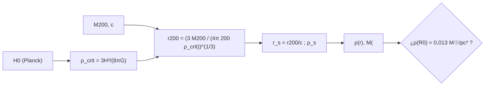

# B25-C15 — Materia oscura en galaxias

<!-- nav:top -->
[🏠 Programa](../../../../README.md) · [📚 Bloque B25](../../../tronco-comun/B25-galaxias-y-medio-interestelar.md) · [← Anterior: B25-C14 — Lentes gravitacionales galácticas](../B25-C14-lentes-gravitacionales-galacticas/CLASE.md) · [Siguiente: B25-C16 — Retroalimentación estelar →](../B25-C16-retroalimentacion-estelar/CLASE.md)
<!-- /nav -->

## 1. Ubicación, nivel y alcance

Clase 15 del bloque B25. Nivel N3. Reúne lo que las curvas de rotación de [C08](../B25-C08-curvas-de-rotacion-de-galaxias/CLASE.md), las dispersiones de [C10](../B25-C10-galaxias-irregulares-y-enanas/CLASE.md) y [C13](../B25-C13-cumulos-de-galaxias/CLASE.md) y las lentes de [C14](../B25-C14-lentes-gravitacionales-galacticas/CLASE.md) dicen sobre la masa que no se ve, y la expresa con un modelo de halo. Usa la gravitación ([B05-C10](../../B05/B05-C10-gravitacion-universal/CLASE.md)) y las integrales numéricas ([B09](../../../tronco-comun/B09-calculo-diferencial-e-integral.md)). La formación de los halos en el universo se estudia en [B36](../../../tronco-comun/B36-formacion-de-estructuras-cosmicas-y-materia-oscura.md); la naturaleza de la partícula, en [B31](../../../tronco-comun/B31-fisica-cuantica-nuclear-y-astroparticulas.md). Aquí aprendes a **construir y comprobar el halo de una galaxia como la Vía Láctea** con el perfil NFW, sin decir qué es la materia oscura.

## 2. Por qué esta clase existe

Varias medidas independientes (rotación, dispersión, lentes, fondo cósmico) piden más masa de la que se ve. Un halo con un perfil de densidad concreto permite comparar esas medidas entre sí y con las simulaciones. La decisión central: **dados la masa y la concentración de un halo, ¿qué radio, qué velocidad circular y qué densidad local tiene, y concuerdan con lo medido en el Sol?**

## 3. Lo que podrás hacer al terminar

1. Definir materia oscura, halo, perfil NFW, concentración, radio virial y densidad crítica.
2. Calcular la densidad crítica con la constante de Hubble.
3. Construir un halo NFW a partir de `M₂₀₀` y `c` y calcular `r₂₀₀`, `r_s` y `ρ_s`.
4. Calcular su velocidad circular y su densidad en el radio solar y compararlas con los datos.
5. Usar las densidades cósmicas de materia oscura y bariones para decir qué fracción de la materia es oscura.
6. Distinguir lo medido, lo modelado y lo que esta clase no afirma.

La evidencia es la **ficha de un halo** del ejercicio 12 (sección 20).

## 4. Con qué llegas y cómo comprobarlo

1. ¿Qué es la densidad crítica del universo?
2. ¿Qué es la velocidad circular `v = √(GM/r)`?
3. ¿Qué es una integral numérica en `ln r`?
4. ¿Cómo se halla el máximo de una función por sección áurea?
5. ¿Cuánto vale la constante de Hubble en `s⁻¹` si es `67,4 km/s/Mpc`?

<details>
<summary>Ver respuestas</summary>

1. La densidad para la que el universo es plano, `3H²/(8πG)`. 2. Con `M` la masa interior. 3. Integrar con el cambio `u = ln r` para recorrer varios órdenes de magnitud. 4. Reduciendo el intervalo de forma que se conserve el máximo. 5. `67,4 × 10³/3,0857 × 10²² = 2,18 × 10⁻¹⁸ s⁻¹`.
</details>

Con cuatro o cinco aciertos, sigue; si no, repasa B05-C10, B09 y C08.

## 5. Un caso real: lo que dicen las fuentes

Navarro, Frenk y White (S1) hallaron en simulaciones que los halos de materia oscura, de enanas a cúmulos, se ajustan con un perfil «universal»: más suave que `r⁻²` hacia el centro y más empinado que `r⁻²` hacia el radio virial. Planck (S2) da, en su análisis base-ΛCDM, `H₀ = 67,4 ± 0,5 km/s/Mpc`, `Ω_m = 0,315 ± 0,007`, `Ω_c h² = 0,120 ± 0,001` y `Ω_b h² = 0,0224 ± 0,0001`. Bertone y Hooper (S3) narran cómo la materia oscura llegó a aceptarse a partir de descubrimientos observacionales y argumentos teóricos. Para la Vía Láctea, Bland-Hawthorn y Gerhard (S4) ajustan un halo NFW de masa virial `1,3 × 10¹² M☉` y concentración `c = 16`, y citan una densidad local de materia oscura de `0,013 ± 0,003 M☉/pc³` (de McKee y colaboradores). Ese es el **ejemplo conductor**: un halo NFW con `M₂₀₀ = 1,3 × 10¹² M☉` (simplificación de esta clase: se usa la masa virial de S4 como `M₂₀₀`) y `c = 16`.

## 6. Vocabulario

La **materia oscura** es materia que gravita pero no emite luz detectable; su naturaleza no se trata aquí. Un **halo** es la distribución, aproximadamente esférica, de esa materia alrededor de una galaxia. El **perfil NFW** es `ρ(r) = ρ_s/[(r/r_s)(1 + r/r_s)²]`, con `r_s` el radio de escala y `ρ_s` una densidad característica. La **densidad crítica** `ρ_crit = 3H²/(8πG)` es la densidad media del universo plano (`H` la constante de Hubble). La **masa `M₂₀₀`** es la contenida en el radio `r₂₀₀` dentro del cual la densidad media es `200 ρ_crit`. La **concentración** es `c = r₂₀₀/r_s`. La **masa interior** NFW es `M(<r) = 4πρ_s r_s³ [ln(1 + x) − x/(1 + x)]`, con `x = r/r_s`. Las **densidades cósmicas** `Ω_c` y `Ω_b` son las de materia oscura y bariones divididas entre `ρ_crit`; `h = H₀/100 km s⁻¹ Mpc⁻¹`.

## 7. Modelo mental: un halo que se entiende por su concentración

Piensa en un copo de nieve gigante cuya densidad cae hacia fuera: la mayor parte de la masa está cerca del centro, pero el copo se extiende mucho más allá. Analogía: `c` mide qué tan apretado está el copo. Su límite: un halo real tiene subestructura, no es esférico y los bariones cambian su interior.



*Descripción textual:* de la constante de Hubble sale la densidad crítica; con la masa y la concentración se obtienen el radio, la escala y la densidad característica del halo; con ellos se calcula la densidad en el Sol y se compara con la medida.

## 8. La explicación, paso a paso

### 8.1 Densidad crítica

Con `H₀ = 67,4 km/s/Mpc = 2,184 × 10⁻¹⁸ s⁻¹`, `ρ_crit = 3H₀²/(8πG) = 8,53 × 10⁻²⁷ kg/m³ = 1,26 × 10¹¹ M☉/Mpc³`. El laboratorio lo coteja con la referencia clásica `2,775 × 10¹¹ h² M☉/Mpc³` (tolerancia `10⁻³`).

### 8.2 El halo de la Vía Láctea

Para `M₂₀₀ = 1,3 × 10¹² M☉`: `r₂₀₀ = 231 kpc`. Con `c = 16`, `r_s = 14,4 kpc`. Igualando `M₂₀₀` con `M(<r₂₀₀)` se obtiene `ρ_s`. Dentro de `r_s` hay el `10 %` de `M₂₀₀`: `[ln 2 − 1/2]/[ln 17 − 16/17] = 0,102`. La pendiente logarítmica de `ρ` pasa de `−1` en el centro a `−2` en `r_s` y a `−2,9` en `r₂₀₀`, en el sentido de S1 (más suave que `−2` dentro y más empinada fuera).

### 8.3 Velocidad circular

`v_c² = GM(<r)/r` es máxima en `x = 2,163`, o `r = 31,2 kpc`. En el radio solar `R₀ = 8,2 kpc` el halo da `v_c = 178 km/s`, es decir, el `56 %` de `Θ₀²` con `Θ₀ = 238 km/s` (S4). El resto vendría del disco, el bulbo, la barra y el gas. En C08, con el disco estelar como única componente visible y un halo pseudo-isotermo ilustrativo, el halo necesario aportaba `61 %`: del mismo orden.

### 8.4 Densidad local

La densidad del halo en `R₀` resulta `0,0130 M☉/pc³`, dentro de la barra de `0,013 ± 0,003` que S4 cita para la densidad local de materia oscura. Es una coincidencia bienvenida en un modelo simple, pero la concentración y la masa tienen incertidumbre propia que esta clase no propaga.

### 8.5 La parte cósmica

Con las densidades de S2, `Ω_c/Ω_b = 0,120/0,0224 = 5,36`; sus valores `Ω_c h²/h² = 0,264` y `Ω_b h²/h² = 0,0493` suman `0,313`, cerca de `Ω_m = 0,315`. La materia oscura es el `84 %` de la materia. Y la fracción bariónica cósmica es `Ω_b/Ω_m = 0,157`; la de la Vía Láctea, `0,07 ± 0,01` según S4, es menos de la mitad (ejercicio 9).

### 8.6 Lo que el modelo deja fuera

No evalúa explicaciones alternativas de las curvas de rotación (C08), no incluye la contracción del halo por los bariones, subestructura ni la forma triaxial. Bullock y Boylan-Kolchin (en C10) señalan además que a escalas de enanas los núcleos observados son menos densos que los previstos: el perfil NFW no se aplica sin matices a esas galaxias. La naturaleza de la materia oscura queda fuera.

## 9. Magnitudes, símbolos y unidades

| Símbolo | Qué es | Unidad | Valor / nota |
|---|---|---|---|
| `H₀` | constante de Hubble | km/s/Mpc | `67,4 ± 0,5` (S2) |
| `ρ_crit` | densidad crítica | `kg m⁻³`; `M☉ Mpc⁻³` | `8,53 × 10⁻²⁷`; `1,26 × 10¹¹` (cálculo propio) |
| `M₂₀₀`, `c` | masa y concentración | `M☉`; adimensional | `1,3 × 10¹²`; `16` (S4, simplificación) |
| `r₂₀₀`, `r_s` | radios | kpc | `231`; `14,4` (cálculo propio) |
| `v_c(R₀)` | velocidad circular del halo | km/s | `178` (cálculo propio) |
| `ρ(R₀)` | densidad local | `M☉ pc⁻³` | `0,0130` (modelo); `0,013 ± 0,003` (S4) |
| `Ω_c h²`, `Ω_b h²` | densidades cósmicas | adimensional | `0,120 ± 0,001`; `0,0224 ± 0,0001` (S2) |

## 10. Convenciones y referencias

`1 pc = 3,0856776 × 10¹⁶ m`; `GM☉` de la IAU. Se rotulan **observados/estimados** `H₀`, las `Ω` y la densidad local; **estimados de modelo** `M₂₀₀` y `c` de S4; **cálculo propio** `r₂₀₀`, `ρ_s` y `v_c`. El uso de la masa virial de S4 como `M₂₀₀` es una **simplificación** de esta clase.

## 11. De dónde sale lo que afirmamos

| ID | Fuente | Localizador | Respalda | Estado |
|---|---|---|---|---|
| S1 | Navarro, Frenk y White, *The Structure of Cold Dark Matter Halos*, arXiv:astro-ph/9508025 | https://arxiv.org/abs/astro-ph/9508025 | Perfil universal: más suave que `r⁻²` dentro y más empinado fuera | Solo resumen, consultado el 2026-11-09 |
| S2 | Planck Collaboration, *Planck 2018 results. VI. Cosmological parameters*, arXiv:1807.06209 | https://arxiv.org/abs/1807.06209 | `H₀`, `Ω_m`, `Ω_c h²`, `Ω_b h²` | Solo resumen, consultado el 2026-11-09 |
| S3 | Bertone y Hooper, *A History of Dark Matter*, arXiv:1605.04909 | https://arxiv.org/abs/1605.04909 | Aceptación de la materia oscura por evidencia observacional y teórica | Solo resumen, consultado el 2026-11-09 |
| S4 | Bland-Hawthorn y Gerhard, arXiv:1602.07702 | https://arxiv.org/abs/1602.07702 | Halo NFW (`1,3 × 10¹² M☉`, `c = 16`); densidad local; fracción bariónica | Texto del PDF extraído el 2026-11-09 |
| S5 | NIST, *Fundamental Physical Constants — Complete Listing* (CODATA 2022) | https://physics.nist.gov/cuu/Constants/Table/allascii.txt | `G` | Consultada el 2026-11-09 |
| S6 | Mamajek et al., *IAU 2015 Resolution B3*, arXiv:1510.07674 | https://arxiv.org/abs/1510.07674 | `GM☉` nominal | Texto del PDF extraído el 2026-11-09 |

Límites: la forma funcional del perfil NFW no figura en el resumen de S1 y se verifica aquí numéricamente (masa por cuadratura, máximo de `v_c`); la constante `2,775 × 10¹¹ h² M☉/Mpc³` es una referencia clásica que no se consultó; S1–S3 solo en resumen.

## 12. Cómo ver el halo

Equivalente accesible a un perfil de densidad (cálculo propio):

| Magnitud | Valor |
|---|---|
| `ρ_crit` | `1,26 × 10¹¹ M☉/Mpc³` |
| `r₂₀₀`, `r_s` | `231`, `14,4 kpc` |
| `r` del máximo de `v_c` | `31,2 kpc` |
| `v_c(R₀)` del halo | `178 km/s` |
| `ρ(R₀)` | `0,0130 M☉/pc³` |
| `M(<R₀)` del halo | `6,0 × 10¹⁰ M☉` |

Descripción larga: el halo se extiende cientos de kiloparsecs, la mayor parte de su masa está lejos del Sol y, en el radio solar, aporta algo más de la mitad del cuadrado de la velocidad circular.

## 13. Ejemplo trabajado: el halo en el radio solar

**Paso 1 · Datos.** `M₂₀₀ = 1,3 × 10¹² M☉`, `c = 16`, `H₀ = 67,4`.

**Paso 2 · Radio.** `r₂₀₀ = (3M₂₀₀/(4π · 200 ρ_crit))^{1/3} = 231 kpc`; `r_s = 14,4 kpc`.

**Paso 3 · Masa interior.** `x = 8,2/14,4 = 0,569`; `ln(1,569) − 0,569/1,569 = 0,4503 − 0,3626 = 0,0877`; con `4πρ_s r_s³ = M₂₀₀/[ln 17 − 16/17] = M₂₀₀/1,892`: `M(<R₀) = 1,3 × 10¹² × 0,0877/1,892 = 6,0 × 10¹⁰ M☉`.

**Paso 4 · Velocidad.** `v_c = √(GM/r) = 178 km/s`.

**Paso 5 · Sentido.** El halo explica el `56 %` de `Θ₀²`; el resto lo darán disco, bulbo, barra y gas. Esta es una coincidencia de modelo con valores de otra fuente: no confirma que el halo sea NFW ni que `M₂₀₀` valga eso.

## 14. Distintas maneras de describir un halo

**NFW (esta clase):** dos parámetros, adecuado a halos de simulaciones sin bariones. **Pseudo-isotermo (C08):** núcleo constante, usado en curvas de rotación de enanas. **Perfiles con núcleo en simulaciones con bariones:** reflejan cómo la retroalimentación (C16) cambia el centro. Para un primer cálculo sirve NFW; para una enana, conviene un perfil con núcleo.

## 15. Práctica guiada

**Ejercicio 1 · con los pasos indicados.** Calcula `ρ_crit` con `H₀ = 67,4 km/s/Mpc`. *Pasos:* `H₀` en `s⁻¹`; `3H₀²/(8πG)`.

<details><summary>Solución comentada</summary>

`H₀ = 2,184 × 10⁻¹⁸`; `H₀² = 4,77 × 10⁻³⁶`; `3H₀²/(8πG) = 1,43 × 10⁻³⁵/1,677 × 10⁻⁹ = 8,53 × 10⁻²⁷ kg/m³` (8.1).
</details>

**Ejercicio 2 · con una pista.** Calcula `r_s` con `r₂₀₀ = 231 kpc` y `c = 16`.

<details><summary>Solución comentada</summary>

`231/16 = 14,4 kpc` (8.2).
</details>

**Ejercicio 3 · casi autónomo.** ¿Qué fracción de `M₂₀₀` hay dentro de `r_s`?

<details><summary>Solución comentada</summary>

`m(1)/m(16) = 0,193/1,892 = 0,102` (8.2).
</details>

## 16. Práctica autónoma, transferencia e integrador

**Ejercicio 4.** Calcula la pendiente logarítmica de `ρ` en `x = 1` y `x = 16`.

<details><summary>Solución comentada</summary>

`d ln ρ/d ln r = −1 − 2x/(1 + x)`: `−2` en `x = 1`; `−2,88` en `x = 16` (8.2).
</details>

**Ejercicio 5.** ¿En qué radio es máxima la velocidad circular del halo?

<details><summary>Solución comentada</summary>

`2,163 r_s = 31,2 kpc` (8.3).
</details>

**Ejercicio 6.** Calcula el cociente `v_c²(R₀)/Θ₀²`.

<details><summary>Solución comentada</summary>

`(178/238)² = 0,56` (8.3).
</details>

**Ejercicio 7.** ¿Qué fracción de la materia del universo es oscura según `Ω_c h²` y `Ω_b h²`?

<details><summary>Solución comentada</summary>

`0,120/(0,120 + 0,0224) = 0,84` (8.5).
</details>

**Ejercicio 8.** Compara `ρ(R₀) = 0,0130` con `0,013 ± 0,003` en unidades de la incertidumbre.

<details><summary>Solución comentada</summary>

Diferencia `0,0000 / 0,003 ≈ 0σ`: coincide (8.4).
</details>

**Ejercicio 9 · transferencia.** La fracción bariónica cósmica es `Ω_b/Ω_m = 0,0224/(h²·0,315)`, con `h = 0,674`. ¿Qué proporción tiene la Vía Láctea (`0,07 ± 0,01`)?

<details><summary>Solución comentada</summary>

`Ω_b = 0,0224/0,4543 = 0,0493`; `0,0493/0,315 = 0,157`; `0,07/0,157 = 0,45`: la Galaxia contiene menos de la mitad de la fracción bariónica cósmica (8.5).
</details>

**Ejercicio 10 · transferencia.** Un compañero dice: «el halo NFW de esta clase demuestra que la materia oscura existe». Respóndele.

<details><summary>Solución comentada</summary>

El halo es un modelo que, con dos parámetros tomados de otra fuente, reproduce una densidad local y parte de la rotación; no descarta explicaciones alternativas. La aceptación se apoya en varias líneas de evidencia (S3 resume su historia) (8.6).
</details>

**Ejercicio 11 · transferencia.** El NFW tiene `ρ ∝ r⁻¹` hacia el centro. ¿Qué dice Bullock y Boylan-Kolchin (C10) que se observa en muchas galaxias dominadas por materia oscura?

<details><summary>Solución comentada</summary>

Núcleos menos densos y menos puntiagudos que los previstos; es el problema «núcleo–cúspide» (8.6).
</details>

**Ejercicio 12 · integrador.** Elabora la *ficha de un halo*: con `M₂₀₀` y `c` (puedes cambiar los de la Vía Láctea), calcula `r₂₀₀`, `r_s`, `v_c(R₀)` y `ρ(R₀)`, compara con `Θ₀` y la densidad local, y di qué parámetros de S4 son modelo.

<details><summary>Solución modelo</summary>

Con `1,3 × 10¹²` y `16`: `231`, `14,4 kpc`, `178 km/s`, `0,0130 M☉/pc³`; modelo: `M₂₀₀` (simplificación) y `c`; observada: la densidad local de S4.
</details>

## 17. Laboratorio: halo NFW

El script [halo_nfw.py](halo_nfw.py) construye el halo y calcula `r₂₀₀`, `v_c` y `ρ(R₀)`. **Comprueba** que la masa por cuadratura en `ln r` coincide con la forma cerrada en tres radios (`10⁻⁶`), que el máximo de `v_c` está en `x = 2,163` (`10⁻³`) y que `ρ_crit` es coherente con `2,775 × 10¹¹ h² M☉/Mpc³` (`10⁻³`).

**Datos:** `H₀` y `Ω` de S2; `M₂₀₀`, `c`, densidad local de S4; `G` de NIST. **Predice antes de ejecutar:** ¿cuánto vale `r₂₀₀`? (≈ 230 kpc.) **Ejecución del 2026-11-09 (Python 3.12.9):**

```text
Python 3.12.9 (biblioteca estandar)
rho_crit = 8.533e-27 kg/m3 = 1.261e+11 Msol/Mpc3
r_200 = 231 kpc ; r_s = 14.4 kpc ; r_max = 31.2 kpc
v_c(R0) del halo = 178 km/s ; fraccion de Theta0^2 = 0.56
rho_halo(R0) = 0.0130 Msol/pc3 (densidad local medida: 0.013 +- 0.003)
M(<R0) del halo = 6.020e+10 Msol
Omega_c/Omega_b = 5.36 (Planck 2018, resumen)
Pruebas superadas.
```

```bash
python programa/clases/B25/B25-C15-materia-oscura-en-galaxias/halo_nfw.py
```

**Límites:** halo esférico sin bariones, `M₂₀₀` tomado de la masa virial de S4.

## 18. Errores frecuentes y cómo corregirlos

**Tomar la masa virial como `M₂₀₀` sin avisar.** Se corrige en la sección 5 y la 10.

**Olvidar que `ρ_crit` depende de `H₀²`.** Se corrige con el ejercicio 1.

**Confundir `r_s` con `r₂₀₀`.** Se corrige con el ejercicio 2.

**Concluir que el halo prueba la materia oscura.** Se corrige con el ejercicio 10.

**Aplicar NFW a una enana sin matices.** Se corrige con el ejercicio 11.

## 19. Cómo sabrás que vas bien

Tras 8.2: ¿qué fracción de la masa está dentro de `r_s`? Ejercicio 3. Tras 8.4: ¿concuerda la densidad local? Ejercicio 8. Tras el laboratorio: ¿qué valida el máximo de `v_c`? (que la forma de la masa interior es correcta).

## 20. Qué entregas y cómo se evalúa

El producto es tu **ficha de un halo** (ejercicio 12).

| Criterio | Inicial | En desarrollo | Logrado | Destacado |
|---|---|---|---|---|
| Definiciones | Las confunde | Parciales | NFW, `M₂₀₀`, `c`, `ρ_crit` | Distingue modelo y medida |
| Cálculo | Sin unidades | Con errores | Valores correctos | Compara con datos |
| Interpretación | Sin comparar | Sin razón | Concluye sobre la fracción de `Θ₀²` | Discute alternativas |
| Numérico | Sin comprobar | Un caso | Tres pruebas superadas | Explica cada prueba |
| Fuentes | Sin fuente | Sin fecha | S1–S6 con fecha | Declara resúmenes |

**Condiciones críticas (no se compensan con promedio):** rotular `M₂₀₀` como simplificación; no presentar el halo como prueba de la materia oscura; citar solo lo consultado.

## 21. Ética, seguridad y límites

La clase es educativa y no sustituye a un ajuste de la masa de la Galaxia con datos de movimientos estelares. No toma posición sobre la naturaleza de la materia oscura. Accesibilidad: tablas equivalentes a los perfiles, fórmulas en texto, ejercicios sin conexión.

## 22. Para cerrar y seguir

Un halo NFW de `1,3 × 10¹² M☉` y `c = 16` mide `r₂₀₀ = 231 kpc`, da `178 km/s` en el radio solar y `0,013 M☉/pc³` de densidad local, de acuerdo con S4; la materia oscura sería el 84 % de la materia cósmica según S2. Queda una pregunta: ¿qué devuelven las estrellas al gas que las formó?

**Glosario español–inglés.** materia oscura · *dark matter*; halo · *halo*; perfil NFW · *NFW profile*; concentración · *concentration*; densidad crítica · *critical density*; radio virial · *virial radius*.

**Continuidad.** [B25-C16](../B25-C16-retroalimentacion-estelar/CLASE.md) trata de cómo las estrellas devuelven energía y metales al gas.

**Referencias:** ver sección 11.

<!-- nav:bottom -->
---

[← Anterior: B25-C14 — Lentes gravitacionales galácticas](../B25-C14-lentes-gravitacionales-galacticas/CLASE.md) · [📚 Bloque B25](../../../tronco-comun/B25-galaxias-y-medio-interestelar.md) · [Siguiente: B25-C16 — Retroalimentación estelar →](../B25-C16-retroalimentacion-estelar/CLASE.md)
<!-- /nav -->
