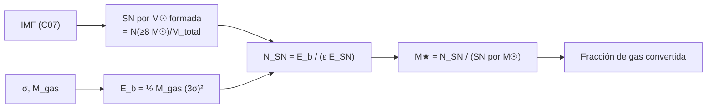

# B25-C16 — Retroalimentación estelar

<!-- nav:top -->
[🏠 Programa](../../../../README.md) · [📚 Bloque B25](../../../tronco-comun/B25-galaxias-y-medio-interestelar.md) · [← Anterior: B25-C15 — Materia oscura en galaxias](../B25-C15-materia-oscura-en-galaxias/CLASE.md) · [Siguiente: B25-C17 — Metallicidad y evolución química →](../B25-C17-metallicidad-y-evolucion-quimica/CLASE.md)
<!-- /nav -->

## 1. Ubicación, nivel y alcance

Clase 16 del bloque B25. Nivel N3. Cierra la pregunta de C05 («¿cuánto gas se convierte en estrellas?») con su cara opuesta: lo que las estrellas **devuelven** al gas. Usa la función de masa de [C07](../B25-C07-dinamica-de-poblaciones-estelares/CLASE.md), la enana de [C10](../B25-C10-galaxias-irregulares-y-enanas/CLASE.md), el halo de [C15](../B25-C15-materia-oscura-en-galaxias/CLASE.md), la energía ([B05-C06](../../B05/B05-C06-trabajo-y-energia/CLASE.md)) y el análisis dimensional ([B01-C04](../../B01/B01-C04-espacio-y-tiempo-en-ciencia/CLASE.md)). Aprendes a **hacer el presupuesto de energía de las supernovas** frente a la energía de ligadura del gas de una galaxia, y a deducir la escala de una burbuja de explosión por análisis dimensional. No se resuelve la hidrodinámica ni el enfriamiento radiativo.

## 2. Por qué esta clase existe

Sin retroalimentación, el gas de una galaxia se convertiría en estrellas mucho más deprisa de lo observado. Las supernovas, los vientos y la radiación de las estrellas masivas calientan y expulsan gas, y lo enriquecen con metales (C17). La decisión central: **¿alcanza la energía de las supernovas de una población para liberar el gas de una galaxia, y con qué fracción de estrellas formadas?**

## 3. Lo que podrás hacer al terminar

1. Definir retroalimentación, supernova, eficiencia de acoplamiento y energía de ligadura.
2. Calcular cuántas supernovas produce una población con una función de masa dada, por masa formada.
3. Estimar la energía de ligadura del gas de una enana y el número de supernovas necesarias.
4. Deducir por análisis dimensional el radio de una explosión en un medio uniforme.
5. Comparar el caso de una enana con el de una galaxia masiva.
6. Reconocer por qué los modelos de retroalimentación siguen siendo parametrizaciones.

La evidencia es la **ficha de presupuesto de retroalimentación** del ejercicio 12 (sección 20).

## 4. Con qué llegas y cómo comprobarlo

1. ¿Cuántos julios son `10⁵¹ erg`?
2. ¿Qué es la energía cinética `½mv²`?
3. ¿Qué es el análisis dimensional?
4. ¿Qué fracción de las estrellas de la IMF de C07 tiene `≥ 8 M☉`?
5. ¿Qué es la velocidad de escape de un halo isotermo?

<details>
<summary>Ver respuestas</summary>

1. `1 erg = 10⁻⁷ J`, luego `10⁴⁴ J`. 2. La energía asociada al movimiento. 3. Hallar la combinación de magnitudes que da las unidades de la cantidad buscada. 4. `0,63 %` en número y `20,9 %` en masa (C07, IMF ilustrativa). 5. Del orden de unas pocas veces la dispersión; aquí se usa `3σ` como valor ilustrativo.
</details>

Con cuatro o cinco aciertos, sigue; si no, repasa C07, B05-C06 y B01-C04.

## 5. Un caso real: lo que las fuentes dicen

Veilleux, Cecil y Bland-Hawthorn (S1) presentan los vientos galácticos como la vía principal por la que las galaxias devuelven energía y metales al medio intergaláctico, con evidencia en galaxias cercanas y en el universo lejano. Naab y Ostriker (S2) señalan que la retroalimentación de estrellas masivas y de agujeros negros supermasivos no se resuelve en las simulaciones cosmológicas y debe modelarse a una escala menor que la resolución; que una gran variedad de modelos verosímiles lo logra; y que su poder predictivo es limitado. El **ejemplo conductor**: la enana **sintética** de C10 (`σ = 7 km/s`, gas `10⁷ M☉`) y la IMF por tramos de C07 (rupturas de Kroupa, S3, pendientes ilustrativas).

## 6. Vocabulario

La **retroalimentación estelar** es el efecto de las estrellas sobre el gas que las rodea: calentamiento, empuje y enriquecimiento. Una **supernova** es la explosión final de una estrella masiva; aquí se toma una energía convencional de `10⁵¹ erg = 10⁴⁴ J` por explosión (valor ilustrativo). El **umbral** de `8 M☉` separa las estrellas que explotan de las que no (ilustrativo). La **eficiencia de acoplamiento** `ε` es la fracción de la energía de la explosión que acaba empujando gas (aquí `0,1`, ilustrativa). La **energía de ligadura del gas** es la que habría que darle para sacarlo del pozo: `E_b = ½ M_gas v²`, con `v = 3σ` ilustrativa. Un **viento galáctico** es un flujo de gas que sale de la galaxia. Una **burbuja** es la región de gas caliente creada por una explosión; su radio sigue `R = ξ (E t²/ρ)^{1/5}` con `E` la energía, `t` el tiempo y `ρ` la densidad del medio; `ξ ≈ 1,15` es un valor clásico no consultado aquí.

## 7. Modelo mental: pagar el viaje del gas

Imagina que el gas tiene que subir una cuesta (el pozo de la galaxia) y cada supernova da un pequeño impulso, aunque la mayor parte de su energía se pierde como luz. Analogía: las supernovas son monedas y la cuesta, el precio. Su límite: la energía no se acumula como dinero; llega en tiempos y lugares distintos, y el gas se enfría antes de poder usarla toda.



*Descripción textual:* la función de masa da cuántas supernovas hay por masa estelar; la dispersión y la masa de gas dan la energía de ligadura; dividiendo por la energía útil de cada supernova se obtiene su número y, con él, la masa estelar necesaria.

## 8. La explicación, paso a paso

### 8.1 Supernovas por masa formada

Con la IMF de C07 (ruptura en `0,5 M☉`, pendientes `1,3` y `2,3`, límites `0,08–100 M☉`), el número de estrellas `≥ 8 M☉` es `0,63 %` del total y la masa media `0,574 M☉`, de modo que se producen `0,0109` supernovas por `M☉` formada: una por cada `~92 M☉`. La energía liberada es `0,0109 × 10⁴⁴ J = 1,09 × 10⁴² J` por `M☉` formada. El laboratorio verifica las integrales de la IMF con su forma cerrada (`10⁻⁸`).

### 8.2 Ligadura del gas de una enana

Para `σ = 7 km/s`, `v = 3σ = 21 km/s` y `M_gas = 10⁷ M☉`: `E_b = ½ × 1,989 × 10³⁷ × (2,1 × 10⁴)² = 4,38 × 10⁴⁵ J`. Con `ε = 0,1`, cada supernova aporta `10⁴³ J` útiles, y hacen falta `438` supernovas. Formarlas requiere `438/0,0109 = 4,0 × 10⁴ M☉` de estrellas: el `0,40 %` del gas. En una enana, una fracción pequeña de formación estelar basta, con estos supuestos, para expulsar el gas. Si `ε = 0,01`, serían `4380` supernovas y el `4 %` del gas.

### 8.3 La escala de una burbuja

Buscamos la longitud `R` en función de `E` (`M L² T⁻²`), `ρ` (`M L⁻³`) y `t` (`T`): `R ∝ E^a ρ^b t^c` exige, por masa, `a + b = 0`; por longitud, `2a − 3b = 1`; por tiempo, `−2a + c = 0`. Resulta `a = 1/5`, `b = −1/5` y `c = 2/5`: `R ∝ (E t²/ρ)^{1/5}`, justo la forma de la burbuja. Con `ξ = 1,15`, `E = 10⁵¹ erg`, `n = 1 cm⁻³` y `t = 1 Myr`: `R ≈ 84 pc`, el techo sin enfriamiento. Multiplicar `E` por `32` duplica `R`; multiplicar `t` por `32` lo cuadruplica.

### 8.4 Galaxias de masa distinta

La energía de ligadura crece con `M_gas v²`. Para una galaxia como la Vía Láctea, con `M_gas ≈ 9 × 10⁹ M☉` (C03) y `v ≈ 300 km/s` (ilustrativo), `E_b = 8 × 10⁵⁰ J`: unas `8 × 10⁷` supernovas con `ε = 0,1`, o `7,4 × 10⁹ M☉` de estrellas formadas, el `15 %` de su masa estelar. Con estos valores, la retroalimentación vacía fácilmente una enana, no una galaxia masiva: una razón por la que los modelos de formación de galaxias necesitan retroalimentación más fuerte en masas bajas (S2).

### 8.5 Lo que el modelo deja fuera

No incluye el enfriamiento radiativo, que reduce mucho la energía útil, ni la distribución espacial de las explosiones, ni vientos y radiación de las estrellas masivas, ni la retroalimentación de agujeros negros (C11). Los valores de `E_SN`, `ε`, `8 M☉` y `3σ` son convencionales. S1 y S2 son resúmenes: el trabajo de ajuste de estas cantidades queda fuera.

## 9. Magnitudes, símbolos y unidades

| Símbolo | Qué es | Unidad | Valor / nota |
|---|---|---|---|
| `E_SN` | energía por supernova | J | `10⁴⁴` (`10⁵¹ erg`, convencional) |
| `ε` | acoplamiento | adimensional | `0,1` (ilustrativo) |
| `N_SN/M★` | supernovas por masa formada | `M☉⁻¹` | `0,0109` (IMF ilustrativa) |
| `σ`, `M_gas` | dispersión y gas de la enana | km/s; `M☉` | `7`; `10⁷` (sintéticos) |
| `E_b` | energía de ligadura | J | `4,38 × 10⁴⁵` (cálculo propio) |
| `R` | radio de la burbuja | pc | `84` a 1 Myr (con `ξ = 1,15`) |
| `G`, `GM☉` | constantes | SI | `6,674 30 × 10⁻¹¹` (S4); `1,327 124 4 × 10²⁰` (S5) |

## 10. Convenciones y referencias

`1 erg = 10⁻⁷ J`. Los valores `E_SN`, `ε`, el umbral y `3σ` son **convencionales/ilustrativos**; la enana es **sintética**; las rupturas de la IMF vienen de S3 y las pendientes son ilustrativas. Todo lo demás es **cálculo propio**. La constante `ξ = 1,15` es un valor clásico **no consultado**.

## 11. De dónde sale lo que afirmamos

| ID | Fuente | Localizador | Respalda | Estado |
|---|---|---|---|---|
| S1 | Veilleux, Cecil y Bland-Hawthorn, *Galactic Winds*, arXiv:astro-ph/0504435 | https://arxiv.org/abs/astro-ph/0504435 | Los vientos devuelven energía y metales | Solo resumen, consultado el 2026-11-09 |
| S2 | Naab y Ostriker, *Theoretical Challenges in Galaxy Formation*, arXiv:1612.06891 | https://arxiv.org/abs/1612.06891 | Retroalimentación sin resolver; poder predictivo limitado | Solo resumen, consultado el 2026-11-09 |
| S3 | Kroupa, arXiv:astro-ph/0009005 | https://arxiv.org/abs/astro-ph/0009005 | Rupturas de la IMF hacia `0,5` y `0,08 M☉` | Solo resumen, consultado el 2026-11-09 |
| S4 | NIST, *Fundamental Physical Constants — Complete Listing* (CODATA 2022) | https://physics.nist.gov/cuu/Constants/Table/allascii.txt | `G`, `m_p` | Consultada el 2026-11-09 |
| S5 | Mamajek et al., *IAU 2015 Resolution B3*, arXiv:1510.07674 | https://arxiv.org/abs/1510.07674 | `GM☉` nominal | Texto del PDF extraído el 2026-11-09 |

Límites: S1–S3 solo en resumen y sin cifras; `E_SN`, `ε`, el umbral de masa, `3σ` y `ξ` no se consultaron; el resultado de la enana es un presupuesto de energía, no una predicción.

## 12. Cómo ver el presupuesto

Equivalente accesible a un diagrama de flujo de energía (valores ilustrativos):

| Concepto | Valor |
|---|---|
| Supernovas por `M☉` formada | 0,0109 |
| Energía por `M☉` formada | `1,09 × 10⁴² J` |
| `E_b` de la enana | `4,38 × 10⁴⁵ J` |
| Supernovas necesarias (`ε = 0,1`) | 438 |
| Masa estelar necesaria | `4,0 × 10⁴ M☉` (0,40 % del gas) |

Descripción larga: unas cuatrocientas supernovas, formadas con menos del medio por ciento del gas, igualan la energía de ligadura del gas de la enana.

## 13. Ejemplo trabajado: ¿cuánta formación estelar libera el gas de la enana?

**Paso 1 · Datos.** `σ = 7 km/s`, `M_gas = 10⁷ M☉`, `ε = 0,1`, `E_SN = 10⁴⁴ J`.

**Paso 2 · Ligadura.** `v = 21 km/s`; `E_b = ½ × 1,989 × 10³⁷ × 4,41 × 10⁸ = 4,38 × 10⁴⁵ J`.

**Paso 3 · Supernovas.** `N = 4,38 × 10⁴⁵/(0,1 × 10⁴⁴) = 438`.

**Paso 4 · Masa estelar.** `438/0,0109 = 4,0 × 10⁴ M☉`.

**Paso 5 · Sentido.** Con estas hipótesis, formar el `0,4 %` del gas como estrellas bastaría para expulsarlo. Pero el acoplamiento real, el enfriamiento y la distribución de las explosiones pueden cambiar el resultado en un orden de magnitud; es un presupuesto, no una predicción.

## 14. Distintas formas de tratar la retroalimentación

**Presupuesto de energía (esta clase):** muestra órdenes de magnitud. **Burbujas de Sedov con enfriamiento:** dan cuánto de la energía llega a gas lejano. **Parametrizaciones en simulaciones (S2):** incluyen el efecto sin resolverlo, a costa de depender de parámetros. Para entender la escala sirve el presupuesto; para predecir, simulaciones.

## 15. Práctica guiada

**Ejercicio 1 · con los pasos indicados.** Calcula las supernovas por `M☉` a partir de `0,00627` por estrella y masa media `0,574 M☉`. *Pasos:* divide.

<details><summary>Solución comentada</summary>

`0,00627/0,574 = 0,0109` (8.1).
</details>

**Ejercicio 2 · con una pista.** Convierte `10⁵¹ erg` a julios y calcula la energía por `M☉` formada.

<details><summary>Solución comentada</summary>

`10⁴⁴ J`; `0,0109 × 10⁴⁴ = 1,09 × 10⁴² J/M☉` (8.1).
</details>

**Ejercicio 3 · casi autónomo.** Calcula `E_b` de la enana.

<details><summary>Solución comentada</summary>

`½ × 10⁷ × 1,989 × 10³⁰ × (2,1 × 10⁴)² = 4,38 × 10⁴⁵ J` (8.2).
</details>

## 16. Práctica autónoma, transferencia e integrador

**Ejercicio 4.** ¿Cuántas supernovas hacen falta con `ε = 0,1`?

<details><summary>Solución comentada</summary>

`4,38 × 10⁴⁵/10⁴³ = 438` (8.2).
</details>

**Ejercicio 5.** ¿Qué masa estelar produce esas supernovas?

<details><summary>Solución comentada</summary>

`438/0,0109 = 4,0 × 10⁴ M☉` (8.2).
</details>

**Ejercicio 6.** Repite con `ε = 0,01`.

<details><summary>Solución comentada</summary>

`4380` supernovas; `4,0 × 10⁵ M☉`, o el `4 %` del gas (8.2).
</details>

**Ejercicio 7.** Comprueba por exponentes que `R ∝ E^{1/5} ρ^{−1/5} t^{2/5}` tiene unidades de longitud.

<details><summary>Solución comentada</summary>

Masa: `1/5 − 1/5 = 0`; longitud: `2/5 + 3/5 = 1`; tiempo: `−2/5 + 2/5 = 0` (8.3).
</details>

**Ejercicio 8.** ¿Cuánto vale `R` a `t = 0,1 Myr` si a 1 Myr son `84 pc`?

<details><summary>Solución comentada</summary>

`84 × 0,1^{0,4} = 84 × 0,398 = 33 pc` (8.3).
</details>

**Ejercicio 9 · transferencia.** Estima `E_b` para una galaxia con gas `9 × 10⁹ M☉` y `v = 300 km/s`, y la fracción de masa estelar (`5 × 10¹⁰ M☉`) que habría que formar.

<details><summary>Solución comentada</summary>

`½ × 9 × 10⁹ × 1,989 × 10³⁰ × 9 × 10¹⁰ = 8,06 × 10⁵⁰ J`; `8 × 10⁷` supernovas; `7,4 × 10⁹ M☉`; `7,4/50 = 15 %` (8.4).
</details>

**Ejercicio 10 · transferencia.** Un compañero dice: «las supernovas siempre expulsan todo el gas de una galaxia». Respóndele.

<details><summary>Solución comentada</summary>

Depende de la masa de la galaxia (ejercicio 9) y del acoplamiento `ε`; en una enana puede bastar un `0,4 %`, en una galaxia masiva hace falta mucha más energía. S2 añade que el poder predictivo de los modelos es limitado (8.4).
</details>

**Ejercicio 11 · transferencia.** S1 dice que los vientos devuelven metales al medio. ¿Qué cambia en la composición del gas de la enana tras expulsarlo?

<details><summary>Solución comentada</summary>

Las supernovas lo enriquecen con elementos pesados y el viento los saca de la galaxia: la enana retiene menos metales; el tema continúa en C17.
</details>

**Ejercicio 12 · integrador.** Elabora la *ficha de presupuesto de retroalimentación*: elige una galaxia (sintética) con `σ` y gas; calcula supernovas por `M☉`, `E_b`, supernovas necesarias, masa estelar, fracción del gas y la sensibilidad a `ε`; indica qué parámetros son convencionales.

<details><summary>Solución modelo</summary>

La enana de la clase: `0,0109`; `4,38 × 10⁴⁵ J`; `438`; `4 × 10⁴ M☉`; `0,4 %` (y `4 %` con `ε = 0,01`); convencionales: `E_SN`, `ε`, umbral, `3σ`.
</details>

## 17. Laboratorio: presupuesto y análisis dimensional

El script [retroalimentacion.py](retroalimentacion.py) calcula las supernovas por masa, la energía de ligadura, la masa estelar necesaria y la burbuja. **Comprueba** que las integrales de la IMF coinciden con su forma cerrada (`10⁻⁸`), que el sistema lineal de dimensiones da los exponentes `(1/5, −1/5, 2/5)` (`10⁻¹²`) y que `R` escala con `E^{1/5}` y `t^{2/5}` (`10⁻¹²`).

**Datos:** constantes de NIST e IAU; IMF de C07; enana sintética; `E_SN` y `ε` convencionales. **Predice antes de ejecutar:** ¿qué masa estelar libera el gas? (~4 × 10⁴ M☉.) **Ejecución del 2026-11-09 (Python 3.12.9):**

```text
Python 3.12.9 (biblioteca estandar)
SN por Msol formada = 0.0109 ; energia por Msol = 1.093e+42 J/Msol
exponentes (E, rho, t) = (0.200, -0.200, 0.400)
R_Sedov-Taylor (E = 1e51 erg, n = 1 cm^-3, t = 1 Myr) = 84 pc (sin enfriamiento)
enana sintetica: E_ligadura = 4.384e+45 J ; SN necesarias (eps = 0.1) = 438 ; masa estelar = 4.011e+04 Msol (0.40 % del gas)
Pruebas superadas.
```

```bash
python programa/clases/B25/B25-C16-retroalimentacion-estelar/retroalimentacion.py
```

**Límites:** sin enfriamiento ni distribución espacial; `ξ` no verificado; parámetros convencionales.

## 18. Errores frecuentes y cómo corregirlos

**Confundir energía liberada y energía útil.** Se corrige con el ejercicio 6.

**Olvidar el cuadrado de la velocidad en `E_b`.** Se corrige con el ejercicio 3.

**Tomar `ξ = 1,15` como verificado.** Se corrige en las secciones 6 y 11.

**Extrapolar la enana a una galaxia masiva.** Se corrige con el ejercicio 9.

**Pensar que la burbuja crece sin pérdidas.** Se corrige en 8.5.

## 19. Cómo sabrás que vas bien

Tras 8.1: ¿cuántas supernovas por `M☉`? Ejercicio 1. Tras 8.2: ¿qué fracción del gas basta? Ejercicio 5. Tras el laboratorio: ¿qué demuestra el sistema de dimensiones? (que la combinación de exponentes es única).

## 20. Qué entregas y cómo se evalúa

El producto es tu **ficha de presupuesto de retroalimentación** (ejercicio 12).

| Criterio | Inicial | En desarrollo | Logrado | Destacado |
|---|---|---|---|---|
| Definiciones | Las confunde | Parciales | `ε`, `E_b`, supernova | Distingue energía total y útil |
| Cálculo | Sin unidades | Con errores | Valores correctos | Estudia la sensibilidad a `ε` |
| Interpretación | Sin comparar | Sin razón | Compara enana y masiva | Discute el enfriamiento |
| Numérico | Sin comprobar | Un caso | Tres pruebas superadas | Explica cada prueba |
| Fuentes | Sin fuente | Sin fecha | S1–S5 con fecha | Rotula lo convencional |

**Condiciones críticas (no se compensan con promedio):** rotular `E_SN`, `ε` y `3σ` como convencionales; no presentar el presupuesto como predicción; citar solo lo consultado.

## 21. Ética, seguridad y límites

La clase es educativa y no sustituye a una simulación de retroalimentación. Accesibilidad: tablas equivalentes a los diagramas, fórmulas en texto, ejercicios sin conexión.

## 22. Para cerrar y seguir

Una población con la IMF de C07 produce 0,011 supernovas por `M☉`; ~440 de ellas, con `ε = 0,1`, igualan la ligadura del gas de la enana sintética, y `R ∝ (Et²/ρ)^{1/5}` fija la escala de cada burbuja. Queda una pregunta: ¿qué elementos pesados llevan esos vientos y cómo cambian la composición de la galaxia?

**Glosario español–inglés.** retroalimentación · *feedback*; supernova · *supernova*; viento galáctico · *galactic wind*; energía de ligadura · *binding energy*; eficiencia de acoplamiento · *coupling efficiency*; burbuja · *bubble*.

**Continuidad.** [B25-C17](../B25-C17-metallicidad-y-evolucion-quimica/CLASE.md) sigue la composición química que dejan las estrellas y los vientos.

**Referencias:** ver sección 11.

<!-- nav:bottom -->
---

[← Anterior: B25-C15 — Materia oscura en galaxias](../B25-C15-materia-oscura-en-galaxias/CLASE.md) · [📚 Bloque B25](../../../tronco-comun/B25-galaxias-y-medio-interestelar.md) · [Siguiente: B25-C17 — Metallicidad y evolución química →](../B25-C17-metallicidad-y-evolucion-quimica/CLASE.md)
<!-- /nav -->
