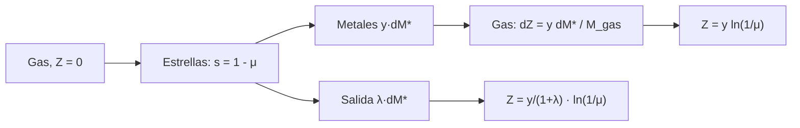

# B25-C17 — Metalicidad y evolución química

<!-- nav:top -->
[🏠 Programa](../../../../README.md) · [📚 Bloque B25](../../../tronco-comun/B25-galaxias-y-medio-interestelar.md) · [← Anterior: B25-C16 — Retroalimentación estelar](../B25-C16-retroalimentacion-estelar/CLASE.md) · [Siguiente: B25-C18 — Estructura cósmica a gran escala →](../../../tronco-comun/B25-galaxias-y-medio-interestelar.md#b25-c18)
<!-- /nav -->

## 1. Ubicación, nivel y alcance

Clase 17 del bloque B25. Nivel N3. Sigue la composición del gas y las estrellas de una galaxia a medida que se forman estrellas y se devuelve gas, con las supernovas y los vientos de [C16](../B25-C16-retroalimentacion-estelar/CLASE.md). Usa la nucleosíntesis de [B24-C08](../../B24/B24-C08-nucleosintesis-estelar/CLASE.md), la tabla periódica ([B06-C02](../../B06/B06-C02-tabla-periodica-y-abundancias-cosmicas/CLASE.md)), las ecuaciones diferenciales ([B11](../../../tronco-comun/B11-ecuaciones-diferenciales-y-simulacion-numerica.md)) y las incertidumbres ([B12](../../../tronco-comun/B12-probabilidad-estadistica-e-incertidumbre.md)). Aprendes el **modelo de caja cerrada** y su versión con salida de gas, con reciclaje instantáneo y mezcla perfecta. La química detallada de cada elemento no se trata.

## 2. Por qué esta clase existe

Cada generación de estrellas fabrica elementos pesados y los devuelve al gas; la proporción de metales de una galaxia cuenta cuánto se ha procesado su gas. En astronomía, «metales» son todos los elementos más pesados que el helio. La decisión central: **dada la fracción de gas que queda y la pérdida de gas por vientos, ¿qué metalicidad esperas en una galaxia y cómo se compara con la del Sol?**

## 3. Lo que podrás hacer al terminar

1. Definir metalicidad `Z`, rendimiento, fracción de gas, reciclaje instantáneo y carga de masa.
2. Resolver el modelo de caja cerrada y comprobarlo con una integración numérica.
3. Añadir una salida de gas y obtener el rendimiento efectivo.
4. Convertir `Z` a escala logarítmica respecto del Sol.
5. Calcular cuántos metales quedan en estrellas y cuántos en el gas.
6. Reconocer lo que el modelo omite (entrada de gas, mezcla finita).

La evidencia es la **ficha de evolución química** del ejercicio 12 (sección 20).

## 4. Con qué llegas y cómo comprobarlo

1. ¿Qué es la fracción de masa de un componente?
2. ¿Cuánto vale `ln(1/0,5)`?
3. ¿Qué es una ecuación diferencial separable?
4. ¿Qué es el logaritmo decimal de un cociente?
5. ¿Cómo se integra con Runge–Kutta de cuarto orden?

<details>
<summary>Ver respuestas</summary>

1. La masa del componente dividida entre la masa total. 2. `ln 2 = 0,693`. 3. Una en la que se pueden pasar a cada lado todas las apariciones de cada variable. 4. La diferencia de los logaritmos; se usa para expresar `Z/Z☉` en dex. 5. Con cuatro pendientes por paso (B11, C07).
</details>

Con cuatro o cinco aciertos, sigue; si no, repasa B24-C08, B06-C02 y B11.

## 5. Un caso real: la composición del Sol

Asplund y colaboradores (S1) recomiendan para la fotosfera solar las fracciones de masa `X = 0,7381` (hidrógeno), `Y = 0,2485` (helio) y `Z = 0,0134` (metales), con `Z/X = 0,0181`; en la composición global del Sol (con difusión) son `0,7154`, `0,2703` y `0,0142`. Esas cifras bajan el `2 %` clásico de metales a un `1,4 %`, según el texto. Maiolino y Mannucci (S2) revisan la evolución química cósmica de las galaxias y las relaciones observadas entre metalicidad y propiedades de las galaxias. El **ejemplo conductor** es una galaxia **sintética** de caja cerrada con rendimiento efectivo `y = 0,010` (ilustrativo) y gas restante `μ = 0,3`.

## 6. Vocabulario

La **metalicidad** `Z` es la fracción de masa en elementos más pesados que el helio. El **Sol** sirve de referencia: `Z☉ = 0,0134` (fotosfera, S1). La escala **logarítmica** es `log₁₀(Z/Z☉)`, en dex. La **fracción de gas** `μ = M_gas/M_total`. La fracción convertida en estrellas es `s = 1 − μ` en la caja cerrada. El **rendimiento** `y` es la masa de metales producida y liberada por cada unidad de masa que queda en estrellas. El **reciclaje instantáneo** supone que las estrellas masivas devuelven sus metales de inmediato. La **caja cerrada** es una galaxia sin entrada ni salida de masa. La **carga de masa** `λ` es la masa de gas expulsada por cada unidad de masa estelar formada. La **metalicidad efectiva** `y_ef = y/(1 + λ)` resume el efecto de las pérdidas.

## 7. Modelo mental: una olla que se concentra

Piensa en una olla de caldo que se hierve con sal que se va añadiendo; a medida que se evapora el agua, la sal se concentra. Analogía: la sal son los metales y el agua que sale es el gas que se convierte en estrellas. Su límite: aquí las estrellas atrapan parte de la sal y, además, el caldo real recibe agua nueva (gas de fuera).



*Descripción textual:* al formar estrellas, el gas se enriquece con los metales producidos; la metalicidad crece con el logaritmo de la inversa de la fracción de gas; con salida de gas, el crecimiento es menor en un factor `1 + λ`.

## 8. La explicación, paso a paso

### 8.1 Caja cerrada

Sea `M_gas = 1 − s`. Al formar `dM*` de estrellas con la composición del gas, el gas pierde `dM*` y recibe `y dM*` de metales, y los metales de `M_gas Z` varían como `d(M_gas Z) = y dM* − Z dM*`. Eliminando términos, `M_gas dZ = y dM*`, de modo que `dZ/ds = y/(1 − s)` y

`Z = y ln(1/μ)`.

Con `y = 0,010`: `μ = 0,9 → Z = 0,0011` (`0,08 Z☉`); `μ = 0,5 → 0,0069` (`0,52 Z☉`); `μ = 0,3 → 0,0120` (`0,90 Z☉`); `μ = 0,1 → 0,0230` (`1,7 Z☉`); `μ = 0,03 → 0,0351` (`2,6 Z☉`). El laboratorio integra la ecuación con RK4 y reproduce la solución exacta con error menor que `10⁻⁹`.

### 8.2 Con salida de gas

Si por cada `dM*` el gas expulsa además `λ dM*`, con la misma `Z`, la fracción de gas es `μ = 1 − (1 + λ)s` y, como los metales expulsados no cambian `Z`, `dZ/ds = y/(1 − (1 + λ)s)`. La solución es

`Z = [y/(1 + λ)] ln(1/μ)`.

A igual `μ = 0,3`, `Z` baja a `0,0060` (`0,45 Z☉`) con `λ = 1` y a `0,0030` (`0,22 Z☉`) con `λ = 3`. Una salida fuerte, como la que C16 sugiere para galaxias de baja masa, rebaja la metalicidad; es un efecto cualitativo, no una calibración.

### 8.3 Dónde están los metales

En la caja cerrada con `μ = 0,3` se produjeron `y s = 0,0070` de metales (por unidad de masa total); el gas retiene `Zμ = 0,0036`, el `51,6 %`, y las estrellas conservan el `48,4 %`. El laboratorio comprueba el balance de metales: la integral de `Z ds` más `Zμ` suma `y s` (error `10⁻⁶`). Las estrellas formadas tarde tienen más metales que las formadas pronto, de modo que la «edad» de una estrella se refleja en su composición.

### 8.4 Dos escalas de comparación

En el Sol: `X + Y + Z = 0,7381 + 0,2485 + 0,0134 = 1,0000`, y `Z/X = 0,0181`. En dex, una galaxia con `Z = 0,0069` está a `−0,29 dex` del Sol. Para igualar `Z☉ = 0,0134` con `y = 0,010` hace falta `μ = e^{−1,34} = 0,26`; con `λ = 1`, `μ = e^{−2,68} = 0,069`.

### 8.5 Lo que el modelo deja fuera

No hay entrada de gas ni mezcla gradual; el reciclaje es instantáneo, lo que falla para elementos producidos por supernovas de tipo Ia o estrellas de baja masa (B24-C21); `y` no es constante y `λ` depende de la galaxia. S2 revisa relaciones observadas que este modelo simple solo ilustra. El valor `y = 0,010` y las `λ` son ilustrativos.

## 9. Magnitudes, símbolos y unidades

| Símbolo | Qué es | Unidad | Valor / nota |
|---|---|---|---|
| `X`, `Y`, `Z` | fracciones de masa de H, He y metales | adimensional | `0,7381`, `0,2485`, `0,0134` (fotosfera, S1) |
| `Z☉` | metalicidad solar | adimensional | `0,0134` (S1) |
| `y` | rendimiento efectivo | adimensional | `0,010` (ilustrativo) |
| `μ`, `s` | fracción de gas y de estrellas | adimensional | libres |
| `λ` | carga de masa | adimensional | `0`, `1`, `3` (ilustrativas) |
| `log₁₀(Z/Z☉)` | metalicidad en dex | dex | tabla de 8.1 |

## 10. Convenciones y referencias

`Z` es fracción de masa. Se rotulan **estimados** las abundancias solares de S1 (fotosfera actual), **ilustrativos** `y` y `λ`, **sintética** la galaxia y **cálculo propio** el resto. El modelo es el estándar de caja cerrada con reciclaje instantáneo; su solución se verifica numéricamente aquí, no se cita.

## 11. De dónde sale lo que afirmamos

| ID | Fuente | Localizador | Respalda | Estado |
|---|---|---|---|---|
| S1 | Asplund, Grevesse, Sauval y Scott, *The chemical composition of the Sun*, arXiv:0909.0948 | https://arxiv.org/abs/0909.0948 | `X`, `Y`, `Z`, `Z/X` de la fotosfera y del Sol global | Texto del PDF extraído el 2026-11-09 |
| S2 | Maiolino y Mannucci, *De Re Metallica*, arXiv:1811.09642 | https://arxiv.org/abs/1811.09642 | Existen relaciones observadas entre metalicidad y propiedades de las galaxias | Solo resumen, consultado el 2026-11-09 |

Límites: S2 solo en resumen y sin cifras (no se citan pendientes ni la relación masa–metalicidad); `y` y `λ` son ilustrativos y no proceden de ninguna fuente.

## 12. Cómo ver la evolución química

Equivalente accesible a una gráfica `Z` frente a `μ` (`y = 0,010`, ilustrativo):

| `μ` | `Z` caja cerrada | `Z/Z☉` | `log₁₀(Z/Z☉)` |
|---|---|---|---|
| 0,9 | 0,0011 | 0,08 | −1,10 |
| 0,5 | 0,0069 | 0,52 | −0,29 |
| 0,3 | 0,0120 | 0,90 | −0,05 |
| 0,1 | 0,0230 | 1,72 | +0,24 |
| 0,03 | 0,0351 | 2,62 | +0,42 |

Descripción larga: la metalicidad crece despacio al principio y rápido al final, cuando queda poco gas.

## 13. Ejemplo trabajado: ¿cuánto vale `Z` si queda el 30 % del gas?

**Paso 1 · Datos.** `y = 0,010`, `μ = 0,3`.

**Paso 2 · Fórmula.** `Z = y ln(1/μ)`.

**Paso 3 · Cálculo.** `ln(1/0,3) = 1,204`; `Z = 0,0120`.

**Paso 4 · Referencia.** `Z/Z☉ = 0,0120/0,0134 = 0,90`; `log₁₀ = −0,05`.

**Paso 5 · Sentido.** Con ese rendimiento ilustrativo, una caja cerrada que ha convertido el `70 %` de su gas en estrellas alcanza casi el valor solar; con salida de gas `λ = 1` sería la mitad. Son números de un modelo con parámetros ilustrativos, no de una galaxia.

## 14. Distintas formas de modelar la química

**Caja cerrada (esta clase):** solución analítica; sin entrada ni salida. **Con flujos de entrada y salida:** más realista, con más parámetros. **Con reciclaje retardado y varios elementos:** necesarios para cocientes como el hierro y el oxígeno, y con tiempos de vida estelar. Para entender la dirección del efecto sirve la caja; para comparar con una galaxia real, el modelo con flujos.

## 15. Práctica guiada

**Ejercicio 1 · con los pasos indicados.** Calcula `Z` para `μ = 0,5`, `y = 0,010`. *Pasos:* `ln 2`; por `y`.

<details><summary>Solución comentada</summary>

`0,693 × 0,010 = 0,0069` (8.1).
</details>

**Ejercicio 2 · con una pista.** Expresa ese `Z` respecto del Sol en dex. *Pista:* `log₁₀(Z/Z☉)`.

<details><summary>Solución comentada</summary>

`log₁₀(0,0069/0,0134) = log₁₀ 0,515 = −0,29` (8.4).
</details>

**Ejercicio 3 · casi autónomo.** ¿Qué `μ` da `Z = Z☉` con `y = 0,010`?

<details><summary>Solución comentada</summary>

`μ = e^{−Z/y} = e^{−1,34} = 0,26` (8.4).
</details>

## 16. Práctica autónoma, transferencia e integrador

**Ejercicio 4.** Con `λ = 1` y `μ = 0,3`, ¿cuánto vale `Z`?

<details><summary>Solución comentada</summary>

`0,0120/2 = 0,0060` (8.2).
</details>

**Ejercicio 5.** Con `λ = 1`, ¿qué `μ` da `Z = Z☉`?

<details><summary>Solución comentada</summary>

`μ = e^{−(1+λ)Z/y} = e^{−2,68} = 0,069` (8.4).
</details>

**Ejercicio 6.** ¿Qué fracción de los metales producidos queda en las estrellas a `μ = 0,3` en la caja cerrada?

<details><summary>Solución comentada</summary>

`1 − Zμ/(y s) = 1 − 0,0036/0,0070 = 0,484` (8.3).
</details>

**Ejercicio 7.** Un gas de `10⁹ M☉` con `Z = 0,0120`, ¿cuántos metales contiene?

<details><summary>Solución comentada</summary>

`1,2 × 10⁷ M☉` (8.1).
</details>

**Ejercicio 8.** Comprueba que `X + Y + Z = 1` para la fotosfera solar de S1.

<details><summary>Solución comentada</summary>

`0,7381 + 0,2485 + 0,0134 = 1,0000` (8.4).
</details>

**Ejercicio 9 · transferencia.** Una enana con salida fuerte `λ = 3` y `μ = 0,5`. Calcula `Z` y su valor en dex.

<details><summary>Solución comentada</summary>

`Z = 0,010/4 × 0,693 = 0,00173`; `Z/Z☉ = 0,13`; `−0,89 dex` (8.2).
</details>

**Ejercicio 10 · transferencia.** Un compañero dice: «la metalicidad solo depende de la edad de la galaxia». Respóndele.

<details><summary>Solución comentada</summary>

En el modelo depende de la fracción de gas consumida y de la salida de gas: dos galaxias de igual edad con distinta `μ` o `λ` tienen metalicidades distintas (8.1, 8.2).
</details>

**Ejercicio 11 · transferencia.** Si el rendimiento real fuera `y = 0,02`, ¿cómo cambia `Z` a igual `μ`?

<details><summary>Solución comentada</summary>

`Z ∝ y`: se duplica. Por eso `y` es una de las incertidumbres principales del modelo (8.1, 8.5).
</details>

**Ejercicio 12 · integrador.** Elabora la *ficha de evolución química*: tabla `Z(μ)` para dos valores de `λ`, equivalencia en dex, fracción de metales en estrellas y tres supuestos que debilitan el resultado.

<details><summary>Solución modelo</summary>

La tabla de 8.1 y de 8.2; `0,484`; supuestos: reciclaje instantáneo, sin entrada de gas, `y` constante.
</details>

## 17. Laboratorio: caja cerrada con y sin salida

El script [evolucion_quimica.py](evolucion_quimica.py) calcula `Z(μ)` y la integra con RK4. **Comprueba** que RK4 reproduce la solución exacta con y sin salida (`10⁻⁹`), la identidad `Z_salida (1 + λ) = Z_caja` a igual `μ` (`10⁻¹²`) y la conservación de metales (`10⁻⁶`).

**Datos:** `Z☉` de S1; `y` y `λ` ilustrativos. **Predice antes de ejecutar:** ¿qué `Z` da `μ = 0,3`? (≈ 0,012.) **Ejecución del 2026-11-09 (Python 3.12.9):**

```text
Python 3.12.9 (biblioteca estandar)
Z_sol = 0.0134 ; y_eff ilustrativo = 0.01
caja cerrada: mu = 0.90 -> Z = 0.0011 = 0.08 Z_sol ; log10(Z/Zsol) = -1.10
caja cerrada: mu = 0.50 -> Z = 0.0069 = 0.52 Z_sol ; log10(Z/Zsol) = -0.29
caja cerrada: mu = 0.30 -> Z = 0.0120 = 0.90 Z_sol ; log10(Z/Zsol) = -0.05
caja cerrada: mu = 0.10 -> Z = 0.0230 = 1.72 Z_sol ; log10(Z/Zsol) = +0.24
caja cerrada: mu = 0.03 -> Z = 0.0351 = 2.62 Z_sol ; log10(Z/Zsol) = +0.42
salida lambda = 0, mu = 0.30: Z = 0.0120 = 0.90 Z_sol ; log10 = -0.05
salida lambda = 1, mu = 0.30: Z = 0.0060 = 0.45 Z_sol ; log10 = -0.35
salida lambda = 3, mu = 0.30: Z = 0.0030 = 0.22 Z_sol ; log10 = -0.65
fraccion de los metales producidos que queda en estrellas (mu = 0.3): 0.484
Pruebas superadas.
```

```bash
python programa/clases/B25/B25-C17-metallicidad-y-evolucion-quimica/evolucion_quimica.py
```

**Límites:** reciclaje instantáneo, sin entrada de gas, `y` constante.

## 18. Errores frecuentes y cómo corregirlos

**Confundir `μ` con `s`.** Se corrige en la sección 6.

**Olvidar que `Z` crece con el logaritmo de `1/μ`.** Se corrige con el ejercicio 1.

**Tomar `y` como un dato.** Se corrige con el ejercicio 11.

**Equiparar dex con porcentaje.** Se corrige con el ejercicio 2.

**Creer que el modelo describe galaxias reales.** Se corrige en 8.5.

## 19. Cómo sabrás que vas bien

Tras 8.1: ¿qué `μ` da el valor solar? Ejercicio 3. Tras 8.2: ¿cuánto baja `Z` con `λ = 1`? Ejercicio 4. Tras el laboratorio: ¿qué valida RK4? (que la ecuación diferencial y la solución cerrada son la misma).

## 20. Qué entregas y cómo se evalúa

El producto es tu **ficha de evolución química** (ejercicio 12).

| Criterio | Inicial | En desarrollo | Logrado | Destacado |
|---|---|---|---|---|
| Definiciones | Las confunde | Parciales | `Z`, `y`, `μ`, `λ` | Distingue metales y metalicidad solar |
| Cálculo | Sin unidades | Con errores | Valores y dex correctos | Propone casos límite |
| Interpretación | Sin comparar | Sin razón | Concluye sobre efecto de `λ` | Discute la entrada de gas |
| Numérico | Sin comprobar | Un caso | Tres pruebas superadas | Explica cada prueba |
| Fuentes | Sin fuente | Sin fecha | S1–S2 con fecha | Rotula lo ilustrativo |

**Condiciones críticas (no se compensan con promedio):** rotular `y` y `λ` como ilustrativos; no presentar el modelo como descripción de una galaxia real; citar solo lo consultado.

## 21. Ética, seguridad y límites

La clase es educativa y no sustituye a un modelo de evolución química con datos. Accesibilidad: tablas equivalentes a las gráficas, fórmulas en texto, ejercicios sin conexión.

## 22. Para cerrar y seguir

En una caja cerrada `Z = y ln(1/μ)`: con `y = 0,010` y `μ = 0,3` se llega a 0,9 `Z☉`; una salida `λ` la reduce a `1/(1 + λ)`. Queda una pregunta: ¿cómo se distribuyen todas estas galaxias, con sus halos, a escala cósmica?

**Glosario español–inglés.** metalicidad · *metallicity*; rendimiento · *yield*; caja cerrada · *closed box*; fracción de gas · *gas fraction*; carga de masa · *mass loading*; reciclaje instantáneo · *instantaneous recycling*.

**Continuidad.** [B25-C18](../B25-C18-estructura-cosmica-a-gran-escala/CLASE.md) sube a la escala en que se organizan las galaxias.

**Referencias:** ver sección 11.

<!-- nav:bottom -->
---

[← Anterior: B25-C16 — Retroalimentación estelar](../B25-C16-retroalimentacion-estelar/CLASE.md) · [📚 Bloque B25](../../../tronco-comun/B25-galaxias-y-medio-interestelar.md) · [Siguiente: B25-C18 — Estructura cósmica a gran escala →](../../../tronco-comun/B25-galaxias-y-medio-interestelar.md#b25-c18)
<!-- /nav -->
