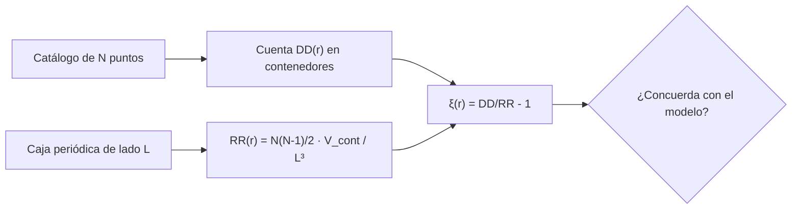

# B25-C18 — Estructura cósmica a gran escala

<!-- nav:top -->
[🏠 Programa](../../../../README.md) · [📚 Bloque B25](../../../tronco-comun/B25-galaxias-y-medio-interestelar.md) · [← Anterior: B25-C17 — Metallicidad y evolución química](../B25-C17-metallicidad-y-evolucion-quimica/CLASE.md) · [Siguiente: B25-C19 — Catálogos y sesgos de selección →](../B25-C19-catalogos-y-sesgos-de-seleccion/CLASE.md)
<!-- /nav -->

## 1. Ubicación, nivel y alcance

Clase 18 del bloque B25. Nivel N3. Sube de las galaxias aisladas y los cúmulos (C13) a la distribución de todas ellas en el espacio. Usa la densidad crítica de [C15](../B25-C15-materia-oscura-en-galaxias/CLASE.md), la estadística ([B12](../../../tronco-comun/B12-probabilidad-estadistica-e-incertidumbre.md)) y la probabilidad de Poisson. La formación de la estructura se estudia en [B36](../../../tronco-comun/B36-formacion-de-estructuras-cosmicas-y-materia-oscura.md) y la cosmología de fondo en [B26](../../../tronco-comun/B26-relatividad-y-cosmologia.md). Aquí aprendes a **medir cuánto se agrupan las galaxias con la función de correlación de dos puntos**, comprobando el estimador con catálogos sintéticos de solución conocida. Todo es una caja periódica sin distorsiones de corrimiento al rojo ni máscara.

## 2. Por qué esta clase existe

Las galaxias no se reparten al azar: forman filamentos, paredes, cúmulos y vacíos, la llamada red cósmica. La forma en que se agrupan guarda información de la materia oscura y de la historia del universo. Pero «agruparse» necesita una medida. La decisión central: **dado un catálogo de posiciones, ¿cuánto exceso de pares hay a cada separación respecto de una distribución al azar, y ese exceso concuerda con un modelo?**

## 3. Lo que podrás hacer al terminar

1. Definir red cósmica, vacío, función de correlación de dos puntos y catálogo aleatorio.
2. Calcular la densidad numérica y la separación media de un catálogo.
3. Estimar `ξ(r)` contando pares y comparando con los esperados en una distribución uniforme.
4. Calcular la incertidumbre de Poisson de la estimación.
5. Comparar con el resultado analítico de un modelo de agrupamiento.
6. Reconocer lo que requiere un catálogo real (máscara, distorsiones).

La evidencia es la **ficha de agrupamiento** del ejercicio 12 (sección 20).

## 4. Con qué llegas y cómo comprobarlo

1. ¿Qué es una distribución de Poisson de puntos?
2. ¿Cuál es el volumen de una corteza esférica entre `r₁` y `r₂`?
3. ¿Cuántos pares distintos hay entre `N` puntos?
4. ¿Qué es una caja periódica?
5. ¿Cuántos grados cuadrados tiene el cielo completo?

<details>
<summary>Ver respuestas</summary>

1. Puntos independientes y uniformes: el número en un volumen sigue la ley de Poisson. 2. `4π(r₂³ − r₁³)/3`. 3. `N(N−1)/2`. 4. Un cubo cuyos bordes opuestos se identifican, de modo que no hay fronteras. 5. `4π(180/π)² = 41 253` grados cuadrados.
</details>

Con cuatro o cinco aciertos, sigue; si no, repasa B12 y C15.

## 5. Un caso real: mapas del universo

El 2dF Galaxy Redshift Survey (S1) buscó unos `250 000` corrimientos al rojo de galaxias con el espectrógrafo 2dF, hasta `b_J < 19,45`, sobre unos `2000` grados cuadrados y con profundidad mediana `z = 0,11`. La simulación Millennium (S2) siguió el crecimiento de la estructura de materia oscura y mostró cómo las huellas bariónicas de las condiciones iniciales aparecen «distorsionadas» en la distribución de galaxias a corrimiento al rojo bajo. Planck (S3) da `Ω_m = 0,315 ± 0,007` y `H₀ = 67,4 ± 0,5 km/s/Mpc`, de donde la densidad media de materia es `0,315 × 1,26 × 10¹¹ = 3,97 × 10¹⁰ M☉/Mpc³` (con `ρ_crit` de C15). El **ejemplo conductor** son dos catálogos **sintéticos** en una caja de `100 Mpc` (unidades ilustrativas): uno al azar y otro agrupado.

## 6. Vocabulario

La **red cósmica** es la estructura de filamentos, paredes y nodos que rodea a los **vacíos**. La **densidad numérica** es `n = N/V`. La **función de correlación de dos puntos** `ξ(r)` mide el exceso de pares a separación `r` respecto del azar: la probabilidad de hallar un par es `n² [1 + ξ(r)] dV₁ dV₂`; `ξ = 0` es la distribución de Poisson, sin estructura. El **estimador natural** es `ξ = DD/RR − 1`, con `DD` los pares de datos y `RR` los esperados al azar. Un **catálogo aleatorio** es el de Poisson usado como referencia. El **proceso de Neyman–Scott** pone «padres» al azar y cada uno rodea de «hijos» con desplazamiento gaussiano de desviación `s` por coordenada. La **caja periódica** elimina los bordes. El **sesgo de selección** se trata en C19.

## 7. Modelo mental: cuentas de pares

Imagina un tablero de dardos: si los dardos caen al azar, el número de pares cercanos sigue la regla del azar; si tienden a juntarse en racimos, hay más pares cercanos. Analogía: `ξ` es cuánto más racimo hay que azar. Su límite: los dardos de un tablero son independientes; las galaxias, no, y el catálogo real tiene huecos, bordes y selección que el azar de referencia debe reproducir.



*Descripción textual:* se cuentan los pares de datos por contenedor de distancia, se calculan los esperados al azar con el volumen del contenedor y se obtiene `ξ`; se compara con el modelo o con cero.

## 8. La explicación, paso a paso

### 8.1 Densidad y separación

Un catálogo de `N = 2000` puntos en `L = 100 Mpc` (volumen `10⁶ Mpc³`) tiene `n = 2 × 10⁻³ Mpc⁻³` y una separación media `n^{−1/3} = 7,9 Mpc`. En una caja de ese tamaño hay `3,97 × 10¹⁶ M☉` de materia media (`ρ_m V`).

### 8.2 El estimador

En una caja periódica, los pares esperados al azar en un contenedor entre `r₁` y `r₂` son `RR = [N(N−1)/2] × V_cont/L³`, con `V_cont = 4π(r₂³ − r₁³)/3`. Para el catálogo agrupado (`N = 2022`) en `2–4 Mpc`: `V_cont = 234,6 Mpc³`, `RR = 479`; se contaron `DD = 3373` pares; `ξ = 3373/479 − 1 = 6,04`.

### 8.3 Un modelo con solución exacta

En el proceso de Neyman–Scott con `n_p` padres por volumen y miembros de Poisson, los pares de un mismo racimo dan

`ξ(r) = exp(−r²/(4s²)) / [n_p (4πs²)^{3/2}]`,

porque la diferencia de posiciones de dos miembros tiene varianza `2s²` por coordenada. Con `100` padres, `s = 3 Mpc`, `n_p = 10⁻⁴ Mpc⁻³`: `ξ(0) = 8,31` y `ξ` baja a la mitad en `r = 2s√(ln 2) = 5,0 Mpc`. El laboratorio genera un catálogo con esos parámetros y obtiene, en cinco contenedores, `7,34`, `6,04`, `4,20`, `1,56` y `0,25`, frente a `7,78`, `6,22`, `4,02`, `1,33` y `0,13` de la teoría promediada en cada contenedor. En los dos primeros contenedores el acuerdo es del 6 % y el 3 %; en los externos la diferencia (`0,23` y `0,12`) supera el ruido de Poisson de las cuentas (`~0,02`), porque la caja solo contiene 100 racimos y esa realización concreta se aparta de la media teórica (varianza de la realización). Por eso el laboratorio solo exige el acuerdo en los dos primeros contenedores.

### 8.4 Incertidumbre

Si `DD` sigue una ley de Poisson, `σ_ξ ≈ (1 + ξ)/√DD`. En el contenedor `2–4 Mpc`: `7,04/√3373 = 0,12`, es decir 2 %. El catálogo de Poisson, sin estructura, debe dar `ξ` compatible con cero: el laboratorio exige `|ξ| ≤ 4/√RR` en cada contenedor.

### 8.5 Lo que el modelo deja fuera

Los catálogos reales requieren un catálogo aleatorio con la misma máscara y selección, corrección de las distorsiones por velocidades peculiares (la distancia sale del corrimiento al rojo) y estimadores con menor varianza. Las galaxias no son un proceso de Neyman–Scott; el modelo solo prueba el estimador. Los datos de S1 y S2 no se usan numéricamente.

## 9. Magnitudes, símbolos y unidades

| Símbolo | Qué es | Unidad | Valor / nota |
|---|---|---|---|
| `L`, `V` | lado y volumen de la caja | Mpc; `Mpc³` | `100`; `10⁶` (ilustrativos) |
| `N`, `n` | número y densidad de puntos | adimensional; `Mpc⁻³` | `2000`; `2 × 10⁻³` |
| `ξ(r)` | función de correlación | adimensional | tabla de 8.3 |
| `n_p`, `s` | densidad de padres y dispersión | `Mpc⁻³`; Mpc | `10⁻⁴`; `3` (sintéticos) |
| `ρ_m` | densidad media de materia | `M☉ Mpc⁻³` | `3,97 × 10¹⁰` (cálculo propio con S3 y C15) |
| `Ω_m`, `H₀` | parámetros cosmológicos | adimensional; km/s/Mpc | `0,315 ± 0,007`; `67,4 ± 0,5` (S3) |

## 10. Convenciones y referencias

Distancias comóviles ilustrativas en Mpc; caja periódica. Se rotulan **observados** los datos de S1 y S3 (cualitativos o de abstract), **sintéticos** los catálogos y **cálculo propio** `ξ` y las densidades. El estimador natural y la solución de Neyman–Scott se verifican en el laboratorio, no se citan.

## 11. De dónde sale lo que afirmamos

| ID | Fuente | Localizador | Respalda | Estado |
|---|---|---|---|---|
| S1 | Colless et al., *The 2dF Galaxy Redshift Survey: Spectra and redshifts*, arXiv:astro-ph/0106498 | https://arxiv.org/abs/astro-ph/0106498 | ~250 000 galaxias, 2000 grados², `z` mediano 0,11 | Solo resumen, consultado el 2026-11-09 |
| S2 | Springel et al., *Simulating the joint evolution of quasars, galaxies and their large-scale distribution*, arXiv:astro-ph/0504097 | https://arxiv.org/abs/astro-ph/0504097 | Simulación de la estructura; huellas bariónicas distorsionadas | Solo resumen, consultado el 2026-11-09 |
| S3 | Planck Collaboration, arXiv:1807.06209 | https://arxiv.org/abs/1807.06209 | `Ω_m`, `H₀` | Solo resumen, consultado el 2026-11-09 |

Límites: S1–S3 solo en resumen; no se leyó ningún resultado de `ξ` observada, así que no se compara el catálogo sintético con una `ξ` real; el estimador y el modelo se verifican con catálogos sintéticos.

## 12. Cómo ver el agrupamiento

Equivalente accesible a una gráfica `ξ(r)` (catálogo agrupado **sintético**; teoría promediada por contenedor):

| `r` (Mpc) | `ξ` estimado | `ξ` teórico | Pares |
|---|---|---|---|
| 0–2 | 7,34 | 7,78 | 571 |
| 2–4 | 6,04 | 6,22 | 3373 |
| 4–6 | 4,20 | 4,02 | 6771 |
| 6–10 | 1,56 | 1,33 | 17 208 |
| 10–15 | 0,25 | 0,13 | 25 375 |

Descripción larga: `ξ` es alta a separaciones pequeñas y cae a casi cero hacia 15 Mpc, como en un conjunto de racimos de unos pocos megaparsecs.

## 13. Ejemplo trabajado: del conteo a `ξ`

**Paso 1 · Datos.** Catálogo agrupado: `N = 2022`, `L = 100 Mpc`, contenedor `2–4 Mpc`, `DD = 3373`.

**Paso 2 · Volumen.** `V_cont = (4π/3)(4³ − 2³) = 234,6 Mpc³`.

**Paso 3 · Pares esperados.** `RR = 2022 × 2021/2 × 234,6/10⁶ = 479`.

**Paso 4 · Estimador.** `ξ = 3373/479 − 1 = 6,04`.

**Paso 5 · Sentido.** Hay 7 veces más pares a 2–4 Mpc que en una distribución al azar. La incertidumbre de Poisson es ~0,12. El resultado describe un catálogo sintético, no el universo.

## 14. Distintas formas de medir la estructura

**Función de correlación (esta clase):** en el espacio de configuraciones. **Espectro de potencia:** el equivalente en el espacio de frecuencias, más cómodo para comparar con la teoría (B36). **Estadísticas de vacíos y filamentos:** describen la red cósmica directamente. Para una primera medida del agrupamiento sirve `ξ`; para parámetros cosmológicos se usa el espectro de potencia.

## 15. Práctica guiada

**Ejercicio 1 · con los pasos indicados.** Calcula la densidad numérica y la separación media de `N = 2000` en `10⁶ Mpc³`. *Pasos:* `N/V`; `n^{−1/3}`.

<details><summary>Solución comentada</summary>

`2 × 10⁻³ Mpc⁻³`; `(2 × 10⁻³)^{−1/3} = 7,9 Mpc` (8.1).
</details>

**Ejercicio 2 · con una pista.** Calcula `RR` en el contenedor `2–4 Mpc` para `N = 2022`. *Pista:* `N(N−1)/2 × V_cont/L³`.

<details><summary>Solución comentada</summary>

`2,043 × 10⁶ × 234,6/10⁶ = 479` (8.2).
</details>

**Ejercicio 3 · casi autónomo.** Con `DD = 3373`, calcula `ξ`.

<details><summary>Solución comentada</summary>

`3373/479 − 1 = 6,04` (8.2).
</details>

## 16. Práctica autónoma, transferencia e integrador

**Ejercicio 4.** Calcula `ξ(0)` del modelo de Neyman–Scott con `n_p = 10⁻⁴`, `s = 3`.

<details><summary>Solución comentada</summary>

`(4π × 9)^{3/2} = 1203`; `ξ(0) = 1/(10⁻⁴ × 1203) = 8,31` (8.3).
</details>

**Ejercicio 5.** ¿A qué `r` cae `ξ` a la mitad?

<details><summary>Solución comentada</summary>

`exp(−r²/4s²) = 1/2` → `r = 2s√(ln 2) = 5,0 Mpc` (8.3).
</details>

**Ejercicio 6.** Calcula la incertidumbre de Poisson del contenedor `4–6 Mpc` (`DD = 6771`, `ξ = 4,2`).

<details><summary>Solución comentada</summary>

`(1 + 4,2)/√6771 = 0,063` (8.4).
</details>

**Ejercicio 7.** ¿Qué masa media de materia hay en la caja de `100 Mpc`?

<details><summary>Solución comentada</summary>

`3,97 × 10¹⁰ × 10⁶ = 3,97 × 10¹⁶ M☉` (8.1).
</details>

**Ejercicio 8.** Si las 2000 galaxias de la caja fueran todas de `10¹¹ M☉`, ¿qué fracción de la materia media suman?

<details><summary>Solución comentada</summary>

`2000 × 10¹¹ = 2 × 10¹⁴ M☉`; `2 × 10¹⁴/3,97 × 10¹⁶ = 0,5 %` (valor sintético; indica que la materia no está solo en galaxias).
</details>

**Ejercicio 9 · transferencia.** Si `s` fuera `6 Mpc` con la misma `n_p`, ¿cuánto vale `ξ(0)` y dónde cae a la mitad?

<details><summary>Solución comentada</summary>

`ξ(0)` se divide por `2³ = 8`: `1,04`; el radio se duplica: `10 Mpc` (8.3).
</details>

**Ejercicio 10 · transferencia.** Un compañero dice: «las galaxias se reparten al azar por el cielo». Respóndele con una cifra.

<details><summary>Solución comentada</summary>

Una distribución al azar da `ξ = 0`; el catálogo agrupado da `ξ = 6` a 2–4 Mpc, con ruido de 0,12. El azar queda descartado en ese modelo; para el universo real hace falta un catálogo real (8.3, 8.4).
</details>

**Ejercicio 11 · transferencia.** ¿Qué fracción del cielo cubre el 2dFGRS si son unos `2000` grados cuadrados?

<details><summary>Solución comentada</summary>

`2000/41 253 = 4,8 %` del cielo (sección 4, S1). Un solo campo no es representativo del universo entero.
</details>

**Ejercicio 12 · integrador.** Elabora la *ficha de agrupamiento*: elige `n_p`, `s` y `N`, genera o inventa el catálogo, calcula `ξ` en tres contenedores con su incertidumbre y compáralo con la teoría; indica qué le falta a un catálogo real.

<details><summary>Solución modelo</summary>

Con los valores de la clase: tabla de la sección 12 con incertidumbres `~0,1`; falta máscara, catálogo aleatorio y distorsiones de corrimiento al rojo.
</details>

## 17. Laboratorio: pares y función de correlación

El script [correlacion.py](correlacion.py) genera un catálogo de Poisson y otro de Neyman–Scott con semilla fija, cuenta pares en una caja periódica y estima `ξ`. **Comprueba** que el catálogo al azar da `|ξ| ≤ 4/√RR` en cada contenedor y que el agrupado coincide con la teoría al 30 % en los dos primeros contenedores.

**Datos:** todo **sintético**. **Predice antes de ejecutar:** ¿qué `ξ` da el catálogo de Poisson? (cero.) **Ejecución del 2026-11-09 (Python 3.12.9; ~2 s):**

```text
Python 3.12.9 (biblioteca estandar)
Poisson: N = 2000 ; agrupado: N = 2022 (100 padres x ~20 miembros, s = 3 Mpc)
contenedor (Mpc) | xi estimado | xi teorico (promedio en el contenedor) | pares
   0.0- 2.0            7.34          7.78                          571
   2.0- 4.0            6.04          6.22                          3373
   4.0- 6.0            4.20          4.02                          6771
   6.0-10.0            1.56          1.33                         17208
  10.0-15.0            0.25          0.13                         25375
Pruebas superadas.
```

```bash
python programa/clases/B25/B25-C18-estructura-cosmica-a-gran-escala/correlacion.py
```

**Límites:** caja periódica, sin máscara ni distorsiones; los puntos son sintéticos.

## 18. Errores frecuentes y cómo corregirlos

**Olvidar que `RR` depende del volumen del contenedor.** Se corrige con el ejercicio 2.

**Contar cada par dos veces.** Se corrige en la sección 4 y el ejercicio 2.

**Interpretar `ξ = 0` como «sin galaxias».** Se corrige en la sección 6.

**Ignorar el ruido.** Se corrige con el ejercicio 6.

**Aplicar el estimador a un catálogo real sin máscara.** Se corrige en 8.5.

## 19. Cómo sabrás que vas bien

Tras 8.2: ¿cuántos pares esperas al azar? Ejercicio 2. Tras 8.3: ¿a qué radio cae `ξ` a la mitad? Ejercicio 5. Tras el laboratorio: ¿por qué se prueba con un catálogo de Poisson? (porque el resultado correcto es conocido: cero).

## 20. Qué entregas y cómo se evalúa

El producto es tu **ficha de agrupamiento** (ejercicio 12).

| Criterio | Inicial | En desarrollo | Logrado | Destacado |
|---|---|---|---|---|
| Definiciones | Las confunde | Parciales | `ξ`, `DD`, `RR` | Distingue red cósmica y racimos |
| Cálculo | Sin unidades | Con errores | Valores correctos | Propaga la incertidumbre |
| Interpretación | Sin comparar | Sin razón | Compara con la teoría | Discute máscara y selección |
| Numérico | Sin comprobar | Un caso | Dos pruebas superadas | Explica cada prueba |
| Fuentes | Sin fuente | Sin fecha | S1–S3 con fecha | Declara que no hay `ξ` real |

**Condiciones críticas (no se compensan con promedio):** rotular los catálogos como sintéticos; no presentar `ξ` sintética como del universo; citar solo lo consultado.

## 21. Ética, seguridad y límites

La clase es educativa y no sustituye al análisis de un catálogo real. Accesibilidad: tablas equivalentes a las gráficas, fórmulas en texto, ejercicios sin conexión.

## 22. Para cerrar y seguir

La función de correlación `ξ = DD/RR − 1` mide el exceso de pares sobre el azar; en un catálogo sintético de racimos de 3 Mpc llega a ~8 en el centro y cae a casi cero a 15 Mpc. Queda una pregunta: ¿qué galaxias entran en un catálogo real y cuáles quedan fuera?

**Glosario español–inglés.** red cósmica · *cosmic web*; vacío · *void*; función de correlación · *correlation function*; catálogo aleatorio · *random catalogue*; caja periódica · *periodic box*; densidad numérica · *number density*.

**Continuidad.** [B25-C19](../B25-C19-catalogos-y-sesgos-de-seleccion/CLASE.md) trata de los sesgos que afectan a los catálogos.

**Referencias:** ver sección 11.

<!-- nav:bottom -->
---

[← Anterior: B25-C17 — Metallicidad y evolución química](../B25-C17-metallicidad-y-evolucion-quimica/CLASE.md) · [📚 Bloque B25](../../../tronco-comun/B25-galaxias-y-medio-interestelar.md) · [Siguiente: B25-C19 — Catálogos y sesgos de selección →](../B25-C19-catalogos-y-sesgos-de-seleccion/CLASE.md)
<!-- /nav -->
