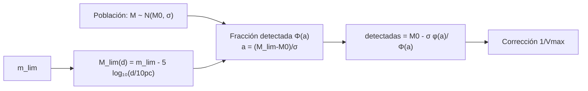

# B25-C19 — Catálogos y sesgos de selección

<!-- nav:top -->
[🏠 Programa](../../../../README.md) · [📚 Bloque B25](../../../tronco-comun/B25-galaxias-y-medio-interestelar.md) · [← Anterior: B25-C18 — Estructura cósmica a gran escala](../B25-C18-estructura-cosmica-a-gran-escala/CLASE.md) · [Siguiente: B25-C20 — Proyecto de clasificación galáctica →](../B25-C20-proyecto-de-clasificacion-galactica/CLASE.md)
<!-- /nav -->

## 1. Ubicación, nivel y alcance

Clase 19 del bloque B25. Nivel N3. Aplica la estadística de [B12](../../../tronco-comun/B12-probabilidad-estadistica-e-incertidumbre.md) y las magnitudes de [C04](../B25-C04-nubes-moleculares-y-polvo/CLASE.md) a una pregunta de método: **qué galaxias entran en un catálogo y cómo eso deforma lo que concluyes**. Sigue a la estructura a gran escala de [C18](../B25-C18-estructura-cosmica-a-gran-escala/CLASE.md), donde todo catálogo se suponía completo. Estudias el sesgo de Malmquist en una población sintética y su corrección con el estimador `1/V_max`. El modelo es de luminosidad gaussiana, densidad uniforme, sin extinción ni evolución.

## 2. Por qué esta clase existe

Un catálogo limitado por flujo ve las galaxias brillantes a gran distancia y casi solo ellas; si se promedian sus luminosidades sin cuidado, el resultado depende de la distancia del catálogo y no de las galaxias. Saber qué falta es tan importante como saber qué hay. La decisión central: **dado un límite de brillo, ¿qué fracción de la población detecta un catálogo a cada distancia, cuánto sesga la media y cómo se corrige?**

## 3. Lo que podrás hacer al terminar

1. Definir catálogo, completitud, límite de flujo, sesgo de selección y sesgo de Malmquist.
2. Convertir un límite de magnitud aparente en uno de magnitud absoluta a cada distancia.
3. Calcular la fracción detectada y la magnitud media de las detectadas.
4. Aplicar `1/V_max` para recuperar la media de la población.
5. Contrastar un cálculo con una simulación de Monte Carlo y juzgar el acuerdo con su incertidumbre estadística.
6. Leer la descripción de un catálogo real e identificar su selección.

La evidencia es la **ficha de selección de un catálogo** del ejercicio 12 (sección 20).

## 4. Con qué llegas y cómo comprobarlo

1. ¿Cuál es el módulo de distancia `m − M = 5 log₁₀(d/10 pc)`?
2. ¿Qué es la distribución normal y su función acumulada `Φ`?
3. ¿Qué es la media de una normal truncada?
4. ¿Qué es un experimento de Monte Carlo?
5. ¿Qué es el error estándar de una media?

<details>
<summary>Ver respuestas</summary>

1. Relación entre magnitud aparente, absoluta y distancia. 2. La campana de Gauss; `Φ(x)` es la probabilidad de estar por debajo de `x` en unidades de desviación. 3. Si se corta por arriba en `a`, `μ − σ φ(a)/Φ(a)` con `φ` la densidad normal. 4. Una simulación con números aleatorios de semilla fija. 5. `σ/√N`.
</details>

Con cuatro o cinco aciertos, sigue; si no, repasa C04 y B12.

## 5. Un caso real: qué ve cada catálogo

El 2dF Galaxy Redshift Survey (S1) apunta a `b_J < 19,45` y declara que su completitud para corrimientos fiables (`Q ≥ 3`) es de `91,8 %`, desde un `99 %` para las galaxias más brillantes hasta un `90 %` en el límite, con una fiabilidad del `98,4 %`. La Data Release 3 de Gaia (S2) conserva la astrometría de la anterior y añade, entre otros, más de 33 millones de velocidades radiales para fuentes con `G_rvs < 14` y `3100 < T_ef < 14 500 K`: cada muestra tiene su propio criterio. SDSS DR17 (S3) completa los 10 000 galaxias de MaNGA y casi 30 000 estrellas de MaStar. El **ejemplo conductor** es un catálogo **sintético**: galaxias con densidad uniforme y magnitudes absolutas normales (media `−20,0`, dispersión `1,0`, ilustrativas), con límite aparente `m_lim = 17,0`.

## 6. Vocabulario

Un **catálogo** es una lista de objetos con propiedades medidas. El **límite de flujo** es el brillo mínimo para entrar en él (`m ≤ m_lim`). La **completitud** es la fracción de los objetos que cumplen el criterio y están en el catálogo. Un **sesgo de selección** es la desviación de una conclusión por los objetos que faltan. El **sesgo de Malmquist** es el que resulta de promediar luminosidades en un catálogo limitado por flujo: las galaxias débiles se pierden con la distancia y la media sube. El **módulo de distancia** es `m − M = 5 log₁₀(d/10 pc)`. La **magnitud absoluta límite** a la distancia `d` es `M_lim(d) = m_lim − 5 log₁₀(d/10 pc)`. El volumen máximo `V_max` es el de la esfera dentro de la cual una galaxia dada todavía se detectaría, y el estimador **`1/V_max`** pesa cada galaxia por su inverso.

## 7. Modelo mental: una linterna con alcance limitado

Imagina buscar luciérnagas por la noche: ves las brillantes a lo lejos y las tenues solo cerca. Si anotas la luminosidad promedio de las que ves, a lo lejos solo cuentas brillantes. Analogía: el alcance de la linterna es el límite de flujo. Su límite: la linterna tiene alcance abrupto; en un catálogo real hay ruido y la completitud decae gradualmente.



*Descripción textual:* el límite de brillo aparente fija un límite de magnitud absoluta que depende de la distancia; con él se calcula la fracción detectada y la media sesgada; el peso `1/V_max` restituye la media de la población.

## 8. La explicación, paso a paso

### 8.1 Del límite aparente al absoluto

A `100 Mpc` (`d/10 pc = 10⁷`), `m − M = 35`, de modo que `M_lim = 17 − 35 = −18,0`. A `300 Mpc`, `m − M = 37,39` y `M_lim = −20,39`. El catálogo ve cada vez menos de la población: a 100 Mpc, las galaxias hasta `M = −18`; a 300 Mpc, solo las de `M ≲ −20,4`.

### 8.2 Fracción detectada y media sesgada

Con `M ~ N(−20, 1)`, la fracción detectada a la distancia `d` es `Φ(a)` con `a = M_lim − M₀` (en unidades de `σ`) y la magnitud media de las detectadas es `M₀ − σφ(a)/Φ(a)`. A 100 Mpc: `a = 2,0`, fracción `0,977`, media `−20,055`; a 200 Mpc: `a = +0,50`, `0,69`, `−20,51`; a 300 Mpc: `a = −0,385`, `0,350`, `−21,06`. Entre 100 y 300 Mpc la media baja `1,0` magnitud: más luminosa, no porque las galaxias lo sean sino por la selección.

### 8.3 Contraste con una simulación

El laboratorio simula `400 000` galaxias con densidad uniforme hasta `800 Mpc` y semilla fija. En tres cascarones, la media y la fracción detectada de la simulación son: `481` detectadas, `−20,098` y `1,023` (teoría `−20,055` y `0,977`) a `90–110 Mpc`; `1306`, `−20,525` y `0,696` (`−20,512`, `0,690`) a `190–210 Mpc`; `1426`, `−21,058` y `0,338` (`−21,058`, `0,350`) a `290–310 Mpc`. La fracción `1,023` mayor que 1 es una fluctuación: se esperaban unas 470 galaxias y se contaron 481 (ruido de Poisson, ±4,6 %). El test exige el acuerdo en media dentro de 4 errores estándar y en fracción dentro de 8 %.

### 8.4 Corrección con 1/V_max

Cada galaxia de magnitud `M` es visible hasta `d_max = 10 pc × 10^{(m_lim − M)/5}`. Con `V_max = (4π/3) d_max³` (acotado por la esfera de la simulación), el peso `1/V_max` compensa que las galaxias débiles se vean en menos volumen. Con las galaxias de `M < −18` (completas hasta 100 Mpc) la media de la población es `−20,055`; la media sin pesos es `−21,27` (sesgo de `1,2` mag); con `1/V_max`, `−20,03 ± 0,02`.

### 8.5 Lo que el modelo deja fuera

No hay extinción, correcciones K, evolución, errores fotométricos ni una variación de la densidad (agrupamiento, C18), que pone en cuestión `1/V_max`. Un catálogo real tiene una completitud que decae gradualmente (S1). Las descripciones de S1–S3 son resúmenes; los criterios de cada catálogo hay que leerlos en su documentación completa.

## 9. Magnitudes, símbolos y unidades

| Símbolo | Qué es | Unidad | Valor / nota |
|---|---|---|---|
| `m_lim` | límite de magnitud aparente | mag | `17,0` (ilustrativo) |
| `M₀`, `σ` | media y dispersión de la población | mag | `−20,0`; `1,0` (ilustrativos) |
| `M_lim(d)` | límite absoluto | mag | `−18,0` (100 Mpc); `−20,39` (300 Mpc) |
| `Φ(a)` | fracción detectada | adimensional | `0,977`; `0,69`; `0,350` |
| `V_max` | volumen máximo | `Mpc³` | `(4π/3) d_max³` |
| `C` | completitud | % | `91,8` (2dFGRS, S1) |

## 10. Convenciones y referencias

Densidad uniforme; `1 Mpc = 10⁵ × 10 pc`. Se rotulan **observadas** las cifras de S1–S3 (de resumen), **sintética** la población, **ilustrativos** `m_lim`, `M₀` y `σ`, y **simulados** los resultados de Monte Carlo. La media truncada y `1/V_max` se verifican con la simulación, no se citan.

## 11. De dónde sale lo que afirmamos

| ID | Fuente | Localizador | Respalda | Estado |
|---|---|---|---|---|
| S1 | Colless et al., arXiv:astro-ph/0106498 | https://arxiv.org/abs/astro-ph/0106498 | Límite `b_J < 19,45`; completitud `91,8 %`; fiabilidad `98,4 %` | Solo resumen, consultado el 2026-11-09 |
| S2 | Gaia Collaboration (Vallenari et al.), *Gaia Data Release 3: Summary of the content and survey properties*, arXiv:2208.00211 | https://arxiv.org/abs/2208.00211 | Contenido de DR3; criterio de velocidades radiales | Solo resumen, consultado el 2026-11-09 |
| S3 | Abdurro'uf et al., *The Seventeenth Data Release of the Sloan Digital Sky Surveys*, arXiv:2112.02026 | https://arxiv.org/abs/2112.02026 | MaNGA (>10 000 galaxias), MaStar (~30 000 estrellas) | Solo resumen, consultado el 2026-11-09 |

Límites: S1–S3 solo en resumen; la descripción detallada de la selección de cada catálogo requiere su documentación completa; el sesgo de Malmquist no se contrastó con una fuente, se verifica con la simulación.

## 12. Cómo ver el sesgo

Equivalente accesible a una gráfica `⟨M⟩` frente a distancia (población **sintética**, teoría):

| Distancia (Mpc) | `M_lim` | Fracción detectada | `⟨M⟩` detectadas |
|---|---|---|---|
| 100 | −18,0 | 0,977 | −20,06 |
| 200 | −19,5 | 0,69 | −20,51 |
| 300 | −20,39 | 0,350 | −21,06 |

Descripción larga: al alejarse, el catálogo ve menos galaxias y las que ve son más luminosas.

## 13. Ejemplo trabajado: la media a 300 Mpc

**Paso 1 · Datos.** `m_lim = 17,0`, `M ~ N(−20, 1)`, `d = 300 Mpc`.

**Paso 2 · Límite absoluto.** `5 log₁₀(3 × 10⁷) = 37,39`; `M_lim = −20,39`.

**Paso 3 · Parámetro.** `a = (−20,39 + 20)/1 = −0,39`; `Φ(a) = 0,350`; `φ(a) = 0,370`.

**Paso 4 · Media.** `M₀ − σφ/Φ = −20 − 0,370/0,350 = −21,06`.

**Paso 5 · Sentido.** A 300 Mpc el catálogo solo detecta el 35 % de la población y su media es 1,06 magnitudes más brillante que la de la población. La simulación (`−21,058`) lo confirma. Es un catálogo sintético sin extinción ni ruido.

## 14. Distintas maneras de manejar la selección

**Muestra limitada por volumen:** se descartan las galaxias más débiles que `M_lim` del volumen elegido; sin sesgo, pero con menos datos. **Pesos `1/V_max` (esta clase):** usa todos los datos y supone densidad uniforme. **Modelo de la función de selección con catálogo aleatorio:** el método estándar, más general y complejo. Para una media simple sirve `1/V_max`; con agrupamiento fuerte, conviene modelar la selección.

## 15. Práctica guiada

**Ejercicio 1 · con los pasos indicados.** Calcula `M_lim` a `100 Mpc` con `m_lim = 17`. *Pasos:* `d/10 pc = 10⁷`; `5 log₁₀`; resta.

<details><summary>Solución comentada</summary>

`5 × 7 = 35`; `17 − 35 = −18,0` (8.1).
</details>

**Ejercicio 2 · con una pista.** Calcula la fracción detectada a esa distancia. *Pista:* `a = 2`.

<details><summary>Solución comentada</summary>

`Φ(2) = 0,977` (8.2).
</details>

**Ejercicio 3 · casi autónomo.** Calcula la magnitud media de las detectadas a `300 Mpc`.

<details><summary>Solución comentada</summary>

`−21,06` (13).
</details>

## 16. Práctica autónoma, transferencia e integrador

**Ejercicio 4.** ¿Hasta qué distancia se detecta una galaxia de `M = −20`?

<details><summary>Solución comentada</summary>

`d_max = 10 pc × 10^{(17 + 20)/5} = 10 × 10^{7,4} pc = 251 Mpc` (8.4).
</details>

**Ejercicio 5.** Calcula su `V_max` y su peso.

<details><summary>Solución comentada</summary>

`V_max = (4π/3)(251)³ = 6,6 × 10⁷ Mpc³`; peso `1,5 × 10⁻⁸ Mpc⁻³` (8.4).
</details>

**Ejercicio 6.** ¿Cuánto cambia la magnitud media detectada entre 100 y 300 Mpc?

<details><summary>Solución comentada</summary>

`−21,06 − (−20,06) = −1,0` mag (8.2).
</details>

**Ejercicio 7.** Calcula la fracción detectada a `200 Mpc`.

<details><summary>Solución comentada</summary>

`M_lim = 17 − 36,5 = −19,5`; `a = (−19,5 + 20)/1 = +0,5`; `Φ(0,5) = 0,69` (8.2).
</details>

**Ejercicio 8.** La simulación contó `481` galaxias a `90–110 Mpc`, donde se esperaban `470`. ¿Es compatible con el azar?

<details><summary>Solución comentada</summary>

La desviación de Poisson es `√470 = 21,7`; `481 − 470 = 11`, es decir `0,5σ`: sí (8.3).
</details>

**Ejercicio 9 · transferencia.** Un catálogo con `m_lim = 19,45` observa a una distancia ilustrativa de `400 Mpc`. ¿Qué `M_lim` tiene?

<details><summary>Solución comentada</summary>

`5 log₁₀(4 × 10⁷) = 38,01`; `M_lim = 19,45 − 38,01 = −18,56` (8.1). La distancia es ilustrativa, no calculada con cosmología.
</details>

**Ejercicio 10 · transferencia.** Un compañero dice: «con un millón de galaxias el catálogo ya es representativo». Respóndele.

<details><summary>Solución comentada</summary>

El tamaño no corrige la selección: a 300 Mpc el catálogo sintético solo contiene el 35 % de la población, con una media sesgada por 1 mag, aunque tuviera millones de objetos (8.2).
</details>

**Ejercicio 11 · transferencia.** Con una completitud de `91,8 %` (S1), si se contaron `100 000` galaxias, ¿cuántas hay en la selección?

<details><summary>Solución comentada</summary>

`100 000/0,918 = 108 932` (se supone que la completitud es uniforme; S1 dice que varía de 99 % a 90 %).
</details>

**Ejercicio 12 · integrador.** Elabora la *ficha de selección de un catálogo*: elige `m_lim`, `M₀`, `σ`; calcula `M_lim`, fracción detectada y media sesgada a dos distancias; di cómo corregirías; añade la selección de un catálogo real según S1, S2 o S3.

<details><summary>Solución modelo</summary>

Con los de la clase: tabla de la sección 12; corrección `1/V_max`; 2dFGRS: `b_J < 19,45`, completitud `91,8 %`.
</details>

## 17. Laboratorio: Malmquist y 1/V_max

El script [malmquist.py](malmquist.py) simula `400 000` galaxias con semilla fija, aplica el límite de flujo y compara con la teoría. **Comprueba** la magnitud media y la fracción detectada en tres cascarones (4 errores estándar y 8 %) y que `1/V_max` recupera la media de la población dentro de 3 errores estándar, mientras que el promedio sin pesos no.

**Datos:** todo **sintético**. **Predice antes de ejecutar:** ¿la media de las detectadas será más brillante o más débil que `−20`? (más brillante.) **Ejecución del 2026-11-09 (Python 3.12.9):**

```text
Python 3.12.9 (biblioteca estandar)
cascaron (Mpc) | N detectadas | <M> MC | <M> teoria | fraccion detectada MC | teoria
     90-  110          481   -20.098   -20.055        1.023            0.977
    190-  210         1306   -20.525   -20.512        0.696            0.690
    290-  310         1426   -21.058   -21.058        0.338            0.350
media poblacional (M < M0 + 2 sigma) = -20.055 ; sin pesos = -21.274 ; con 1/Vmax = -20.028 +- 0.016
Pruebas superadas.
```

```bash
python programa/clases/B25/B25-C19-catalogos-y-sesgos-de-seleccion/malmquist.py
```

**Límites:** densidad uniforme, sin ruido ni extinción; solo galaxias de `M < M₀ + 2σ` para el contraste de `1/V_max`.

## 18. Errores frecuentes y cómo corregirlos

**Confundir magnitud aparente y absoluta.** Se corrige con los ejercicios 1 y 4.

**Olvidar la raíz cuadrada al pasar de pares a ruido.** Se corrige con el ejercicio 8.

**Creer que más objetos corrige el sesgo.** Se corrige con el ejercicio 10.

**Aplicar `1/V_max` con densidad no uniforme.** Se corrige en 8.5.

**Tomar la completitud como constante.** Se corrige con el ejercicio 11.

## 19. Cómo sabrás que vas bien

Tras 8.1: ¿cuánto vale `M_lim` a 200 Mpc? Ejercicio 7. Tras 8.2: ¿por qué se vuelven más brillantes? Ejercicio 6. Tras el laboratorio: ¿qué valida el Monte Carlo? (que la fórmula de la media truncada es correcta).

## 20. Qué entregas y cómo se evalúa

El producto es tu **ficha de selección de un catálogo** (ejercicio 12).

| Criterio | Inicial | En desarrollo | Logrado | Destacado |
|---|---|---|---|---|
| Definiciones | Las confunde | Parciales | Límite de flujo, Malmquist | Distingue completitud y sesgo |
| Cálculo | Sin unidades | Con errores | Valores correctos | Corrige con `1/V_max` |
| Interpretación | Sin comparar | Sin razón | Concluye sobre el sesgo | Discute densidad no uniforme |
| Numérico | Sin comprobar | Un caso | Dos pruebas superadas | Explica el error estadístico |
| Fuentes | Sin fuente | Sin fecha | S1–S3 con fecha | Declara resúmenes |

**Condiciones críticas (no se compensan con promedio):** rotular la población como sintética; no presentar el catálogo como completo; citar solo lo consultado.

## 21. Ética, seguridad y límites

La clase es educativa y no sustituye al análisis de la función de selección de un catálogo real. Accesibilidad: tablas equivalentes a las gráficas, fórmulas en texto, ejercicios sin conexión.

## 22. Para cerrar y seguir

Un límite de flujo hace que la luminosidad media aparente de un catálogo suba con la distancia (1 mag entre 100 y 300 Mpc en el ejemplo) y `1/V_max` la corrige; todo catálogo real tiene una selección que hay que leer antes de concluir. Queda por reunir todo en un proyecto: ¿cómo se diseña y valida un clasificador de galaxias?

**Glosario español–inglés.** catálogo · *catalogue*; completitud · *completeness*; límite de flujo · *flux limit*; sesgo de selección · *selection bias*; sesgo de Malmquist · *Malmquist bias*; módulo de distancia · *distance modulus*.

**Continuidad.** [B25-C20](../B25-C20-proyecto-de-clasificacion-galactica/CLASE.md) integra el bloque en un proyecto de clasificación con métricas.

**Referencias:** ver sección 11.

<!-- nav:bottom -->
---

[← Anterior: B25-C18 — Estructura cósmica a gran escala](../B25-C18-estructura-cosmica-a-gran-escala/CLASE.md) · [📚 Bloque B25](../../../tronco-comun/B25-galaxias-y-medio-interestelar.md) · [Siguiente: B25-C20 — Proyecto de clasificación galáctica →](../B25-C20-proyecto-de-clasificacion-galactica/CLASE.md)
<!-- /nav -->
