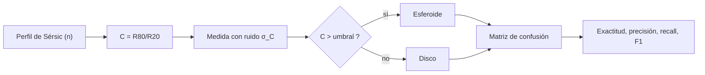

# B25-C20 — Proyecto de clasificación galáctica

<!-- nav:top -->
[🏠 Programa](../../../../README.md) · [📚 Bloque B25](../../../tronco-comun/B25-galaxias-y-medio-interestelar.md) · [← Anterior: B25-C19 — Catálogos y sesgos de selección](../B25-C19-catalogos-y-sesgos-de-seleccion/CLASE.md) · [Siguiente: B26-C01 — Postulados de relatividad especial →](../../B26/B26-C01-postulados-de-relatividad-especial/CLASE.md)
<!-- /nav -->

## 1. Ubicación, nivel y alcance

Clase 20 y última del bloque B25: el proyecto integrador. Nivel N3. Reúne el perfil de Sérsic de [C09](../B25-C09-galaxias-elipticas-y-espirales/CLASE.md), los sesgos de selección de [C19](../B25-C19-catalogos-y-sesgos-de-seleccion/CLASE.md) y la evidencia de las clases anteriores en un problema de ingeniería: **diseñar, construir y validar un clasificador de galaxias** con requisitos, componentes y criterios de comprobación. Usa el método de proyecto del bloque [B20](../../../tronco-comun/B20-metodologia-de-la-investigacion-cientifica.md) y las métricas de [B17](../../../tronco-comun/B17-aprendizaje-automatico-cientifico.md), de las que solo se emplean la matriz de confusión y sus derivados. El clasificador es una regla por umbral sobre un descriptor; los datos son sintéticos.

## 2. Por qué esta clase existe

Clasificar galaxias a gran escala exige algo más que una regla que parezca razonable: hay que decir qué debe cumplir, probarlo contra casos de respuesta conocida y evaluar con honestidad cómo se comporta donde los datos son malos. La decisión central: **¿cumple tu clasificador los requisitos que fijaste, y su rendimiento medido en una muestra buena es el que tendrá en toda la población?**

## 3. Lo que podrás hacer al terminar

1. Redactar requisitos medibles para un clasificador y una matriz de comprobación.
2. Calcular un descriptor de forma (concentración `R80/R20`) a partir de un perfil de Sérsic.
3. Fijar un umbral con un criterio razonado y aplicarlo.
4. Construir la matriz de confusión y calcular exactitud, precisión, exhaustividad y F1.
5. Detectar sesgos de evaluación (muestra buena, prevalencia) y corregir la interpretación.
6. Entregar un informe de proyecto con alcance, resultados y límites.

La evidencia es la **ficha del proyecto de clasificación** del ejercicio 12 (sección 20).

## 4. Con qué llegas y cómo comprobarlo

1. ¿Qué es un perfil de Sérsic y qué valor de `n` corresponde a un disco y a un esferoide? (C09)
2. ¿Qué es un límite de flujo y por qué sesga una muestra? (C19)
3. ¿Qué es un falso positivo?
4. ¿Qué es una incertidumbre estadística de una proporción?
5. ¿Qué es una semilla aleatoria fija y por qué se usa?

<details>
<summary>Ver respuestas</summary>

1. El brillo `I ∝ exp[−b_n (R/R_e)^{1/n}]`; `n ≈ 1` disco, `n ≈ 4` esferoide. 2. Es el brillo mínimo para entrar en un catálogo; hace que solo se vean los objetos más luminosos o más cercanos. 3. Un objeto que el clasificador asigna a una clase que no es la suya. 4. `√(p(1 − p)/N)`. 5. Hace reproducible la simulación.
</details>

Con cuatro o cinco aciertos, sigue; si no, repasa C09, C19 y B12.

## 5. Un caso real: Galaxy Zoo

Lintott y colaboradores (S1) presentan Galaxy Zoo: las morfologías de casi un millón de galaxias del SDSS, derivadas de más de 40 millones de clasificaciones individuales de unos 100 000 voluntarios, y que concuerdan con las de subconjuntos clasificados por astrónomos profesionales. Es un ejemplo de proyecto donde el requisito clave es la fiabilidad de una etiqueta. El **ejemplo conductor** de esta clase es un clasificador **sintético**: 4000 galaxias, la mitad discos (`n ~ N(1; 0,25)`) y la mitad esferoides (`n ~ N(4; 0,7)`), con la mitad «brillantes» (ruido de concentración 0,3) y la mitad «tenues» (ruido 4,0), todos valores ilustrativos.

## 6. Vocabulario

La **concentración** `C = R80/R20` es el cociente entre los radios que contienen el 80 % y el 20 % de la luz. Un **descriptor** es una cantidad medida que alimenta la regla. El **umbral** es el valor del descriptor que separa las dos clases. La **matriz de confusión** cuenta verdaderos positivos (`TP`), falsos negativos (`FN`), falsos positivos (`FP`) y verdaderos negativos (`TN`); aquí «positivo» es «esferoide». La **exactitud** es `(TP + TN)/total`; la **precisión**, `TP/(TP + FP)`; la **exhaustividad** (*recall*), `TP/(TP + FN)`; el **F1**, la media armónica de las dos últimas. La **prevalencia** es la fracción de la clase positiva en la población. Un **requisito** es una condición medible que el sistema debe cumplir; una **matriz de comprobación** liga cada requisito con la prueba que lo verifica.

## 7. Modelo mental: un control de calidad con un calibre

Imagina separar piezas con un calibre: hay un umbral, algunas piezas buenas se rechazan y algunas malas pasan. Analogía: la regla de umbral es el calibre y la matriz de confusión es el recuento de errores de cada tipo. Su límite: en el control de calidad las piezas se miden con el mismo instrumento; aquí las galaxias tenues se miden con mucho más ruido que las brillantes.



*Descripción textual:* de `n` se calcula la concentración; se mide con ruido; si supera el umbral se clasifica como esferoide; la comparación con la clase real da la matriz de confusión y las métricas.

## 8. La explicación, paso a paso

### 8.1 Requisitos

Un proyecto empieza por exigencias medibles. Para este clasificador: **R1** la concentración se calcula con un error numérico menor de `10⁻⁹` en casos analíticos; **R2** el umbral se fija por un criterio explícito; **R3** las métricas se calculan con una función verificada contra un caso hecho a mano; **R4** la evaluación se informa por separado para muestra brillante y tenue y para la población; **R5** los datos se rotulan como sintéticos; **R6** el informe declara qué no cubre. Cada requisito tiene su prueba en el laboratorio o en un ejercicio.

### 8.2 El descriptor

La fracción de luz dentro de `x_p` es `P(2n, x_p) = p`, y `R_p/R_e = (x_p/b_n)^n`, de modo que `C = (x₈₀/x₂₀)^n`. Hay dos casos exactos: `n = 1/2` da `C = √(ln 5/ln 1,25) = 2,6856` y `n = 1` da `C = 3,632` (con `x₂₀ = 0,824` y `x₈₀ = 2,994` del disco exponencial de C01). Para `n = 2` y `n = 4`, `C = 5,77` y `11,34`.

### 8.3 El umbral

Se fija en el punto medio entre `C(n = 1) = 3,632` y `C(n = 4) = 11,340`, es decir, `7,486`. Es un criterio razonable si las dos clases pesan igual y el ruido es el mismo; no es óptimo en general.

### 8.4 Resultados

Con las 4000 galaxias sintéticas:

| Muestra | TP | FN | FP | TN | Exactitud | Precisión | Recall | F1 |
|---|---|---|---|---|---|---|---|---|
| Brillantes | 958 | 42 | 0 | 1000 | 0,979 | 1,000 | 0,958 | 0,979 |
| Tenues | 812 | 188 | 156 | 844 | 0,828 | 0,839 | 0,812 | 0,825 |
| Todas | 1770 | 230 | 156 | 1844 | 0,903 | 0,919 | 0,885 | 0,902 |

Evaluar solo con las brillantes sobreestima el rendimiento en `7,6` puntos de exactitud: es el sesgo de selección de C19 aplicado a la validación. Los errores de las brillantes (42 esferoides con `n` bajo clasificados como discos) vienen del solapamiento de las poblaciones en `n`, no del ruido.

### 8.5 Prevalencia y límites

Con las tasas de las tenues (recall `0,812`, tasa de falsos positivos `156/1000 = 0,156`), si los esferoides fueran solo el `10 %` de la población, la precisión sería `0,1 × 0,812/(0,1 × 0,812 + 0,9 × 0,156) = 0,37`: el mismo clasificador deja de ser fiable cuando la clase positiva es rara. El proyecto no cubre imágenes reales, inclinación, polvo ni clases intermedias (lenticulares, irregulares de C10) ni compara con etiquetas humanas como las de S1.

## 9. Magnitudes, símbolos y unidades

| Símbolo | Qué es | Unidad | Valor / nota |
|---|---|---|---|
| `n` | índice de Sérsic | adimensional | disco `~1`; esferoide `~4` (sintéticos) |
| `C = R80/R20` | concentración | adimensional | `2,686`, `3,632`, `5,766`, `11,340` para `n = 0,5; 1; 2; 4` |
| `σ_C` | ruido de la medida de `C` | adimensional | `0,3` (brillantes); `4,0` (tenues) |
| umbral | separación de clases | adimensional | `7,486` |
| `TP, FN, FP, TN` | matriz de confusión | conteos | tabla de 8.4 |
| exactitud, precisión, recall, F1 | métricas | adimensional | tabla de 8.4 |

## 10. Convenciones y referencias

«Positivo» = esferoide. Se rotulan **sintéticos** todos los datos, **ilustrativos** los parámetros de las poblaciones y los ruidos, **observados** solo los números de Galaxy Zoo (resumen), y **cálculo propio** las métricas. La fórmula de `C` y las métricas se verifican en el laboratorio.

## 11. De dónde sale lo que afirmamos

| ID | Fuente | Localizador | Respalda | Estado |
|---|---|---|---|---|
| S1 | Lintott et al., *Galaxy Zoo: Morphologies derived from visual inspection of galaxies from the Sloan Digital Sky Survey*, arXiv:0804.4483 | https://arxiv.org/abs/0804.4483 | ~1 millón de galaxias, >40 millones de clasificaciones, ~100 000 voluntarios; coherencia con subconjuntos profesionales | Solo resumen, consultado el 2026-11-09 |

Límites: de S1 solo se leyó el resumen; no hay datos reales ni etiquetas humanas en el laboratorio; los parámetros de las poblaciones y los ruidos no tienen fuente.

## 12. Cómo ver los resultados

Equivalente accesible a una matriz de confusión (muestra **sintética** de 4000 galaxias):

| Verdad \ predicción | Disco | Esferoide |
|---|---|---|
| Disco | TN = 1844 | FP = 156 |
| Esferoide | FN = 230 | TP = 1770 |

Descripción larga: de 2000 discos, 1844 se clasifican bien y 156 mal; de 2000 esferoides, 1770 bien y 230 mal; los errores se concentran en las galaxias tenues.

## 13. Ejemplo trabajado: del perfil a la métrica

**Paso 1 · Descriptor.** Para `n = 1`: `x₂₀ = 0,824` (`1 − 1,824 e^{−0,824} = 0,1998`), `x₈₀ = 2,994` (`1 − 3,994 e^{−2,994} = 0,7998`); `C = 3,634 ≈ 3,632`.

**Paso 2 · Esferoide.** Para `n = 4`, el laboratorio da `C = 11,340`.

**Paso 3 · Umbral.** `(3,632 + 11,340)/2 = 7,486`.

**Paso 4 · Evaluación.** En las tenues, `TP = 812`, `FP = 156`: precisión `812/968 = 0,839`; recall `812/1000 = 0,812`.

**Paso 5 · Sentido.** La regla separa casi perfectamente con medidas buenas (`0,979`) y deja de hacerlo con medidas ruidosas (`0,828`). El proyecto cumple R1–R6 con esta salvedad; la cifra global de `0,903` mezcla dos regímenes y no debe presentarse sin su desglose.

## 14. Distintas formas de clasificar

**Regla por umbral sobre un descriptor (esta clase):** transparente y fácil de comprobar. **Votación humana (S1):** maneja formas complejas, a costa de tiempo y de la calidad de la etiqueta. **Aprendizaje automático supervisado (B17):** más flexible, pero exige datos etiquetados y control de sesgos. Para un primer sistema con requisitos verificables sirve la regla; para formas finas, humanos o aprendizaje.

## 15. Práctica guiada

**Ejercicio 1 · con los pasos indicados.** Comprueba que `x = 0,824` da una fracción de luz del `20 %` en un disco exponencial. *Pasos:* `e^{−0,824}`; `(1 + x)`; `1 − …`.

<details><summary>Solución comentada</summary>

`e^{−0,824} = 0,4387`; `1,824 × 0,4387 = 0,8002`; `1 − 0,8002 = 0,1998` (13).
</details>

**Ejercicio 2 · con una pista.** Calcula el umbral con `C(1) = 3,632` y `C(4) = 11,340`.

<details><summary>Solución comentada</summary>

El punto medio, `7,486` (8.3).
</details>

**Ejercicio 3 · casi autónomo.** Para `TP = 40`, `FN = 10`, `FP = 5`, `TN = 45`, calcula las cuatro métricas.

<details><summary>Solución comentada</summary>

Exactitud `85/100 = 0,85`; precisión `40/45 = 0,889`; recall `40/50 = 0,80`; F1 `= 2 × 0,889 × 0,8/(0,889 + 0,8) = 0,842` (caso del laboratorio).
</details>

## 16. Práctica autónoma, transferencia e integrador

**Ejercicio 4.** Calcula la exactitud de la muestra brillante y la de todas.

<details><summary>Solución comentada</summary>

`(958 + 1000)/2000 = 0,979`; `(1770 + 1844)/4000 = 0,9035` (8.4).
</details>

**Ejercicio 5.** ¿Cuántos puntos de exactitud se sobreestiman al evaluar solo con las brillantes?

<details><summary>Solución comentada</summary>

`97,9 − 90,3 = 7,6` puntos (8.4).
</details>

**Ejercicio 6.** Calcula precisión y recall de las tenues.

<details><summary>Solución comentada</summary>

`812/968 = 0,839`; `812/1000 = 0,812` (13).
</details>

**Ejercicio 7.** Con la prevalencia del `10 %` de esferoides, ¿qué precisión tendrían las tenues?

<details><summary>Solución comentada</summary>

`0,0812/(0,0812 + 0,1404) = 0,37` (8.5).
</details>

**Ejercicio 8.** Escribe la matriz de comprobación de R1–R6: ¿qué prueba verifica cada requisito?

<details><summary>Solución comentada</summary>

R1: pruebas de `C` en `n = 1/2` y `n = 1`; R2: sección 8.3; R3: prueba de métricas a mano; R4: tabla 8.4; R5: rótulos en la cabecera del script; R6: límites del laboratorio y 8.5.
</details>

**Ejercicio 9 · transferencia.** Galaxy Zoo (S1) reúne más de 40 millones de clasificaciones de casi un millón de galaxias. ¿Cuántas clasificaciones hay, como mínimo, por galaxia, en promedio?

<details><summary>Solución comentada</summary>

`40 × 10⁶/10⁶ ≈ 40` clasificaciones por galaxia (la cifra real depende de «casi» un millón; es una cota). Muchas opiniones por objeto es la manera de estimar la fiabilidad de una etiqueta (sección 5).
</details>

**Ejercicio 10 · transferencia.** Un compañero dice: «mi clasificador tiene un 90 % de exactitud, luego es bueno». Respóndele.

<details><summary>Solución comentada</summary>

La exactitud global de `0,90` de la clase mezcla `0,98` en brillantes y `0,83` en tenues; con una prevalencia del 10 %, su precisión caería a `0,37` (8.4, 8.5). Hay que desglosar por muestra y por prevalencia.
</details>

**Ejercicio 11 · transferencia.** Si bajas el umbral a `6`, ¿qué esperas para recall y precisión? (predicción; puedes comprobarla editando el script)

<details><summary>Solución comentada</summary>

Más discos pasan a «esferoide»: el recall sube (menos FN) y la precisión baja (más FP). Es el compromiso entre ambos tipos de error.
</details>

**Ejercicio 12 · integrador.** Entrega la *ficha del proyecto de clasificación*: requisitos (R1–R6 o los tuyos), descriptor, umbral con su criterio, tabla de métricas por muestra, matriz de comprobación, efecto de la prevalencia y tres límites.

<details><summary>Solución modelo</summary>

Requisitos de 8.1; `C` y umbral `7,486`; tabla de 8.4; matriz del ejercicio 8; prevalencia `0,37` (ejercicio 7); límites: datos sintéticos, perfil puro, sin clases intermedias.
</details>

## 17. Laboratorio: clasificador por concentración

El script [clasificador.py](clasificador.py) calcula la concentración, aplica el umbral y evalúa. **Comprueba** que `C(n = 1/2) = √(ln 5/ln 1,25)` (`10⁻⁹`), que `C(n = 1)` coincide con una raíz hallada por bisección independiente de la fórmula cerrada (`10⁻⁹`), que las métricas de un caso hecho a mano coinciden (`10⁻¹²`) y que la exactitud en las brillantes excede la global y esta la de las tenues, con una diferencia mayor que tres errores estándar.

**Datos:** todo **sintético** con semilla fija. **Predice antes de ejecutar:** ¿qué muestra tendrá peor exactitud? (las tenues.) **Ejecución del 2026-11-09 (Python 3.12.9):**

```text
Python 3.12.9 (biblioteca estandar)
C(n = 0.5) = 2.6856 ; C(n = 1) = 3.6322 ; C(n = 2) = 5.7658 ; C(n = 4) = 11.3403
umbral = 7.4862 ; N = 4000 (brillantes 2000, tenues 2000)
brillantes: TP= 958 FN=  42 FP=   0 TN=1000 | exactitud 0.979 precision 1.000 recall 0.958 F1 0.979
tenues    : TP= 812 FN= 188 FP= 156 TN= 844 | exactitud 0.828 precision 0.839 recall 0.812 F1 0.825
todas     : TP=1770 FN= 230 FP= 156 TN=1844 | exactitud 0.903 precision 0.919 recall 0.885 F1 0.902
Pruebas superadas.
```

```bash
python programa/clases/B25/B25-C20-proyecto-de-clasificacion-galactica/clasificador.py
```

**Límites:** perfil de Sérsic puro, ruido gaussiano, dos clases, sin imágenes.

## 18. Errores frecuentes y cómo corregirlos

**Presentar solo la exactitud global.** Se corrige con el ejercicio 10.

**Evaluar con la muestra más limpia.** Se corrige con el ejercicio 5.

**Ignorar la prevalencia.** Se corrige con el ejercicio 7.

**Fijar el umbral sin criterio.** Se corrige en 8.3.

**Omitir qué no cubre el proyecto.** Se corrige en 8.5 y el ejercicio 12.

## 19. Cómo sabrás que vas bien

Tras 8.2: ¿cuánto vale `C` para `n = 1`? Ejercicio 1. Tras 8.4: ¿qué muestra rinde peor? Ejercicio 6. Tras el laboratorio: ¿qué prueba la métrica hecha a mano? (que el código de las métricas es correcto).

## 20. Qué entregas y cómo se evalúa

El producto es tu **ficha del proyecto de clasificación** (ejercicio 12).

| Criterio | Inicial | En desarrollo | Logrado | Destacado |
|---|---|---|---|---|
| Requisitos | Vagos | Parciales | R1–R6 medibles | Matriz de comprobación completa |
| Cálculo | Sin unidades | Con errores | Descriptor y umbral correctos | Propone casos límite |
| Evaluación | Solo la global | Un desglose | Brillantes, tenues y global | Efecto de la prevalencia |
| Numérico | Sin comprobar | Un caso | Pruebas superadas | Explica cada prueba |
| Fuentes | Sin fuente | Sin fecha | S1 con fecha | Rotula lo sintético |

**Condiciones críticas (no se compensan con promedio):** rotular los datos como sintéticos; no presentar la exactitud global sin desglose; citar solo lo consultado.

## 21. Ética, seguridad y límites

La clase es educativa; el clasificador no se ha validado con imágenes reales ni etiquetas humanas, y no debe usarse para decidir sobre datos reales. Accesibilidad: tablas equivalentes a las matrices, fórmulas en texto, ejercicios sin conexión.

## 22. Para cerrar y seguir

Un clasificador por concentración separa discos de esferoides con una exactitud de `0,98` en medidas buenas y `0,83` en medidas ruidosas; el informe de proyecto debe presentar los dos regímenes y los límites. Con esto termina el bloque B25; la cosmología y la formación de estructuras continúan en los bloques [B26](../../../tronco-comun/B26-relatividad-y-cosmologia.md) y [B36](../../../tronco-comun/B36-formacion-de-estructuras-cosmicas-y-materia-oscura.md).

**Glosario español–inglés.** concentración · *concentration*; umbral · *threshold*; matriz de confusión · *confusion matrix*; exactitud · *accuracy*; precisión · *precision*; exhaustividad · *recall*; prevalencia · *prevalence*.

**Continuidad.** Este bloque concluye aquí; el siguiente de A03 es B26, ya redactado por separado.

**Referencias:** ver sección 11.

<!-- nav:bottom -->
---

[← Anterior: B25-C19 — Catálogos y sesgos de selección](../B25-C19-catalogos-y-sesgos-de-seleccion/CLASE.md) · [📚 Bloque B25](../../../tronco-comun/B25-galaxias-y-medio-interestelar.md) · [Siguiente: B26-C01 — Postulados de relatividad especial →](../../B26/B26-C01-postulados-de-relatividad-especial/CLASE.md)
<!-- /nav -->
