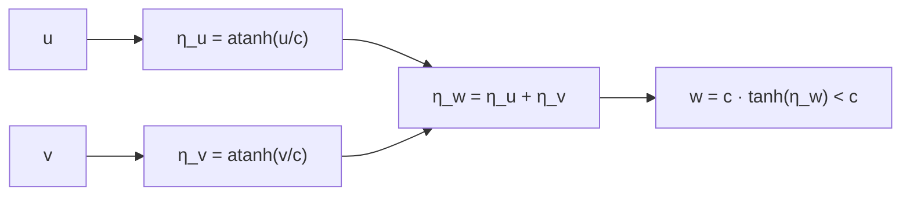

# B26-C01 — Postulados de relatividad especial

<!-- nav:top -->
[🏠 Programa](../../../../README.md) · [📚 Bloque B26](../../../tronco-comun/B26-relatividad-y-cosmologia.md) · [← Anterior: B25-C20 — Proyecto de clasificación galáctica](../../../tronco-comun/B25-galaxias-y-medio-interestelar.md#b25-c20) · [Siguiente: B26-C02 — Transformaciones de Lorentz →](../B26-C02-transformaciones-de-lorentz/CLASE.md)
<!-- /nav -->

## 1. Ubicación, nivel y alcance

Clase 1 del bloque B26. Nivel N3. En [B05-C19](../../B05/B05-C19-optica-y-velocidad-de-la-luz/CLASE.md) mediste la luz como una onda con velocidad finita y en [B05-C03](../../B05/B05-C03-movimiento-rectilineo-y-circular/CLASE.md) sumaste velocidades como se hace en la vida diaria. Aquí cambias una regla: la velocidad de la luz no se suma. Partes de dos postulados y obtienes la ley de composición de velocidades. Lo que viene después (transformaciones, tiempo y espacio) sale de aquí. Solo se tratan marcos inerciales y movimiento en una dimensión.

## 2. Por qué esta clase existe

Una nave espacial, un satélite de navegación y un rayo gamma comparten un problema: decir cómo se ve el mismo fenómeno desde marcos que se mueven entre sí. Si las velocidades se sumaran siempre como `u + v`, la luz de una nave que viaja al `90 %` de `c` iría más rápido que `c`. La decisión central: **¿cómo se combinan dos velocidades cuando una de ellas puede ser cercana a la de la luz y qué se conserva en todos los marcos?**

## 3. Lo que podrás hacer al terminar

1. Enunciar el principio de relatividad y el postulado de la constancia de `c`.
2. Distinguir un marco inercial de uno que no lo es.
3. Aplicar la composición relativista de velocidades.
4. Verificar la composición con la rapidez, que sí se suma.
5. Comprobar que la suma de `c` con cualquier velocidad da `c`.
6. Estimar cuándo la corrección relativista es despreciable.

La evidencia es la **hoja de composición de velocidades** del ejercicio 12 (sección 20).

## 4. Con qué llegas y cómo comprobarlo

1. ¿Qué es un marco de referencia?
2. ¿Cómo se suman velocidades en la mecánica de Newton?
3. ¿Cuánto vale `c` en `m/s`?
4. ¿Qué es la tangente hiperbólica `tanh` y su inversa `atanh`?
5. ¿Qué es un sistema inercial?

<details>
<summary>Ver respuestas</summary>

1. Un observador con un origen y ejes para medir posiciones y tiempos. 2. `w = u + v`. 3. `299 792 458 m/s`. 4. `tanh x = (eˣ − e⁻ˣ)/(eˣ + e⁻ˣ)`; devuelve valores entre −1 y 1; `atanh` es su inversa. 5. Un marco donde un cuerpo sin fuerzas se mueve a velocidad constante.
</details>

Con cuatro o cinco aciertos, sigue; si no, repasa B05-C03 y B05-C19.

## 5. Un caso real: sumar la velocidad de una nave y la de su luz

Imagina una nave que se aleja de ti a `0,8 c` y dispara un proyectil a `0,8 c` respecto de ella. La regla newtoniana daría `1,6 c`; el cálculo relativista da `0,97561 c`. Es el **ejemplo conductor**. La constante `c = 299 792 458 m/s` es exacta por definición del metro (S1), y la distancia Tierra–Sol, `1 au = 1,495 978 707 00 × 10¹¹ m` (S2), la recorre la luz en `499,005 s`.

## 6. Vocabulario

Un **marco inercial** es un marco en el que se cumple la primera ley de Newton. El **principio de relatividad** afirma que las leyes de la física son las mismas en todos los marcos inerciales. El **postulado de la constancia de `c`** afirma que la velocidad de la luz en el vacío tiene el mismo valor `c` en todos los marcos inerciales, sin depender del movimiento de la fuente ni del observador. La **composición de velocidades** es la regla que da la velocidad `w` de un cuerpo respecto de un marco, conocidas `u` (del cuerpo respecto de un segundo marco) y `v` (del segundo marco respecto del primero). Se define `β = v/c`. La **rapidez** `η` cumple `β = tanh η`. Un **evento** es algo que ocurre en un lugar y un instante. El **límite galileano** es el caso `u, v ≪ c`.

## 7. Modelo mental: velocidades como ángulos

Las velocidades cercanas a `c` no se suman como longitudes, sino como ángulos que se acumulan sin pasar jamás de un tope. La rapidez `η` es ese «ángulo»: se suma sin restricciones, y la velocidad `β = tanh η` queda siempre por debajo de 1.



*Descripción textual:* cada velocidad se convierte en rapidez; las rapideces se suman; la suma se convierte de nuevo en velocidad y resulta menor que `c`.

Analogía: sumar latitudes en un mapa que se comprime hacia un polo que nunca se alcanza. Límite: es una imagen de la estructura matemática; no hay ningún ángulo físico en el espacio.

## 8. La explicación, paso a paso

### 8.1 Los dos postulados

(1) Las leyes de la física valen igual en todos los marcos inerciales. (2) La luz en el vacío viaja a `c` en todos ellos. Con el segundo, la suma `u + v` ya no puede ser correcta para la luz, porque un rayo visto desde una nave en movimiento no iría a `c + v`.

### 8.2 La composición

La regla es `w = (u + v)/(1 + uv/c²)`. Cuando `u` y `v` son pequeños frente a `c`, el denominador vale casi 1 y se recupera `w ≈ u + v`. Con `u = v = 0,5 c`, `w = 0,8 c`; con `0,8 c` y `0,8 c`, `0,97561 c`; con `0,9 c` y `0,99 c`, `0,99947 c`.

### 8.3 La luz sigue siendo `c`

Si `u = c`, `w = (c + v)/(1 + v/c) = c` para cualquier `v`. El laboratorio lo comprueba con `3 × 10⁴ m/s`, `0,5 c` y `0,99 c`. Ningún observador inercial puede alcanzar `c` componiendo velocidades subluminales.

### 8.4 La rapidez

Con `β = tanh η`, la identidad de la suma de tangentes hiperbólicas muestra que la regla de 8.2 equivale a `η_w = η_u + η_v`. El laboratorio calcula `w` por ambas vías y coinciden a `10⁻¹² c`. Por ejemplo `atanh(0,5) = 0,5493`; el doble es `1,0986` y `tanh 1,0986 = 0,8`.

### 8.5 Cuánto importa en la práctica

Para dos velocidades de `30 km/s` (el orden de la velocidad orbital terrestre), la corrección relativa es `uv/c² = 10⁻⁸`: la suma relativista difiere de la newtoniana en `6 × 10⁻⁴ m/s` sobre `6 × 10⁴ m/s`. Para naves interplanetarias es despreciable en una suma, aunque no en un reloj de precisión (C03).

## 9. Magnitudes, símbolos y unidades

| Símbolo | Qué es | Unidad | Valor / nota |
|---|---|---|---|
| `c` | velocidad de la luz en el vacío | `m s⁻¹` | `299 792 458` (exacta, S1) |
| `u`, `v`, `w` | velocidades | `m s⁻¹` | según el caso |
| `β` | `v/c` | — | `0 ≤ \|β\| < 1` |
| `η` | rapidez | — | `atanh β` |
| `au` | unidad astronómica | m | `1,495 978 707 00 × 10¹¹` (S2) |

## 10. Convenciones y referencias

Marcos inerciales con ejes paralelos y movimiento en `x`. Las velocidades de los ejemplos son **sintéticas**. La luz se refiere al vacío.

## 11. De dónde sale lo que afirmamos

| ID | Fuente | Localizador | Respalda | Estado |
|---|---|---|---|---|
| S1 | NIST, *Fundamental Physical Constants — Complete Listing* (CODATA 2022) | https://physics.nist.gov/cuu/Constants/Table/allascii.txt | `c = 299 792 458 m/s` exacta | Consultada el 2026-11-09 |
| S2 | IERS, *IERS Conventions (2010)*, TN36, Tabla 1.1 | https://iers-conventions.obspm.fr/content/tn36.pdf | `1 au = 1,495 978 707 00 × 10¹¹ m` (±3 m, TDB-compatible) | Texto del PDF extraído el 2026-11-09 |

Límites: los postulados y la regla de composición son resultados estándar de la relatividad especial; aquí se verifican numéricamente, no se citan de un texto. No se consultó ninguna medida experimental de la constancia de `c`.

## 12. Cómo ver la composición

| `u` | `v` | `w` relativista | `w` galileana |
|---|---|---|---|
| 0,5 `c` | 0,5 `c` | 0,80000 `c` | 1,0 `c` |
| 0,8 `c` | 0,8 `c` | 0,97561 `c` | 1,6 `c` |
| 0,9 `c` | 0,99 `c` | 0,99947 `c` | 1,89 `c` |
| 1 `c` | cualquiera | 1 `c` | `1 c + v` |

Descripción larga: la columna relativista nunca llega a 1; la galileana la supera.

## 13. Ejemplo trabajado: el proyectil de la nave

**Paso 1 · Datos.** `u = 0,8 c` (proyectil respecto de la nave), `v = 0,8 c` (nave respecto de ti).

**Paso 2 · Fórmula.** `w = (0,8 + 0,8)/(1 + 0,64) c`.

**Paso 3 · Cálculo.** `1,6/1,64 = 0,97561`.

**Paso 4 · Comprobación con rapideces.** `atanh 0,8 = 1,0986`; `2 × 1,0986 = 2,1972`; `tanh 2,1972 = 0,97561`.

**Paso 5 · Sentido.** El proyectil se ve a `0,97561 c`: más rápido que la nave, pero por debajo de `c`.

## 14. Distintas formas de componer velocidades

**Fórmula directa:** corta. **Rapideces:** convierte la composición en una suma y evita errores cuando hay varios pasos. **Transformaciones de Lorentz (C02):** dan la regla como caso particular y sirven también para tiempos y distancias.

## 15. Práctica guiada

**Ejercicio 1 · con los pasos indicados.** Compón `0,5 c` y `0,5 c`. *Pasos:* `(u+v)/(1+uv/c²)`.

<details><summary>Solución comentada</summary>

`1/(1 + 0,25) = 0,8 c`.
</details>

**Ejercicio 2 · con una pista.** Compón `0,8 c` y `0,8 c`. *Pista:* denominador `1,64`.

<details><summary>Solución comentada</summary>

`1,6/1,64 = 0,97561 c`.
</details>

**Ejercicio 3 · casi autónomo.** Compón `c` con `0,99 c`.

<details><summary>Solución comentada</summary>

`(1 + 0,99)/(1 + 0,99) = 1`: `c` (8.3).
</details>

## 16. Práctica autónoma, transferencia e integrador

**Ejercicio 4.** ¿Cuánto tarda la luz en recorrer `1 au`?

<details><summary>Solución comentada</summary>

`1,495 978 707 × 10¹¹/299 792 458 = 499,005 s = 8,317 min`.
</details>

**Ejercicio 5.** Compón `0,9 c` y `0,99 c`.

<details><summary>Solución comentada</summary>

`1,89/(1 + 0,891) = 0,99947 c`.
</details>

**Ejercicio 6.** Para dos velocidades de `30 km/s`, ¿cuál es la corrección relativa `uv/c²`?

<details><summary>Solución comentada</summary>

`(3 × 10⁴)²/(299 792 458)² = 1,0 × 10⁻⁸` (8.5).
</details>

**Ejercicio 7.** Verifica con rapideces la composición de `0,5 c` y `0,5 c`.

<details><summary>Solución comentada</summary>

`atanh 0,5 = 0,5493`; suma `1,0986`; `tanh = 0,8` (8.4).
</details>

**Ejercicio 8.** ¿Qué rapidez total tiene una velocidad `β = 0,9`?

<details><summary>Solución comentada</summary>

`η = atanh 0,9 = ½ ln(1,9/0,1) = 1,4722`.
</details>

**Ejercicio 9 · transferencia.** Un compañero afirma: «si corro con una linterna, su luz va a `c` más mi velocidad». Respóndele.

<details><summary>Solución comentada</summary>

Con `u = c`, `w = c` para cualquier `v` (8.3): el postulado dice que la luz va a `c` en todos los marcos.
</details>

**Ejercicio 10 · transferencia.** Una nave dispara dos proyectiles, uno hacia delante y otro hacia atrás, ambos a `0,9 c` respecto de la nave, y la nave va a `0,9 c` respecto de la Tierra. ¿Qué velocidad tiene cada uno respecto de la Tierra?

<details><summary>Solución comentada</summary>

Hacia delante: `1,8/(1,81) = 0,99448 c`. Hacia atrás: `(0,9 − 0,9)/(1 − 0,81) = 0`: queda en reposo respecto de la Tierra (se usa `u = −0,9 c`).
</details>

**Ejercicio 11 · transferencia.** Si dos sondas se alejan de ti en direcciones opuestas, cada una a `0,9 c`, ¿con qué velocidad se alejan una de otra, vista desde una de ellas?

<details><summary>Solución comentada</summary>

La velocidad de una respecto de la otra es la composición de `0,9 c` y `0,9 c`: `1,8/1,81 = 0,99448 c`, menor que `c` (no `1,8 c`).
</details>

**Ejercicio 12 · integrador.** Elabora tu *hoja de composición de velocidades*: tabla de tres composiciones con el valor relativista, el galileano y la diferencia, verificadas por la vía de la rapidez; demuestra que `c` es invariante y estima la corrección para dos velocidades de `30 km/s`.

<details><summary>Solución modelo</summary>

Usa la tabla de la sección 12; `c` invariante (8.3); corrección `10⁻⁸` (ejercicio 6); todo rotulado como sintético.
</details>

## 17. Laboratorio: composición y rapidez

El script [velocidades.py](velocidades.py) compone velocidades con la fórmula y con las rapideces y **comprueba** que coinciden a `10⁻¹² c`, que el resultado es siempre menor que `c` y que `c` compuesta con cualquier `v` sigue valiendo `c`.

**Datos:** `c` de NIST y `au` del IERS; velocidades **sintéticas**. **Predice antes de ejecutar:** ¿qué velocidad da `0,5 c` con `0,5 c`? (`0,8 c`.) **Ejecución del 2026-11-09 (Python 3.12.9):**

```text
Python 3.12.9 (biblioteca estandar)
u = 0.500000 c, v = 0.500000 c -> w = 0.80000000 c (galileano 1.000000 c)
u = 0.800000 c, v = 0.800000 c -> w = 0.97560976 c (galileano 1.600000 c)
u = 0.900000 c, v = 0.990000 c -> w = 0.99947118 c (galileano 1.890000 c)
u = 0.000100 c, v = 0.000100 c -> w = 0.00020014 c (galileano 0.000200 c)
c compuesta con v = 3e4, 0.5c, 0.99c: sigue valiendo c
diferencia con galileano para 30 km/s + 30 km/s = -6.008e-04 m/s
tiempo de luz por 1 au = 499.005 s
Pruebas superadas.
```

```bash
python programa/clases/B26/B26-C01-postulados-de-relatividad-especial/velocidades.py
```

**Límites:** movimiento colineal; la verificación es algebraica, no experimental.

## 18. Errores frecuentes y cómo corregirlos

**Sumar velocidades cercanas a `c` como en Newton.** Se corrige con los ejercicios 2 y 5.

**Creer que `c` depende del movimiento de la fuente.** Se corrige con el ejercicio 9.

**Olvidar el signo de `u` en el sentido contrario.** Se corrige con el ejercicio 10.

**Usar el denominador `1 − uv/c²`.** Se corrige con el ejercicio 1.

**Aplicar la regla a marcos acelerados.** Se corrige con la sección 6: solo inerciales.

## 19. Cómo sabrás que vas bien

Tras 8.2: ¿cuánto da `0,8 c` con `0,8 c`? Si dudas, ejercicio 2. Tras 8.4: ¿qué se suma en realidad? (la rapidez). Tras el laboratorio: ¿qué verifica la doble vía? (que la fórmula equivale a sumar rapideces).

## 20. Qué entregas y cómo se evalúa

El producto es tu **hoja de composición de velocidades** (ejercicio 12).

| Criterio | Inicial | En desarrollo | Logrado | Destacado |
|---|---|---|---|---|
| Postulados | Los confunde | Parciales | Los dos correctos | Explica la contradicción con Newton |
| Cálculo | Sin unidades | Con errores | Composiciones correctas | Verifica con rapideces |
| Invariancia | No la nota | Un caso | `c` invariante demostrada | Estima la corrección práctica |
| Fuentes | Sin fuente | Sin fecha | S1–S2 con fecha | Declara que no hay medidas experimentales |
| Límites | No los nombra | Uno | Tres | Discute marcos acelerados |

**Condiciones críticas (no se compensan con promedio):** no sumar velocidades de forma galileana cerca de `c`; rotular lo sintético; citar solo lo consultado.

## 21. Ética, seguridad y límites

Clase educativa: no sustituye la deducción completa ni las pruebas experimentales de la relatividad. Accesibilidad: tablas equivalentes a las gráficas, fórmulas en texto, ejercicios sin conexión.

## 22. Para cerrar y seguir

Dos postulados bastan: la física es la misma en todo marco inercial y la luz va a `c` en todos. De ahí sale que las velocidades se compongan por rapideces. Queda una pregunta: ¿qué transformación de coordenadas conserva a `c` y qué hace con los tiempos y las longitudes?

**Glosario español–inglés.** marco inercial · *inertial frame*; principio de relatividad · *principle of relativity*; composición de velocidades · *velocity addition*; rapidez (rapidity) · *rapidity*; evento · *event*; velocidad de la luz · *speed of light*.

**Continuidad.** [B26-C02](../B26-C02-transformaciones-de-lorentz/CLASE.md) obtiene las transformaciones de coordenadas que contienen esta regla.

**Referencias:** ver sección 11.

<!-- nav:bottom -->
---

[← Anterior: B25-C20 — Proyecto de clasificación galáctica](../../../tronco-comun/B25-galaxias-y-medio-interestelar.md#b25-c20) · [📚 Bloque B26](../../../tronco-comun/B26-relatividad-y-cosmologia.md) · [Siguiente: B26-C02 — Transformaciones de Lorentz →](../B26-C02-transformaciones-de-lorentz/CLASE.md)
<!-- /nav -->
