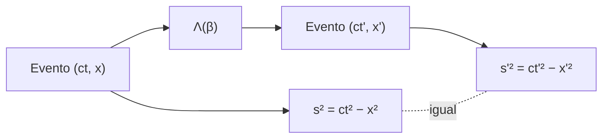

# B26-C02 — Transformaciones de Lorentz

<!-- nav:top -->
[🏠 Programa](../../../../README.md) · [📚 Bloque B26](../../../tronco-comun/B26-relatividad-y-cosmologia.md) · [← Anterior: B26-C01 — Postulados de relatividad especial](../B26-C01-postulados-de-relatividad-especial/CLASE.md) · [Siguiente: B26-C03 — Dilatación temporal y contracción →](../B26-C03-dilatacion-temporal-y-contraccion/CLASE.md)
<!-- /nav -->

## 1. Ubicación, nivel y alcance

Clase 2 del bloque B26. Nivel N3. En [C01](../B26-C01-postulados-de-relatividad-especial/CLASE.md) obtuviste cómo se componen velocidades. Ahora buscas la regla completa que transforma el lugar y el instante de un evento de un marco inercial a otro y que deja a `c` invariante. Usas matrices ([B10](../../../tronco-comun/B10-algebra-lineal-y-matematicas-geometricas.md)) y trigonometría hiperbólica. Se trata solo el *boost* en una dirección, con dos coordenadas `(ct, x)`.

## 2. Por qué esta clase existe

Para comparar la hora de un reloj en órbita con la de uno en tierra, o la dirección de una señal vista desde dos naves, hace falta una fórmula que traduzca coordenadas entre marcos. Esa fórmula debe respetar los postulados de C01. La decisión central: **¿qué transformación de `(ct, x)` conserva la velocidad de la luz y qué cantidad queda igual para todos los observadores?**

## 3. Lo que podrás hacer al terminar

1. Escribir el *boost* de Lorentz con `γ` y `β`.
2. Transformar las coordenadas de un evento.
3. Verificar que el intervalo `s² = (ct)² − x²` es invariante.
4. Verificar que la composición de dos *boosts* es un *boost* con la velocidad de C01.
5. Calcular la transformación inversa.
6. Comprobar que un rayo de luz sigue siendo un rayo de luz.

La evidencia es la **hoja de transformaciones verificadas** del ejercicio 12 (sección 20).

## 4. Con qué llegas y cómo comprobarlo

1. ¿Cómo se multiplican dos matrices `2 × 2`?
2. ¿Qué es el determinante?
3. ¿Qué es `γ = 1/√(1 − β²)`?
4. ¿Qué es una matriz inversa?
5. ¿Qué dice la regla de composición de C01?

<details>
<summary>Ver respuestas</summary>

1. Fila por columna. 2. `ad − bc` para `[[a,b],[c,d]]`. 3. El factor de Lorentz; vale 1 en reposo y crece sin límite cuando `β → 1`. 4. La que al multiplicar da la identidad. 5. `w = (u+v)/(1+uv/c²)`.
</details>

Con cuatro o cinco aciertos, sigue; si no, repasa B10 y C01.

## 5. Un caso real: un evento visto desde dos marcos

Un evento ocurre en el marco `S` en `ct = 5` y `x = 3` (unidades arbitrarias, **sintéticas**). Un marco `S'` se mueve a `β = 0,6` respecto de `S`. El cálculo da `ct' = 4` y `x' = 0`: para `S'`, el evento ocurre en su propio origen, y `ct' = 4` es el tiempo propio. Es el **ejemplo conductor**. El invariante vale `5² − 3² = 16` en ambos marcos.

## 6. Vocabulario

Un **boost de Lorentz** es la transformación entre dos marcos inerciales con velocidad relativa `v` a lo largo de `x`. Se define con `β = v/c` y `γ = 1/√(1−β²)`. El **intervalo** `s² = (ct)² − x²` es la combinación que no cambia. Una **matriz de Lorentz** `Λ` tiene determinante 1 y deja invariante `s²`. La **transformación inversa** corresponde a `−β`. La **composición** de *boosts* es el producto de matrices. Un **rayo de luz** cumple `ct = ±x`. La **simultaneidad** depende del marco.

## 7. Modelo mental: ejes que se inclinan hacia el rayo de luz

Un *boost* inclina los ejes `ct` y `x` simétricamente hacia el rayo de luz, que queda en su sitio. Las líneas de simultaneidad de un marco se inclinan respecto de las del otro.



*Descripción textual:* la matriz de Lorentz transforma las coordenadas del evento; el intervalo calculado antes y después es el mismo.

Analogía: rotar los ejes de un plano conserva la distancia `x² + y²`; el *boost* conserva `ct² − x²`. Límite: aquí el signo menos hace que no sea una rotación circular sino hiperbólica.

## 8. La explicación, paso a paso

### 8.1 La transformación

`ct' = γ(ct − βx)` y `x' = γ(x − βct)`. Con `β = 0,6`, `γ = 1,25`. El evento `(5, 3)` va a `ct' = 1,25 × (5 − 1,8) = 4` y `x' = 1,25 × (3 − 3) = 0`.

### 8.2 El intervalo es invariante

`(ct')² − x'² = γ²[(ct − βx)² − (x − βct)²] = γ²(1−β²)[(ct)² − x²] = (ct)² − x²`. El laboratorio lo comprueba para `β = 0,1; 0,6; 0,9; 0,999`: siempre `16,000 000 000`.

### 8.3 Determinante y matriz inversa

El determinante de `Λ(β)` es `γ²(1 − β²) = 1`. La inversa es `Λ(−β)`, porque deshacer el *boost* es moverse con velocidad opuesta. El laboratorio comprueba `Λ(0,6) Λ(−0,6) = I`.

### 8.4 Composición

`Λ(β₁) Λ(β₂) = Λ(β)` con `β = (β₁ + β₂)/(1 + β₁β₂)`, la regla de C01. Con `0,6` y `0,8`: `β = 0,945 946`. El laboratorio compara las matrices y coinciden a `10⁻¹²`.

### 8.5 La luz sigue siendo luz

Para un rayo `ct = x`, `ct' = γ(1−β)ct` y `x' = γ(1−β)ct`: son iguales. Por eso `c` es la misma en todos los marcos. Los eventos que se separan por intervalo nulo siguen siendo nulos.

## 9. Magnitudes, símbolos y unidades

| Símbolo | Qué es | Unidad | Valor / nota |
|---|---|---|---|
| `β`, `γ` | velocidad relativa en unidades de `c`; factor de Lorentz | — | `γ(0,6) = 1,25`; `γ(0,999) = 22,37` |
| `(ct, x)` | coordenadas del evento | m | sintéticas |
| `s²` | intervalo | `m²` | `16` (ejemplo) |
| `Λ(β)` | matriz de *boost* | — | `det = 1` |

## 10. Convenciones y referencias

Signatura `(+,−)` para `s² = (ct)² − x²`; ejes paralelos, *boost* en `x`; eventos de ejemplo **sintéticos**. `c` exacta (S1).

## 11. De dónde sale lo que afirmamos

| ID | Fuente | Localizador | Respalda | Estado |
|---|---|---|---|---|
| S1 | NIST, *Fundamental Physical Constants — Complete Listing* (CODATA 2022) | https://physics.nist.gov/cuu/Constants/Table/allascii.txt | `c` exacta | Consultada el 2026-11-09 |

Límites: la transformación de Lorentz y sus propiedades son resultados estándar que aquí se verifican algebraica y numéricamente; no se consultó ninguna fuente primaria de la relatividad especial.

## 12. Cómo ver el boost

| `β` | `γ` | `(ct', x')` del evento `(5, 3)` | `s²` |
|---|---|---|---|
| 0,1 | 1,00504 | (4,7237; 2,5126) | 16 |
| 0,6 | 1,25000 | (4,0000; 0,0000) | 16 |
| 0,9 | 2,29416 | (5,2766; −3,4412) | 16 |
| 0,999 | 22,3663 | (44,7996; −44,6207) | 16 |

Descripción larga: al subir `β` las coordenadas se estiran, pero `ct'² − x'²` siempre vale 16.

## 13. Ejemplo trabajado: el evento que ocurre «en el mismo lugar»

**Paso 1 · Datos.** Evento `(ct, x) = (5, 3)`; marco `S'` con `β = 0,6`.

**Paso 2 · Factor.** `γ = 1/√(1 − 0,36) = 1,25`.

**Paso 3 · Coordenadas nuevas.** `ct' = 1,25 × (5 − 0,6 × 3) = 4`; `x' = 1,25 × (3 − 0,6 × 5) = 0`.

**Paso 4 · Invariante.** `4² − 0² = 16 = 5² − 3²`.

**Paso 5 · Sentido.** En `S'` el evento ocurre en su origen, a `ct' = 4`; esa es la distancia en tiempo medida por un reloj que viaja con `S'`.

## 14. Distintas formas de escribir la transformación

**Con `γ` y `β`:** directa. **Con la rapidez `η`:** `ct' = ct cosh η − x sinh η`, una rotación hiperbólica; hace evidente la composición. **Con matrices `4 × 4`:** necesarias en tres dimensiones. Aquí se usa la primera y se verifica con la segunda.

## 15. Práctica guiada

**Ejercicio 1 · con los pasos indicados.** Calcula `γ` para `β = 0,6`. *Pasos:* `1 − β²`, raíz, inverso.

<details><summary>Solución comentada</summary>

`1 − 0,36 = 0,64`; `√0,64 = 0,8`; `γ = 1,25`.
</details>

**Ejercicio 2 · con una pista.** Transforma `(5, 3)` con `β = 0,6`. *Pista:* 8.1.

<details><summary>Solución comentada</summary>

`(4, 0)`.
</details>

**Ejercicio 3 · casi autónomo.** Calcula `s²` antes y después.

<details><summary>Solución comentada</summary>

`25 − 9 = 16` y `16 − 0 = 16`.
</details>

## 16. Práctica autónoma, transferencia e integrador

**Ejercicio 4.** Transforma `(5, 3)` con `β = 0,9`.

<details><summary>Solución comentada</summary>

`γ = 2,2942`; `ct' = 2,2942 × (5 − 2,7) = 5,2766`; `x' = 2,2942 × (3 − 4,5) = −3,4412`.
</details>

**Ejercicio 5.** Compón `β₁ = 0,6` y `β₂ = 0,8`.

<details><summary>Solución comentada</summary>

`1,4/1,48 = 0,945 946` (8.4).
</details>

**Ejercicio 6.** ¿Cuánto vale `Λ(0,6) Λ(−0,6)`?

<details><summary>Solución comentada</summary>

La identidad (8.3).
</details>

**Ejercicio 7.** Aplica `Λ(0,3)` al rayo `(4, 4)`.

<details><summary>Solución comentada</summary>

`γ = 1,0483`; `ct' = 1,0483 × (4 − 1,2) = 2,9353 = x'` (8.5).
</details>

**Ejercicio 8.** ¿Cuál es el determinante de `Λ(0,999)`?

<details><summary>Solución comentada</summary>

`γ²(1 − β²) = 1`.
</details>

**Ejercicio 9 · transferencia.** Para el evento `(3, 5)` (separación de género espacio), encuentra el `β` de un marco donde `ct' = 0`.

<details><summary>Solución comentada</summary>

`ct' = γ(3 − 5β) = 0` ⇒ `β = 0,6`; `x' = 1,25 × (5 − 1,8) = 4 = √16`: en ese marco los eventos son simultáneos y están a distancia propia `4`.
</details>

**Ejercicio 10 · transferencia.** Un compañero dice: «las coordenadas cambian, así que nada es objetivo». Respóndele con 8.2.

<details><summary>Solución comentada</summary>

Cambian `ct` y `x`, pero `s²` es el mismo para todos; lo objetivo es el intervalo.
</details>

**Ejercicio 11 · transferencia.** Un satélite se mueve a `β = 10⁻⁴`. ¿Cuánto vale `γ − 1`?

<details><summary>Solución comentada</summary>

`γ − 1 ≈ β²/2 = 5 × 10⁻⁹`: despreciable en coordenadas, relevante en tiempos acumulados (C03).
</details>

**Ejercicio 12 · integrador.** Elabora tu *hoja de transformaciones verificadas*: transforma un evento a tres marcos, comprueba `s²`, compón dos *boosts*, verifica la inversa y demuestra que un rayo de luz se conserva.

<details><summary>Solución modelo</summary>

Con la tabla de la sección 12; composición `0,945 946`; inversa = identidad; rayo `(4, 4)` → `ct' = x'`; todo sintético.
</details>

## 17. Laboratorio: matrices de Lorentz

El script [lorentz.py](lorentz.py) construye los *boosts*, **comprueba** `det = 1`, el invariante `s²` en cuatro marcos, que `Λ(β₁)Λ(β₂) = Λ(β)` a `10⁻¹²` y que la luz se conserva.

**Datos:** `c` de NIST; eventos **sintéticos**. **Predice antes de ejecutar:** ¿qué `s²` saldrá en cualquier marco? (`16`.) **Ejecución del 2026-11-09 (Python 3.12.9):**

```text
Python 3.12.9 (biblioteca estandar)
beta = 0.1: gamma = 1.005038, evento -> (ct', x') = (4.72368, 2.51259), s^2 = 16.000000000
beta = 0.6: gamma = 1.250000, evento -> (ct', x') = (4.00000, 0.00000), s^2 = 16.000000000
beta = 0.9: gamma = 2.294157, evento -> (ct', x') = (5.27656, -3.44124), s^2 = 16.000000000
beta = 0.999: gamma = 22.366272, evento -> (ct', x') = (44.79964, -44.62071), s^2 = 16.000000000
composicion 0.6 y 0.8: beta = 0.94594595; |L1 L2 - L(suma)| < 1e-12
un rayo de luz (ct = x) sigue siendo ct' = x' en cualquier boost
Pruebas superadas.
```

```bash
python programa/clases/B26/B26-C02-transformaciones-de-lorentz/lorentz.py
```

**Límites:** una dimensión espacial; sin rotaciones; evento sintético.

## 18. Errores frecuentes y cómo corregirlos

**Olvidar `γ`.** Se corrige con el ejercicio 1.

**Cambiar el signo de `β` en una de las dos ecuaciones.** Se corrige con el ejercicio 2.

**Creer que el intervalo es `ct² + x²`.** Se corrige con el ejercicio 3.

**Confundir la inversa con la transpuesta.** Se corrige con el ejercicio 6.

**Pensar que lo simultáneo es absoluto.** Se corrige con el ejercicio 9.

## 19. Cómo sabrás que vas bien

Tras 8.1: ¿sabes transformar un evento? Si dudas, ejercicio 2. Tras 8.2: ¿qué se conserva? Ejercicio 10. Tras el laboratorio: ¿qué comprueba la composición? (la regla de C01).

## 20. Qué entregas y cómo se evalúa

El producto es tu **hoja de transformaciones verificadas** (ejercicio 12).

| Criterio | Inicial | En desarrollo | Logrado | Destacado |
|---|---|---|---|---|
| Fórmulas | Las confunde | Con errores | Boost correcto | Con rapidez |
| Invariante | No lo nota | Un caso | `s²` en cuatro marcos | Lo demuestra |
| Composición | No la hace | Sin verificar | Verificada | Con inversa |
| Fuentes | Sin fuente | Sin fecha | S1 con fecha | Declara lo no consultado |
| Límites | No los nombra | Uno | Tres | Discute simultaneidad |

**Condiciones críticas (no se compensan con promedio):** mantener la signatura declarada; rotular lo sintético; citar solo lo consultado.

## 21. Ética, seguridad y límites

Clase educativa: no sustituye la deducción completa a partir de los postulados. Accesibilidad: tablas equivalentes a las gráficas, fórmulas en texto, ejercicios sin conexión.

## 22. Para cerrar y seguir

El *boost* de Lorentz conserva `s²` y la forma de los rayos de luz, compone según C01 y tiene determinante 1. Queda una pregunta: ¿qué dice la transformación sobre los relojes y las reglas en movimiento?

**Glosario español–inglés.** transformación de Lorentz · *Lorentz transformation*; intervalo · *spacetime interval*; factor de Lorentz · *Lorentz factor*; evento · *event*; simultaneidad · *simultaneity*; matriz inversa · *inverse matrix*.

**Continuidad.** [B26-C03](../B26-C03-dilatacion-temporal-y-contraccion/CLASE.md) aplica estas fórmulas a los tiempos y longitudes de un muón.

**Referencias:** ver sección 11.

<!-- nav:bottom -->
---

[← Anterior: B26-C01 — Postulados de relatividad especial](../B26-C01-postulados-de-relatividad-especial/CLASE.md) · [📚 Bloque B26](../../../tronco-comun/B26-relatividad-y-cosmologia.md) · [Siguiente: B26-C03 — Dilatación temporal y contracción →](../B26-C03-dilatacion-temporal-y-contraccion/CLASE.md)
<!-- /nav -->
