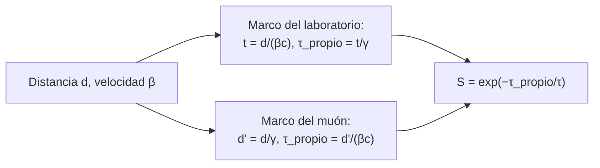

# B26-C03 — Dilatación temporal y contracción

<!-- nav:top -->
[🏠 Programa](../../../../README.md) · [📚 Bloque B26](../../../tronco-comun/B26-relatividad-y-cosmologia.md) · [← Anterior: B26-C02 — Transformaciones de Lorentz](../B26-C02-transformaciones-de-lorentz/CLASE.md) · [Siguiente: B26-C04 — Espacio-tiempo de Minkowski →](../B26-C04-espacio-tiempo-de-minkowski/CLASE.md)
<!-- /nav -->

## 1. Ubicación, nivel y alcance

Clase 3 del bloque B26. Nivel N3. Las transformaciones de [C02](../B26-C02-transformaciones-de-lorentz/CLASE.md) contienen dos consecuencias medibles: un reloj en movimiento marca menos tiempo y una regla en movimiento mide menos. Usas el decaimiento exponencial ([B09](../../../tronco-comun/B09-calculo-diferencial-e-integral.md)) y las unidades de [B13-C01](../../B13/B13-C01-sistema-internacional-y-constantes/CLASE.md). El caso conductor es un muón que cruza la atmósfera.

## 2. Por qué esta clase existe

Los muones se producen en la alta atmósfera por rayos cósmicos, viven microsegundos y, sin embargo, llegan al suelo en cantidad. Los relojes de satélites de navegación se ajustan por el mismo efecto. La decisión central: **¿cuánto cambia la duración o la longitud medida cuando el objeto se mueve a una fracción grande de `c`, y por qué los dos marcos concuerdan en el resultado físico?**

## 3. Lo que podrás hacer al terminar

1. Enunciar la dilatación temporal `Δt = γ Δτ` y la contracción `L = L₀/γ`.
2. Calcular la fracción de muones que sobreviven en el marco del laboratorio.
3. Repetir el cálculo en el marco del muón y verificar que coincide.
4. Calcular el `γ` necesario para que sobreviva la mitad.
5. Comparar con el cálculo sin relatividad.
6. Distinguir tiempo propio de tiempo coordenado.

La evidencia es la **tabla de supervivencia de muones** del ejercicio 12 (sección 20).

## 4. Con qué llegas y cómo comprobarlo

1. ¿Qué es una ley exponencial de desintegración?
2. ¿Qué es el factor `γ` (C02)?
3. ¿Qué es la vida media?
4. ¿Qué es un reloj en reposo respecto del objeto?
5. ¿Cuánto es `c τ` si `τ = 2,2 μs`?

<details>
<summary>Ver respuestas</summary>

1. `N(t) = N₀ e^{−t/τ}`. 2. `γ = 1/√(1−β²)`. 3. El tiempo en que queda `1/e` de la muestra. 4. El que viaja con el objeto; marca el tiempo propio. 5. Unos `660 m`.
</details>

Con cuatro o cinco aciertos, sigue; si no, repasa C02 y B09.

## 5. Un caso real: la vida del muón

La colaboración MuLan midió la vida media del muón positivo en reposo: `2 196 980,3 ps` con una incertidumbre de `2,2 ps` (S2, resumen), es decir, `2,1969803 μs`. Con ella, `c τ = 658,64 m`: sin relatividad, un muón apenas recorrería unos centenares de metros. Con producción a `15 km` de altura (valor **sintético**, ilustrativo) y `β = 0,99`, el laboratorio da una supervivencia de `3,9 × 10⁻²` frente a `10⁻¹⁰` sin relatividad. Es el **ejemplo conductor**.

## 6. Vocabulario

El **tiempo propio** `τ` es el medido por un reloj que viaja con el objeto. El **tiempo coordenado** `t` es el de un marco respecto del cual el objeto se mueve. La **dilatación temporal** relaciona ambos: `t = γτ`. La **longitud propia** `L₀` es la medida en el marco donde el objeto está en reposo. La **contracción de longitudes** dice que, en un marco donde el objeto se mueve, su longitud a lo largo del movimiento es `L = L₀/γ`. La **vida media** `τ` es el tiempo propio en que sobrevive `1/e` de una población. La **supervivencia** `S` es la fracción que queda tras recorrer una distancia.

## 7. Modelo mental: dos relatos, un mismo desenlace

Desde el laboratorio, el muón vive más porque su reloj va lento. Desde el muón, vive lo habitual, pero la atmósfera que se le acerca está contraída. Los dos relatos dan el mismo número de muones que llegan.



*Descripción textual:* en ambos marcos el tiempo propio del recorrido es `d/(γβc)`, y la supervivencia es la exponencial de ese tiempo entre la vida media.

Analogía: dos observadores describen la misma carrera, uno desde las gradas y otro desde el corredor. Límite: ambos concuerdan en eventos concretos, pero no en simultaneidad.

## 8. La explicación, paso a paso

### 8.1 Dilatación del tiempo

De `Λ` (C02), un reloj en reposo en `S'` (en `x' = 0`) marca `Δτ = Δt/γ` cuando `S` mide `Δt`. A `β = 0,99`, `γ = 7,089`: en `50,54 μs` de laboratorio, el muón envejece `7,13 μs`.

### 8.2 Contracción de longitudes

La distancia de `15 km` es la longitud propia en el marco del laboratorio. En el marco del muón mide `15 km/γ = 2,116 km` a `β = 0,99`. El muón la recorre a `βc`.

### 8.3 Supervivencia

En el laboratorio: `S = exp(−d/(γβcτ))`. Con `β = 0,99`: exponente `15 000/(7,089 × 0,99 × 658,64) = 3,245`; `S = 0,0390`. En el marco del muón: tiempo propio `2116/(0,99c) = 7,13 μs`; en unidades de `τ`: `3,245`; el mismo `S`. El laboratorio comprueba la coincidencia a `10⁻¹²` para `β = 0,9; 0,99; 0,999; 0,9999`.

### 8.4 Sin relatividad

Con `exp(−d/(βcτ))` el exponente es `15 000/(0,99 × 658,64) = 23,0` y `S = 10⁻¹⁰`: unos `10⁸` veces menos muones llegarían. En `β = 0,999` la relación es de `2,9 × 10⁹`.

### 8.5 Cuánto `γ` hace falta

La supervivencia de `1/2` tras `15 km` exige `d/(γβcτ) = ln 2`: `γ = 32,87`, `β = 0,999 537`. La sensibilidad a la incertidumbre de `τ` (`10⁻⁶` relativa, S2) es de unas `3 × 10⁻⁶` en el exponente: irrelevante aquí.

## 9. Magnitudes, símbolos y unidades

| Símbolo | Qué es | Unidad | Valor / nota |
|---|---|---|---|
| `τ` | vida media del muón en reposo | μs | `2,1969803` (S2) |
| `c τ` | longitud característica | m | `658,64` |
| `γ`, `β` | factor de Lorentz y velocidad | — | `7,089`; `0,99` |
| `d` | altura de producción | m | `15 000` (sintético) |
| `S` | supervivencia | — | `0,0390` (a `β = 0,99`) |

## 10. Convenciones y referencias

El muón se mueve en línea recta a velocidad constante; la desintegración es exponencial. La altura de 15 km y las velocidades son **sintéticas**. `c` de NIST (S1).

## 11. De dónde sale lo que afirmamos

| ID | Fuente | Localizador | Respalda | Estado |
|---|---|---|---|---|
| S1 | NIST, *Fundamental Physical Constants — Complete Listing* (CODATA 2022) | https://physics.nist.gov/cuu/Constants/Table/allascii.txt | `c` exacta | Consultada el 2026-11-09 |
| S2 | Tishchenko et al. (MuLan), *Detailed Report of the MuLan Measurement of the Positive Muon Lifetime…*, arXiv:1211.0960 | https://arxiv.org/abs/1211.0960 | Vida media `2 196 980,3 ± 2,2 ps` | Solo resumen, consultado el 2026-11-09 |

Límites: S2 solo resumen; no se consultó ninguna medida de muones atmosféricos, así que el cálculo ilustra el método sin afirmar flujos reales.

## 12. Cómo ver la supervivencia

| `β` | `γ` | `S` (relatividad) | `S` (sin relatividad) |
|---|---|---|---|
| 0,9 | 2,294 | `1,6 × 10⁻⁵` | `1,0 × 10⁻¹¹` |
| 0,99 | 7,089 | `3,9 × 10⁻²` | `1,0 × 10⁻¹⁰` |
| 0,999 | 22,37 | `0,361` | `1,3 × 10⁻¹⁰` |
| 0,9999 | 70,71 | `0,725` | `1,3 × 10⁻¹⁰` |

Descripción larga: la supervivencia relativista sube con `β`; la clásica queda en `10⁻¹⁰`.

## 13. Ejemplo trabajado: el muón de `β = 0,999`

**Paso 1 · Datos.** `β = 0,999`, `d = 15 000 m` (sintéticos), `τ = 2,1969803 μs`.

**Paso 2 · Factor.** `γ = 22,366`.

**Paso 3 · Exponente.** `d/(γβcτ) = 15 000/(22,366 × 0,999 × 658,64) = 1,019`.

**Paso 4 · Supervivencia.** `e^{−1,019} = 0,361`.

**Paso 5 · Otro marco.** `15 000/22,366 = 670,7 m`; tiempo propio `670,7/(0,999c) = 2,24 μs = 1,019 τ`; mismo exponente.

**Paso 6 · Sentido.** Con relatividad llega el `36 %`; sin ella, `10⁻¹⁰`.

## 14. Distintas formas de calcular

**Marco del laboratorio (dilatación):** se piensa en el reloj del muón. **Marco del muón (contracción):** se piensa en la distancia. **Con el intervalo (C04):** el tiempo propio es `√(Δt² − Δx²/c²)`, el mismo en cualquier marco.

## 15. Práctica guiada

**Ejercicio 1 · con los pasos indicados.** Calcula `γ` para `β = 0,99`. *Pasos:* `1 − 0,9801 = 0,0199`.

<details><summary>Solución comentada</summary>

`1/√0,0199 = 7,089`.
</details>

**Ejercicio 2 · con una pista.** Calcula `c τ`. *Pista:* `299 792 458 × 2,1969803 × 10⁻⁶`.

<details><summary>Solución comentada</summary>

`658,64 m`.
</details>

**Ejercicio 3 · casi autónomo.** Calcula `S` a `β = 0,99` y `d = 15 km`.

<details><summary>Solución comentada</summary>

Exponente `3,245`; `S = 0,0390`.
</details>

## 16. Práctica autónoma, transferencia e integrador

**Ejercicio 4.** Calcula `S` a `β = 0,9`.

<details><summary>Solución comentada</summary>

`γ = 2,294`; exponente `15 000/(2,294 × 0,9 × 658,64) = 11,03`; `S = 1,6 × 10⁻⁵`.
</details>

**Ejercicio 5.** ¿Cuántas veces más muones llegan con relatividad que sin ella a `β = 0,999`?

<details><summary>Solución comentada</summary>

`0,361/1,26 × 10⁻¹⁰ = 2,9 × 10⁹`.
</details>

**Ejercicio 6.** ¿Cuánto mide la altura de 15 km en el marco del muón a `β = 0,99`?

<details><summary>Solución comentada</summary>

`15/7,089 = 2,116 km`.
</details>

**Ejercicio 7.** ¿Qué `γ` da `S = 1/2`?

<details><summary>Solución comentada</summary>

`γ = 15 000/(β c τ ln 2) ≈ 32,87` (8.5).
</details>

**Ejercicio 8.** Tiempo de laboratorio y tiempo propio para el trayecto a `β = 0,99`.

<details><summary>Solución comentada</summary>

`15 000/(0,99c) = 50,54 μs`; propio `/7,089 = 7,13 μs`.
</details>

**Ejercicio 9 · transferencia.** Un compañero dice: «en el marco del muón no hay dilatación, entonces el muón no debería llegar». Respóndele.

<details><summary>Solución comentada</summary>

En ese marco la distancia está contraída; el resultado (`S`) es el mismo. Los dos relatos son equivalentes (8.3).
</details>

**Ejercicio 10 · transferencia.** La incertidumbre relativa de `τ` es `1,0 × 10⁻⁶` (S2). ¿Cuánto cambia el exponente `3,245` a `β = 0,99`?

<details><summary>Solución comentada</summary>

`3,245 × 10⁻⁶ ≈ 3,2 × 10⁻⁶`, despreciable.
</details>

**Ejercicio 11 · transferencia.** Un reloj atómico en una nave a `β = 10⁻⁴` va a un ritmo `1 − β²/2` respecto de tierra. ¿Cuánto retrasa por año?

<details><summary>Solución comentada</summary>

`β²/2 = 5 × 10⁻⁹`; por `3,156 × 10⁷ s` son `0,158 s` al año (solo efecto cinemático, sin gravedad).
</details>

**Ejercicio 12 · integrador.** Elabora tu *tabla de supervivencia de muones*: para cuatro velocidades, calcula `S` en ambos marcos y sin relatividad, la altura contraída y el `γ` para `S = 1/2`; indica qué es sintético y qué viene de la fuente.

<details><summary>Solución modelo</summary>

Tabla de la sección 12; ambos marcos coinciden a `10⁻¹²`; `γ = 32,87`; sintético: altura y velocidades; fuente: `τ` (S2, resumen).
</details>

## 17. Laboratorio: muones en dos marcos

El script [muon.py](muon.py) calcula `S` con dilatación y con contracción y **comprueba** que coinciden a `10⁻¹²` para cuatro velocidades y que la versión relativista supera por más de `10³` a la clásica.

**Datos:** `τ` de MuLan (resumen) y `c` de NIST; altura y velocidades **sintéticas**. **Predice antes de ejecutar:** ¿qué `S` esperas a `β = 0,9999`? (cerca de `0,7`.) **Ejecución del 2026-11-09 (Python 3.12.9):**

```text
Python 3.12.9 (biblioteca estandar)
vida media en reposo = 2.1969803 us ; c tau = 658.64 m
    beta     gamma      S (lab)     S (muon)   S (sin SR)
  0.9000     2.294   1.6207e-05   1.6207e-05   1.0240e-11
  0.9900     7.089   3.8962e-02   3.8962e-02   1.0218e-10
  0.9990    22.366   3.6086e-01   3.6086e-01   1.2571e-10
  0.9999    70.712   7.2463e-01   7.2463e-01   1.2831e-10
gamma para S = 1/2 tras 15 km: 32.87 (beta = 0.99953716)
Pruebas superadas.
```

```bash
python programa/clases/B26/B26-C03-dilatacion-temporal-y-contraccion/muon.py
```

**Límites:** altura única, velocidad constante, sin pérdida de energía ni ángulo de llegada.

## 18. Errores frecuentes y cómo corregirlos

**Aplicar `γ` en el sentido contrario.** Se corrige con los ejercicios 6 y 8.

**Usar ambas correcciones a la vez.** Se corrige con el ejercicio 9: son relatos alternativos.

**Confundir `τ` (propio) con `t` (coordenado).** Se corrige con la sección 6.

**Dar por real la altura sintética.** Se corrige con la sección 10.

**Olvidar `β` además de `γ` en la distancia recorrida.** Se corrige con el ejercicio 3.

## 19. Cómo sabrás que vas bien

Tras 8.1: ¿cuánto envejece el muón? Si dudas, ejercicio 8. Tras 8.3: ¿por qué dos marcos coinciden? Ejercicio 9. Tras el laboratorio: ¿qué comprueba? (que dilatación y contracción dan igual `S`).

## 20. Qué entregas y cómo se evalúa

El producto es tu **tabla de supervivencia de muones** (ejercicio 12).

| Criterio | Inicial | En desarrollo | Logrado | Destacado |
|---|---|---|---|---|
| Conceptos | Los confunde | Parciales | Propio y coordenado | Explica la equivalencia |
| Cálculo | Sin unidades | Con errores | `S` correcta | Despeja `γ` |
| Numérico | Sin comprobar | Un caso | Dos marcos | Sensibilidad a `τ` |
| Fuentes | Sin fuente | Sin fecha | S1–S2 con fecha | Declara que S2 es resumen |
| Límites | No los nombra | Uno | Tres | Discute el flujo real |

**Condiciones críticas (no se compensan con promedio):** rotular altura y velocidades como sintéticas; no aplicar ambas correcciones a la vez; citar solo lo consultado.

## 21. Ética, seguridad y límites

Clase educativa: no es un análisis de datos de rayos cósmicos. Accesibilidad: tablas equivalentes a las gráficas, fórmulas en texto, ejercicios sin conexión.

## 22. Para cerrar y seguir

El tiempo propio es `t/γ` y la longitud propia contraída es `L₀/γ`; ambos relatos dan la misma supervivencia. Queda una pregunta: ¿hay un marco geométrico donde estos efectos sean evidentes sin fórmulas?

**Glosario español–inglés.** dilatación del tiempo · *time dilation*; contracción de longitudes · *length contraction*; tiempo propio · *proper time*; longitud propia · *proper length*; vida media · *mean lifetime*; muón · *muon*.

**Continuidad.** [B26-C04](../B26-C04-espacio-tiempo-de-minkowski/CLASE.md) reúne tiempo propio, intervalo y conos de luz en una geometría única.

**Referencias:** ver sección 11.

<!-- nav:bottom -->
---

[← Anterior: B26-C02 — Transformaciones de Lorentz](../B26-C02-transformaciones-de-lorentz/CLASE.md) · [📚 Bloque B26](../../../tronco-comun/B26-relatividad-y-cosmologia.md) · [Siguiente: B26-C04 — Espacio-tiempo de Minkowski →](../B26-C04-espacio-tiempo-de-minkowski/CLASE.md)
<!-- /nav -->
