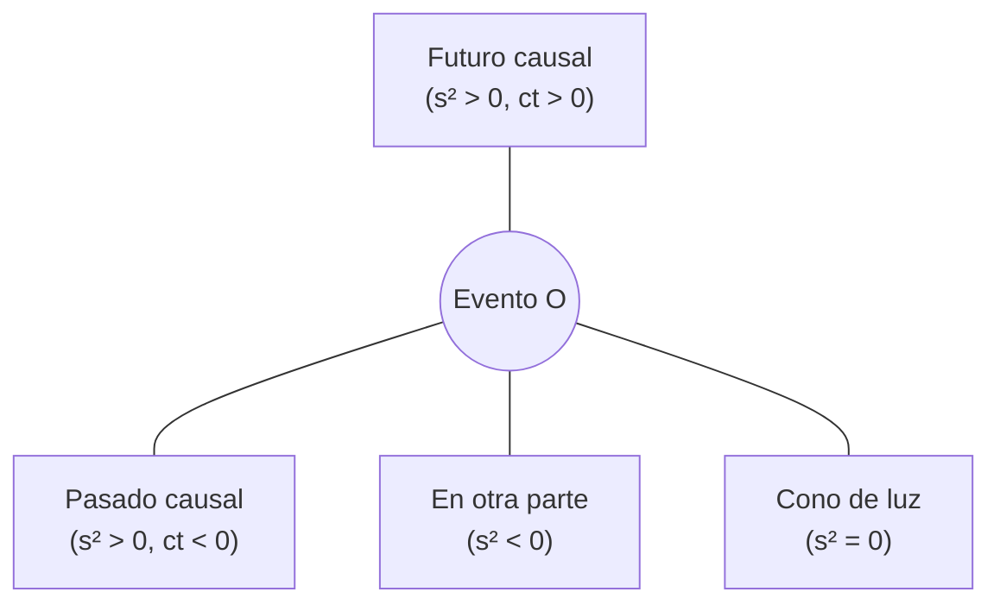

# B26-C04 — Espacio-tiempo de Minkowski

<!-- nav:top -->
[🏠 Programa](../../../../README.md) · [📚 Bloque B26](../../../tronco-comun/B26-relatividad-y-cosmologia.md) · [← Anterior: B26-C03 — Dilatación temporal y contracción](../B26-C03-dilatacion-temporal-y-contraccion/CLASE.md) · [Siguiente: B26-C05 — Equivalencia entre masa y energía →](../../../tronco-comun/B26-relatividad-y-cosmologia.md#b26-c05)
<!-- /nav -->

## 1. Ubicación, nivel y alcance

Clase 4 del bloque B26. Nivel N3. En [C02](../B26-C02-transformaciones-de-lorentz/CLASE.md) y [C03](../B26-C03-dilatacion-temporal-y-contraccion/CLASE.md) trabajaste con fórmulas. Aquí las reúnes en una geometría: el espacio-tiempo, donde cada evento es un punto y el intervalo hace de distancia. Con ella clasificas pares de eventos, delimitas qué puede influir en qué y calculas el tiempo propio de cualquier viaje. Usas integración numérica ([B11](../../../tronco-comun/B11-ecuaciones-diferenciales-y-simulacion-numerica.md)) y geometría ([B04](../../../tronco-comun/B04-algebra-trigonometria-y-geometria-espacial.md)). Se trata el espacio-tiempo plano, en `1+1` dimensiones.

## 2. Por qué esta clase existe

Comunicar con una sonda, sincronizar relojes de dos estaciones o decidir si un evento puede haber causado otro exige saber cuándo dos sucesos están conectados por una señal. El intervalo lo decide para todos los observadores. La decisión central: **dado un par de eventos, ¿es posible que uno influya en el otro y cuánto tiempo mide un reloj que viaja entre ellos?**

## 3. Lo que podrás hacer al terminar

1. Definir el espacio-tiempo de Minkowski y el intervalo.
2. Clasificar un par de eventos como de género tiempo, espacio o luz.
3. Dibujar (con descripción textual) el cono de luz y las zonas de causalidad.
4. Calcular el tiempo propio de una línea de universo por integración numérica.
5. Resolver la paradoja de los gemelos.
6. Decir qué eventos pueden ser causa de otro.

La evidencia es la **ficha de causalidad y tiempo propio** del ejercicio 12 (sección 20).

## 4. Con qué llegas y cómo comprobarlo

1. ¿Qué es el intervalo `s² = (ct)² − x²` (C02)?
2. ¿Qué es una línea de universo?
3. ¿Qué es el tiempo propio (C03)?
4. ¿Cómo se integra numéricamente una función?
5. ¿Qué es un cono?

<details>
<summary>Ver respuestas</summary>

1. La combinación invariante de la diferencia de tiempo y espacio. 2. La trayectoria de un objeto en el espacio-tiempo. 3. El tiempo medido por un reloj que viaja con el objeto. 4. Sumando valores de la función por el ancho de pequeños tramos. 5. Una superficie que se abre desde un vértice.
</details>

Con cuatro o cinco aciertos, sigue; si no, repasa C02, C03 y B11.

## 5. Un caso real: ¿pueden influirse el Sol y la Tierra en 300 segundos?

La luz tarda `499,005 s` en ir del Sol a la Tierra (`1 au = 1,495 978 707 00 × 10¹¹ m`, S2; `c` exacta, S1). Dos eventos, uno en el Sol y otro en la Tierra, separados por `300 s`, tienen `c Δt = 8,99 × 10¹⁰ m < 1,496 × 10¹¹ m`: el intervalo es de género espacio y ninguno puede haber causado el otro. Es el **ejemplo conductor**; el viaje de unos gemelos (sintético) ilustra el tiempo propio.

## 6. Vocabulario

El **espacio-tiempo de Minkowski** es el conjunto de eventos con la métrica `s² = (ct)² − x² − y² − z²`. El **intervalo de género tiempo** (`s² > 0`) conecta eventos que un objeto con masa puede unir. El de **género espacio** (`s² < 0`) no admite conexión causal. El de **género luz** (`s² = 0`) se une con un rayo de luz. El **cono de luz** de un evento es el conjunto de eventos a intervalo nulo; separa el futuro, el pasado y el «en otra parte». El **tiempo propio** a lo largo de una línea de universo es `τ = ∫ √(1 − v²/c²) dt`. Una **línea de universo** es la sucesión de eventos de un objeto.

## 7. Modelo mental: un mapa con conos de luz

Cada punto del mapa tiene un cono de luz dibujado: dentro del cono hacia arriba está su futuro, dentro hacia abajo su pasado; fuera, sus eventos inalcanzables. Las líneas de universo de los objetos con masa se mantienen siempre dentro del cono.



*Descripción textual:* desde un evento O, los eventos que quedan dentro del cono superior son su futuro; los del inferior, su pasado; los de fuera, no están conectados causalmente con O.

Analogía: el alcance de una onda en un estanque. Límite: aquí el «alcance» es el máximo, `c`, y se aplica en tiempo y espacio juntos.

## 8. La explicación, paso a paso

### 8.1 Clasificación

Para un par de eventos con `(ct, x)`: `(5, 3)` da `s² = +16` (tiempo); `(3, 5)`, `−16` (espacio); `(4, 4)`, `0` (luz). El laboratorio lo clasifica. Un cambio de marco no altera el signo de `s²` (C02).

### 8.2 Causalidad

Un evento puede influir en otro solo si el segundo está en su cono futuro (o sobre él). Para eventos de género espacio existen marcos donde ocurren en el orden contrario o a la vez; ninguno puede causar al otro.

### 8.3 Tiempo propio

El tiempo que mide un reloj a lo largo de una línea de universo es `τ = ∫ √(1 − β²) dt`, con `β = v/c`. Para velocidad constante `τ = t√(1−β²)`; si cambia, se integra por tramos. El tiempo propio es menor que el coordenado salvo en reposo.

### 8.4 Los gemelos

Una gemela viaja con `β = 0,8` durante `T = 20` años de la Tierra (10 de ida y 10 de vuelta) y el otro se queda. El laboratorio integra y obtiene `τ = 12,000 000` años; con `β = 0,6`, `16,000 000`; con `β = 0,99`, `2,821 347`. Los resultados coinciden con `T√(1−β²)` a `10⁻⁹`. Al regreso, la gemela viajera es más joven.

### 8.5 Por qué no es simétrico

La situación no es simétrica porque la viajera cambia de marco inercial al dar la vuelta: su línea de universo es una poligonal de dos tramos. El tiempo propio del camino recto (el gemelo en la Tierra) es el **máximo** entre todas las líneas de universo de género tiempo con los mismos extremos. Con una velocidad sinusoidal de máximo `0,9 c` el laboratorio da `14,92` años, también menos de `20`.

## 9. Magnitudes, símbolos y unidades

| Símbolo | Qué es | Unidad | Valor / nota |
|---|---|---|---|
| `s²` | intervalo | `m²` | `+16`, `−16`, `0` (sintéticos) |
| `τ` | tiempo propio | años | `12,000`, `16,000`, `2,821` |
| `T` | tiempo coordenado del viaje | años | `20` (sintético) |
| `β` | velocidad en unidades de `c` | — | `0,6; 0,8; 0,99` |
| `c` | velocidad de la luz | `m s⁻¹` | exacta (S1) |

## 10. Convenciones y referencias

Signatura `(+,−,−,−)` en el intervalo; una dimensión espacial; aceleraciones instantáneas en el giro. Los viajes son **sintéticos**.

## 11. De dónde sale lo que afirmamos

| ID | Fuente | Localizador | Respalda | Estado |
|---|---|---|---|---|
| S1 | NIST, *Fundamental Physical Constants — Complete Listing* (CODATA 2022) | https://physics.nist.gov/cuu/Constants/Table/allascii.txt | `c` exacta | Consultada el 2026-11-09 |
| S2 | IERS, *IERS Conventions (2010)*, TN36, Tabla 1.1 | https://iers-conventions.obspm.fr/content/tn36.pdf | `1 au = 1,495 978 707 00 × 10¹¹ m` | Texto del PDF extraído el 2026-11-09 |

Límites: el cono de luz y el tiempo propio son resultados estándar verificados numéricamente aquí; no se consultó una fuente primaria ni un experimento de los gemelos.

## 12. Cómo ver los conos

| Evento `(ct, x)` | `s²` | Género |
|---|---|---|
| (5, 3) | +16 | tiempo |
| (3, 5) | −16 | espacio |
| (4, 4) | 0 | luz |
| (−2, 1) | +3 | tiempo (pasado) |

Descripción larga: solo el género luz está sobre el cono; los de tiempo están dentro y los de espacio, fuera.

## 13. Ejemplo trabajado: ¿puede el evento del Sol causar el de la Tierra?

**Paso 1 · Datos.** Separación temporal `300 s`; distancia `1 au`.

**Paso 2 · Distancia de luz.** `c Δt = 299 792 458 × 300 = 8,99 × 10¹⁰ m`.

**Paso 3 · Comparación.** `8,99 × 10¹⁰ < 1,496 × 10¹¹`.

**Paso 4 · Género.** `s² = (c Δt)² − Δx² < 0`: espacio.

**Paso 5 · Sentido.** No hay conexión causal; con `Δt = 600 s` ya sería de género tiempo (`1,8 × 10¹¹ m > 1,496 × 10¹¹ m`).

## 14. Distintas formas de calcular el tiempo propio

**Fórmula directa (velocidad constante):** `t√(1−β²)`. **Integración numérica:** sirve con velocidad variable. **Con el intervalo:** `τ = s/c` para un tramo recto entre dos eventos.

## 15. Práctica guiada

**Ejercicio 1 · con los pasos indicados.** Clasifica `(5, 3)`. *Pasos:* `25 − 9`.

<details><summary>Solución comentada</summary>

`+16`: tiempo.
</details>

**Ejercicio 2 · con una pista.** Clasifica `(3, 5)`. *Pista:* `9 − 25`.

<details><summary>Solución comentada</summary>

`−16`: espacio.
</details>

**Ejercicio 3 · casi autónomo.** Tiempo propio con `β = 0,6` durante `T = 20` años.

<details><summary>Solución comentada</summary>

`20 × 0,8 = 16` años.
</details>

## 16. Práctica autónoma, transferencia e integrador

**Ejercicio 4.** Tiempo propio con `β = 0,8`.

<details><summary>Solución comentada</summary>

`20 × 0,6 = 12` años.
</details>

**Ejercicio 5.** Tiempo propio con `β = 0,99`.

<details><summary>Solución comentada</summary>

`20 × 0,14107 = 2,821` años.
</details>

**Ejercicio 6.** Distancia máxima a la que llega la viajera de `β = 0,8` (10 años de ida).

<details><summary>Solución comentada</summary>

`0,8 × 10 = 8` años luz.
</details>

**Ejercicio 7.** ¿Cuánto envejece la viajera con velocidad sinusoidal de máximo `0,9 c`?

<details><summary>Solución comentada</summary>

`14,92` años (laboratorio, 8.5).
</details>

**Ejercicio 8.** ¿Cuánto vale `s²` de `(−2, 1)` y de qué género es?

<details><summary>Solución comentada</summary>

`4 − 1 = +3`: tiempo, en el pasado.
</details>

**Ejercicio 9 · transferencia.** Un evento ocurre en el Sol y otro 600 s después en la Tierra. ¿Pueden estar conectados?

<details><summary>Solución comentada</summary>

`c Δt = 1,80 × 10¹¹ m > 1,496 × 10¹¹ m`: género tiempo; sí, una señal luminosa del primero llegaría antes (13).
</details>

**Ejercicio 10 · transferencia.** Un compañero dice: «la paradoja de los gemelos es simétrica». Responde con 8.5.

<details><summary>Solución comentada</summary>

No: solo uno de ellos cambia de marco inercial; el camino recto maximiza el tiempo propio.
</details>

**Ejercicio 11 · transferencia.** Una sonda envía un pulso a `x = 4` años luz. ¿Cuándo, en el marco de la Tierra, puede llegarle una respuesta, como mínimo?

<details><summary>Solución comentada</summary>

La señal ida y vuelta tarda `8` años como mínimo; antes no puede haber conexión causal.
</details>

**Ejercicio 12 · integrador.** Elabora tu *ficha de causalidad y tiempo propio*: clasifica cuatro pares de eventos, calcula el tiempo propio de tres viajes de ida y vuelta, interpreta el cono de luz del par Sol–Tierra y explica por qué los gemelos no son simétricos.

<details><summary>Solución modelo</summary>

Con las tablas de 8.1–8.4; Sol–Tierra: 300 s espacio, 600 s tiempo; no simétricos por el cambio de marco; todo sintético.
</details>

## 17. Laboratorio: gemelos por integración

El script [gemelos.py](gemelos.py) clasifica eventos e integra `τ = ∫√(1−β²)dt` y **comprueba** que coincide con `T√(1−β²)` a `10⁻⁹` y que un viaje con velocidad variable da `τ < T`.

**Datos:** ninguno observado; viajes **sintéticos**. **Predice antes de ejecutar:** ¿cuánto vale `τ` con `β = 0,8`? (`12`.) **Ejecución del 2026-11-09 (Python 3.12.9):**

```text
Python 3.12.9 (biblioteca estandar)
evento (ct, x) = (5, 3): s^2 = +16 -> intervalo de genero tiempo
evento (ct, x) = (3, 5): s^2 = -16 -> intervalo de genero espacio
evento (ct, x) = (4, 4): s^2 = +0 -> intervalo de genero luz
evento (ct, x) = (-2, 1): s^2 = +3 -> intervalo de genero tiempo
beta = 0.6: tau (viajero) = 16.000000 anios ; analitico = 16.000000 ; el gemelo en la Tierra envejece 20.0
beta = 0.8: tau (viajero) = 12.000000 anios ; analitico = 12.000000 ; el gemelo en la Tierra envejece 20.0
beta = 0.99: tau (viajero) = 2.821347 anios ; analitico = 2.821347 ; el gemelo en la Tierra envejece 20.0
velocidad sinusoidal (max 0.9 c): tau = 14.9185 anios < 20.0
Pruebas superadas.
```

```bash
python programa/clases/B26/B26-C04-espacio-tiempo-de-minkowski/gemelos.py
```

**Límites:** una dimensión espacial; giro instantáneo; sin gravedad.

## 18. Errores frecuentes y cómo corregirlos

**Pensar que el género espacio puede ser causal.** Se corrige con el ejercicio 9.

**Olvidar el signo de `s²`.** Se corrige con los ejercicios 1 y 2.

**Creer que los gemelos son simétricos.** Se corrige con el ejercicio 10.

**Confundir tiempo propio con coordenado.** Se corrige con la sección 8.3.

**Usar `T` entero en lugar de dos tramos.** Se corrige con el ejercicio 6.

## 19. Cómo sabrás que vas bien

Tras 8.1: ¿clasificas un par de eventos? Si dudas, ejercicios 1–2. Tras 8.4: ¿cuánto envejece la viajera? Ejercicios 3–5. Tras el laboratorio: ¿qué verifica la integral? (que equivale a `T√(1−β²)`).

## 20. Qué entregas y cómo se evalúa

El producto es tu **ficha de causalidad y tiempo propio** (ejercicio 12).

| Criterio | Inicial | En desarrollo | Logrado | Destacado |
|---|---|---|---|---|
| Géneros | Los confunde | Parciales | Clasifica bien | Relaciona con el cono |
| Cálculo | Sin unidades | Con errores | `τ` correcto | Integra con velocidad variable |
| Causalidad | No la usa | Sin criterio | Sol–Tierra resuelto | Argumenta con marcos |
| Fuentes | Sin fuente | Sin fecha | S1–S2 con fecha | Declara lo no consultado |
| Límites | No los nombra | Uno | Tres | Discute aceleración |

**Condiciones críticas (no se compensan con promedio):** no dar causalidad a un par de género espacio; rotular lo sintético; citar solo lo consultado.

## 21. Ética, seguridad y límites

Clase educativa: no es una propuesta de viaje ni un análisis de aceleraciones humanas. Accesibilidad: tablas equivalentes a las gráficas, fórmulas en texto, ejercicios sin conexión.

## 22. Para cerrar y seguir

El intervalo clasifica los pares de eventos, el cono de luz fija la causalidad y el tiempo propio mide el camino; el camino recto es el de mayor tiempo propio. Queda una pregunta: ¿cuánta energía hay detrás de esa masa que hace de «reloj»?

**Glosario español–inglés.** espacio-tiempo de Minkowski · *Minkowski spacetime*; cono de luz · *light cone*; línea de universo · *world line*; género tiempo · *timelike*; género espacio · *spacelike*; paradoja de los gemelos · *twin paradox*.

**Continuidad.** [B26-C05](../B26-C05-equivalencia-entre-masa-y-energia/CLASE.md) usa el tiempo propio y los invariantes para relacionar masa y energía.

**Referencias:** ver sección 11.

<!-- nav:bottom -->
---

[← Anterior: B26-C03 — Dilatación temporal y contracción](../B26-C03-dilatacion-temporal-y-contraccion/CLASE.md) · [📚 Bloque B26](../../../tronco-comun/B26-relatividad-y-cosmologia.md) · [Siguiente: B26-C05 — Equivalencia entre masa y energía →](../../../tronco-comun/B26-relatividad-y-cosmologia.md#b26-c05)
<!-- /nav -->
