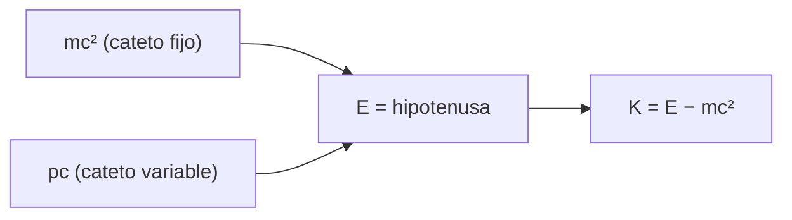

# B26-C05 — Equivalencia entre masa y energía

<!-- nav:top -->
[🏠 Programa](../../../../README.md) · [📚 Bloque B26](../../../tronco-comun/B26-relatividad-y-cosmologia.md) · [← Anterior: B26-C04 — Espacio-tiempo de Minkowski](../B26-C04-espacio-tiempo-de-minkowski/CLASE.md) · [Siguiente: B26-C06 — Principio de equivalencia →](../B26-C06-principio-de-equivalencia/CLASE.md)
<!-- /nav -->

## 1. Ubicación, nivel y alcance

Clase 5 del bloque B26, cierre de la relatividad especial. Nivel N3. Con el tiempo propio de [C04](../B26-C04-espacio-tiempo-de-minkowski/CLASE.md) construyes la energía y el momento relativistas, y con ellos la relación `E = mc²` que usaste sin deducirla en [B24-C06](../../B24/B24-C06-fusion-de-hidrogeno/CLASE.md). Usas energía y momento ([B05-C06](../../B05/B05-C06-trabajo-y-energia/CLASE.md), [B05-C08](../../B05/B05-C08-momento-lineal-e-impulsos/CLASE.md)) y masas atómicas ([B06-C03](../../B06/B06-C03-isotopos-y-masa-atomica/CLASE.md)). Se trata una partícula libre.

## 2. Por qué esta clase existe

El Sol, un acelerador de partículas y la fusión de dos agujeros negros son balances de masa y energía. Para calcularlos hay que saber cuánta energía tiene una partícula en reposo y en movimiento, y por qué no puede acelerarse hasta `c`. La decisión central: **dada una masa y una velocidad, ¿cuánta energía y momento tiene una partícula, y cuánta masa se convierte en energía en un proceso dado?**

## 3. Lo que podrás hacer al terminar

1. Escribir `E = γmc²`, `p = γmv` y `E² = (pc)² + (mc²)²`.
2. Calcular la energía cinética relativista y compararla con `½mv²`.
3. Calcular la energía de reposo de partículas con masas de referencia.
4. Calcular la energía de un balance de masas (aniquilación, fusión, fusión de agujeros negros).
5. Explicar por qué una partícula con masa no alcanza `c`.
6. Distinguir masa invariante de masa «relativista».

La evidencia es el **balance de energía relativista** del ejercicio 12 (sección 20).

## 4. Con qué llegas y cómo comprobarlo

1. ¿Qué es la energía cinética clásica?
2. ¿Qué es `γ` (C02)?
3. ¿Qué es un MeV en julios?
4. ¿Qué es un fotón?
5. ¿Qué es un invariante (C02)?

<details>
<summary>Ver respuestas</summary>

1. `½mv²`. 2. `1/√(1−β²)`. 3. `1 MeV = 1,602 176 634 × 10⁻¹³ J`. 4. La partícula de luz, sin masa, con `E = pc`. 5. Una cantidad que vale lo mismo en todos los marcos inerciales.
</details>

Con cuatro o cinco aciertos, sigue; si no, repasa C02 y B05-C06.

## 5. Un caso real: tres solares que se vuelven ondas

La señal GW150914 vino de la fusión de dos agujeros negros de `36` y `29` masas solares que dejó uno de `62`; la energía radiada en ondas gravitacionales fue `3,0 M☉c²` (S3, resumen). El balance de masas coincide: `36 + 29 − 62 = 3`. Con `M☉ = GM☉/G` (S2, S1), `1 M☉c² = 1,787 × 10⁴⁷ J` y la energía radiada fue `5,36 × 10⁴⁷ J`, el `4,6 %` de la masa inicial. Es el **ejemplo conductor**.

## 6. Vocabulario

La **energía de reposo** es `E₀ = mc²`, con `m` la masa invariante. La **energía total** es `E = γmc²`. El **momento relativista** es `p = γmv`. La **energía cinética** es `K = (γ − 1)mc²`. La **relación energía–momento** `E² = (pc)² + (mc²)²` es un invariante. Un **fotón** tiene `m = 0` y `E = pc`. La **aniquilación** electrón–positrón convierte sus masas en fotones. La **masa invariante** de un sistema es `√(E² − (pc)²)/c²`: puede ser mayor que la suma de las masas en reposo.

## 7. Modelo mental: un triángulo rectángulo

`E`, `pc` y `mc²` forman un triángulo rectángulo con `E` como hipotenusa. En reposo el triángulo degenera en el cateto `mc²`; para un fotón, `mc²` desaparece y `E = pc`.



*Descripción textual:* la energía total es la hipotenusa de un triángulo cuyos catetos son la energía de reposo, fija, y el término de momento, variable; la energía cinética es la diferencia entre la hipotenusa y el cateto fijo.

Analogía: el teorema de Pitágoras. Límite: el signo de la relación es Pitágoras, pero los tres lados son magnitudes físicas distintas.

## 8. La explicación, paso a paso

### 8.1 Energía y momento

`E = γmc²` y `p = γmv`. Para un protón (`m_pc² = 938,272 MeV`, por `m_p = 1,007 276 466 579 u` y `1 u = 931,494 103 72 MeV/c²`, S1): a `β = 0,9`, `γ = 2,29416`, `E = 2152,5 MeV` y `pc = 1937,3 MeV`; `E² − (pc)² = 8,80 × 10⁵ MeV² = (938,27 MeV)²`. El laboratorio lo comprueba a `10⁻⁹`.

### 8.2 Límite clásico

`K = (γ−1)mc² ≈ ½mv²(1 + 3β²/4)`. A `β = 10⁻³` la diferencia con la fórmula clásica es `7,5 × 10⁻⁷`; a `β = 0,1`, `0,76 %`; a `0,5`, `24 %`; a `0,9`, un factor 3,2.

### 8.3 Por qué no se alcanza `c`

`K = (γ−1)mc²` crece sin límite cuando `β → 1`: a `β = 0,99999`, `γ = 223,6` y `K = 2,09 × 10⁵ MeV`, unos `209 GeV` para un protón. Acelerar hasta `c` exigiría energía infinita.

### 8.4 Aniquilación

Un electrón y un positrón en reposo se convierten en dos fotones, cada uno con `m_ec² = 0,510 999 MeV` (por kilogramos y por unidades de masa atómica, coincidentes a `10⁻⁹`). El sistema de dos fotones tiene masa invariante `2m_e`, pese a que cada fotón no tiene masa.

### 8.5 Balances de masa y energía

En GW150914 faltan `3 M☉` entre el estado inicial y el final: se fueron como energía. En la fusión de hidrógeno de B24-C06, la fracción convertida es `0,7 %`; aquí es `4,6 %`, la mayor del bloque. Recordar: lo que se conserva es `E` total (y `p`), no la masa en reposo.

## 9. Magnitudes, símbolos y unidades

| Símbolo | Qué es | Unidad | Valor / nota |
|---|---|---|---|
| `m_pc²` | energía de reposo del protón | MeV | `938,272` (S1) |
| `m_ec²` | energía de reposo del electrón | MeV | `0,510 999` (S1) |
| `E`, `K`, `pc` | energía total, cinética, momento | MeV | `2152,5`; `1214,3`; `1937,3` (`β = 0,9`) |
| `M☉c²` | energía de una masa solar | J | `1,787 × 10⁴⁷` |
| `E_rad` | energía radiada en GW150914 | `M☉c²`; J | `3,0`; `5,36 × 10⁴⁷` (S3) |

## 10. Convenciones y referencias

`c` exacta; `M☉ = GM☉/G` con el valor nominal de la IAU (S2) y `G` de NIST (S1). Las masas de GW150914 son valores publicados (resumen) con incertidumbre del 90 %, no repetidos aquí. Las velocidades del protón son **sintéticas**.

## 11. De dónde sale lo que afirmamos

| ID | Fuente | Localizador | Respalda | Estado |
|---|---|---|---|---|
| S1 | NIST, *Fundamental Physical Constants — Complete Listing* (CODATA 2022) | https://physics.nist.gov/cuu/Constants/Table/allascii.txt | `c`, masas del protón y del electrón, `u` en MeV, `G` | Consultada el 2026-11-09 |
| S2 | Mamajek et al., *IAU 2015 Resolution B3*, arXiv:1510.07674 | https://arxiv.org/abs/1510.07674 | `GM☉` nominal | Texto del PDF extraído el 2026-11-09 |
| S3 | LIGO Scientific Collaboration y Virgo, *Observation of Gravitational Waves from a Binary Black Hole Merger*, arXiv:1602.03837 | https://arxiv.org/abs/1602.03837 | `36 + 29 → 62 M☉`; energía radiada `3,0 M☉c²` | Solo resumen, consultado el 2026-11-09 |

Límites: S3 solo resumen; la relación energía–momento y `E = γmc²` son resultados estándar que aquí se verifican numéricamente.

## 12. Cómo ver la energía

| `β` | `γ` | `K` relativista (MeV) | `K` clásica (MeV) |
|---|---|---|---|
| 0,001 | 1,0000005 | 0,000 469 | 0,000 469 |
| 0,1 | 1,00504 | 4,727 | 4,691 |
| 0,5 | 1,15470 | 145,15 | 117,28 |
| 0,9 | 2,29416 | 1214,3 | 380 |
| 0,99999 | 223,607 | 208 866 | 469 |

Descripción larga: las dos energías coinciden a baja velocidad y divergen cerca de `c`.

## 13. Ejemplo trabajado: energía de un protón a `β = 0,9`

**Paso 1 · Datos.** `m_pc² = 938,272 MeV`; `β = 0,9`.

**Paso 2 · Factor.** `γ = 1/√0,19 = 2,29416`.

**Paso 3 · Energía total.** `E = 2,29416 × 938,272 = 2152,5 MeV`.

**Paso 4 · Cinética.** `K = E − m_pc² = 1214,3 MeV`; la clásica da `0,5 × 938,272 × 0,81 = 380 MeV`.

**Paso 5 · Momento.** `pc = γβ m_pc² = 1937,3 MeV`; `E² − (pc)² = 8,80 × 10⁵ = (938,27)²` ✓.

**Paso 6 · Sentido.** La fórmula clásica subestima la energía en un factor 3,2.

## 14. Distintas formas de calcular la energía

**Con `γ`:** natural para la cinemática. **Con `E² = (pc)² + (mc²)²`:** útil cuando se conoce el momento, como en un detector. **Con balances de masa:** para reacciones, `Q = (Σm_ini − Σm_fin)c²`.

## 15. Práctica guiada

**Ejercicio 1 · con los pasos indicados.** Calcula `γ` para `β = 0,9`. *Pasos:* `1 − 0,81 = 0,19`.

<details><summary>Solución comentada</summary>

`γ = 2,29416`.
</details>

**Ejercicio 2 · con una pista.** Energía cinética del protón a `β = 0,1`. *Pista:* `(γ−1)m_pc²`.

<details><summary>Solución comentada</summary>

`0,005038 × 938,272 = 4,727 MeV`; la clásica da `4,691`: `0,76 %` menos.
</details>

**Ejercicio 3 · casi autónomo.** Comprueba `E² − (pc)²` para `β = 0,9`.

<details><summary>Solución comentada</summary>

`2152,5² − 1937,3² = 4,6333 × 10⁶ − 3,7531 × 10⁶ = 8,80 × 10⁵ = 938,27²`.
</details>

## 16. Práctica autónoma, transferencia e integrador

**Ejercicio 4.** ¿Qué fracción de la masa inicial radió GW150914?

<details><summary>Solución comentada</summary>

`3/65 = 4,6 %` (8.5).
</details>

**Ejercicio 5.** Calcula `M☉c²` en julios.

<details><summary>Solución comentada</summary>

`1,98841 × 10³⁰ × 8,98755 × 10¹⁶ = 1,787 × 10⁴⁷ J`.
</details>

**Ejercicio 6.** ¿Qué energía lleva cada fotón en la aniquilación en reposo de `e⁺e⁻`?

<details><summary>Solución comentada</summary>

`0,510 999 MeV`.
</details>

**Ejercicio 7.** ¿Cuánta energía cinética (en GeV) necesita un protón a `β = 0,99999`?

<details><summary>Solución comentada</summary>

`(223,607 − 1) × 0,938272 = 208,9 GeV`.
</details>

**Ejercicio 8.** ¿Qué fracción de `mc²` es la energía cinética a `β = 0,5`?

<details><summary>Solución comentada</summary>

`γ − 1 = 0,1547`.
</details>

**Ejercicio 9 · transferencia.** El Sol radia `3,828 × 10²⁶ W`. ¿Cuánta masa pierde por segundo?

<details><summary>Solución comentada</summary>

`L/c² = 4,26 × 10⁹ kg/s` (como en B24-C06).
</details>

**Ejercicio 10 · transferencia.** Un compañero dice: «los fotones no tienen masa, entonces dos fotones tampoco». Responde con 8.4.

<details><summary>Solución comentada</summary>

La masa invariante de un sistema es `√(E² − (pc)²)/c²`; dos fotones en sentidos opuestos tienen `pc = 0` total y `E = 1,022 MeV`: masa `2m_e`.
</details>

**Ejercicio 11 · transferencia.** ¿Qué energía cinética necesita un protón a `β = 0,9999999`?

<details><summary>Solución comentada</summary>

`γ = 2236,07`; `K = 2235,07 × 938,272 MeV = 2,097 × 10⁶ MeV ≈ 2,1 TeV`.
</details>

**Ejercicio 12 · integrador.** Elabora tu *balance de energía relativista*: tabla de energía, momento y energía cinética de un protón a cuatro velocidades, la comprobación de la relación energía–momento, el balance de GW150914 y una reflexión sobre por qué `v = c` es inalcanzable.

<details><summary>Solución modelo</summary>

Tabla de la sección 12 con `E` y `pc`; `E² − (pc)² = (938,27)²`; `3 M☉c² = 5,36 × 10⁴⁷ J`; `K → ∞` cuando `β → 1`.
</details>

## 17. Laboratorio: energía y momento

El script [energia.py](energia.py) calcula `E`, `p` y `K`, **comprueba** `E² − (pc)² = (mc²)²` a `10⁻⁹`, el límite clásico `K/K_cl − 1 ≈ 3β²/4`, la aniquilación por dos vías (kg y u) y el balance de masas de GW150914.

**Datos:** constantes de NIST y de la IAU; resumen de LIGO; velocidades **sintéticas**. **Predice antes de ejecutar:** ¿qué fracción de la masa inicial radió GW150914? (`4,6 %`.) **Ejecución del 2026-11-09 (Python 3.12.9):**

```text
Python 3.12.9 (biblioteca estandar)
m_p c^2 = 938.272 MeV
      beta       gamma       K [MeV]     K clasica   K/Kcl - 1
   0.00100     1.00000   0.000469136   0.000469136   7.498e-07
   0.10000     1.00504       4.72684       4.69136   7.563e-03
   0.50000     1.15470       145.151       117.284   2.376e-01
   0.90000     2.29416       1214.27           380   2.195e+00
   0.99999   223.60736        208866       469.127   4.442e+02
aniquilacion e+ e-: cada foton 0.510999 MeV (via kg) = 0.510999 MeV (via u)
GW150914: 36 + 29 - 62 = 3 Msol ; energia radiada = 5.361e+47 J ; fraccion de la masa inicial = 0.0462
1 Msol c^2 = 1.7871e+47 J
Pruebas superadas.
```

```bash
python programa/clases/B26/B26-C05-equivalencia-entre-masa-y-energia/energia.py
```

**Límites:** partículas libres; las masas de LIGO se toman como valores centrales.

## 18. Errores frecuentes y cómo corregirlos

**Usar `½mv²` cerca de `c`.** Se corrige con la tabla y el ejercicio 2.

**Decir que la masa «crece» con la velocidad.** Se corrige con la sección 6: la masa invariante no cambia.

**Olvidar que los fotones tienen energía sin masa.** Se corrige con el ejercicio 10.

**Confundir energía total con cinética.** Se corrige con el ejercicio 7.

**Mezclar kg y MeV sin conversión.** Se corrige con el ejercicio 5.

## 19. Cómo sabrás que vas bien

Tras 8.1: ¿cuánto vale `E² − (pc)²`? Si dudas, ejercicio 3. Tras 8.5: ¿qué se conserva? Ejercicios 4 y 10. Tras el laboratorio: ¿qué comprueba la doble vía de la aniquilación? (que kg y u dan igual energía).

## 20. Qué entregas y cómo se evalúa

El producto es tu **balance de energía relativista** (ejercicio 12).

| Criterio | Inicial | En desarrollo | Logrado | Destacado |
|---|---|---|---|---|
| Fórmulas | Las confunde | Parciales | `E`, `p`, `K` correctas | Usa el invariante |
| Cálculo | Sin unidades | Con errores | MeV y J correctos | Compara clásico y relativista |
| Balances | No los hace | Uno | GW y aniquilación | Discute masa invariante |
| Fuentes | Sin fuente | Sin fecha | S1–S3 con fecha | Declara que S3 es resumen |
| Límites | No los nombra | Uno | Tres | Discute la no conservación de la masa |

**Condiciones críticas (no se compensan con promedio):** no presentar `E = mc²` como «masa se transforma» sin balance; rotular lo sintético; citar solo lo consultado.

## 21. Ética, seguridad y límites

Clase educativa: no sustituye cálculos de reacciones nucleares ni de aceleradores. Accesibilidad: tablas equivalentes a las gráficas, fórmulas en texto, ejercicios sin conexión.

## 22. Para cerrar y seguir

La energía total es la hipotenusa de un triángulo con catetos `mc²` y `pc`; los balances de masa-energía explican la luminosidad del Sol y las ondas gravitacionales. Queda una pregunta: ¿qué ocurre cuando la gravedad entra en el esquema?

**Glosario español–inglés.** energía de reposo · *rest energy*; momento relativista · *relativistic momentum*; energía cinética · *kinetic energy*; masa invariante · *invariant mass*; aniquilación · *annihilation*; fotón · *photon*.

**Continuidad.** [B26-C06](../B26-C06-principio-de-equivalencia/CLASE.md) incorpora la gravedad con el principio de equivalencia.

**Referencias:** ver sección 11.

<!-- nav:bottom -->
---

[← Anterior: B26-C04 — Espacio-tiempo de Minkowski](../B26-C04-espacio-tiempo-de-minkowski/CLASE.md) · [📚 Bloque B26](../../../tronco-comun/B26-relatividad-y-cosmologia.md) · [Siguiente: B26-C06 — Principio de equivalencia →](../B26-C06-principio-de-equivalencia/CLASE.md)
<!-- /nav -->
