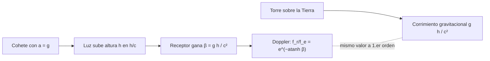

# B26-C06 — Principio de equivalencia

<!-- nav:top -->
[🏠 Programa](../../../../README.md) · [📚 Bloque B26](../../../tronco-comun/B26-relatividad-y-cosmologia.md) · [← Anterior: B26-C05 — Equivalencia entre masa y energía](../B26-C05-equivalencia-entre-masa-y-energia/CLASE.md) · [Siguiente: B26-C07 — Curvatura y métricas →](../B26-C07-curvatura-y-metricas/CLASE.md)
<!-- /nav -->

## 1. Ubicación, nivel y alcance

Clase 6 del bloque B26, primera de la gravedad. Nivel N3. Hasta aquí no había gravedad. Ahora la incorporas con una idea: en un laboratorio pequeño, caer libremente es indistinguible de flotar sin gravedad, y estar en reposo sobre la Tierra es indistinguible de estar en un cohete que acelera. Retomas la gravitación ([B05-C10](../../B05/B05-C10-gravitacion-universal/CLASE.md)), el efecto Doppler y la precisión de coma flotante ([B11-C25](../../B11/B11-C25-aritmetica-de-punto-flotante-y-errores-de-redondeo/CLASE.md)). Se trata el campo uniforme.

## 2. Por qué esta clase existe

Los relojes de los satélites de navegación van a un ritmo ligeramente distinto de los terrestres, y un maser en una torre ve su frecuencia cambiar con la altura. Todo eso se deduce de la equivalencia entre aceleración y gravedad. La decisión central: **¿qué cambio de frecuencia ve un receptor situado a una altura `h` sobre un emisor, y cómo se verifica con un cálculo en un cohete que acelera?**

## 3. Lo que podrás hacer al terminar

1. Enunciar el principio de equivalencia en su forma local.
2. Calcular la aceleración de la gravedad con `GM` y `R`.
3. Calcular el corrimiento `gh/c²` entre emisor y receptor.
4. Verificarlo con el Doppler relativista en un cohete acelerado.
5. Evitar la pérdida de cifras al calcular cantidades del orden de `10⁻¹⁶`.
6. Interpretar la precisión de la prueba con satélites Galileo.

La evidencia es la **ficha de corrimiento por aceleración** del ejercicio 12 (sección 20).

## 4. Con qué llegas y cómo comprobarlo

1. ¿Qué es la gravedad superficial `g = GM/R²`?
2. ¿Qué es el efecto Doppler?
3. ¿Qué es un marco inercial (C01)?
4. ¿Qué es un epsilon de máquina?
5. ¿Qué es una expansión a primer orden?

<details>
<summary>Ver respuestas</summary>

1. La aceleración que produce un cuerpo de masa `M` a distancia `R`. 2. El cambio de frecuencia por movimiento relativo entre emisor y receptor. 3. Uno en el que un cuerpo libre se mueve a velocidad constante. 4. El menor `ε` tal que `1 + ε ≠ 1` en coma flotante (`≈ 2,2 × 10⁻¹⁶`). 5. Conservar solo el término lineal.
</details>

Con cuatro o cinco aciertos, sigue; si no, repasa B05-C10 y B11-C25.

## 5. Un caso real: gravedad que se confunde con aceleración

Con los valores nominales de la IAU para la Tierra, `(GM)_E = 3,986 004 × 10¹⁴ m³/s²` y `R_E = 6,3781 × 10⁶ m` (S2), `g = 9,7984 m/s²`. Un emisor y un receptor separados `100 m` verticalmente difieren en frecuencia por `gh/c² = 1,09 × 10⁻¹⁴`. Una prueba con dos satélites Galileo en órbitas excéntricas midió la desviación del corrimiento respecto de la predicción de la relatividad general: `(+0,19 ± 2,48) × 10⁻⁵`, con `1008` días de datos (S3, resumen). Es el **ejemplo conductor**.

## 6. Vocabulario

El **principio de equivalencia (débil)** dice que todos los cuerpos caen con la misma aceleración en un campo gravitatorio. El **principio de equivalencia de Einstein (local)** dice que, en una región pequeña, los efectos de un campo gravitatorio son indistinguibles de los de una aceleración. Un **marco en caída libre** no siente gravedad. El **corrimiento gravitacional al rojo** es el cambio de frecuencia de la luz al subir en un campo. La **aceleración del cohete** `a` equivale a `g`. El **Doppler relativista** de una fuente que se aleja con `β` da `f_r/f_e = √((1−β)/(1+β)) = e^{−atanh β}`. Una **prueba de la relatividad** compara la predicción con la medida y acota la desviación.

## 7. Modelo mental: el ascensor

Dentro de un ascensor sin ventanas no puedes decir si estás parado en la Tierra o si un cohete te acelera con `a = g`. Un haz de luz que sube desde el piso llega al techo con la frecuencia reducida porque el techo, que acelera, se aleja del haz.



*Descripción textual:* en el cohete, la luz tarda `h/c` en subir y el receptor gana una velocidad `β = gh/c²`; el Doppler resultante coincide, a primer orden, con el corrimiento gravitacional de una torre de altura `h`.

Analogía: dos observadores describen la misma escena. Límite: la equivalencia vale localmente; los efectos de marea (variación de `g` con la posición) la distinguen en regiones grandes.

## 8. La explicación, paso a paso

### 8.1 Gravedad desde `GM` y `R`

`g = (GM)_E/R_E² = 3,986 004 × 10¹⁴/(6,3781 × 10⁶)² = 9,7984 m/s²` (campo en el ecuador, sin rotación).

### 8.2 El corrimiento a primer orden

En el cohete, el emisor está en el piso. La luz sube una altura `h` en un tiempo `h/c` y el receptor ha ganado una velocidad `a h/c`, es decir `β = ah/c²`. Con `a = g`, `β = gh/c²`. Para `h = 1 m`, `1,09 × 10⁻¹⁶`; `100 m`, `1,09 × 10⁻¹⁴`; `10 km`, `1,09 × 10⁻¹²`.

### 8.3 Verificación con el Doppler exacto

El Doppler relativista da `1 − √((1−β)/(1+β))`. Calculado literalmente con `β ≈ 10⁻¹⁶` se pierde precisión en coma flotante: la resta `1 − 0,99999…` queda al borde de la resolución (`1,8 %` de error a `h = 1 m`). Con `e^{−atanh β}` y `−expm1(−atanh β)` el laboratorio obtiene la diferencia relativa con `β` de `0` a `1 m`, `5,6 × 10⁻¹⁵` a `100 m` y `5,5 × 10⁻¹³` a `10 km`, del orden de `β` (segundo orden), como se espera.

### 8.4 Qué mide un reloj

Un maser de `1,42040575 GHz` (valor ilustrativo) en la parte alta de una torre de `100 m` ve su frecuencia respecto de la base cambiada en `1,55 × 10⁻⁵ Hz`. A `h = 10 km`, un día acumula `86 400 × 1,09 × 10⁻¹² = 94 ns`.

### 8.5 La precisión de la prueba

El resultado de Galileo, `(0,19 ± 2,48) × 10⁻⁵` (1σ) significa que la desviación es compatible con cero y que cualquier modelo alternativo debería producir diferencias menores que unos `5 × 10⁻⁵` (2σ) del efecto. Según el resumen, mejora un factor `5,6` el mejor resultado anterior y mejora por primera vez la prueba de Gravity Probe A (1976) (S3).

## 9. Magnitudes, símbolos y unidades

| Símbolo | Qué es | Unidad | Valor / nota |
|---|---|---|---|
| `(GM)_E`, `R_E` | parámetro gravitatorio y radio ecuatorial terrestres | `m³ s⁻²`; m | `3,986 004 × 10¹⁴`; `6,3781 × 10⁶` (S2) |
| `g` | gravedad en la superficie | `m s⁻²` | `9,7984` |
| `h` | altura entre emisor y receptor | m | `1`, `100`, `10⁴` (ilustrativas) |
| `gh/c²` | corrimiento fraccional | — | `1,09 × 10⁻¹⁶ … 10⁻¹²` |
| `δ` | desviación de la prueba Galileo | — | `(0,19 ± 2,48) × 10⁻⁵` (S3) |

## 10. Convenciones y referencias

Campo uniforme y `h ≪ R_E`; velocidades pequeñas. Alturas y aceleración del cohete son **ilustrativas**. `c` exacta (S1).

## 11. De dónde sale lo que afirmamos

| ID | Fuente | Localizador | Respalda | Estado |
|---|---|---|---|---|
| S1 | NIST, *Fundamental Physical Constants — Complete Listing* (CODATA 2022) | https://physics.nist.gov/cuu/Constants/Table/allascii.txt | `c` exacta | Consultada el 2026-11-09 |
| S2 | Mamajek et al., *IAU 2015 Resolution B3*, arXiv:1510.07674 | https://arxiv.org/abs/1510.07674 | `(GM)_E` y `R_E` nominales | Texto del PDF extraído el 2026-11-09 |
| S3 | Delva et al., *A gravitational redshift test using eccentric Galileo satellites*, arXiv:1812.03711 | https://arxiv.org/abs/1812.03711 | `(0,19 ± 2,48) × 10⁻⁵`; 1008 días; mejora ×5,6; primera mejora de Gravity Probe A | Solo resumen, consultado el 2026-11-09 |

Límites: S3 solo resumen; el principio de equivalencia y el cálculo del cohete son resultados estándar verificados numéricamente aquí.

## 12. Cómo ver el corrimiento

| `h` | `gh/c²` | `1 − Doppler` (estable) |
|---|---|---|
| 1 m | `1,0902 × 10⁻¹⁶` | `1,0902 × 10⁻¹⁶` |
| 100 m | `1,0902 × 10⁻¹⁴` | `1,0902 × 10⁻¹⁴` |
| 10 km | `1,0902 × 10⁻¹²` | `1,0902 × 10⁻¹²` |

Descripción larga: ambas columnas coinciden en todas las cifras mostradas; la diferencia está en la décima cifra.

## 13. Ejemplo trabajado: la torre de 100 m

**Paso 1 · Datos.** `g = 9,7984 m/s²`, `h = 100 m`.

**Paso 2 · Velocidad ganada.** `β = gh/c² = 979,84/8,98755 × 10¹⁶ = 1,0902 × 10⁻¹⁴`.

**Paso 3 · Doppler.** `1 − e^{−atanh β} = 1,0902 × 10⁻¹⁴`.

**Paso 4 · Cambio de frecuencia.** Para `1,42040575 GHz`, `Δf = 1,55 × 10⁻⁵ Hz`.

**Paso 5 · Sentido.** La luz que sube pierde frecuencia (corrimiento al rojo); la que baja la gana. Una medida con precisión relativa de `10⁻¹⁵` lo detecta.

## 14. Distintas formas de obtener el corrimiento

**Cohete acelerado (esta clase):** deduce el resultado sin gravedad. **Energía del fotón en un campo:** `Δf/f = −ΔΦ/c²` con el potencial. **Relatividad general (C09–C10):** forma exacta con la métrica.

## 15. Práctica guiada

**Ejercicio 1 · con los pasos indicados.** Calcula `g`. *Pasos:* `R_E²`, `(GM)_E/R_E²`.

<details><summary>Solución comentada</summary>

`R_E² = 4,0680 × 10¹³`; `g = 9,7984 m/s²`.
</details>

**Ejercicio 2 · con una pista.** Calcula `gh/c²` para `h = 100 m`.

<details><summary>Solución comentada</summary>

`979,84/8,98755 × 10¹⁶ = 1,09 × 10⁻¹⁴`.
</details>

**Ejercicio 3 · casi autónomo.** ¿Y para `h = 1 m`?

<details><summary>Solución comentada</summary>

`1,09 × 10⁻¹⁶`.
</details>

## 16. Práctica autónoma, transferencia e integrador

**Ejercicio 4.** Calcula el cambio de frecuencia de un maser de `1,42040575 GHz` a `100 m`.

<details><summary>Solución comentada</summary>

`1,42040575 × 10⁹ × 1,0902 × 10⁻¹⁴ = 1,55 × 10⁻⁵ Hz`.
</details>

**Ejercicio 5.** ¿Cuántos nanosegundos por día acumula un reloj a `h = 10 km` respecto de otro en el suelo (solo este efecto)?

<details><summary>Solución comentada</summary>

`86 400 × 1,0902 × 10⁻¹² = 9,4 × 10⁻⁸ s = 94 ns`.
</details>

**Ejercicio 6.** En el cohete con `a = g` y `h = 100 m`, ¿cuánto tarda la luz y qué velocidad gana el receptor?

<details><summary>Solución comentada</summary>

`t = h/c = 3,34 × 10⁻⁷ s`; `v = gt = 3,27 × 10⁻⁶ m/s`; `β = v/c = 1,09 × 10⁻¹⁴`.
</details>

**Ejercicio 7.** ¿Por qué `1 − √((1−β)/(1+β))` calculada literalmente falla para `β = 10⁻¹⁶`?

<details><summary>Solución comentada</summary>

Porque `1 − β` y `1 + β` no se distinguen bien de 1 en doble precisión (`ε ≈ 2,2 × 10⁻¹⁶`); la resta destruye las cifras. Se corrige con `−expm1(−atanh β)` (8.3).
</details>

**Ejercicio 8.** Si la prueba Galileo tiene incertidumbre `2,48 × 10⁻⁵` (1σ), ¿cuánto vale 2σ?

<details><summary>Solución comentada</summary>

`4,96 × 10⁻⁵`.
</details>

**Ejercicio 9 · transferencia.** Un compañero dice: «en una torre, el corrimiento depende de si el emisor es de oro o de plomo». Responde con 6.

<details><summary>Solución comentada</summary>

El principio de equivalencia dice que el efecto es universal: depende de `g` y `h`, no del material (el valor se verifica con el cohete, 8.3).
</details>

**Ejercicio 10 · transferencia.** ¿Por qué la equivalencia es solo local?

<details><summary>Solución comentada</summary>

Porque `g` varía con la posición: dos cuerpos separados sienten aceleraciones algo distintas (marea) y eso distingue un campo gravitatorio de una aceleración uniforme.
</details>

**Ejercicio 11 · transferencia.** Si el campo en un planeta es `g = 20 m/s²`, ¿cuánto cambia `gh/c²` a 100 m respecto de la Tierra?

<details><summary>Solución comentada</summary>

`gh/c² ∝ g`: `20/9,7984 = 2,04` veces más, `2,23 × 10⁻¹⁴`.
</details>

**Ejercicio 12 · integrador.** Elabora tu *ficha de corrimiento por aceleración*: calcula `g`, el corrimiento a tres alturas con la fórmula y con el Doppler estable, explica por qué la fórmula directa falla y compara con la incertidumbre de la prueba Galileo.

<details><summary>Solución modelo</summary>

Tabla de la sección 12; la cancelación se corrige con `expm1`; incertidumbre `2,48 × 10⁻⁵` del efecto.
</details>

## 17. Laboratorio: cohete y torre

El script [cohete.py](cohete.py) calcula `g`, el corrimiento `gh/c²` y el Doppler exacto con una forma numéricamente estable, **comprueba** que la diferencia relativa es del orden de `β` (segundo orden) y evalúa el cambio de frecuencia de un maser ilustrativo.

**Datos:** `c` de NIST; `(GM)_E`, `R_E` de la IAU; alturas **ilustrativas**; resultado de Galileo (resumen). **Predice antes de ejecutar:** ¿qué diferencia hay entre `gh/c²` y el Doppler exacto? (del orden de `β`.) **Ejecución del 2026-11-09 (Python 3.12.9):**

```text
Python 3.12.9 (biblioteca estandar)
g = (GM)_E / R_E^2 = 9.7984 m/s2
h =      1.0 m: g h / c^2 = 1.0902e-16 ; 1 - Doppler exacto = 1.0902e-16 ; diferencia relativa = 0.00e+00
h =    100.0 m: g h / c^2 = 1.0902e-14 ; 1 - Doppler exacto = 1.0902e-14 ; diferencia relativa = 5.55e-15
h =  10000.0 m: g h / c^2 = 1.0902e-12 ; 1 - Doppler exacto = 1.0902e-12 ; diferencia relativa = 5.45e-13
frecuencia de 1.42040575 GHz (ilustrativa) a 100 m de altura: cambio = 1.549e-05 Hz
prueba Galileo: desviacion (+0.19 +/- 2.48)e-5 -> incertidumbre relativa 1 sigma = 2.48e-05
Pruebas superadas.
```

```bash
python programa/clases/B26/B26-C06-principio-de-equivalencia/cohete.py
```

**Límites:** campo uniforme, primer orden en `h`, sin marea ni rotación terrestre.

## 18. Errores frecuentes y cómo corregirlos

**Pensar que la equivalencia vale en todo el espacio.** Se corrige con el ejercicio 10.

**Perder cifras restando números casi iguales.** Se corrige con el ejercicio 7.

**Creer que el corrimiento depende del material.** Se corrige con el ejercicio 9.

**Olvidar que sube la luz y baja la frecuencia.** Se corrige con la sección 13.

**Usar `g` de la superficie para alturas orbitales.** Se corrige con la sección 10.

## 19. Cómo sabrás que vas bien

Tras 8.2: ¿qué es `β` en el cohete? Si dudas, ejercicio 6. Tras 8.3: ¿por qué la fórmula directa falla? Ejercicio 7. Tras el laboratorio: ¿qué verifica la comparación? (que el Doppler exacto y `gh/c²` coinciden a primer orden).

## 20. Qué entregas y cómo se evalúa

El producto es tu **ficha de corrimiento por aceleración** (ejercicio 12).

| Criterio | Inicial | En desarrollo | Logrado | Destacado |
|---|---|---|---|---|
| Principio | Lo confunde | Parcial | Enunciado local | Explica la marea |
| Cálculo | Sin unidades | Con errores | `g` y `gh/c²` | Doppler estable |
| Numérico | Sin comprobar | Un caso | Tres alturas | Explica la cancelación |
| Fuentes | Sin fuente | Sin fecha | S1–S3 con fecha | Declara que S3 es resumen |
| Límites | No los nombra | Uno | Tres | Discute la precisión de la prueba |

**Condiciones críticas (no se compensan con promedio):** declarar que la equivalencia es local; rotular lo ilustrativo; citar solo lo consultado.

## 21. Ética, seguridad y límites

Clase educativa: no sustituye la corrección relativista de relojes de navegación. Accesibilidad: tablas equivalentes a las gráficas, fórmulas en texto, ejercicios sin conexión.

## 22. Para cerrar y seguir

Un cohete que acelera produce, a primer orden, el mismo corrimiento `gh/c²` que una torre sobre la Tierra; la prueba con satélites Galileo lo confirma a `2,5 × 10⁻⁵`. Queda una pregunta: ¿cómo describir una gravedad que varía de lugar a lugar?

**Glosario español–inglés.** principio de equivalencia · *equivalence principle*; caída libre · *free fall*; corrimiento al rojo gravitacional · *gravitational redshift*; efecto Doppler · *Doppler effect*; marea · *tidal effect*; prueba · *test*.

**Continuidad.** [B26-C07](../B26-C07-curvatura-y-metricas/CLASE.md) describe la gravedad variable con una métrica.

**Referencias:** ver sección 11.

<!-- nav:bottom -->
---

[← Anterior: B26-C05 — Equivalencia entre masa y energía](../B26-C05-equivalencia-entre-masa-y-energia/CLASE.md) · [📚 Bloque B26](../../../tronco-comun/B26-relatividad-y-cosmologia.md) · [Siguiente: B26-C07 — Curvatura y métricas →](../B26-C07-curvatura-y-metricas/CLASE.md)
<!-- /nav -->
