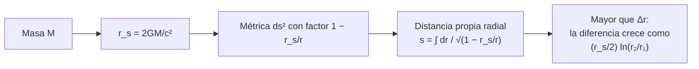

# B26-C07 — Curvatura y métricas

<!-- nav:top -->
[🏠 Programa](../../../../README.md) · [📚 Bloque B26](../../../tronco-comun/B26-relatividad-y-cosmologia.md) · [← Anterior: B26-C06 — Principio de equivalencia](../B26-C06-principio-de-equivalencia/CLASE.md) · [Siguiente: B26-C08 — Geodésicas gravitacionales →](../B26-C08-geodesicas-gravitacionales/CLASE.md)
<!-- /nav -->

## 1. Ubicación, nivel y alcance

Clase 7 del bloque B26. Nivel N3. [C06](../B26-C06-principio-de-equivalencia/CLASE.md) mostró que la gravedad se comporta como una propiedad local del movimiento. Aquí la describes con una **métrica**: la regla que da la distancia propia entre puntos cercanos. Con una esfera entiendes qué es la curvatura y con la métrica de Schwarzschild calculas una distancia propia alrededor del Sol. Usas geometría ([B04](../../../tronco-comun/B04-algebra-trigonometria-y-geometria-espacial.md)), integrales ([B09](../../../tronco-comun/B09-calculo-diferencial-e-integral.md)) y cuadratura numérica ([B11](../../../tronco-comun/B11-ecuaciones-diferenciales-y-simulacion-numerica.md)). La relatividad general avanzada se ve en [B39](../../../tronco-comun/B39-relatividad-general-avanzada.md).

## 2. Por qué esta clase existe

Medir una distancia cerca de una masa grande no da lo mismo que en el espacio plano: el radio de un círculo y su circunferencia dejan de cumplir `C = 2πR`. Los GPS, las lentes gravitacionales y los agujeros negros dependen de esa diferencia. La decisión central: **dada una masa, ¿cuánto se aparta la distancia propia de la coordenada y qué tan comprimido es su campo?**

## 3. Lo que podrás hacer al terminar

1. Definir métrica, curvatura y distancia propia.
2. Medir la curvatura de una esfera con el exceso angular de un triángulo.
3. Calcular el radio de Schwarzschild de un cuerpo.
4. Calcular la distancia propia radial entre dos radios en la métrica de Schwarzschild.
5. Comparar la distancia propia con la coordenada.
6. Estimar la compacidad `r_s/R` de objetos conocidos.

La evidencia es la **ficha de métrica y distancia propia** del ejercicio 12 (sección 20).

## 4. Con qué llegas y cómo comprobarlo

1. ¿Cómo se mide la longitud de una curva con un elemento de longitud `ds`?
2. ¿Qué es un triángulo esférico?
3. ¿Qué es la integral numérica de Simpson?
4. ¿Cuál es el radio de Schwarzschild `2GM/c²`?
5. ¿Qué es la compacidad?

<details>
<summary>Ver respuestas</summary>

1. Sumando `ds` a lo largo de la curva. 2. Un triángulo formado por tres arcos de círculo máximo. 3. Un método que aproxima la integral con parábolas por tramos. 4. La distancia en que la velocidad de escape iguala a `c` en una aproximación newtoniana; aquí se verá su papel en la métrica. 5. El cociente `r_s/R`.
</details>

Con cuatro o cinco aciertos, sigue; si no, repasa B04, B09 y B11.

## 5. Un caso real: el Sol visto con la métrica

El Sol, con `GM☉ = 1,327 124 4 × 10²⁰ m³/s²` y `R☉ = 6,957 × 10⁸ m` (S2), tiene un radio de Schwarzschild `r_s = 2GM/c² = 2953,25 m` (con `c` de S1) y una compacidad `r_s/R☉ = 4,245 × 10⁻⁶`. La Tierra, con `(GM)_E = 3,986 004 × 10¹⁴ m³/s²` y `R_E = 6,3781 × 10⁶ m` (S2), tiene `r_s = 8,870 mm` y compacidad `1,39 × 10⁻⁹`. Es el **ejemplo conductor**. En un caso extremo, el agujero negro final de GW150914, de `62 M☉` (S3, resumen), tendría un `r_s` de unos `183 km`.

## 6. Vocabulario

Una **métrica** es una regla `ds² = g_{μν} dx^μ dx^ν` que da el intervalo entre eventos cercanos. La **distancia propia** es la longitud medida con la métrica a lo largo de un camino. La **curvatura gaussiana** `K` de una superficie es `1/R²` para una esfera de radio `R`. El **exceso angular** de un triángulo es la suma de sus ángulos menos `π`, y vale `K A`, con `A` el área. La **métrica de Schwarzschild** describe el vacío alrededor de una masa esférica. El **radio de Schwarzschild** es `r_s = 2GM/c²`. La **coordenada** `r` se define de modo que una circunferencia mide `2πr`. La **compacidad** es `r_s/R`.

## 7. Modelo mental: una hoja de goma con una bola pesada

En una hoja de goma horizontal, la distancia en línea recta entre dos puntos es la de la regla. Si apoyas una bola pesada, la hoja se hunde y la distancia sobre la superficie entre dos puntos cercanos a la bola es mayor que la proyectada en el plano.



*Descripción textual:* la masa fija `r_s`; el factor `1 − r_s/r` aparece en la métrica; la distancia propia radial integra su raíz inversa y resulta mayor que la diferencia de coordenadas.

Analogía: la hoja de goma. Límite: es una imagen del espacio, no del espacio-tiempo completo (que incluye el tiempo).

## 8. La explicación, paso a paso

### 8.1 Curvatura de la esfera

Sobre una esfera de radio `R`, el elemento de área es `R² sen θ dθ dφ`. El triángulo con un vértice en el polo y los otros dos en el ecuador separados `90°` (el octante) tiene tres ángulos rectos: suma `270°`, exceso `90° = π/2`. Su área es `πR²/2`, de modo que el exceso es `A/R² = π/2`: `K = 1/R²`. El laboratorio integra el área y recupera `1,570 796` (`π/2`) a `10⁻⁶`.

### 8.2 La métrica de Schwarzschild

Para una masa esférica `M`, el intervalo espacial radial es `dl = dr/√(1 − r_s/r)`. Fuera de `r_s`, el factor `1/√(1−r_s/r)` es mayor que 1 y tiende a 1 lejos de la masa. La circunferencia de radio coordenado `r` mide `2πr`.

### 8.3 El radio de Schwarzschild

`r_s = 2GM/c²`: Sol, `2953,25 m`; Tierra, `8,870 mm`; `62 M☉`, `183 km`. Es la escala en que la curvatura se vuelve extrema; los astros normales están muy por encima de ella.

### 8.4 Distancia propia radial

La integral tiene la forma cerrada `s(r) = √(r(r − r_s)) + r_s ln(√r + √(r − r_s))`. Entre `R☉` y `2R☉`, `s = 6,957 010 × 10⁸ m`, `1023,52 m` más que la diferencia de coordenadas `6,957 × 10⁸ m`. La aproximación `(r_s/2) ln(r₂/r₁) = 1023,52 m` coincide. El laboratorio compara la cuadratura de Simpson con la forma cerrada a `10⁻⁹`.

### 8.5 Qué significa

La diferencia es de unos `1,5 × 10⁻⁶` de la distancia: minúscula, pero medible con relojes y señales de alta precisión. Cerca de objetos compactos (`r_s/R` ≈ 0,1–1) la diferencia deja de ser pequeña.

## 9. Magnitudes, símbolos y unidades

| Símbolo | Qué es | Unidad | Valor / nota |
|---|---|---|---|
| `r_s` | radio de Schwarzschild | m | Sol `2953,25`; Tierra `8,870 × 10⁻³` |
| `r_s/R` | compacidad | — | Sol `4,245 × 10⁻⁶`; Tierra `1,39 × 10⁻⁹` |
| `s` | distancia propia radial | m | `6,957 010 × 10⁸` (`R☉→2R☉`) |
| `K` | curvatura gaussiana | `m⁻²` | `1/R²` |
| `GM☉`, `R☉`, `(GM)_E`, `R_E` | valores nominales | — | (S2) |

## 10. Convenciones y referencias

Métrica de vacío, estática y esférica, válida fuera del cuerpo; `r > r_s`. Los radios del ejemplo (`R☉` a `2R☉`) son **ilustrativos**. `c` y `G` de NIST (S1).

## 11. De dónde sale lo que afirmamos

| ID | Fuente | Localizador | Respalda | Estado |
|---|---|---|---|---|
| S1 | NIST, *Fundamental Physical Constants — Complete Listing* (CODATA 2022) | https://physics.nist.gov/cuu/Constants/Table/allascii.txt | `c`, `G` | Consultada el 2026-11-09 |
| S2 | Mamajek et al., *IAU 2015 Resolution B3*, arXiv:1510.07674 | https://arxiv.org/abs/1510.07674 | `GM☉`, `R☉`, `(GM)_E`, `R_E` nominales | Texto del PDF extraído el 2026-11-09 |
| S3 | LIGO Scientific Collaboration y Virgo, arXiv:1602.03837 | https://arxiv.org/abs/1602.03837 | Masa final de `62 M☉` en GW150914 | Solo resumen, consultado el 2026-11-09 |

Límites: S3 solo resumen; la métrica de Schwarzschild y la integral son resultados estándar verificados numéricamente aquí; no se consultó ninguna fuente primaria de relatividad general.

## 12. Cómo ver la curvatura

| Cuerpo | `r_s` | `R` | `r_s/R` |
|---|---|---|---|
| Tierra | 8,870 mm | 6378,1 km | `1,39 × 10⁻⁹` |
| Sol | 2953,25 m | 695 700 km | `4,245 × 10⁻⁶` |
| Remanente de `62 M☉` | 183,1 km | — | — |

Descripción larga: la compacidad crece millones de veces del Sol a un agujero negro estelar.

## 13. Ejemplo trabajado: distancia propia de la fotosfera a `2R☉`

**Paso 1 · Datos.** `r₁ = 6,957 × 10⁸ m`, `r₂ = 2r₁`, `r_s = 2953,25 m`.

**Paso 2 · Distancia coordenada.** `Δr = 6,957 × 10⁸ m`.

**Paso 3 · Forma cerrada.** `s(r₂) − s(r₁)` da `6,957 010 × 10⁸ m`.

**Paso 4 · Diferencia.** `1023,52 m`.

**Paso 5 · Aproximación.** `(r_s/2) ln 2 = 1023,52 m`.

**Paso 6 · Sentido.** La distancia propia es `1,5 × 10⁻⁶` mayor que la coordenada.

## 14. Distintas formas de calcular una distancia

**Integral numérica (Simpson):** general. **Forma cerrada:** exacta para la métrica de Schwarzschild. **Aproximación logarítmica:** sirve cuando `r ≫ r_s`.

## 15. Práctica guiada

**Ejercicio 1 · con los pasos indicados.** Calcula `r_s` del Sol. *Pasos:* `2GM/c²`.

<details><summary>Solución comentada</summary>

`2 × 1,3271244 × 10²⁰/8,98755 × 10¹⁶ = 2953,25 m`.
</details>

**Ejercicio 2 · con una pista.** Calcula `r_s` de la Tierra.

<details><summary>Solución comentada</summary>

`2 × 3,986004 × 10¹⁴/8,98755 × 10¹⁶ = 8,870 × 10⁻³ m`.
</details>

**Ejercicio 3 · casi autónomo.** Calcula la compacidad del Sol.

<details><summary>Solución comentada</summary>

`2953,25/6,957 × 10⁸ = 4,245 × 10⁻⁶`.
</details>

## 16. Práctica autónoma, transferencia e integrador

**Ejercicio 4.** ¿Cuánto vale el exceso angular del octante?

<details><summary>Solución comentada</summary>

`270° − 180° = 90° = π/2` (8.1).
</details>

**Ejercicio 5.** ¿Cuánto vale `r_s` de un agujero negro de `62 M☉`?

<details><summary>Solución comentada</summary>

`62 × 2953,25 = 183 100 m = 183 km`.
</details>

**Ejercicio 6.** Calcula la diferencia entre distancia propia y coordenada entre `R☉` y `2R☉`.

<details><summary>Solución comentada</summary>

`1023,5 m` (8.4).
</details>

**Ejercicio 7.** ¿Qué fracción de la distancia coordenada es?

<details><summary>Solución comentada</summary>

`1023,5/6,957 × 10⁸ = 1,47 × 10⁻⁶`.
</details>

**Ejercicio 8.** ¿Cuál es la curvatura de una esfera de radio `1 m`?

<details><summary>Solución comentada</summary>

`K = 1 m⁻²`.
</details>

**Ejercicio 9 · transferencia.** Un compañero dice: «la métrica de Schwarzschild vale dentro del Sol». Responde con 10.

<details><summary>Solución comentada</summary>

No: es la métrica de vacío, válida fuera del cuerpo; dentro hay materia y otra solución.
</details>

**Ejercicio 10 · transferencia.** Si un cuerpo de radio `R = 10 km` tiene `M = 1,4 M☉`, ¿cuánto vale su compacidad?

<details><summary>Solución comentada</summary>

`r_s = 1,4 × 2953,25 = 4134,6 m`; `r_s/R = 0,413`: muy por encima de la del Sol; la métrica ya no se aproxima como débil (se verá en C18 de B24 y en B27).
</details>

**Ejercicio 11 · transferencia.** ¿Por qué la circunferencia define la coordenada `r` y no la distancia a lo largo del radio?

<details><summary>Solución comentada</summary>

Porque la circunferencia se mide directamente (no depende del factor radial) y se define `r = C/2π`; la distancia radial propia, en cambio, es mayor (8.2).
</details>

**Ejercicio 12 · integrador.** Elabora tu *ficha de métrica y distancia propia*: calcula `r_s` y compacidad de tres cuerpos, la distancia propia entre dos radios por cuadratura y forma cerrada, la diferencia con la coordenada y el exceso angular de un triángulo esférico.

<details><summary>Solución modelo</summary>

Tabla de la sección 12; `s = 6,957 010 × 10⁸ m`, diferencia `1023,52 m`; octante `π/2`.
</details>

## 17. Laboratorio: esfera y Schwarzschild

El script [metrica.py](metrica.py) integra el área del octante y **comprueba** que el exceso angular es `π/2` (`10⁻⁶`); calcula `r_s` y compacidad, y **comprueba** que la cuadratura de Simpson de la distancia propia coincide con la forma cerrada a `10⁻⁹`.

**Datos:** `c`, `G` de NIST; `GM`, `R` de la IAU; radios de la integral **ilustrativos**. **Predice antes de ejecutar:** ¿qué exceso angular tiene el octante? (`90°`.) **Ejecución del 2026-11-09 (Python 3.12.9):**

```text
Python 3.12.9 (biblioteca estandar)
octante de esfera unidad: area = 1.570796 (pi/2 = 1.570796) ; exceso = 90.0000 grados
r_s(Sol) = 2953.25 m ; r_s(Tierra) = 8.870 mm
compacidad r_s/R: Sol = 4.245e-06 ; Tierra = 1.391e-09
distancia propia R_sol -> 2 R_sol = 6.957010e+08 m ; diferencia coordenada = 1023.521 m
aproximacion (r_s/2) ln(r2/r1) = 1023.518 m
Pruebas superadas.
```

```bash
python programa/clases/B26/B26-C07-curvatura-y-metricas/metrica.py
```

**Límites:** métrica estática y de vacío; solo distancia radial; sin tiempo.

## 18. Errores frecuentes y cómo corregirlos

**Confundir `r` con la distancia radial propia.** Se corrige con el ejercicio 11.

**Aplicar Schwarzschild dentro del astro.** Se corrige con el ejercicio 9.

**Olvidar el factor 2 en `r_s`.** Se corrige con el ejercicio 1.

**Creer que la curvatura es una fuerza.** Se corrige con la sección 7: describe cómo se miden distancias.

**Pensar que la diferencia es grande en el Sol.** Se corrige con el ejercicio 7.

## 19. Cómo sabrás que vas bien

Tras 8.3: ¿cuánto vale `r_s`? Si dudas, ejercicio 1. Tras 8.4: ¿qué distancia es mayor? Ejercicios 6 y 7. Tras el laboratorio: ¿qué comprueba la cuadratura? (la forma cerrada de la distancia propia).

## 20. Qué entregas y cómo se evalúa

El producto es tu **ficha de métrica y distancia propia** (ejercicio 12).

| Criterio | Inicial | En desarrollo | Logrado | Destacado |
|---|---|---|---|---|
| Conceptos | Los confunde | Parciales | Métrica, curvatura, `r_s` | Explica el papel de `r` |
| Cálculo | Sin unidades | Con errores | `r_s` y distancia propia | Compara con la aproximación |
| Numérico | Sin comprobar | Un caso | Dos verificaciones | Interpreta la diferencia |
| Fuentes | Sin fuente | Sin fecha | S1–S3 con fecha | Declara que S3 es resumen |
| Límites | No los nombra | Uno | Tres | Discute el interior |

**Condiciones críticas (no se compensan con promedio):** no aplicar la métrica de vacío en el interior; rotular lo ilustrativo; citar solo lo consultado.

## 21. Ética, seguridad y límites

Clase educativa: no sustituye un tratamiento completo de la relatividad general. Accesibilidad: tablas equivalentes a las gráficas, fórmulas en texto, ejercicios sin conexión.

## 22. Para cerrar y seguir

La métrica da la distancia propia; la esfera enseña qué es la curvatura; Schwarzschild fija el radio `2GM/c²` y muestra que la distancia radial propia es algo mayor que la coordenada. Queda una pregunta: ¿qué trayectorias siguen los cuerpos libres en un espacio-tiempo curvo?

**Glosario español–inglés.** métrica · *metric*; curvatura · *curvature*; distancia propia · *proper distance*; radio de Schwarzschild · *Schwarzschild radius*; compacidad · *compactness*; exceso angular · *angular excess*.

**Continuidad.** [B26-C08](../B26-C08-geodesicas-gravitacionales/CLASE.md) usa la métrica para obtener las trayectorias de caída libre.

**Referencias:** ver sección 11.

<!-- nav:bottom -->
---

[← Anterior: B26-C06 — Principio de equivalencia](../B26-C06-principio-de-equivalencia/CLASE.md) · [📚 Bloque B26](../../../tronco-comun/B26-relatividad-y-cosmologia.md) · [Siguiente: B26-C08 — Geodésicas gravitacionales →](../B26-C08-geodesicas-gravitacionales/CLASE.md)
<!-- /nav -->
