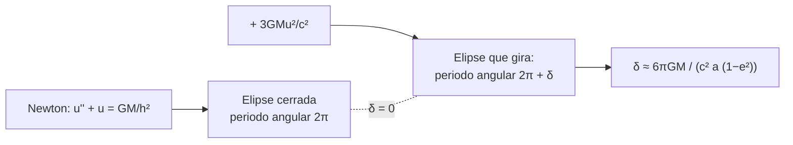

# B26-C08 — Geodésicas gravitacionales

<!-- nav:top -->
[🏠 Programa](../../../../README.md) · [📚 Bloque B26](../../../tronco-comun/B26-relatividad-y-cosmologia.md) · [← Anterior: B26-C07 — Curvatura y métricas](../B26-C07-curvatura-y-metricas/CLASE.md) · [Siguiente: B26-C09 — Relatividad general introductoria →](../B26-C09-relatividad-general-introductoria/CLASE.md)
<!-- /nav -->

## 1. Ubicación, nivel y alcance

Clase 8 del bloque B26. Nivel N3. Con la métrica de [C07](../B26-C07-curvatura-y-metricas/CLASE.md) puedes responder qué camino sigue un cuerpo libre: una **geodésica**, la «línea más recta» posible en un espacio-tiempo curvo. Eso reemplaza la fuerza de Newton y predice un efecto nuevo: la órbita elíptica no se cierra, sino que su perihelio avanza un poco en cada vuelta. Usas ecuaciones diferenciales ([B11-C07](../../B11/B11-C07-runge-kutta-de-cuarto-orden/CLASE.md)) y órbitas de Newton ([B05-C10](../../B05/B05-C10-gravitacion-universal/CLASE.md)). Se trata una partícula de prueba en el campo de una masa esférica.

## 2. Por qué esta clase existe

Calcular una trayectoria de una nave o un planeta con precisión de arcosegundos exige saber cuándo la mecánica newtoniana deja de ser suficiente. La precesión del perihelio es la manifestación más simple de esa diferencia. La decisión central: **¿cuánto avanza el perihelio de una órbita por vuelta según la relatividad general y cómo se verifica integrando la ecuación de la órbita?**

## 3. Lo que podrás hacer al terminar

1. Definir geodésica y explicar por qué un cuerpo libre sigue una.
2. Escribir la ecuación de la órbita en Schwarzschild.
3. Integrar la órbita numéricamente y medir el avance del perihelio.
4. Comparar con la fórmula `6πGM/(c²a(1−e²))`.
5. Comprobar que sin el término relativista no hay precesión.
6. Estimar la precesión por siglo para elementos orbitales dados.

La evidencia es la **verificación de la precesión** del ejercicio 12 (sección 20).

## 4. Con qué llegas y cómo comprobarlo

1. ¿Qué es una elipse con semieje `a` y excentricidad `e`?
2. ¿Qué es el momento angular específico `h`?
3. ¿Qué es el método de Runge–Kutta de cuarto orden?
4. ¿Qué es una geodésica de una esfera?
5. ¿Cuánto es `GM☉`?

<details>
<summary>Ver respuestas</summary>

1. Una órbita cerrada con `r_min = a(1−e)` y `r_max = a(1+e)`. 2. `h = r² dφ/dt` constante en un campo central. 3. Un integrador de cuatro pendientes por paso (B11-C07). 4. Un arco de círculo máximo. 5. `1,3271244 × 10²⁰ m³/s²`.
</details>

Con cuatro o cinco aciertos, sigue; si no, repasa B05-C10 y B11-C07.

## 5. Un caso real: una órbita del tamaño de la de Mercurio

El **ejemplo conductor** es una órbita con semieje `a = 5,79 × 10¹⁰ m` y excentricidad `e = 0,2056` (valores **ilustrativos**, no consultados) alrededor de una masa `GM☉` (S2). La fórmula da `5,0194 × 10⁻⁷ rad` por vuelta, es decir `0,1035″`; con un periodo kepleriano de `87,95 d`, son `415,3` vueltas por siglo y `43,00″` por siglo. Esta clase no cita la medida del perihelio de Mercurio porque no la consultó.

## 6. Vocabulario

Una **geodésica** es la trayectoria de un cuerpo libre en un espacio-tiempo curvo: extremiza el tiempo propio. En una esfera, es un arco de círculo máximo. La **ecuación de la órbita** para `u = 1/r` en la métrica de Schwarzschild es `u'' + u = GM/h² + 3GMu²/c²`, con `' = d/dφ`. El primer término del lado derecho es el newtoniano; el segundo es la corrección relativista. El **perihelio** es el punto de mayor acercamiento. La **precesión** es el avance angular del perihelio entre dos pasos. El **momento angular específico** `h` se conserva. El **semieje** `a` y la **excentricidad** `e` describen la elipse.

## 7. Modelo mental: una rosa en lugar de una elipse

En el caso newtoniano la órbita es una elipse que se repite. Con la corrección relativista, el planeta traza una «rosa»: casi una elipse que gira lentamente.



*Descripción textual:* la ecuación newtoniana da una elipse que se cierra tras `2π`; el término relativista alarga el ciclo a `2π + δ`, con `δ` de primer orden en `GM/(c²a)`.

Analogía: un espirógrafo que gira una vuelta casi completa. Límite: la analogía no explica por qué el efecto escala como `1/(a(1−e²))`.

## 8. La explicación, paso a paso

### 8.1 Geodésicas y gravedad

En relatividad general, un cuerpo libre sigue una geodésica de la métrica (C07). La «fuerza de gravedad» se sustituye por la curvatura del espacio-tiempo. En una esfera, las geodésicas son círculos máximos; en Schwarzschild, las órbitas de caída libre.

### 8.2 La ecuación de la órbita

Con la métrica de Schwarzschild y el momento angular específico `h`, la ecuación para `u = 1/r` es `u'' + u = GM/h² + 3GMu²/c²`. Sin el último término es la de Kepler. Con `c → ∞` el término desaparece.

### 8.3 Integración numérica

Se integra con Runge–Kutta de cuarto orden, con paso `dφ = 2 × 10⁻⁴`, desde un perihelio (`u'= 0`), hasta el siguiente. Se toma `h² = GMa(1−e²)` (la elipse newtoniana) como momento angular. El ángulo recorrido es `2π + δ`.

### 8.4 Resultado

El laboratorio da `δ = 5,019427 × 10⁻⁷ rad` frente a la predicción `5,019383 × 10⁻⁷ rad`: `8,8 × 10⁻⁶` de diferencia relativa, mucho menos del `0,5 %` de tolerancia. Con `c → ∞` (`10³⁰ m/s`) sale `δ = 4,3 × 10⁻¹² rad`: sin relatividad, no hay precesión. La fórmula equivale a `0,1035″` por vuelta y a `43,00″` por siglo.

### 8.5 Cómo depende de la órbita

`δ ∝ GM/(c² a (1−e²))`: más grande para órbitas pequeñas y excéntricas, y proporcional a la masa central. Para `e = 0,5` con el mismo `a`, el efecto es `1,28` veces mayor que para `e = 0,2056`.

## 9. Magnitudes, símbolos y unidades

| Símbolo | Qué es | Unidad | Valor / nota |
|---|---|---|---|
| `u` | `1/r` | `m⁻¹` | — |
| `h` | momento angular específico | `m² s⁻¹` | `√(GMa(1−e²))` |
| `a`, `e` | semieje y excentricidad | m; — | `5,79 × 10¹⁰`; `0,2056` (ilustrativos) |
| `δ` | precesión por vuelta | rad; ″ | `5,0194 × 10⁻⁷`; `0,1035″` |
| `GM☉` | parámetro nominal | `m³ s⁻²` | `1,3271244 × 10²⁰` (S2) |

## 10. Convenciones y referencias

Partícula de prueba, métrica de Schwarzschild, órbita en un plano, sin otros planetas ni achatamiento solar. Los elementos son **ilustrativos**. `c` exacta (S1).

## 11. De dónde sale lo que afirmamos

| ID | Fuente | Localizador | Respalda | Estado |
|---|---|---|---|---|
| S1 | NIST, *Fundamental Physical Constants — Complete Listing* (CODATA 2022) | https://physics.nist.gov/cuu/Constants/Table/allascii.txt | `c` exacta | Consultada el 2026-11-09 |
| S2 | Mamajek et al., *IAU 2015 Resolution B3*, arXiv:1510.07674 | https://arxiv.org/abs/1510.07674 | `GM☉` nominal | Texto del PDF extraído el 2026-11-09 |

Límites: la ecuación de la órbita y la fórmula de la precesión son resultados estándar verificados numéricamente aquí; no se consultó ninguna medida observacional de precesión ni elementos orbitales de planetas.

## 12. Cómo ver la precesión

| Magnitud | Valor |
|---|---|
| Predicción por vuelta | `5,019383 × 10⁻⁷ rad` (0,1035″) |
| Integración numérica | `5,019427 × 10⁻⁷ rad` |
| Caso newtoniano (`c → ∞`) | `4,3 × 10⁻¹² rad` |
| Vueltas por siglo (`a = 5,79 × 10¹⁰ m`) | `415,3` |
| Por siglo | `43,00″` |

Descripción larga: el avance es una fracción minúscula de vuelta, pero se acumula en siglos.

## 13. Ejemplo trabajado: la precesión de una órbita terrestre ilustrativa

**Paso 1 · Datos.** `a = 1,495 978 707 × 10¹¹ m`, `e = 0,0167` (ilustrativos).

**Paso 2 · Fórmula.** `δ = 6πGM/(c²a(1−e²))`.

**Paso 3 · Cálculo.** `6π × 1,3271244 × 10²⁰ = 2,5015 × 10²¹`; `c²a = 1,3445 × 10²⁸`; cociente `1,8604 × 10⁻⁷`; `/(1 − 0,000279)` → `1,8611 × 10⁻⁷ rad = 0,0384″`.

**Paso 4 · Por siglo.** `100` vueltas: `3,84″`.

**Paso 5 · Sentido.** Menor que la de una órbita pequeña; confirma que depende de `1/a`.

## 14. Distintas formas de obtener la precesión

**Fórmula de primer orden:** analítica. **Integración numérica:** verifica y permite órbitas más cerradas. **Simulaciones con muchos cuerpos (B21):** incluyen perturbaciones de otros planetas.

## 15. Práctica guiada

**Ejercicio 1 · con los pasos indicados.** Calcula `δ` por vuelta para la órbita del ejemplo. *Pasos:* `6πGM/(c²a(1−e²))`.

<details><summary>Solución comentada</summary>

`5,0194 × 10⁻⁷ rad = 0,1035″`.
</details>

**Ejercicio 2 · con una pista.** Calcula el periodo de Kepler. *Pista:* `2π√(a³/GM)`.

<details><summary>Solución comentada</summary>

`87,95 d`.
</details>

**Ejercicio 3 · casi autónomo.** Calcula la precesión por siglo.

<details><summary>Solución comentada</summary>

`0,1035″ × 415,3 = 43,00″`.
</details>

## 16. Práctica autónoma, transferencia e integrador

**Ejercicio 4.** ¿Cuánto vale `δ` para `e = 0,5` con el mismo `a`?

<details><summary>Solución comentada</summary>

`1/(1−0,25) = 1,333` frente a `1/(1−0,0423) = 1,044`: `1,277` veces mayor.
</details>

**Ejercicio 5.** ¿Qué sale de la integración con `c → ∞`?

<details><summary>Solución comentada</summary>

`δ ≈ 0` (`4,3 × 10⁻¹² rad`): la órbita newtoniana se cierra.
</details>

**Ejercicio 6.** Calcula `δ` para una órbita de semieje doble.

<details><summary>Solución comentada</summary>

`δ ∝ 1/a`: la mitad, `2,51 × 10⁻⁷ rad`.
</details>

**Ejercicio 7.** ¿Por qué la geodésica de una esfera es un círculo máximo?

<details><summary>Solución comentada</summary>

Porque es la curva de menor longitud entre dos puntos de la superficie (C07: sobre una esfera, `ds² = R²(dθ² + sen²θ dφ²)`).
</details>

**Ejercicio 8.** Distancia sobre la esfera unitaria entre los puntos `(θ, φ) = (90°, 0°)` y `(90°, 90°)`.

<details><summary>Solución comentada</summary>

`π/2` a lo largo del ecuador, un círculo máximo (la cuerda recta, que atraviesa la esfera, mide `√2`).
</details>

**Ejercicio 9 · transferencia.** Un compañero dice que «la relatividad explica la órbita con una fuerza más». Responde con 8.1.

<details><summary>Solución comentada</summary>

No: el cuerpo sigue una geodésica; la diferencia con Newton aparece en el término extra de la ecuación de la órbita, no en una fuerza adicional.
</details>

**Ejercicio 10 · transferencia.** Si la masa central se duplica con los mismos `a` y `e`, ¿cuánto cambia `δ`?

<details><summary>Solución comentada</summary>

`δ ∝ GM`: se duplica (a fijo; el periodo cambia).
</details>

**Ejercicio 11 · transferencia.** ¿Qué haría falta para comparar este resultado con una medida real?

<details><summary>Solución comentada</summary>

Elementos orbitales medidos y una medición de la precesión con la sustracción de las perturbaciones de otros planetas; esta clase no consultó esos datos.
</details>

**Ejercicio 12 · integrador.** Elabora tu *verificación de la precesión*: integra la órbita, compara con la fórmula, comprueba que sin el término relativista no hay precesión, calcula la precesión por siglo y declara qué es ilustrativo.

<details><summary>Solución modelo</summary>

`δ = 5,019 × 10⁻⁷` frente a `5,019 × 10⁻⁷`; newtoniano `4 × 10⁻¹²`; `43,00″` por siglo; elementos ilustrativos.
</details>

## 17. Laboratorio: precesión por integración

El script [precesion.py](precesion.py) integra `u'' + u = GM/h² + 3GMu²/c²` y **comprueba** que el avance del perihelio coincide con `6πGM/(c²a(1−e²))` dentro del `0,5 %` y que con `c → ∞` no hay precesión.

**Datos:** `c` de NIST, `GM☉` de la IAU; elementos orbitales **ilustrativos**. **Predice antes de ejecutar:** ¿qué avance por siglo esperas? (cerca de `43″`.) **Ejecución del 2026-11-09 (Python 3.12.9):**

```text
Python 3.12.9 (biblioteca estandar)
prediccion 6 pi GM / (c^2 a (1-e^2)) = 5.019383e-07 rad por orbita (0.10353 arcsec)
integracion numerica: delta = 5.019427e-07 rad por orbita (0.10353 arcsec)
periodo kepleriano = 87.95 d ; orbitas por siglo = 415.3 ; precesion = 43.00 arcsec por siglo
caso newtoniano (c -> infinito): delta = 4.33e-12 rad
Pruebas superadas.
```

```bash
python programa/clases/B26/B26-C08-geodesicas-gravitacionales/precesion.py
```

**Límites:** partícula de prueba; perturbaciones planetarias y achatamiento solar fuera.

## 18. Errores frecuentes y cómo corregirlos

**Pensar que la elipse relativista se cierra.** Se corrige con la sección 8.4.

**Tomar los elementos del ejemplo como medidos.** Se corrige con la sección 10.

**Olvidar `(1−e²)`.** Se corrige con el ejercicio 4.

**Usar el periodo en lugar de la fórmula.** Se corrige con el ejercicio 3.

**Pensar que hay una fuerza adicional.** Se corrige con el ejercicio 9.

## 19. Cómo sabrás que vas bien

Tras 8.2: ¿qué hace el término `3GMu²/c²`? Si dudas, ejercicio 5. Tras 8.5: ¿cómo escala `δ`? Ejercicios 4 y 6. Tras el laboratorio: ¿qué comprueba el caso `c → ∞`? (que sin relatividad no hay precesión).

## 20. Qué entregas y cómo se evalúa

El producto es tu **verificación de la precesión** (ejercicio 12).

| Criterio | Inicial | En desarrollo | Logrado | Destacado |
|---|---|---|---|---|
| Conceptos | Los confunde | Parciales | Geodésica y precesión | Contrasta con Newton |
| Cálculo | Sin unidades | Con errores | `δ` y siglo | Escala con `a`, `e`, `M` |
| Numérico | Sin comprobar | Un caso | Fórmula y límite newtoniano | Explica el paso y la tolerancia |
| Fuentes | Sin fuente | Sin fecha | S1–S2 con fecha | Declara que no hay medida |
| Límites | No los nombra | Uno | Tres | Discute perturbaciones |

**Condiciones críticas (no se compensan con promedio):** rotular los elementos como ilustrativos; no afirmar un acuerdo con la observación sin fuente; citar solo lo consultado.

## 21. Ética, seguridad y límites

Clase educativa: no sustituye el cálculo de efemérides. Accesibilidad: tablas equivalentes a las gráficas, fórmulas en texto, ejercicios sin conexión.

## 22. Para cerrar y seguir

Un cuerpo libre sigue una geodésica; en Schwarzschild, la órbita se abre y el perihelio avanza `6πGM/(c²a(1−e²))` por vuelta, que el laboratorio reproduce numéricamente. Queda una pregunta: ¿cómo se relaciona todo esto con la ecuación de Einstein y con la luz?

**Glosario español–inglés.** geodésica · *geodesic*; precesión del perihelio · *perihelion precession*; ecuación de la órbita · *orbit equation*; momento angular específico · *specific angular momentum*; excentricidad · *eccentricity*; partícula de prueba · *test particle*.

**Continuidad.** [B26-C09](../B26-C09-relatividad-general-introductoria/CLASE.md) pone estos resultados dentro de la ecuación de Einstein y calcula la deflexión de la luz.

**Referencias:** ver sección 11.

<!-- nav:bottom -->
---

[← Anterior: B26-C07 — Curvatura y métricas](../B26-C07-curvatura-y-metricas/CLASE.md) · [📚 Bloque B26](../../../tronco-comun/B26-relatividad-y-cosmologia.md) · [Siguiente: B26-C09 — Relatividad general introductoria →](../B26-C09-relatividad-general-introductoria/CLASE.md)
<!-- /nav -->
