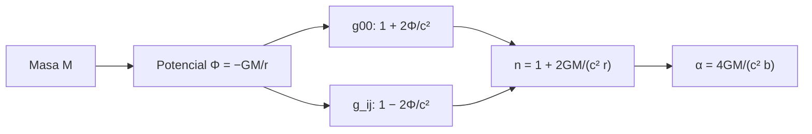

# B26-C09 — Relatividad general introductoria

<!-- nav:top -->
[🏠 Programa](../../../../README.md) · [📚 Bloque B26](../../../tronco-comun/B26-relatividad-y-cosmologia.md) · [← Anterior: B26-C08 — Geodésicas gravitacionales](../B26-C08-geodesicas-gravitacionales/CLASE.md) · [Siguiente: B26-C10 — Desplazamiento gravitacional al rojo →](../B26-C10-desplazamiento-gravitacional-al-rojo/CLASE.md)
<!-- /nav -->

## 1. Ubicación, nivel y alcance

Clase 9 del bloque B26. Nivel N3. Con el principio de equivalencia ([C06](../B26-C06-principio-de-equivalencia/CLASE.md)), la métrica ([C07](../B26-C07-curvatura-y-metricas/CLASE.md)) y las geodésicas ([C08](../B26-C08-geodesicas-gravitacionales/CLASE.md)) tienes los elementos de la relatividad general. Aquí los reúnes en una idea («la materia dice al espacio-tiempo cómo curvarse; el espacio-tiempo dice a la materia cómo moverse»), tomas el límite de campo débil y calculas una predicción medible: la **deflexión de la luz** por el Sol. No se resuelven las ecuaciones de Einstein; se usan sus consecuencias. Usas óptica ([B05-C19](../../B05/B05-C19-optica-y-velocidad-de-la-luz/CLASE.md)) y ecuaciones diferenciales ([B11-C07](../../B11/B11-C07-runge-kutta-de-cuarto-orden/CLASE.md)). La teoría completa está en [B39](../../../tronco-comun/B39-relatividad-general-avanzada.md).

## 2. Por qué esta clase existe

La luz de una estrella lejana que pasa cerca del Sol, o de una galaxia, se desvía: es la base de las lentes gravitacionales que miden masas de cúmulos (C18) y de las correcciones al seguimiento de naves en el espacio profundo. La decisión central: **¿cuánto se desvía un rayo de luz que pasa a una distancia `b` de una masa `M`, y cómo se verifica con un cálculo independiente?**

## 3. Lo que podrás hacer al terminar

1. Enunciar la idea central de la relatividad general y su límite newtoniano.
2. Escribir la métrica de campo débil en función del potencial.
3. Calcular la deflexión `4GM/(c²b)`.
4. Trazar un rayo numéricamente con un índice de refracción efectivo.
5. Distinguir el valor newtoniano (la mitad) del relativista.
6. Aplicar la escala `1/b` a otros casos.

La evidencia es el **cálculo de la deflexión solar** del ejercicio 12 (sección 20).

## 4. Con qué llegas y cómo comprobarlo

1. ¿Qué es el potencial gravitatorio `Φ = −GM/r`?
2. ¿Qué es un índice de refracción?
3. ¿Qué es un rayo de luz en óptica geométrica?
4. ¿Qué es el radio de Schwarzschild (C07)?
5. ¿Cómo se convierten radianes a segundos de arco?

<details>
<summary>Ver respuestas</summary>

1. La energía potencial por unidad de masa. 2. `n = c/v`, la razón entre `c` y la velocidad de fase. 3. Una trayectoria perpendicular a los frentes de onda. 4. `2GM/c²`. 5. Multiplicando por `180/π × 3600 ≈ 206 265`.
</details>

Con cuatro o cinco aciertos, sigue; si no, repasa B05-C19 y C07.

## 5. Un caso real: la luz que roza el Sol

Para un rayo que pasa rasante al limbo solar, `b = R☉ = 6,957 × 10⁸ m` y `GM☉ = 1,327 124 4 × 10²⁰ m³/s²` (S2), con `c` exacta (S1), la relatividad general predice `α = 4GM/(c²b) = 8,490 × 10⁻⁶ rad = 1,7512″`, el doble de lo que sale si solo se considera la parte temporal de la métrica, `0,8756″`. Es el **ejemplo conductor**. La energía de las ondas gravitacionales detectadas por LIGO (GW150914, pico de deformación `1,0 × 10⁻²¹` entre `35` y `250 Hz`, S3, resumen) pertenece al régimen de campo fuerte y no se trata aquí.

## 6. Vocabulario

La **relatividad general** describe la gravedad como curvatura del espacio-tiempo. Las **ecuaciones de Einstein** relacionan la curvatura con la energía y el momento de la materia. El **límite de campo débil** supone `|Φ|/c² ≪ 1`. La **métrica de campo débil** es `ds² = −(1+2Φ/c²)c²dt² + (1−2Φ/c²)dx²`. El **índice de refracción efectivo** de la luz es `n = 1 − 2Φ/c² = 1 + 2GM/(c²r)`. La **deflexión** `α` es el cambio de dirección del rayo. El **parámetro de impacto** `b` es la distancia de mayor acercamiento de la trayectoria recta. El **valor newtoniano** (Soldner) es `2GM/(c²b)`.

## 7. Modelo mental: el Sol como una lente débil

La luz se comporta como si atravesara un medio más denso cerca de la masa: se curva hacia ella, como en una lente. Pero la curvatura tiene dos aportes iguales (tiempo y espacio), y por eso el doble de lo newtoniano.



*Descripción textual:* el potencial de la masa modifica la parte temporal y la espacial de la métrica; ambos efectos suman un índice efectivo que curva el rayo con un ángulo `4GM/(c²b)`.

Analogía: una lente de vidrio. Límite: el índice efectivo es una herramienta de cálculo; no hay un medio material.

## 8. La explicación, paso a paso

### 8.1 Idea central y límite newtoniano

La materia curva el espacio-tiempo y los cuerpos libres siguen geodésicas (C08). En campo débil y velocidades bajas, la geodésica reproduce la gravedad de Newton, con `Φ` el potencial. En la superficie del Sol `2|Φ|/c² = r_s/R☉ = 4,245 × 10⁻⁶`; en la de la Tierra, `1,39 × 10⁻⁹`.

### 8.2 La luz como rayo en un medio

Para un rayo, `ds² = 0`. Con la métrica de campo débil, la velocidad coordenada de la luz es `c(1 + 2Φ/c²)` y el índice efectivo es `n = 1 + 2GM/(c²r)`. El rayo cumple la ecuación de la óptica geométrica `d(n dr/ds)/ds = ∇n`.

### 8.3 La deflexión analítica

Al integrar el gradiente transversal de `n` a lo largo de la línea recta, `α = 4GM/(c²b)`. Para `b = R☉`: `8,490 × 10⁻⁶ rad = 1,7512″`. Equivale a `2r_s/b`. Con solo el aporte temporal, `n = 1 + GM/(c²r)`, sale la mitad (`0,8756″`).

### 8.4 Verificación numérica

El laboratorio traza un rayo con Runge–Kutta desde `x = −2000 b` hasta `+2000 b`, con `n = 1 + 2GM/(c²r)`, y mide el ángulo final: `8,490 038 × 10⁻⁶ rad`, que coincide con `4GM/(c²b)` a `3,3 × 10⁻⁶`. Con `n = 1 + GM/(c²r)` obtiene `0,8756″`, la mitad. El signo es negativo: el rayo se curva hacia el Sol.

### 8.5 Escala con `b`

`α ∝ 1/b`: `0,8756″` a `2R☉` y `0,3502″` a `5R☉`. Es un efecto de largo alcance, pero decreciente; para masas mayores crece proporcionalmente.

## 9. Magnitudes, símbolos y unidades

| Símbolo | Qué es | Unidad | Valor / nota |
|---|---|---|---|
| `Φ` | potencial gravitatorio | `m² s⁻²` | `−GM/r` |
| `n` | índice efectivo | — | `1 + 2GM/(c²r)` |
| `b` | parámetro de impacto | m | `R☉ = 6,957 × 10⁸` (S2) |
| `α` | deflexión | rad; ″ | `8,490 × 10⁻⁶`; `1,7512″` |
| `r_s` | radio de Schwarzschild | m | `2953,25` (Sol) |

## 10. Convenciones y referencias

Masa puntual, rayo en un plano, campo débil; el rayo parte de `−2000 b` (elección numérica). Sin corona solar ni refracción atmosférica. `c` y `G` de NIST (S1).

## 11. De dónde sale lo que afirmamos

| ID | Fuente | Localizador | Respalda | Estado |
|---|---|---|---|---|
| S1 | NIST, *Fundamental Physical Constants — Complete Listing* (CODATA 2022) | https://physics.nist.gov/cuu/Constants/Table/allascii.txt | `c`, `G` | Consultada el 2026-11-09 |
| S2 | Mamajek et al., *IAU 2015 Resolution B3*, arXiv:1510.07674 | https://arxiv.org/abs/1510.07674 | `GM☉`, `R☉` nominales | Texto del PDF extraído el 2026-11-09 |
| S3 | LIGO Scientific Collaboration y Virgo, arXiv:1602.03837 | https://arxiv.org/abs/1602.03837 | Deformación pico `1,0 × 10⁻²¹`, barrido de `35` a `250 Hz` | Solo resumen, consultado el 2026-11-09 |

Límites: S3 solo resumen; la deflexión `4GM/(c²b)` es un resultado estándar verificado numéricamente aquí; no se consultó ninguna medida observacional de la deflexión solar.

## 12. Cómo ver la deflexión

| `b` | `α` relativista | `α` newtoniana |
|---|---|---|
| `R☉` | 1,7512″ | 0,8756″ |
| `2R☉` | 0,8756″ | 0,4378″ |
| `5R☉` | 0,3502″ | 0,1751″ |

Descripción larga: ambas decrecen como `1/b`; la relativista es siempre el doble.

## 13. Ejemplo trabajado: deflexión por una masa de 62 `M☉`

**Paso 1 · Datos.** `M = 62 M☉` y `b = 1000 r_s`.

**Paso 2 · Radio.** `r_s = 62 × 2953,25 = 183 100 m`; `b = 1,831 × 10⁸ m`.

**Paso 3 · Deflexión.** `α = 2r_s/b = 2/1000 = 2 × 10⁻³ rad`.

**Paso 4 · En segundos de arco.** `2 × 10⁻³ × 206 265 = 412″`.

**Paso 5 · Sentido.** Lejos del régimen de campo débil el cálculo deja de ser fiable cuando `b` se acerca a unas pocas `r_s`; con `b = 1000 r_s` sí vale. Es un valor de ejemplo; no se refiere a una observación.

## 14. Distintas formas de calcular la deflexión

**Fórmula analítica:** inmediata. **Trazado de rayos numérico (esta clase):** sirve con potenciales más complicados. **Integración de la geodésica nula en Schwarzschild:** exacta en campo fuerte (B39).

## 15. Práctica guiada

**Ejercicio 1 · con los pasos indicados.** Calcula `4GM/(c²b)` con `b = R☉`. *Pasos:* `4 × 1,3271244 × 10²⁰`, entre `c²b`.

<details><summary>Solución comentada</summary>

`5,3085 × 10²⁰/(8,98755 × 10¹⁶ × 6,957 × 10⁸) = 8,490 × 10⁻⁶ rad`.
</details>

**Ejercicio 2 · con una pista.** Pásalo a segundos de arco.

<details><summary>Solución comentada</summary>

`8,490 × 10⁻⁶ × 206 265 = 1,7512″`.
</details>

**Ejercicio 3 · casi autónomo.** ¿Cuál es el valor newtoniano?

<details><summary>Solución comentada</summary>

La mitad: `0,8756″`.
</details>

## 16. Práctica autónoma, transferencia e integrador

**Ejercicio 4.** Deflexión a `b = 5R☉`.

<details><summary>Solución comentada</summary>

`1,7512/5 = 0,3502″`.
</details>

**Ejercicio 5.** ¿Cuánto vale `2Φ/c²` en la superficie del Sol?

<details><summary>Solución comentada</summary>

`r_s/R☉ = 4,245 × 10⁻⁶`.
</details>

**Ejercicio 6.** Comprueba que `α = 2r_s/b` para `b = R☉`.

<details><summary>Solución comentada</summary>

`2 × 2953,25/6,957 × 10⁸ = 8,490 × 10⁻⁶`.
</details>

**Ejercicio 7.** ¿Qué diferencia relativa tiene el trazado de rayos con la fórmula?

<details><summary>Solución comentada</summary>

`8,490 038/8,490 010 − 1 = 3,3 × 10⁻⁶`.
</details>

**Ejercicio 8.** ¿Hacia dónde se curva el rayo?

<details><summary>Solución comentada</summary>

Hacia la masa (ángulo final negativo en el laboratorio).
</details>

**Ejercicio 9 · transferencia.** Un compañero dice que la luz no tiene masa y por eso no debería desviarse. Respóndele con 8.1–8.2.

<details><summary>Solución comentada</summary>

No se trata de una fuerza sobre una masa: los rayos de luz siguen geodésicas nulas del espacio-tiempo curvo.
</details>

**Ejercicio 10 · transferencia.** ¿Por qué el valor de la relatividad general es el doble del newtoniano?

<details><summary>Solución comentada</summary>

Porque la curvatura tiene dos contribuciones iguales, temporal y espacial (`g₀₀` y `g_ij`); el cálculo newtoniano solo incluye la temporal (8.3).
</details>

**Ejercicio 11 · transferencia.** Para una masa de `10¹² M☉` y `b` de 10 kpc, ¿cuánto vale `α`? (Usa `1 pc = 648000/π au`.)

<details><summary>Solución comentada</summary>

`r_s = 10¹² × 2953,25 = 2,953 × 10¹⁵ m`; `b = 10⁴ × 3,0857 × 10¹⁶ = 3,0857 × 10²⁰ m`; `α = 2r_s/b = 1,9 × 10⁻⁵ rad ≈ 3,9″`; es una masa de ejemplo, no de una galaxia concreta.
</details>

**Ejercicio 12 · integrador.** Elabora tu *cálculo de la deflexión solar*: fórmula, valor en rad y ″, trazado de rayos con ambas versiones del índice, escala con `b` y una discusión de los límites.

<details><summary>Solución modelo</summary>

`1,7512″` y `0,8756″`; diferencia con la fórmula `3 × 10⁻⁶`; `α ∝ 1/b`; límites: campo débil, masa puntual.
</details>

## 17. Laboratorio: trazado de rayos

El script [deflexion.py](deflexion.py) integra la ecuación de rayos y **comprueba** que la deflexión coincide con `4GM/(c²b)` dentro del `0,2 %` y que con la parte temporal sola es la mitad.

**Datos:** `c`, `G` de NIST; `GM☉`, `R☉` de la IAU. **Predice antes de ejecutar:** ¿qué ángulo para `b = R☉`? (`1,75″`.) **Ejecución del 2026-11-09 (Python 3.12.9):**

```text
Python 3.12.9 (biblioteca estandar)
4GM/(c^2 b) = 8.490010e-06 rad = 1.7512 arcsec (b = R_sol)
trazado de rayos (n = 1 + 2GM/(c^2 r)) : alfa = 8.490038e-06 rad = 1.7512 arcsec
trazado de rayos (n = 1 +  GM/(c^2 r)) : alfa = 4.245012e-06 rad = 0.8756 arcsec (valor newtoniano)
b = 2 R_sol: alfa = 0.8756 arcsec (escala 1/b)
b = 5 R_sol: alfa = 0.3502 arcsec (escala 1/b)
Pruebas superadas.
```

```bash
python programa/clases/B26/B26-C09-relatividad-general-introductoria/deflexion.py
```

**Límites:** masa puntual, rayo en un plano, tramo finito de `±2000 b`.

## 18. Errores frecuentes y cómo corregirlos

**Pensar que la luz se desvía por tener masa.** Se corrige con el ejercicio 9.

**Olvidar el factor 2.** Se corrige con el ejercicio 10.

**Mezclar rad y ″.** Se corrige con el ejercicio 2.

**Aplicar la fórmula a `b ≈ r_s`.** Se corrige con la sección 13.

**Confundir `n` efectivo con un medio real.** Se corrige con la sección 7.

## 19. Cómo sabrás que vas bien

Tras 8.3: ¿cuánto vale `α` en el limbo? Si dudas, ejercicios 1–2. Tras 8.4: ¿por qué el doble de Newton? Ejercicio 10. Tras el laboratorio: ¿qué verifica el trazado? (la fórmula analítica).

## 20. Qué entregas y cómo se evalúa

El producto es tu **cálculo de la deflexión solar** (ejercicio 12).

| Criterio | Inicial | En desarrollo | Logrado | Destacado |
|---|---|---|---|---|
| Idea central | La confunde | Parcial | Curvatura y geodésicas | Explica el factor 2 |
| Cálculo | Sin unidades | Con errores | `α` en rad y ″ | Escala con `b` |
| Numérico | Sin comprobar | Un caso | Rayo con dos índices | Interpreta el error |
| Fuentes | Sin fuente | Sin fecha | S1–S3 con fecha | Declara que no hay medida |
| Límites | No los nombra | Uno | Tres | Discute campo fuerte |

**Condiciones críticas (no se compensan con promedio):** no presentar la deflexión como medida sin fuente; rotular lo ilustrativo; citar solo lo consultado.

## 21. Ética, seguridad y límites

Clase educativa: no sustituye la teoría de lentes gravitacionales ni el tratamiento completo de las ecuaciones de Einstein. Accesibilidad: tablas equivalentes a las gráficas, fórmulas en texto, ejercicios sin conexión.

## 22. Para cerrar y seguir

En campo débil, la luz se comporta como en un medio de índice `1 + 2GM/(c²r)` y se desvía `4GM/(c²b)`: `1,75″` en el limbo solar, el doble de lo newtoniano. Queda una pregunta: ¿cuánto cambia la frecuencia de la luz que sale de un campo gravitatorio?

**Glosario español–inglés.** relatividad general · *general relativity*; ecuaciones de Einstein · *Einstein field equations*; campo débil · *weak field*; deflexión de la luz · *light deflection*; parámetro de impacto · *impact parameter*; índice de refracción efectivo · *effective refractive index*.

**Continuidad.** [B26-C10](../B26-C10-desplazamiento-gravitacional-al-rojo/CLASE.md) calcula el corrimiento al rojo de la luz que sale de un campo gravitatorio.

**Referencias:** ver sección 11.

<!-- nav:bottom -->
---

[← Anterior: B26-C08 — Geodésicas gravitacionales](../B26-C08-geodesicas-gravitacionales/CLASE.md) · [📚 Bloque B26](../../../tronco-comun/B26-relatividad-y-cosmologia.md) · [Siguiente: B26-C10 — Desplazamiento gravitacional al rojo →](../B26-C10-desplazamiento-gravitacional-al-rojo/CLASE.md)
<!-- /nav -->
