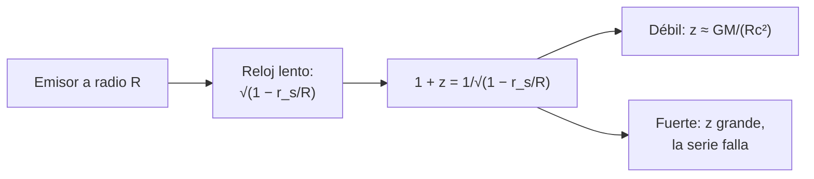

# B26-C10 — Desplazamiento gravitacional al rojo

<!-- nav:top -->
[🏠 Programa](../../../../README.md) · [📚 Bloque B26](../../../tronco-comun/B26-relatividad-y-cosmologia.md) · [← Anterior: B26-C09 — Relatividad general introductoria](../B26-C09-relatividad-general-introductoria/CLASE.md) · [Siguiente: B26-C11 — Expansión cósmica y ley de Hubble-Lemaître →](../B26-C11-expansion-cosmica-y-ley-de-hubble-lemaitre/CLASE.md)
<!-- /nav -->

## 1. Ubicación, nivel y alcance

Clase 10 del bloque B26, cierre de la gravedad como geometría. Nivel N3. En [C06](../B26-C06-principio-de-equivalencia/CLASE.md) obtuviste el corrimiento `gh/c²` de un campo uniforme; con la métrica de Schwarzschild ([C07](../B26-C07-curvatura-y-metricas/CLASE.md)) obtienes la forma exacta y la usas en cuerpos de cualquier compacidad: Tierra, Sol, enana blanca, estrella de neutrones. Usas series de potencias ([B09](../../../tronco-comun/B09-calculo-diferencial-e-integral.md)) y espectros ([B24-C10](../../B24/B24-C10-espectros-y-clasificacion-estelar/CLASE.md)). Se trata un emisor estático.

## 2. Por qué esta clase existe

El corrimiento gravitacional ajusta los relojes de los satélites de navegación, contamina la medida de velocidades en enanas blancas y revela la compacidad de las estrellas de neutrones. La decisión central: **dada la compacidad de un cuerpo, ¿cuánto vale el corrimiento de su luz y cuándo falla la aproximación de campo débil?**

## 3. Lo que podrás hacer al terminar

1. Escribir `1 + z = 1/√(1 − r_s/R)`.
2. Calcular `z` para la Tierra, el Sol, una enana blanca y una estrella de neutrones.
3. Convertir `z` en una velocidad equivalente `cz`.
4. Comparar con la serie de campo débil y ver dónde falla.
5. Calcular la razón de frecuencias entre el suelo y una órbita.
6. Interpretar la precisión de una prueba experimental.

La evidencia es la **tabla de corrimientos** del ejercicio 12 (sección 20).

## 4. Con qué llegas y cómo comprobarlo

1. ¿Qué es `r_s` (C07)?
2. ¿Qué es la compacidad `GM/(Rc²)`?
3. ¿Qué es un corrimiento al rojo `z`?
4. ¿Qué es un desarrollo en serie?
5. ¿Qué es un reloj estático en un campo?

<details>
<summary>Ver respuestas</summary>

1. `2GM/c²`. 2. Una medida adimensional de lo comprimido que está el cuerpo. 3. `z = (λ_obs − λ_em)/λ_em`. 4. Aproximar una función por potencias de una variable pequeña. 5. Uno que no se mueve respecto de la masa.
</details>

Con cuatro o cinco aciertos, sigue; si no, repasa C07 y B09.

## 5. Un caso real: una enana blanca, un neutrón y la órbita de un satélite

Con los valores nominales de la IAU (S2) y `c`, `G` de NIST (S1), la luz que escapa de la superficie solar sufre `z = 2,1225 × 10⁻⁶` (equivale a `0,636 km/s`). Para una enana blanca ilustrativa de `0,6 M☉` y `0,0127 R☉`, `z = 1,0029 × 10⁻⁴` (`30,07 km/s`). Para una estrella de neutrones ilustrativa de `1,4 M☉` y `10 km`, `z = 0,3057`. Es el **ejemplo conductor**. Una prueba con dos satélites Galileo confirmó el corrimiento con una desviación de `(+0,19 ± 2,48) × 10⁻⁵` (S3, resumen).

## 6. Vocabulario

El **corrimiento gravitacional al rojo** es el aumento de longitud de onda de la luz al salir de un pozo de potencial. El **emisor estático** está en reposo respecto de la masa. El **corrimiento exacto** (Schwarzschild) es `1 + z = 1/√(1 − r_s/R)`. La **serie de campo débil** es `z ≈ x + (3/2)x² + (5/2)x³`, con `x = GM/(Rc²)`. La **velocidad equivalente** `cz` es la velocidad de un emisor que daría ese `z` por efecto Doppler. La **razón de frecuencias** entre un suelo (`R`) y una órbita (`r`) es `√((1 − r_s/R)/(1 − r_s/r))`. Una **enana blanca** es un remanente compacto (B24-C18). Una **estrella de neutrones** es aún más compacta (B27).

## 7. Modelo mental: un reloj en el fondo de un pozo

Un reloj en un pozo gravitatorio marca más despacio que uno lejano; la luz que sale pierde energía y se enrojece, en la misma proporción.



*Descripción textual:* el ritmo del reloj del emisor es `√(1 − r_s/R)` respecto del infinito; el corrimiento es su inverso menos uno; la serie de campo débil se cumple si la compacidad es pequeña.

Analogía: un tono grave que se alarga cuando la fuente está en el fondo de un pozo. Límite: no hay Doppler; el efecto es del propio tiempo.

## 8. La explicación, paso a paso

### 8.1 La fórmula exacta

Para un emisor estático en `R` y un receptor lejano, `1 + z = 1/√(1 − r_s/R)`, con `r_s = 2GM/c²`. Se cumple que `1/(1+z) = √(1 − r_s/R)`: el factor de dilatación del reloj del emisor.

### 8.2 El campo débil

Con `x = GM/(Rc²) ≪ 1`, `z ≈ x + (3/2)x² + (5/2)x³`. El laboratorio verifica que, para `x = 10⁻³`, la forma exacta y la serie coinciden a `10⁻⁶`.

### 8.3 Una tabla de cuerpos

Tierra: `x = 6,95 × 10⁻¹⁰`, `z = 6,95 × 10⁻¹⁰` (`0,2 mm/s`). Sol: `2,12 × 10⁻⁶`, `0,636 km/s`. Enana blanca ilustrativa: `1,00 × 10⁻⁴`, `30,07 km/s`. Estrella de neutrones ilustrativa: `x = 0,2067`, `z_exacto = 0,3057` y `z_débil = 0,2929`: la serie queda un `4,2 %` corta. En un cuerpo así hay que usar la fórmula exacta.

### 8.4 Del suelo a la órbita

La razón de frecuencias entre el suelo y una órbita de radio `r = 2,6 × 10⁷ m` (ilustrativo) es `0,999 999 999 475`, o sea `1 − f = 5,25 × 10⁻¹⁰`, que coincide con `GM_E(1/R_E − 1/r)/c²` a `10⁻¹⁴`. El reloj orbital adelanta `45,3 μs` por día solo por el efecto gravitacional. (En la práctica se suma el efecto del movimiento, que no se calcula aquí.)

### 8.5 La prueba experimental

Delva et al. (S3) usaron `1008` días de dos satélites en órbitas excéntricas y acotaron la desviación del corrimiento a `(0,19 ± 2,48) × 10⁻⁵` (1σ). La variación de altura a lo largo de la órbita modula el corrimiento y reduce los efectos sistemáticos. Es una medida de que la relatividad general acierta con una precisión de cinco milésimas del uno por ciento.

## 9. Magnitudes, símbolos y unidades

| Símbolo | Qué es | Unidad | Valor / nota |
|---|---|---|---|
| `x` | compacidad `GM/(Rc²)` | — | Sol `2,12 × 10⁻⁶` |
| `z` | corrimiento | — | exacto o débil |
| `cz` | velocidad equivalente | km/s | `0,636` (Sol) |
| `f` | razón de frecuencias orbita/suelo | — | `0,999 999 999 475` |
| `δ` | desviación de la prueba Galileo | — | `(0,19 ± 2,48) × 10⁻⁵` (S3) |

## 10. Convenciones y referencias

Emisor estático, receptor en el infinito, métrica de Schwarzschild; la enana blanca, la estrella de neutrones y el radio de órbita son **ilustrativos**. `c`, `G` de NIST (S1); valores solares y terrestres de la IAU (S2).

## 11. De dónde sale lo que afirmamos

| ID | Fuente | Localizador | Respalda | Estado |
|---|---|---|---|---|
| S1 | NIST, *Fundamental Physical Constants — Complete Listing* (CODATA 2022) | https://physics.nist.gov/cuu/Constants/Table/allascii.txt | `c`, `G` | Consultada el 2026-11-09 |
| S2 | Mamajek et al., *IAU 2015 Resolution B3*, arXiv:1510.07674 | https://arxiv.org/abs/1510.07674 | `GM` y `R` nominales del Sol y la Tierra | Texto del PDF extraído el 2026-11-09 |
| S3 | Delva et al., arXiv:1812.03711 | https://arxiv.org/abs/1812.03711 | `(0,19 ± 2,48) × 10⁻⁵`; 1008 días; órbitas excéntricas | Solo resumen, consultado el 2026-11-09 |

Límites: S3 solo resumen; la fórmula de Schwarzschild es estándar y se verifica con la serie; no se consultó ninguna medida de `z` en enanas blancas ni estrellas de neutrones.

## 12. Cómo ver los corrimientos

| Cuerpo | `x` | `z` exacto | `z` débil | `cz` (km/s) |
|---|---|---|---|---|
| Tierra | `6,954 × 10⁻¹⁰` | `6,95 × 10⁻¹⁰` | `6,95 × 10⁻¹⁰` | `2,1 × 10⁻⁴` |
| Sol | `2,123 × 10⁻⁶` | `2,12 × 10⁻⁶` | `2,12 × 10⁻⁶` | `0,636` |
| Enana blanca (ilustr.) | `1,003 × 10⁻⁴` | `1,0029 × 10⁻⁴` | `1,0029 × 10⁻⁴` | `30,07` |
| Estrella de neutrones (ilustr.) | `0,2067` | `0,3057` | `0,2929` | `9,2 × 10⁴` |

Descripción larga: el corrimiento crece millones de veces de la Tierra a la estrella de neutrones, y la aproximación débil solo falla en esta última.

## 13. Ejemplo trabajado: la estrella de neutrones

**Paso 1 · Datos.** `M = 1,4 M☉`, `R = 10 km`; `r_s = 4134,6 m`.

**Paso 2 · Compacidad.** `r_s/R = 0,41346`.

**Paso 3 · Exacto.** `1 + z = 1/√(1 − 0,41346) = 1/0,76588 = 1,3057`; `z = 0,3057`.

**Paso 4 · Débil.** `x = 0,2067`; `x + 1,5x² + 2,5x³ = 0,2067 + 0,0641 + 0,0221 = 0,2929`.

**Paso 5 · Sentido.** La serie hasta tercer orden subestima en `4 %`: la compacidad no es pequeña. La velocidad equivalente `cz` ya no tiene sentido físico porque no es un Doppler.

## 14. Distintas formas de calcular `z`

**Fórmula exacta:** válida siempre que `R > r_s`. **Serie de campo débil:** buena si `x ≪ 0,1`. **Diferencia de potenciales:** `z ≈ ΔΦ/c²` entre dos alturas, la forma de C06.

## 15. Práctica guiada

**Ejercicio 1 · con los pasos indicados.** Calcula `z` del Sol. *Pasos:* `x = GM/(Rc²)`.

<details><summary>Solución comentada</summary>

`x = 2,1225 × 10⁻⁶`; `z = 2,1225 × 10⁻⁶`.
</details>

**Ejercicio 2 · con una pista.** Convierte a velocidad equivalente.

<details><summary>Solución comentada</summary>

`cz = 299 792,458 × 2,1225 × 10⁻⁶ = 0,636 km/s`.
</details>

**Ejercicio 3 · casi autónomo.** Calcula `z` de la Tierra.

<details><summary>Solución comentada</summary>

`6,95 × 10⁻¹⁰` (`0,208 mm/s`).
</details>

## 16. Práctica autónoma, transferencia e integrador

**Ejercicio 4.** `z` de la enana blanca ilustrativa.

<details><summary>Solución comentada</summary>

`x = 0,6 × 2,1225 × 10⁻⁶/0,0127 = 1,003 × 10⁻⁴`; `z = 1,0029 × 10⁻⁴`; `cz = 30,07 km/s`.
</details>

**Ejercicio 5.** Corrimiento exacto de la estrella de neutrones.

<details><summary>Solución comentada</summary>

`0,3057` (13).
</details>

**Ejercicio 6.** ¿Cuánto subestima la serie de tercer orden?

<details><summary>Solución comentada</summary>

`1 − 0,2929/0,3057 = 4,2 %`.
</details>

**Ejercicio 7.** Calcula `1 − f` entre el suelo y la órbita.

<details><summary>Solución comentada</summary>

`GM_E(1/R_E − 1/r)/c² = 3,986 × 10¹⁴ × (1,5679 × 10⁻⁷ − 3,846 × 10⁻⁸)/8,98755 × 10¹⁶ = 5,25 × 10⁻¹⁰`.
</details>

**Ejercicio 8.** ¿Cuánto adelanta el reloj orbital en un día (solo gravitación)?

<details><summary>Solución comentada</summary>

`86 400 × 5,25 × 10⁻¹⁰ = 4,5 × 10⁻⁵ s = 45 μs`.
</details>

**Ejercicio 9 · transferencia.** Una línea de Hα de laboratorio (`656,28 nm`, valor ilustrativo) se observa en la enana blanca. ¿Cuánto se corre?

<details><summary>Solución comentada</summary>

`Δλ = z λ = 1,0029 × 10⁻⁴ × 656,28 nm = 0,0658 nm`.
</details>

**Ejercicio 10 · transferencia.** Un compañero dice que se puede distinguir un corrimiento gravitacional de uno Doppler con una sola línea. Responde con 8.3.

<details><summary>Solución comentada</summary>

No: una línea da solo `z`; hace falta conocer la masa y el radio, o un movimiento independiente, para separarlos.
</details>

**Ejercicio 11 · transferencia.** La prueba Galileo tiene 1σ de `2,48 × 10⁻⁵`. ¿Podría detectar una desviación del `10⁻⁴`?

<details><summary>Solución comentada</summary>

`10⁻⁴/2,48 × 10⁻⁵ = 4σ`: sí, con unos 4σ de significancia (S3, resumen).
</details>

**Ejercicio 12 · integrador.** Elabora tu *tabla de corrimientos*: calcula `z` exacto y débil para cuatro cuerpos, el error de la serie, la velocidad equivalente y la razón suelo–órbita; interpreta la prueba Galileo.

<details><summary>Solución modelo</summary>

Tabla de la sección 12; razón suelo–órbita `5,25 × 10⁻¹⁰` (`45 μs/día`); prueba `(0,19 ± 2,48) × 10⁻⁵`.
</details>

## 17. Laboratorio: corrimientos

El script [corrimientos.py](corrimientos.py) calcula `z` exacto y de campo débil, **comprueba** que coinciden a `10⁻⁶` para `x = 10⁻³`, que `1/(1+z) = √(1 − r_s/R)`, y que la razón suelo–órbita coincide con `GM(1/R−1/r)/c²` a `10⁻¹⁴`.

**Datos:** constantes de NIST; `GM`, `R` de la IAU; enana blanca, estrella de neutrones y órbita **ilustrativas**. **Predice antes de ejecutar:** ¿en qué cuerpo falla la serie? (en la estrella de neutrones.) **Ejecución del 2026-11-09 (Python 3.12.9):**

```text
Python 3.12.9 (biblioteca estandar)
cuerpo                                      GM/(R c^2)     z exacto      z debil   c z [km/s]
Tierra                                       6.954e-10   6.9535e-10   6.9535e-10    0.0002085
Sol                                          2.123e-06   2.1225e-06   2.1225e-06       0.6363
enana blanca (0.6 Msol, 0.0127 Rsol)         1.003e-04   1.0029e-04   1.0029e-04        30.07
estrella de neutrones (1.4 Msol, 10 km)      2.067e-01   3.0572e-01   2.9292e-01    9.165e+04
razon de frecuencias orbita/suelo (r = 2.6e+07 m) = 0.999999999475 ; 1 - f = 5.2477e-10
la parte gravitacional adelanta el reloj orbital en 45.3 us por dia
incertidumbre de la prueba Galileo (1 sigma) sobre el efecto: 2.48e-5
Pruebas superadas.
```

```bash
python programa/clases/B26/B26-C10-desplazamiento-gravitacional-al-rojo/corrimientos.py
```

**Límites:** emisor estático, sin rotación ni movimiento orbital en el efecto del reloj.

## 18. Errores frecuentes y cómo corregirlos

**Usar la serie en una estrella de neutrones.** Se corrige con el ejercicio 6.

**Interpretar `cz` como velocidad real.** Se corrige con el ejercicio 10.

**Olvidar el efecto del movimiento en relojes orbitales.** Se corrige con la sección 8.4.

**Confundir `r_s/R` con `GM/(Rc²)`.** Se corrige con la sección 13 (factor 2).

**Tomar los valores ilustrativos por observados.** Se corrige con la sección 10.

## 19. Cómo sabrás que vas bien

Tras 8.1: ¿cuánto vale `z` en el Sol? Si dudas, ejercicio 1. Tras 8.3: ¿cuándo falla la serie? Ejercicio 6. Tras el laboratorio: ¿qué verifica la serie? (la fórmula exacta en campo débil).

## 20. Qué entregas y cómo se evalúa

El producto es tu **tabla de corrimientos** (ejercicio 12).

| Criterio | Inicial | En desarrollo | Logrado | Destacado |
|---|---|---|---|---|
| Fórmula | La confunde | Parcial | Exacta y débil | Explica la reloj lento |
| Cálculo | Sin unidades | Con errores | Cuatro cuerpos | Error de la serie |
| Numérico | Sin comprobar | Un caso | Tres verificaciones | Interpreta tolerancias |
| Fuentes | Sin fuente | Sin fecha | S1–S3 con fecha | Declara que S3 es resumen |
| Límites | No los nombra | Uno | Tres | Discute el movimiento orbital |

**Condiciones críticas (no se compensan con promedio):** rotular lo ilustrativo; no interpretar `cz` como velocidad en campo fuerte; citar solo lo consultado.

## 21. Ética, seguridad y límites

Clase educativa: no sustituye las correcciones relativistas operativas de los sistemas de navegación. Accesibilidad: tablas equivalentes a las gráficas, fórmulas en texto, ejercicios sin conexión.

## 22. Para cerrar y seguir

El corrimiento gravitacional es `1/√(1 − r_s/R) − 1`: minúsculo en la Tierra, `0,6 km/s` equivalentes en el Sol y de orden uno en una estrella de neutrones. Con esto cierras la gravedad como geometría. Queda una pregunta: ¿qué dice la relatividad sobre el universo entero?

**Glosario español–inglés.** corrimiento gravitacional al rojo · *gravitational redshift*; emisor estático · *static emitter*; campo débil · *weak field*; compacidad · *compactness*; razón de frecuencias · *frequency ratio*; enana blanca · *white dwarf*.

**Continuidad.** [B26-C11](../B26-C11-expansion-cosmica-y-ley-de-hubble-lemaitre/CLASE.md) pasa del corrimiento de una estrella al del universo en expansión.

**Referencias:** ver sección 11.

<!-- nav:bottom -->
---

[← Anterior: B26-C09 — Relatividad general introductoria](../B26-C09-relatividad-general-introductoria/CLASE.md) · [📚 Bloque B26](../../../tronco-comun/B26-relatividad-y-cosmologia.md) · [Siguiente: B26-C11 — Expansión cósmica y ley de Hubble-Lemaître →](../B26-C11-expansion-cosmica-y-ley-de-hubble-lemaitre/CLASE.md)
<!-- /nav -->
