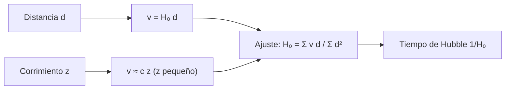

# B26-C11 — Expansión cósmica y ley de Hubble-Lemaître

<!-- nav:top -->
[🏠 Programa](../../../../README.md) · [📚 Bloque B26](../../../tronco-comun/B26-relatividad-y-cosmologia.md) · [← Anterior: B26-C10 — Desplazamiento gravitacional al rojo](../B26-C10-desplazamiento-gravitacional-al-rojo/CLASE.md) · [Siguiente: B26-C12 — Escalas de distancia cosmológicas →](../B26-C12-escalas-de-distancia-cosmologicas/CLASE.md)
<!-- /nav -->

## 1. Ubicación, nivel y alcance

Clase 11 del bloque B26. Nivel N3. Pasas de la gravedad alrededor de un astro a la del universo entero. La observación fundamental es que las galaxias lejanas se alejan, tanto más rápido cuanto más lejos están: la **ley de Hubble–Lemaître**. Aquí la formulas, ajustas su pendiente con datos sintéticos y conviertes `H₀` en un tiempo. Usas regresión ([B12-C10](../../B12/B12-C10-regresion-lineal-y-no-lineal/CLASE.md)), incertidumbre ([B12-C08](../../B12/B12-C08-intervalos-de-confianza/CLASE.md)) y unidades ([B13-C01](../../B13/B13-C01-sistema-internacional-y-constantes/CLASE.md)). La estructura del universo a gran escala está en [B25](../../../tronco-comun/B25-galaxias-y-medio-interestelar.md).

## 2. Por qué esta clase existe

`H₀` fija la escala de distancias del universo y su edad aproximada, y hoy su valor depende de cómo se mida (C23). Para entender esa discusión hay que saber ajustar la ley a datos con dispersión, cuándo vale `v = cz` y qué incertidumbre se arrastra. La decisión central: **¿cómo se obtiene `H₀` con su incertidumbre a partir de pares distancia–velocidad y qué tiempo característico implica?**

## 3. Lo que podrás hacer al terminar

1. Enunciar la ley `v = H₀ d`.
2. Ajustar `H₀` por mínimos cuadrados con ordenada cero y dar su incertidumbre.
3. Convertir `H₀` en un tiempo de Hubble.
4. Comparar `cz` con la fórmula Doppler relativista.
5. Elegir la distancia de los datos según el efecto de las velocidades peculiares.
6. Interpretar dos valores publicados de `H₀`.

La evidencia es el **ajuste de la ley con su incertidumbre** del ejercicio 12 (sección 20).

## 4. Con qué llegas y cómo comprobarlo

1. ¿Qué es un corrimiento al rojo `z`?
2. ¿Qué es la regresión por el origen?
3. ¿Qué es 1 Mpc en kilómetros?
4. ¿Qué es la velocidad peculiar?
5. ¿Qué es un intervalo de confianza?

<details>
<summary>Ver respuestas</summary>

1. El cambio fraccional de longitud de onda. 2. Un ajuste `v = H₀ d` sin término constante. 3. `3,0857 × 10¹⁹ km`. 4. El movimiento de una galaxia respecto de la expansión. 5. Un rango que contiene el valor verdadero con cierta probabilidad.
</details>

Con cuatro o cinco aciertos, sigue; si no, repasa B12-C10 y B13-C01.

## 5. Un caso real: dos valores de `H₀`

El **ejemplo conductor** compara dos resultados publicados, en `km/s/Mpc`: Planck 2018, `H₀ = 67,4 ± 0,5` (S3, resumen), y Riess y colaboradores, `74,03 ± 1,42` con cefeidas y otros anclajes (S4, resumen). Los tiempos de Hubble son `14,51 Gyr` y `13,21 Gyr`. Para entrenar el ajuste se usa una muestra sintética con `H₀` verdadero `70`. Las distancias del Mpc a km usan `1 au = 1,495 978 707 00 × 10¹¹ m` (S2).

## 6. Vocabulario

La **ley de Hubble–Lemaître** dice que la velocidad de recesión es proporcional a la distancia: `v = H₀ d`. La **constante de Hubble** `H₀` se da en `km s⁻¹ Mpc⁻¹`. El **tiempo de Hubble** es `1/H₀`. El **corrimiento al rojo cosmológico** `z` es el cambio fraccional de longitud de onda por la expansión. La **velocidad peculiar** es la velocidad de una galaxia respecto de la expansión; se suma como ruido. La **dispersión** `σ_v` es su desviación típica. El **Doppler relativista** da `v = c((1+z)²−1)/((1+z)²+1)`. Un **parsec** vale `648000/π au`.

## 7. Modelo mental: una hoja de goma que se estira

Dibuja puntos sobre una goma y estírala: todos se alejan de todos, y los más lejanos se alejan más deprisa porque entre ellos hay más goma que se estira.



*Descripción textual:* la distancia y el corrimiento dan la velocidad; el ajuste por mínimos cuadrados a través del origen da `H₀` y su inverso es el tiempo de Hubble.

Analogía: la goma. Límite: la goma tiene un borde; el universo no tiene un centro respecto del cual expandirse.

## 8. La explicación, paso a paso

### 8.1 La ley

Si la distancia entre dos puntos comóviles crece como `a(t)`, su velocidad es `v = (ȧ/a) d = H d`. Hoy `H = H₀`. La ley vale para distancias y velocidades promediadas sobre escalas grandes.

### 8.2 El ajuste

Con `N` pares `(d_i, v_i)` y ruido de velocidad `σ_v`, el estimador por el origen es `Ĥ₀ = Σ v_i d_i/Σ d_i²` con `σ(Ĥ₀) = σ_v/√(Σ d_i²)`. El laboratorio genera `40` galaxias sintéticas (`20`–`400 Mpc`, `σ_v = 300 km/s`) y obtiene `70,35 ± 0,20` frente al verdadero `70`: dentro de `3σ`.

### 8.3 Dónde medir

Una velocidad peculiar de `300 km/s` a `20 Mpc` aporta un error de `15 km/s/Mpc` (21 %); a `400 Mpc`, `0,75 km/s/Mpc` (1 %). Por eso los datos de ajuste usan distancias grandes.

### 8.4 El tiempo de Hubble

`1 Mpc = 3,085 678 × 10¹⁹ km`. Entonces `1/H₀` es `14,507 Gyr` para `67,4`, `13,968 Gyr` para `70` y `13,208 Gyr` para `74,03`. Cada unidad de `H₀` equivale a unas `0,2 Gyr` cerca de 70. No es la edad del universo (C13).

### 8.5 `cz` y Doppler relativista

Para `z ≪ 1`, `v ≈ cz`. Con la fórmula relativista `v = c tanh(ln(1+z))`, la diferencia es `0,05 %` a `z = 0,001`; `0,50 %` a `0,01`; `5,2 %` a `0,1`; `30 %` a `0,5`. Para `z` grandes, el Doppler deja de describir la expansión (C13).

## 9. Magnitudes, símbolos y unidades

| Símbolo | Qué es | Unidad | Valor / nota |
|---|---|---|---|
| `H₀` | constante de Hubble | `km s⁻¹ Mpc⁻¹` | `67,4 ± 0,5` (S3); `74,03 ± 1,42` (S4) |
| `1/H₀` | tiempo de Hubble | Gyr | `14,51`; `13,21` |
| `d`, `v` | distancia y velocidad de recesión | Mpc; km/s | sintéticas |
| `σ_v` | dispersión de velocidades peculiares | km/s | `300` (sintética) |
| `Mpc` | megaparsec | km | `3,085 678 × 10¹⁹` (S2) |

## 10. Convenciones y referencias

Ajuste por el origen; errores gaussianos en `v`, distancias exactas; los datos son **sintéticos**. `H₀` publicados son **observados** (resúmenes). `c = 299 792,458 km/s`.

## 11. De dónde sale lo que afirmamos

| ID | Fuente | Localizador | Respalda | Estado |
|---|---|---|---|---|
| S1 | NIST, *Fundamental Physical Constants — Complete Listing* (CODATA 2022) | https://physics.nist.gov/cuu/Constants/Table/allascii.txt | `c` exacta | Consultada el 2026-11-09 |
| S2 | IERS, *IERS Conventions (2010)*, TN36, Tabla 1.1 | https://iers-conventions.obspm.fr/content/tn36.pdf | `1 au = 1,495 978 707 00 × 10¹¹ m` | Texto del PDF extraído el 2026-11-09 |
| S3 | Planck Collaboration, *Planck 2018 results. VI. Cosmological parameters*, arXiv:1807.06209 | https://arxiv.org/abs/1807.06209 | `H₀ = 67,4 ± 0,5` | Solo resumen, consultado el 2026-11-09 |
| S4 | Riess et al., arXiv:1903.07603 | https://arxiv.org/abs/1903.07603 | `H₀ = 74,03 ± 1,42` (combinando anclajes); `74,22 ± 1,82` (solo LMC) | Solo resumen, consultado el 2026-11-09 |

Límites: S3 y S4 solo resumen; la definición `pc = 648000/π au` es geométrica; no se consultó la resolución de la IAU que sugiere el nombre «Hubble–Lemaître» (la página no abrió), por lo que no se cita.

## 12. Cómo ver la ley

| `H₀` (km/s/Mpc) | `1/H₀` (Gyr) |
|---|---|
| 67,4 | 14,507 |
| 70 | 13,968 |
| 74,03 | 13,208 |

| `z` | `cz` (km/s) | Doppler relativista (km/s) | Diferencia |
|---|---|---|---|
| 0,001 | 299,8 | 299,6 | 0,05 % |
| 0,01 | 2997,9 | 2982,9 | 0,50 % |
| 0,1 | 29 979 | 28 487 | 5,2 % |
| 0,5 | 149 896 | 115 305 | 30 % |

Descripción larga: `cz` y el Doppler coinciden a `z` pequeño y se separan rápido después.

## 13. Ejemplo trabajado: la distancia a `z = 0,01`

**Paso 1 · Datos.** `z = 0,01`; `H₀ = 70 km/s/Mpc` (sintético).

**Paso 2 · Velocidad.** `v = cz = 2997,9 km/s`.

**Paso 3 · Distancia.** `d = v/H₀ = 42,8 Mpc`.

**Paso 4 · Corrección.** Con Doppler, `2982,9 km/s` y `42,6 Mpc`: `0,5 %` menor.

**Paso 5 · Sentido.** A esa distancia, 300 km/s de velocidad peculiar son un `10 %` de `v`; la distancia tiene un error similar.

## 14. Distintas formas de medir `H₀`

**Escalera de distancias (C12):** local, con cefeidas y supernovas. **Fondo cósmico (C15):** inferido de un modelo. **Otras:** ondas gravitacionales, lentes. Cada método tiene su incertidumbre.

## 15. Práctica guiada

**Ejercicio 1 · con los pasos indicados.** Calcula `v` de una galaxia a `100 Mpc` con `H₀ = 70`. *Pasos:* `v = H₀ d`.

<details><summary>Solución comentada</summary>

`7000 km/s`.
</details>

**Ejercicio 2 · con una pista.** ¿A qué distancia está una galaxia con `v = 3000 km/s`?

<details><summary>Solución comentada</summary>

`3000/70 = 42,9 Mpc`.
</details>

**Ejercicio 3 · casi autónomo.** Calcula `1/H₀` para `H₀ = 70`.

<details><summary>Solución comentada</summary>

`977,79/70 = 13,97 Gyr`.
</details>

## 16. Práctica autónoma, transferencia e integrador

**Ejercicio 4.** ¿Cuál es la diferencia entre los dos valores publicados de `H₀`?

<details><summary>Solución comentada</summary>

`74,03 − 67,4 = 6,63 km/s/Mpc` (C23 mide su significancia).
</details>

**Ejercicio 5.** ¿Cuál es la precisión relativa del ajuste sintético?

<details><summary>Solución comentada</summary>

`0,20/70,35 = 0,28 %`.
</details>

**Ejercicio 6.** ¿Cuánto vale la diferencia entre `cz` y Doppler a `z = 0,1`?

<details><summary>Solución comentada</summary>

`5,2 %` (8.5).
</details>

**Ejercicio 7.** ¿Qué error induce una velocidad peculiar de `300 km/s` a `20 Mpc`?

<details><summary>Solución comentada</summary>

`300/20 = 15 km/s/Mpc`, un `21 %` de 70.
</details>

**Ejercicio 8.** ¿Y a `400 Mpc`?

<details><summary>Solución comentada</summary>

`0,75 km/s/Mpc`, `1,1 %`.
</details>

**Ejercicio 9 · transferencia.** Un compañero dice que «el universo se expande hacia un lugar vacío». Responde con 8.1 y 7.

<details><summary>Solución comentada</summary>

Lo que se estira es la métrica: las distancias entre puntos comóviles crecen; no hay un borde ni un vacío al que expandirse.
</details>

**Ejercicio 10 · transferencia.** Si `σ_v` baja a `150 km/s`, ¿cómo cambia `σ(Ĥ₀)`?

<details><summary>Solución comentada</summary>

Proporcional: se divide por 2, a `0,10 km/s/Mpc`.
</details>

**Ejercicio 11 · transferencia.** ¿Qué pasa con `σ(Ĥ₀)` si el número de galaxias se cuadruplica con las mismas distancias?

<details><summary>Solución comentada</summary>

`Σd²` se cuadruplica; `σ` se divide por 2.
</details>

**Ejercicio 12 · integrador.** Elabora tu *ajuste de la ley con su incertidumbre*: genera una muestra sintética, ajusta `H₀`, da el intervalo, el tiempo de Hubble, la diferencia con `cz` y Doppler y compara con los dos valores publicados.

<details><summary>Solución modelo</summary>

`H₀ = 70,35 ± 0,20`; `1/H₀ = 13,9 Gyr`; Doppler `5,2 %` a `z = 0,1`; diferencias `6,63` con los valores publicados.
</details>

## 17. Laboratorio: ajuste de Hubble

El script [hubble.py](hubble.py) convierte Mpc a km, genera `40` galaxias sintéticas (semilla fija), ajusta `H₀` por el origen y **comprueba** que queda dentro de `3σ` del verdadero; calcula el tiempo de Hubble y **comprueba** `v = c tanh(ln(1+z))` con la fórmula Doppler.

**Datos:** `c` de NIST, `au` del IERS, `H₀` publicados (resúmenes); muestra **sintética**. **Predice antes de ejecutar:** ¿qué incertidumbre tendrá `H₀`? (cerca de `0,2`.) **Ejecución del 2026-11-09 (Python 3.12.9):**

```text
Python 3.12.9 (biblioteca estandar)
1 Mpc = 3.085678e+19 km
ajuste con 40 galaxias sinteticas: H0 = 70.35 +/- 0.20 km/s/Mpc (verdadero 70.0)
1/H0 para Planck 2018 (67.4): 14.507 Gyr
1/H0 para Riess 2019 (74.03): 13.208 Gyr
1/H0 para sintetico (70): 13.968 Gyr
z = 0.001: c z =      299.8 km/s ; Doppler relativista =      299.6 km/s ; diferencia   0.05 %
z = 0.010: c z =     2997.9 km/s ; Doppler relativista =     2982.9 km/s ; diferencia   0.50 %
z = 0.100: c z =    29979.2 km/s ; Doppler relativista =    28487.1 km/s ; diferencia   5.24 %
z = 0.500: c z =   149896.2 km/s ; Doppler relativista =   115304.8 km/s ; diferencia  30.00 %
distancia por la ley (z = 0.01, H0 = 70): d = c z/H0 = 42.8 Mpc
Pruebas superadas.
```

```bash
python programa/clases/B26/B26-C11-expansion-cosmica-y-ley-de-hubble-lemaitre/hubble.py
```

**Límites:** distancias exactas, ruido gaussiano, ley lineal.

## 18. Errores frecuentes y cómo corregirlos

**Confundir `H₀` con la edad.** Se corrige con la sección 8.4 y C13.

**Usar `cz` a corrimientos grandes.** Se corrige con el ejercicio 6.

**Medir `H₀` con galaxias cercanas.** Se corrige con los ejercicios 7 y 8.

**Pensar que hay un centro de expansión.** Se corrige con el ejercicio 9.

**Presentar la muestra sintética como real.** Se corrige con la sección 10.

## 19. Cómo sabrás que vas bien

Tras 8.2: ¿cómo se estima `H₀`? Si dudas, ejercicios 1–2. Tras 8.4: ¿qué es `1/H₀`? Ejercicio 3. Tras el laboratorio: ¿qué comprueba la tolerancia de `3σ`? (que el estimador es consistente con el valor sembrado).

## 20. Qué entregas y cómo se evalúa

El producto es tu **ajuste de la ley con su incertidumbre** (ejercicio 12).

| Criterio | Inicial | En desarrollo | Logrado | Destacado |
|---|---|---|---|---|
| Ley | La confunde | Parcial | `v = H₀ d` | Explica la métrica que se estira |
| Cálculo | Sin unidades | Con errores | `H₀`, `σ`, `1/H₀` | Propaga el efecto de `σ_v` |
| Numérico | Sin comprobar | Un caso | Ajuste y Doppler | Elige distancias |
| Fuentes | Sin fuente | Sin fecha | S1–S4 con fecha | Declara que son resúmenes |
| Límites | No los nombra | Uno | Tres | Discute la edad |

**Condiciones críticas (no se compensan con promedio):** rotular la muestra como sintética; no equiparar `1/H₀` con la edad; citar solo lo consultado.

## 21. Ética, seguridad y límites

Clase educativa: no es una medida de `H₀`. Accesibilidad: tablas equivalentes a las gráficas, fórmulas en texto, ejercicios sin conexión.

## 22. Para cerrar y seguir

La ley `v = H₀ d` se ajusta por el origen con una incertidumbre `σ_v/√Σd²`; `1/H₀` es de unos 13–14,5 Gyr y `cz` solo vale para `z` pequeño. Queda una pregunta: ¿cómo se obtiene una distancia, y con qué error, en cada peldaño hasta el universo lejano?

**Glosario español–inglés.** ley de Hubble–Lemaître · *Hubble–Lemaître law*; constante de Hubble · *Hubble constant*; tiempo de Hubble · *Hubble time*; velocidad peculiar · *peculiar velocity*; corrimiento cosmológico · *cosmological redshift*; megaparsec · *megaparsec*.

**Continuidad.** [B26-C12](../B26-C12-escalas-de-distancia-cosmologicas/CLASE.md) mide las distancias que alimentan este ajuste.

**Referencias:** ver sección 11.

<!-- nav:bottom -->
---

[← Anterior: B26-C10 — Desplazamiento gravitacional al rojo](../B26-C10-desplazamiento-gravitacional-al-rojo/CLASE.md) · [📚 Bloque B26](../../../tronco-comun/B26-relatividad-y-cosmologia.md) · [Siguiente: B26-C12 — Escalas de distancia cosmológicas →](../B26-C12-escalas-de-distancia-cosmologicas/CLASE.md)
<!-- /nav -->
