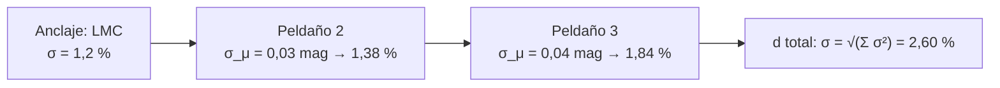

# B26-C12 — Escalas de distancia cosmológicas

<!-- nav:top -->
[🏠 Programa](../../../../README.md) · [📚 Bloque B26](../../../tronco-comun/B26-relatividad-y-cosmologia.md) · [← Anterior: B26-C11 — Expansión cósmica y ley de Hubble-Lemaître](../B26-C11-expansion-cosmica-y-ley-de-hubble-lemaitre/CLASE.md) · [Siguiente: B26-C13 — Modelo FLRW — Relatividad y cosmología →](../B26-C13-modelo-flrw-relatividad-y-cosmologia/CLASE.md)
<!-- /nav -->

## 1. Ubicación, nivel y alcance

Clase 12 del bloque B26. Nivel N3. Para ajustar `H₀` ([C11](../B26-C11-expansion-cosmica-y-ley-de-hubble-lemaitre/CLASE.md)) hacen falta distancias. Ninguna regla sirve de la Tierra a las galaxias lejanas: se usa una **escalera** en la que cada peldaño calibra el siguiente y propaga sus errores. Aquí calculas cómo se combinan esos errores y cómo se sesga una distancia obtenida como `1/paralaje`. Usas propagación de incertidumbre ([B12-C16](../../B12/B12-C16-propagacion-de-incertidumbre/CLASE.md)), Monte Carlo ([B12-C14](../../B12/B12-C14-simulacion-monte-carlo/CLASE.md)) y las cefeidas de [B24-C13](../../B24/B24-C13-estrellas-variables/CLASE.md). Se trata la incertidumbre estadística de la escalera.

## 2. Por qué esta clase existe

Una distancia con un error de `2,6 %` produce un `H₀` con un error similar, y la discusión actual sobre `H₀` gira alrededor de esas décimas de punto porcentual. Entender cómo se acumulan los errores en una cadena de pasos evita confiar en una cifra más de lo debido. La decisión central: **dados los errores de cada peldaño, ¿cuál es el error total de la escalera y qué sesgo introduce una transformación no lineal?**

## 3. Lo que podrás hacer al terminar

1. Describir los peldaños de la escalera de distancias.
2. Convertir un error en magnitudes en uno fraccional.
3. Combinar errores independientes en cuadratura.
4. Verificar la combinación con Monte Carlo.
5. Calcular el sesgo de `1/p` para un paralaje ruidoso.
6. Leer la precisión publicada de una calibración.

La evidencia es el **presupuesto de la escalera** del ejercicio 12 (sección 20).

## 4. Con qué llegas y cómo comprobarlo

1. ¿Qué es un módulo de distancia (B24-C13)?
2. ¿Qué es la propagación de varianzas?
3. ¿Qué es una simulación Monte Carlo?
4. ¿Qué es el paralaje?
5. ¿Qué es un sesgo estadístico?

<details>
<summary>Ver respuestas</summary>

1. `μ = m − M`, y `d = 10^{(μ+5)/5}` pc. 2. Para variables independientes, las varianzas se suman. 3. Repetir un cálculo con entradas aleatorias. 4. El desplazamiento aparente de una estrella por el movimiento orbital terrestre. 5. La diferencia entre la media del estimador y el valor verdadero.
</details>

Con cuatro o cinco aciertos, sigue; si no, repasa B12-C14, B12-C16 y B24-C13.

## 5. Un caso real: la escalera de Riess et al.

Riess y colaboradores midieron `70` cefeidas en la Gran Nube de Magallanes con el Telescopio Espacial Hubble. La distancia a la LMC se conoce con `1,2 %` por binarias eclipsantes; la incertidumbre total de la escalera pasó de `2,5 %` a `1,3 %`, y `H₀ = 74,22 ± 1,82 km/s/Mpc` con solo ese anclaje (S1, resumen), una precisión de `2,45 %`. Es el **ejemplo conductor**; los otros peldaños de esta clase (`0,03` y `0,04 mag`) son ilustrativos.

## 6. Vocabulario

La **escalera de distancias** es la cadena de métodos: paralaje trigonométrico, binarias eclipsantes, cefeidas, supernovas Ia, ley de Hubble. Un **anclaje** es la distancia geométrica a la primera galaxia de la cadena. Un **peldaño** es un paso de calibración. El **error fraccional** es `σ_d/d`. El **error de módulo** `σ_μ` en magnitudes se convierte a fraccional con `(ln 10/5) σ_μ`. La **cuadratura** suma los cuadrados de los errores. El **Monte Carlo** repite el cálculo con muestras aleatorias. El **sesgo de `1/p`**: aunque `p` no tenga sesgo, `1/p` sí lo tiene por la no linealidad.

## 7. Modelo mental: una cadena de eslabones elásticos

Cada eslabón se estira un poco; el estiramiento total no es la suma, sino la raíz de la suma de cuadrados, porque los estiramientos son independientes.



*Descripción textual:* tres peldaños con errores de `1,2 %`, `1,38 %` y `1,84 %` se combinan en cuadratura y dan `2,60 %` en la distancia final.

Analogía: sumar los errores de tres reglas encadenadas. Límite: supone independencia; las correlaciones cambian el resultado.

## 8. La explicación, paso a paso

### 8.1 De magnitudes a fracción

Como `d ∝ 10^{μ/5}`, `δd/d = (ln 10/5) δμ = 0,4605 δμ`. Un error de `0,03 mag` es `1,38 %`; de `0,04 mag`, `1,84 %`; de `0,1 mag`, `4,6 %`.

### 8.2 Cuadratura

Para errores independientes `σ₁, σ₂, σ₃`, `σ_tot = √(σ₁² + σ₂² + σ₃²)`. Con `1,20 %`, `1,38 %` y `1,84 %`: `2,597 %`. La contribución mayor domina: reducir el peldaño de `1,84 %` a `0,92 %` bajaría el total a `2,05 %`.

### 8.3 Verificación con Monte Carlo

El laboratorio genera `10⁵` distancias multiplicando tres factores aleatorios (gaussiano `1,2 %` y dos con `10^{0,2 g}`) y obtiene una desviación de `2,593 %`, a un `0,2 %` de la cuadratura. Comprueba que la aproximación lineal es buena para errores de pocos por ciento.

### 8.4 El sesgo de `1/p`

Con un paralaje `p = 10 ± 1` mas (sintético), la distancia nominal es `100 pc`, pero la media de `1/p` en `10⁵` muestras es `101,03 pc`: un sesgo de `+1,03 %`. Es la desigualdad de Jensen: `1/p` es convexa. Con `σ_p/p = 0,1`, el sesgo es de `σ²/p² = 1 %`. Para `σ_p/p` grande la estimación `1/p` falla.

### 8.5 Qué se pierde y qué falta

Las correlaciones entre peldaños (por ejemplo, un mismo punto cero fotométrico) aumentan el error total. La incertidumbre sistemática (extinción, metalicidad) no entra en la cuadratura estadística. Una escalera con `2,5 %` o `1,3 %` es comparable con las diferencias entre métodos (C23).

## 9. Magnitudes, símbolos y unidades

| Símbolo | Qué es | Unidad | Valor / nota |
|---|---|---|---|
| `σ_μ` | error de módulo | mag | `0,03`; `0,04` (ilustrativos) |
| `δd/d` | error fraccional | — | `1,38 %`; `1,84 %` |
| `σ_tot` | error total | % | `2,597` (cuadratura) |
| `p` | paralaje | mas | `10 ± 1` (sintético) |
| `H₀` | constante de Hubble | `km s⁻¹ Mpc⁻¹` | `74,22 ± 1,82` (S1) |

## 10. Convenciones y referencias

Errores independientes y gaussianos; semilla fija. `LMC 1,2 %`, `2,5 % → 1,3 %` y `H₀` son valores publicados (resumen); los demás son **ilustrativos / sintéticos**.

## 11. De dónde sale lo que afirmamos

| ID | Fuente | Localizador | Respalda | Estado |
|---|---|---|---|---|
| S1 | Riess et al., *Large Magellanic Cloud Cepheid Standards Provide a 1% Foundation…*, arXiv:1903.07603 | https://arxiv.org/abs/1903.07603 | 70 cefeidas LMC; distancia LMC 1,2 %; escalera 2,5 % → 1,3 %; `H₀ = 74,22 ± 1,82` (LMC); `74,03 ± 1,42` (combinado) | Solo resumen, consultado el 2026-11-09 |
| S2 | Di Valentino et al., *In the Realm of the Hubble tension – a Review of Solutions*, arXiv:2103.01183 | https://arxiv.org/abs/2103.01183 | Tensión de 4–6σ entre `H₀` local y el inferido del universo temprano | Solo resumen, consultado el 2026-11-09 |

Límites: S1 y S2 solo resumen; la cuadratura y el sesgo de `1/p` son resultados estándar verificados numéricamente aquí.

## 12. Cómo ver el presupuesto

| Peldaño | Error fraccional |
|---|---|
| LMC | 1,20 % |
| Peldaño 2 (0,03 mag) | 1,38 % |
| Peldaño 3 (0,04 mag) | 1,84 % |
| Total (cuadratura) | 2,597 % |
| Total (Monte Carlo) | 2,593 % |

Descripción larga: el total es poco mayor que el mayor peldaño; Monte Carlo y cuadratura coinciden.

## 13. Ejemplo trabajado: un peldaño menos preciso

**Paso 1 · Datos.** Peldaño 3 con `σ_μ = 0,08 mag`.

**Paso 2 · Fracción.** `0,4605 × 0,08 = 3,68 %`.

**Paso 3 · Total.** `√(1,2² + 1,38² + 3,68²) = 4,17 %`.

**Paso 4 · Sentido.** Duplicar el error del último peldaño casi duplica el total; el último eslabón domina.

## 14. Distintas formas de propagar errores

**Cuadratura (esta clase):** analítica, linealizada. **Monte Carlo:** sirve con no linealidad y errores no gaussianos. **Matriz de covarianza (B12-C18):** incluye correlaciones.

## 15. Práctica guiada

**Ejercicio 1 · con los pasos indicados.** Convierte `0,03 mag` en error fraccional. *Pasos:* `(ln 10)/5 × 0,03`.

<details><summary>Solución comentada</summary>

`0,4605 × 0,03 = 1,38 %`.
</details>

**Ejercicio 2 · con una pista.** Combina `1,2 %`, `1,38 %` y `1,84 %`.

<details><summary>Solución comentada</summary>

`√(1,44 + 1,904 + 3,386) = √6,73 = 2,60 %`.
</details>

**Ejercicio 3 · casi autónomo.** ¿Cuál es la precisión relativa de `74,22 ± 1,82`?

<details><summary>Solución comentada</summary>

`1,82/74,22 = 2,45 %`.
</details>

## 16. Práctica autónoma, transferencia e integrador

**Ejercicio 4.** Con `σ_μ = 0,1 mag`, ¿qué error fraccional?

<details><summary>Solución comentada</summary>

`4,6 %`.
</details>

**Ejercicio 5.** Si el peldaño de `1,84 %` baja a `0,92 %`, ¿cuál es el total?

<details><summary>Solución comentada</summary>

`√(1,44 + 1,904 + 0,846) = 2,05 %`.
</details>

**Ejercicio 6.** ¿Cuántas veces menor es la incertidumbre de la escalera tras la mejora (2,5 % → 1,3 %)?

<details><summary>Solución comentada</summary>

`2,5/1,3 = 1,9` veces (S1).
</details>

**Ejercicio 7.** Calcula el sesgo de `1/p` para `p = 10 ± 1`.

<details><summary>Solución comentada</summary>

Aproximadamente `(σ/p)² = 1 %`; el laboratorio da `+1,03 %`.
</details>

**Ejercicio 8.** ¿Y para `p = 5 ± 1`?

<details><summary>Solución comentada</summary>

`(1/5)² = 4 %` aproximado (el desarrollo en serie empieza a ser menos exacto).
</details>

**Ejercicio 9 · transferencia.** Un compañero dice: «el error total es la suma de los errores». Responde con 8.2.

<details><summary>Solución comentada</summary>

Para independientes se suman los cuadrados: `1,2 + 1,38 + 1,84 = 4,42 %` sobreestima el `2,60 %` real.
</details>

**Ejercicio 10 · transferencia.** Si dos peldaños comparten un mismo punto cero con correlación `ρ = +1`, ¿qué pasa con el total de `1,38` y `1,84`?

<details><summary>Solución comentada</summary>

Se suman linealmente: `3,22 %` en lugar de `2,30 %` en cuadratura.
</details>

**Ejercicio 11 · transferencia.** La tensión de Hubble se describe como de 4–6σ (S2). Si dos valores difieren en un `9 %`, ¿qué error total máximo permite ver 5σ?

<details><summary>Solución comentada</summary>

`9 %/5σ = 1,8 %` de error total (combinado de ambos); la escalera con `1,3 %` queda por debajo de ese umbral y por eso la discusión es seria (C23 lo cuantifica con los valores publicados).
</details>

**Ejercicio 12 · integrador.** Elabora tu *presupuesto de la escalera*: tabla de peldaños, cuadratura, Monte Carlo y sesgo de `1/p`, con un peldaño dominante señalado.

<details><summary>Solución modelo</summary>

Tabla de la sección 12; el peldaño de `1,84 %` domina; sesgo `+1,03 %`.
</details>

## 17. Laboratorio: errores en cadena

El script [escalera.py](escalera.py) propaga errores en cuadratura y por Monte Carlo (`10⁵` muestras, semilla fija) y **comprueba** que difieren menos del `2 %`; calcula el sesgo de `1/p` y **comprueba** que es positivo.

**Datos:** cifras de Riess et al. (resumen); peldaños y paralaje **ilustrativos**. **Predice antes de ejecutar:** ¿qué error total? (cerca del `2,6 %`.) **Ejecución del 2026-11-09 (Python 3.12.9):**

```text
Python 3.12.9 (biblioteca estandar)
distancia LMC (1.2 %)       : error fraccional = 1.20 %
peldano 2 (0.03 mag)        : error fraccional = 1.38 %
peldano 3 (0.04 mag)        : error fraccional = 1.84 %
cuadratura: error total = 2.597 %
Monte Carlo (100000 muestras): media = 1.00033 ; desviacion = 2.593 %
paralaje 10 +/- 1 mas: media de 1/p = 101.030 pc ; valor nominal 100 pc ; sesgo = +1.03 %
Riess et al. 2019 (solo LMC): H0 = 74.22 +/- 1.82 -> precision 2.45 %
Pruebas superadas.
```

```bash
python programa/clases/B26/B26-C12-escalas-de-distancia-cosmologicas/escalera.py
```

**Límites:** errores independientes, sin sistemáticos ni correlaciones.

## 18. Errores frecuentes y cómo corregirlos

**Sumar errores en lugar de cuadrarlos.** Se corrige con el ejercicio 9.

**Olvidar el factor `ln 10/5`.** Se corrige con el ejercicio 1.

**Ignorar correlaciones.** Se corrige con el ejercicio 10.

**Usar `1/p` sin comprobar `σ_p/p`.** Se corrige con los ejercicios 7 y 8.

**Confundir estadístico con sistemático.** Se corrige con 8.5.

## 19. Cómo sabrás que vas bien

Tras 8.1: ¿conviertes mag en %? Si dudas, ejercicio 1. Tras 8.2: ¿cuadras errores? Ejercicio 2. Tras el laboratorio: ¿qué verifica Monte Carlo? (que la cuadratura linealizada es buena).

## 20. Qué entregas y cómo se evalúa

El producto es tu **presupuesto de la escalera** (ejercicio 12).

| Criterio | Inicial | En desarrollo | Logrado | Destacado |
|---|---|---|---|---|
| Conceptos | Los confunde | Parciales | Peldaños y anclaje | Distingue estadístico y sistemático |
| Cálculo | Sin unidades | Con errores | Cuadratura correcta | Identifica el dominante |
| Numérico | Sin comprobar | Un caso | Monte Carlo y sesgo | Explica la tolerancia |
| Fuentes | Sin fuente | Sin fecha | S1–S2 con fecha | Declara que son resúmenes |
| Límites | No los nombra | Uno | Tres | Discute correlaciones |

**Condiciones críticas (no se compensan con promedio):** no sumar errores independientes linealmente; rotular lo ilustrativo; citar solo lo consultado.

## 21. Ética, seguridad y límites

Clase educativa: no sustituye un análisis de la escalera real con sus covarianzas. Accesibilidad: tablas equivalentes a las gráficas, fórmulas en texto, ejercicios sin conexión.

## 22. Para cerrar y seguir

La escalera propaga errores en cuadratura (`2,6 %` con los peldaños del ejemplo), un Monte Carlo lo confirma y `1/p` sesga una distancia. Queda una pregunta: ¿cómo describe la relatividad general un universo que se expande de forma homogénea?

**Glosario español–inglés.** escalera de distancias · *distance ladder*; anclaje · *anchor*; peldaño · *rung*; cuadratura · *quadrature sum*; sesgo · *bias*; paralaje · *parallax*; Monte Carlo · *Monte Carlo*.

**Continuidad.** [B26-C13](../B26-C13-modelo-flrw-relatividad-y-cosmologia/CLASE.md) da el modelo de universo en que se interpretan estas distancias.

**Referencias:** ver sección 11.

<!-- nav:bottom -->
---

[← Anterior: B26-C11 — Expansión cósmica y ley de Hubble-Lemaître](../B26-C11-expansion-cosmica-y-ley-de-hubble-lemaitre/CLASE.md) · [📚 Bloque B26](../../../tronco-comun/B26-relatividad-y-cosmologia.md) · [Siguiente: B26-C13 — Modelo FLRW — Relatividad y cosmología →](../B26-C13-modelo-flrw-relatividad-y-cosmologia/CLASE.md)
<!-- /nav -->
