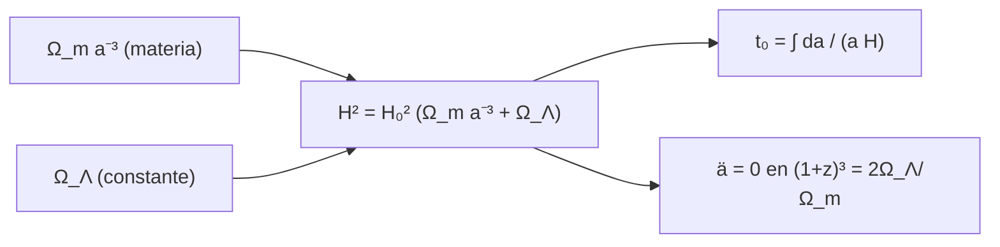

# B26-C13 — Modelo FLRW — Relatividad y cosmología

<!-- nav:top -->
[🏠 Programa](../../../../README.md) · [📚 Bloque B26](../../../tronco-comun/B26-relatividad-y-cosmologia.md) · [← Anterior: B26-C12 — Escalas de distancia cosmológicas](../B26-C12-escalas-de-distancia-cosmologicas/CLASE.md) · [Siguiente: B26-C14 — Evolución térmica del universo →](../B26-C14-evolucion-termica-del-universo/CLASE.md)
<!-- /nav -->

## 1. Ubicación, nivel y alcance

Clase 13 del bloque B26. Nivel N3. Con la expansión observada ([C11](../B26-C11-expansion-cosmica-y-ley-de-hubble-lemaitre/CLASE.md)) y la gravedad como geometría ([C09](../B26-C09-relatividad-general-introductoria/CLASE.md)), construyes el modelo de universo homogéneo e isótropo: **Friedmann–Lemaître–Robertson–Walker (FLRW)**. Con una sola ecuación sacas la edad del universo, la densidad crítica y el momento en que la expansión empezó a acelerar. Usas integración numérica ([B11-C07](../../B11/B11-C07-runge-kutta-de-cuarto-orden/CLASE.md), [B11-C19](../../B11/B11-C19-estimacion-de-error-y-convergencia/CLASE.md)) y unidades ([B13-C01](../../B13/B13-C01-sistema-internacional-y-constantes/CLASE.md)). Se trata el caso plano con materia y constante cosmológica.

## 2. Por qué esta clase existe

La edad del universo, la distancia a una galaxia y el calendario de su historia salen de la ecuación de Friedmann. Con ella se interpreta cualquier parámetro cosmológico. La decisión central: **dados `H₀` y `Ω_m`, ¿cuál es la edad del universo y cómo evoluciona el factor de escala?**

## 3. Lo que podrás hacer al terminar

1. Escribir la ecuación de Friedmann para un universo plano.
2. Calcular la densidad crítica.
3. Calcular la edad por cuadratura y con la forma cerrada.
4. Verificar la forma cerrada de `a(t)` integrando la ecuación diferencial.
5. Calcular el parámetro de deceleración y el corrimiento de transición.
6. Comparar con el universo de Einstein–de Sitter.

La evidencia es el **cálculo de la edad** del ejercicio 12 (sección 20).

## 4. Con qué llegas y cómo comprobarlo

1. ¿Qué es el factor de escala `a(t)`?
2. ¿Qué es `H = ȧ/a`?
3. ¿Qué es una constante cosmológica?
4. ¿Cómo se integra una función con Simpson?
5. ¿Qué es un cambio de variable en una integral?

<details>
<summary>Ver respuestas</summary>

1. El factor por el que crecen las distancias comóviles; `a = 1` hoy. 2. El ritmo de expansión. 3. Una densidad de energía constante del vacío. 4. Con parábolas por tramos (B11). 5. Sustituir `a = s²` para suavizar el integrando.
</details>

Con cuatro o cinco aciertos, sigue; si no, repasa B11 y C11.

## 5. Un caso real: ¿cuántos años tiene el universo en el modelo de Planck?

Con `H₀ = 67,4 km/s/Mpc` y `Ω_m = 0,315` (S3, resumen), el universo plano con materia y constante cosmológica tiene una edad de `13,796 Gyr` (cálculo propio, sin radiación), frente a `9,672 Gyr` si no hubiera constante cosmológica (`Ω_m = 1`). La densidad crítica es `8,533 × 10⁻²⁷ kg/m³`, unos `5,10` protones por metro cúbico. Es el **ejemplo conductor**. Las supernovas distantes se ven más débiles de lo esperado en un universo sin constante cosmológica, lo que llevó a postular una expansión acelerada (S4, resumen; S5, resumen).

## 6. Vocabulario

El **factor de escala** `a(t)` mide cuánto crecieron las distancias. La **ecuación de Friedmann** (plano) es `H² = H₀²(Ω_m a⁻³ + Ω_Λ)`, con `Ω_Λ = 1 − Ω_m`. La **densidad crítica** es `ρ_c = 3H₀²/(8πG)`. El **parámetro de densidad** `Ω_i = ρ_i/ρ_c`. La **constante cosmológica** `Λ` es una densidad de energía constante. La **edad** es `t₀ = ∫₀¹ da/(aH)`. El **parámetro de deceleración** es `q₀ = Ω_m/2 − Ω_Λ`. El **corrimiento de transición** `z_t` es aquel en que `ä = 0`. **Einstein–de Sitter** es el caso `Ω_m = 1`.

## 7. Modelo mental: una pelota lanzada hacia arriba con un empujón extra

La materia frena la expansión como la gravedad frena una pelota; la constante cosmológica añade un empuje que no se diluye. Al principio domina el freno; después, el empuje.



*Descripción textual:* la tasa de expansión suma la materia, que decae como `a⁻³`, y la constante cosmológica; integrando `1/(aH)` se obtiene la edad, y el signo de `ä` marca el paso de frenar a acelerar.

Analogía: una pelota que sube. Límite: no hay un «arriba»; la expansión no es un movimiento a través del espacio.

## 8. La explicación, paso a paso

### 8.1 La ecuación de Friedmann plana

Para curvatura nula, materia y `Λ`, `H² = H₀²(Ω_m a⁻³ + Ω_Λ)`. Con `H₀ = 67,4 km/s/Mpc = 2,18429 × 10⁻¹⁸ s⁻¹`, `1/H₀ = 14,507 Gyr` y `ρ_c = 3H₀²/(8πG) = 8,533 × 10⁻²⁷ kg/m³`.

### 8.2 La edad

`t₀ = ∫₀¹ da/(aH) = (1/H₀)∫₀¹ √a da/√(Ω_m + Ω_Λ a³)`. Con `a = s²` el integrando es suave: `2s²/√(Ω_m + Ω_Λ s⁶)`. El laboratorio obtiene `13,7962 Gyr` por cuadratura y por la forma cerrada `2 asinh(√(Ω_Λ/Ω_m))/(3H₀√Ω_Λ)`, que coinciden a `10⁻⁹`. En Einstein–de Sitter, `2/(3H₀) = 9,6715 Gyr`.

### 8.3 La historia del factor de escala

La forma cerrada es `a(t) = (Ω_m/Ω_Λ)^{1/3} sinh^{2/3}(1,5√Ω_Λ H₀ t)`. El laboratorio integra `ȧ = aH(a)` con RK4 desde `a = 0,1` y obtiene `a(t₀) = 1,000 000 00`, igual al valor analítico a `10⁻⁶`.

### 8.4 Deceleración y aceleración

`q₀ = Ω_m/2 − Ω_Λ = −0,5275`: la expansión acelera hoy. La aceleración empezó en `(1 + z_t)³ = 2Ω_Λ/Ω_m`, es decir `z_t = 0,6323` (el laboratorio lo verifica por bisección). Antes dominaba la materia y la expansión se frenaba.

### 8.5 Qué falta

La radiación (`Ω_r ≈ 9 × 10⁻⁵`, C14) importa en el universo temprano, no para la edad; la curvatura se toma nula. Valores más altos de `H₀` dan edades menores: con `74,03` la edad sería `12,56 Gyr` (misma `Ω_m`, escala `1/H₀`).

## 9. Magnitudes, símbolos y unidades

| Símbolo | Qué es | Unidad | Valor / nota |
|---|---|---|---|
| `H₀` | constante de Hubble | `s⁻¹` | `2,18429 × 10⁻¹⁸` (67,4 km/s/Mpc, S3) |
| `Ω_m`, `Ω_Λ` | parámetros de densidad | — | `0,315`; `0,685` |
| `ρ_c` | densidad crítica | `kg m⁻³` | `8,533 × 10⁻²⁷` |
| `t₀` | edad | Gyr | `13,796` (EdS: `9,672`) |
| `q₀`, `z_t` | deceleración; transición | — | `−0,5275`; `0,6323` |

## 10. Convenciones y referencias

Universo plano, materia sin presión y constante cosmológica; radiación ignorada. `G` de NIST (S1); `1 au` del IERS (S2) para Mpc. La edad es un **cálculo propio**, no un valor citado.

## 11. De dónde sale lo que afirmamos

| ID | Fuente | Localizador | Respalda | Estado |
|---|---|---|---|---|
| S1 | NIST, *Fundamental Physical Constants — Complete Listing* (CODATA 2022) | https://physics.nist.gov/cuu/Constants/Table/allascii.txt | `G` | Consultada el 2026-11-09 |
| S2 | IERS, *IERS Conventions (2010)*, TN36, Tabla 1.1 | https://iers-conventions.obspm.fr/content/tn36.pdf | `1 au` | Texto del PDF extraído el 2026-11-09 |
| S3 | Planck Collaboration, *Planck 2018 results. VI*, arXiv:1807.06209 | https://arxiv.org/abs/1807.06209 | `H₀ = 67,4 ± 0,5`; `Ω_m = 0,315 ± 0,007` | Solo resumen, consultado el 2026-11-09 |
| S4 | Riess et al., *Observational Evidence from Supernovae for an Accelerating Universe…*, arXiv:astro-ph/9805201 | https://arxiv.org/abs/astro-ph/9805201 | SNe Ia `10`–`15 %` más lejanas de lo esperado sin constante cosmológica | Solo resumen, consultado el 2026-11-09 |
| S5 | Perlmutter et al., *Measurements of Omega and Lambda from 42 High-Redshift Supernovae*, arXiv:astro-ph/9812133 | https://arxiv.org/abs/astro-ph/9812133 | `Ω_m ≈ 0,28` (plano); constante cosmológica positiva al 99 % | Solo resumen, consultado el 2026-11-09 |

Límites: S3–S5 solo resumen; el valor de la edad de Planck no figura en el resumen consultado y no se cita; la ecuación de Friedmann es un resultado estándar verificado aquí.

## 12. Cómo ver la historia

| Modelo | `Ω_m` | `t₀` (Gyr, `H₀ = 67,4`) |
|---|---|---|
| Einstein–de Sitter | 1 | 9,672 |
| Plano (Planck) | 0,315 | 13,796 |
| Plano (`Ω_m = 0,28`) | 0,28 | 14,257 |

Descripción larga: menos materia significa universo más viejo para el mismo `H₀`.

## 13. Ejemplo trabajado: edad del universo con `Ω_m = 0,28`

**Paso 1 · Datos.** `Ω_m = 0,28`, `Ω_Λ = 0,72`, `1/H₀ = 14,507 Gyr`.

**Paso 2 · Argumento.** `√(0,72/0,28) = 1,6036`; `asinh(1,6036) = 1,2510`.

**Paso 3 · Factor.** `2/(3√0,72) = 0,7857`.

**Paso 4 · Edad.** `0,7857 × 1,2510 × 14,507 = 14,26 Gyr`.

**Paso 5 · Sentido.** Es la edad de ese modelo con `H₀ = 67,4`; no es la edad del resumen de Perlmutter et al., que usa su propio `H₀`.

## 14. Distintas formas de obtener la edad

**Cuadratura (esta clase):** general. **Forma cerrada:** exacta para plano sin radiación. **Códigos cosmológicos:** incluyen radiación, neutrinos y curvatura.

## 15. Práctica guiada

**Ejercicio 1 · con los pasos indicados.** Convierte `H₀ = 67,4 km/s/Mpc` a `s⁻¹`. *Pasos:* `Mpc = 3,0857 × 10¹⁹ km`.

<details><summary>Solución comentada</summary>

`67,4/3,0857 × 10¹⁹ = 2,184 × 10⁻¹⁸ s⁻¹`.
</details>

**Ejercicio 2 · con una pista.** Calcula la edad de Einstein–de Sitter. *Pista:* `2/(3H₀)`.

<details><summary>Solución comentada</summary>

`(2/3) × 14,507 = 9,67 Gyr`.
</details>

**Ejercicio 3 · casi autónomo.** Calcula `q₀` para `Ω_m = 0,315`.

<details><summary>Solución comentada</summary>

`0,1575 − 0,685 = −0,5275`.
</details>

## 16. Práctica autónoma, transferencia e integrador

**Ejercicio 4.** Calcula `z_t`.

<details><summary>Solución comentada</summary>

`(2 × 0,685/0,315)^{1/3} − 1 = 4,349^{1/3} − 1 = 0,632`.
</details>

**Ejercicio 5.** Calcula `ρ_c`.

<details><summary>Solución comentada</summary>

`3 × (2,184 × 10⁻¹⁸)²/(8π × 6,6743 × 10⁻¹¹) = 8,53 × 10⁻²⁷ kg/m³`.
</details>

**Ejercicio 6.** ¿Cuántos protones por m³ equivale?

<details><summary>Solución comentada</summary>

`8,533 × 10⁻²⁷/1,6726 × 10⁻²⁷ = 5,10`.
</details>

**Ejercicio 7.** Edad con `H₀ = 74,03` y `Ω_m = 0,315`.

<details><summary>Solución comentada</summary>

`13,796 × 67,4/74,03 = 12,56 Gyr`.
</details>

**Ejercicio 8.** Edad con `Ω_m = 0,28` (13).

<details><summary>Solución comentada</summary>

`14,26 Gyr`.
</details>

**Ejercicio 9 · transferencia.** Un compañero dice que la edad del universo es simplemente `1/H₀`. Responde con 12.

<details><summary>Solución comentada</summary>

`t₀/(1/H₀) = 0,951` para Planck y `0,667` en Einstein–de Sitter: depende del contenido.
</details>

**Ejercicio 10 · transferencia.** ¿Por qué en 8.2 se sustituye `a = s²`?

<details><summary>Solución comentada</summary>

Porque `√a` tiene derivada infinita en `0` y Simpson converge mal; con `s` el integrando es suave.
</details>

**Ejercicio 11 · transferencia.** ¿Qué dominaba la expansión en `z = 3` y qué en `z = 0`?

<details><summary>Solución comentada</summary>

`Ω_m(1+z)³ = 0,315 × 64 = 20,2` frente a `0,685`: la materia en `z = 3`; en `z = 0`, `0,315` frente a `0,685`: la constante.
</details>

**Ejercicio 12 · integrador.** Elabora tu *cálculo de la edad*: edad por cuadratura y forma cerrada con tus `H₀` y `Ω_m`, la de Einstein–de Sitter, `ρ_c`, `q₀`, `z_t` y una discusión de lo que se desprecia.

<details><summary>Solución modelo</summary>

`13,796`, `9,672` Gyr; `8,533 × 10⁻²⁷`; `−0,5275`; `0,632`; se desprecian radiación y curvatura.
</details>

## 17. Laboratorio: Friedmann

El script [friedmann.py](friedmann.py) calcula la edad por cuadratura y forma cerrada (**comprueba** `10⁻⁹`), el caso de Einstein–de Sitter, integra `ȧ = aH` con RK4 y **comprueba** `a(t₀)` (`10⁻⁶`), y localiza `z_t` por bisección.

**Datos:** `G` de NIST, `au` del IERS, `H₀` y `Ω_m` de Planck (resumen). **Predice antes de ejecutar:** ¿qué edad esperas? (poco menos de `14 Gyr`.) **Ejecución del 2026-11-09 (Python 3.12.9):**

```text
Python 3.12.9 (biblioteca estandar)
H0 = 2.18429e-18 s^-1 ; 1/H0 = 14.507 Gyr
edad (LCDM plano, Om = 0.315): cerrada = 13.7962 Gyr ; cuadratura = 13.7962 Gyr
edad (Einstein-de Sitter, Om = 1) = 9.6715 Gyr
a(t0): RK4 = 1.00000000 ; analitico = 1.00000000
rho_c = 8.5329e-27 kg/m3 = 5.10 masas de proton por m3
q0 = -0.5275 ; transicion a la aceleracion en z = 0.6323
Pruebas superadas.
```

```bash
python programa/clases/B26/B26-C13-modelo-flrw-relatividad-y-cosmologia/friedmann.py
```

**Límites:** sin radiación ni curvatura.

## 18. Errores frecuentes y cómo corregirlos

**Confundir la edad con `1/H₀`.** Se corrige con el ejercicio 9.

**Olvidar convertir Mpc.** Se corrige con el ejercicio 1.

**Integrar `√a` sin cambiar de variable.** Se corrige con el ejercicio 10.

**Pensar que la expansión siempre frena.** Se corrige con la sección 8.4.

**Presentar la edad calculada como valor de Planck.** Se corrige con la sección 10.

## 19. Cómo sabrás que vas bien

Tras 8.2: ¿cuánto da la cuadratura? Si dudas, ejercicio 8. Tras 8.4: ¿cuándo empezó la aceleración? Ejercicio 4. Tras el laboratorio: ¿qué verifica RK4? (la forma cerrada de `a(t)`).

## 20. Qué entregas y cómo se evalúa

El producto es tu **cálculo de la edad** (ejercicio 12).

| Criterio | Inicial | En desarrollo | Logrado | Destacado |
|---|---|---|---|---|
| Ecuación | La confunde | Parcial | Friedmann plana | Interpreta términos |
| Cálculo | Sin unidades | Con errores | Edad y `ρ_c` | `q₀` y `z_t` |
| Numérico | Sin comprobar | Un caso | Cuadratura y RK4 | Cambio de variable |
| Fuentes | Sin fuente | Sin fecha | S1–S5 con fecha | Declara que son resúmenes |
| Límites | No los nombra | Uno | Tres | Discute radiación |

**Condiciones críticas (no se compensan con promedio):** rotular la edad como cálculo propio; no omitir que `H₀` y `Ω_m` son de un resumen; citar solo lo consultado.

## 21. Ética, seguridad y límites

Clase educativa: no sustituye un código cosmológico con radiación, neutrinos y curvatura. Accesibilidad: tablas equivalentes a las gráficas, fórmulas en texto, ejercicios sin conexión.

## 22. Para cerrar y seguir

Con `H² = H₀²(Ω_m a⁻³ + Ω_Λ)` el universo plano tiene `13,8 Gyr`, aceleró desde `z ≈ 0,63` y su densidad crítica es de unos cinco protones por metro cúbico. Queda una pregunta: ¿cómo era el universo cuando la radiación dominaba?

**Glosario español–inglés.** factor de escala · *scale factor*; ecuación de Friedmann · *Friedmann equation*; densidad crítica · *critical density*; constante cosmológica · *cosmological constant*; edad del universo · *age of the universe*; deceleración · *deceleration parameter*.

**Continuidad.** [B26-C14](../B26-C14-evolucion-termica-del-universo/CLASE.md) estudia la época en que la radiación dominaba.

**Referencias:** ver sección 11.

<!-- nav:bottom -->
---

[← Anterior: B26-C12 — Escalas de distancia cosmológicas](../B26-C12-escalas-de-distancia-cosmologicas/CLASE.md) · [📚 Bloque B26](../../../tronco-comun/B26-relatividad-y-cosmologia.md) · [Siguiente: B26-C14 — Evolución térmica del universo →](../B26-C14-evolucion-termica-del-universo/CLASE.md)
<!-- /nav -->
