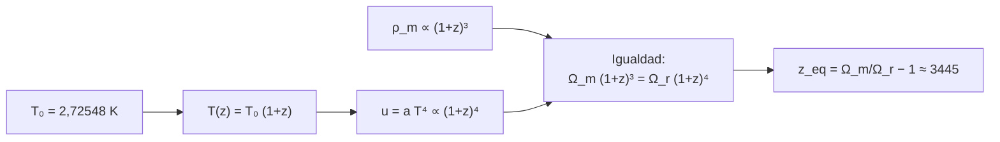

# B26-C14 — Evolución térmica del universo

<!-- nav:top -->
[🏠 Programa](../../../../README.md) · [📚 Bloque B26](../../../tronco-comun/B26-relatividad-y-cosmologia.md) · [← Anterior: B26-C13 — Modelo FLRW — Relatividad y cosmología](../B26-C13-modelo-flrw-relatividad-y-cosmologia/CLASE.md) · [Siguiente: B26-C15 — Radiación cósmica de fondo →](../B26-C15-radiacion-cosmica-de-fondo/CLASE.md)
<!-- /nav -->

## 1. Ubicación, nivel y alcance

Clase 14 del bloque B26. Nivel N3. A medida que el universo se expande, se enfría. Aquí calculas cómo evoluciona la temperatura de la radiación, cuánta energía tenía en el pasado y cuándo la radiación dejó de dominar a la materia. Usas la ecuación de Friedmann ([C13](../B26-C13-modelo-flrw-relatividad-y-cosmologia/CLASE.md)), la ley de Stefan–Boltzmann ([B05-C18](../../B05/B05-C18-electromagnetismo-y-radiacion/CLASE.md)) y la temperatura del cuerpo negro ([B24-C03](../../B24/B24-C03-diagrama-de-hertzsprung-russell/CLASE.md)). La física de partículas del universo temprano se profundiza en [B40](../../../tronco-comun/B40-universo-temprano-y-radiacion-cosmica-de-fondo.md).

## 2. Por qué esta clase existe

Casi todo lo observable del universo temprano (radiación de fondo, abundancia de helio) depende de su temperatura y de qué componente dominaba la densidad en cada época. La decisión central: **dada la temperatura actual de la radiación, ¿qué temperatura tenía en un corrimiento `z`, cuánta densidad de radiación había y cuándo igualó a la de la materia?**

## 3. Lo que podrás hacer al terminar

1. Aplicar `T(z) = T₀(1+z)`.
2. Calcular la densidad de energía de los fotones y verificarla por integración.
3. Calcular el parámetro de densidad de la radiación con neutrinos.
4. Calcular el corrimiento de igualdad materia–radiación.
5. Expresar la temperatura en electronvoltios.
6. Comparar `kT = 13,6 eV` con la época de recombinación.

La evidencia es la **línea de tiempo térmica** del ejercicio 12 (sección 20).

## 4. Con qué llegas y cómo comprobarlo

1. ¿Qué es la ley de Stefan–Boltzmann?
2. ¿Qué es un parámetro de densidad `Ω` (C13)?
3. ¿Qué es la distribución de Planck?
4. ¿Qué es un electronvoltio en kelvin?
5. ¿Qué escalas como `(1+z)³` y `(1+z)⁴`?

<details>
<summary>Ver respuestas</summary>

1. La emisión de un cuerpo negro es `σT⁴`. 2. El cociente de la densidad de un componente entre la crítica. 3. La distribución de energía de un cuerpo negro. 4. `1 eV ↔ 11 604,5 K`. 5. La densidad de materia (`a⁻³`) y de radiación (`a⁻⁴`).
</details>

Con cuatro o cinco aciertos, sigue; si no, repasa C13 y B05-C18.

## 5. Un caso real: la temperatura de la radiación hoy y en la recombinación

Fixsen recopiló medidas de la temperatura de la radiación de fondo y obtuvo `T₀ = 2,72548 ± 0,00057 K` (S2, resumen). Para `z = 1089` (la superficie de última dispersión, S4, resumen), `T = 2971 K = 0,256 eV`. La densidad de fotones hoy es `4,175 × 10⁻¹⁴ J/m³ = 0,2606 eV/cm³`, y la radiación (fotones y neutrinos) iguala a la materia en `z_eq = 3445`, cuando `T = 9393 K`. Es el **ejemplo conductor**.

## 6. Vocabulario

La **radiación de fondo** es un cuerpo negro cuya temperatura decae como `T(z) = T₀(1+z)`. La **constante de radiación** es `a = 4σ/c`. La **densidad de energía de los fotones** es `u = aT⁴`. El **parámetro de densidad de fotones** `Ω_γ = u/(ρ_c c²)`. Los **neutrinos** aportan `Ω_ν = Ω_γ × 0,2271 N_eff`, con `0,2271 = (7/8)(4/11)^{4/3}`. La **igualdad materia–radiación** ocurre cuando `Ω_m(1+z)³ = Ω_r(1+z)⁴`. La **recombinación** es el paso del plasma a átomos neutros. `N_eff` es el número efectivo de especies de neutrinos.

## 7. Modelo mental: un gas que se enfría al expandirse

Cada fotón se estira con el universo: su longitud de onda crece como `a`, y la temperatura baja como `1/a`. La densidad de fotones cae como `a⁻⁴` (número `a⁻³` y energía `a⁻¹`), más rápido que la de materia (`a⁻³`).



*Descripción textual:* la temperatura crece con `1+z`; la densidad de radiación como `(1+z)⁴` y la de materia como `(1+z)³`; la igualdad ocurre cuando se cruzan.

Analogía: un gas en un globo que se infla. Límite: la expansión no es una explosión hacia un exterior.

## 8. La explicación, paso a paso

### 8.1 La temperatura en el pasado

`T(z) = T₀(1+z)`: `5,45 K` en `z = 1`; `29,98 K` en `z = 10`; `2971 K` (`0,256 eV`) en `z = 1089`; `2,7 × 10⁶ K` (`234,9 eV`) en `z = 10⁶`. La incertidumbre de `T₀` (`2,1 × 10⁻⁴` relativa) se traslada tal cual: `±0,62 K` en `z = 1089`.

### 8.2 La densidad de energía de los fotones

Con `a = 4σ/c`, `u = aT₀⁴ = 4,1747 × 10⁻¹⁴ J/m³ = 0,2606 eV/cm³`. El laboratorio integra la distribución de Planck sobre frecuencias y obtiene el mismo valor a `10⁻⁶`.

### 8.3 El parámetro de la radiación

Con `ρ_c = 8,533 × 10⁻²⁷ kg/m³` (C13), `Ω_γ = u/(ρ_c c²) = 5,444 × 10⁻⁵` y `Ω_γ h² = 2,473 × 10⁻⁵` (con `h = 0,674`). Con los neutrinos (`N_eff = 2,99`, S3, resumen), `Ω_r = Ω_γ(1 + 0,2271 × 2,99) = 9,14 × 10⁻⁵`.

### 8.4 La igualdad

`Ω_m(1+z)³ = Ω_r(1+z)⁴` ⇒ `1 + z_eq = Ω_m/Ω_r = 0,315/9,14 × 10⁻⁵ = 3446`, `z_eq = 3445`. A esa `z`, `T = 9393 K = 0,809 eV`. La recombinación (`z = 1089`) ocurrió ya con la materia dominando.

### 8.5 ¿Por qué se recombina a `0,26 eV` y no a `13,6 eV`?

`kT = 13,6 eV` correspondería a `z = 57 929`, 53 veces mayor que `1089`. La razón: hay unos `1,6 × 10⁹` fotones por barión (`η = 6,1 × 10⁻¹⁰`, C15), y la cola de energía alta de la distribución de Planck mantiene el hidrógeno ionizado hasta temperaturas mucho menores que `13,6 eV/k`. El valor preciso exige la ecuación de Saha (B24-C10) con `η`.

## 9. Magnitudes, símbolos y unidades

| Símbolo | Qué es | Unidad | Valor / nota |
|---|---|---|---|
| `T₀` | temperatura de la radiación hoy | K | `2,72548 ± 0,00057` (S2) |
| `u` | densidad de energía de fotones | `J m⁻³` | `4,1747 × 10⁻¹⁴` |
| `Ω_γ`, `Ω_r` | densidades de fotones y de radiación | — | `5,444 × 10⁻⁵`; `9,14 × 10⁻⁵` |
| `N_eff` | especies efectivas de neutrinos | — | `2,99` (S3) |
| `z_eq` | igualdad materia–radiación | — | `3445` |

## 10. Convenciones y referencias

Neutrinos sin masa; `Ω_m = 0,315`, `H₀ = 67,4` (S3); `N_eff = 2,99` (valor central del resumen de Planck con BAO). Constantes de NIST (S1). El cálculo de `z_eq` es **propio**, sin tabulado.

## 11. De dónde sale lo que afirmamos

| ID | Fuente | Localizador | Respalda | Estado |
|---|---|---|---|---|
| S1 | NIST, *Fundamental Physical Constants — Complete Listing* (CODATA 2022) | https://physics.nist.gov/cuu/Constants/Table/allascii.txt | `h`, `c`, `k`, `σ`, `G`, eV | Consultada el 2026-11-09 |
| S2 | Fixsen, *The Temperature of the Cosmic Microwave Background*, arXiv:0911.1955 | https://arxiv.org/abs/0911.1955 | `T₀ = 2,72548 ± 0,00057 K` | Solo resumen, consultado el 2026-11-09 |
| S3 | Planck Collaboration, arXiv:1807.06209 | https://arxiv.org/abs/1807.06209 | `H₀`, `Ω_m`, `Ω_b h²`, `N_eff = 2,99 ± 0,17` (con BAO) | Solo resumen, consultado el 2026-11-09 |
| S4 | Eisenstein et al., arXiv:astro-ph/0501171 | https://arxiv.org/abs/astro-ph/0501171 | Distancia a `z = 1089` | Solo resumen, consultado el 2026-11-09 |

Límites: S2–S4 solo resumen; la densidad de fotones es resultado estándar verificado por integración; `z_eq` es un cálculo propio con `N_eff` del resumen.

## 12. Cómo ver la línea de tiempo

| `z` | `T` (K) | `kT` (eV) | Época |
|---|---|---|---|
| 0 | 2,725 | `2,35 × 10⁻⁴` | hoy |
| 1089 | 2971 | 0,256 | recombinación |
| 3445 | 9393 | 0,809 | igualdad |
| 57 929 | 157 800 | 13,6 | `kT` = energía de ionización |
| `10⁶` | `2,7 × 10⁶` | 234,9 | — |

Descripción larga: la temperatura sube en proporción a `1+z`; la igualdad queda antes de la recombinación.

## 13. Ejemplo trabajado: temperatura e igualdad

**Paso 1 · Datos.** `T₀ = 2,72548 K`; `Ω_m = 0,315`; `Ω_r = 9,14 × 10⁻⁵`.

**Paso 2 · Igualdad.** `1 + z_eq = 0,315/9,14 × 10⁻⁵ = 3446`.

**Paso 3 · Temperatura.** `T = 2,72548 × 3446 = 9393 K`.

**Paso 4 · En eV.** `9393 × 8,6173 × 10⁻⁵ = 0,809 eV`.

**Paso 5 · Sentido.** La radiación dominó la densidad hasta `z ≈ 3400`; después, la materia.

## 14. Distintas formas de calcular `z_eq`

**Cálculo directo (esta clase):** analítico. **Códigos de Boltzmann:** incluyen la masa de los neutrinos. **Ajuste a la anisotropía:** el CMB mide `z_eq` con alta precisión.

## 15. Práctica guiada

**Ejercicio 1 · con los pasos indicados.** Calcula `T` en `z = 1089`. *Pasos:* `T₀(1+z)`.

<details><summary>Solución comentada</summary>

`2,72548 × 1090 = 2971 K`.
</details>

**Ejercicio 2 · con una pista.** Pásala a eV. *Pista:* `k = 8,6173 × 10⁻⁵ eV/K`.

<details><summary>Solución comentada</summary>

`0,256 eV`.
</details>

**Ejercicio 3 · casi autónomo.** Calcula `u` con `a = 7,5657 × 10⁻¹⁶ J m⁻³ K⁻⁴`.

<details><summary>Solución comentada</summary>

`7,5657 × 10⁻¹⁶ × 2,72548⁴ = 4,175 × 10⁻¹⁴ J/m³`.
</details>

## 16. Práctica autónoma, transferencia e integrador

**Ejercicio 4.** ¿Cuánto vale `Ω_γ`?

<details><summary>Solución comentada</summary>

`u/(ρ_c c²) = 4,1747 × 10⁻¹⁴/(8,533 × 10⁻²⁷ × 8,98755 × 10¹⁶) = 5,44 × 10⁻⁵`.
</details>

**Ejercicio 5.** ¿Cuánto vale el factor de neutrinos?

<details><summary>Solución comentada</summary>

`(7/8)(4/11)^{4/3} = 0,2271`.
</details>

**Ejercicio 6.** Calcula `Ω_r` con `N_eff = 2,99`.

<details><summary>Solución comentada</summary>

`5,444 × 10⁻⁵ × (1 + 0,2271 × 2,99) = 9,14 × 10⁻⁵`.
</details>

**Ejercicio 7.** Calcula `z_eq`.

<details><summary>Solución comentada</summary>

`0,315/9,14 × 10⁻⁵ − 1 = 3445`.
</details>

**Ejercicio 8.** ¿A qué `z` es `kT = 13,6 eV`?

<details><summary>Solución comentada</summary>

`T = 13,6/8,6173 × 10⁻⁵ = 157 800 K`; `z = 57 929` (8.5).
</details>

**Ejercicio 9 · transferencia.** Si `N_eff` fuera `3,046` en vez de `2,99`, ¿cómo cambia `z_eq`?

<details><summary>Solución comentada</summary>

`Ω_r` sube un factor `1,0076`; `z_eq` baja un `0,75 %`, a unos `3419`.
</details>

**Ejercicio 10 · transferencia.** Un compañero dice que la recombinación ocurre cuando `kT = 13,6 eV`. Responde con 8.5.

<details><summary>Solución comentada</summary>

Ocurre a `0,26 eV` (53 veces menos) porque hay mil millones de fotones por barión; la cola de alta energía mantiene ionizado el gas.
</details>

**Ejercicio 11 · transferencia.** ¿Qué incertidumbre tiene la temperatura en `z = 1089` por la de `T₀`?

<details><summary>Solución comentada</summary>

`0,00057 × 1090 = 0,62 K`.
</details>

**Ejercicio 12 · integrador.** Elabora tu *línea de tiempo térmica*: tabla de `T`, `kT` y época para cinco corrimientos, la densidad de fotones por integración, `Ω_r`, `z_eq` y la comparación con `kT = 13,6 eV`.

<details><summary>Solución modelo</summary>

Tabla de la sección 12; `u = 4,175 × 10⁻¹⁴`; `Ω_r = 9,14 × 10⁻⁵`; `z_eq = 3445`; `z(13,6 eV) = 57 929`.
</details>

## 17. Laboratorio: radiación y temperatura

El script [termica.py](termica.py) integra la distribución de Planck y **comprueba** que da `aT⁴` a `10⁻⁶`, calcula `Ω_γ`, `Ω_r` y `z_eq`, y **comprueba** que cumple `Ω_m(1+z)³ = Ω_r(1+z)⁴`; calcula `η`.

**Datos:** constantes de NIST; `T₀`, `H₀`, `Ω_m`, `Ω_b h²`, `N_eff` de resúmenes. **Predice antes de ejecutar:** ¿qué `z_eq` esperas? (unos 3400.) **Ejecución del 2026-11-09 (Python 3.12.9):**

```text
Python 3.12.9 (biblioteca estandar)
u_gamma = a T0^4 = 4.1747e-14 J/m3 = 0.2606 eV/cm3 ; integral = 4.1747e-14 J/m3
h = 0.6740 ; Omega_gamma = 5.4436e-05 ; Omega_gamma h^2 = 2.4729e-05
factor de neutrinos = 0.22711 ; Omega_r = 9.1401e-05
igualdad materia-radiacion: z_eq = 3445 ; T(z_eq) = 9393 K = 0.809 eV
       z      T [K]    kT [eV]
       0      2.725  0.0002349
       1      5.451  0.0004697
      10      29.98   0.002584
    1089       2971      0.256
    3445       9393     0.8094
 1000000  2.725e+06      234.9
1000000000  2.725e+09  2.349e+05
kT = 13.6 eV a z = 57929 ; la recombinacion ocurre a z = 1089 (razon 53.2)
eta = n_b / n_gamma = 6.125e-10
Pruebas superadas.
```

```bash
python programa/clases/B26/B26-C14-evolucion-termica-del-universo/termica.py
```

**Límites:** neutrinos sin masa; sin dependencia de `Λ` en el pasado; `N_eff` fijo.

## 18. Errores frecuentes y cómo corregirlos

**Usar `(1+z)³` para la radiación.** Se corrige con la sección 7.

**Olvidar los neutrinos.** Se corrige con el ejercicio 6.

**Pensar que se recombina a `13,6 eV`.** Se corrige con el ejercicio 10.

**Confundir `Ω_γ` con `Ω_r`.** Se corrige con la sección 8.3.

**Tomar `z_eq` como medido.** Se corrige con la sección 10: es un cálculo propio.

## 19. Cómo sabrás que vas bien

Tras 8.1: ¿cuánto vale `T` en `z = 10`? Si dudas, ejercicio 1. Tras 8.4: ¿qué da `z_eq`? Ejercicio 7. Tras el laboratorio: ¿qué verifica la integral? (que `u = aT⁴`).

## 20. Qué entregas y cómo se evalúa

El producto es tu **línea de tiempo térmica** (ejercicio 12).

| Criterio | Inicial | En desarrollo | Logrado | Destacado |
|---|---|---|---|---|
| Escalas | Las confunde | Parciales | `T(1+z)`, `(1+z)⁴` | Explica el cruce |
| Cálculo | Sin unidades | Con errores | `Ω_r`, `z_eq` | Propaga `N_eff` |
| Numérico | Sin comprobar | Un caso | Integral y cruce | Interpreta `η` |
| Fuentes | Sin fuente | Sin fecha | S1–S4 con fecha | Declara resúmenes |
| Límites | No los nombra | Uno | Tres | Discute la masa de los neutrinos |

**Condiciones críticas (no se compensan con promedio):** rotular `z_eq` como cálculo propio; citar solo lo consultado; no mezclar `Ω_γ` y `Ω_r`.

## 21. Ética, seguridad y límites

Clase educativa: no sustituye un código de Boltzmann cosmológico. Accesibilidad: tablas equivalentes a las gráficas, fórmulas en texto, ejercicios sin conexión.

## 22. Para cerrar y seguir

La temperatura de la radiación crece con `1+z` y la densidad de radiación con `(1+z)⁴`: igualó a la de materia en `z ≈ 3445` y el gas se recombinó a `z ≈ 1089`, a `0,26 eV`. Queda una pregunta: ¿cómo es la luz de aquella superficie que seguimos viendo hoy?

**Glosario español–inglés.** radiación de fondo · *background radiation*; recombinación · *recombination*; igualdad materia–radiación · *matter–radiation equality*; neutrinos · *neutrinos*; densidad de energía · *energy density*; parámetro de densidad · *density parameter*.

**Continuidad.** [B26-C15](../B26-C15-radiacion-cosmica-de-fondo/CLASE.md) estudia el espectro y la densidad de los fotones de fondo.

**Referencias:** ver sección 11.

<!-- nav:bottom -->
---

[← Anterior: B26-C13 — Modelo FLRW — Relatividad y cosmología](../B26-C13-modelo-flrw-relatividad-y-cosmologia/CLASE.md) · [📚 Bloque B26](../../../tronco-comun/B26-relatividad-y-cosmologia.md) · [Siguiente: B26-C15 — Radiación cósmica de fondo →](../B26-C15-radiacion-cosmica-de-fondo/CLASE.md)
<!-- /nav -->
