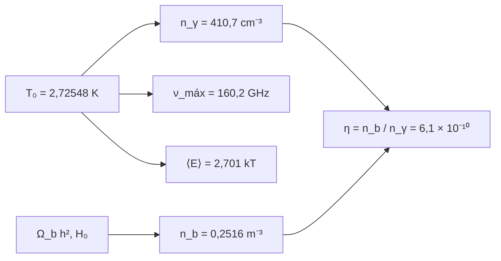

# B26-C15 — Radiación cósmica de fondo

<!-- nav:top -->
[🏠 Programa](../../../../README.md) · [📚 Bloque B26](../../../tronco-comun/B26-relatividad-y-cosmologia.md) · [← Anterior: B26-C14 — Evolución térmica del universo](../B26-C14-evolucion-termica-del-universo/CLASE.md) · [Siguiente: B26-C16 — Nucleosíntesis primordial →](../B26-C16-nucleosintesis-primordial/CLASE.md)
<!-- /nav -->

## 1. Ubicación, nivel y alcance

Clase 15 del bloque B26. Nivel N3. En [C14](../B26-C14-evolucion-termica-del-universo/CLASE.md) calculaste la temperatura y la densidad de energía de la radiación. Aquí la tratas como lo que es: un cuerpo negro casi perfecto que llena el cielo. Calculas cuántos fotones hay por metro cúbico, dónde está el máximo de su espectro, cuánta energía lleva cada fotón y cuántos fotones hay por barión. Usas integración numérica ([B11](../../../tronco-comun/B11-ecuaciones-diferenciales-y-simulacion-numerica.md)), radiación térmica ([B05-C18](../../B05/B05-C18-electromagnetismo-y-radiacion/CLASE.md)) y la calibración radiométrica de [B13-C17](../../B13/B13-C17-calibracion-radiometrica/CLASE.md). La cosmología de la radiación de fondo se amplía en [B40](../../../tronco-comun/B40-universo-temprano-y-radiacion-cosmica-de-fondo.md).

## 2. Por qué esta clase existe

El fondo de microondas es la reliquia más antigua observable y da los parámetros del modelo cosmológico. Entender su espectro de cuerpo negro permite calibrar un instrumento, estimar el contenido de fotones y comprender por qué un solo número, la razón barión–fotón, resume tanta física. La decisión central: **dada la temperatura del fondo, ¿cuántos fotones hay, a qué frecuencia está el máximo y cuántos fotones corresponden a cada barión?**

## 3. Lo que podrás hacer al terminar

1. Escribir el espectro de Planck en frecuencia.
2. Calcular la densidad numérica de fotones de dos maneras.
3. Hallar el máximo del espectro y compararlo con la constante de Wien.
4. Calcular la energía media por fotón.
5. Calcular la razón barión–fotón `η`.
6. Propagar la incertidumbre de la temperatura.

La evidencia es la **ficha del cuerpo negro cósmico** del ejercicio 12 (sección 20).

## 4. Con qué llegas y cómo comprobarlo

1. ¿Qué es la función de Planck `B_ν(T)`?
2. ¿Qué es la función zeta de Riemann `ζ(3)`?
3. ¿Qué es la constante de Wien en frecuencia?
4. ¿Cómo se integra numéricamente una cola exponencial?
5. ¿Qué es la densidad numérica de bariones?

<details>
<summary>Ver respuestas</summary>

1. La intensidad espectral de un cuerpo negro. 2. `ζ(3) = Σ 1/k³ = 1,2020569…`. 3. `ν_máx = 5,8789 × 10¹⁰ Hz/K × T`. 4. Truncando donde el integrando es despreciable. 5. `n_b = ρ_b/m_p`.
</details>

Con cuatro o cinco aciertos, sigue; si no, repasa B05-C18 y C14.

## 5. Un caso real: el cielo a 2,72548 K

Con `T₀ = 2,72548 ± 0,00057 K` (S2, resumen), el fondo tiene `410,72` fotones por centímetro cúbico, un máximo de `B_ν` en `160,23 GHz` (`λ = 1,871 mm`) y una energía media de `0,6344 meV` por fotón (`2,701 kT`). Con `Ω_b h² = 0,0224` y `H₀ = 67,4` (S3, resumen) hay `0,2516` bariones por metro cúbico, es decir, `1,63 × 10⁹` fotones por barión. Es el **ejemplo conductor**.

## 6. Vocabulario

La **función de Planck** `B_ν = (2hν³/c²)/(e^{hν/kT} − 1)` da la intensidad espectral. La **densidad numérica de fotones** es `n_γ = (2ζ(3)/π²)(kT/ħc)³`. La **frecuencia del máximo** de `B_ν` es `ν_máx = (5,8789 × 10¹⁰ Hz/K) T` (S1). La **energía media** de un fotón es `u/n_γ = 2,701 kT`. La **razón barión–fotón** `η = n_b/n_γ`. El **fondo cósmico de microondas (CMB)** es la radiación térmica relicta. La **anisotropía** es su pequeña variación de temperatura, del orden de `10⁻⁵`. Un **instrumento radiométrico** mide la intensidad de esta radiación.

## 7. Modelo mental: el interior de un horno enorme

El universo temprano fue un horno en equilibrio térmico. Cuando se enfrió y se hizo transparente, la radiación quedó con la forma del cuerpo negro y desde entonces solo cambia su temperatura.



*Descripción textual:* la temperatura determina el número de fotones, el máximo espectral y la energía media; con la densidad de bariones del modelo se obtiene la razón barión–fotón.

Analogía: el brillo de un horno apagado hace mucho tiempo. Límite: aquí no se enfría por contacto, sino por la expansión del espacio.

## 8. La explicación, paso a paso

### 8.1 Número de fotones

`n_γ = (2ζ(3)/π²)(kT/ħc)³`. El laboratorio calcula `ζ(3)` por serie y obtiene `410,72 cm⁻³`; la integral numérica de Planck da el mismo valor a `10⁻⁶`.

### 8.2 El máximo del espectro

Maximizando `B_ν` numéricamente (razón áurea) resulta `160,229 GHz`, igual a `5,878 925 757 × 10¹⁰ × 2,72548` (constante de Wien de NIST, S1) a `10⁻⁶`. En longitud de onda, `λ = c/ν = 1,871 mm`. Ojo: el máximo de `B_λ` está en `1,063 mm` (otra función, otra variable).

### 8.3 Energía media por fotón

`u = 4σT⁴/c` y `n_γ` dan `⟨E⟩ = u/n_γ = 6,344 × 10⁻⁴ eV = 2,7012 kT`. Un fotón del fondo tiene unos 0,6 meV, millones de veces menos que uno visible.

### 8.4 Razón barión–fotón

Con `Ω_b h² = 0,0224`, `h = 0,674` y `ρ_c = 8,533 × 10⁻²⁷ kg/m³` (C13), `n_b = 0,2516 m⁻³` y `η = n_b/n_γ = 6,125 × 10⁻¹⁰`. Es un único número que fija la nucleosíntesis (C16) y la recombinación (C14).

### 8.5 Incertidumbre

Como `n_γ ∝ T³`, la incertidumbre relativa de `T₀` (`2,09 × 10⁻⁴`) se triplica en `n_γ`: `6,3 × 10⁻⁴`. A `z = 1089`, la temperatura es `2971 K`; su máximo espectral estaría en `1,75 × 10¹⁴ Hz` (`1,72 μm`, infrarrojo cercano).

## 9. Magnitudes, símbolos y unidades

| Símbolo | Qué es | Unidad | Valor / nota |
|---|---|---|---|
| `T₀` | temperatura | K | `2,72548 ± 0,00057` (S2) |
| `n_γ` | densidad de fotones | `cm⁻³` | `410,72` |
| `ν_máx` | máximo de `B_ν` | GHz | `160,229` |
| `⟨E⟩` | energía media | meV | `0,6344` |
| `η` | razón barión–fotón | — | `6,125 × 10⁻¹⁰` |
| `Ω_b h²` | densidad bariónica | — | `0,0224 ± 0,0001` (S3) |

## 10. Convenciones y referencias

Cuerpo negro isótropo sin anisotropías; `ζ(3)` por serie de `200 000` términos más corrección. `h = H₀/100`. `Ω_b h²` y `H₀` son valores publicados (resumen).

## 11. De dónde sale lo que afirmamos

| ID | Fuente | Localizador | Respalda | Estado |
|---|---|---|---|---|
| S1 | NIST, *Fundamental Physical Constants — Complete Listing* (CODATA 2022) | https://physics.nist.gov/cuu/Constants/Table/allascii.txt | `h`, `c`, `k`, `σ`, constante de Wien en frecuencia y en longitud de onda, masa del protón | Consultada el 2026-11-09 |
| S2 | Fixsen, arXiv:0911.1955 | https://arxiv.org/abs/0911.1955 | `T₀ = 2,72548 ± 0,00057 K` | Solo resumen, consultado el 2026-11-09 |
| S3 | Planck Collaboration, arXiv:1807.06209 | https://arxiv.org/abs/1807.06209 | `Ω_b h² = 0,0224 ± 0,0001`; `H₀ = 67,4` | Solo resumen, consultado el 2026-11-09 |
| S4 | Eisenstein et al., arXiv:astro-ph/0501171 | https://arxiv.org/abs/astro-ph/0501171 | `z = 1089` | Solo resumen, consultado el 2026-11-09 |

Límites: S2–S4 solo resumen; las fórmulas de Planck son estándar y se verifican con integrales; no se consultó ninguna medida del espectro de FIRAS más allá de la temperatura.

## 12. Cómo ver el espectro

| Magnitud | Valor |
|---|---|
| `n_γ` | `410,72 cm⁻³` |
| `ν_máx` (en `B_ν`) | `160,23 GHz` (`1,871 mm`) |
| máximo de `B_λ` | `1,063 mm` |
| `⟨E⟩` | `0,6344 meV` (`2,701 kT`) |
| `η` | `6,125 × 10⁻¹⁰` |

Descripción larga: las dos longitudes de onda del máximo difieren porque `B_ν` y `B_λ` son densidades en variables distintas.

## 13. Ejemplo trabajado: fotones en una sala

**Paso 1 · Datos.** Sala de `50 m³`; `n_γ = 410,72 cm⁻³ = 4,107 × 10⁸ m⁻³`.

**Paso 2 · Número.** `50 × 4,107 × 10⁸ = 2,05 × 10¹⁰` fotones.

**Paso 3 · Energía.** `2,05 × 10¹⁰ × 0,6344 meV = 1,3 × 10¹⁰ meV = 1,3 × 10⁷ eV = 2,1 × 10⁻¹² J`.

**Paso 4 · Sentido.** Una cantidad ínfima de energía, pero una cantidad enorme de fotones: unos 410 millones por metro cúbico.

## 14. Distintas formas de medir `T₀`

**Radiómetros absolutos con cuerpo negro de referencia:** medida directa (calibración B13-C17). **Ajuste de espectros:** da `T₀` y desviaciones. **Cosmología:** `T₀` entra en `Ω_γ` y `z_eq` (C14).

## 15. Práctica guiada

**Ejercicio 1 · con los pasos indicados.** Calcula `n_γ` con `ζ(3) = 1,20206`. *Pasos:* `kT/ħc` en `m⁻¹`, al cubo, por `2ζ(3)/π²`.

<details><summary>Solución comentada</summary>

`kT = 1,3806 × 10⁻²³ × 2,72548 = 3,7628 × 10⁻²³ J`; `ħc = 3,1615 × 10⁻²⁶ J m`; `kT/ħc = 1190 m⁻¹`; su cubo `1,686 × 10⁹ m⁻³`; `2ζ(3)/π² = 0,24359`; `n_γ = 4,107 × 10⁸ m⁻³ = 410,7 cm⁻³`.
</details>

**Ejercicio 2 · con una pista.** Calcula `ν_máx`. *Pista:* `5,8789 × 10¹⁰ × T`.

<details><summary>Solución comentada</summary>

`160,23 GHz`.
</details>

**Ejercicio 3 · casi autónomo.** Calcula `λ = c/ν_máx`.

<details><summary>Solución comentada</summary>

`299 792 458/1,6023 × 10¹¹ = 1,871 mm`.
</details>

## 16. Práctica autónoma, transferencia e integrador

**Ejercicio 4.** Energía media en meV.

<details><summary>Solución comentada</summary>

`2,701 × 0,23487 meV = 0,6344 meV`.
</details>

**Ejercicio 5.** Calcula `η`.

<details><summary>Solución comentada</summary>

`0,2516/4,107 × 10⁸ = 6,13 × 10⁻¹⁰`.
</details>

**Ejercicio 6.** ¿Cuántos fotones hay por barión?

<details><summary>Solución comentada</summary>

`1/η = 1,63 × 10⁹`.
</details>

**Ejercicio 7.** Incertidumbre relativa de `n_γ`.

<details><summary>Solución comentada</summary>

`3 × 2,09 × 10⁻⁴ = 6,3 × 10⁻⁴`.
</details>

**Ejercicio 8.** Máximo de `B_ν` en `z = 1089` en frecuencia y longitud.

<details><summary>Solución comentada</summary>

`5,8789 × 10¹⁰ × 2971 = 1,747 × 10¹⁴ Hz`; `λ = 1,72 μm`.
</details>

**Ejercicio 9 · transferencia.** Un compañero dice que el máximo del fondo está en `1,06 mm`. Respóndele.

<details><summary>Solución comentada</summary>

Ese es el máximo de `B_λ`; el de `B_ν` está en `160 GHz` (`1,87 mm`). Hay que declarar la variable espectral.
</details>

**Ejercicio 10 · transferencia.** ¿Por qué `⟨E⟩ = 2,701 kT` y no `kT`?

<details><summary>Solución comentada</summary>

Porque se pondera por la distribución de Planck, con una cola larga de alta energía (`u/n_γ = 2,701 kT`).
</details>

**Ejercicio 11 · transferencia.** Si `Ω_b h²` fuera el doble, ¿cuánto cambiaría `η`?

<details><summary>Solución comentada</summary>

Se duplica: `1,2 × 10⁻⁹`.
</details>

**Ejercicio 12 · integrador.** Elabora tu *ficha del cuerpo negro cósmico*: `n_γ` por dos vías, máximos en `ν` y en `λ`, energía media, `η`, la incertidumbre propagada y el espectro a `z = 1089`.

<details><summary>Solución modelo</summary>

Con la sección 12 y los ejercicios 4–8.
</details>

## 17. Laboratorio: cuerpo negro cósmico

El script [cmb.py](cmb.py) calcula `n_γ` por serie de `ζ(3)` y por integral (**comprueba** `10⁻⁶`), halla el máximo de `B_ν` y **comprueba** que coincide con la constante de Wien de NIST, calcula la energía media y `η`.

**Datos:** constantes de NIST; `T₀`, `Ω_b h²` y `H₀` de resúmenes. **Predice antes de ejecutar:** ¿en qué frecuencia está el máximo? (≈160 GHz.) **Ejecución del 2026-11-09 (Python 3.12.9):**

```text
Python 3.12.9 (biblioteca estandar)
n_gamma = 410.72 cm^-3 (cerrada) ; 410.72 cm^-3 (integral)
maximo de B_nu: 160.229 GHz (numerico) = 160.229 GHz (Wien-NIST) ; lambda = 1.871 mm
energia media por foton = 0.6344 meV = 2.7012 kT (2.701 esperado)
n_b = 0.2516 m^-3 ; eta = n_b/n_gamma = 6.125e-10
incertidumbre relativa de T0 = 2.09e-04 -> de n_gamma = 6.27e-04
temperatura a z = 1089 : 2971 K
Pruebas superadas.
```

```bash
python programa/clases/B26/B26-C15-radiacion-cosmica-de-fondo/cmb.py
```

**Límites:** cuerpo negro perfecto, sin anisotropías ni distorsiones.

## 18. Errores frecuentes y cómo corregirlos

**Confundir los máximos en `ν` y `λ`.** Se corrige con el ejercicio 9.

**Pensar que la energía media es `kT`.** Se corrige con el ejercicio 10.

**Mezclar `cm⁻³` y `m⁻³`.** Se corrige con el ejercicio 1.

**Olvidar que `n_γ ∝ T³`.** Se corrige con el ejercicio 7.

**Presentar `η` como medida directa.** Se corrige con la sección 10: depende de `Ω_b h²` del modelo.

## 19. Cómo sabrás que vas bien

Tras 8.1: ¿cuánto vale `n_γ`? Si dudas, ejercicio 1. Tras 8.2: ¿en qué variable está el máximo? Ejercicio 9. Tras el laboratorio: ¿qué verifica la integral? (la forma cerrada con `ζ(3)`).

## 20. Qué entregas y cómo se evalúa

El producto es tu **ficha del cuerpo negro cósmico** (ejercicio 12).

| Criterio | Inicial | En desarrollo | Logrado | Destacado |
|---|---|---|---|---|
| Espectro | Lo confunde | Parcial | `B_ν`, `n_γ`, máximo | Distingue `ν` y `λ` |
| Cálculo | Sin unidades | Con errores | `⟨E⟩` y `η` | Propaga `T₀` |
| Numérico | Sin comprobar | Un caso | Dos vías | Interpreta tolerancias |
| Fuentes | Sin fuente | Sin fecha | S1–S4 con fecha | Declara resúmenes |
| Límites | No los nombra | Uno | Tres | Discute anisotropías |

**Condiciones críticas (no se compensan con promedio):** declarar la variable espectral; rotular `η` como derivado de un modelo; citar solo lo consultado.

## 21. Ética, seguridad y límites

Clase educativa: no sustituye el análisis de datos del fondo cósmico. Accesibilidad: tablas equivalentes a las gráficas, fórmulas en texto, ejercicios sin conexión.

## 22. Para cerrar y seguir

El fondo cósmico es un cuerpo negro a `2,725 K` con `410,7` fotones por centímetro cúbico, máximo en `160 GHz` y `1,6 × 10⁹` fotones por barión. Queda una pregunta: ¿qué pasó con los núcleos cuando el universo tenía unos minutos?

**Glosario español–inglés.** fondo cósmico de microondas · *cosmic microwave background*; función de Planck · *Planck function*; razón barión–fotón · *baryon-to-photon ratio*; energía media · *mean energy*; anisotropía · *anisotropy*; densidad numérica · *number density*.

**Continuidad.** [B26-C16](../B26-C16-nucleosintesis-primordial/CLASE.md) usa `η` para estudiar la formación de los primeros núcleos.

**Referencias:** ver sección 11.

<!-- nav:bottom -->
---

[← Anterior: B26-C14 — Evolución térmica del universo](../B26-C14-evolucion-termica-del-universo/CLASE.md) · [📚 Bloque B26](../../../tronco-comun/B26-relatividad-y-cosmologia.md) · [Siguiente: B26-C16 — Nucleosíntesis primordial →](../B26-C16-nucleosintesis-primordial/CLASE.md)
<!-- /nav -->
