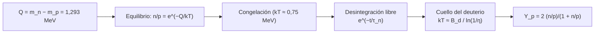

# B26-C16 — Nucleosíntesis primordial

<!-- nav:top -->
[🏠 Programa](../../../../README.md) · [📚 Bloque B26](../../../tronco-comun/B26-relatividad-y-cosmologia.md) · [← Anterior: B26-C15 — Radiación cósmica de fondo](../B26-C15-radiacion-cosmica-de-fondo/CLASE.md) · [Siguiente: B26-C17 — Estructura cosmológica →](../B26-C17-estructura-cosmologica/CLASE.md)
<!-- /nav -->

## 1. Ubicación, nivel y alcance

Clase 16 del bloque B26, cierre del universo temprano. Nivel N3. Cuando el universo tenía unos minutos, protones y neutrones se unieron en los primeros núcleos. Aquí calculas la razón neutrón/protón, la energía de ligadura del deuterón y la fracción de helio-4 resultante, con parámetros del proceso declarados como ilustrativos. Usas las masas y la unidad atómica de [B24-C06](../../B24/B24-C06-fusion-de-hidrogeno/CLASE.md), la razón barión–fotón de [C15](../B26-C15-radiacion-cosmica-de-fondo/CLASE.md) y la desintegración exponencial ([B09](../../../tronco-comun/B09-calculo-diferencial-e-integral.md)). La física nuclear se profundiza en [B31](../../../tronco-comun/B31-fisica-cuantica-nuclear-y-astroparticulas.md).

## 2. Por qué esta clase existe

La cuarta parte de la masa bariónica del universo es helio, y la proporción casi no cambió desde los primeros minutos. Su valor da información sobre cuántas especies de neutrinos existen y sobre la densidad de bariones. La decisión central: **dada la diferencia de masa neutrón–protón, ¿qué fracción de la masa acaba en helio-4 y qué parámetros la controlan?**

## 3. Lo que podrás hacer al terminar

1. Calcular la diferencia de energía neutrón–protón y la energía de ligadura del deuterón con masas de referencia.
2. Calcular la razón `n/p` en equilibrio y tras la desintegración libre.
3. Relacionar `n/p` con la fracción de helio `Y_p`.
4. Estimar la temperatura del cuello de botella del deuterio.
5. Analizar la sensibilidad de `Y_p` a la temperatura de congelación.
6. Interpretar el estado de las comparaciones con las observaciones.

La evidencia es el **cálculo de la fracción de helio** del ejercicio 12 (sección 20).

## 4. Con qué llegas y cómo comprobarlo

1. ¿Qué es el equilibrio térmico `n/p = e^{−Q/kT}`?
2. ¿Qué es la vida media de una partícula?
3. ¿Qué es la energía de ligadura?
4. ¿Qué es la razón barión–fotón `η` (C15)?
5. ¿Cuántos nucleones tiene el helio-4?

<details>
<summary>Ver respuestas</summary>

1. La razón de poblaciones con energías separadas por `Q`. 2. El tiempo en que una población decae a `1/e`. 3. La energía que hay que aportar para separar un núcleo en sus nucleones. 4. El número de bariones por fotón, `6,1 × 10⁻¹⁰`. 5. Cuatro: dos protones y dos neutrones.
</details>

Con cuatro o cinco aciertos, sigue; si no, repasa B24-C06 y C15.

## 5. Un caso real: ¿una cuarta parte de helio?

Cyburt, Fields, Olive y Yeh revisan la nucleosíntesis primordial: las observaciones recientes de deuterio concuerdan con el modelo estándar y con la densidad bariónica de Planck; combinadas con ella, acotan el número de especies de neutrinos a `N_ν < 3,2` (2σ); el litio-7 sigue en desacuerdo (S2, resumen). Es el **ejemplo conductor**. El cálculo de esta clase, con una temperatura de congelación de `0,75 MeV` y un tiempo de inicio de `200 s` (ilustrativos), da `Y_p = 0,2487`; con `n/p = 1/7`, exactamente `0,25`.

## 6. Vocabulario

La **nucleosíntesis primordial** es la formación de núcleos ligeros en los primeros minutos. La **razón `n/p`** es el cociente de neutrones y protones. La **congelación** es el momento en que las reacciones débiles dejan de mantener el equilibrio. La **vida media del neutrón libre** `τ_n` es de unos 880 s (valor ilustrativo, no consultado). La **energía de ligadura del deuterón** `B_d` es la que separa un deuterón en un protón y un neutrón. El **cuello de botella del deuterio** es el retraso hasta que el deuterio deja de fotodisociarse. La **fracción de helio** `Y_p` es la fracción de masa en helio-4. La **razón barión–fotón** `η`. `N_ν` es el número de especies de neutrinos.

## 7. Modelo mental: una carrera contra el reloj de los neutrones

Los neutrones se desintegran mientras el universo espera a ser lo bastante frío para que el deuterio sobreviva. Cuando por fin se fabrica helio, casi todos los neutrones que quedan acaban en helio-4.



*Descripción textual:* la diferencia de masa fija la razón de equilibrio; tras la congelación los neutrones se desintegran hasta que el deuterio sobrevive; todos los neutrones restantes forman helio-4 y fijan `Y_p`.

Analogía: una fila de personas que se va reduciendo hasta que se abre la puerta. Límite: el proceso real incluye redes de reacciones; esta clase solo usa el esqueleto.

## 8. La explicación, paso a paso

### 8.1 Diferencia de masa

`Q = (m_n − m_p)c² = 1,29333 MeV`, calculado por masas en `u` y por masas en `kg` con coincidencia de `10⁻⁶` (S1). En equilibrio, `n/p = e^{−Q/kT}`.

### 8.2 Congelación y desintegración

Con `kT = 0,75 MeV` (ilustrativo), `n/p = e^{−1,7244} = 0,1783 = 1/5,61`. Hasta el inicio de la formación de deuterio (`t = 200 s`, ilustrativo) los neutrones libres se desintegran con `τ_n = 880 s` (ilustrativo): factor `e^{−200/880} = 0,797`, de modo que `n/p = 0,1420 = 1/7,04`.

### 8.3 De `n/p` a `Y_p`

Si todos los neutrones terminan en helio-4 (dos neutrones por núcleo), `Y_p = 2(n/p)/(1 + n/p)`. Con `n/p = 1/7` sale `0,25` exacto; con `0,1420`, `0,2487`. El laboratorio también explora `kT_cong = 0,6; 0,75; 0,9 MeV`, que dan `Y_p = 0,169; 0,249; 0,318`: la dependencia es fuerte.

### 8.4 El cuello de botella del deuterio

La energía de ligadura del deuterón es `B_d = (m_p + m_n − m_d)c² = 2,22457 MeV` (con masas nucleares, S1). Con `η = 6,1 × 10⁻¹⁰` hay `1,6 × 10⁹` fotones por barión: los fotones de la cola de la distribución disocian los deuterones hasta que `kT ≈ B_d/ln(1/η) = 0,105 MeV` (`1,2 × 10⁹ K`), una estimación de orden de magnitud.

### 8.5 Qué se compara con las observaciones

El deuterio observado concuerda con el cálculo estándar; el helio-4 se incluye con una nueva determinación; el litio-7 predicho excede lo observado (S2, resumen). Esta clase no usa esos números: el resumen no da abundancias numéricas. El resultado de la clase (`Y_p ≈ 0,25`) es ilustrativo.

## 9. Magnitudes, símbolos y unidades

| Símbolo | Qué es | Unidad | Valor / nota |
|---|---|---|---|
| `Q` | `(m_n − m_p)c²` | MeV | `1,29333` (S1) |
| `B_d` | energía de ligadura del deuterón | MeV | `2,22457` (S1) |
| `n/p` | razón neutrón/protón | — | `0,1783` (congelación); `0,1420` (tras 200 s) |
| `Y_p` | fracción de masa de He-4 | — | `0,2487` |
| `η` | razón barión–fotón | — | `6,1 × 10⁻¹⁰` (C15) |
| `kT_cong`, `τ_n`, `t` | parámetros del proceso | MeV; s; s | `0,75`; `880`; `200` (ilustrativos) |

## 10. Convenciones y referencias

Congelación instantánea, todos los neutrones restantes forman helio-4; los tres parámetros del proceso son **ilustrativos**. Masas nucleares para el deuterón y masas de partículas libres para `n` y `p` (S1).

## 11. De dónde sale lo que afirmamos

| ID | Fuente | Localizador | Respalda | Estado |
|---|---|---|---|---|
| S1 | NIST, *Fundamental Physical Constants — Complete Listing* (CODATA 2022) | https://physics.nist.gov/cuu/Constants/Table/allascii.txt | Masas del neutrón, protón y deuterón (u y kg); `u` en MeV | Consultada el 2026-11-09 |
| S2 | Cyburt, Fields, Olive, Yeh, *Big Bang Nucleosynthesis: 2015*, arXiv:1505.01076 | https://arxiv.org/abs/1505.01076 | D/H concuerda; `N_ν < 3,2` (2σ); litio-7 en desacuerdo | Solo resumen, consultado el 2026-11-09 |
| S3 | Planck Collaboration, arXiv:1807.06209 | https://arxiv.org/abs/1807.06209 | `Ω_b h² = 0,0224`; `N_eff = 2,99 ± 0,17` | Solo resumen, consultado el 2026-11-09 |

Límites: S2 y S3 solo resumen; ni `τ_n`, ni la temperatura de congelación, ni el tiempo de inicio se consultaron; el cálculo es el esqueleto del proceso, no una predicción.

## 12. Cómo ver la sensibilidad

| `kT_cong` (MeV) | `n/p` | `Y_p` |
|---|---|---|
| 0,60 | 0,0923 | 0,169 |
| 0,75 | 0,1420 | 0,249 |
| 0,90 | 0,1893 | 0,318 |

Descripción larga: subir la temperatura de congelación aumenta el número de neutrones y el helio resultante.

## 13. Ejemplo trabajado: `Y_p` con `τ_n = 900 s`

**Paso 1 · Datos.** `kT = 0,75 MeV`, `t = 200 s`, `τ_n = 900 s`.

**Paso 2 · Equilibrio.** `n/p = 0,1783`.

**Paso 3 · Decaimiento.** `e^{−200/900} = 0,8007` ⇒ `n/p = 0,1427`.

**Paso 4 · Helio.** `Y_p = 2 × 0,1427/1,1427 = 0,2498`.

**Paso 5 · Sentido.** Cambiar `τ_n` de 880 a 900 s mueve `Y_p` en `0,001`. Es una sensibilidad pequeña frente a la de `kT_cong`.

## 14. Distintas formas de predecir `Y_p`

**Esqueleto (esta clase):** muestra qué parámetros importan. **Redes con decenas de reacciones y tasas medidas:** precisión de décimas de punto (S2). **Comparación con observaciones:** exige corregir por evolución química posterior.

## 15. Práctica guiada

**Ejercicio 1 · con los pasos indicados.** Calcula `Q`. *Pasos:* `(1,00866491606 − 1,007276466579) × 931,494`.

<details><summary>Solución comentada</summary>

`0,001388449 u × 931,494 = 1,2933 MeV`.
</details>

**Ejercicio 2 · con una pista.** Calcula `n/p` en equilibrio a `0,75 MeV`.

<details><summary>Solución comentada</summary>

`e^{−1,29333/0,75} = 0,1783`.
</details>

**Ejercicio 3 · casi autónomo.** Aplica la desintegración de 200 s con `τ = 880 s`.

<details><summary>Solución comentada</summary>

`0,1783 × 0,7966 = 0,1420`.
</details>

## 16. Práctica autónoma, transferencia e integrador

**Ejercicio 4.** Calcula `Y_p` con `n/p = 0,1420`.

<details><summary>Solución comentada</summary>

`0,2840/1,1420 = 0,2487`.
</details>

**Ejercicio 5.** ¿Cuánto da `n/p = 1/7`?

<details><summary>Solución comentada</summary>

`(2/7)/(8/7) = 0,25`.
</details>

**Ejercicio 6.** Calcula `B_d`.

<details><summary>Solución comentada</summary>

`(1,007276467 + 1,008664916 − 2,013553213) u = 0,002388170 u = 2,2246 MeV`.
</details>

**Ejercicio 7.** Calcula `kT ≈ B_d/ln(1/η)` para `η = 6,1 × 10⁻¹⁰`.

<details><summary>Solución comentada</summary>

`ln(1,64 × 10⁹) = 21,2`; `2,2246/21,2 = 0,105 MeV`.
</details>

**Ejercicio 8.** ¿Cuánto vale `Y_p` si `kT_cong = 0,9 MeV`?

<details><summary>Solución comentada</summary>

`0,318` (sección 12).
</details>

**Ejercicio 9 · transferencia.** Un compañero dice que más especies de neutrinos aumentan el helio. Responde con la sensibilidad de 12.

<details><summary>Solución comentada</summary>

Más especies aceleran la expansión, la congelación ocurre antes y a mayor temperatura, lo que sube `n/p` y `Y_p`; por eso el helio y el deuterio acotan `N_ν` (S2).
</details>

**Ejercicio 10 · transferencia.** El resumen de Cyburt et al. dice que el litio-7 no concuerda. ¿Qué implica para esta clase?

<details><summary>Solución comentada</summary>

Que el esqueleto no cierra todo el cuadro: puede haber física adicional o efectos sistemáticos; la clase solo trata el helio.
</details>

**Ejercicio 11 · transferencia.** ¿Cuánto cambia `Y_p` si `τ_n` pasa de 880 a 900 s?

<details><summary>Solución comentada</summary>

De `0,2487` a `0,2498` (13).
</details>

**Ejercicio 12 · integrador.** Elabora tu *cálculo de la fracción de helio*: `Q`, `n/p`, `Y_p`, la sensibilidad a `kT_cong` y a `τ_n`, `B_d` y el cuello del deuterio, con los parámetros ilustrativos señalados.

<details><summary>Solución modelo</summary>

`Q = 1,2933`; `n/p = 0,1783 → 0,1420`; `Y_p = 0,2487`; sensibilidades de 12 y 13; `B_d = 2,2246`; `kT ≈ 0,105 MeV`.
</details>

## 17. Laboratorio: helio primordial

El script [primordial.py](primordial.py) calcula `Q` y `B_d` por masas en `u` y en `kg` (**comprueba** `10⁻⁶`), la razón `n/p` y `Y_p`, con `Y_p(1/7) = 0,25` exacto, y la escala del cuello de botella.

**Datos:** masas de NIST; `η` de C15; parámetros del proceso **ilustrativos**. **Predice antes de ejecutar:** ¿qué `Y_p` esperas? (cerca de `0,25`.) **Ejecución del 2026-11-09 (Python 3.12.9):**

```text
Python 3.12.9 (biblioteca estandar)
Q = (m_n - m_p) c^2 = 1.29333 MeV (via u) = 1.29333 MeV (via kg)
B_d = (m_p + m_n - m_d) c^2 = 2.22457 MeV
kT_congelacion = 0.75 MeV (ilustrativo): n/p = exp(-Q/kT) = 0.1783 = 1/5.61
tras desintegrarse 200 s (tau = 880 s, ilustrativos): n/p = 0.1420 = 1/7.04
Y_p = 2 (n/p)/(1 + n/p) = 0.2487  (n/p = 1/7 -> 0.2500)
  kT_cong = 0.60 MeV -> n/p = 0.0923 -> Y_p = 0.1690
  kT_cong = 0.75 MeV -> n/p = 0.1420 -> Y_p = 0.2487
  kT_cong = 0.90 MeV -> n/p = 0.1893 -> Y_p = 0.3184
cuello de botella del deuterio: kT ~ B_d / ln(1/eta) = 2.2246/21.22 = 0.1048 MeV = 1.217e+09 K (orden de magnitud)
Pruebas superadas.
```

```bash
python programa/clases/B26/B26-C16-nucleosintesis-primordial/primordial.py
```

**Límites:** esqueleto del proceso; sin red de reacciones, sin litio.

## 18. Errores frecuentes y cómo corregirlos

**Tomar los parámetros ilustrativos como medidos.** Se corrige con la sección 10.

**Olvidar la desintegración del neutrón.** Se corrige con el ejercicio 3.

**Usar masas atómicas para el deuterón.** Se corrige con la sección 10: nucleares.

**Creer que `Y_p` es insensible a la temperatura de congelación.** Se corrige con el ejercicio 8.

**Ignorar el problema del litio.** Se corrige con el ejercicio 10.

## 19. Cómo sabrás que vas bien

Tras 8.1: ¿cuánto vale `Q`? Si dudas, ejercicio 1. Tras 8.3: ¿cómo se pasa de `n/p` a `Y_p`? Ejercicios 4 y 5. Tras el laboratorio: ¿qué verifica la doble vía? (que kg y u dan la misma `Q` y `B_d`).

## 20. Qué entregas y cómo se evalúa

El producto es tu **cálculo de la fracción de helio** (ejercicio 12).

| Criterio | Inicial | En desarrollo | Logrado | Destacado |
|---|---|---|---|---|
| Proceso | Lo confunde | Parcial | `Q`, `n/p`, `Y_p` | Explica el cuello del deuterio |
| Cálculo | Sin unidades | Con errores | Todos los valores | Sensibilidades |
| Numérico | Sin comprobar | Un caso | Dos vías | Discute parámetros |
| Fuentes | Sin fuente | Sin fecha | S1–S3 con fecha | Declara lo no consultado |
| Límites | No los nombra | Uno | Tres | Discute el litio |

**Condiciones críticas (no se compensan con promedio):** rotular `kT_cong`, `τ_n` y `t` como ilustrativos; no presentar `Y_p` como predicción; citar solo lo consultado.

## 21. Ética, seguridad y límites

Clase educativa: no sustituye un código de nucleosíntesis primordial. Accesibilidad: tablas equivalentes a las gráficas, fórmulas en texto, ejercicios sin conexión.

## 22. Para cerrar y seguir

La diferencia de masa neutrón–protón, la desintegración libre y el cuello del deuterio fijan que cerca de una cuarta parte de la masa sea helio-4. Queda una pregunta: ¿cómo crecen las estructuras a partir de las pequeñas fluctuaciones que dejó esta época?

**Glosario español–inglés.** nucleosíntesis primordial · *Big Bang nucleosynthesis*; razón neutrón/protón · *neutron-to-proton ratio*; congelación · *freeze-out*; cuello de botella del deuterio · *deuterium bottleneck*; deuterón · *deuteron*; fracción de helio · *helium mass fraction*.

**Continuidad.** [B26-C17](../B26-C17-estructura-cosmologica/CLASE.md) estudia cómo crecen las fluctuaciones hasta formar galaxias y cúmulos.

**Referencias:** ver sección 11.

<!-- nav:bottom -->
---

[← Anterior: B26-C15 — Radiación cósmica de fondo](../B26-C15-radiacion-cosmica-de-fondo/CLASE.md) · [📚 Bloque B26](../../../tronco-comun/B26-relatividad-y-cosmologia.md) · [Siguiente: B26-C17 — Estructura cosmológica →](../B26-C17-estructura-cosmologica/CLASE.md)
<!-- /nav -->
