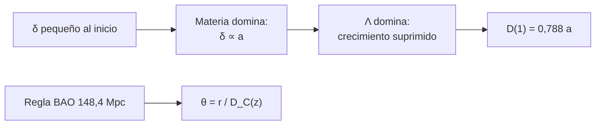

# B26-C17 — Estructura cosmológica

<!-- nav:top -->
[🏠 Programa](../../../../README.md) · [📚 Bloque B26](../../../tronco-comun/B26-relatividad-y-cosmologia.md) · [← Anterior: B26-C16 — Nucleosíntesis primordial](../B26-C16-nucleosintesis-primordial/CLASE.md) · [Siguiente: B26-C18 — Materia oscura y evidencias →](../B26-C18-materia-oscura-y-evidencias/CLASE.md)
<!-- /nav -->

## 1. Ubicación, nivel y alcance

Clase 17 del bloque B26. Nivel N3. El universo temprano era casi uniforme; hoy hay galaxias, cúmulos y vacíos. La diferencia la hizo la gravedad, que amplificó pequeñas fluctuaciones. Aquí calculas cómo crece una fluctuación de densidad en el modelo ΛCDM y cómo una regla estándar, la escala de las oscilaciones acústicas de bariones, se convierte en un ángulo en el cielo. Usas ecuaciones diferenciales ([B11-C07](../../B11/B11-C07-runge-kutta-de-cuarto-orden/CLASE.md)), la ecuación de Friedmann de [C13](../B26-C13-modelo-flrw-relatividad-y-cosmologia/CLASE.md) y cuadratura numérica. La formación de estructuras se amplía en [B36](../../../tronco-comun/B36-formacion-de-estructuras-cosmicas-y-materia-oscura.md).

## 2. Por qué esta clase existe

Los grandes sondeos de galaxias miden cómo se agrupan, y de su agrupamiento salen la densidad de materia y la historia de la expansión. Para interpretarlos hace falta saber cómo crece una fluctuación y qué distancia angular corresponde a una escala física. La decisión central: **¿cuánto menos crece una fluctuación con constante cosmológica que sin ella y qué ángulo subtiende la regla de las BAO a `z = 0,35`?**

## 3. Lo que podrás hacer al terminar

1. Escribir la ecuación de crecimiento lineal.
2. Resolverla numéricamente y compararla con la solución integral y con Einstein–de Sitter.
3. Calcular la supresión del crecimiento por la constante cosmológica.
4. Calcular una distancia comóvil por cuadratura.
5. Convertir una escala comóvil en un ángulo.
6. Interpretar el papel de las BAO como regla estándar.

La evidencia es la **curva de crecimiento** del ejercicio 12 (sección 20).

## 4. Con qué llegas y cómo comprobarlo

1. ¿Qué es una perturbación de densidad `δ = δρ/ρ`?
2. ¿Qué es una distancia comóvil?
3. ¿Qué es una ecuación diferencial lineal de segundo orden?
4. ¿Qué es `E(a)` en la ecuación de Friedmann?
5. ¿Cómo se convierte una longitud en un ángulo?

<details>
<summary>Ver respuestas</summary>

1. El exceso relativo de densidad. 2. La distancia entre puntos comóviles hoy. 3. Una ecuación con `δ'' + p δ' + q δ = 0`. 4. `E = H/H₀ = √(Ω_m a⁻³ + Ω_Λ)`. 5. `θ = longitud/distancia`.
</details>

Con cuatro o cinco aciertos, sigue; si no, repasa C13 y B11-C07.

## 5. Un caso real: una regla de 100 megaparsecs

Eisenstein y colaboradores midieron en `46 748` galaxias rojas luminosas de SDSS (`3816 deg²`, `0,16 < z < 0,47`) un pico en la función de correlación a una separación de unos `100 h⁻¹ Mpc`, que usaron como regla estándar para medir distancias con una precisión de unos `4 %` a `z = 0,35` y `z = 1089` (S3, resumen). DESI, con más de seis millones de objetos entre `z = 0,1` y `4,2`, obtuvo `Ω_m = 0,295 ± 0,015` solo con BAO (S4, resumen). Es el **ejemplo conductor**: con `h = 0,674`, la regla mide `148,4 Mpc` comóviles.

## 6. Vocabulario

La **perturbación de densidad** es `δ = (ρ − ρ̄)/ρ̄`. El **crecimiento lineal** `D(a)` describe cómo `δ` crece mientras `δ ≪ 1`. La **ecuación de crecimiento** (en `x = ln a`) es `δ_xx + (2 + dlnE/dlna) δ_x − (3/2)Ω_m/(a³E²) δ = 0`. La **supresión** es el cociente entre `D(1)` en ΛCDM y `a` (en EdS vale 1). Las **oscilaciones acústicas de bariones (BAO)** dejaron una escala característica en la distribución de galaxias. Una **regla estándar** es una longitud conocida. La **distancia comóvil** es `D_C = (c/H₀)∫dz/E`. El **ángulo de la regla** es `θ = r_BAO/D_C`.

## 7. Modelo mental: una fiesta donde la música baja de volumen

En un universo solo de materia, cada fluctuación crece como el factor de escala. Cuando la constante cosmológica domina, la expansión se acelera y las fluctuaciones dejan de crecer con tanta facilidad: la gravedad pierde la pelea contra la expansión.



*Descripción textual:* las fluctuaciones crecen como `a` mientras la materia domina y más despacio después; por separado, la regla BAO se convierte en ángulo dividiéndola por la distancia comóvil.

Analogía: una bola rodando cuesta abajo que encuentra una pendiente más suave. Límite: la ecuación vale solo para fluctuaciones lineales.

## 8. La explicación, paso a paso

### 8.1 La ecuación

En materia sin presión y con constante cosmológica, `δ_xx + (2 + dlnE/dlna)δ_x − (3/2)Ω_m/(a³E²) δ = 0`, con `E² = Ω_m a⁻³ + Ω_Λ` y `dlnE/dlna = −(3/2)Ω_m a⁻³/E²`. En Einstein–de Sitter (`Ω_m = 1`, `E² = a⁻³`) la solución es `δ = a`.

### 8.2 Resolución numérica

El laboratorio integra con RK4 en `ln a` desde `a = 10⁻³` con `δ = a`. En EdS obtiene `δ(1) = 1,000 000 0000` (error menor de `10⁻⁸`). Con `Ω_m = 0,315` obtiene `0,787 813`, igual a la solución integral `D(a) = (5Ω_m/2)E(a)∫₀^a da'/(a'E(a'))³` a `10⁻⁵`: el crecimiento queda un `21 %` por debajo de EdS.

### 8.3 Historia del crecimiento

`D(0,5)/D(1) = 0,6068` (en EdS valdría `0,5`): hasta `a = 0,5` se había acumulado el `61 %` del crecimiento total, porque después casi se detiene. Los sondeos que miden el crecimiento a distintos `z` ponen a prueba la combinación de materia y energía oscura.

### 8.4 La regla BAO como ángulo

`D_C(z = 0,35) = 1423,2 Mpc` en ΛCDM plano (`Ω_m = 0,315`, `H₀ = 67,4`); en EdS, `1239,5 Mpc`. La regla `r = 100/h = 148,4 Mpc` subtiende `5,97°` en ΛCDM y `6,86°` en EdS. Esa diferencia, del `15 %`, es lo que permite distinguir modelos con BAO.

### 8.5 Qué falta

La ecuación es lineal; cuando `δ ~ 1` hay que simular (B36). La escala `100 h⁻¹ Mpc` es aproximada (el resumen de Eisenstein et al. la da con precisión de pocos por ciento); el valor preciso del horizonte acústico no se consultó.

## 9. Magnitudes, símbolos y unidades

| Símbolo | Qué es | Unidad | Valor / nota |
|---|---|---|---|
| `D(a)` | factor de crecimiento | — | `D(1) = 0,7878` (ΛCDM); `1` (EdS) |
| `E(a)` | `H/H₀` | — | `√(Ω_m a⁻³ + Ω_Λ)` |
| `r_BAO` | regla acústica | Mpc | `100/h = 148,4` |
| `D_C(0,35)` | distancia comóvil | Mpc | `1423,2` (ΛCDM) |
| `θ` | ángulo de la regla | ° | `5,97` |
| `H₀`, `Ω_m` | parámetros | — | `67,4`; `0,315` (S2) |

## 10. Convenciones y referencias

Fluctuaciones lineales; sin radiación ni neutrinos masivos; `δ = a` en `a = 10⁻³` es una condición **ilustrativa**. `c` de NIST (S1).

## 11. De dónde sale lo que afirmamos

| ID | Fuente | Localizador | Respalda | Estado |
|---|---|---|---|---|
| S1 | NIST, *Fundamental Physical Constants — Complete Listing* (CODATA 2022) | https://physics.nist.gov/cuu/Constants/Table/allascii.txt | `c` | Consultada el 2026-11-09 |
| S2 | Planck Collaboration, arXiv:1807.06209 | https://arxiv.org/abs/1807.06209 | `H₀ = 67,4`; `Ω_m = 0,315` | Solo resumen, consultado el 2026-11-09 |
| S3 | Eisenstein et al., *Detection of the Baryon Acoustic Peak…*, arXiv:astro-ph/0501171 | https://arxiv.org/abs/astro-ph/0501171 | 46 748 LRG; ~100 `h⁻¹` Mpc; distancias al 4 % | Solo resumen, consultado el 2026-11-09 |
| S4 | DESI Collaboration, *DESI 2024 VI: Cosmological Constraints from BAO*, arXiv:2404.03002 | https://arxiv.org/abs/2404.03002 | >6 millones de objetos; `Ω_m = 0,295 ± 0,015` (BAO solo) | Solo resumen, consultado el 2026-11-09 |

Límites: S2–S4 solo resumen; la ecuación de crecimiento y su solución integral son estándar y se verifican entre sí.

## 12. Cómo ver el crecimiento

| Magnitud | ΛCDM (`Ω_m = 0,315`) | EdS |
|---|---|---|
| `D(1)/a` | 0,7878 | 1 |
| `D(0,5)/D(1)` | 0,6068 | 0,5 |
| `D_C(z = 0,35)` | 1423,2 Mpc | 1239,5 Mpc |
| Ángulo de 148,4 Mpc | 5,97° | 6,86° |

Descripción larga: ΛCDM crece menos hoy, acumuló antes su crecimiento y aleja más las galaxias lejanas.

## 13. Ejemplo trabajado: el ángulo de la regla a `z = 0,35`

**Paso 1 · Datos.** `r = 100/0,674 = 148,4 Mpc`; `c/H₀ = 4448,0 Mpc`.

**Paso 2 · Integral.** `∫₀^{0,35} dz/E = 0,3200` (ΛCDM).

**Paso 3 · Distancia.** `D_C = 4448,0 × 0,3200 = 1423 Mpc`.

**Paso 4 · Ángulo.** `θ = 148,4/1423 = 0,1043 rad = 5,97°`.

**Paso 5 · Sentido.** En EdS saldría `6,86°`: un 15 % mayor.

## 14. Distintas formas de medir el crecimiento

**ODE numérica (esta clase):** general. **Integral de crecimiento:** exacta para ΛCDM plano. **Simulaciones de N cuerpos (B36):** incluyen régimen no lineal.

## 15. Práctica guiada

**Ejercicio 1 · con los pasos indicados.** ¿Qué `δ(1)` da EdS con `δ = a` inicial?

<details><summary>Solución comentada</summary>

`δ(1) = 1`, `δ = a`.
</details>

**Ejercicio 2 · con una pista.** ¿Qué `D(1)` da ΛCDM?

<details><summary>Solución comentada</summary>

`0,7878` (8.2).
</details>

**Ejercicio 3 · casi autónomo.** ¿Cuánto crecimiento se suprimió?

<details><summary>Solución comentada</summary>

`1 − 0,7878 = 21,2 %`.
</details>

## 16. Práctica autónoma, transferencia e integrador

**Ejercicio 4.** ¿Qué fracción del crecimiento total ocurrió hasta `a = 0,5`?

<details><summary>Solución comentada</summary>

`0,6068` (61 %).
</details>

**Ejercicio 5.** Calcula `r_BAO` con `h = 0,674`.

<details><summary>Solución comentada</summary>

`100/0,674 = 148,4 Mpc`.
</details>

**Ejercicio 6.** Calcula `c/H₀`.

<details><summary>Solución comentada</summary>

`299 792,458/67,4 = 4448,0 Mpc`.
</details>

**Ejercicio 7.** Distancia comóvil a `z = 0,35` en EdS.

<details><summary>Solución comentada</summary>

`2 × 4448,0 × (1 − 1/√1,35) = 1239,5 Mpc`.
</details>

**Ejercicio 8.** ¿Cuánto mayor es la distancia en ΛCDM?

<details><summary>Solución comentada</summary>

`1423,2/1239,5 − 1 = 14,8 %`.
</details>

**Ejercicio 9 · transferencia.** Un compañero dice: «las estructuras crecen exponencialmente». Responde con 8.1–8.2.

<details><summary>Solución comentada</summary>

En régimen lineal y con materia dominante crecen como `a` (potencia del tiempo), no exponencialmente; con constante cosmológica crecen aún menos.
</details>

**Ejercicio 10 · transferencia.** Si la distancia medida con BAO tiene un 4 % de error (S3), ¿cuánto cambia el ángulo previsto?

<details><summary>Solución comentada</summary>

El ángulo `θ ∝ 1/D_C` cambia un `4 %`: `5,97° ± 0,24°`.
</details>

**Ejercicio 11 · transferencia.** DESI obtiene `Ω_m = 0,295 ± 0,015` solo con BAO (S4). ¿Cuál es la diferencia con el valor de Planck en unidades de la incertidumbre de DESI?

<details><summary>Solución comentada</summary>

`(0,315 − 0,295)/0,015 = 1,3σ`.
</details>

**Ejercicio 12 · integrador.** Elabora tu *curva de crecimiento*: resuelve el crecimiento por ODE e integral para dos `Ω_m`, la supresión, el `D_C` y el ángulo de la regla BAO a `z = 0,35` en dos modelos.

<details><summary>Solución modelo</summary>

`D(1) = 0,7878`; `D(0,5)/D(1) = 0,6068`; `1423,2` y `1239,5 Mpc`; `5,97°` y `6,86°`.
</details>

## 17. Laboratorio: crecimiento y BAO

El script [crecimiento.py](crecimiento.py) integra la ecuación de crecimiento en `ln a`, **comprueba** `δ = a` en EdS (`10⁻⁸`) y que la ODE coincide con la integral de crecimiento (`10⁻⁵`); calcula `D_C` y **comprueba** la solución de EdS (`10⁻⁹`).

**Datos:** `c` de NIST; `H₀`, `Ω_m` de Planck (resumen); regla BAO de Eisenstein et al. (resumen). **Predice antes de ejecutar:** ¿ΛCDM crece más o menos que EdS? (menos.) **Ejecución del 2026-11-09 (Python 3.12.9):**

```text
Python 3.12.9 (biblioteca estandar)
Einstein-de Sitter: delta(a=1)/a = 1.0000000000 (esperado 1)
LCDM (Om = 0.315): D(1) por ODE = 0.787813 ; por integral = 0.787813
supresion del crecimiento: D(1)/a = 0.7878 (EdS: 1)
D(a = 0.5)/D(1) = 0.6068 (EdS: 0.5)
escala BAO ~ 100/h = 148.4 Mpc comovil ; D_C(z = 0.35) = 1423.2 Mpc ; angulo = 5.97 grados
Pruebas superadas.
```

```bash
python programa/clases/B26/B26-C17-estructura-cosmologica/crecimiento.py
```

**Límites:** régimen lineal, sin radiación ni neutrinos masivos.

## 18. Errores frecuentes y cómo corregirlos

**Pensar que la constante cosmológica ayuda a crecer.** Se corrige con el ejercicio 3.

**Confundir `r` comóvil con físico.** Se corrige con el ejercicio 5.

**Usar EdS para convertir a ángulo.** Se corrige con el ejercicio 8.

**Aplicar la ecuación lineal a estructuras ya colapsadas.** Se corrige con la sección 8.5.

**Tomar la escala de 100 `h⁻¹` Mpc como exacta.** Se corrige con la sección 10.

## 19. Cómo sabrás que vas bien

Tras 8.2: ¿qué crecimiento da ΛCDM? Si dudas, ejercicio 2. Tras 8.4: ¿qué ángulo tiene la regla? Ejercicios 5–7. Tras el laboratorio: ¿qué verifican la ODE y la integral? (que son la misma solución).

## 20. Qué entregas y cómo se evalúa

El producto es tu **curva de crecimiento** (ejercicio 12).

| Criterio | Inicial | En desarrollo | Logrado | Destacado |
|---|---|---|---|---|
| Ecuación | No la plantea | Parcial | Escribe y resuelve | Verifica con la integral |
| Cálculo | Sin unidades | Con errores | `D(a)` y ángulo | Compara modelos |
| Numérico | Sin comprobar | Un caso | EdS y ODE-integral | Interpreta las tolerancias |
| Fuentes | Sin fuente | Sin fecha | S1–S4 con fecha | Declara resúmenes |
| Límites | No los nombra | Uno | Tres | Discute el régimen no lineal |

**Condiciones críticas (no se compensan con promedio):** declarar el régimen lineal; rotular lo ilustrativo; citar solo lo consultado.

## 21. Ética, seguridad y límites

Clase educativa: no sustituye un código de Boltzmann ni simulaciones de estructura. Accesibilidad: tablas equivalentes a las gráficas, fórmulas en texto, ejercicios sin conexión.

## 22. Para cerrar y seguir

Las fluctuaciones crecen como `a` con materia y menos con constante cosmológica (`D(1) = 0,788 a`); la regla BAO de `148 Mpc` subtiende `5,97°` a `z = 0,35`. Queda una pregunta: ¿qué pruebas hay de que gran parte de esa materia no se ve?

**Glosario español–inglés.** crecimiento lineal · *linear growth*; perturbación de densidad · *density perturbation*; oscilaciones acústicas de bariones · *baryon acoustic oscillations (BAO)*; regla estándar · *standard ruler*; distancia comóvil · *comoving distance*; supresión · *suppression*.

**Continuidad.** [B26-C18](../B26-C18-materia-oscura-y-evidencias/CLASE.md) reúne las evidencias de la materia que no se ve.

**Referencias:** ver sección 11.

<!-- nav:bottom -->
---

[← Anterior: B26-C16 — Nucleosíntesis primordial](../B26-C16-nucleosintesis-primordial/CLASE.md) · [📚 Bloque B26](../../../tronco-comun/B26-relatividad-y-cosmologia.md) · [Siguiente: B26-C18 — Materia oscura y evidencias →](../B26-C18-materia-oscura-y-evidencias/CLASE.md)
<!-- /nav -->
