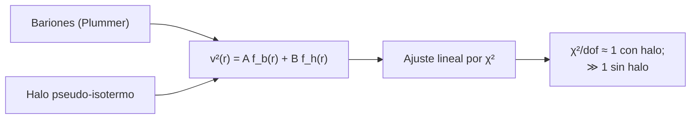

# B26-C18 — Materia oscura y evidencias

<!-- nav:top -->
[🏠 Programa](../../../../README.md) · [📚 Bloque B26](../../../tronco-comun/B26-relatividad-y-cosmologia.md) · [← Anterior: B26-C17 — Estructura cosmológica](../B26-C17-estructura-cosmologica/CLASE.md) · [Siguiente: B26-C19 — Energía oscura y parámetros →](../B26-C19-energia-oscura-y-parametros/CLASE.md)
<!-- /nav -->

## 1. Ubicación, nivel y alcance

Clase 18 del bloque B26. Nivel N3. En [C17](../B26-C17-estructura-cosmologica/CLASE.md) la materia hacía crecer las estructuras; ahora preguntas cuánta hay y de qué tipo. Verás dos evidencias complementarias: la forma de la curva de rotación de una galaxia (con un ejemplo sintético que ajustas) y las medidas cosmológicas del contenido de materia. Usas mínimos cuadrados ([B12-C10](../../B12/B12-C10-regresion-lineal-y-no-lineal/CLASE.md)), la gravitación de [B05-C10](../../B05/B05-C10-gravitacion-universal/CLASE.md) y el movimiento circular ([B05-C03](../../B05/B05-C03-movimiento-rectilineo-y-circular/CLASE.md)). La estructura de las galaxias está en [B25](../../../tronco-comun/B25-galaxias-y-medio-interestelar.md).

## 2. Por qué esta clase existe

Si las estrellas y el gas fueran toda la masa, las estrellas de los bordes de una galaxia irían más despacio que las del centro; observaciones de este tipo y de lentes gravitacionales indican que hay mucha más masa que la que se ve. La decisión central: **dada una curva de rotación, ¿cuánta masa hace falta para explicarla y qué fracción es visible?**

## 3. Lo que podrás hacer al terminar

1. Enunciar la predicción de la curva de rotación con solo bariones.
2. Ajustar una curva con un modelo barión + halo por mínimos cuadrados ponderados.
3. Comparar el ajuste con el modelo sin halo mediante `χ²/dof`.
4. Calcular la masa dinámica dentro de un radio.
5. Citar las evidencias cosmológicas y de lentes.
6. Distinguir evidencia directa de modelo.

La evidencia es la **curva de rotación con halo** del ejercicio 12 (sección 20).

## 4. Con qué llegas y cómo comprobarlo

1. ¿Qué es la velocidad circular `v² = GM(<r)/r`?
2. ¿Qué es un ajuste lineal por mínimos cuadrados ponderados?
3. ¿Qué es `χ²/dof`?
4. ¿Qué es un kiloparsec en metros?
5. ¿Qué es una lente gravitacional (C09)?

<details>
<summary>Ver respuestas</summary>

1. La velocidad de una órbita circular a radio `r`. 2. Minimiza `Σ(y − modelo)²/σ²`. 3. El `χ²` dividido entre los grados de libertad; vale ~1 para un buen ajuste. 4. `3,0857 × 10¹⁹ m`. 5. La desviación de la luz por una masa.
</details>

Con cuatro o cinco aciertos, sigue; si no, repasa B12-C10 y C09.

## 5. Un caso real: el cúmulo Bala y el contenido de materia

Clowe y colaboradores estudiaron la colisión de cúmulos de galaxias 1E0657-558 (`z = 0,296`) mediante lentes débiles: la masa total sigue a las galaxias y no al gas, que es la mayor parte de la masa visible, y el centro de masa está desplazado del gas con significancia de `8σ`; según los autores, una ley de fuerza modificada no explica el desplazamiento (S4, resumen). En cosmología, Planck da `Ω_c h² = 0,120 ± 0,001` frente a `Ω_b h² = 0,0224 ± 0,0001` (S5, resumen): unas `5,4` veces más materia oscura fría que bariones. El **ejemplo conductor** es una galaxia **sintética** con curva de rotación plana.

## 6. Vocabulario

La **curva de rotación** es la velocidad circular en función del radio. La **materia oscura** es materia que no emite ni absorbe luz de forma apreciable y se detecta por su gravedad. Un **halo** es una distribución casi esférica que envuelve la galaxia. El **halo pseudo-isotermo** tiene `v²(r) = v_∞²[1 − (r_c/r)arctan(r/r_c)]`. Un **perfil de Plummer** sirve de modelo sencillo de los bariones: `v² = GM r²/(r²+a²)^{3/2}`. La **masa dinámica** dentro de `r` es `v²r/G`. La **lente gravitacional débil** mide masas por la distorsión de imágenes de fondo. El **parámetro** `Ω_c h²` es la densidad de materia oscura fría.

## 7. Modelo mental: la fila de coches en una rotonda

Si solo hubiera una masa central (los bariones), los coches más lejanos irían más despacio, como los planetas. Si en cambio la masa crece con el radio, todos los coches van casi a la misma velocidad.



*Descripción textual:* la velocidad al cuadrado es la suma de una parte barionica y otra de halo; el ajuste lineal de las dos amplitudes da `χ²/dof` cercano a 1 con halo y mucho mayor sin él.

Analogía: la rotonda. Límite: los halos reales no son tan sencillos y hay discos gruesos, gas y bulbos.

## 8. La explicación, paso a paso

### 8.1 La predicción con solo bariones

Si la masa estuviera concentrada, a gran radio `v ∝ r^{−1/2}`: al pasar de `8` a `32 kpc`, la velocidad se reduciría a la mitad. La observación de curvas planas indica que `M(<r) ∝ r`.

### 8.2 El ajuste

El laboratorio genera una galaxia sintética: Plummer de `5 × 10¹⁰ M☉` con `a = 3 kpc`, halo con `v_∞ = 180 km/s` y `r_c = 5 kpc`, `20` radios de `1` a `30 kpc` y ruido de `5 km/s`. El ajuste lineal de `v²` en las dos formas da `M_b = 5,11 × 10¹⁰ M☉` y `v_∞ = 176,0 km/s`, dentro de `3σ` de lo inyectado, con `χ²/dof = 0,87`.

### 8.3 Sin halo

Ajustando solo la componente barionica, se obtiene `M_b = 8,95 × 10¹⁰ M☉` y `χ²/dof = 52,9`, unas `60` veces peor. A `r = 30 kpc`, la componente barionica del ajuste completo da `84,9 km/s`, frente a `172,0 km/s` observados.

### 8.4 Masa dinámica

La masa dentro de `30 kpc` es `v²r/G = 2,06 × 10¹¹ M☉`; la barionica (Plummer) es `4,93 × 10¹⁰ M☉`: una fracción de `0,24`. Es decir, tres cuartas partes de la masa dinámica de este ejemplo no son barionicas.

### 8.5 Otras evidencias

El cúmulo Bala (S4, resumen) separa la masa total del gas con `8σ`. En cosmología, `Ω_c h²/Ω_b h² = 0,120/0,0224 = 5,36` (S5, resumen) y la materia total `Ω_m h² = 0,1431`, de la que los bariones son un `15,7 %`. Los tres tipos de evidencia (dinámica de galaxias, lentes y cosmología) coinciden en que la materia visible es una minoría.

## 9. Magnitudes, símbolos y unidades

| Símbolo | Qué es | Unidad | Valor / nota |
|---|---|---|---|
| `M_b`, `a` | masa y escala del Plummer | `M☉`; kpc | `5 × 10¹⁰`; `3` (sintéticos) |
| `v_∞`, `r_c` | halo | km/s; kpc | `180`; `5` (sintéticos) |
| `χ²/dof` | calidad del ajuste | — | `0,87` (con halo); `52,9` (sin halo) |
| `M_dyn(<30 kpc)` | masa dinámica | `M☉` | `2,06 × 10¹¹` |
| `Ω_c h²`, `Ω_b h²` | densidades cosmológicas | — | `0,120 ± 0,001`; `0,0224 ± 0,0001` (S5) |

## 10. Convenciones y referencias

Galaxia **sintética** con semilla fija; órbitas circulares y simetría esférica. `GM☉` de la IAU (S2), `G` de NIST (S1), `kpc` con la unidad astronómica del IERS (S3). Los resultados de Clowe et al. y de Planck son publicados (resúmenes).

## 11. De dónde sale lo que afirmamos

| ID | Fuente | Localizador | Respalda | Estado |
|---|---|---|---|---|
| S1 | NIST, *Fundamental Physical Constants — Complete Listing* (CODATA 2022) | https://physics.nist.gov/cuu/Constants/Table/allascii.txt | `G` | Consultada el 2026-11-09 |
| S2 | Mamajek et al., *IAU 2015 Resolution B3*, arXiv:1510.07674 | https://arxiv.org/abs/1510.07674 | `GM☉` | Texto del PDF extraído el 2026-11-09 |
| S3 | IERS, *IERS Conventions (2010)*, TN36, Tabla 1.1 | https://iers-conventions.obspm.fr/content/tn36.pdf | `1 au` | Texto del PDF extraído el 2026-11-09 |
| S4 | Clowe et al., *A direct empirical proof of the existence of dark matter*, arXiv:astro-ph/0608407 | https://arxiv.org/abs/astro-ph/0608407 | Desplazamiento de `8σ` entre masa total y gas; `z = 0,296` | Solo resumen, consultado el 2026-11-09 |
| S5 | Planck Collaboration, arXiv:1807.06209 | https://arxiv.org/abs/1807.06209 | `Ω_c h² = 0,120 ± 0,001`; `Ω_b h² = 0,0224 ± 0,0001` | Solo resumen, consultado el 2026-11-09 |

Límites: S4 y S5 solo resumen; no se consultaron curvas de rotación observadas, de modo que la parte dinámica es ilustrativa; el ajuste es estándar y verificable.

## 12. Cómo ver la curva

| `r` (kpc) | `v_obs` (km/s, sintética) | Componente barionica (km/s) |
|---|---|---|
| 1,0 | 88,1 | 83,4 |
| 8,6 | 184,1 | 146,5 |
| 16,3 | 178,1 | 113,4 |
| 30,0 | 172,0 | 84,9 |

Descripción larga: la velocidad observada es casi plana, mientras que la componente barionica desciende.

## 13. Ejemplo trabajado: masa dinámica dentro de 30 kpc

**Paso 1 · Datos.** `v = 172,0 km/s`, `r = 30 kpc = 9,257 × 10²⁰ m`.

**Paso 2 · Fórmula.** `M = v²r/G`.

**Paso 3 · Cálculo.** `(1,72 × 10⁵)² = 2,958 × 10¹⁰`; `× 9,257 × 10²⁰/6,6743 × 10⁻¹¹ = 4,103 × 10⁴¹ kg`.

**Paso 4 · En masas solares.** `/1,98841 × 10³⁰ = 2,06 × 10¹¹ M☉`.

**Paso 5 · Sentido.** Cuatro veces la masa barionica de ese ejemplo (0,24 de fracción). Los datos son sintéticos.

## 14. Distintas formas de detectar materia oscura

**Dinámica (curvas de rotación):** la masa total dentro de un radio. **Lentes gravitacionales:** masa total proyectada, independiente de la dinámica. **Cosmología:** anisotropías del fondo y BAO. Concordantes entre sí.

## 15. Práctica guiada

**Ejercicio 1 · con los pasos indicados.** Si solo hubiera masa central, ¿cómo cambia `v` al pasar de `8` a `32 kpc`? *Pasos:* `v ∝ r^{−1/2}`.

<details><summary>Solución comentada</summary>

`(32/8)^{−1/2} = 0,5`: se reduce a la mitad.
</details>

**Ejercicio 2 · con una pista.** Calcula la masa dinámica con `v = 172 km/s` y `r = 30 kpc`.

<details><summary>Solución comentada</summary>

`2,06 × 10¹¹ M☉` (13).
</details>

**Ejercicio 3 · casi autónomo.** Calcula la fracción barionica si la barionica es `4,93 × 10¹⁰`.

<details><summary>Solución comentada</summary>

`4,93 × 10¹⁰/2,06 × 10¹¹ = 0,24`.
</details>

## 16. Práctica autónoma, transferencia e integrador

**Ejercicio 4.** ¿Cuántas veces más materia oscura fría que bariones hay según Planck?

<details><summary>Solución comentada</summary>

`0,120/0,0224 = 5,36`.
</details>

**Ejercicio 5.** ¿Qué fracción de la materia total son bariones?

<details><summary>Solución comentada</summary>

`0,0224/(0,315 × 0,674²) = 0,0224/0,1431 = 15,7 %`.
</details>

**Ejercicio 6.** ¿Cuántas veces peor es el `χ²/dof` sin halo?

<details><summary>Solución comentada</summary>

`52,9/0,87 = 61` veces.
</details>

**Ejercicio 7.** Error relativo de `v_∞` recuperado.

<details><summary>Solución comentada</summary>

`(180 − 176,0)/180 = 2,2 %`.
</details>

**Ejercicio 8.** Para una curva plana `v = 180 km/s`, ¿cuánto crece `M(<r)` de `15` a `30 kpc`?

<details><summary>Solución comentada</summary>

`M ∝ r`: se duplica.
</details>

**Ejercicio 9 · transferencia.** Un compañero dice que bastaría con modificar la gravedad. Responde con S4.

<details><summary>Solución comentada</summary>

Según Clowe et al. (resumen), el desplazamiento de `8σ` entre la masa por lentes y el gas no lo explica una ley de fuerza modificada; la discusión sigue abierta en la literatura, que aquí no se revisó.
</details>

**Ejercicio 10 · transferencia.** Si el error en `v` es de `5 km/s` a `172 km/s`, ¿qué error relativo induce en la masa dinámica?

<details><summary>Solución comentada</summary>

`M ∝ v²`: `2 × 5/172 = 5,8 %`.
</details>

**Ejercicio 11 · transferencia.** Si el halo se ajustara con un `r_c` equivocado, ¿qué detectarías?

<details><summary>Solución comentada</summary>

Un `χ²/dof` mayor y residuos sistemáticos en los radios pequeños; el ajuste lineal no corrige la forma de `f_h`.
</details>

**Ejercicio 12 · integrador.** Elabora tu *curva de rotación con halo*: genera una curva sintética, ajusta con y sin halo, compara `χ²/dof`, calcula la masa dinámica y la fracción barionica, y cita dos evidencias independientes.

<details><summary>Solución modelo</summary>

`χ²/dof = 0,87` y `52,9`; `2,06 × 10¹¹ M☉`; fracción `0,24`; evidencias: cúmulo Bala (8σ) y `Ω_c/Ω_b = 5,36`.
</details>

## 17. Laboratorio: curva de rotación

El script [rotacion.py](rotacion.py) genera la galaxia sintética, ajusta `v²` por mínimos cuadrados ponderados con y sin halo, **comprueba** que los parámetros caen en `3σ` y que el modelo sin halo tiene `χ²/dof` más de diez veces mayor.

**Datos:** ninguno observado; galaxia **sintética**. **Predice antes de ejecutar:** ¿qué `χ²/dof` esperas con halo? (cerca de 1.) **Ejecución del 2026-11-09 (Python 3.12.9):**

```text
Python 3.12.9 (biblioteca estandar)
con halo: M_b = 5.109e+10 Msol (verdadero 5e10) ; v_inf = 176.0 km/s (verdadero 180) ; chi2/dof = 0.87
solo bariones: M_b = 8.946e+10 Msol ; chi2/dof = 52.9
r =   1.0 kpc: v_obs =   88.1 km/s ; componente barionica =   83.4 km/s
r =   8.6 kpc: v_obs =  184.1 km/s ; componente barionica =  146.5 km/s
r =  16.3 kpc: v_obs =  178.1 km/s ; componente barionica =  113.4 km/s
r =  30.0 kpc: v_obs =  172.0 km/s ; componente barionica =   84.9 km/s
masa dinamica dentro de 30 kpc ~ v^2 r/G = 2.064e+11 Msol ; barionica (Plummer) = 4.926e+10 Msol ; fraccion barionica = 0.24
Pruebas superadas.
```

```bash
python programa/clases/B26/B26-C18-materia-oscura-y-evidencias/rotacion.py
```

**Límites:** simetría esférica, perfiles supuestos, sin gas ni bulbo.

## 18. Errores frecuentes y cómo corregirlos

**Pensar que la curva plana prueba un perfil concreto.** Se corrige con el ejercicio 11.

**Usar `v` sin elevar al cuadrado en la masa.** Se corrige con el ejercicio 10.

**Confundir los datos sintéticos con una galaxia real.** Se corrige con la sección 10.

**Olvidar que `h²` interviene en `Ω h²`.** Se corrige con el ejercicio 5.

**Dar por cerrada la discusión de las alternativas.** Se corrige con el ejercicio 9.

## 19. Cómo sabrás que vas bien

Tras 8.2: ¿qué compara `χ²/dof`? Si dudas, ejercicio 6. Tras 8.4: ¿qué da `v²r/G`? Ejercicio 2. Tras el laboratorio: ¿qué verifica la tolerancia de `3σ`? (que el ajuste recupera lo inyectado).

## 20. Qué entregas y cómo se evalúa

El producto es tu **curva de rotación con halo** (ejercicio 12).

| Criterio | Inicial | En desarrollo | Logrado | Destacado |
|---|---|---|---|---|
| Conceptos | Los confunde | Parciales | Curva, halo, masa dinámica | Contrasta evidencias |
| Cálculo | Sin unidades | Con errores | Masa y fracción | Propaga errores |
| Numérico | Sin comprobar | Un caso | Con y sin halo | Interpreta `χ²` |
| Fuentes | Sin fuente | Sin fecha | S1–S5 con fecha | Declara resúmenes |
| Límites | No los nombra | Uno | Tres | Discute alternativas |

**Condiciones críticas (no se compensan con promedio):** rotular la galaxia como sintética; citar solo lo consultado; no presentar una alternativa como descartada sin fuente.

## 21. Ética, seguridad y límites

Clase educativa: no es un análisis de curvas de rotación reales. Accesibilidad: tablas equivalentes a las gráficas, fórmulas en texto, ejercicios sin conexión.

## 22. Para cerrar y seguir

Una curva plana exige una masa que crece con el radio: en el ejemplo, tres cuartas partes de la masa dentro de 30 kpc no son barionicas; el cúmulo Bala y los parámetros de Planck apuntan a lo mismo. Queda una pregunta: ¿qué impulsa la aceleración de la expansión?

**Glosario español–inglés.** curva de rotación · *rotation curve*; materia oscura · *dark matter*; halo · *halo*; masa dinámica · *dynamical mass*; lente gravitacional débil · *weak gravitational lensing*; cúmulo Bala · *Bullet Cluster*.

**Continuidad.** [B26-C19](../B26-C19-energia-oscura-y-parametros/CLASE.md) trata el otro componente oscuro: el que acelera la expansión.

**Referencias:** ver sección 11.

<!-- nav:bottom -->
---

[← Anterior: B26-C17 — Estructura cosmológica](../B26-C17-estructura-cosmologica/CLASE.md) · [📚 Bloque B26](../../../tronco-comun/B26-relatividad-y-cosmologia.md) · [Siguiente: B26-C19 — Energía oscura y parámetros →](../B26-C19-energia-oscura-y-parametros/CLASE.md)
<!-- /nav -->
