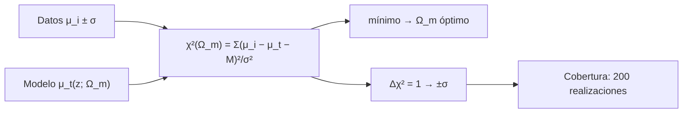

# B26-C20 — Límites observacionales de modelos cosmológicos

<!-- nav:top -->
[🏠 Programa](../../../../README.md) · [📚 Bloque B26](../../../tronco-comun/B26-relatividad-y-cosmologia.md) · [← Anterior: B26-C19 — Energía oscura y parámetros](../B26-C19-energia-oscura-y-parametros/CLASE.md) · [Siguiente: B26-C21 — Verosimilitud cosmológica con datos combinados →](../../../tronco-comun/B26-relatividad-y-cosmologia.md#b26-c21)
<!-- /nav -->

## 1. Ubicación, nivel y alcance

Clase 20 del bloque B26, cierre de la malla base. Nivel N3. En [C19](../B26-C19-energia-oscura-y-parametros/CLASE.md) calculaste cómo cambia la distancia con los parámetros; ahora haces lo inverso: partir de datos y obtener **los valores de los parámetros con su incertidumbre**. Ajustas `Ω_m` con supernovas sintéticas por `χ²`, obtienes un intervalo de confianza y compruebas por simulación que el intervalo cubre el valor verdadero con la frecuencia esperada. Usas estadística ([B12-C07](../../B12/B12-C07-estimacion-de-parametros/CLASE.md), [B12-C08](../../B12/B12-C08-intervalos-de-confianza/CLASE.md), [B12-C14](../../B12/B12-C14-simulacion-monte-carlo/CLASE.md)) y la distancia de luminosidad de C19. La inferencia bayesiana está en [B19](../../../tronco-comun/B19-inferencia-bayesiana-y-computacion-probabilistica.md).

## 2. Por qué esta clase existe

Una cifra cosmológica sin incertidumbre no significa nada. Para decidir si dos resultados concuerdan, o si un modelo queda excluido, hay que saber construir y leer un intervalo de confianza. La decisión central: **dado un conjunto de distancias medidas con ruido, ¿qué `Ω_m` se infiere, con qué incertidumbre y cómo se comprueba que el intervalo está bien calibrado?**

## 3. Lo que podrás hacer al terminar

1. Construir el `χ²(Ω_m)` de un conjunto de supernovas con una constante de calibración marginalizada.
2. Hallar el mejor ajuste y el intervalo de 68 % con `Δχ² = 1`.
3. Calcular los grados de libertad y el `χ²/dof`.
4. Simular muchas realizaciones para medir la cobertura.
5. Comparar con un resultado publicado.
6. Estimar cuántos datos hacen falta para bajar la incertidumbre.

La evidencia es el **ajuste de `Ω_m` con su incertidumbre** del ejercicio 12 (sección 20).

## 4. Con qué llegas y cómo comprobarlo

1. ¿Qué es el estimador de máxima verosimilitud gaussiano?
2. ¿Qué es un intervalo de confianza al 68 %?
3. ¿Qué es la distancia de luminosidad (C19)?
4. ¿Qué es marginalizar un parámetro de ruido?
5. ¿Qué es una simulación de Monte Carlo?

<details>
<summary>Ver respuestas</summary>

1. Minimizar `Σ(y − modelo)²/σ²`. 2. Un rango que contiene el valor verdadero en el 68 % de los experimentos repetidos. 3. `D_L = (1+z)D_M`. 4. Eliminarlo ajustándolo o integrándolo. 5. Repetir el análisis con ruido aleatorio.
</details>

Con cuatro o cinco aciertos, sigue; si no, repasa B12-C07, B12-C08 y C19.

## 5. Un caso real: Pantheon+ y una muestra sintética

Pantheon+ analizó `1701` curvas de luz de `1550` supernovas Ia entre `z = 0,001` y `2,26` y obtuvo, con supernovas solas en ΛCDM plano, `Ω_m = 0,334 ± 0,018` (S2, resumen). Con DESI, solo BAO da `Ω_m = 0,295 ± 0,015` (S3, resumen). En esta clase se ajusta una muestra **sintética** de `100` supernovas con `Ω_m = 0,315` verdadero y ruido de `0,15 mag`. Es el **ejemplo conductor**: el ajuste recupera `Ω_m = 0,335 ± 0,040`.

## 6. Vocabulario

El **`χ²`** es la suma de residuos al cuadrado divididos por la varianza. Los **grados de libertad** son datos menos parámetros ajustados. El **mejor ajuste** minimiza `χ²`. El **intervalo de 68 %** para un parámetro es la región con `Δχ² ≤ 1`. La **marginalización** de la constante `M` se hace restando la media de los residuos. La **cobertura** es la fracción de realizaciones cuyo intervalo contiene el valor verdadero. La **degeneración** es la compensación entre parámetros (C22). `Ω_m` es el parámetro de densidad de materia. La **muestra sintética** es un conjunto de datos simulados.

## 7. Modelo mental: buscar el fondo de un valle en una sola dirección

La función `χ²(Ω_m)` es un valle: su mínimo marca el mejor ajuste y la anchura del valle a un punto por encima fija la incertidumbre.



*Descripción textual:* los datos y el modelo definen `χ²(Ω_m)`; su mínimo da el mejor ajuste; el intervalo donde sube una unidad da la incertidumbre; repetir el experimento muchas veces mide si la cobertura es la esperada.

Analogía: el fondo de un valle. Límite: el valle es parabólico solo cerca del mínimo; en general hay asimetrías.

## 8. La explicación, paso a paso

### 8.1 La función `χ²`

Con `μ_i` observados, `μ_t(z_i; Ω_m)` teóricos (C19) y error `σ = 0,15 mag`, `χ²(Ω_m) = Σ[(μ_i − μ_t,i) − ⟨μ − μ_t⟩]²/σ²`: restar la media de los residuos marginaliza la constante de calibración. Hay `100` datos y `2` parámetros efectivos (`Ω_m` y la constante), de modo que `dof = 98`.

### 8.2 El ajuste

El laboratorio evalúa `χ²` en una rejilla de `Ω_m` de `0,05` a `0,80` (paso `0,005`) para `100` supernovas con `z` entre `0,02` y `1`. El mínimo está en `Ω_m = 0,335` con `χ²_min = 87,5` (`χ²/dof = 0,89`). El intervalo con `Δχ² ≤ 1` es `[0,295; 0,375]`, o sea `0,335 ± 0,040`; el valor verdadero (`0,315`) queda a `0,5σ`.

### 8.3 Cobertura

Se repite el experimento `200` veces con ruido nuevo y se cuenta cuántas veces el intervalo contiene `0,315`: `68,0 %`, el esperado para `Δχ² = 1`. Eso no dice que el intervalo concreto tenga un 68 % de probabilidad de contener la verdad; dice que el procedimiento acierta el 68 % de las veces.

### 8.4 Cuántos datos hacen falta

La incertidumbre decrece como `1/√N`: con `N = 100`, `0,040`; para `0,018` (el valor de Pantheon+, con otras calidades) harían falta `100 × (0,040/0,018)² ≈ 490` supernovas con este mismo error. Pantheon+ tiene `1550`, pero cada una con distintas incertidumbres y sistemáticos.

### 8.5 Comparación con resultados publicados

El resultado sintético (`0,335 ± 0,040`) es compatible con Pantheon+ (`0,334 ± 0,018`) pero menos preciso. La diferencia entre Pantheon+ y DESI BAO (`0,295 ± 0,015`) es de `0,039` frente a una incertidumbre combinada de `0,023`: `1,7σ`, ejercicio de C21.

## 9. Magnitudes, símbolos y unidades

| Símbolo | Qué es | Unidad | Valor / nota |
|---|---|---|---|
| `Ω_m` | densidad de materia | — | `0,335 ± 0,040` (ajuste sintético) |
| `σ` | error por supernova | mag | `0,15` (sintético) |
| `N`, `dof` | datos y grados de libertad | — | `100`; `98` |
| `χ²_min` | mínimo de `χ²` | — | `87,5` |
| cobertura | fracción de intervalos que cubren | % | `68,0` |

## 10. Convenciones y referencias

ΛCDM plano, `H₀ = 67,4` fijo; constante de calibración marginalizada; datos **sintéticos** con semilla fija. Pantheon+ y DESI son resultados publicados (resúmenes).

## 11. De dónde sale lo que afirmamos

| ID | Fuente | Localizador | Respalda | Estado |
|---|---|---|---|---|
| S1 | NIST, *Fundamental Physical Constants — Complete Listing* (CODATA 2022) | https://physics.nist.gov/cuu/Constants/Table/allascii.txt | `c` | Consultada el 2026-11-09 |
| S2 | Brout et al., *The Pantheon+ Analysis: Cosmological Constraints*, arXiv:2202.04077 | https://arxiv.org/abs/2202.04077 | 1550 SNe Ia; `Ω_m = 0,334 ± 0,018` | Solo resumen, consultado el 2026-11-09 |
| S3 | DESI Collaboration, arXiv:2404.03002 | https://arxiv.org/abs/2404.03002 | BAO solo: `Ω_m = 0,295 ± 0,015` | Solo resumen, consultado el 2026-11-09 |
| S4 | Planck Collaboration, arXiv:1807.06209 | https://arxiv.org/abs/1807.06209 | `H₀ = 67,4`; `Ω_m = 0,315 ± 0,007` | Solo resumen, consultado el 2026-11-09 |

Límites: S2–S4 solo resumen; el método `Δχ² = 1` y la cobertura son resultados estadísticos estándar, verificados por simulación; no se reprodujo ningún análisis de datos reales.

## 12. Cómo ver el resultado

| Magnitud | Valor |
|---|---|
| `Ω_m` ajustado | `0,335 ± 0,040` |
| `χ²_min/dof` | `0,89` |
| Cobertura (200 realizaciones) | `68,0 %` |
| Pantheon+ (publicado) | `0,334 ± 0,018` |
| DESI BAO (publicado) | `0,295 ± 0,015` |

Descripción larga: el ajuste sintético reproduce el valor de Pantheon+ con el doble de incertidumbre.

## 13. Ejemplo trabajado: el tamaño de muestra

**Paso 1 · Dato.** `σ(Ω_m) = 0,040` con `N = 100`.

**Paso 2 · Objetivo.** `σ = 0,018`.

**Paso 3 · Escala.** `N = 100 × (0,040/0,018)² = 494`.

**Paso 4 · Sentido.** Con el mismo error por supernova se necesitarían unas 500; la dependencia es `1/√N`. No es una predicción para Pantheon+.

## 14. Distintas formas de obtener intervalos

**`Δχ² = 1` en una rejilla (esta clase):** simple. **MCMC:** para muchos parámetros (B19). **Perfil de verosimilitud:** para parámetros de ruido. **Simulaciones de cobertura:** comprueban el método.

## 15. Práctica guiada

**Ejercicio 1 · con los pasos indicados.** ¿Cuántos grados de libertad hay con `100` datos y `2` parámetros?

<details><summary>Solución comentada</summary>

`98`.
</details>

**Ejercicio 2 · con una pista.** ¿Cuánto vale `χ²/dof` en el mínimo?

<details><summary>Solución comentada</summary>

`87,5/98 = 0,89`.
</details>

**Ejercicio 3 · casi autónomo.** Intervalo de 68 %.

<details><summary>Solución comentada</summary>

`[0,295; 0,375]`, `0,335 ± 0,040`.
</details>

## 16. Práctica autónoma, transferencia e integrador

**Ejercicio 4.** ¿A cuántas sigmas queda el valor verdadero?

<details><summary>Solución comentada</summary>

`(0,335 − 0,315)/0,040 = 0,5σ`.
</details>

**Ejercicio 5.** Si se cuadruplica el número de supernovas, ¿cuánto vale `σ`?

<details><summary>Solución comentada</summary>

`0,040/2 = 0,020`.
</details>

**Ejercicio 6.** ¿Qué cobertura se midió y cuál se esperaba?

<details><summary>Solución comentada</summary>

`68,0 %` frente a `68,3 %`.
</details>

**Ejercicio 7.** ¿Cuántas supernovas hacen falta para `σ = 0,018` con este error?

<details><summary>Solución comentada</summary>

`≈ 494` (13).
</details>

**Ejercicio 8.** Diferencia entre Pantheon+ (`0,334 ± 0,018`) y DESI (`0,295 ± 0,015`).

<details><summary>Solución comentada</summary>

`0,039`; incertidumbre combinada `√(0,018² + 0,015²) = 0,0234`; `1,67σ`.
</details>

**Ejercicio 9 · transferencia.** Un compañero dice: «el intervalo [0,295; 0,375] tiene un 68 % de probabilidad de contener `Ω_m`». Responde con 8.3.

<details><summary>Solución comentada</summary>

Es una frase bayesiana; en el enfoque frecuentista, el procedimiento cubre el valor verdadero el 68 % de las veces; la interpretación bayesiana requiere una distribución a priori (B19).
</details>

**Ejercicio 10 · transferencia.** ¿Por qué se resta la media de los residuos?

<details><summary>Solución comentada</summary>

Para marginalizar la constante de calibración desconocida (la magnitud absoluta y `H₀`): solo importan las diferencias entre supernovas.
</details>

**Ejercicio 11 · transferencia.** Si el error real fuera `0,25 mag` y se usara `0,15`, ¿qué pasaría con el `χ²/dof`?

<details><summary>Solución comentada</summary>

Subiría a `(0,25/0,15)² ≈ 2,8`, señal de errores subestimados.
</details>

**Ejercicio 12 · integrador.** Elabora tu *ajuste de `Ω_m` con su incertidumbre*: genera una muestra, calcula `χ²` en una rejilla, da el mejor ajuste y el intervalo, mide la cobertura con 200 realizaciones y compara con Pantheon+.

<details><summary>Solución modelo</summary>

`0,335 ± 0,040`; `χ²/dof = 0,89`; cobertura `68,0 %`; Pantheon+ `0,334 ± 0,018`.
</details>

## 17. Laboratorio: χ² y cobertura

El script [chi2.py](chi2.py) ajusta `Ω_m` con `100` supernovas sintéticas, **comprueba** que el valor verdadero cae dentro de `3σ` y que la cobertura de `Δχ² = 1` en `200` realizaciones está entre `55 %` y `80 %`.

**Datos:** ninguno observado; muestra **sintética**; Pantheon+ (resumen) como contraste. **Predice antes de ejecutar:** ¿qué cobertura esperas? (≈68 %.) **Ejecución del 2026-11-09 (Python 3.12.9):**

```text
Python 3.12.9 (biblioteca estandar)
mejor ajuste: Om = 0.335 ; chi2_min = 87.5 para 98 grados de libertad
intervalo de 68 % (Delta chi2 = 1): [0.295, 0.375] -> Om = 0.335 +/- 0.040
chi2/dof = 0.89
cobertura del intervalo de Delta chi2 = 1 en 200 realizaciones: 68.0 % (esperado ~68 %)
Pantheon+ (publicado, solo SNe): Om = 0.334 +/- 0.018 ; diferencia con la verdad sintetica 0.315 = 1.1 sigma de esa medida
Pruebas superadas.
```

```bash
python programa/clases/B26/B26-C20-limites-observacionales-de-modelos-cosmologicos/chi2.py
```

**Límites:** errores gaussianos conocidos; `H₀` fijo; ΛCDM plano; sin sistemáticos.

## 18. Errores frecuentes y cómo corregirlos

**Interpretar el 68 % como probabilidad del valor verdadero.** Se corrige con el ejercicio 9.

**No marginalizar la calibración.** Se corrige con el ejercicio 10.

**Subestimar los errores.** Se corrige con el ejercicio 11.

**Confundir `N` con la precisión.** Se corrige con el ejercicio 5.

**Comparar intervalos sin combinar incertidumbres.** Se corrige con el ejercicio 8.

## 19. Cómo sabrás que vas bien

Tras 8.2: ¿qué es `Δχ² = 1`? Si dudas, ejercicio 3. Tras 8.3: ¿qué mide la cobertura? Ejercicios 6 y 9. Tras el laboratorio: ¿qué verifica la simulación? (que el método está bien calibrado).

## 20. Qué entregas y cómo se evalúa

El producto es tu **ajuste de `Ω_m` con su incertidumbre** (ejercicio 12).

| Criterio | Inicial | En desarrollo | Logrado | Destacado |
|---|---|---|---|---|
| Conceptos | Los confunde | Parciales | `χ²`, `Δχ²`, dof | Distingue frecuentista y bayesiano |
| Cálculo | Sin unidades | Con errores | Ajuste e intervalo | Planifica el tamaño de la muestra |
| Numérico | Sin comprobar | Un caso | Cobertura simulada | Interpreta la tolerancia |
| Fuentes | Sin fuente | Sin fecha | S1–S4 con fecha | Declara resúmenes |
| Límites | No los nombra | Uno | Tres | Discute sistemáticos |

**Condiciones críticas (no se compensan con promedio):** rotular la muestra como sintética; no interpretar la cobertura como probabilidad bayesiana; citar solo lo consultado.

## 21. Ética, seguridad y límites

Clase educativa: no sustituye análisis con covarianza completa ni sistemáticos. Accesibilidad: tablas equivalentes a las gráficas, fórmulas en texto, ejercicios sin conexión.

## 22. Para cerrar y seguir

Un `χ²` con la constante marginalizada da `Ω_m = 0,335 ± 0,040` con 100 supernovas sintéticas, y la simulación confirma una cobertura de `68 %`. Con esto cierras la malla base. Quedan tres ampliaciones: combinar fuentes, entender las degeneraciones y evaluar las tensiones.

**Glosario español–inglés.** mejor ajuste · *best fit*; intervalo de confianza · *confidence interval*; grados de libertad · *degrees of freedom*; cobertura · *coverage*; marginalización · *marginalization*; muestra sintética · *synthetic sample*.

**Continuidad.** [B26-C21](../B26-C21-verosimilitud-cosmologica-con-datos-combinados/CLASE.md) combina resultados de varias sondas en una sola verosimilitud.

**Referencias:** ver sección 11.

<!-- nav:bottom -->
---

[← Anterior: B26-C19 — Energía oscura y parámetros](../B26-C19-energia-oscura-y-parametros/CLASE.md) · [📚 Bloque B26](../../../tronco-comun/B26-relatividad-y-cosmologia.md) · [Siguiente: B26-C21 — Verosimilitud cosmológica con datos combinados →](../../../tronco-comun/B26-relatividad-y-cosmologia.md#b26-c21)
<!-- /nav -->
