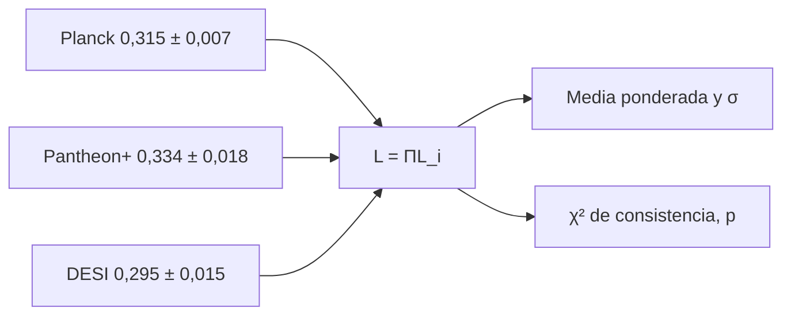

# B26-C21 — Verosimilitud cosmológica con datos combinados

<!-- nav:top -->
[🏠 Programa](../../../../README.md) · [📚 Bloque B26](../../../tronco-comun/B26-relatividad-y-cosmologia.md) · [← Anterior: B26-C20 — Límites observacionales de modelos cosmológicos](../B26-C20-limites-observacionales-de-modelos-cosmologicos/CLASE.md) · [Siguiente: B26-C22 — Degeneraciones de parámetros cosmológicos →](../B26-C22-degeneraciones-de-parametros-cosmologicos/CLASE.md)
<!-- /nav -->

## 1. Ubicación, nivel y alcance

Clase 21 del bloque B26 (ampliación `0.2.0`). Nivel N3. [B12](../../../tronco-comun/B12-probabilidad-estadistica-e-incertidumbre.md) enseña estimación general; en [C20](../B26-C20-limites-observacionales-de-modelos-cosmologicos/CLASE.md) ajustaste una sola sonda, las supernovas. Falta construir la **verosimilitud conjunta** de varias sondas, como el fondo cósmico, las oscilaciones acústicas y las supernovas, y juzgar si son compatibles. Aquí lo haces con restricciones gaussianas sobre `Ω_m`, con cifras publicadas usadas como ejercicio de técnica. Usas verosimilitud gaussiana ([B12-C07](../../B12/B12-C07-estimacion-de-parametros/CLASE.md)), covarianzas ([B12-C18](../../B12/B12-C18-matrices-de-covarianza/CLASE.md)) y la inferencia de [B19](../../../tronco-comun/B19-inferencia-bayesiana-y-computacion-probabilistica.md).

## 2. Por qué esta clase existe

Ninguna sonda fija sola todos los parámetros; combinarlas reduce la incertidumbre, pero solo si son compatibles entre sí y si se tratan bien sus correlaciones. La decisión central: **dadas tres restricciones sobre `Ω_m`, ¿cuál es el valor combinado, qué incertidumbre tiene y son consistentes entre sí?**

## 3. Lo que podrás hacer al terminar

1. Escribir la verosimilitud conjunta de medidas gaussianas independientes.
2. Calcular la media ponderada y su incertidumbre en forma cerrada y por rejilla.
3. Calcular el `χ²` de consistencia y su p-valor.
4. Calcular las tensiones por pares.
5. Incluir una correlación entre dos medidas.
6. Reconocer las condiciones que justifican (o no) la combinación.

La evidencia es la **combinación de restricciones de `Ω_m`** del ejercicio 12 (sección 20).

## 4. Con qué llegas y cómo comprobarlo

1. ¿Qué es una verosimilitud gaussiana?
2. ¿Qué es la inversa de la varianza como peso?
3. ¿Qué es un `χ²` con `k` grados de libertad?
4. ¿Qué es una matriz de covarianza?
5. ¿Qué es un p-valor?

<details>
<summary>Ver respuestas</summary>

1. `L ∝ exp(−(x − μ)²/2σ²)`. 2. Las medidas más precisas pesan más. 3. La suma de cuadrados de `k` variables normales estándar. 4. La matriz de varianzas y covarianzas. 5. La probabilidad, bajo la hipótesis, de un resultado tan extremo o más.
</details>

Con cuatro o cinco aciertos, sigue; si no, repasa B12-C07 y B12-C18.

## 5. Un caso real: tres medidas de `Ω_m`

Los tres valores del **ejemplo conductor** son resultados publicados en sus resúmenes: Planck 2018, `Ω_m = 0,315 ± 0,007` (S1); Pantheon+ con supernovas solas, `0,334 ± 0,018` (S2); DESI 2024 con BAO solo, `0,295 ± 0,015` (S3). Se combinan **como ejercicio**, sin afirmar que sea la combinación que harían los equipos: las medidas se obtienen bajo hipótesis no idénticas y pueden compartir datos o calibraciones.

## 6. Vocabulario

La **verosimilitud conjunta** de medidas independientes es el producto de las verosimilitudes. La **media ponderada** es `μ = Σ(μ_i/σ_i²)/Σ(1/σ_i²)` y su incertidumbre, `σ = 1/√Σ(1/σ_i²)`. El **`χ²` de consistencia** es `Σ(μ_i − μ)²/σ_i²` con `n − 1` grados de libertad. La **tensión por pares** es `|μ_i − μ_j|/√(σ_i² + σ_j²)`. La **correlación** `ρ` entre dos medidas cambia la incertidumbre combinada: `σ² = 1/(1ᵀC⁻¹1)`. La **independencia** supone que las medidas no comparten errores. La **gaussianidad** supone que cada incertidumbre es una desviación típica de una normal.

## 7. Modelo mental: tres relojes mal puestos

Tres relojes dan horas ligeramente distintas con precisiones distintas. La mejor estimación pesa más al que tiene menor error, y el desacuerdo entre ellos dice si alguno está mal.



*Descripción textual:* las tres medidas entran en la verosimilitud como factores gaussianos; el producto da la media ponderada y su incertidumbre, y el `χ²` mide si las tres son consistentes.

Analogía: promediar relojes. Límite: si los relojes comparten el mismo error, promediar no lo reduce.

## 8. La explicación, paso a paso

### 8.1 Combinación

Con pesos `1/σ²` (`20 408`, `3086`, `4444`), `Ω_m = 0,3139 ± 0,0060`. El laboratorio encuentra lo mismo maximizando la verosimilitud en una rejilla de `50 000` puntos. Planck domina por ser la medida más precisa: pesa el `73 %`.

### 8.2 Consistencia

El `χ²_min = 2,86` para `2` grados de libertad da un p-valor `exp(−χ²/2) = 0,239`: los tres resultados son compatibles. Una `χ²` alta indicaría que alguna medida está sesgada o que su incertidumbre está subestimada.

### 8.3 Tensiones por pares

Planck–Pantheon+: `0,019`, `0,98σ`. Planck–DESI: `0,020`, `1,21σ`. Pantheon+–DESI: `0,039`, `1,66σ`. Ninguna pasa de `2σ`. Estas cifras dependen de que las incertidumbres de los resúmenes sean gaussianas y de que se comparen en el mismo modelo.

### 8.4 Correlaciones

Con dos medidas de `σ = 0,018` y `0,015` y correlación `ρ`, la incertidumbre combinada es `0,01152` si `ρ = 0`, `0,01400` si `ρ = 0,5` y `0,01483` si `ρ = 0,9`: la correlación quita información. Con `ρ = 0` se recupera la fórmula de la media ponderada.

### 8.5 Cuándo no combinar

No se debe combinar si (a) las medidas dependen de los mismos datos, (b) están obtenidas bajo modelos distintos (por ejemplo `w` libre frente a `w = −1`) o (c) el `χ²` de consistencia es alto. Los análisis conjuntos reales usan las verosimilitudes completas y sus covarianzas.

## 9. Magnitudes, símbolos y unidades

| Símbolo | Qué es | Unidad | Valor / nota |
|---|---|---|---|
| `Ω_m` combinado | media ponderada | — | `0,3139 ± 0,0060` |
| `χ²_min` | consistencia | — | `2,86` (2 dof) |
| `p` | p-valor | — | `0,239` |
| `n_σ` | tensión por pares | `σ` | `0,98`; `1,21`; `1,66` |
| `ρ` | correlación | — | `0`; `0,5`; `0,9` (sintético) |

## 10. Convenciones y referencias

Medidas gaussianas e independientes, **como supuesto del ejercicio**; los valores son resultados publicados (solo resúmenes). El caso con correlación es **sintético**.

## 11. De dónde sale lo que afirmamos

| ID | Fuente | Localizador | Respalda | Estado |
|---|---|---|---|---|
| S1 | Planck Collaboration, arXiv:1807.06209 | https://arxiv.org/abs/1807.06209 | `Ω_m = 0,315 ± 0,007` (ΛCDM base) | Solo resumen, consultado el 2026-11-09 |
| S2 | Brout et al., arXiv:2202.04077 | https://arxiv.org/abs/2202.04077 | `Ω_m = 0,334 ± 0,018` (SNe solas) | Solo resumen, consultado el 2026-11-09 |
| S3 | DESI Collaboration, arXiv:2404.03002 | https://arxiv.org/abs/2404.03002 | `Ω_m = 0,295 ± 0,015` (BAO solo) | Solo resumen, consultado el 2026-11-09 |

Límites: S1–S3 solo resumen; la combinación es un ejercicio de técnica y no reproduce ningún análisis conjunto de las colaboraciones; no se verificó la independencia ni la gaussianidad de las incertidumbres.

## 12. Cómo ver la combinación

| Medida | `Ω_m` | `σ` | Peso (%) |
|---|---|---|---|
| Planck 2018 | 0,315 | 0,007 | 73 |
| Pantheon+ | 0,334 | 0,018 | 11 |
| DESI BAO | 0,295 | 0,015 | 16 |
| Combinado | 0,3139 | 0,0060 | 100 |

Descripción larga: el resultado combinado queda muy cerca de Planck, que pesa casi tres cuartas partes.

## 13. Ejemplo trabajado: el peso de Planck

**Paso 1 · Pesos.** `1/0,007² = 20 408`; `1/0,018² = 3086`; `1/0,015² = 4444`.

**Paso 2 · Suma.** `27 938`.

**Paso 3 · Porcentajes.** `20 408/27 938 = 73 %`; `11 %`; `16 %`.

**Paso 4 · Incertidumbre.** `1/√27 938 = 0,0060`.

**Paso 5 · Sentido.** La mejor medida manda; añadir las otras reduce `σ` de `0,0070` a `0,0060`.

## 14. Distintas formas de combinar

**Media ponderada (esta clase):** válida para medidas independientes y gaussianas de un parámetro. **Verosimilitud completa:** tablas y covarianzas de cada sonda. **MCMC conjunto (B19):** para muchos parámetros.

## 15. Práctica guiada

**Ejercicio 1 · con los pasos indicados.** Calcula los pesos `1/σ²`.

<details><summary>Solución comentada</summary>

`20 408`, `3086`, `4444`.
</details>

**Ejercicio 2 · con una pista.** Calcula la media ponderada.

<details><summary>Solución comentada</summary>

`(0,315 × 20 408 + 0,334 × 3086 + 0,295 × 4444)/27 938 = 0,3139`.
</details>

**Ejercicio 3 · casi autónomo.** Calcula `σ`.

<details><summary>Solución comentada</summary>

`1/√27 938 = 0,0060`.
</details>

## 16. Práctica autónoma, transferencia e integrador

**Ejercicio 4.** Calcula el `χ²_min`.

<details><summary>Solución comentada</summary>

`((0,315−0,3139)/0,007)² + ((0,334−0,3139)/0,018)² + ((0,295−0,3139)/0,015)² = 0,02 + 1,25 + 1,59 = 2,86`.
</details>

**Ejercicio 5.** p-valor con `2` dof.

<details><summary>Solución comentada</summary>

`exp(−2,86/2) = 0,239`.
</details>

**Ejercicio 6.** Tensión Planck–DESI.

<details><summary>Solución comentada</summary>

`0,020/√(0,007² + 0,015²) = 0,020/0,01655 = 1,21σ`.
</details>

**Ejercicio 7.** Tensión Pantheon+–DESI.

<details><summary>Solución comentada</summary>

`0,039/0,0234 = 1,66σ`.
</details>

**Ejercicio 8.** ¿Cuánto vale `σ` combinada de Pantheon+ y DESI con `ρ = 0`?

<details><summary>Solución comentada</summary>

`1/√(1/0,018² + 1/0,015²) = 0,01152`.
</details>

**Ejercicio 9 · transferencia.** Un compañero dice que combinar siempre reduce la incertidumbre. Responde con 8.4.

<details><summary>Solución comentada</summary>

Con correlación positiva la ganancia es menor: con `ρ = 0,9`, `0,01483` en lugar de `0,01152`; con `ρ = 1` no habría ganancia.
</details>

**Ejercicio 10 · transferencia.** Si el `χ²` de consistencia fuera `12` con `2` dof, ¿cuál sería el p-valor y qué harías?

<details><summary>Solución comentada</summary>

`exp(−6) = 0,0025`: inconsistencia; revisar sistemáticos, hipótesis o incertidumbres antes de combinar.
</details>

**Ejercicio 11 · transferencia.** ¿Por qué no se pueden combinar un resultado con `w` libre y otro con `w = −1` como si midieran lo mismo?

<details><summary>Solución comentada</summary>

Porque cada incertidumbre está marginalizada sobre parámetros distintos; los valores centrales y las anchuras cambian de modelo a modelo (8.5).
</details>

**Ejercicio 12 · integrador.** Elabora tu *combinación de restricciones de `Ω_m`*: pesos, media ponderada, `σ`, `χ²`, p-valor, tensiones por pares y el efecto de una correlación, con una advertencia sobre las hipótesis.

<details><summary>Solución modelo</summary>

`0,3139 ± 0,0060`; `χ² = 2,86`; `p = 0,239`; tensiones `0,98; 1,21; 1,66σ`; la correlación sube `σ`; advertencia: ejercicio con cifras de resúmenes.
</details>

## 17. Laboratorio: media ponderada y consistencia

El script [combinar.py](combinar.py) calcula la media ponderada, la comprueba con una rejilla de `50 000` puntos (`10⁻⁴`), el `χ²` y el p-valor, las tensiones por pares y el efecto de la correlación (**comprueba** que `ρ = 0` reproduce la forma cerrada).

**Datos:** tres valores publicados (resúmenes); correlación **sintética**. **Predice antes de ejecutar:** ¿qué valor combinado esperas? (muy cerca de Planck.) **Ejecución del 2026-11-09 (Python 3.12.9):**

```text
Python 3.12.9 (biblioteca estandar)
combinado: Omega_m = 0.3139 +/- 0.0060 (rejilla: 0.3139 +/- 0.0060)
chi2_min = 2.86 para 2 grados de libertad ; p = 0.239
  Planck 2018 vs Pantheon+ (SNe): diferencia = 0.019 ; 0.98 sigma
  Planck 2018 vs DESI 2024 (BAO): diferencia = 0.020 ; 1.21 sigma
  Pantheon+ (SNe) vs DESI 2024 (BAO): diferencia = 0.039 ; 1.66 sigma
  Pantheon+ y DESI con correlacion 0.0: sigma combinada = 0.01152
  Pantheon+ y DESI con correlacion 0.5: sigma combinada = 0.01400
  Pantheon+ y DESI con correlacion 0.9: sigma combinada = 0.01483
Pruebas superadas.
```

```bash
python programa/clases/B26/B26-C21-verosimilitud-cosmologica-con-datos-combinados/combinar.py
```

**Límites:** un solo parámetro, medidas gaussianas e independientes (salvo el ejemplo con `ρ`).

## 18. Errores frecuentes y cómo corregirlos

**Combinar medidas con modelos distintos.** Se corrige con el ejercicio 11.

**Suponer independencia sin comprobarla.** Se corrige con el ejercicio 9.

**Ignorar el `χ²` de consistencia.** Se corrige con el ejercicio 10.

**Presentar el ejercicio como la combinación oficial.** Se corrige con la sección 5 y 10.

**Olvidar el peso de cada medida.** Se corrige con el ejercicio 1.

## 19. Cómo sabrás que vas bien

Tras 8.1: ¿cuánto pesa Planck? Si dudas, ejercicio 1 y la sección 13. Tras 8.2: ¿cómo se juzga la consistencia? Ejercicios 4–5. Tras el laboratorio: ¿qué verifica la rejilla? (la forma cerrada).

## 20. Qué entregas y cómo se evalúa

El producto es tu **combinación de restricciones de `Ω_m`** (ejercicio 12).

| Criterio | Inicial | En desarrollo | Logrado | Destacado |
|---|---|---|---|---|
| Conceptos | Los confunde | Parciales | Verosimilitud conjunta | Explica las hipótesis |
| Cálculo | Sin unidades | Con errores | Media, `σ`, `χ²` | Maneja correlaciones |
| Numérico | Sin comprobar | Un caso | Rejilla y forma cerrada | Interpreta el p-valor |
| Fuentes | Sin fuente | Sin fecha | S1–S3 con fecha | Declara que son resúmenes |
| Límites | No los nombra | Uno | Tres | Discute independencia |

**Condiciones críticas (no se compensan con promedio):** declarar que es un ejercicio y no una combinación oficial; no combinar sin revisar la consistencia; citar solo lo consultado.

## 21. Ética, seguridad y límites

Clase educativa: no sustituye los análisis conjuntos de las colaboraciones. Accesibilidad: tablas equivalentes a las gráficas, fórmulas en texto, ejercicios sin conexión.

## 22. Para cerrar y seguir

La verosimilitud conjunta de tres medidas de `Ω_m` da `0,3139 ± 0,0060` con `χ² = 2,86` (`p = 0,24`), pero solo es válida si las medidas son independientes y comparables. Queda una pregunta: ¿qué pasa cuando dos parámetros se compensan entre sí?

**Glosario español–inglés.** verosimilitud · *likelihood*; media ponderada · *weighted mean*; consistencia · *consistency*; p-valor · *p-value*; correlación · *correlation*; tensión · *tension*.

**Continuidad.** [B26-C22](../B26-C22-degeneraciones-de-parametros-cosmologicos/CLASE.md) estudia qué ocurre cuando los parámetros no son independientes.

**Referencias:** ver sección 11.

<!-- nav:bottom -->
---

[← Anterior: B26-C20 — Límites observacionales de modelos cosmológicos](../B26-C20-limites-observacionales-de-modelos-cosmologicos/CLASE.md) · [📚 Bloque B26](../../../tronco-comun/B26-relatividad-y-cosmologia.md) · [Siguiente: B26-C22 — Degeneraciones de parámetros cosmológicos →](../B26-C22-degeneraciones-de-parametros-cosmologicos/CLASE.md)
<!-- /nav -->
