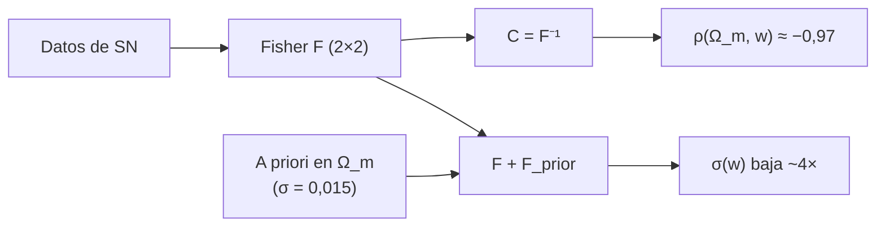

# B26-C22 — Degeneraciones de parámetros cosmológicos

<!-- nav:top -->
[🏠 Programa](../../../../README.md) · [📚 Bloque B26](../../../tronco-comun/B26-relatividad-y-cosmologia.md) · [← Anterior: B26-C21 — Verosimilitud cosmológica con datos combinados](../B26-C21-verosimilitud-cosmologica-con-datos-combinados/CLASE.md) · [Siguiente: B26-C23 — Tensiones observacionales: constante de Hubble y S8 →](../B26-C23-tensiones-observacionales-constante-de-hubble-y-s8/CLASE.md)
<!-- /nav -->

## 1. Ubicación, nivel y alcance

Clase 22 del bloque B26 (ampliación). Nivel N3. En [C21](../B26-C21-verosimilitud-cosmologica-con-datos-combinados/CLASE.md) combinaste medidas de un solo parámetro. Casi siempre se ajustan varios a la vez y muchos se compensan: subir uno y bajar otro deja casi igual la observación. A eso se llama **degeneración**. Aquí la cuantificas con la **matriz de Fisher** de `(Ω_m, w)` para supernovas y ves cómo un dato complementario la rompe. Usas covarianzas ([B12-C18](../../B12/B12-C18-matrices-de-covarianza/CLASE.md)), análisis de sensibilidad ([B12-C17](../../B12/B12-C17-analisis-de-sensibilidad/CLASE.md)), álgebra lineal ([B10](../../../tronco-comun/B10-algebra-lineal-y-matematicas-geometricas.md)) y las distancias de [C19](../B26-C19-energia-oscura-y-parametros/CLASE.md). Los problemas inversos mal condicionados se amplían en [B22](../../../tronco-comun/B22-problemas-inversos-y-estimacion-de-modelos.md).

## 2. Por qué esta clase existe

Una incertidumbre marginal puede ser mucho mayor que la que se obtendría si el otro parámetro estuviera fijo, porque ambos se compensan. Sin analizar la degeneración se interpretan mal las barras de error y se desaprovechan las combinaciones de datos. La decisión central: **dados los datos, ¿cuán correlacionados están `Ω_m` y `w`, cuánto crece la incertidumbre por esa correlación y cuánto la reduce un dato complementario?**

## 3. Lo que podrás hacer al terminar

1. Definir degeneración y correlación entre parámetros.
2. Calcular la matriz de Fisher con derivadas numéricas y marginalizando una constante.
3. Obtener las incertidumbres marginales y la correlación.
4. Verificar la matriz con el hessiano de `χ²`.
5. Añadir un a priori y medir cuánto se rompe la degeneración.
6. Interpretar el área de la elipse de confianza.

La evidencia es la **elipse de Fisher antes y después** del ejercicio 12 (sección 20).

## 4. Con qué llegas y cómo comprobarlo

1. ¿Qué es una matriz de covarianza?
2. ¿Qué es la inversa de una matriz `2 × 2`?
3. ¿Qué es una derivada numérica central?
4. ¿Qué es el hessiano?
5. ¿Qué es la distancia de luminosidad (C19)?

<details>
<summary>Ver respuestas</summary>

1. La matriz de varianzas y covarianzas. 2. `(1/det)[[d, −b],[−c, a]]`. 3. `(f(x+h) − f(x−h))/(2h)`. 4. La matriz de segundas derivadas. 5. `D_L = (1+z)D_M`.
</details>

Con cuatro o cinco aciertos, sigue; si no, repasa B12-C18 y C19.

## 5. Un caso real: materia y ecuación de estado

Las supernovas Ia solas dan `w₀ = −0,90 ± 0,14` con Pantheon+ (S1, resumen); combinadas con CMB y BAO, `−0,978 (+0,024/−0,031)`: la incertidumbre baja unas cinco veces al añadir las otras sondas (S1, resumen). DESI con BAO solo da `Ω_m = 0,295 ± 0,015` (S2, resumen). Es el **ejemplo conductor**: el ejercicio muestra con supernovas **sintéticas** por qué sucede, y cómo un a priori sobre `Ω_m` del tamaño del de DESI reduce `σ(w)` unas cuatro veces.

## 6. Vocabulario

La **degeneración** es la compensación entre parámetros que deja los datos casi iguales. La **matriz de Fisher** `F_ij = Σ (∂μ/∂p_i)(∂μ/∂p_j)/σ²` mide la información de los datos. Su inversa es la **covarianza** (cota de Cramér–Rao). La **incertidumbre marginal** `σ_i = √(F⁻¹)_ii` incluye la incertidumbre de los demás parámetros. El **coeficiente de correlación** es `ρ = C₁₂/√(C₁₁C₂₂)`. El **a priori** es información externa que se suma a `F`. La **elipse de confianza** tiene un área proporcional a `1/√det F`. El **modelo wCDM** añade `w` a ΛCDM.

## 7. Modelo mental: un valle alargado

La superficie de `χ²` en el plano `(Ω_m, w)` no tiene forma de cuenco redondo, sino de valle alargado en diagonal: se puede avanzar mucho a lo largo del fondo sin subir. El a priori corta el valle de través.



*Descripción textual:* los datos dan la matriz de Fisher, cuya inversa es la covarianza y muestra una fuerte correlación negativa; sumar un a priori sobre `Ω_m` corta el valle y reduce las incertidumbres.

Analogía: un camino casi plano a lo largo de una cresta. Límite: la forma gaussiana (elipse) es exacta solo cerca del máximo.

## 8. La explicación, paso a paso

### 8.1 La matriz de Fisher

Para supernovas con error `σ = 0,15 mag`, modelo wCDM plano y valores fiduciales `Ω_m = 0,315`, `w = −1`, `H₀ = 67,4`: derivadas numéricas centrales `∂μ/∂Ω_m` y `∂μ/∂w`, a las que se resta su media (marginalizar la constante de calibración). Resulta `F₁₁ = 573,9`, `F₁₂ = 170,9`, `F₂₂ = 53,9`. El laboratorio la compara con el hessiano numérico de `χ²/2` y coinciden a `10⁻³`.

### 8.2 Incertidumbres y correlación

La inversa da `σ(Ω_m) = 0,175`, `σ(w) = 0,572` y `ρ = −0,971`: la correlación negativa casi total indica que subir `Ω_m` se compensa con bajar `w`. Con 100 supernovas de error `0,15 mag`, solas, ninguno de los dos queda bien fijado.

### 8.3 Romper la degeneración

Se suma un a priori sintético `σ(Ω_m) = 0,015` (como el de DESI BAO, S2): `F₁₁ → F₁₁ + 1/0,015² = F₁₁ + 4444`. Resultan `σ(Ω_m) = 0,0149`, `σ(w) = 0,144` y `ρ = −0,33`. El área relativa baja de `0,0239` a `0,0020`: unas `11,7` veces menor; `σ(w)` baja `3,97` veces.

### 8.4 Por qué ayuda un dato complementario

Las supernovas dependen sobre todo de una combinación de `Ω_m` y `w`; una medida que fije `Ω_m` por otra vía (BAO, CMB) corta la dirección degenerada. Por eso las combinaciones son mucho más informativas que la suma de los pedazos (resultado análogo a la reducción de `w₀` con CMB y BAO, S1).

### 8.5 Límites

El Fisher es una aproximación lineal: vale cerca del punto fiducial y con errores gaussianos. Para degeneraciones fuertes, las regiones reales son curvas («bananas») y se necesitan cadenas MCMC (B19). Aquí el a priori es sintético, no el análisis de DESI.

## 9. Magnitudes, símbolos y unidades

| Símbolo | Qué es | Unidad | Valor / nota |
|---|---|---|---|
| `F_ij` | matriz de Fisher | `mag⁻²`-escala | `573,9`; `170,9`; `53,9` |
| `σ(Ω_m)`, `σ(w)` | incertidumbres marginales | — | `0,175`; `0,572` (SN solas) |
| `ρ` | correlación | — | `−0,971` |
| Con a priori | `σ(Ω_m)`, `σ(w)`, `ρ` | — | `0,0149`; `0,144`; `−0,33` |
| Reducción del área | factor | — | `11,7` |

## 10. Convenciones y referencias

Fiduciales `Ω_m = 0,315`, `w = −1`, `H₀ = 67,4` (S3); supernovas **sintéticas**; a priori **sintético** (valor tomado del orden del resumen de DESI). `H₀` fijo.

## 11. De dónde sale lo que afirmamos

| ID | Fuente | Localizador | Respalda | Estado |
|---|---|---|---|---|
| S1 | Brout et al., arXiv:2202.04077 | https://arxiv.org/abs/2202.04077 | `w₀ = −0,90 ± 0,14` (SNe); `−0,978 (+0,024/−0,031)` con CMB y BAO | Solo resumen, consultado el 2026-11-09 |
| S2 | DESI Collaboration, arXiv:2404.03002 | https://arxiv.org/abs/2404.03002 | `Ω_m = 0,295 ± 0,015` (BAO solo) | Solo resumen, consultado el 2026-11-09 |
| S3 | Planck Collaboration, arXiv:1807.06209 | https://arxiv.org/abs/1807.06209 | `H₀ = 67,4`; `Ω_m = 0,315` | Solo resumen, consultado el 2026-11-09 |

Límites: S1–S3 solo resumen; el análisis de Fisher es estándar y se verifica con el hessiano; no se reprodujo ningún análisis publicado.

## 12. Cómo ver la degeneración

| Caso | `σ(Ω_m)` | `σ(w)` | `ρ` | Área relativa |
|---|---|---|---|---|
| SN solas (sintéticas) | 0,1754 | 0,5720 | −0,971 | 0,02388 |
| SN + a priori en `Ω_m` | 0,0149 | 0,1441 | −0,328 | 0,002035 |

Descripción larga: el a priori reduce las dos incertidumbres y desfasa la correlación; el área de la elipse cae un factor 11,7.

## 13. Ejemplo trabajado: el efecto del a priori en `F₁₁`

**Paso 1 · Datos.** `F₁₁ = 573,9`; a priori `σ = 0,015`.

**Paso 2 · Información del a priori.** `1/0,015² = 4444`.

**Paso 3 · Nuevo `F₁₁`.** `573,9 + 4444 = 5018`.

**Paso 4 · Inversa.** Con `F₁₂ = 170,9` y `F₂₂ = 53,9`: `det = 5018 × 53,9 − 170,9² = 270 470 − 29 207 = 241 263`; `σ(w) = √(5018/241 263) = 0,144`.

**Paso 5 · Sentido.** Un a priori fuerte en un parámetro mejora mucho el otro porque estaban correlacionados.

## 14. Distintas formas de estudiar degeneraciones

**Fisher (esta clase):** rápido, lineal. **Perfil de verosimilitud:** exacto para un parámetro. **MCMC (B19):** regiones reales, incluso no gaussianas. **Reparametrización:** usar combinaciones menos correlacionadas.

## 15. Práctica guiada

**Ejercicio 1 · con los pasos indicados.** Calcula `det F` para `F = [[573,9; 170,9],[170,9; 53,9]]`.

<details><summary>Solución comentada</summary>

`573,9 × 53,9 − 170,9² = 30 934 − 29 207 = 1727`.
</details>

**Ejercicio 2 · con una pista.** Calcula `σ(w) = √(F₁₁/det)`.

<details><summary>Solución comentada</summary>

`√(573,9/1727) = 0,576` (el laboratorio da `0,572` con cifras sin redondear).
</details>

**Ejercicio 3 · casi autónomo.** Calcula `ρ`.

<details><summary>Solución comentada</summary>

`ρ = −F₁₂/√(F₁₁F₂₂) = −170,9/√(573,9 × 53,9) = −0,972`.
</details>

## 16. Práctica autónoma, transferencia e integrador

**Ejercicio 4.** ¿Qué `σ(w)` saldría si `Ω_m` estuviera fijo (sin marginalizar)?

<details><summary>Solución comentada</summary>

`1/√F₂₂ = 1/√53,9 = 0,136`: cuatro veces menor que la marginal `0,572`.
</details>

**Ejercicio 5.** Calcula `F₁₁` con el a priori.

<details><summary>Solución comentada</summary>

`573,9 + 4444 = 5018`.
</details>

**Ejercicio 6.** ¿Cuántas veces baja `σ(w)`?

<details><summary>Solución comentada</summary>

`0,572/0,144 = 3,97`.
</details>

**Ejercicio 7.** ¿Cuántas veces baja el área?

<details><summary>Solución comentada</summary>

`11,7`.
</details>

**Ejercicio 8.** Con a priori de `σ = 0,030`, ¿cuál es el `F₁₁` nuevo?

<details><summary>Solución comentada</summary>

`573,9 + 1/0,03² = 573,9 + 1111 = 1685`.
</details>

**Ejercicio 9 · transferencia.** Un compañero dice que `σ(w) = 0,57` significa que `w` está medido con ese error aunque `Ω_m` se conozca. Responde.

<details><summary>Solución comentada</summary>

No: `0,572` es la incertidumbre marginal; con `Ω_m` fijo sería `0,136` (ejercicio 4).
</details>

**Ejercicio 10 · transferencia.** Si `ρ` fuera `0`, ¿cuánto valdría la incertidumbre marginal de `w`?

<details><summary>Solución comentada</summary>

Coincidiría con la condicional: `1/√F₂₂`.
</details>

**Ejercicio 11 · transferencia.** Observa la mejora de `w₀` en Pantheon+ (de `0,14` a unos `0,03` combinando con CMB y BAO). ¿Qué cociente es?

<details><summary>Solución comentada</summary>

`0,14/0,028 ≈ 5` veces (con la semiancho de `+0,024/−0,031`).
</details>

**Ejercicio 12 · integrador.** Elabora tu *elipse de Fisher antes y después*: calcula `F`, las incertidumbres marginales, `ρ` y el área, añade un a priori en `Ω_m`, repite y comenta la ruptura de la degeneración y los límites del método.

<details><summary>Solución modelo</summary>

Tabla de la sección 12; `ρ = −0,97 → −0,33`; área ÷ 11,7; límites: aproximación lineal y a priori sintético.
</details>

## 17. Laboratorio: Fisher de Ω_m y w

El script [fisher.py](fisher.py) construye `F` con derivadas numéricas, **comprueba** que coincide con el hessiano de `χ²/2` (`10⁻³`), invierte (`10⁻⁹`), suma el a priori y **comprueba** que reduce las incertidumbres.

**Datos:** ninguno observado; supernovas y a priori **sintéticos**; fiduciales de Planck (resumen). **Predice antes de ejecutar:** ¿qué signo tendrá la correlación? (negativo.) **Ejecución del 2026-11-09 (Python 3.12.9):**

```text
Python 3.12.9 (biblioteca estandar)
Fisher (SN): F11 = 573.9, F12 = 170.9, F22 = 53.9 ; Hessiano/2: 573.9, 170.9, 53.9
SN solas       : sigma(Om) = 0.1754 ; sigma(w) = 0.5720 ; correlacion = -0.9713 ; area relativa = 0.02388
SN + a priori : sigma(Om) = 0.0149 ; sigma(w) = 0.1441 ; correlacion = -0.3284 ; area relativa = 0.002035
reduccion del area: x11.7 ; de sigma(w): x3.97
Pruebas superadas.
```

```bash
python programa/clases/B26/B26-C22-degeneraciones-de-parametros-cosmologicos/fisher.py
```

**Límites:** aproximación lineal, errores gaussianos, `H₀` fijo, a priori sintético.

## 18. Errores frecuentes y cómo corregirlos

**Confundir incertidumbre marginal con condicional.** Se corrige con los ejercicios 4 y 9.

**Olvidar marginalizar la calibración.** Se corrige con la sección 8.1.

**Pensar que la elipse es siempre válida.** Se corrige con 8.5.

**Sumar a priori y datos sin comprobar independencia.** Se corrige con C21.

**Tomar el a priori sintético por el análisis de DESI.** Se corrige con la sección 10.

## 19. Cómo sabrás que vas bien

Tras 8.2: ¿qué indica `ρ ≈ −0,97`? Si dudas, ejercicio 3. Tras 8.3: ¿cómo cambia `F₁₁` con un a priori? Ejercicios 5 y 8. Tras el laboratorio: ¿qué verifica el hessiano? (que Fisher y la curvatura de `χ²` son lo mismo).

## 20. Qué entregas y cómo se evalúa

El producto es tu **elipse de Fisher antes y después** (ejercicio 12).

| Criterio | Inicial | En desarrollo | Logrado | Destacado |
|---|---|---|---|---|
| Conceptos | Los confunde | Parciales | Fisher, correlación | Distingue marginal y condicional |
| Cálculo | Sin unidades | Con errores | `F`, `C`, `ρ` | Efecto del a priori |
| Numérico | Sin comprobar | Un caso | Hessiano e inversa | Explica las tolerancias |
| Fuentes | Sin fuente | Sin fecha | S1–S3 con fecha | Declara resúmenes |
| Límites | No los nombra | Uno | Tres | Discute no linealidad |

**Condiciones críticas (no se compensan con promedio):** rotular datos y a priori como sintéticos; no presentar la reducción como resultado de DESI; citar solo lo consultado.

## 21. Ética, seguridad y límites

Clase educativa: no sustituye los análisis de parámetros con cadenas MCMC. Accesibilidad: tablas equivalentes a las gráficas, fórmulas en texto, ejercicios sin conexión.

## 22. Para cerrar y seguir

Las supernovas solas dejan `Ω_m` y `w` correlacionados al `−0,97`; un a priori del tamaño del de DESI baja `σ(w)` casi cuatro veces y el área de la elipse, 11,7. Queda una pregunta: ¿qué hacer cuando dos conjuntos de datos no concuerdan?

**Glosario español–inglés.** degeneración · *degeneracy*; matriz de Fisher · *Fisher matrix*; covarianza · *covariance*; incertidumbre marginal · *marginal uncertainty*; a priori · *prior*; elipse de confianza · *confidence ellipse*.

**Continuidad.** [B26-C23](../B26-C23-tensiones-observacionales-constante-de-hubble-y-s8/CLASE.md) evalúa las tensiones entre conjuntos de datos.

**Referencias:** ver sección 11.

<!-- nav:bottom -->
---

[← Anterior: B26-C21 — Verosimilitud cosmológica con datos combinados](../B26-C21-verosimilitud-cosmologica-con-datos-combinados/CLASE.md) · [📚 Bloque B26](../../../tronco-comun/B26-relatividad-y-cosmologia.md) · [Siguiente: B26-C23 — Tensiones observacionales: constante de Hubble y S8 →](../B26-C23-tensiones-observacionales-constante-de-hubble-y-s8/CLASE.md)
<!-- /nav -->
