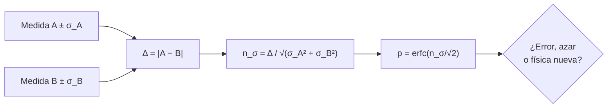

# B26-C23 — Tensiones observacionales: constante de Hubble y S8

<!-- nav:top -->
[🏠 Programa](../../../../README.md) · [📚 Bloque B26](../../../tronco-comun/B26-relatividad-y-cosmologia.md) · [← Anterior: B26-C22 — Degeneraciones de parámetros cosmológicos](../B26-C22-degeneraciones-de-parametros-cosmologicos/CLASE.md) · [Siguiente: B27-C01 — Presión de degeneración →](../../B27/B27-C01-presion-de-degeneracion/CLASE.md)
<!-- /nav -->

## 1. Ubicación, nivel y alcance

Clase 23 del bloque B26 (ampliación), cierre del bloque. Nivel N3. [C19](../B26-C19-energia-oscura-y-parametros/CLASE.md) y [C20](../B26-C20-limites-observacionales-de-modelos-cosmologicos/CLASE.md) no tratan discrepancias entre conjuntos de datos. Aquí aprendes a medirlas: la **tensión de Hubble** (el valor local de `H₀` frente al inferido del fondo cósmico) y la **tensión de `S₈`** (el agrupamiento de la materia medido por lentes frente al previsto por el fondo). Calculas su significancia en sigmas, la conviertes en p-valor y compruebas el cálculo con integración numérica y Monte Carlo. Usas pruebas de hipótesis ([B12-C09](../../B12/B12-C09-pruebas-de-hipotesis/CLASE.md)), propagación de incertidumbre ([B12-C16](../../B12/B12-C16-propagacion-de-incertidumbre/CLASE.md)) y la combinación de [C21](../B26-C21-verosimilitud-cosmologica-con-datos-combinados/CLASE.md). La cosmología del universo temprano se amplía en [B40](../../../tronco-comun/B40-universo-temprano-y-radiacion-cosmica-de-fondo.md).

## 2. Por qué esta clase existe

Decir «hay una tensión» solo tiene sentido con un número: ¿cuántas sigmas?, ¿qué probabilidad de ocurrir por azar?, ¿qué se asume? Sin ese rigor, una discrepancia se exagera o se descarta. La decisión central: **dadas dos medidas con incertidumbre, ¿cuántas sigmas las separan, qué p-valor tiene esa diferencia y qué la hace fiable o frágil?**

## 3. Lo que podrás hacer al terminar

1. Calcular la significancia de la diferencia entre dos medidas independientes.
2. Convertir sigmas en p-valores con la función de error y verificarlo por integración y Monte Carlo.
3. Calcular la tensión de Hubble con valores publicados.
4. Estimar la tensión de `S₈` con propagación de incertidumbre y declarar sus límites.
5. Enumerar las explicaciones posibles de una tensión.
6. Distinguir significancia estadística de evidencia física.

La evidencia es el **informe de significancia de dos tensiones** del ejercicio 12 (sección 20).

## 4. Con qué llegas y cómo comprobarlo

1. ¿Qué es una distribución normal y su cola?
2. ¿Qué es un p-valor?
3. ¿Qué es propagación de incertidumbre?
4. ¿Qué es `S₈ = σ₈ √(Ω_m/0,3)`?
5. ¿Qué es una prueba de hipótesis bilateral?

<details>
<summary>Ver respuestas</summary>

1. La campana gaussiana; la cola es la probabilidad más allá de un umbral. 2. La probabilidad, si no hay diferencia, de obtener una discrepancia al menos tan grande. 3. Combinar los errores de las entradas en el de un resultado. 4. Una combinación de la amplitud de las fluctuaciones y la densidad de materia que miden las lentes débiles. 5. La que considera diferencias en ambos sentidos.
</details>

Con cuatro o cinco aciertos, sigue; si no, repasa B12-C09 y B12-C16.

## 5. Un caso real: dos tensiones

**Hubble.** Planck 2018 da `H₀ = 67,4 ± 0,5 km/s/Mpc` en ΛCDM (S1, resumen); Riess y colaboradores midieron `74,03 ± 1,42` con cefeidas de la Gran Nube de Magallanes y otros anclajes, una diferencia de `6,6 ± 1,5` que los autores sitúan en `4,4σ` (S2, resumen). Di Valentino y colaboradores revisan la discrepancia como de `4` a `6σ` y citan `73,2 ± 1,3` para SH0ES (S3, resumen). **`S₈`.** DES Y3 obtuvo `S₈ = 0,776 ± 0,017` en ΛCDM (S4, resumen). Es el **ejemplo conductor**: este documento recalcula las tensiones con esos números.

## 6. Vocabulario

La **significancia** `n_σ = |a − b|/√(σ_a² + σ_b²)` mide la diferencia en unidades de su incertidumbre. El **p-valor bilateral** es `erfc(n_σ/√2)`. La **tensión de Hubble** es la discrepancia entre el `H₀` local y el del fondo cósmico. `S₈ = σ₈ √(Ω_m/0,3)` resume el agrupamiento de la materia. La **solución** de una tensión puede ser un error sistemático, una fluctuación o física nueva. La **dependencia del modelo** significa que el valor del fondo se infiere en ΛCDM. El **efecto de «mirar en muchos sitios»** hace más probable encontrar alguna discrepancia alta. Un **modelo extendido** añade parámetros a ΛCDM.

## 7. Modelo mental: dos reglas que no coinciden

Mides la misma longitud con dos reglas distintas. Si las marcas difieren más de lo que sus errores permiten, o una regla está mal, o la longitud no es la misma.



*Descripción textual:* se restan las dos medidas, se divide la diferencia por la raíz de la suma de cuadrados de sus incertidumbres, se convierte en un p-valor y se decide entre error, casualidad o física nueva.

Analogía: dos reglas. Límite: no se puede decidir solo con el número; hace falta examinar el método.

## 8. La explicación, paso a paso

### 8.1 Significancia y p-valor

`n_σ` supone medidas independientes y gaussianas. El p-valor bilateral de `n_σ` es `erfc(n_σ/√2)`: `0,317` (1σ), `0,0455` (2σ), `0,0027` (3σ), `1,08 × 10⁻⁵` (4,4σ), `5,7 × 10⁻⁷` (5σ). El laboratorio los verifica integrando la campana por Simpson (acuerdo de `10⁻⁷`) y con un Monte Carlo de `10⁶` muestras: `2672` con `|x| > 3`, frente a `2700 ± 52` esperados.

### 8.2 La tensión de Hubble

`74,03 − 67,4 = 6,63`; `√(1,42² + 0,5²) = 1,505`; `n_σ = 4,40`, con `p = 1,1 × 10⁻⁵` (igual al `4,4σ` de Riess et al., S2). Con SH0ES `73,2 ± 1,3`: diferencia `5,8`, incertidumbre `1,393`, `4,16σ`, `p = 3,1 × 10⁻⁵`. Estas cifras suponen que ambos resultados son independientes y gaussianos, y que el valor de Planck se mantiene en ΛCDM.

### 8.3 La tensión de `S₈` (estimación gruesa)

De Planck (S1) `σ₈ = 0,811 ± 0,006` y `Ω_m = 0,315 ± 0,007` dan `S₈ = 0,811 × √(0,315/0,3) = 0,8310`. Propagando los errores sin correlación, `δS₈ = 0,0111`. Frente a DES Y3 (`0,776 ± 0,017`, S4): diferencia `0,055`, `n_σ = 2,71`, `p = 0,007`. **Es una estimación del curso**, no el valor publicado: la anticorrelación entre `σ₈` y `Ω_m` en Planck reduce la incertidumbre real y la diferencia podría resultar algo mayor.

### 8.4 Qué puede estar pasando

Di Valentino et al. (S3) analizan modelos que reducen la tensión de Hubble a `1`–`2σ` con grados de libertad adicionales; observan que parte de la reducción proviene de incertidumbres mayores por degeneraciones, no solo de un desplazamiento de `H₀`, y no encuentran una solución claramente mejor (resumen). Las explicaciones son: sistemáticos en la escalera, física nueva antes de la recombinación, interacciones del sector oscuro, gravedad modificada.

### 8.5 Cómo leer un número de sigmas

Un `4,4σ` no equivale a «99,999 % de certeza de física nueva»: es la probabilidad de la diferencia bajo la hipótesis de que ambas medidas estimen lo mismo y sus errores estén bien cuantificados. Si un error sistemático está subestimado, la tensión se reduce. Y al mirar muchos parámetros, alguna discrepancia saldrá alta por azar.

## 9. Magnitudes, símbolos y unidades

| Símbolo | Qué es | Unidad | Valor / nota |
|---|---|---|---|
| `H₀` | constante de Hubble | km/s/Mpc | `67,4 ± 0,5` (S1); `74,03 ± 1,42` (S2); `73,2 ± 1,3` (S3) |
| `n_σ` | significancia | `σ` | `4,40`; `4,16` |
| `p` | p-valor bilateral | — | `1,06 × 10⁻⁵`; `3,13 × 10⁻⁵` |
| `S₈` | agrupamiento | — | `0,776 ± 0,017` (S4); `0,8310 ± 0,0111` (derivado, grueso) |
| `σ₈`, `Ω_m` | amplitud y materia | — | `0,811 ± 0,006`; `0,315 ± 0,007` (S1) |

## 10. Convenciones y referencias

Medidas gaussianas e independientes; el `S₈` de Planck se **deriva** con propagación lineal sin correlación (estimación gruesa, **no** valor publicado). Todas las cifras de `H₀`, `σ₈`, `Ω_m`, `S₈` son publicadas (resúmenes).

## 11. De dónde sale lo que afirmamos

| ID | Fuente | Localizador | Respalda | Estado |
|---|---|---|---|---|
| S1 | Planck Collaboration, *Planck 2018 results. VI*, arXiv:1807.06209 | https://arxiv.org/abs/1807.06209 | `H₀ = 67,4 ± 0,5`; `σ₈ = 0,811 ± 0,006`; `Ω_m = 0,315 ± 0,007` | Solo resumen, consultado el 2026-11-09 |
| S2 | Riess et al., arXiv:1903.07603 | https://arxiv.org/abs/1903.07603 | `H₀ = 74,03 ± 1,42`; diferencia `6,6 ± 1,5`; `4,4σ` | Solo resumen, consultado el 2026-11-09 |
| S3 | Di Valentino et al., *In the Realm of the Hubble tension*, arXiv:2103.01183 | https://arxiv.org/abs/2103.01183 | Tensión de 4–6σ; SH0ES `73,2 ± 1,3`; modelos que la reducen a 1–2σ | Solo resumen, consultado el 2026-11-09 |
| S4 | DES Collaboration, *DES Y3 cosmology from galaxy clustering and weak lensing*, arXiv:2105.13549 | https://arxiv.org/abs/2105.13549 | `S₈ = 0,776 ± 0,017`; `Ω_m = 0,339`; con Planck lensing `0,812 ± 0,008` | Solo resumen, consultado el 2026-11-09 |

Límites: S1–S4 solo resumen; la tensión de `S₈` aquí calculada es del curso; no se consultaron las matrices de covarianza ni las discusiones de sistemáticos.

## 12. Cómo ver las tensiones

| Comparación | Diferencia | `n_σ` | `p` |
|---|---|---|---|
| `H₀`: Planck frente a Riess et al. | 6,63 | 4,40 | `1,1 × 10⁻⁵` |
| `H₀`: Planck frente a SH0ES R20 | 5,80 | 4,16 | `3,1 × 10⁻⁵` |
| `S₈`: Planck (derivado) frente a DES Y3 | 0,055 | 2,71 | 0,007 |

Descripción larga: la tensión de Hubble supera los 4σ y la de `S₈`, calculada de forma gruesa, ronda los 2,7σ.

## 13. Ejemplo trabajado: ¿qué tan inusual es 4,4σ?

**Paso 1 · Diferencia.** `74,03 − 67,4 = 6,63`.

**Paso 2 · Incertidumbre combinada.** `√(0,5² + 1,42²) = 1,505`.

**Paso 3 · Significancia.** `6,63/1,505 = 4,40`.

**Paso 4 · p-valor.** `erfc(4,40/√2) = 1,08 × 10⁻⁵`, es decir 1 entre unos 92 000.

**Paso 5 · Sentido.** Si ambas medidas estimaran lo mismo y fueran gaussianas, tal diferencia saldría una vez de cada ~92 000; eso no demuestra física nueva: puede haber un error sistemático no contabilizado.

## 14. Distintas formas de evaluar una tensión

**Diferencia de sigmas (esta clase):** simple. **Métricas con covarianza completa:** necesarias si las medidas comparten datos. **Comparación de evidencias bayesianas (B12-C22):** compara modelos. **Simulaciones:** estiman la probabilidad con sistemáticos.

## 15. Práctica guiada

**Ejercicio 1 · con los pasos indicados.** Calcula la diferencia de `H₀` entre Riess et al. y Planck.

<details><summary>Solución comentada</summary>

`74,03 − 67,4 = 6,63`.
</details>

**Ejercicio 2 · con una pista.** Calcula la incertidumbre combinada.

<details><summary>Solución comentada</summary>

`√(1,42² + 0,5²) = 1,505`.
</details>

**Ejercicio 3 · casi autónomo.** Calcula `n_σ`.

<details><summary>Solución comentada</summary>

`4,40`.
</details>

## 16. Práctica autónoma, transferencia e integrador

**Ejercicio 4.** p-valor bilateral de `4,40σ`.

<details><summary>Solución comentada</summary>

`1,08 × 10⁻⁵`.
</details>

**Ejercicio 5.** Tensión con SH0ES `73,2 ± 1,3`.

<details><summary>Solución comentada</summary>

`5,8/√(0,5² + 1,3²) = 5,8/1,393 = 4,16σ`.
</details>

**Ejercicio 6.** Calcula `S₈` de Planck.

<details><summary>Solución comentada</summary>

`0,811 × √1,05 = 0,811 × 1,0247 = 0,8310`.
</details>

**Ejercicio 7.** Propaga la incertidumbre de `S₈` (sin correlación).

<details><summary>Solución comentada</summary>

`δ(σ₈ parte) = 0,006 × 1,0247 = 0,0061`; `δ(Ω_m parte) = 0,811 × 0,5/√(0,3 × 0,315) × 0,007 = 0,0092`; total `0,0111`.
</details>

**Ejercicio 8.** Tensión de `S₈` con DES Y3 (`0,776 ± 0,017`).

<details><summary>Solución comentada</summary>

`0,055/√(0,0111² + 0,017²) = 0,055/0,0203 = 2,71σ`.
</details>

**Ejercicio 9 · transferencia.** Un compañero dice que 4,4σ significa 99,999 % de seguridad en física nueva. Responde con 8.5.

<details><summary>Solución comentada</summary>

Mide la improbabilidad de la diferencia bajo la hipótesis de igualdad y errores correctos; no la probabilidad de la hipótesis alternativa. Un sistemático subestimado la reduce.
</details>

**Ejercicio 10 · transferencia.** Si se examinan 20 parámetros independientes, ¿cuál es la probabilidad de que al menos uno supere 2σ por azar?

<details><summary>Solución comentada</summary>

`1 − (1 − 0,0455)²⁰ = 1 − 0,9545²⁰ = 0,6` (60 %): conviene tenerlo en cuenta al mirar muchos sitios.
</details>

**Ejercicio 11 · transferencia.** Di Valentino et al. (S3) señalan que parte de la reducción de la tensión en modelos extendidos viene de incertidumbres mayores. ¿Cómo lo cuantificarías con la fórmula de `n_σ`?

<details><summary>Solución comentada</summary>

Si `σ_Planck` sube de `0,5` a `1,5` con el mismo valor central, `n_σ = 6,63/√(1,5² + 1,42²) = 3,2σ`: la tensión baja sin que se mueva `H₀`.
</details>

**Ejercicio 12 · integrador.** Elabora tu *informe de significancia de dos tensiones*: tabla con diferencia, `n_σ` y `p` para `H₀` (dos comparaciones) y `S₈`, la verificación numérica del p-valor, y una nota con tres razones por las que un número de sigmas no basta.

<details><summary>Solución modelo</summary>

Tabla de la sección 12; verificación con integral y Monte Carlo; razones: sistemáticos, correlaciones, mirar en muchos sitios, dependencia del modelo.
</details>

## 17. Laboratorio: significancia de las tensiones

El script [tensiones.py](tensiones.py) calcula `n_σ` y p-valores, los **verifica** con una integral de Simpson (`10⁻⁷`) y con un Monte Carlo de `10⁶` muestras (dentro de `4σ` estadísticos), y recalcula las dos tensiones con las cifras publicadas.

**Datos:** cifras publicadas (resúmenes); `S₈` de Planck **derivado** por el curso. **Predice antes de ejecutar:** ¿qué `n_σ` saldrá para Planck–Riess? (≈4,4.) **Ejecución del 2026-11-09 (Python 3.12.9):**

```text
Python 3.12.9 (biblioteca estandar)
n = 1.0 sigma: p bilateral = 3.173e-01 (erfc) = 3.173e-01 (integral)
n = 2.0 sigma: p bilateral = 4.550e-02 (erfc) = 4.550e-02 (integral)
n = 3.0 sigma: p bilateral = 2.700e-03 (erfc) = 2.700e-03 (integral)
n = 4.4 sigma: p bilateral = 1.083e-05 (erfc) = 1.083e-05 (integral)
n = 5.0 sigma: p bilateral = 5.733e-07 (erfc) = 5.733e-07 (integral)
Monte Carlo: 2672 de 1000000 con |x| > 3 (esperado 2700 +/- 52)
--- tension de H0 ---
Planck 67.4 +/- 0.5 vs Riess et al. 2019 74.03 +/- 1.42: diferencia = 6.63 ; 4.40 sigma ; p = 1.06e-05
Planck 67.4 +/- 0.5 vs SH0ES R20 (Di Valentino) 73.2 +/- 1.3: diferencia = 5.80 ; 4.16 sigma ; p = 3.13e-05
--- tension de S8 (estimacion gruesa) ---
S8 derivado de Planck = 0.8310 +/- 0.0111 (sin correlacion) ; DES Y3 = 0.776 +/- 0.017 ; 2.71 sigma ; p = 0.007
Pruebas superadas.
```

```bash
python programa/clases/B26/B26-C23-tensiones-observacionales-constante-de-hubble-y-s8/tensiones.py
```

**Límites:** gaussianidad e independencia; sin sistemáticos ni correlaciones; `S₈` de Planck derivado de forma gruesa.

## 18. Errores frecuentes y cómo corregirlos

**Interpretar sigmas como certeza de la alternativa.** Se corrige con el ejercicio 9.

**Ignorar la correlación entre `σ₈` y `Ω_m`.** Se corrige con la sección 8.3.

**No contar «mirar en muchos sitios».** Se corrige con el ejercicio 10.

**Comparar medidas que no son independientes.** Se corrige con la sección 14.

**Confundir reducir la tensión con resolverla.** Se corrige con el ejercicio 11.

## 19. Cómo sabrás que vas bien

Tras 8.1: ¿conviertes sigmas en p? Si dudas, ejercicio 4. Tras 8.2: ¿cuánto vale la tensión de Hubble? Ejercicios 1–3. Tras el laboratorio: ¿qué verifica el Monte Carlo? (la cola normal calculada con `erfc`).

## 20. Qué entregas y cómo se evalúa

El producto es tu **informe de significancia de dos tensiones** (ejercicio 12).

| Criterio | Inicial | En desarrollo | Logrado | Destacado |
|---|---|---|---|---|
| Conceptos | Los confunde | Parciales | Sigmas y p-valores | Distingue estadística y física |
| Cálculo | Sin unidades | Con errores | Tres tensiones | Propaga `S₈` |
| Numérico | Sin comprobar | Un caso | Integral y Monte Carlo | Discute el azar |
| Fuentes | Sin fuente | Sin fecha | S1–S4 con fecha | Declara resúmenes |
| Límites | No los nombra | Uno | Cuatro | Discute correlaciones |

**Condiciones críticas (no se compensan con promedio):** declarar que el `S₈` de Planck es derivado y grueso; no presentar las sigmas como certeza de física nueva; citar solo lo consultado.

## 21. Ética, seguridad y límites

Clase educativa: no sustituye los análisis oficiales de las colaboraciones ni resuelve las tensiones. Accesibilidad: tablas equivalentes a las gráficas, fórmulas en texto, ejercicios sin conexión.

## 22. Para cerrar y seguir

Con cifras publicadas, la tensión de Hubble es de `4,4σ` (`p ≈ 10⁻⁵`) y la de `S₈`, calculada de forma gruesa, de `2,7σ`; las sigmas miden la improbabilidad de la diferencia, no la verdad de la explicación. Con esto cierras el bloque de relatividad y cosmología. Los siguientes (por ejemplo, [B27](../../../tronco-comun/B27-objetos-compactos-y-altas-energias.md)) aplican estas herramientas a objetos compactos y a altas energías.

**Glosario español–inglés.** tensión de Hubble · *Hubble tension*; significancia · *significance*; p-valor · *p-value*; error sistemático · *systematic error*; efecto de mirar en otro sitio · *look-elsewhere effect*; modelo extendido · *extended model*.

**Continuidad.** `B27-C13` (bloque [B27](../../../tronco-comun/B27-objetos-compactos-y-altas-energias.md)) retoma la relatividad en objetos compactos; B26 queda cerrado.

**Referencias:** ver sección 11.

<!-- nav:bottom -->
---

[← Anterior: B26-C22 — Degeneraciones de parámetros cosmológicos](../B26-C22-degeneraciones-de-parametros-cosmologicos/CLASE.md) · [📚 Bloque B26](../../../tronco-comun/B26-relatividad-y-cosmologia.md) · [Siguiente: B27-C01 — Presión de degeneración →](../../B27/B27-C01-presion-de-degeneracion/CLASE.md)
<!-- /nav -->
