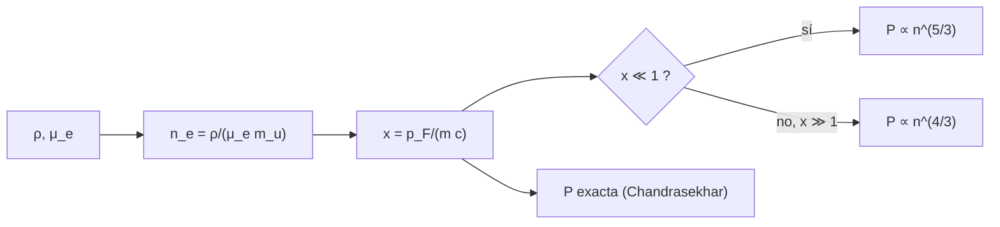

# B27-C01 — Presión de degeneración

<!-- nav:top -->
[🏠 Programa](../../../../README.md) · [📚 Bloque B27](../../../tronco-comun/B27-objetos-compactos-y-altas-energias.md) · [← Anterior: B26-C23 — Tensiones observacionales: constante de Hubble y S8](../../B26/B26-C23-tensiones-observacionales-constante-de-hubble-y-s8/CLASE.md) · [Siguiente: B27-C02 — Enanas blancas y límite de Chandrasekhar →](../B27-C02-enanas-blancas-y-limite-de-chandrasekhar/CLASE.md)
<!-- /nav -->

## 1. Ubicación, nivel y alcance

Clase 1 del bloque B27. Nivel N3. En [B24-C18](../../B24/B24-C18-etapas-finales-de-evolucion/CLASE.md) usaste el límite ultrarrelativista de un gas de electrones degenerado para obtener la masa de Chandrasekhar. Aquí construyes la presión completa, desde el régimen no relativista hasta el ultrarrelativista, y ves cuándo cada límite es válido. Es la base de las enanas blancas ([C02](../B27-C02-enanas-blancas-y-limite-de-chandrasekhar/CLASE.md)) y de las estrellas de neutrones ([C03](../B27-C03-estrellas-de-neutrones/CLASE.md)). Usas física cuántica elemental ([B31](../../../tronco-comun/B31-fisica-cuantica-nuclear-y-astroparticulas.md)), integrales ([B09](../../../tronco-comun/B09-calculo-diferencial-e-integral.md)) y relatividad especial ([B26-C05](../../B26/B26-C05-equivalencia-entre-masa-y-energia/CLASE.md)).

## 2. Por qué esta clase existe

Una estrella sin fusión no se desploma porque los electrones (o neutrones) no pueden apretarse más allá de lo que permite el principio de exclusión, aunque la temperatura sea cero. La decisión central: **dada la densidad de un gas degenerado, ¿cuánto vale el momento de Fermi, la presión y cuál de los dos límites aplica?**

## 3. Lo que podrás hacer al terminar

1. Enunciar el principio de exclusión y el momento de Fermi.
2. Calcular `n_e` y `x = p_F/(m c)` desde la densidad.
3. Calcular la presión exacta por cuadratura y por la forma cerrada.
4. Reconocer los límites no relativista (`P ∝ n^{5/3}`) y ultrarrelativista (`P ∝ n^{4/3}`).
5. Calcular la densidad de cruce `x = 1`.
6. Decidir cuándo un gas es degenerado comparando `kT` con la energía de Fermi.

La evidencia es la **ficha de presión degenerada** del ejercicio 12 (sección 20).

## 4. Con qué llegas y cómo comprobarlo

1. ¿Qué dice el principio de exclusión de Pauli?
2. ¿Cuánto vale la energía en reposo del electrón en MeV?
3. ¿Qué es `v = pc²/E` para una partícula relativista?
4. ¿Cómo se integra con Simpson?
5. ¿Qué es la masa molecular por electrón `μ_e`?

<details>
<summary>Ver respuestas</summary>

1. Dos fermiones idénticos no ocupan el mismo estado. 2. `0,511 MeV`. 3. La velocidad de la partícula. 4. Con parábolas por tramos (B11). 5. La masa media por electrón libre en unidades de `m_u`; vale 2 para C y O.
</details>

Con cuatro o cinco aciertos, sigue; si no, repasa B26-C05 y B24-C18.

## 5. Un caso real: ¿degenerado o no?

Para un material con `ρ = 10⁹ kg/m³` y `μ_e = 2` (valor **ilustrativo**, típico de enanas blancas), `n_e = 3,01 × 10³⁵ m⁻³`, `x = 0,80` y la presión exacta es `2,63 × 10²¹ Pa`. La energía cinética de Fermi vale `143,6 keV`, equivalente a `1,7 × 10⁹ K`: a las temperaturas de un núcleo estelar (decenas de millones de kelvin) el gas está profundamente degenerado. Es el **ejemplo conductor**.

## 6. Vocabulario

Un **fermión** obedece el principio de exclusión. El **momento de Fermi** `p_F` es el mayor momento ocupado a `T = 0`: `n = (8π/3h³)p_F³` (dos espines). `x = p_F/(m c)` mide cuán relativista es el gas. La **presión de degeneración** es la que ejercen los fermiones por llenar estados de momento alto. El **régimen no relativista** es `x ≪ 1`; el **ultrarrelativista**, `x ≫ 1`. La **energía de Fermi** es la energía cinética en `p_F`. La **temperatura de Fermi** es `T_F = E_F/k`. Un gas es **degenerado** si `T ≪ T_F`. La **función de Chandrasekhar** es la forma cerrada de `P(x)`.

## 7. Modelo mental: un auditorio con butacas ocupadas de abajo hacia arriba

Cada butaca (estado) admite dos personas (espines). Aunque la sala esté a temperatura cero, las butacas bajas se llenan y las últimas personas quedan sentadas en niveles altos, con mucha energía y empujando.



*Descripción textual:* de la densidad se obtiene `n_e` y el parámetro `x`; si `x` es pequeño la presión crece como `n^{5/3}`, si es grande como `n^{4/3}`; la forma cerrada cubre ambos casos.

Analogía: el auditorio. Límite: no hay interacción entre personas; el gas ideal de Fermi tampoco incluye la repulsión nuclear ni la atracción de Coulomb.

## 8. La explicación, paso a paso

### 8.1 Del principio de exclusión al momento de Fermi

Cada celda de volumen `h³` del espacio de fases contiene un estado, con dos espines. A `T = 0` se llenan los estados hasta `p_F`: `n = (8π/3h³)p_F³`. Entonces `p_F = h(3n/8π)^{1/3}` y `x = p_F/(mc)`.

### 8.2 La presión

La presión es `P = (1/3)∫ p v n(p) d³p`, con `v = pc²/√(p²c² + m²c⁴)`: `P = (8π/3h³)∫₀^{p_F} p³ v dp`. Resuelta en forma cerrada, `P = (πm⁴c⁵/3h³)[x(2x²−3)√(1+x²) + 3 asinh x]`. El laboratorio compara la cuadratura de Simpson con la forma cerrada para `x = 0,01; 0,1; 1; 10; 100`: coinciden a `10⁻⁸`.

### 8.3 Los dos límites

Para `x ≪ 1`, `P → (8πm⁴c⁵/15h³)x⁵ ∝ n^{5/3}`; para `x ≫ 1`, `P → (2πm⁴c⁵/3h³)x⁴ ∝ n^{4/3}`. A `x = 0,01` y `x = 100`, las formas límite difieren de la exacta menos del `1 %`. Duplicar `n` multiplica `P` por `2^{5/3} = 3,17` o por `2^{4/3} = 2,52`.

### 8.4 La densidad de cruce

`x = 1` ocurre para `n_e = 8πm³c³/3h³ = 5,87 × 10³⁵ m⁻³`, es decir `ρ = 1,95 × 10⁹ kg/m³` con `μ_e = 2`. Por debajo domina el límite no relativista; por encima, el ultrarrelativista. Tabla del laboratorio: `ρ = 10⁶`: `x = 0,080`; `10⁸`: `0,372`; `10⁹`: `0,801`; `10¹⁰`: `1,73`; `10¹²`: `8,01`.

### 8.5 ¿Cuándo es degenerado?

Se compara `kT` con la energía de Fermi: a `10⁶ kg/m³`, `E_F = 1,64 keV` (`T_F = 1,9 × 10⁷ K`); a `10⁹`, `143,6 keV` (`1,7 × 10⁹ K`). Un núcleo estelar a `10⁷ K` es degenerado si `ρ ≳ 10⁶ kg/m³`. La presión no depende de la temperatura mientras `T ≪ T_F`.

## 9. Magnitudes, símbolos y unidades

| Símbolo | Qué es | Unidad | Valor / nota |
|---|---|---|---|
| `h`, `c`, `m_e`, `m_u` | constantes | — | (S1) |
| `n_e` | densidad numérica de electrones | `m⁻³` | `3,01 × 10³⁵` (ejemplo) |
| `x` | `p_F/(m_e c)` | — | `0,801` |
| `P` | presión | Pa | `2,63 × 10²¹` |
| `E_F`, `T_F` | energía y temperatura de Fermi | keV; K | `143,6`; `1,7 × 10⁹` |

## 10. Convenciones y referencias

Gas ideal de Fermi a `T = 0`, `μ_e = 2`; las densidades de la tabla son **ilustrativas**. Constantes de NIST (S1).

## 11. De dónde sale lo que afirmamos

| ID | Fuente | Localizador | Respalda | Estado |
|---|---|---|---|---|
| S1 | NIST, *Fundamental Physical Constants — Complete Listing* (CODATA 2022) | https://physics.nist.gov/cuu/Constants/Table/allascii.txt | `h`, `c`, `m_e`, `m_u` | Consultada el 2026-11-09 |

Límites: la presión de Fermi es un resultado estándar verificado aquí por cuadratura frente a la forma cerrada; no se consultó ninguna fuente primaria ni medida de enanas blancas en esta clase.

## 12. Cómo ver la presión

| `ρ` (kg/m³) | `x` | `P` (Pa) | `P_NR/P` | `P_UR/P` | `E_F` (keV) |
|---|---|---|---|---|---|
| `10⁶` | 0,080 | `3,15 × 10¹⁶` | 1,002 | 15,6 | 1,64 |
| `10⁸` | 0,372 | `6,50 × 10¹⁹` | 1,048 | 3,52 | 34,2 |
| `10⁹` | 0,801 | `2,63 × 10²¹` | 1,203 | 1,88 | 143,6 |
| `10¹⁰` | 1,73 | `8,46 × 10²²` | 1,734 | 1,26 | 507,9 |
| `10¹²` | 8,01 | `4,86 × 10²⁵` | 6,50 | 1,015 | 3612 |

Descripción larga: la fórmula no relativista sirve para `x` pequeño y la ultrarrelativista para `x` grande; en el medio ninguna de las dos basta.

## 13. Ejemplo trabajado: ¿qué límite aplica a `10⁹ kg/m³`?

**Paso 1 · Densidad numérica.** `n_e = 10⁹/(2 × 1,66054 × 10⁻²⁷) = 3,01 × 10³⁵ m⁻³`.

**Paso 2 · `x`.** `p_F = h(3n/8π)^{1/3}`; `x = 0,801`.

**Paso 3 · Límites.** `P_NR/P = 1,20`; `P_UR/P = 1,88`.

**Paso 4 · Sentido.** Ninguno de los dos límites vale: se usa la forma exacta, `2,63 × 10²¹ Pa`.

## 14. Distintas formas de obtener `P`

**Cuadratura sobre estados:** la definición. **Forma cerrada de Chandrasekhar:** exacta y rápida. **Límites asintóticos:** dan leyes de potencias para análisis rápidos y para politropos.

## 15. Práctica guiada

**Ejercicio 1 · con los pasos indicados.** Calcula `n_e` para `ρ = 10⁹` con `μ_e = 2`. *Pasos:* `ρ/(2m_u)`.

<details><summary>Solución comentada</summary>

`10⁹/(3,32108 × 10⁻²⁷) = 3,01 × 10³⁵ m⁻³`.
</details>

**Ejercicio 2 · con una pista.** Calcula la densidad de cruce `x = 1`. *Pista:* `8πm³c³/3h³`.

<details><summary>Solución comentada</summary>

`5,87 × 10³⁵ m⁻³`, `ρ = 1,95 × 10⁹ kg/m³`.
</details>

**Ejercicio 3 · casi autónomo.** Si se duplica `n` en el régimen no relativista, ¿cuánto sube `P`?

<details><summary>Solución comentada</summary>

`2^{5/3} = 3,17` veces.
</details>

## 16. Práctica autónoma, transferencia e integrador

**Ejercicio 4.** Y en el ultrarrelativista.

<details><summary>Solución comentada</summary>

`2^{4/3} = 2,52` veces.
</details>

**Ejercicio 5.** ¿Qué límite vale a `ρ = 10¹²`?

<details><summary>Solución comentada</summary>

El ultrarrelativista: `P_UR/P = 1,015`.
</details>

**Ejercicio 6.** Calcula `T_F` para `ρ = 10⁶` (`E_F = 1,64 keV`).

<details><summary>Solución comentada</summary>

`1,64 × 10³ × 1,602 × 10⁻¹⁹/1,3806 × 10⁻²³ = 1,9 × 10⁷ K`.
</details>

**Ejercicio 7.** Un núcleo a `10⁷ K` y `10⁶ kg/m³`, ¿es degenerado?

<details><summary>Solución comentada</summary>

`T/T_F = 0,53`: solo parcialmente; con `10⁸ kg/m³`, `T_F` sube y sí lo es.
</details>

**Ejercicio 8.** ¿Qué cociente `P(10⁹)/P(10⁸)`?

<details><summary>Solución comentada</summary>

`2,63 × 10²¹/6,50 × 10¹⁹ = 40`: diez veces más densidad dan 40 veces más presión (exponente efectivo `1,6`).
</details>

**Ejercicio 9 · transferencia.** Un compañero dice que la presión de degeneración crece con la temperatura. Responde con 8.5.

<details><summary>Solución comentada</summary>

No, mientras `T ≪ T_F`: a `T = 0` ya existe y solo depende de `n_e`.
</details>

**Ejercicio 10 · transferencia.** Aplica la fórmula a neutrones (`m_n`, `μ = 1`) a `ρ = 5 × 10¹⁷ kg/m³`. ¿Cuánto vale `x_n`?

<details><summary>Solución comentada</summary>

`n = 3,01 × 10⁴⁴ m⁻³`; `x_n = 0,435`: moderadamente relativista (esto es solo un gas ideal de neutrones; la fuerza nuclear lo cambia, C04).
</details>

**Ejercicio 11 · transferencia.** ¿Por qué se cuentan dos estados por celda?

<details><summary>Solución comentada</summary>

Por los dos valores de espín del electrón.
</details>

**Ejercicio 12 · integrador.** Elabora tu *ficha de presión degenerada*: tabla de `x`, `P`, límites y `E_F` para cinco densidades, la densidad de cruce, la comprobación cuadratura–forma cerrada y una discusión de cuándo el gas es degenerado.

<details><summary>Solución modelo</summary>

Con la sección 12; cruce `1,95 × 10⁹ kg/m³`; `T_F = 1,7 × 10⁹ K` a `10⁹`.
</details>

## 17. Laboratorio: presión degenerada

El script [degeneracion.py](degeneracion.py) integra la presión sobre estados y **comprueba** que coincide con la forma cerrada a `10⁻⁸` en cinco `x`, y que los límites no relativista y ultrarrelativista se cumplen al `1 %`.

**Datos:** constantes de NIST; densidades **ilustrativas**. **Predice antes de ejecutar:** ¿qué límite vale a `10¹²`? (el ultrarrelativista.) **Ejecución del 2026-11-09 (Python 3.12.9):**

```text
Python 3.12.9 (biblioteca estandar)
n_e en x = 1 : 5.865e+35 m^-3 -> rho (mu_e = 2) = 1.948e+09 kg/m3
 rho [kg/m3]          x   P exacta [Pa]    P_NR/P    P_UR/P  E_F [keV]
       1e+06     0.0801      3.1539e+16     1.002    15.647       1.64
       1e+08     0.3717      6.4992e+19     1.048     3.524      34.15
       1e+09     0.8007      2.6273e+21     1.203     1.878     143.63
       1e+10     1.7251      8.4600e+22     1.734     1.257     507.92
       1e+12     8.0072      4.8618e+25     6.502     1.015    3612.45
la presion no depende de la temperatura (T = 0): solo de n_e y de m_e
Pruebas superadas.
```

```bash
python programa/clases/B27/B27-C01-presion-de-degeneracion/degeneracion.py
```

**Límites:** gas ideal, `T = 0`, sin interacciones.

## 18. Errores frecuentes y cómo corregirlos

**Pensar que depende de la temperatura.** Se corrige con el ejercicio 9.

**Usar el límite equivocado.** Se corrige con la sección 13 y el ejercicio 5.

**Olvidar el factor 2 del espín.** Se corrige con el ejercicio 11.

**Confundir `ρ` con `n_e`.** Se corrige con el ejercicio 1.

**Aplicar el gas ideal a neutrones sin reservas.** Se corrige con el ejercicio 10.

## 19. Cómo sabrás que vas bien

Tras 8.1: ¿cómo se obtiene `p_F`? Si dudas, ejercicio 1. Tras 8.3: ¿cómo escala `P`? Ejercicios 3–4. Tras el laboratorio: ¿qué verifica la cuadratura? (la función de Chandrasekhar).

## 20. Qué entregas y cómo se evalúa

El producto es tu **ficha de presión degenerada** (ejercicio 12).

| Criterio | Inicial | En desarrollo | Logrado | Destacado |
|---|---|---|---|---|
| Conceptos | Los confunde | Parciales | Exclusión, `p_F`, `x` | Explica la independencia de `T` |
| Cálculo | Sin unidades | Con errores | `n_e`, `x`, `P` | Escala con `n` |
| Numérico | Sin comprobar | Un caso | Cuadratura y límites | Interpreta tolerancias |
| Fuentes | Sin fuente | Sin fecha | S1 con fecha | Declara lo no consultado |
| Límites | No los nombra | Uno | Tres | Discute interacciones |

**Condiciones críticas (no se compensan con promedio):** rotular las densidades como ilustrativas; no usar un límite fuera de su rango; citar solo lo consultado.

## 21. Ética, seguridad y límites

Clase educativa: no sustituye una ecuación de estado con interacciones. Accesibilidad: tablas equivalentes a las gráficas, fórmulas en texto, ejercicios sin conexión.

## 22. Para cerrar y seguir

La presión de un gas de Fermi a `T = 0` pasa de `n^{5/3}` a `n^{4/3}` al cruzar `x = 1` (`ρ ≈ 2 × 10⁹ kg/m³` para `μ_e = 2`) y no depende de la temperatura. Queda una pregunta: ¿qué estrellas sostiene y hasta qué masa?

**Glosario español–inglés.** presión de degeneración · *degeneracy pressure*; momento de Fermi · *Fermi momentum*; energía de Fermi · *Fermi energy*; gas degenerado · *degenerate gas*; ultrarrelativista · *ultra-relativistic*; principio de exclusión · *exclusion principle*.

**Continuidad.** [B27-C02](../B27-C02-enanas-blancas-y-limite-de-chandrasekhar/CLASE.md) integra esta presión en el equilibrio de una enana blanca.

**Referencias:** ver sección 11.

<!-- nav:bottom -->
---

[← Anterior: B26-C23 — Tensiones observacionales: constante de Hubble y S8](../../B26/B26-C23-tensiones-observacionales-constante-de-hubble-y-s8/CLASE.md) · [📚 Bloque B27](../../../tronco-comun/B27-objetos-compactos-y-altas-energias.md) · [Siguiente: B27-C02 — Enanas blancas y límite de Chandrasekhar →](../B27-C02-enanas-blancas-y-limite-de-chandrasekhar/CLASE.md)
<!-- /nav -->
