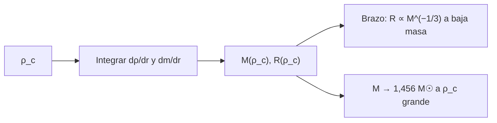

# B27-C02 — Enanas blancas y límite de Chandrasekhar

<!-- nav:top -->
[🏠 Programa](../../../../README.md) · [📚 Bloque B27](../../../tronco-comun/B27-objetos-compactos-y-altas-energias.md) · [← Anterior: B27-C01 — Presión de degeneración](../B27-C01-presion-de-degeneracion/CLASE.md) · [Siguiente: B27-C03 — Estrellas de neutrones →](../B27-C03-estrellas-de-neutrones/CLASE.md)
<!-- /nav -->

## 1. Ubicación, nivel y alcance

Clase 2 del bloque B27. Nivel N3. Con la presión de [C01](../B27-C01-presion-de-degeneracion/CLASE.md) resuelves la estructura completa de una enana blanca integrando el equilibrio hidrostático ([B24-C04](../../B24/B24-C04-equilibrio-hidrostatico-estelar/CLASE.md)) para muchas densidades centrales. Obtienes la relación masa–radio y ves cómo la masa se acerca al límite de Chandrasekhar de [B24-C18](../../B24/B24-C18-etapas-finales-de-evolucion/CLASE.md). Usas integración numérica ([B11-C07](../../B11/B11-C07-runge-kutta-de-cuarto-orden/CLASE.md)) y ecuaciones de estado. Se trata una enana blanca fría, con composición uniforme.

## 2. Por qué esta clase existe

Las enanas blancas son el destino de la mayoría de las estrellas, sirven de relojes cosmológicos y, al acercarse a su masa límite, pueden explotar. Una relación masa–radio correcta separa masas y radios que la fotometría sola confunde. La decisión central: **dada la densidad central, ¿qué masa y radio tiene una enana blanca y cómo se acerca a la masa límite?**

## 3. Lo que podrás hacer al terminar

1. Escribir el sistema hidrostático con la ecuación de estado degenerada.
2. Integrarlo para varias densidades centrales.
3. Obtener la relación masa–radio y su pendiente no relativista.
4. Ver que la masa crece hacia `1,456 M☉` y el radio se encoge.
5. Comparar con el politropo `n = 3/2`.
6. Reconocer el papel de la masa del compañero en una binaria.

La evidencia es la **tabla masa–radio de enanas blancas** del ejercicio 12 (sección 20).

## 4. Con qué llegas y cómo comprobarlo

1. ¿Qué es el equilibrio hidrostático?
2. ¿Qué es `dP/dρ`?
3. ¿Qué es RK4?
4. ¿Qué es un politropo `n = 3/2`?
5. ¿Qué es `μ_e`?

<details>
<summary>Ver respuestas</summary>

1. El balance entre el gradiente de presión y el peso. 2. La derivada de la presión respecto de la densidad (velocidad del sonido al cuadrado). 3. Runge–Kutta de cuarto orden. 4. `P ∝ ρ^{5/3}` (régimen no relativista). 5. Masa por electrón en `m_u`.
</details>

Con cuatro o cinco aciertos, sigue; si no, repasa C01 y B24-C04.

## 5. Un caso real: una enana blanca en un púlsar binario

El púlsar PSR J0348+0432 (de `2,01 ± 0,04 M☉`) tiene una compañera enana blanca de `0,172 ± 0,003 M☉` en una órbita de `2,46 h` (S4, resumen). Según el cálculo de la clase, una enana blanca de `0,17 M☉` (C/O, `μ_e = 2`) tendría un radio cercano a `1,6 × 10⁴ km` (unos `0,023 R☉`, interpolando la tabla de 8.2); es una **estimación** con una composición de C/O, no la de esa compañera. Es el **ejemplo conductor**. Los diagramas de Gaia muestran la secuencia de enanas blancas, que se divide en dos (hidrógeno y helio) (S3, resumen).

## 6. Vocabulario

Una **enana blanca** es un remanente sostenido por la presión de electrones degenerados. La **relación masa–radio** `R(M)` decrece. La **masa de Chandrasekhar** es el límite del politropo `n = 3`. La **densidad central** `ρ_c` parametriza la familia de modelos. La **ecuación de estado** es `P(ρ)`. La **superficie numérica** es el punto donde `ρ` baja de un umbral (aquí `10³ kg/m³`). Una **enana blanca de C/O** tiene `μ_e = 2`. La **compacidad** es `GM/(Rc²)`.

## 7. Modelo mental: más masa, más pequeña

Al añadir masa, la presión debe subir; en el régimen no relativista eso exige que la estrella se comprima, y la degeneración responde con poco aumento de presión (exponente `5/3`), así que se encoge más y más. En el régimen ultrarrelativista el exponente `4/3` no alcanza y la estrella no puede sostener más masa.



*Descripción textual:* para cada densidad central se integra el equilibrio hasta la superficie y se obtienen `M` y `R`; a baja masa `R ∝ M^{−1/3}` y a alta densidad la masa tiende al límite de Chandrasekhar.

Analogía: un globo que, cuanto más lo apretamos, endurece menos de lo que esperábamos. Límite: el modelo es de materia fría y composición uniforme.

## 8. La explicación, paso a paso

### 8.1 El sistema

`dρ/dr = −G m ρ/(r² dP/dρ)` y `dm/dr = 4πr²ρ`, con `dP/dρ = (m_ec²/3μ_e m_u) x²/√(1+x²)`. El laboratorio verifica esta derivada contra la derivada numérica de `P(ρ)` de C01 a `10⁻⁶`.

### 8.2 Las soluciones

Para `ρ_c` de `10⁶` a `10¹³ kg/m³`: `10⁶`: `0,0156 M☉`, `35 134 km`; `10⁸`: `0,149 M☉`, `16 382 km`; `10⁹`: `0,401 M☉`, `11 009 km`; `10¹⁰`: `0,815 M☉`, `7105 km`; `10¹¹`: `1,18 M☉`, `4351 km`; `10¹²`: `1,367 M☉`, `2485 km`; `10¹³`: `1,433 M☉`, `1319 km`.

### 8.3 Pendiente no relativista

Entre `10⁶` y `3 × 10⁶ kg/m³`, `d ln R/d ln M = −0,316`, cerca del `−1/3` del politropo `n = 3/2` (la diferencia es de unos `5 %` por efectos relativistas ya incipientes).

### 8.4 El límite

La masa crece monótonamente con `ρ_c` y a `10¹³ kg/m³` alcanza `1,4327 M☉`, un `98,4 %` de `1,4563 M☉` (límite del politropo `n = 3` con `μ_e = 2`, B24-C18). La masa límite solo se alcanza para `ρ_c → ∞`; en la práctica, antes ocurren otros procesos (captura de electrones, fusión).

### 8.5 Qué esperar de una enana blanca real

La relación depende de la composición (`μ_e`), la temperatura y la corrección de Coulomb. Para una masa de `0,6 M☉` el radio estimado es cercano a `9000 km` (`0,013 R☉`), del tamaño de un planeta. Una enana blanca que gana masa de una compañera puede aproximarse al límite (B27-C14).

## 9. Magnitudes, símbolos y unidades

| Símbolo | Qué es | Unidad | Valor / nota |
|---|---|---|---|
| `ρ_c` | densidad central | `kg m⁻³` | `10⁶` – `10¹³` (ilustrativas) |
| `M`, `R` | masa y radio | `M☉`; km | tabla de 8.2 |
| `μ_e` | masa por electrón | — | `2` |
| `d ln R/d ln M` | pendiente | — | `−0,316` |
| `M_Ch` | límite | `M☉` | `1,4563` (politropo `n = 3`) |

## 10. Convenciones y referencias

Materia fría, composición uniforme (C/O), relatividad general despreciable; `M☉ = GM☉/G` (IAU y NIST). Las densidades centrales son **ilustrativas**.

## 11. De dónde sale lo que afirmamos

| ID | Fuente | Localizador | Respalda | Estado |
|---|---|---|---|---|
| S1 | NIST, *Fundamental Physical Constants — Complete Listing* (CODATA 2022) | https://physics.nist.gov/cuu/Constants/Table/allascii.txt | `h`, `c`, `m_e`, `m_u`, `G` | Consultada el 2026-11-09 |
| S2 | Mamajek et al., *IAU 2015 Resolution B3*, arXiv:1510.07674 | https://arxiv.org/abs/1510.07674 | `GM☉` | Texto del PDF extraído el 2026-11-09 |
| S3 | Gaia Collaboration, arXiv:1804.09378 | https://arxiv.org/abs/1804.09378 | Secuencia de enanas blancas dividida (H y He) | Solo resumen, consultado el 2026-11-09 |
| S4 | Antoniadis et al., *A massive pulsar in a compact relativistic binary*, arXiv:1304.6875 | https://arxiv.org/abs/1304.6875 | Púlsar `2,01 ± 0,04 M☉`; compañera enana blanca `0,172 ± 0,003 M☉` | Solo resumen, consultado el 2026-11-09 |

Límites: S3 y S4 solo resumen; la relación masa–radio es un cálculo propio con ecuación de estado ideal, no una calibración observacional.

## 12. Cómo ver la relación

| `ρ_c` (kg/m³) | `M` (`M☉`) | `R` (km) |
|---|---|---|
| `10⁶` | 0,0156 | 35 134 |
| `10⁸` | 0,149 | 16 382 |
| `10⁹` | 0,401 | 11 009 |
| `10¹⁰` | 0,815 | 7105 |
| `10¹²` | 1,367 | 2485 |
| `10¹³` | 1,433 | 1319 |

Descripción larga: la masa sube y el radio baja; la masa se aplana cerca de `1,45 M☉`.

## 13. Ejemplo trabajado: radio de una enana blanca de `0,4 M☉`

**Paso 1 · Datos.** Tabla: `10⁹ kg/m³` → `0,401 M☉`.

**Paso 2 · Radio.** `R = 11 009 km`.

**Paso 3 · En radios solares.** `11 009/695 700 = 0,0158 R☉`.

**Paso 4 · Compacidad.** `GM/(Rc²) = 0,401 × 2,12 × 10⁻⁶/0,0158 = 5,4 × 10⁻⁵`.

**Paso 5 · Sentido.** Un objeto con la masa de media estrella y el tamaño de la Tierra; la relatividad general aún es una pequeña corrección.

## 14. Distintas formas de relacionar `M` y `R`

**Politropo `n = 3/2` (límite no relativista):** `R ∝ M^{−1/3}`. **Politropo `n = 3`:** da la masa límite. **EOS exacta (esta clase):** interpola entre ambos.

## 15. Práctica guiada

**Ejercicio 1 · con los pasos indicados.** Pasa `R = 11 009 km` a `R☉`.

<details><summary>Solución comentada</summary>

`0,0158 R☉`.
</details>

**Ejercicio 2 · con una pista.** ¿Qué fracción de `M_Ch` es `1,433 M☉`?

<details><summary>Solución comentada</summary>

`1,433/1,4563 = 98,4 %`.
</details>

**Ejercicio 3 · casi autónomo.** Pendiente `d ln R/d ln M` entre `10⁶` y `3 × 10⁶`.

<details><summary>Solución comentada</summary>

`−0,316`.
</details>

## 16. Práctica autónoma, transferencia e integrador

**Ejercicio 4.** ¿Cuántas veces mayor es el radio de la enana de `0,0156 M☉` que la de `0,815 M☉`?

<details><summary>Solución comentada</summary>

`35 134/7105 = 4,9`.
</details>

**Ejercicio 5.** Si `R ∝ M^{−1/3}`, ¿cuánto cambia `R` al duplicar `M`?

<details><summary>Solución comentada</summary>

`2^{−1/3} = 0,79`.
</details>

**Ejercicio 6.** ¿Cuánto vale la densidad media de la enana de `0,401 M☉` y `11 009 km`?

<details><summary>Solución comentada</summary>

`0,401 × 1,98841 × 10³⁰/(4,19 × (1,1009 × 10⁷)³) = 1,4 × 10⁸ kg/m³`.
</details>

**Ejercicio 7.** ¿Por qué `M` se aplana a alta `ρ_c`?

<details><summary>Solución comentada</summary>

Porque la ecuación de estado se acerca al politropo `n = 3` (8.4), cuyo límite de masa no depende de `ρ_c`.
</details>

**Ejercicio 8.** Compara el radio de una enana de `0,17 M☉` (interpolando `0,149` y `0,401`) con la Tierra.

<details><summary>Solución comentada</summary>

Entre `16 382` y `11 009` km: `≈ 15 700 km`, unas 2,5 veces el radio ecuatorial terrestre nominal de la IAU, `6378,1 km` (S2).
</details>

**Ejercicio 9 · transferencia.** Un compañero dice que una enana blanca de `2 M☉` es posible si es muy fría. Responde con 8.4.

<details><summary>Solución comentada</summary>

No: el límite no depende de la temperatura sino de la ecuación de estado; con rotación o campo la cifra cambia algo, pero no a `2 M☉` en este modelo.
</details>

**Ejercicio 10 · transferencia.** El púlsar J0348+0432 tiene compañera de `0,172 M☉` (S4). ¿Qué orden de radio tendría si fuera de C/O?

<details><summary>Solución comentada</summary>

Unos `1,6 × 10⁴ km` (8.5 y ejercicio 8); es una estimación, la compañera real puede tener helio.
</details>

**Ejercicio 11 · transferencia.** ¿Qué dice Gaia sobre las enanas blancas (S3)?

<details><summary>Solución comentada</summary>

Que su secuencia se divide en una de hidrógeno y otra de helio (resumen).
</details>

**Ejercicio 12 · integrador.** Elabora tu *tabla masa–radio de enanas blancas*: integra para cinco densidades centrales, da `M` y `R`, la pendiente no relativista, el acercamiento al límite y dos limitaciones.

<details><summary>Solución modelo</summary>

Tabla de la sección 12; pendiente `−0,316`; `98,4 %` de `M_Ch`; limitaciones: composición y temperatura.
</details>

## 17. Laboratorio: masa y radio

El script [enana_blanca.py](enana_blanca.py) integra el equilibrio con RK4 para nueve densidades, **comprueba** `dP/dρ` frente a la derivada numérica (`10⁻⁶`), la pendiente `−1/3` (tolerancia `0,02`) y que `M` crece monótonamente y queda entre `97,5 %` y `100 %` de `1,4563 M☉` a `10¹³`.

**Datos:** constantes de NIST e IAU; densidades **ilustrativas**. **Predice antes de ejecutar:** ¿qué masa da `10¹³ kg/m³`? (cerca del límite.) **Ejecución del 2026-11-09 (Python 3.12.9):**

```text
Python 3.12.9 (biblioteca estandar)
 rho_c [kg/m3]   M [Msol]    R [km]  R [R_sol]
         1e+06     0.0156     35134    0.05050
         3e+06     0.0270     29555    0.04248
         1e+07     0.0490     24370    0.03503
         1e+08     0.1487     16382    0.02355
         1e+09     0.4008     11009    0.01582
         1e+10     0.8152      7105    0.01021
         1e+11     1.1805      4351    0.00625
         1e+12     1.3672      2485    0.00357
         1e+13     1.4327      1319    0.00190
pendiente d lnR/d lnM (rho_c 1e6 -> 3e6) = -0.316 (politropo n = 3/2: -1/3)
M(rho_c = 1e13) = 1.4327 Msol ; limite del politropo n = 3 = 1.4563 Msol
Pruebas superadas.
```

```bash
python programa/clases/B27/B27-C02-enanas-blancas-y-limite-de-chandrasekhar/enana_blanca.py
```

**Límites:** newtoniano, `T = 0`, composición uniforme.

## 18. Errores frecuentes y cómo corregirlos

**Pensar que la masa crece sin límite con `ρ_c`.** Se corrige con el ejercicio 7.

**Confundir el radio con la densidad.** Se corrige con el ejercicio 6.

**Tomar el cálculo por una calibración observacional.** Se corrige con la sección 10.

**Aplicar `R ∝ M^{−1/3}` a masas grandes.** Se corrige con el ejercicio 3.

**Creer que la temperatura cambia el límite.** Se corrige con el ejercicio 9.

## 19. Cómo sabrás que vas bien

Tras 8.2: ¿cómo cambian `M` y `R` con `ρ_c`? Si dudas, ejercicio 4. Tras 8.4: ¿qué pasa a alta densidad? Ejercicio 7. Tras el laboratorio: ¿qué comprueba `dP/dρ`? (la consistencia con C01).

## 20. Qué entregas y cómo se evalúa

El producto es tu **tabla masa–radio de enanas blancas** (ejercicio 12).

| Criterio | Inicial | En desarrollo | Logrado | Destacado |
|---|---|---|---|---|
| Conceptos | Los confunde | Parciales | Equilibrio, límite | Explica la pendiente |
| Cálculo | Sin unidades | Con errores | Tabla correcta | Compara con politropos |
| Numérico | Sin comprobar | Un caso | Derivada y pendiente | Interpreta el acercamiento |
| Fuentes | Sin fuente | Sin fecha | S1–S4 con fecha | Declara resúmenes |
| Límites | No los nombra | Uno | Tres | Discute composición |

**Condiciones críticas (no se compensan con promedio):** rotular densidades como ilustrativas; no presentar el resultado como calibración observacional; citar solo lo consultado.

## 21. Ética, seguridad y límites

Clase educativa: no sustituye modelos de enanas blancas con corrección de Coulomb y enfriamiento. Accesibilidad: tablas equivalentes a las gráficas, fórmulas en texto, ejercicios sin conexión.

## 22. Para cerrar y seguir

Integrando el equilibrio con la presión degenerada, una enana blanca pasa de `35 000 km` y `0,016 M☉` a `1300 km` y `1,43 M☉`: `R ∝ M^{−1/3}` a baja masa y `M → 1,456 M☉` a alta densidad. Queda una pregunta: ¿qué ocurre cuando los electrones no bastan?

**Glosario español–inglés.** enana blanca · *white dwarf*; relación masa–radio · *mass–radius relation*; masa de Chandrasekhar · *Chandrasekhar mass*; densidad central · *central density*; ecuación de estado · *equation of state*; compacidad · *compactness*.

**Continuidad.** [B27-C03](../B27-C03-estrellas-de-neutrones/CLASE.md) estudia el objeto que se forma cuando los electrones se funden con los protones.

**Referencias:** ver sección 11.

<!-- nav:bottom -->
---

[← Anterior: B27-C01 — Presión de degeneración](../B27-C01-presion-de-degeneracion/CLASE.md) · [📚 Bloque B27](../../../tronco-comun/B27-objetos-compactos-y-altas-energias.md) · [Siguiente: B27-C03 — Estrellas de neutrones →](../B27-C03-estrellas-de-neutrones/CLASE.md)
<!-- /nav -->
