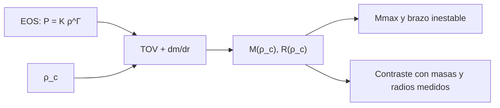

# B27-C03 — Estrellas de neutrones

<!-- nav:top -->
[🏠 Programa](../../../../README.md) · [📚 Bloque B27](../../../tronco-comun/B27-objetos-compactos-y-altas-energias.md) · [← Anterior: B27-C02 — Enanas blancas y límite de Chandrasekhar](../B27-C02-enanas-blancas-y-limite-de-chandrasekhar/CLASE.md) · [Siguiente: B27-C04 — Ecuación de estado nuclear →](../B27-C04-ecuacion-de-estado-nuclear/CLASE.md)
<!-- /nav -->

## 1. Ubicación, nivel y alcance

Clase 3 del bloque B27. Nivel N3. Una estrella de neutrones tiene la masa del Sol en una esfera de unos 12 km: la gravedad es tan intensa que la relatividad general ya no es una pequeña corrección. Aquí integras la **ecuación de Tolman–Oppenheimer–Volkoff (TOV)** con una ecuación de estado politrópica ilustrativa y la comparas con la versión newtoniana y con las masas medidas. Usas el equilibrio de [B24-C04](../../B24/B24-C04-equilibrio-hidrostatico-estelar/CLASE.md), la métrica de Schwarzschild de [B26-C07](../../B26/B26-C07-curvatura-y-metricas/CLASE.md) y la presión degenerada de [C01](../B27-C01-presion-de-degeneracion/CLASE.md). Se trata una estrella estática y esférica.

## 2. Por qué esta clase existe

Las masas y radios de las estrellas de neutrones son la mejor ventana a la materia a densidades nucleares. Para interpretarlos hay que saber qué cambia la relatividad respecto de Newton y por qué existe una masa máxima. La decisión central: **dada una ecuación de estado, ¿qué masa y radio tiene una estrella de neutrones para cada densidad central y cuál es su masa máxima?**

## 3. Lo que podrás hacer al terminar

1. Escribir las ecuaciones TOV y reconocer sus correcciones relativistas.
2. Integrarlas con una ecuación de estado politrópica.
3. Comprobar el límite newtoniano a baja densidad.
4. Obtener la masa máxima y reconocer el brazo inestable.
5. Calcular la compacidad y compararla con una medida publicada.
6. Contrastar el resultado con masas medidas de púlsares.

La evidencia es la **ficha de una familia de estrellas de neutrones** del ejercicio 12 (sección 20).

## 4. Con qué llegas y cómo comprobarlo

1. ¿Qué es la ecuación de equilibrio newtoniana?
2. ¿Qué es la compacidad `GM/(Rc²)`?
3. ¿Qué es un politropo?
4. ¿Qué es la energía de reposo y la energía total por volumen `e`?
5. ¿Qué es el radio de Schwarzschild?

<details>
<summary>Ver respuestas</summary>

1. `dP/dr = −Gmρ/r²`. 2. La razón entre el radio de Schwarzschild/2 y el radio. 3. `P = Kρ^Γ`. 4. `e = ρc² + energía interna`. 5. `2GM/c²`.
</details>

Con cuatro o cinco aciertos, sigue; si no, repasa B24-C04 y B26-C07.

## 5. Un caso real: las masas medidas

El púlsar PSR J0740+6620 tiene `2,14 (+0,10/−0,09) M☉` por el retardo de Shapiro (S3, resumen); PSR J0348+0432, `2,01 ± 0,04 M☉` (S4, resumen). NICER midió para PSR J0030+0451 `1,34 (+0,15/−0,16) M☉` y `12,71 (+1,14/−1,19) km`, con una compacidad `0,156 (+0,008/−0,010)` (S5, resumen). El evento GW170817 tenía una masa total de `2,74 (+0,04/−0,01) M☉` a `40 (+8/−14) Mpc` (S6, resumen). Es el **ejemplo conductor**: ¿qué estrellas permite una ecuación de estado simple?

## 6. Vocabulario

La **ecuación TOV** es la de equilibrio hidrostático relativista: `dP/dr = −(e+P)(m + 4πr³P/c²)G/[c²r(r − 2Gm/c²)]`. La **densidad de energía** `e` incluye la masa en reposo. La **ecuación de estado** (EOS) liga `P` con `ρ`. El **politropo** `P = Kρ^Γ` con `Γ = 2` es el caso `n = 1`. La **masa máxima** es la mayor masa estable. El **brazo inestable** son las configuraciones con densidad central mayor que la de masa máxima. La **compacidad** es `GM/(Rc²)`. El **retardo de Shapiro** es el retraso de una señal que pasa cerca de una masa. Una **EOS rígida** (stiff) sube más rápido `P` con `ρ`.

## 7. Modelo mental: la presión también pesa

En Newton, solo la masa pesa. En relatividad general, la presión y la energía también gravitan: cuanto más se comprime la materia, más se refuerza la gravedad, y eso limita la masa.



*Descripción textual:* con la ecuación de estado y una densidad central se integra TOV hasta que la presión se anula; la familia `(M, R)` tiene una masa máxima, y se contrasta con las medidas.

Analogía: una bola de masa creciente que se hunde en una cama elástica que se endurece. Límite: la analogía no captura que la presión pesa.

## 8. La explicación, paso a paso

### 8.1 El límite newtoniano

Para el politropo `n = 1` newtoniano, `R = √(πK/(2G)) = 11,98 km` independiente de la masa, y `M = 4ρ_cR³/π`. Con `K = 6,1 × 10⁻³` (SI, **ilustrativo**) y `ρ_c = 2 × 10¹⁵ kg/m³`, TOV da `M = 0,0022 M☉` y `R = 11,98 km`, igual que Newton.

### 8.2 La corrección relativista

A densidades mayores, TOV se aparta de Newton. Con `ρ_c = 10¹⁸ kg/m³`, TOV da `0,674 M☉` y `10,26 km` (compacidad `0,097`) frente a los `1,102 M☉` newtonianos: Newton sobrestima la masa un `63 %`.

### 8.3 Masa máxima

El barrido da `0,032; 0,104; 0,281; 0,484; 0,674; 0,829; 0,985; 1,055; 1,013 M☉` para `ρ_c = 3 × 10¹⁶ … 8 × 10¹⁸`. El máximo, `1,055 M☉`, ocurre cerca de `4 × 10¹⁸ kg/m³` (`R = 7,65 km`, compacidad `0,204`); más allá, `M` decrece y las configuraciones son inestables. En Newton, `M` crece sin límite.

### 8.4 Contraste con las medidas

La masa máxima de esta EOS (`1,055 M☉`) queda por debajo de `2,01` y `2,14 M☉` (S3, S4): **esta ecuación de estado queda excluida**. Las medidas obligan a ecuaciones de estado más rígidas a alta densidad (C04). Con `1,34 M☉` y `12,71 km` la compacidad es `0,156` (coincide con S5), y con la EOS ilustrativa, una estrella de `1 M☉` ya tiene `R ≈ 8 km`: un radio menor que el de NICER.

### 8.5 Qué falta

No hay rotación, campo ni corteza; la EOS ilustrativa no es nuclear. El límite de masa depende sobre todo de la rigidez a densidades altas y se acota con medidas de masa. Las ondas gravitacionales de binarias de estrellas de neutrones (GW170817, masa total `2,74 M☉`, S6) añaden restricciones de deformabilidad de marea (C13).

## 9. Magnitudes, símbolos y unidades

| Símbolo | Qué es | Unidad | Valor / nota |
|---|---|---|---|
| `K`, `Γ` | constantes de la EOS | SI; — | `6,1 × 10⁻³`; `2` (ilustrativas) |
| `ρ_c` | densidad central | `kg m⁻³` | `3 × 10¹⁶` – `8 × 10¹⁸` |
| `M`, `R` | masa y radio | `M☉`; km | tabla de 8.3 |
| `GM/Rc²` | compacidad | — | `0,097`; `0,204` (máx.); `0,156` (NICER, S5) |
| `M_max` | masa máxima del modelo | `M☉` | `1,055` |

## 10. Convenciones y referencias

Estrella esférica y estática; `e = ρc² + P/(Γ−1)`; la EOS es **sintética**. Masas y radios medidos son publicados (resúmenes). `M☉ = GM☉/G` (IAU, NIST).

## 11. De dónde sale lo que afirmamos

| ID | Fuente | Localizador | Respalda | Estado |
|---|---|---|---|---|
| S1 | NIST, *Fundamental Physical Constants — Complete Listing* (CODATA 2022) | https://physics.nist.gov/cuu/Constants/Table/allascii.txt | `G`, `c` | Consultada el 2026-11-09 |
| S2 | Mamajek et al., *IAU 2015 Resolution B3*, arXiv:1510.07674 | https://arxiv.org/abs/1510.07674 | `GM☉` | Texto del PDF extraído el 2026-11-09 |
| S3 | Cromartie et al., *Relativistic Shapiro delay measurements of an extremely massive millisecond pulsar*, arXiv:1904.06759 | https://arxiv.org/abs/1904.06759 | `2,14 (+0,10/−0,09) M☉` | Solo resumen, consultado el 2026-11-09 |
| S4 | Antoniadis et al., arXiv:1304.6875 | https://arxiv.org/abs/1304.6875 | `2,01 ± 0,04 M☉` | Solo resumen, consultado el 2026-11-09 |
| S5 | Riley et al., *A NICER View of PSR J0030+0451*, arXiv:1912.05702 | https://arxiv.org/abs/1912.05702 | `1,34 (+0,15/−0,16) M☉`; `12,71 (+1,14/−1,19) km`; compacidad `0,156` | Solo resumen, consultado el 2026-11-09 |
| S6 | LIGO Scientific Collaboration y Virgo, *GW170817*, arXiv:1710.05832 | https://arxiv.org/abs/1710.05832 | Masa total `2,74 (+0,04/−0,01) M☉`; `40 (+8/−14) Mpc` | Solo resumen, consultado el 2026-11-09 |

Límites: S3–S6 solo resumen; la ecuación TOV es estándar y el límite newtoniano la verifica; la EOS no procede de ningún modelo nuclear.

## 12. Cómo ver la familia

| `ρ_c` (kg/m³) | `M` (`M☉`) | `R` (km) | `GM/Rc²` | `M` newtoniana |
|---|---|---|---|---|
| `3 × 10¹⁶` | 0,032 | 11,92 | 0,004 | 0,033 |
| `10¹⁷` | 0,104 | 11,79 | 0,013 | 0,110 |
| `10¹⁸` | 0,674 | 10,26 | 0,097 | 1,102 |
| `2,5 × 10¹⁸` | 0,985 | 8,67 | 0,168 | 2,754 |
| `4 × 10¹⁸` | 1,055 | 7,65 | 0,204 | 4,406 |
| `8 × 10¹⁸` | 1,013 | 6,25 | 0,240 | 8,812 |

Descripción larga: a baja densidad TOV y Newton coinciden; a alta, Newton crece sin límite y TOV se satura y decrece.

## 13. Ejemplo trabajado: compacidad de la medida de NICER

**Paso 1 · Datos.** `M = 1,34 M☉`, `R = 12,71 km` (S5).

**Paso 2 · Radio gravitacional.** `GM/c² = 1,34 × 1476,63 m = 1978,7 m`.

**Paso 3 · Compacidad.** `1978,7/12 710 = 0,156`.

**Paso 4 · Sentido.** Coincide con el valor del resumen (`0,156`). Es alta: la corrección de TOV frente a Newton es de decenas por ciento.

## 14. Distintas formas de estudiar la estructura

**TOV con EOS politrópica (esta clase):** simple. **EOS tabulada de física nuclear:** realista. **Inferencia bayesiana con masas, radios y mareas:** acota la EOS (C04).

## 15. Práctica guiada

**Ejercicio 1 · con los pasos indicados.** Calcula `R = √(πK/2G)` para `K = 6,1 × 10⁻³`. *Pasos:* `πK/2G`, raíz.

<details><summary>Solución comentada</summary>

`π × 6,1 × 10⁻³/(2 × 6,6743 × 10⁻¹¹) = 1,436 × 10⁸`; raíz `11 980 m = 11,98 km`.
</details>

**Ejercicio 2 · con una pista.** Calcula la compacidad para `1,4 M☉` y `12 km`.

<details><summary>Solución comentada</summary>

`1,4 × 1476,63/12 000 = 0,172`.
</details>

**Ejercicio 3 · casi autónomo.** ¿Qué masa newtoniana da `ρ_c = 10¹⁸`, y cuánto más que TOV?

<details><summary>Solución comentada</summary>

`1,102` frente a `0,674 M☉`: `+63 %`.
</details>

## 16. Práctica autónoma, transferencia e integrador

**Ejercicio 4.** ¿Cuál es la masa máxima del barrido y a qué densidad?

<details><summary>Solución comentada</summary>

`1,055 M☉` a `4 × 10¹⁸ kg/m³`.
</details>

**Ejercicio 5.** ¿Qué pasa con `M` entre `4 × 10¹⁸` y `8 × 10¹⁸`?

<details><summary>Solución comentada</summary>

Decrece de `1,055` a `1,013 M☉`: brazo inestable.
</details>

**Ejercicio 6.** ¿Excluye esta EOS a J0740+6620?

<details><summary>Solución comentada</summary>

Sí: `1,055 < 2,14 − 0,09 = 2,05`.
</details>

**Ejercicio 7.** Diferencia entre las masas de J0740+6620 y J0348+0432 en unidades de la incertidumbre combinada.

<details><summary>Solución comentada</summary>

`0,13/√(0,10² + 0,04²) = 0,13/0,108 = 1,2σ`.
</details>

**Ejercicio 8.** Radio de Schwarzschild de `1,4 M☉`.

<details><summary>Solución comentada</summary>

`2 × 1,4 × 1476,63 = 4134,6 m`.
</details>

**Ejercicio 9 · transferencia.** Un compañero dice que no existe masa máxima porque la presión de degeneración crece sin límite. Responde con 8.3.

<details><summary>Solución comentada</summary>

La presión también pesa en relatividad general; con TOV hay un máximo (aquí `1,055 M☉`).
</details>

**Ejercicio 10 · transferencia.** En un politropo `n = 1` newtoniano, ¿qué radio tiene una estrella de `0,1 M☉` y qué de `1 M☉`?

<details><summary>Solución comentada</summary>

El mismo, `11,98 km`: no depende de la masa. En TOV sí cambia con la compacidad.
</details>

**Ejercicio 11 · transferencia.** GW170817 tenía una masa total de `2,74 M☉` (S6). Si las dos estrellas fueran iguales, ¿qué masa tendría cada una y cabría bajo la masa máxima de esta EOS?

<details><summary>Solución comentada</summary>

`1,37 M☉` cada una, mayor que `1,055 M☉`: esta EOS no admitiría esas estrellas, otra razón para descartarla.
</details>

**Ejercicio 12 · integrador.** Elabora tu *ficha de una familia de estrellas de neutrones*: tabla `M(ρ_c)`, `R(ρ_c)`, compacidad, masa máxima, comparación con Newton y con las masas medidas, y una conclusión sobre la EOS.

<details><summary>Solución modelo</summary>

Tabla de la sección 12; `M_max = 1,055`; EOS excluida por `2,14 M☉`.
</details>

## 17. Laboratorio: TOV

El script [tov.py](tov.py) integra TOV (y la versión newtoniana) para nueve densidades y **comprueba** que a `2 × 10¹⁵ kg/m³` coincide con el límite newtoniano (`R` y `M`) al `3 %`; imprime la masa máxima y la compara con J0740+6620 y J0348+0432.

**Datos:** constantes de NIST; EOS **sintética**; masas publicadas (resúmenes). **Predice antes de ejecutar:** ¿superará la masa máxima a `2 M☉`? (no.) **Ejecución del 2026-11-09 (Python 3.12.9):**

```text
Python 3.12.9 (biblioteca estandar)
politropo n = 1 newtoniano: R = 11.98 km (independiente de la masa)
rho_c = 2e15: TOV M = 0.0022 Msol, R = 11.98 km ; newtoniano M = 0.0022 Msol
 rho_c [kg/m3]  M [Msol]   R [km]  GM/(Rc^2)   M newt.
       3.0e+16     0.032    11.92      0.004     0.033
       1.0e+17     0.104    11.79      0.013     0.110
       3.0e+17     0.281    11.41      0.036     0.330
       6.0e+17     0.484    10.83      0.066     0.661
       1.0e+18     0.674    10.26      0.097     1.102
       1.5e+18     0.829     9.62      0.127     1.652
       2.5e+18     0.985     8.67      0.168     2.754
       4.0e+18     1.055     7.65      0.204     4.406
       8.0e+18     1.013     6.25      0.240     8.812
masa maxima del barrido TOV = 1.055 Msol
  J0740+6620 (Cromartie): 2.14 Msol -> excluida por esta EOS
  J0348+0432 (Antoniadis): 2.01 Msol -> excluida por esta EOS
Pruebas superadas.
```

```bash
python programa/clases/B27/B27-C03-estrellas-de-neutrones/tov.py
```

**Límites:** EOS de una sola ley de potencias, sin rotación ni corteza.

## 18. Errores frecuentes y cómo corregirlos

**Usar Newton cerca de `GM/Rc² ~ 0,1`.** Se corrige con el ejercicio 3.

**Pensar que la masa crece siempre con `ρ_c`.** Se corrige con el ejercicio 5.

**Tomar la EOS ilustrativa por física nuclear.** Se corrige con la sección 10.

**Confundir `e` con `ρ`.** Se corrige con la definición de la sección 6.

**Ignorar la incertidumbre de las medidas.** Se corrige con el ejercicio 7.

## 19. Cómo sabrás que vas bien

Tras 8.1: ¿cuánto vale `R` newtoniano? Si dudas, ejercicio 1. Tras 8.3: ¿cuál es el máximo? Ejercicio 4. Tras el laboratorio: ¿qué verifica el límite newtoniano? (la integración TOV).

## 20. Qué entregas y cómo se evalúa

El producto es tu **ficha de una familia de estrellas de neutrones** (ejercicio 12).

| Criterio | Inicial | En desarrollo | Logrado | Destacado |
|---|---|---|---|---|
| Ecuaciones | No las plantea | Parciales | TOV completas | Distingue el aporte de `P` |
| Cálculo | Sin unidades | Con errores | Tabla correcta | Compacidad y comparación |
| Numérico | Sin comprobar | Un caso | Límite newtoniano | Interpreta el brazo inestable |
| Fuentes | Sin fuente | Sin fecha | S1–S6 con fecha | Declara resúmenes |
| Límites | No los nombra | Uno | Tres | Discute la EOS |

**Condiciones críticas (no se compensan con promedio):** rotular la EOS como sintética; no concluir sobre materia nuclear a partir de ella; citar solo lo consultado.

## 21. Ética, seguridad y límites

Clase educativa: no sustituye un modelo de estructura con ecuaciones de estado nucleares. Accesibilidad: tablas equivalentes a las gráficas, fórmulas en texto, ejercicios sin conexión.

## 22. Para cerrar y seguir

TOV reduce el radio y limita la masa: con la EOS ilustrativa el máximo es `1,055 M☉`, lejos de los `2 M☉` medidos. Queda una pregunta: ¿qué ecuaciones de estado, con qué rigidez, permiten esas masas y los radios medidos?

**Glosario español–inglés.** ecuación TOV · *TOV equation*; masa máxima · *maximum mass*; ecuación de estado · *equation of state*; compacidad · *compactness*; retardo de Shapiro · *Shapiro delay*; brazo inestable · *unstable branch*.

**Continuidad.** [B27-C04](../B27-C04-ecuacion-de-estado-nuclear/CLASE.md) compara ecuaciones de estado con las restricciones de masa y radio.

**Referencias:** ver sección 11.

<!-- nav:bottom -->
---

[← Anterior: B27-C02 — Enanas blancas y límite de Chandrasekhar](../B27-C02-enanas-blancas-y-limite-de-chandrasekhar/CLASE.md) · [📚 Bloque B27](../../../tronco-comun/B27-objetos-compactos-y-altas-energias.md) · [Siguiente: B27-C04 — Ecuación de estado nuclear →](../B27-C04-ecuacion-de-estado-nuclear/CLASE.md)
<!-- /nav -->
