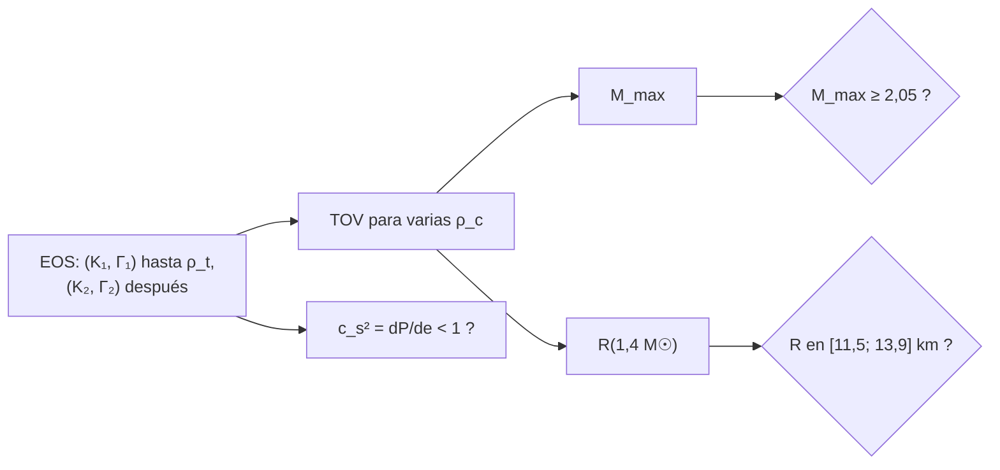

# B27-C04 — Ecuación de estado nuclear

<!-- nav:top -->
[🏠 Programa](../../../../README.md) · [📚 Bloque B27](../../../tronco-comun/B27-objetos-compactos-y-altas-energias.md) · [← Anterior: B27-C03 — Estrellas de neutrones](../B27-C03-estrellas-de-neutrones/CLASE.md) · [Siguiente: B27-C05 — Púlsares y relojes naturales →](../../../tronco-comun/B27-objetos-compactos-y-altas-energias.md#b27-c05)
<!-- /nav -->

## 1. Ubicación, nivel y alcance

Clase 4 del bloque B27. Nivel N3. La ecuación TOV de [C03](../B27-C03-estrellas-de-neutrones/CLASE.md) convierte una ecuación de estado (EOS) en una familia de estrellas. Ahora invertirás el razonamiento: dadas las medidas de masas y radios, ¿qué EOS son compatibles? Comparas tres EOS sintéticas, una de ellas por tramos, con dos restricciones publicadas y con la causalidad. Usas TOV, interpolación ([B11-C18](../../B11/B11-C18-interpolacion-y-extrapolacion/CLASE.md)) y estadística básica. La física nuclear se amplía en [B31](../../../tronco-comun/B31-fisica-cuantica-nuclear-y-astroparticulas.md).

## 2. Por qué esta clase existe

Las estrellas de neutrones son el único laboratorio de materia más allá de la densidad nuclear. Su EOS no se conoce con precisión; las medidas de masa máxima y de radio la acotan. La decisión central: **dadas la masa máxima y el radio de una estrella de `1,4 M☉` medidos, ¿qué EOS de una familia sintética son compatibles y respetan la causalidad?**

## 3. Lo que podrás hacer al terminar

1. Definir una EOS por tramos con continuidad de `P` y de `e`.
2. Calcular `M_max` y `R(1,4 M☉)` de cada EOS.
3. Confrontar con una masa máxima y un radio medidos.
4. Comprobar la causalidad `c_s < c`.
5. Explicar por qué una EOS blanda a baja densidad y rígida a alta puede satisfacer ambas medidas.
6. Reconocer lo que cada medida acota.

La evidencia es la **tabla de EOS frente a restricciones** del ejercicio 12 (sección 20).

## 4. Con qué llegas y cómo comprobarlo

1. ¿Qué es TOV (C03)?
2. ¿Qué es la velocidad del sonido `c_s² = dP/de`?
3. ¿Qué significa continuidad de `P`?
4. ¿Qué es una interpolación lineal?
5. ¿Qué es una EOS rígida?

<details>
<summary>Ver respuestas</summary>

1. La ecuación de equilibrio relativista. 2. La rapidez de la perturbación de presión. 3. Que `P` no salta en el punto de unión de los tramos. 4. Una recta entre dos puntos. 5. Una en que `P` crece rápido con `ρ`.
</details>

Con cuatro o cinco aciertos, sigue; si no, repasa C03 y B11-C18.

## 5. Un caso real: dos restricciones

Cromartie et al. midieron `2,14 (+0,10/−0,09) M☉` para PSR J0740+6620 (S3, resumen): la masa máxima de la EOS debe superar `≈ 2,05 M☉` (límite inferior al 68 %). Riley et al. midieron con NICER un radio `12,71 (+1,14/−1,19) km` para una estrella de `1,34 M☉` (S4, resumen): el radio de una estrella de `1,4 M☉` debe caer en torno a `11,5–13,9 km`. GW170817 aportó una masa total de `2,74 M☉` (S5, resumen). Es el **ejemplo conductor**; las tres EOS son **sintéticas**.

## 6. Vocabulario

Una **EOS por tramos** usa varios politropos unidos en densidades de transición. La **continuidad** exige que `P` y `e` coincidan en la unión. La **velocidad del sonido** `c_s² = dP/de` (en unidades de `c²`) debe ser menor que `1`. La **causalidad** es `c_s ≤ c`. La **masa máxima** `M_max` y el **radio de 1,4 `M☉`** `R_{1,4}` son los dos resúmenes de una EOS. La **rigidez** de una EOS es cuánto crece `P` con `ρ`. La **densidad de transición** `ρ_t` separa dos tramos.

## 7. Modelo mental: una carretera con dos pendientes

A baja densidad la carretera sube suave (EOS blanda): da radios pequeños. A partir de `ρ_t` se empina (EOS rígida): permite masas altas sin que el radio de las estrellas moderadas cambie mucho.



*Descripción textual:* cada EOS genera una familia TOV, de la que se leen `M_max` y `R_{1,4}`; se comprueban las dos restricciones y la causalidad.

Analogía: una carretera de montaña con un tramo suave y otro empinado. Límite: la EOS real tiene más tramos y transiciones de fase.

## 8. La explicación, paso a paso

### 8.1 EOS por tramos

Para `ρ < ρ_t`, `P = K₁ρ^{Γ₁}`; para `ρ ≥ ρ_t`, `P = K₂ρ^{Γ₂}` con `K₂ = K₁ρ_t^{Γ₁−Γ₂}` (continuidad de `P`). La densidad de energía es `e = (1 + a_i)ρc² + P/(Γ_i − 1)`, con `a₂` elegida para que `e` también sea continua. El laboratorio comprueba ambas continuidades a `10⁻¹²`.

### 8.2 Tres EOS

A: `Γ = 2`, `K = 6,1 × 10⁻³` (la de C03). B: `K₁ = 5,5 × 10⁻³`, `Γ₁ = 2` hasta `ρ_t = 10¹⁷ kg/m³` y `Γ₂ = 2,6` después. C: `Γ = 2`, `K = 3,0 × 10⁻²`.

### 8.3 Resultados

A: `M_max = 1,060 M☉` (con un barrido más fino que el de C03, donde la rejilla daba `1,055`); no alcanza ninguna estrella de `1,4 M☉` (no hay `R_{1,4}`). B: `M_max = 2,086 M☉`, `R_{1,4} = 12,75 km`, `c_s²/c² = 0,81`. C: `M_max = 2,351 M☉`, `R_{1,4} = 22,98 km`, `c_s²/c² = 0,38`.

### 8.4 Qué restricciones cumple cada una

Con `M_max ≥ 2,05 M☉` (S3) y `R_{1,4} ∈ [11,5; 13,9] km` (S4): A no cumple ninguna; C cumple la de masa pero su radio es de `23 km`, muy lejos de lo medido; B cumple ambas y es causal. Una sola EOS por ley de potencias no logra a la vez radios de 12 km y masas de 2 `M☉`: hace falta endurecer a alta densidad.

### 8.5 Qué no se concluye

B es un ejemplo, no una EOS nuclear: otras EOS cumplen las mismas restricciones. Las medidas actuales acotan una región, no un punto. La causalidad (`c_s < c`) descarta EOS demasiado rígidas: en una variante con `Γ₂ = 3`, el resultado del barrido mostraba `c_s > c` y se descartó.

## 9. Magnitudes, símbolos y unidades

| Símbolo | Qué es | Unidad | Valor / nota |
|---|---|---|---|
| `K_i`, `Γ_i` | parámetros de cada tramo | SI; — | sintéticos |
| `ρ_t` | densidad de transición | `kg m⁻³` | `10¹⁷` (B) |
| `M_max` | masa máxima | `M☉` | `1,060`; `2,086`; `2,351` |
| `R_{1,4}` | radio de `1,4 M☉` | km | n/a; `12,75`; `22,98` |
| `c_s²/c²` | velocidad del sonido al cuadrado | — | `0,376`; `0,811`; `0,383` |

## 10. Convenciones y referencias

TOV como en C03; `M☉ = GM☉/G`. Las tres EOS son **sintéticas**. Los umbrales `2,05 M☉` (`2,14 − 0,09`) y `[11,5; 13,9] km` (`12,71 ± ~1,2`) se derivan de los resúmenes de S3 y S4.

## 11. De dónde sale lo que afirmamos

| ID | Fuente | Localizador | Respalda | Estado |
|---|---|---|---|---|
| S1 | NIST, *Fundamental Physical Constants — Complete Listing* (CODATA 2022) | https://physics.nist.gov/cuu/Constants/Table/allascii.txt | `G`, `c` | Consultada el 2026-11-09 |
| S2 | Mamajek et al., *IAU 2015 Resolution B3*, arXiv:1510.07674 | https://arxiv.org/abs/1510.07674 | `GM☉` | Texto del PDF extraído el 2026-11-09 |
| S3 | Cromartie et al., arXiv:1904.06759 | https://arxiv.org/abs/1904.06759 | `2,14 (+0,10/−0,09) M☉` | Solo resumen, consultado el 2026-11-09 |
| S4 | Riley et al., arXiv:1912.05702 | https://arxiv.org/abs/1912.05702 | `12,71 (+1,14/−1,19) km` con `1,34 M☉` | Solo resumen, consultado el 2026-11-09 |
| S5 | LIGO Scientific Collaboration y Virgo, arXiv:1710.05832 | https://arxiv.org/abs/1710.05832 | Masa total de GW170817: `2,74 M☉` | Solo resumen, consultado el 2026-11-09 |

Límites: S3–S5 solo resumen; el radio de 1,4 `M☉` no es la medida de NICER (que es de 1,34 `M☉`) y se usa aquí como aproximación; la deformabilidad de marea de GW170817 no se usa.

## 12. Cómo ver las restricciones

| EOS | `M_max` | `R_{1,4}` (km) | `M_max ≥ 2,05` | `R` en rango | `c_s²/c²` |
|---|---|---|---|---|---|
| A (`Γ = 2`, `K = 6,1 × 10⁻³`) | 1,060 | n/a | no | no | 0,376 |
| B (por tramos) | 2,086 | 12,75 | sí | sí | 0,811 |
| C (`Γ = 2`, `K = 3 × 10⁻²`) | 2,351 | 22,98 | sí | no | 0,383 |

Descripción larga: solo la EOS con dos tramos cumple a la vez las dos restricciones.

## 13. Ejemplo trabajado: leer la EOS B

**Paso 1 · Masa.** `M_max = 2,086 ≥ 2,05`: pasa.

**Paso 2 · Radio.** `R_{1,4} = 12,75 ∈ [11,5; 13,9]`: pasa.

**Paso 3 · Causalidad.** `c_s²/c² = 0,81 < 1`: pasa.

**Paso 4 · Sentido.** B es compatible con las tres condiciones; no demuestra que la materia sea así.

## 14. Distintas formas de acotar la EOS

**Masas máximas:** acotan la rigidez a alta densidad. **Radios:** acotan la presión cerca de `2ρ_sat`. **Deformabilidad de marea (GW):** acota una combinación de ambas. Se combinan en inferencias bayesianas (B19).

## 15. Práctica guiada

**Ejercicio 1 · con los pasos indicados.** Calcula el umbral inferior de masa máxima.

<details><summary>Solución comentada</summary>

`2,14 − 0,09 = 2,05 M☉`.
</details>

**Ejercicio 2 · con una pista.** Rango de radio con `12,71 +1,14/−1,19`.

<details><summary>Solución comentada</summary>

`[11,52; 13,85] km`, aproximadamente `[11,5; 13,9]`.
</details>

**Ejercicio 3 · casi autónomo.** ¿Cuáles EOS cumplen ambas?

<details><summary>Solución comentada</summary>

Solo B.
</details>

## 16. Práctica autónoma, transferencia e integrador

**Ejercicio 4.** ¿Por qué A no tiene `R_{1,4}`?

<details><summary>Solución comentada</summary>

Porque su masa máxima es `1,060 M☉ < 1,4`.
</details>

**Ejercicio 5.** ¿Por qué C falla en el radio?

<details><summary>Solución comentada</summary>

Una `K` mayor da radios mayores (`R ∝ √K` a baja densidad): `R_{1,4} = 22,98 km`.
</details>

**Ejercicio 6.** Calcula la continuidad de `P` en `ρ_t` para B.

<details><summary>Solución comentada</summary>

`K₂ = K₁ρ_t^{Γ₁−Γ₂}` garantiza `P_+ = P_−` por construcción.
</details>

**Ejercicio 7.** ¿Qué restricción es la más estrecha para B?

<details><summary>Solución comentada</summary>

La masa: `2,086 − 2,05 = 0,036 M☉` de margen; el radio tiene `0,75 km` hasta el borde inferior.
</details>

**Ejercicio 8.** ¿Qué haría una EOS aún más rígida?

<details><summary>Solución comentada</summary>

Subiría `M_max`, pero se aproximaría a `c_s → c` y podría violar la causalidad (8.5).
</details>

**Ejercicio 9 · transferencia.** Un compañero dice que B es la EOS de la materia nuclear. Responde con 8.5.

<details><summary>Solución comentada</summary>

No: es una EOS sintética compatible con las restricciones; muchas otras también lo serían.
</details>

**Ejercicio 10 · transferencia.** La medida de NICER es a `1,34 M☉` y la tabla usa `1,4 M☉`. ¿Qué error introduce?

<details><summary>Solución comentada</summary>

Pequeño para EOS con curvas `R(M)` casi planas; para otras puede ser de ~1 km. Es una aproximación declarada.
</details>

**Ejercicio 11 · transferencia.** GW170817 tenía masa total `2,74 M☉` (S5). ¿Qué dice sobre `M_max`?

<details><summary>Solución comentada</summary>

Que las componentes (cada una ~1,4 `M☉`) caben bajo `M_max` de EOS como B; la masa total en sí no la acota.
</details>

**Ejercicio 12 · integrador.** Elabora tu *tabla de EOS frente a restricciones*: define tres EOS, calcula `M_max`, `R_{1,4}` y `c_s²/c²`, confronta con las dos medidas y concluye qué cambia al endurecer a alta densidad.

<details><summary>Solución modelo</summary>

Con la tabla de la sección 12; solo la EOS por tramos cumple todo.
</details>

## 17. Laboratorio: EOS por tramos

El script [eos.py](eos.py) construye las EOS, **comprueba** la continuidad de `P` y `e` (`10⁻¹²`), que A queda bajo `2 M_☉`, que endurecer sube `M_max`, que cada EOS es causal en su estrella de masa máxima y que a `ρ_c < ρ_t` la EOS por tramos coincide con su primer tramo.

**Datos:** constantes de NIST e IAU; EOS **sintéticas**; umbrales derivados de resúmenes. **Predice antes de ejecutar:** ¿qué EOS pasa ambas pruebas? (la de dos tramos.) **Ejecución del 2026-11-09 (Python 3.12.9):**

```text
Python 3.12.9 (biblioteca estandar)
EOS                              M_max [Msol]  R(1.4) [km]  M_max >= 2.05 ?  R(1.4) en [11.5, 13.9] km ?  cs2/c2 max
A: Gamma=2, K=6.1e-3                    1.060          n/a            False                   False     0.376
B: K=5.5e-3, G=2 -> 2.6 sobre 1e17        2.086        12.75             True                    True     0.811
C: Gamma=2, K=3.0e-2                    2.351        22.98             True                   False     0.383
Pruebas superadas.
```

```bash
python programa/clases/B27/B27-C04-ecuacion-de-estado-nuclear/eos.py
```

**Límites:** tres EOS barotrópicas sintéticas, sin transiciones de fase ni rotación.

## 18. Errores frecuentes y cómo corregirlos

**Pensar que una restricción basta.** Se corrige con el ejercicio 3.

**Olvidar la causalidad.** Se corrige con la sección 8.5 y el ejercicio 8.

**Tomar B por la EOS real.** Se corrige con el ejercicio 9.

**Mezclar `1,34` y `1,4 M☉` sin avisar.** Se corrige con el ejercicio 10.

**Confundir `K` y `Γ`.** Se corrige con el ejercicio 5.

## 19. Cómo sabrás que vas bien

Tras 8.1: ¿cómo se une un tramo? Si dudas, ejercicio 6. Tras 8.4: ¿qué cumple cada EOS? Ejercicios 1–3. Tras el laboratorio: ¿qué verifica la continuidad? (que la unión es físicamente coherente).

## 20. Qué entregas y cómo se evalúa

El producto es tu **tabla de EOS frente a restricciones** (ejercicio 12).

| Criterio | Inicial | En desarrollo | Logrado | Destacado |
|---|---|---|---|---|
| Conceptos | Los confunde | Parciales | EOS por tramos, causalidad | Distingue qué acota cada medida |
| Cálculo | Sin unidades | Con errores | `M_max`, `R_{1,4}` | Compara tres EOS |
| Numérico | Sin comprobar | Un caso | Continuidad y causalidad | Interpreta márgenes |
| Fuentes | Sin fuente | Sin fecha | S1–S5 con fecha | Declara resúmenes |
| Límites | No los nombra | Uno | Tres | Discute la no unicidad |

**Condiciones críticas (no se compensan con promedio):** rotular las EOS como sintéticas; no presentar B como la EOS real; citar solo lo consultado.

## 21. Ética, seguridad y límites

Clase educativa: no sustituye la inferencia de la EOS con datos y priors nucleares. Accesibilidad: tablas equivalentes a las gráficas, fórmulas en texto, ejercicios sin conexión.

## 22. Para cerrar y seguir

Una EOS blanda a baja densidad y rígida a alta puede dar radios de 12 km y masas máximas de más de 2 `M☉` sin violar la causalidad; una sola ley de potencias no. Queda una pregunta: ¿cómo se miden esas masas y cómo cronometra el cielo un púlsar?

**Glosario español–inglés.** EOS por tramos · *piecewise EOS*; causalidad · *causality*; velocidad del sonido · *speed of sound*; rigidez · *stiffness*; masa máxima · *maximum mass*; densidad de transición · *transition density*.

**Continuidad.** [B27-C05](../B27-C05-pulsares-y-relojes-naturales/CLASE.md) estudia los púlsares como relojes y de ahí sus campos y edades.

**Referencias:** ver sección 11.

<!-- nav:bottom -->
---

[← Anterior: B27-C03 — Estrellas de neutrones](../B27-C03-estrellas-de-neutrones/CLASE.md) · [📚 Bloque B27](../../../tronco-comun/B27-objetos-compactos-y-altas-energias.md) · [Siguiente: B27-C05 — Púlsares y relojes naturales →](../../../tronco-comun/B27-objetos-compactos-y-altas-energias.md#b27-c05)
<!-- /nav -->
