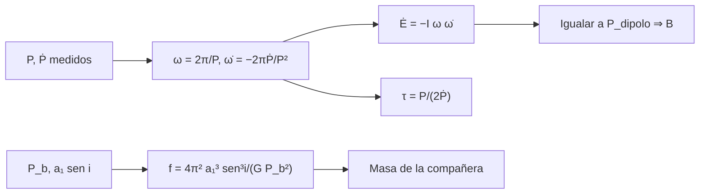

# B27-C05 — Púlsares y relojes naturales

<!-- nav:top -->
[🏠 Programa](../../../../README.md) · [📚 Bloque B27](../../../tronco-comun/B27-objetos-compactos-y-altas-energias.md) · [← Anterior: B27-C04 — Ecuación de estado nuclear](../B27-C04-ecuacion-de-estado-nuclear/CLASE.md) · [Siguiente: B27-C06 — Magnetares y campos extremos →](../B27-C06-magnetares-y-campos-extremos/CLASE.md)
<!-- /nav -->

## 1. Ubicación, nivel y alcance

Clase 5 del bloque B27. Nivel N3. Una estrella de neutrones con campo magnético inclinado y en rotación emite un haz que barre la Tierra como un faro: un **púlsar**. Sus pulsos son tan regulares que sirven de relojes. Aquí obtienes, con el modelo del dipolo en rotación, el campo, la edad característica y la potencia de frenado; y con la función de masa de una binaria, la masa de la compañera. Usas electromagnetismo ([B05-C17](../../B05/B05-C17-campos-magneticos/CLASE.md), [B05-C18](../../B05/B05-C18-electromagnetismo-y-radiacion/CLASE.md)), momento angular ([B05-C09](../../B05/B05-C09-momento-angular-y-torque/CLASE.md)) y escalas de tiempo ([B13-C08](../../B13/B13-C08-escalas-utc-tai-tt-y-tdb/CLASE.md)). Se trata el dipolo en el vacío.

## 2. Por qué esta clase existe

Un púlsar da, a la vez, un reloj de precisión, la medida de su campo magnético y, en una binaria, la masa de las estrellas y una prueba de la relatividad general. La decisión central: **dados el periodo y su derivada, ¿qué campo, edad y potencia de frenado tiene el púlsar y qué se aprende de su binaria?**

## 3. Lo que podrás hacer al terminar

1. Explicar el modelo del dipolo magnético en rotación.
2. Calcular el campo `B` a partir de `P` y `Ṗ`.
3. Calcular la edad característica y la potencia de frenado.
4. Comprobar que el frenado y la radiación dipolar coinciden en energía.
5. Calcular la función de masa de un púlsar binario y despejar la masa de la compañera.
6. Interpretar una prueba de la radiación gravitacional con tiempos de llegada.

La evidencia es la **ficha de un púlsar** del ejercicio 12 (sección 20).

## 4. Con qué llegas y cómo comprobarlo

1. ¿Qué es el momento de inercia?
2. ¿Qué es la energía rotacional `½Iω²`?
3. ¿Qué es la potencia radiada por un dipolo en rotación?
4. ¿Qué es una función de masa de binaria?
5. ¿Cómo se pasa de `P` a `ω`?

<details>
<summary>Ver respuestas</summary>

1. La resistencia al cambio de giro. 2. La energía almacenada en la rotación. 3. Proporcional a `B²R⁶ω⁴`. 4. Una combinación observable de las masas y la inclinación. 5. `ω = 2π/P`.
</details>

Con cuatro o cinco aciertos, sigue; si no, repasa B05-C09 y B05-C18.

## 5. Un caso real: un púlsar con una compañera enana blanca

PSR J0348+0432 tiene `2,01 ± 0,04 M☉` y una enana blanca de `0,172 ± 0,003 M☉` en una órbita de `2,46 h` (S3, resumen). Su función de masa (con `sen i = 1`, **ilustrativo**) es `f = 1,069 × 10⁻³ M☉` y `a₁ sen i = 65 559 km` (`0,2187` segundos luz). Para el campo y la edad se usa un púlsar **ilustrativo** (`P = 0,033 s`, `Ṗ = 4,2 × 10⁻¹³`): `B = 3,77 × 10⁸ T`, edad característica `1245 años`. Es el **ejemplo conductor**. En el púlsar binario PSR B1913+16, `9257` tiempos de llegada durante unos `35` años dieron masas de `1,438` y `1,390 M☉` y un decaimiento orbital que coincide con la relatividad general con razón `0,9983 ± 0,0016` (S4, resumen).

## 6. Vocabulario

Un **púlsar** es una estrella de neutrones que emite pulsos periódicos. El **periodo** `P` y su derivada `Ṗ` se miden con precisión. El **dipolo magnético en rotación** pierde energía por radiación dipolar. El **campo ecuatorial** `B` sale de igualar esa pérdida con la de energía rotacional. La **edad característica** es `τ = P/(2Ṗ)`. La **potencia de frenado** es `Ė = −Iωω̇`. La **función de masa** `f = (m₂ sen i)³/(m₁+m₂)²` liga las masas con el semieje y el periodo orbital. El **tiempo de llegada (TOA)** es el instante de un pulso. El **retardo de Shapiro** es el retraso de la señal al pasar cerca de la compañera.

## 7. Modelo mental: un faro que se frena

El faro gira, emite un haz y pierde energía, así que gira cada vez más despacio. Midiendo cuánto se frena se sabe cuánto campo tiene el faro.



*Descripción textual:* del periodo y su derivada salen la pérdida de energía rotacional, el campo y la edad; en una binaria, el semieje y el periodo orbital dan la función de masa y, con la masa del púlsar, la de la compañera.

Analogía: un volante de inercia que se frena por rozamiento. Límite: el «rozamiento» es radiación y vientos de partículas, y el dipolo en vacío es una simplificación.

## 8. La explicación, paso a paso

### 8.1 Potencia del dipolo en rotación

Un dipolo magnético de campo ecuatorial `B` y radio `R` que rota con `ω` radia en el vacío `P_rad = (8π/3) B² R⁶ ω⁴/(μ₀c³)`. Al igualar con `Iω|ω̇|`, con `ω = 2π/P` y `ω̇ = −2πṖ/P²`: `B = √(3μ₀c³ I PṖ/(32π³R⁶))`. Con `I = 10³⁸ kg m²` y `R = 10 km`, `B = 3,2 × 10¹⁵ √(PṖ) T` (S1).

### 8.2 El ejemplo

Con `P = 0,033 s` y `Ṗ = 4,2 × 10⁻¹³`: `B = 3,77 × 10⁸ T`, `τ = 1245 años`, `Ė = 4,61 × 10³¹ W` y energía rotacional `1,81 × 10⁴² J`. El laboratorio calcula `Ė` por el frenado y por la radiación dipolar y coinciden a `10⁻⁹`.

### 8.3 La edad como cociente de energías

Como `E_rot/Ė = ω/(2|ω̇|) = P/(2Ṗ)`, la edad característica es exactamente el tiempo en que la energía rotacional se agotaría al ritmo actual (`3,93 × 10¹⁰ s = 1245 años`). Si `Ṗ` se mantiene, tras 1000 años `P = 0,0443 s`.

### 8.4 Función de masa

Para un binario, `f = 4π²(a₁ sen i)³/(GP_b²) = (m₂ sen i)³/(m₁+m₂)²`. Con `m₁ = 2,01`, `m₂ = 0,172 M☉`, `P_b = 2,46 h` y `sen i = 1`: `f = 1,069 × 10⁻³ M☉`, `a₁ sen i = 65 559 km`. El laboratorio invierte `f` por bisección y recupera `m₂ = 0,172 000 M☉`.

### 8.5 La prueba de la radiación gravitacional

Weisberg y Huang cronometraron PSR B1913+16 y obtuvieron `1,438 ± 0,001` y `1,390 ± 0,001 M☉`; la razón entre el decaimiento orbital observado (corregido de un término cinemático) y la predicción de la relatividad general es `0,9983 ± 0,0016`, es decir `1,06σ` del valor 1 (S4, resumen). En un púlsar de milisegundos, el retardo de Shapiro mide la masa (`2,14 M☉` para J0740+6620, S5, resumen).

## 9. Magnitudes, símbolos y unidades

| Símbolo | Qué es | Unidad | Valor / nota |
|---|---|---|---|
| `P`, `Ṗ` | periodo y su derivada | s; — | `0,033`; `4,2 × 10⁻¹³` (ilustrativos) |
| `B` | campo ecuatorial | T | `3,77 × 10⁸` |
| `τ` | edad característica | años | `1245` |
| `Ė` | potencia de frenado | W | `4,61 × 10³¹` |
| `f` | función de masa | `M☉` | `1,069 × 10⁻³` |

## 10. Convenciones y referencias

Dipolo en el vacío, `I = 10³⁸ kg m²`, `R = 10 km` (**ilustrativos**), índice de frenado 3. `M☉ = GM☉/G`. Constantes de NIST (S1) e IAU (S2).

## 11. De dónde sale lo que afirmamos

| ID | Fuente | Localizador | Respalda | Estado |
|---|---|---|---|---|
| S1 | NIST, *Fundamental Physical Constants — Complete Listing* (CODATA 2022) | https://physics.nist.gov/cuu/Constants/Table/allascii.txt | `μ₀`, `c`, `G` | Consultada el 2026-11-09 |
| S2 | Mamajek et al., *IAU 2015 Resolution B3*, arXiv:1510.07674 | https://arxiv.org/abs/1510.07674 | `GM☉` | Texto del PDF extraído el 2026-11-09 |
| S3 | Antoniadis et al., arXiv:1304.6875 | https://arxiv.org/abs/1304.6875 | `2,01 ± 0,04 M☉`; compañera `0,172 ± 0,003 M☉`; órbita de `2,46 h` | Solo resumen, consultado el 2026-11-09 |
| S4 | Weisberg y Huang, *Relativistic Measurements from Timing the Binary Pulsar PSR B1913+16*, arXiv:1606.02744 | https://arxiv.org/abs/1606.02744 | 9257 TOAs en ~35 años; masas; razón `0,9983 ± 0,0016` | Solo resumen, consultado el 2026-11-09 |
| S5 | Cromartie et al., arXiv:1904.06759 | https://arxiv.org/abs/1904.06759 | `2,14 (+0,10/−0,09) M☉` por retardo de Shapiro | Solo resumen, consultado el 2026-11-09 |

Límites: S3–S5 solo resumen; el modelo del dipolo es estándar y se verifica internamente; no se consultó ninguna medida de `P`, `Ṗ` de un púlsar real.

## 12. Cómo ver el púlsar

| Magnitud | Valor |
|---|---|
| `B` | `3,77 × 10⁸ T` |
| `τ` | `1245 años` |
| `Ė` | `4,61 × 10³¹ W` |
| `E_rot` | `1,81 × 10⁴² J` |
| `f` (J0348-like) | `1,069 × 10⁻³ M☉` |
| `a₁ sen i` | `65 559 km` (`0,2187` s-luz) |

Descripción larga: la energía rotacional alcanza para unos 1245 años al ritmo actual; el semieje proyectado del binario es de menos de un segundo luz.

## 13. Ejemplo trabajado: la masa de la compañera

**Paso 1 · Datos.** `m₁ = 2,01 M☉`, `P_b = 2,46 h`, `a₁ sen i = 65 559 km`, `sen i = 1` (ilustrativo).

**Paso 2 · Función de masa.** `f = 4π²a³/(GP_b²) = 1,069 × 10⁻³ M☉`.

**Paso 3 · Despeje.** `(m₂)³/(2,01 + m₂)² = 1,069 × 10⁻³`.

**Paso 4 · Solución.** Por bisección, `m₂ = 0,172 M☉`.

**Paso 5 · Sentido.** Si `i < 90°`, la masa real sería mayor; se necesita otra restricción (retardo de Shapiro).

## 14. Distintas formas de medir una masa

**Función de masa + inclinación:** binarias. **Retardo de Shapiro:** pulsos retrasados al pasar cerca de la compañera (S5). **Postkeplerianos (decaimiento, precesión):** pruebas de la relatividad (S4).

## 15. Práctica guiada

**Ejercicio 1 · con los pasos indicados.** Calcula `B` con `3,2 × 10¹⁵√(PṖ)`. *Pasos:* `PṖ = 1,386 × 10⁻¹⁴`.

<details><summary>Solución comentada</summary>

`√(1,386 × 10⁻¹⁴) = 1,177 × 10⁻⁷`; `B = 3,77 × 10⁸ T`.
</details>

**Ejercicio 2 · con una pista.** Calcula la edad característica.

<details><summary>Solución comentada</summary>

`0,033/(2 × 4,2 × 10⁻¹³) = 3,93 × 10¹⁰ s = 1245 años`.
</details>

**Ejercicio 3 · casi autónomo.** Calcula `Ė = Iω|ω̇|`.

<details><summary>Solución comentada</summary>

`ω = 190,4 s⁻¹`; `|ω̇| = 2π × 4,2 × 10⁻¹³/0,033² = 2,42 × 10⁻⁹`; `Ė = 10³⁸ × 190,4 × 2,42 × 10⁻⁹ = 4,6 × 10³¹ W`.
</details>

## 16. Práctica autónoma, transferencia e integrador

**Ejercicio 4.** Calcula `P` tras 1000 años.

<details><summary>Solución comentada</summary>

`√(0,033² + 2 × 0,033 × 4,2 × 10⁻¹³ × 3,156 × 10¹⁰) = 0,0443 s`.
</details>

**Ejercicio 5.** Calcula `f` para `m₁ = 2,01` y `m₂ = 0,172 M☉`.

<details><summary>Solución comentada</summary>

`0,172³/2,182² = 1,069 × 10⁻³ M☉`.
</details>

**Ejercicio 6.** ¿Cuántos segundos luz mide `a₁ sen i = 65 559 km`?

<details><summary>Solución comentada</summary>

`6,5559 × 10⁷/2,998 × 10⁸ = 0,2187 s`.
</details>

**Ejercicio 7.** ¿Qué razón cumple la relatividad general en PSR B1913+16 y a cuántas sigmas?

<details><summary>Solución comentada</summary>

`0,9983 ± 0,0016`; `(1 − 0,9983)/0,0016 = 1,06σ`.
</details>

**Ejercicio 8.** Comprueba `E_rot/Ė = τ`.

<details><summary>Solución comentada</summary>

`1,81 × 10⁴²/4,61 × 10³¹ = 3,93 × 10¹⁰ s = 1245 años`.
</details>

**Ejercicio 9 · transferencia.** Un compañero dice que `B` se mide directamente. Responde con 8.1.

<details><summary>Solución comentada</summary>

Se infiere del frenado con un modelo (dipolo en vacío, `I` y `R` supuestos); otras medidas (líneas ciclotrónicas) pueden contrastarlo.
</details>

**Ejercicio 10 · transferencia.** Si `I` fuera el doble, ¿cómo cambia `B`?

<details><summary>Solución comentada</summary>

`B ∝ √I`: sube `√2 = 1,41` veces.
</details>

**Ejercicio 11 · transferencia.** ¿Por qué hay que referir los tiempos de llegada al baricentro del sistema solar?

<details><summary>Solución comentada</summary>

Porque el movimiento de la Tierra introduce variaciones de hasta `499 s` (el viaje de la luz de `1 au`, B26-C01) y la escala de tiempo adecuada es TDB (B13-C08).
</details>

**Ejercicio 12 · integrador.** Elabora tu *ficha de un púlsar*: `B`, `τ`, `Ė`, `E_rot`, el chequeo energético, `P` tras 1000 años, la función de masa de un binario y la masa de la compañera.

<details><summary>Solución modelo</summary>

Con la sección 12 y los ejercicios 4–8; todo ilustrativo salvo las masas de S3.
</details>

## 17. Laboratorio: campo y masa

El script [pulsar.py](pulsar.py) calcula `B`, `τ` y `Ė`, **comprueba** el coeficiente `3,2 × 10¹⁵ T` al `5 %` y que el frenado y la radiación dipolar coinciden a `10⁻⁹`; calcula la función de masa y **comprueba** la inversión por bisección (`10⁻⁹`).

**Datos:** constantes de NIST e IAU; púlsar **ilustrativo**; masas de S3 (resumen). **Predice antes de ejecutar:** ¿qué edad esperas? (≈1200 años.) **Ejecución del 2026-11-09 (Python 3.12.9):**

```text
Python 3.12.9 (biblioteca estandar)
B = 3.767e+08 T (coeficiente 3.200e+15 T) ; edad caracteristica = 1245 anios
Edot (frenado) = 4.614e+31 W ; Edot (dipolo) = 4.614e+31 W
energia rotacional = 1.813e+42 J
tras 1000 anios (Pdot constante): P = 0.04431 s
funcion de masa f = 1.06875e-03 Msol ; a1 sen i = 65559 km = 0.2187 s-luz
inversion: m2 = 0.172000 Msol (dado f, m1 = 2.01, i = 90 grados)
Pruebas superadas.
```

```bash
python programa/clases/B27/B27-C05-pulsares-y-relojes-naturales/pulsar.py
```

**Límites:** dipolo en vacío, `Ṗ` constante, `sen i = 1`.

## 18. Errores frecuentes y cómo corregirlos

**Tomar la edad característica por la edad real.** Se corrige con la sección 8.3: asume `Ṗ` constante.

**Olvidar que `B` depende de `I` y `R`.** Se corrige con el ejercicio 10.

**Ignorar la inclinación en la función de masa.** Se corrige con la sección 13.

**Mezclar unidades Gaussianas y SI.** Se corrige con la sección 8.1.

**Olvidar el baricentro.** Se corrige con el ejercicio 11.

## 19. Cómo sabrás que vas bien

Tras 8.1: ¿cómo se obtiene `B`? Si dudas, ejercicio 1. Tras 8.4: ¿qué da `f`? Ejercicio 5. Tras el laboratorio: ¿qué comprueba el balance de energía? (que `B` es coherente con el frenado).

## 20. Qué entregas y cómo se evalúa

El producto es tu **ficha de un púlsar** (ejercicio 12).

| Criterio | Inicial | En desarrollo | Logrado | Destacado |
|---|---|---|---|---|
| Conceptos | Los confunde | Parciales | Dipolo, edad, función de masa | Explica los supuestos |
| Cálculo | Sin unidades | Con errores | `B`, `τ`, `Ė`, `f` | Escala con `I` y `R` |
| Numérico | Sin comprobar | Un caso | Balance e inversión | Interpreta tolerancias |
| Fuentes | Sin fuente | Sin fecha | S1–S5 con fecha | Declara resúmenes |
| Límites | No los nombra | Uno | Tres | Discute la edad real |

**Condiciones críticas (no se compensan con promedio):** rotular el púlsar como ilustrativo; no presentar `B` como medida directa; citar solo lo consultado.

## 21. Ética, seguridad y límites

Clase educativa: no sustituye el análisis de tiempos de llegada con modelos de temporización. Accesibilidad: tablas equivalentes a las gráficas, fórmulas en texto, ejercicios sin conexión.

## 22. Para cerrar y seguir

De `P` y `Ṗ` salen el campo (`3,8 × 10⁸ T` en el ejemplo), la edad característica (`1245 años`) y la potencia de frenado; en una binaria, la función de masa da la compañera, y los tiempos de llegada prueban la relatividad con precisión del 0,2 %. Queda una pregunta: ¿qué pasa cuando el campo es mil veces mayor?

**Glosario español–inglés.** púlsar · *pulsar*; edad característica · *characteristic age*; potencia de frenado · *spin-down luminosity*; función de masa · *mass function*; tiempo de llegada · *time of arrival*; retardo de Shapiro · *Shapiro delay*.

**Continuidad.** [B27-C06](../B27-C06-magnetares-y-campos-extremos/CLASE.md) estudia los campos mayores que el crítico cuántico.

**Referencias:** ver sección 11.

<!-- nav:bottom -->
---

[← Anterior: B27-C04 — Ecuación de estado nuclear](../B27-C04-ecuacion-de-estado-nuclear/CLASE.md) · [📚 Bloque B27](../../../tronco-comun/B27-objetos-compactos-y-altas-energias.md) · [Siguiente: B27-C06 — Magnetares y campos extremos →](../B27-C06-magnetares-y-campos-extremos/CLASE.md)
<!-- /nav -->
