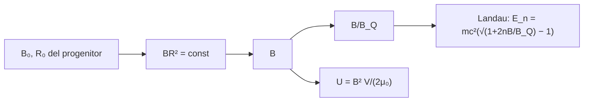

# B27-C06 — Magnetares y campos extremos

<!-- nav:top -->
[🏠 Programa](../../../../README.md) · [📚 Bloque B27](../../../tronco-comun/B27-objetos-compactos-y-altas-energias.md) · [← Anterior: B27-C05 — Púlsares y relojes naturales](../B27-C05-pulsares-y-relojes-naturales/CLASE.md) · [Siguiente: B27-C07 — Métricas de agujeros negros →](../B27-C07-metricas-de-agujeros-negros/CLASE.md)
<!-- /nav -->

## 1. Ubicación, nivel y alcance

Clase 6 del bloque B27. Nivel N3. Hay estrellas de neutrones cuyo campo magnético supera en órdenes de magnitud el de los púlsares de [C05](../B27-C05-pulsares-y-relojes-naturales/CLASE.md): los **magnetares**. A esos campos, la física cambia: la energía de un electrón en un campo comparable al **campo crítico cuántico** se vuelve relativista. Aquí calculas el campo crítico, la energía ciclotrónica, la energía magnética almacenada y el efecto de la conservación del flujo. Usas campos magnéticos ([B05-C17](../../B05/B05-C17-campos-magneticos/CLASE.md)) y estructura atómica ([B06-C01](../../B06/B06-C01-estructura-atomica/CLASE.md)). La física cuántica se amplía en [B31](../../../tronco-comun/B31-fisica-cuantica-nuclear-y-astroparticulas.md). Se trata un campo uniforme.

## 2. Por qué esta clase existe

Los magnetares producen estallidos y llamaradas gigantes que alimenta su campo, no su rotación. Entender la escala del campo y de su energía explica por qué son una familia aparte y cómo se interpretan sus espectros. La decisión central: **¿cuánto vale el campo crítico, cómo se compara un campo de magnetar con él y cuánta energía almacena?**

## 3. Lo que podrás hacer al terminar

1. Calcular el campo crítico cuántico `B_Q = m²c²/(eħ)`.
2. Calcular la energía ciclotrónica del electrón por dos vías.
3. Calcular los niveles de Landau relativistas.
4. Calcular la energía magnética de una estrella de neutrones.
5. Aplicar la conservación del flujo para estimar el campo de una estrella que se contrae.
6. Comparar energía magnética y rotacional.

La evidencia es la **ficha de campo magnético extremo** del ejercicio 12 (sección 20).

## 4. Con qué llegas y cómo comprobarlo

1. ¿Qué es la frecuencia ciclotrónica?
2. ¿Qué es el magnetón de Bohr?
3. ¿Qué es la densidad de energía magnética?
4. ¿Qué es el flujo magnético?
5. ¿Qué es un nivel de Landau?

<details>
<summary>Ver respuestas</summary>

1. La frecuencia de giro de una carga en un campo: `ω_c = eB/m`. 2. `μ_B = eħ/2m`. 3. `B²/(2μ₀)`. 4. `ΦB = B × área`. 5. Un nivel de energía de una carga en un campo magnético.
</details>

Con cuatro o cinco aciertos, sigue; si no, repasa B05-C17 y B06-C01.

## 5. Un caso real: unos treinta magnetares

Kaspi y Beloborodov revisan los magnetares: unas treinta estrellas de neutrones con un campo «ultrafuerte» que tensiona y rompe la corteza, retuerce la magnetosfera y produce estallidos, llamaradas gigantes y oscilaciones cuasiperiódicas (S2, resumen). Para ilustrar la escala se usa un campo **ilustrativo** de `10¹¹ T` (`10¹⁵ G`): `22,7` veces el campo crítico, con una energía ciclotrónica del electrón de `11,6 MeV` y una energía magnética de `1,7 × 10⁴⁰ J`. Es el **ejemplo conductor**.

## 6. Vocabulario

Un **magnetar** es una estrella de neutrones cuyo campo alimenta su emisión. El **campo crítico cuántico** `B_Q = m_e²c²/(eħ) = 4,414 × 10⁹ T` es aquel en que la energía ciclotrónica iguala `m_ec²`. La **energía ciclotrónica** `ħω_c = ħeB/m = 2μ_BB`. Los **niveles de Landau relativistas** son `E_n = m c²(√(1 + 2nB/B_Q) − 1)`. La **energía magnética** `U = B²V/(2μ₀)`. El **flujo congelado** significa `BR² = const` al contraerse. La **llamarada gigante** es un estallido de energía enorme. Una **glitch** es un salto brusco de la rotación.

## 7. Modelo mental: un resorte comprimido

Un magnetar es una estrella con un resorte magnético comprimido: la corteza lo contiene, y cuando cede, el campo se reorganiza y libera energía de golpe.



*Descripción textual:* el campo se compara con `B_Q` para decidir si los efectos cuánticos son relativistas; su energía crece con `B²`; el flujo congelado del progenitor fija el campo de la estrella contraída.

Analogía: un resorte cargado. Límite: la energía magnética no se libera toda; solo una fracción puede convertirse en estallidos.

## 8. La explicación, paso a paso

### 8.1 El campo crítico

`B_Q = m_e²c²/(eħ) = 4,414 × 10⁹ T = 4,414 × 10¹³ G` (S1). Es el campo para el que la energía de Landau del primer nivel iguala `m_ec²` (con otras definiciones, factores de orden uno). Un magnetar con `10¹¹ T` tiene `B/B_Q = 22,7`.

### 8.2 La energía ciclotrónica

`ħω_c = ħeB/m = 2μ_BB`, con `μ_B = 5,788 382 × 10⁻⁵ eV/T` (S1). Para `10⁸ T` (`10¹² G`): `11,58 keV`; para `10¹⁰ T`: `1,158 MeV`; para `10¹¹ T`: `11,58 MeV`. El laboratorio calcula ambas vías y coinciden a `10⁻⁹`.

### 8.3 Los niveles de Landau

A campo débil, el primer nivel es `ħω_c`; a `B = B_Q`, `E₁ = m_ec²(√3 − 1) = 374,08 keV`. El laboratorio comprueba el límite no relativista: a `10⁻⁶ B_Q`, `E₁` coincide con `ħω_c` a `10⁻⁶`.

### 8.4 Energía magnética

Con `B = 10¹¹ T` y `R = 10 km` (uniforme), `U = B²/(2μ₀) × (4π/3)R³ = 1,67 × 10⁴⁰ J`. Para un magnetar de periodo `5 s` (ilustrativo), la energía rotacional es `½Iω² = 7,9 × 10³⁷ J`: la energía magnética es unas `210` veces mayor; por eso la emisión del magnetar no la alimenta la rotación.

### 8.5 Flujo congelado

Una estrella con `10³ T` y radio `10⁷ m` que se contrae a `10⁴ m` conserva el flujo: `B = 10³ × (10⁷/10⁴)² = 10⁹ T`. Con ese mecanismo y campos iniciales algo mayores se alcanzan campos de magnetar; el origen real del campo sigue siendo tema abierto, y aquí solo se muestra la aritmética.

## 9. Magnitudes, símbolos y unidades

| Símbolo | Qué es | Unidad | Valor / nota |
|---|---|---|---|
| `B_Q` | campo crítico cuántico | T | `4,414 × 10⁹` (S1) |
| `ħω_c` | energía ciclotrónica | keV | `11,58` (a `10⁸ T`) |
| `E₁(B_Q)` | primer nivel de Landau | keV | `374,08` |
| `U` | energía magnética | J | `1,67 × 10⁴⁰` (`10¹¹ T`, `10 km`) |
| `μ_B` | magnetón de Bohr | eV/T | `5,788 382 × 10⁻⁵` (S1) |

## 10. Convenciones y referencias

Campo uniforme dentro de la estrella; `B = 10¹¹ T`, `R = 10 km`, `P = 5 s` y los valores del progenitor son **ilustrativos**. `1 G = 10⁻⁴ T`.

## 11. De dónde sale lo que afirmamos

| ID | Fuente | Localizador | Respalda | Estado |
|---|---|---|---|---|
| S1 | NIST, *Fundamental Physical Constants — Complete Listing* (CODATA 2022) | https://physics.nist.gov/cuu/Constants/Table/allascii.txt | `m_e`, `c`, `e`, `ħ`, `μ_B`, `μ₀` | Consultada el 2026-11-09 |
| S2 | Kaspi y Beloborodov, *Magnetars*, arXiv:1703.00068 | https://arxiv.org/abs/1703.00068 | ~30 magnetares; campo ultrafuerte; estallidos y llamaradas | Solo resumen, consultado el 2026-11-09 |

Límites: S2 solo resumen y sin cifras de campo; las fórmulas de `B_Q`, ciclotrón y Landau son estándar y se verifican en el laboratorio; los campos de magnetar son ilustrativos.

## 12. Cómo ver el campo

| `B` (T) | `B/B_Q` | `ħω_c` (keV) |
|---|---|---|
| `10⁸` | 0,0227 | 11,58 |
| `10¹⁰` | 2,27 | 1158 |
| `10¹¹` | 22,7 | `1,158 × 10⁴` |

Descripción larga: la energía ciclotrónica crece en proporción al campo y a `10¹¹ T` supera con creces la energía en reposo del electrón.

## 13. Ejemplo trabajado: ¿relativista o no?

**Paso 1 · Datos.** `B = 10¹⁰ T`.

**Paso 2 · Cociente.** `B/B_Q = 2,27`.

**Paso 3 · Primer nivel.** `E₁ = m_ec²(√(1 + 2 × 2,27) − 1) = 0,511 × (2,35 − 1) = 0,69 MeV`, frente a `ħω_c = 1,158 MeV`.

**Paso 4 · Sentido.** La fórmula no relativista sobrestima el nivel en un factor `1,7`.

## 14. Distintas formas de describir el campo

**Por frenado (C05):** da un campo dipolar inferido. **Por líneas ciclotrónicas:** da el campo local en la región de emisión. **Por energía de estallidos:** da una cota inferior a la energía magnética.

## 15. Práctica guiada

**Ejercicio 1 · con los pasos indicados.** Calcula `B_Q`. *Pasos:* `m²c²/(eħ)`.

<details><summary>Solución comentada</summary>

`(9,109 × 10⁻³¹ × 2,998 × 10⁸)²/(1,602 × 10⁻¹⁹ × 1,0546 × 10⁻³⁴) = 4,414 × 10⁹ T`.
</details>

**Ejercicio 2 · con una pista.** Calcula `ħω_c` a `10⁸ T`. *Pista:* `2μ_BB`.

<details><summary>Solución comentada</summary>

`2 × 5,788 × 10⁻⁵ × 10⁸ = 11,58 keV`.
</details>

**Ejercicio 3 · casi autónomo.** Cociente `B/B_Q` para `10¹¹ T`.

<details><summary>Solución comentada</summary>

`22,7`.
</details>

## 16. Práctica autónoma, transferencia e integrador

**Ejercicio 4.** Primer nivel de Landau a `B = B_Q`.

<details><summary>Solución comentada</summary>

`0,511 × (√3 − 1) = 0,374 MeV`.
</details>

**Ejercicio 5.** Energía magnética para `10¹¹ T`, `R = 10 km`.

<details><summary>Solución comentada</summary>

`1,67 × 10⁴⁰ J`.
</details>

**Ejercicio 6.** Energía rotacional con `P = 5 s`, `I = 10³⁸`.

<details><summary>Solución comentada</summary>

`½ × 10³⁸ × (2π/5)² = 7,9 × 10³⁷ J`.
</details>

**Ejercicio 7.** Cociente energía magnética/rotacional.

<details><summary>Solución comentada</summary>

`1,67 × 10⁴⁰/7,9 × 10³⁷ = 211`.
</details>

**Ejercicio 8.** Campo tras contraerse de `10⁷ m` a `10⁴ m` con `10³ T`.

<details><summary>Solución comentada</summary>

`10⁹ T`.
</details>

**Ejercicio 9 · transferencia.** Un compañero dice que `B_Q` es un tope que el campo no puede superar. Responde con 8.1.

<details><summary>Solución comentada</summary>

No es un tope: es la escala a partir de la cual los efectos cuánticos son relativistas; los magnetares la superan.
</details>

**Ejercicio 10 · transferencia.** ¿Cuánto vale la razón entre la energía de Landau relativista y `ħω_c` a `B = B_Q`?

<details><summary>Solución comentada</summary>

`0,374/0,511 = 0,73`.
</details>

**Ejercicio 11 · transferencia.** ¿Por qué se dice que los magnetares no los alimenta la rotación?

<details><summary>Solución comentada</summary>

Porque su energía rotacional es mucho menor que la magnética (8.4); la emisión proviene del campo.
</details>

**Ejercicio 12 · integrador.** Elabora tu *ficha de campo magnético extremo*: `B_Q`, `ħω_c` y `B/B_Q` para tres campos, `E₁`, energía magnética y rotacional, y flujo congelado.

<details><summary>Solución modelo</summary>

Tabla de la sección 12 y los ejercicios 4–8.
</details>

## 17. Laboratorio: campo crítico

El script [campo_critico.py](campo_critico.py) calcula `B_Q`, la energía ciclotrónica por dos vías (**comprueba** `10⁻⁹`), el límite no relativista de Landau (`10⁻⁶`), la energía magnética y el flujo congelado.

**Datos:** constantes de NIST; campos y radios **ilustrativos**. **Predice antes de ejecutar:** ¿qué valor tiene `B_Q`? (≈`4,4 × 10⁹ T`.) **Ejecución del 2026-11-09 (Python 3.12.9):**

```text
Python 3.12.9 (biblioteca estandar)
B_Q = m_e^2 c^2/(e hbar) = 4.4140e+09 T = 4.414e+13 G
B = 1e+08 T (  0.0227 B_Q): hbar w_c =        11.58 keV (via e hbar B/m = via 2 mu_B B)
B = 1e+10 T (    2.27 B_Q): hbar w_c =         1158 keV (via e hbar B/m = via 2 mu_B B)
B = 1e+11 T (    22.7 B_Q): hbar w_c =    1.158e+04 keV (via e hbar B/m = via 2 mu_B B)
Landau n = 1 a B = B_Q: E_1 = 374.08 keV (m c^2 (sqrt(3) - 1) = 374.08 keV)
energia magnetica (B = 1e11 T, R = 1e4 m, uniforme) = 1.667e+40 J
flujo congelado: 1e3 T con R = 1e7 m -> 1.00e+09 T con R = 1e4 m
Pruebas superadas.
```

```bash
python programa/clases/B27/B27-C06-magnetares-y-campos-extremos/campo_critico.py
```

**Límites:** campo uniforme, electrón libre, sin QED completa.

## 18. Errores frecuentes y cómo corregirlos

**Confundir T y G.** Se corrige con la sección 10 (`1 G = 10⁻⁴ T`).

**Usar la ciclotrónica no relativista a `B ≳ B_Q`.** Se corrige con el ejercicio 10.

**Pensar que `B_Q` es un tope.** Se corrige con el ejercicio 9.

**Despreciar la energía magnética.** Se corrige con el ejercicio 7.

**Tomar el campo ilustrativo por una medida.** Se corrige con la sección 10.

## 19. Cómo sabrás que vas bien

Tras 8.1: ¿cuánto vale `B_Q`? Si dudas, ejercicio 1. Tras 8.4: ¿qué domina, la rotación o el campo? Ejercicio 7. Tras el laboratorio: ¿qué verifican las dos vías? (que `ħe/m = 2μ_B`).

## 20. Qué entregas y cómo se evalúa

El producto es tu **ficha de campo magnético extremo** (ejercicio 12).

| Criterio | Inicial | En desarrollo | Logrado | Destacado |
|---|---|---|---|---|
| Conceptos | Los confunde | Parciales | `B_Q`, ciclotrón, Landau | Explica el régimen relativista |
| Cálculo | Sin unidades | Con errores | Todas las magnitudes | Compara energías |
| Numérico | Sin comprobar | Un caso | Dos vías y límite | Interpreta tolerancias |
| Fuentes | Sin fuente | Sin fecha | S1–S2 con fecha | Declara que S2 es resumen |
| Límites | No los nombra | Uno | Tres | Discute el origen del campo |

**Condiciones críticas (no se compensan con promedio):** rotular los campos como ilustrativos; no dar cifras de magnetares reales sin fuente; citar solo lo consultado.

## 21. Ética, seguridad y límites

Clase educativa: no es un modelo de magnetosferas. Accesibilidad: tablas equivalentes a las gráficas, fórmulas en texto, ejercicios sin conexión.

## 22. Para cerrar y seguir

El campo crítico vale `4,4 × 10⁹ T`; un campo de `10¹¹ T` lo supera 23 veces y almacena una energía magnética unas 200 veces mayor que la rotacional de un magnetar lento. Queda una pregunta: ¿qué pasa cuando la gravedad es tan fuerte que ni la luz escapa?

**Glosario español–inglés.** magnetar · *magnetar*; campo crítico cuántico · *quantum critical field*; energía ciclotrónica · *cyclotron energy*; niveles de Landau · *Landau levels*; flujo congelado · *frozen-in flux*; llamarada gigante · *giant flare*.

**Continuidad.** [B27-C07](../B27-C07-metricas-de-agujeros-negros/CLASE.md) pasa a la geometría de los agujeros negros.

**Referencias:** ver sección 11.

<!-- nav:bottom -->
---

[← Anterior: B27-C05 — Púlsares y relojes naturales](../B27-C05-pulsares-y-relojes-naturales/CLASE.md) · [📚 Bloque B27](../../../tronco-comun/B27-objetos-compactos-y-altas-energias.md) · [Siguiente: B27-C07 — Métricas de agujeros negros →](../B27-C07-metricas-de-agujeros-negros/CLASE.md)
<!-- /nav -->
