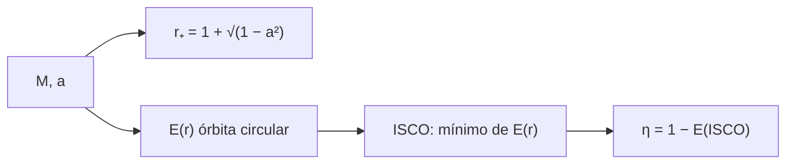

# B27-C07 — Métricas de agujeros negros

<!-- nav:top -->
[🏠 Programa](../../../../README.md) · [📚 Bloque B27](../../../tronco-comun/B27-objetos-compactos-y-altas-energias.md) · [← Anterior: B27-C06 — Magnetares y campos extremos](../B27-C06-magnetares-y-campos-extremos/CLASE.md) · [Siguiente: B27-C08 — Horizonte de sucesos →](../B27-C08-horizonte-de-sucesos/CLASE.md)
<!-- /nav -->

## 1. Ubicación, nivel y alcance

Clase 7 del bloque B27. Nivel N3. Las estrellas de neutrones tienen un tope de masa ([C03](../B27-C03-estrellas-de-neutrones/CLASE.md), [C04](../B27-C04-ecuacion-de-estado-nuclear/CLASE.md)); por encima, la solución es un agujero negro. Aquí describes la geometría de Schwarzschild y de Kerr, localizas el horizonte y la órbita circular estable más interna (ISCO) y calculas la eficiencia con que un disco convierte masa en radiación. Usas relatividad general ([B26-C07](../../B26/B26-C07-curvatura-y-metricas/CLASE.md)) y órbitas ([B02-C14](../../B02/B02-C14-kepler-y-reconstruccion-de-orbitas/CLASE.md)). La caída hacia el horizonte sigue en [C08](../B27-C08-horizonte-de-sucesos/CLASE.md). Se trata un agujero negro aislado, sin carga.

## 2. Por qué esta clase existe

El espín cambia el ISCO y, con él, cuánta energía se libera: de `5,7 %` a más de `30 %` de la masa en reposo. La decisión central: **¿dónde están el horizonte y el ISCO para un espín dado y qué eficiencia implica?**

## 3. Lo que podrás hacer al terminar

1. Calcular el horizonte `r₊ = M(1 + √(1 − a²))` en unidades geométricas.
2. Calcular el ISCO de Schwarzschild y de Kerr, prógrado y retrógrado.
3. Calcular la eficiencia `η = 1 − E_ISCO`.
4. Convertir unidades geométricas a metros, segundos y unidades astronómicas.
5. Comprobar un mínimo numérico contra una fórmula cerrada.
6. Estimar la escala de un agujero negro de masa dada.

La evidencia es la **ficha de una métrica de Kerr** del ejercicio 12 (sección 20).

## 4. Con qué llegas y cómo comprobarlo

1. ¿Cuál es el radio de Schwarzschild?
2. ¿Qué es una órbita circular estable?
3. ¿Qué es la energía específica de una órbita?
4. ¿Qué mide el parámetro de espín `a`?
5. ¿Qué es el radio gravitacional `GM/c²`?

<details>
<summary>Ver respuestas</summary>

1. `r_s = 2GM/c²`. 2. Una órbita circular que vuelve a ella tras una perturbación pequeña. 3. La energía por unidad de masa en reposo, conservada. 4. El momento angular en unidades de `GM²/c` (`0 ≤ a ≤ 1`). 5. `r_g = GM/c²`, la unidad de longitud geométrica.
</details>

Con cuatro o cinco aciertos, sigue; si no, repasa B26-C07 y B02-C14.

## 5. Un caso real: M87\*

La colaboración Event Horizon Telescope midió la sombra de M87\* con un tamaño angular de `42 ± 3 μas` y una masa de `6,5 ± 0,7 × 10⁹ M☉` (S3, resumen). Con esa masa, `r_g = 9,598 × 10¹² m = 64,2 au` y `GM/c³ = 8,89 h`: la escala temporal de la geometría es de horas, no de milisegundos. Es el **ejemplo conductor**.

## 6. Vocabulario

El **radio gravitacional** `r_g = GM/c²`. El **horizonte de sucesos** es la superficie de no retorno. El **espín** `a = cJ/(GM²)`. El **ISCO** es la órbita circular estable más interna. La **órbita prógrada** gira en el sentido del agujero; la **retrógrada**, al revés. La **eficiencia radiativa** `η = 1 − E_ISCO`. Las **unidades geométricas** fijan `G = c = M = 1`.

## 7. Modelo mental: un remolino que arrastra

Un agujero negro con espín es un remolino que arrastra el espacio. Una órbita que gira con él puede acercarse más antes de caer; una que lo contraría debe quedarse más lejos.



*Descripción textual:* la masa y el espín fijan el horizonte y la energía de las órbitas circulares; el mínimo de esa energía define el ISCO y, con él, la eficiencia.

Analogía: un remolino. Límite: el arrastre no es una corriente de materia, es geometría.

## 8. La explicación, paso a paso

### 8.1 El horizonte

En unidades `G = c = M = 1`, `r_± = 1 ± √(1 − a²)`. Sin espín, `r₊ = 2` (el radio de Schwarzschild). Con `a = 0,9`, `r₊ = 1,4359`; con `a = 0,998`, `r₊ = 1,0632` (S4: el cálculo se verifica en el laboratorio).

### 8.2 La energía de una órbita circular

En el ecuador, la energía específica es `E = (1 − 2/r ± a/r^{3/2}) / √(1 − 3/r ± 2a/r^{3/2})`, con `+` prógrada y `−` retrógrada. El ISCO es el radio donde `E(r)` es mínimo.

### 8.3 El ISCO

Sin espín, `r_ISCO = 6`. Con espín prógrado crece la energía liberable y el ISCO baja: `4,2330` (`a = 0,5`), `2,3209` (`0,9`), `1,2370` (`0,998`). Retrógrado sube: `7,5546`, `8,7174`, `8,9944`. La fórmula de Bardeen da el mismo resultado que el mínimo numérico a `10⁻⁶`.

### 8.4 La eficiencia

`η = 1 − E_ISCO`: `5,72 %` sin espín, `8,21 %` con `a = 0,5`, `15,58 %` con `0,9` y `32,10 %` con `0,998`; retrógrado, `4,51 %`, `3,90 %` y `3,78 %`. La fusión nuclear libera menos de `1 %`.

### 8.5 Las escalas

`GM_☉/c³ = 4,9255 μs` y `GM_☉/c² = 1476,63 m`. Para `6,5 × 10⁹ M☉`: `r_g = 64,2 au`. El periodo de la órbita en el ISCO de Schwarzschild es `34,2 d`.

## 9. Magnitudes, símbolos y unidades

| Símbolo | Qué es | Unidad | Valor / nota |
|---|---|---|---|
| `r_g` | radio gravitacional | m | `GM/c²` |
| `a` | espín adimensional | — | `0 ≤ a ≤ 1` |
| `r₊` | horizonte | `r_g` | `1 + √(1 − a²)` |
| `r_ISCO` | órbita estable más interna | `r_g` | 6 (a = 0) |
| `η` | eficiencia radiativa | % | `1 − E_ISCO` |
| `GM_☉` | parámetro gravitacional solar | m³ s⁻² | `1,3271244 × 10²⁰` (S2) |

## 10. Convenciones y referencias

Unidades geométricas `G = c = M = 1` (longitudes en `r_g`, tiempos en `GM/c³`); coordenadas de Boyer–Lindquist; órbitas circulares ecuatoriales; `1 au = 1,495 978 707 × 10¹¹ m` (S5). Los espines de la tabla son **ilustrativos**.

## 11. De dónde sale lo que afirmamos

| ID | Fuente | Localizador | Respalda | Estado |
|---|---|---|---|---|
| S1 | NIST, *Fundamental Physical Constants — Complete Listing* (CODATA 2022) | https://physics.nist.gov/cuu/Constants/Table/allascii.txt | `G`, `c` | Consultada el 2026-11-09 |
| S2 | UAI, Resolución B3 de 2015 | https://arxiv.org/abs/1510.07674 | `GM_☉` nominal | Consultada el 2026-11-09 |
| S3 | Event Horizon Telescope Collaboration, M87\*, arXiv:1906.11238 | https://arxiv.org/abs/1906.11238 | `42 ± 3 μas`; `6,5 ± 0,7 × 10⁹ M☉` | Solo resumen, consultado el 2026-11-09 |
| S4 | Fórmulas de Kerr y de Bardeen (ISCO) | implementadas en `kerr.py` | horizonte, ISCO, `η` | Verificadas contra el mínimo numérico; no se consultó el artículo original |
| S5 | IERS Technical Note 36, Tabla 1.1 | https://iers-conventions.obspm.fr/ | `au` | Consultada el 2026-11-09 |

Límites: S3 solo resumen; el espín de M87\* no se usa; la fórmula de Bardeen se contrasta numéricamente, sin leer el artículo.

## 12. Cómo ver la tabla

| `a` | `r₊` | ISCO pro | `η` pro | ISCO retro | `η` retro |
|---|---|---|---|---|---|
| 0 | 2,0000 | 6,0000 | 5,72 % | 6,0000 | 5,72 % |
| 0,5 | 1,8660 | 4,2330 | 8,21 % | 7,5546 | 4,51 % |
| 0,9 | 1,4359 | 2,3209 | 15,58 % | 8,7174 | 3,90 % |
| 0,998 | 1,0632 | 1,2370 | 32,10 % | 8,9944 | 3,78 % |

Descripción larga: al crecer el espín el ISCO prógrado se acerca al horizonte y la eficiencia sube; el retrógrado se aleja y la eficiencia baja.

## 13. Ejemplo trabajado: ¿cuánta energía por kilogramo?

**Paso 1 · Datos.** `a = 0,9`, prógrado.

**Paso 2 · ISCO.** `2,3209 r_g`.

**Paso 3 · Eficiencia.** `η = 15,58 %`.

**Paso 4 · Energía.** Por kilogramo acretado, `η c² = 0,1558 × 8,988 × 10¹⁶ = 1,40 × 10¹⁶ J`.

**Paso 5 · Sentido.** Es unas veinte veces la fusión del hidrógeno (`≈ 0,7 %`).

## 14. Distintas formas de describir el espín

**Por `a` adimensional:** `0` a `1`. **Por `J`:** `J = a G M²/c`. **Por el ISCO:** invertir la fórmula de Bardeen. **Por la sombra:** efecto sobre su tamaño (no se calcula aquí).

## 15. Práctica guiada

**Ejercicio 1 · con los pasos indicados.** Horizonte para `a = 0,5`. *Pasos:* `1 + √(1 − 0,25)`.

<details><summary>Solución comentada</summary>

`1 + 0,8660 = 1,8660 r_g`.
</details>

**Ejercicio 2 · con una pista.** Radio de Schwarzschild de `10 M☉`. *Pista:* `2GM/c²`.

<details><summary>Solución comentada</summary>

`2 × 10 × 1476,63 = 29 533 m`.
</details>

**Ejercicio 3 · casi autónomo.** Convierte `GM_☉/c³` a microsegundos.

<details><summary>Solución comentada</summary>

`1,3271244 × 10²⁰/(2,998 × 10⁸)³ = 4,9255 μs`.
</details>

## 16. Práctica autónoma, transferencia e integrador

**Ejercicio 4.** Eficiencia de Schwarzschild a partir de `E = 2√2/3`.

<details><summary>Solución comentada</summary>

`E_ISCO = 0,9428`, `η = 5,72 %`.
</details>

**Ejercicio 5.** Energía por kilogramo con `η = 32,10 %`.

<details><summary>Solución comentada</summary>

`0,3210 × 8,988 × 10¹⁶ = 2,88 × 10¹⁶ J`.
</details>

**Ejercicio 6.** `r_g` de M87\* en unidades astronómicas.

<details><summary>Solución comentada</summary>

`6,5 × 10⁹ × 1476,63 = 9,598 × 10¹² m = 64,2 au`.
</details>

**Ejercicio 7.** Tiempo geométrico `GM/c³` de M87\* en horas.

<details><summary>Solución comentada</summary>

`6,5 × 10⁹ × 4,9255 μs = 3,2 × 10⁴ s = 8,89 h`.
</details>

**Ejercicio 8.** Cociente entre el ISCO retrógrado y el prógrado con `a = 0,998`.

<details><summary>Solución comentada</summary>

`8,9944/1,2370 = 7,27`.
</details>

**Ejercicio 9 · transferencia.** Un compañero dice que el ISCO prógrado llega a cero con `a = 1`. Responde con 8.3.

<details><summary>Solución comentada</summary>

Llega a `1 r_g` (coincide con el horizonte), no a cero; en el modelo `a = 1` es un límite y `a = 0,998` ya da `1,2370`.
</details>

**Ejercicio 10 · transferencia.** ¿Por qué un disco retrógrado emite menos?

<details><summary>Solución comentada</summary>

Su ISCO está más lejos y la materia cae desde allí con menos energía ligada liberada (`η` bajo).
</details>

**Ejercicio 11 · transferencia.** ¿Qué compruebas al comparar el mínimo numérico con la fórmula de Bardeen?

<details><summary>Solución comentada</summary>

Que la fórmula implementada reproduce el mínimo de `E(r)` a `10⁻⁶`; no valida que `E(r)` sea la física correcta.
</details>

**Ejercicio 12 · integrador.** Elabora tu *ficha de una métrica de Kerr*: para tres espines, horizonte, ISCO prógrado y retrógrado, eficiencias y la escala en metros y horas para una masa dada.

<details><summary>Solución modelo</summary>

Tabla de la sección 12 más los ejercicios 6–7.
</details>

## 17. Laboratorio: horizonte e ISCO de Kerr

El script [kerr.py](kerr.py) busca el mínimo de `E(r)` por razón áurea, lo compara con la fórmula de Bardeen (**comprueba** `10⁻⁶`), verifica los límites `a = 0` (6) y `a = 1` (1 y 9) y calcula las escalas de M87\*.

**Datos:** `G`, `c` de NIST; `GM_☉` de la UAI; espines **ilustrativos**. **Predice antes de ejecutar:** ¿qué `η` da `a = 0`? (≈`5,7 %`.) **Ejecución del 2026-11-09 (Python 3.12.9):**

```text
Python 3.12.9 (biblioteca estandar)
    a  r_+ [M]  ISCO pro [M]  eta pro [%]  ISCO retro [M]  eta retro [%]
0.000   2.0000        6.0000         5.72          6.0000           5.72
0.500   1.8660        4.2330         8.21          7.5546           4.51
0.900   1.4359        2.3209        15.58          8.7174           3.90
0.998   1.0632        1.2370        32.10          8.9944           3.78
GM_sol/c^3 = 4.9255 us ; GM_sol/c^2 = 1476.63 m
M87* (6.5e9 Msol): r_g = 9.598e+12 m = 64.2 au ; r_s = 128.3 au ; GM/c^3 = 8.89 h
periodo de la orbita en el ISCO de Schwarzschild: 34.2 d
Pruebas superadas.
```

```bash
python programa/clases/B27/B27-C07-metricas-de-agujeros-negros/kerr.py
```

**Límites:** orbitas circulares ecuatoriales, sin disco, sin radiación que vuelva al agujero.

## 18. Errores frecuentes y cómo corregirlos

**Mezclar unidades geométricas y SI.** Se corrige con la sección 10.

**Creer que `a = 1` es alcanzable.** Se corrige con el ejercicio 9.

**Olvidar el signo del espín.** Se corrige con el ejercicio 10.

**Tomar `η` por rendimiento de un disco real.** Se corrige con los límites del laboratorio.

**Tomar los espines de la tabla por medidas.** Se corrige con la sección 10.

## 19. Cómo sabrás que vas bien

Tras 8.3: ¿qué pasa con el ISCO prógrado al subir `a`? Si dudas, sección 12. Tras 8.4: ¿qué eficiencia da `a = 0`? Ejercicio 4. Tras el laboratorio: ¿qué verifican `a = 0` y `a = 1`? (los límites conocidos del ISCO).

## 20. Qué entregas y cómo se evalúa

El producto es tu **ficha de una métrica de Kerr** (ejercicio 12).

| Criterio | Inicial | En desarrollo | Logrado | Destacado |
|---|---|---|---|---|
| Conceptos | Los confunde | Parciales | Horizonte, ISCO, `η` | Explica el efecto del espín |
| Cálculo | Sin unidades | Con errores | Escalas en SI | Contrasta con M87\* |
| Numérico | Sin comprobar | Un caso | Mínimo y fórmula | Interpreta tolerancias |
| Fuentes | Sin fuente | Sin fecha | S1–S5 con fecha | Declara S3 como resumen |
| Límites | No los nombra | Uno | Tres | Discute el disco real |

**Condiciones críticas (no se compensan con promedio):** rotular los espines como ilustrativos; no atribuir un espín a M87\*; citar solo lo consultado.

## 21. Ética, seguridad y límites

Clase educativa: no es una simulación de un disco ni de una sombra. Accesibilidad: tablas equivalentes a las gráficas, fórmulas en texto, ejercicios sin conexión.

## 22. Para cerrar y seguir

El horizonte y el ISCO dependen del espín: la eficiencia va de `5,7 %` a más de `30 %`. Queda una pregunta: ¿qué experimenta quien cae hacia el horizonte y qué ve quien lo mira desde lejos?

**Glosario español–inglés.** radio gravitacional · *gravitational radius*; horizonte de sucesos · *event horizon*; órbita circular estable más interna · *innermost stable circular orbit (ISCO)*; espín · *spin*; prógrado · *prograde*; eficiencia radiativa · *radiative efficiency*.

**Continuidad.** [B27-C08](../B27-C08-horizonte-de-sucesos/CLASE.md) estudia la caída hacia el horizonte.

**Referencias:** ver sección 11.

<!-- nav:bottom -->
---

[← Anterior: B27-C06 — Magnetares y campos extremos](../B27-C06-magnetares-y-campos-extremos/CLASE.md) · [📚 Bloque B27](../../../tronco-comun/B27-objetos-compactos-y-altas-energias.md) · [Siguiente: B27-C08 — Horizonte de sucesos →](../B27-C08-horizonte-de-sucesos/CLASE.md)
<!-- /nav -->
