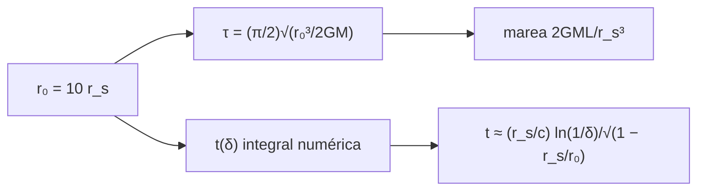

# B27-C08 — Horizonte de sucesos

<!-- nav:top -->
[🏠 Programa](../../../../README.md) · [📚 Bloque B27](../../../tronco-comun/B27-objetos-compactos-y-altas-energias.md) · [← Anterior: B27-C07 — Métricas de agujeros negros](../B27-C07-metricas-de-agujeros-negros/CLASE.md) · [Siguiente: B27-C09 — Órbitas en campos fuertes →](../B27-C09-orbitas-en-campos-fuertes/CLASE.md)
<!-- /nav -->

## 1. Ubicación, nivel y alcance

Clase 8 del bloque B27. Nivel N3. Con la geometría de [C07](../B27-C07-metricas-de-agujeros-negros/CLASE.md) en mano, aquí sigues una caída radial hacia el horizonte desde dos puntos de vista: el **tiempo propio** de quien cae y el **tiempo coordenado** de quien mira desde lejos. También calculas la **marea** en el horizonte. Usas relatividad general ([B26-C07](../../B26/B26-C07-curvatura-y-metricas/CLASE.md)), integración numérica y límites. Se trata un cuerpo de prueba puntual en Schwarzschild.

## 2. Por qué esta clase existe

Para quien cae, el horizonte se cruza en un tiempo finito y, en un agujero grande, sin marea notable; para quien observa desde lejos, la caída parece no terminar. La decisión central: **¿cuánto dura la caída en cada reloj y qué marea se siente en el horizonte?**

## 3. Lo que podrás hacer al terminar

1. Calcular el tiempo propio de caída libre radial desde el reposo.
2. Integrar numéricamente el tiempo coordenado hasta cerca del horizonte.
3. Reconocer el crecimiento logarítmico del tiempo coordenado.
4. Calcular la aceleración de marea en `r_s`.
5. Comparar un agujero estelar con uno supermasivo.
6. Distinguir lo que depende del observador de lo que no.

La evidencia es la **ficha de caída al horizonte** del ejercicio 12 (sección 20).

## 4. Con qué llegas y cómo comprobarlo

1. ¿Qué es el tiempo propio?
2. ¿Qué es la marea gravitacional?
3. ¿Qué es la integración de Simpson?
4. ¿Qué es un cambio de variable que quita una singularidad?
5. ¿Qué es el radio de Schwarzschild?

<details>
<summary>Ver respuestas</summary>

1. El tiempo medido por un reloj que viaja con el cuerpo. 2. La diferencia de aceleración entre dos puntos cercanos. 3. Una regla de cuadratura con parábolas. 4. Sustituir la variable de modo que el integrando sea suave. 5. `r_s = 2GM/c²`.
</details>

Con cuatro o cinco aciertos, sigue; si no, repasa B26-C07 y B26-C08.

## 5. Un caso real: dos masas, una misma caída

M87\* tiene `6,5 ± 0,7 × 10⁹ M☉` (S3, resumen). Una caída desde `10 r_s` dura `49,67 r_s/c` en tiempo propio para cualquier masa; en M87\* son `3,181 × 10⁶ s` (unos 37 días) y en un agujero de `10 M☉` son `4,893 ms`. En el horizonte, dos puntos separados `2 m` sienten una marea de `4,9 × 10⁻¹⁰ m/s²` en M87\* y de `2,1 × 10⁸ m/s²` en el de `10 M☉`. Es el **ejemplo conductor**; las masas y el punto de partida son **ilustrativos**.

## 6. Vocabulario

El **tiempo propio** `τ` lo mide el reloj del cuerpo que cae. El **tiempo coordenado** `t` es el del observador lejano. La **caída libre radial** parte del reposo en `r₀`. La **aceleración de marea** entre dos puntos separados `L` es `2GML/r³`. La **divergencia logarítmica** es el crecimiento de `t` como `ln(1/δ)` al acercarse a `r_s(1 + δ)`.

## 7. Modelo mental: dos relojes

Quien cae lleva un reloj que marca un tiempo finito hasta el centro. El observador lejano ve las señales llegar cada vez más espaciadas: el reloj de quien cae parece detenerse al acercarse al horizonte.



*Descripción textual:* desde `r₀` se obtiene un tiempo propio finito y un tiempo coordenado que diverge logarítmicamente; la marea en el horizonte depende de la masa.

Analogía: dos relojes en lugares distintos. Límite: el «congelamiento» es del reloj visto, no de quien cae.

## 8. La explicación, paso a paso

### 8.1 Tiempo propio

Para caída radial desde el reposo en `r₀`, `τ = (π/2)√(r₀³/(2GM))` hasta `r = 0`, idéntico al newtoniano. Con `r₀ = 10 r_s`, `τ = 49,67 r_s/c`. El laboratorio lo calcula por cuadratura con el cambio `r = r₀ sin²φ` y coincide a `10⁻⁸` con la fórmula.

### 8.2 Tiempo coordenado

`dt = dr/[c(1 − r_s/r)√(r_s/r − r_s/r₀)]`. El integrando diverge en `r_s` y en `r₀`; se parte la integral en dos tramos con cambios de variable (`r = r_s + eˢ` y `r = r₀ − w²`) que lo hacen suave.

### 8.3 La divergencia logarítmica

Para `δ = 10⁻²` a `10⁻⁵`, `t = 63,073; 65,515; 67,943; 70,371 r_s/c`. La pendiente respecto de `ln(1/δ)` es `1,0544` frente a `1/√(1 − r_s/r₀) = 1,0541` esperado, dentro del `1 %` fijado.

### 8.4 La marea

Entre dos puntos separados `L = 2 m` en `r_s`, `a = 2GML/r_s³`: `2,061 × 10⁸ m/s²` para `10 M☉` y `4,878 × 10⁻¹⁰ m/s²` para `6,5 × 10⁹ M☉`. Crece como `1/M²`: en el supermasivo se cruza el horizonte sin notarlo; en el estelar, la marea destruye al cuerpo antes de llegar.

### 8.5 Qué es relativo

El tiempo propio hasta cruzar y la marea los miden quien cae; el tiempo coordenado depende del observador. El horizonte se cruza en tiempo propio finito sin que el cuerpo note nada local especial.

## 9. Magnitudes, símbolos y unidades

| Símbolo | Qué es | Unidad | Valor / nota |
|---|---|---|---|
| `r_s` | radio de Schwarzschild | m | `2GM/c²` |
| `τ` | tiempo propio | s | `49,67 r_s/c` (desde `10 r_s`) |
| `t` | tiempo coordenado | `r_s/c` | `63,07` (δ = 10⁻²) |
| `δ` | cercanía al horizonte | — | `r = r_s(1 + δ)` |
| `a_marea` | aceleración de marea | m/s² | `2GML/r_s³` |
| `GM_☉` | parámetro gravitacional solar | m³ s⁻² | `1,3271244 × 10²⁰` (S2) |

## 10. Convenciones y referencias

Métrica de Schwarzschild, coordenadas de Schwarzschild, caída radial desde el reposo en `r₀ = 10 r_s`; masas de `10 M☉` y `6,5 × 10⁹ M☉` y la separación de `2 m` son **ilustrativas**.

## 11. De dónde sale lo que afirmamos

| ID | Fuente | Localizador | Respalda | Estado |
|---|---|---|---|---|
| S1 | NIST, *Fundamental Physical Constants — Complete Listing* (CODATA 2022) | https://physics.nist.gov/cuu/Constants/Table/allascii.txt | `G`, `c` | Consultada el 2026-11-09 |
| S2 | UAI, Resolución B3 de 2015 | https://arxiv.org/abs/1510.07674 | `GM_☉` nominal | Consultada el 2026-11-09 |
| S3 | Event Horizon Telescope Collaboration, M87\*, arXiv:1906.11238 | https://arxiv.org/abs/1906.11238 | `6,5 ± 0,7 × 10⁹ M☉` | Solo resumen, consultado el 2026-11-09 |

Límites: S3 solo resumen; las fórmulas de caída radial y marea son estándar y se verifican en el laboratorio; no se consultó un texto de relatividad general para esta clase.

## 12. Cómo ver los números

| `δ` | `t` (`r_s/c`) |
|---|---|
| `10⁻²` | 63,073 |
| `10⁻³` | 65,515 |
| `10⁻⁴` | 67,943 |
| `10⁻⁵` | 70,371 |

Descripción larga: cada década de `δ` añade unos `2,43 r_s/c`; el tiempo coordenado crece sin tope pero muy despacio.

## 13. Ejemplo trabajado: caída en M87\*

**Paso 1 · Datos.** `M = 6,5 × 10⁹ M☉`, `r₀ = 10 r_s`.

**Paso 2 · Radio.** `r_s = 1,92 × 10¹³ m`.

**Paso 3 · Tiempo propio.** `49,67 r_s/c = 49,67 × 1,92 × 10¹³/2,998 × 10⁸ = 3,18 × 10⁶ s`.

**Paso 4 · Sentido.** Unos 37 días.

## 14. Distintas formas de describir la caída

**Por tiempo propio:** finito. **Por tiempo coordenado:** diverge. **Por señales recibidas:** llegan cada vez más enrojecidas y espaciadas. **Por marea:** depende de `1/M²`.

## 15. Práctica guiada

**Ejercicio 1 · con los pasos indicados.** `τ` de `10 r_s` en unidades `r_s/c`. *Pasos:* `(π/2)√(1000/2)`.

<details><summary>Solución comentada</summary>

Con `2GM = r_s c²` y `r₀ = 10 r_s`: `τ = (π/2)√(1000) r_s/c = 1,5708 × 31,62 = 49,67 r_s/c`.
</details>

**Ejercicio 2 · con una pista.** Marea con `L = 1 m` para `10 M☉`. *Pista:* proporcional a `L`.

<details><summary>Solución comentada</summary>

`1,03 × 10⁸ m/s²`.
</details>

**Ejercicio 3 · casi autónomo.** Radio de Schwarzschild de `10 M☉` en kilómetros.

<details><summary>Solución comentada</summary>

`29,5 km`.
</details>

## 16. Práctica autónoma, transferencia e integrador

**Ejercicio 4.** `τ` de la caída en el agujero de `10 M☉` en milisegundos.

<details><summary>Solución comentada</summary>

`4,893 ms`.
</details>

**Ejercicio 5.** Aumento de `t` al pasar `δ` de `10⁻³` a `10⁻⁴`.

<details><summary>Solución comentada</summary>

`67,943 − 65,515 = 2,43 r_s/c`.
</details>

**Ejercicio 6.** Esperado por década a partir de la pendiente.

<details><summary>Solución comentada</summary>

`1,0541 × ln 10 = 2,427 r_s/c`.
</details>

**Ejercicio 7.** Razón entre las mareas de `10 M☉` y `6,5 × 10⁹ M☉`.

<details><summary>Solución comentada</summary>

`2,061 × 10⁸/4,878 × 10⁻¹⁰ = 4,2 × 10¹⁷`, cercano a `(6,5 × 10⁸)² = 4,2 × 10¹⁷`.
</details>

**Ejercicio 8.** ¿Qué `r₀` da `1/√(1 − r_s/r₀) = 1,0541`?

<details><summary>Solución comentada</summary>

`r₀ = 10 r_s`.
</details>

**Ejercicio 9 · transferencia.** Un compañero dice que nada cruza el horizonte porque `t` diverge. Responde con 8.5.

<details><summary>Solución comentada</summary>

La divergencia es del tiempo coordenado; el tiempo propio es finito y el cuerpo cruza.
</details>

**Ejercicio 10 · transferencia.** ¿Por qué en un agujero supermasivo se cruza el horizonte sin notar la marea?

<details><summary>Solución comentada</summary>

Porque la marea en `r_s` escala como `1/M²` (8.4).
</details>

**Ejercicio 11 · transferencia.** ¿Qué verifica comparar `τ` numérico y analítico?

<details><summary>Solución comentada</summary>

Que la cuadratura es correcta, no que el modelo describa un cuerpo real.
</details>

**Ejercicio 12 · integrador.** Elabora tu *ficha de caída al horizonte*: `τ` y `t(δ)` para cuatro `δ`, marea para dos masas y una frase por observador.

<details><summary>Solución modelo</summary>

Tabla de la sección 12 y los ejercicios 4–7.
</details>

## 17. Laboratorio: caída radial

El script [horizonte.py](horizonte.py) calcula `τ` por Simpson y por fórmula (**comprueba** `10⁻⁸`), `t(δ)` con dos tramos y la pendiente logarítmica (**comprueba** `1 %`), y la marea.

**Datos:** `G`, `c` de NIST; `GM_☉` de la UAI; masas **ilustrativas**. **Predice antes de ejecutar:** ¿cuánto crece `t` por década de `δ`? (≈`2,4 r_s/c`.) **Ejecución del 2026-11-09 (Python 3.12.9):**

```text
Python 3.12.9 (biblioteca estandar)
M = 1.0e+01 Msol: r_s = 2.953e+04 m ; r0 = 10 r_s ; tau hasta r = 0: 0.004893 s (numerico 0.004893) = 49.67 r_s/c
   aceleracion de marea entre dos puntos separados 2 m en r_s: 2.061e+08 m/s2
M = 6.5e+09 Msol: r_s = 1.92e+13 m ; r0 = 10 r_s ; tau hasta r = 0: 3.181e+06 s (numerico 3.181e+06) = 49.67 r_s/c
   aceleracion de marea entre dos puntos separados 2 m en r_s: 4.878e-10 m/s2
delta = 1e-02: t (en r_s/c) = 63.073
delta = 1e-03: t (en r_s/c) = 65.515
delta = 1e-04: t (en r_s/c) = 67.943
delta = 1e-05: t (en r_s/c) = 70.371
pendiente dt/d(ln 1/delta) = 1.0544 r_s/c (esperado 1/sqrt(1 - r_s/r0) = 1.0541)
Pruebas superadas.
```

```bash
python programa/clases/B27/B27-C08-horizonte-de-sucesos/horizonte.py
```

**Límites:** cuerpo puntual, sin rotación, sin radiación ni backreaction.

## 18. Errores frecuentes y cómo corregirlos

**Confundir tiempo propio y coordenado.** Se corrige con la sección 7.

**Creer que la marea en el horizonte es siempre enorme.** Se corrige con el ejercicio 10.

**Pensar que nada cruza el horizonte.** Se corrige con el ejercicio 9.

**Olvidar que la integral tiene singularidades.** Se corrige con 8.2.

**Tomar las masas por medidas.** Se corrige con la sección 10.

## 19. Cómo sabrás que vas bien

Tras 8.1: ¿cuál es el tiempo propio en `r_s/c`? Si dudas, ejercicio 1. Tras 8.3: ¿cómo crece `t`? Ejercicio 5. Tras el laboratorio: ¿qué tolerancias se comprueban? (`10⁻⁸` y `1 %`).

## 20. Qué entregas y cómo se evalúa

El producto es tu **ficha de caída al horizonte** (ejercicio 12).

| Criterio | Inicial | En desarrollo | Logrado | Destacado |
|---|---|---|---|---|
| Conceptos | Los confunde | Parciales | Dos tiempos | Explica la relatividad del observador |
| Cálculo | Sin unidades | Con errores | `τ`, `t`, marea | Compara masas |
| Numérico | Sin comprobar | Un caso | Dos tolerancias | Interpreta la cuadratura |
| Fuentes | Sin fuente | Sin fecha | S1–S3 con fecha | Declara S3 como resumen |
| Límites | No los nombra | Uno | Tres | Discute la radiación de Hawking como fuera de alcance |

**Condiciones críticas (no se compensan con promedio):** rotular las masas como ilustrativas; no mezclar tiempos; citar solo lo consultado.

## 21. Ética, seguridad y límites

Clase educativa: no describe la experiencia de ningún cuerpo real. Accesibilidad: tablas equivalentes a las gráficas, fórmulas en texto, ejercicios sin conexión.

## 22. Para cerrar y seguir

La caída tarda un tiempo propio finito, el tiempo coordenado diverge logarítmicamente y la marea en el horizonte decae como `1/M²`. Queda una pregunta: ¿qué ocurre con la materia que orbita cerca del horizonte, en campo fuerte?

**Glosario español–inglés.** tiempo propio · *proper time*; tiempo coordenado · *coordinate time*; marea · *tidal acceleration*; caída libre · *free fall*; horizonte de sucesos · *event horizon*; cuerpo de prueba · *test body*.

**Continuidad.** [B27-C09](../B27-C09-orbitas-en-campos-fuertes/CLASE.md) estudia las órbitas en campo fuerte.

**Referencias:** ver sección 11.

<!-- nav:bottom -->
---

[← Anterior: B27-C07 — Métricas de agujeros negros](../B27-C07-metricas-de-agujeros-negros/CLASE.md) · [📚 Bloque B27](../../../tronco-comun/B27-objetos-compactos-y-altas-energias.md) · [Siguiente: B27-C09 — Órbitas en campos fuertes →](../B27-C09-orbitas-en-campos-fuertes/CLASE.md)
<!-- /nav -->
