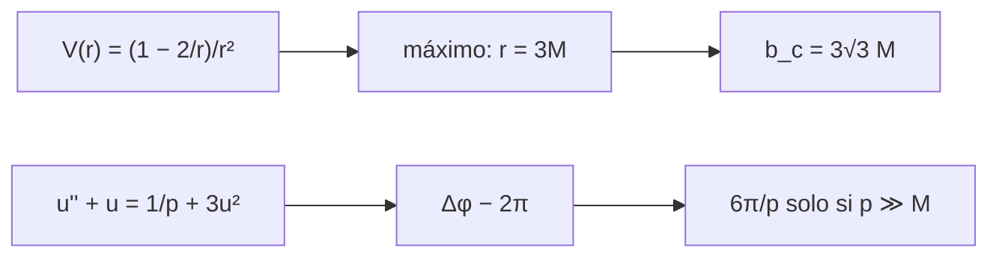

# B27-C09 — Órbitas en campos fuertes

<!-- nav:top -->
[🏠 Programa](../../../../README.md) · [📚 Bloque B27](../../../tronco-comun/B27-objetos-compactos-y-altas-energias.md) · [← Anterior: B27-C08 — Horizonte de sucesos](../B27-C08-horizonte-de-sucesos/CLASE.md) · [Siguiente: B27-C10 — Discos de acreción →](../B27-C10-discos-de-acrecion/CLASE.md)
<!-- /nav -->

## 1. Ubicación, nivel y alcance

Clase 9 del bloque B27. Nivel N3. Con el horizonte y el ISCO de [C07](../B27-C07-metricas-de-agujeros-negros/CLASE.md) y la caída de [C08](../B27-C08-horizonte-de-sucesos/CLASE.md), aquí estudias qué ocurre con la luz y con las partículas cerca del agujero: la **esfera de fotones**, el **parámetro de impacto crítico** (que fija el tamaño de la sombra) y la **precesión** de una órbita ligada, que en campo fuerte supera con creces la fórmula débil. Usas geodésicas ([B26-C08](../../B26/B26-C08-geodesicas-gravitacionales/CLASE.md)) y ecuaciones diferenciales numéricas ([B11-C08](../../B11/B11-C08-integradores-de-paso-adaptativo/CLASE.md)). Se trata Schwarzschild y un cuerpo de prueba.

## 2. Por qué esta clase existe

La sombra de un agujero negro no es su horizonte: es la imagen de la esfera de fotones ampliada por la curvatura. Y la fórmula `6πM/p` de la precesión solo vale lejos. La decisión central: **¿dónde está la esfera de fotones, cuánto mide la sombra y cuándo falla la precesión débil?**

## 3. Lo que podrás hacer al terminar

1. Calcular la esfera de fotones `r = 3M` y el parámetro de impacto crítico `b_c = 3√3 M`.
2. Estimar el tamaño de una sombra en unidades astronómicas.
3. Integrar una órbita relativista con RK4.
4. Medir la precesión por vuelta y compararla con `6π/p`.
5. Reconocer cuándo falla la fórmula débil.
6. Calcular frecuencias orbitales en el ISCO y en la esfera de fotones.

La evidencia es la **ficha de órbitas en campo fuerte** del ejercicio 12 (sección 20).

## 4. Con qué llegas y cómo comprobarlo

1. ¿Qué es un potencial efectivo?
2. ¿Qué es el ISCO?
3. ¿Qué es el método RK4?
4. ¿Qué es un parámetro de impacto?
5. ¿Qué es el semilado recto `p = a(1 − e²)`?

<details>
<summary>Ver respuestas</summary>

1. Un potencial que incluye la barrera centrífuga y reduce el movimiento a una dimensión. 2. La órbita circular estable más interna. 3. Un integrador de cuarto orden. 4. La distancia perpendicular de la trayectoria asintótica al centro. 5. Parámetro de la cónica, en la órbita newtoniana.
</details>

Con cuatro o cinco aciertos, sigue; si no, repasa B26-C08 y B11-C08.

## 5. Un caso real: el tamaño de la sombra de M87\*

Con la masa de `6,5 ± 0,7 × 10⁹ M☉` (S3, resumen), `r_g = 64,2 au` y el diámetro de la sombra es `2 b_c r_g = 667 au`. La colaboración Event Horizon Telescope midió un anillo de `42 ± 3 μas` (S3, resumen); pasar de unidades físicas a angulares exige la distancia, que esta clase no usa. Es el **ejemplo conductor**.

## 6. Vocabulario

La **esfera de fotones** es la órbita circular (inestable) de la luz: `r = 3M`. El **parámetro de impacto crítico** `b_c = L/E` separa los fotones capturados de los desviados. La **sombra** es la región oscura del anillo. La **precesión** es el avance del periastro por vuelta. El **semilado recto** `p` parametriza la cónica. La **frecuencia orbital** `f = c³/(2π (r/r_g)^{3/2} GM)`.

## 7. Modelo mental: una cresta sin valle

El potencial del fotón `V = (1 − 2/r)/r²` tiene una cresta en `r = 3`. Un fotón que llega con `b < b_c` pasa la cresta y cae; con `b > b_c` se desvía y escapa; con `b = b_c` queda en equilibrio inestable.



*Descripción textual:* el máximo del potencial del fotón da la esfera de fotones y el parámetro crítico; la ecuación de la órbita da la precesión, que se compara con la fórmula débil.

Analogía: una bola sobre una cresta. Límite: es equilibrio inestable; una perturbación la envía a un lado.

## 8. La explicación, paso a paso

### 8.1 La esfera de fotones

El máximo de `V(r)` está en `r = 3M`. El laboratorio lo encuentra por razón áurea con error menor que `10⁻⁶`. Ahí `b_c = 1/√V = 3√3 M = 5,196 152 M`.

### 8.2 El tamaño de la sombra

El diámetro es `2 b_c r_g`: para `6,5 × 10⁹ M☉`, `667 au`, unas `2,6` veces el radio de Schwarzschild (`128,3 au`). Es mayor que el horizonte porque la curvatura desvía hacia el observador luz que viene de más lejos.

### 8.3 Frecuencias orbitales

Para `10 M☉`, la frecuencia orbital en el ISCO es `219,9 Hz` y en la esfera de fotones `621,9 Hz` (con `f = c³/(2π (r/r_g)^{3/2} GM)`). Son los hercios que un oyente asociaría a los modos cuasi-periódicos de una binaria de agujeros negros, sin que esta clase los modele.

### 8.4 La órbita relativista

Con `u = 1/r`, `u″ + u = 1/p + 3u²` (unidades `M = 1`). La integración con RK4 en el ángulo, desde el apoastro, mide el ángulo entre dos apoastros; el exceso sobre `2π` es la precesión por vuelta.

### 8.5 Cuándo falla la fórmula débil

| `p` | `e` | Δφ integrado (rad) | `6π/p` | cociente |
|---|---|---|---|---|
| 1000 | 0,20 | 0,018 993 | 0,018 850 | 1,0076 |
| 100 | 0,20 | 0,204 193 | 0,188 496 | 1,0833 |
| 30 | 0,30 | 0,865 311 | 0,628 319 | 1,3772 |
| 20 | 0,20 | 1,653 858 | 0,942 478 | 1,7548 |

La fórmula débil es buena a menos del `1 %` en `p = 1000` y subestima casi a la mitad en `p = 20`. Con `p ≤ 6 + 2e` no hay órbita ligada estable.

## 9. Magnitudes, símbolos y unidades

| Símbolo | Qué es | Unidad | Valor / nota |
|---|---|---|---|
| `r_ph` | esfera de fotones | `r_g` | 3 |
| `b_c` | parámetro de impacto crítico | `r_g` | `5,196 152` |
| `p` | semilado recto | `r_g` | ilustrativo |
| `e` | excentricidad newtoniana | — | ilustrativa |
| `Δφ` | precesión por vuelta | rad | integrada |
| `f` | frecuencia orbital | Hz | `219,9` (ISCO, `10 M☉`) |

## 10. Convenciones y referencias

Unidades geométricas `G = c = M = 1`; Schwarzschild; órbitas planas desde el apoastro; los pares `(p, e)` y la masa de `10 M☉` son **ilustrativos**. `1 au = 1,495 978 707 × 10¹¹ m` (S5).

## 11. De dónde sale lo que afirmamos

| ID | Fuente | Localizador | Respalda | Estado |
|---|---|---|---|---|
| S1 | NIST, *Fundamental Physical Constants — Complete Listing* (CODATA 2022) | https://physics.nist.gov/cuu/Constants/Table/allascii.txt | `G`, `c` | Consultada el 2026-11-09 |
| S2 | UAI, Resolución B3 de 2015 | https://arxiv.org/abs/1510.07674 | `GM_☉` nominal | Consultada el 2026-11-09 |
| S3 | Event Horizon Telescope Collaboration, M87\*, arXiv:1906.11238 | https://arxiv.org/abs/1906.11238 | `6,5 ± 0,7 × 10⁹ M☉`; `42 ± 3 μas` | Solo resumen, consultado el 2026-11-09 |
| S5 | IERS Technical Note 36, Tabla 1.1 | https://iers-conventions.obspm.fr/ | `au` | Consultada el 2026-11-09 |

Límites: S3 solo resumen; las ecuaciones de la esfera de fotones y de la órbita son estándar y se verifican en el laboratorio contra `r = 3`, `b_c = 3√3` y `6π/p`; no se consultó un texto de relatividad.

## 12. Cómo ver el potencial

| `r/M` | `V(r)` |
|---|---|
| 2,5 | 0,0320 |
| 3,0 | 0,0370 |
| 4,0 | 0,0313 |
| 6,0 | 0,0185 |

Descripción larga: `V` crece desde el horizonte, alcanza su máximo `1/27 = 0,0370` en `r = 3` y decrece después.

## 13. Ejemplo trabajado: ¿cuánto vale `b_c`?

**Paso 1 · Máximo.** `V(3) = (1 − 2/3)/9 = 1/27`.

**Paso 2 · Parámetro.** `b_c = 1/√V = √27 = 5,196`.

**Paso 3 · Unidades.** Para `10 M☉`, `b_c = 5,196 × 14,77 km = 76,7 km`.

**Paso 4 · Sentido.** Un fotón que llega con parámetro menor que `76,7 km` es capturado.

## 14. Distintas formas de describir la precesión

**Fórmula débil:** `6π/p`. **Integración numérica:** exacta en Schwarzschild. **Desarrollo en `1/p`:** el cociente crece como `1 + k/p`. **Medida en un púlsar binario:** otra clase.

## 15. Práctica guiada

**Ejercicio 1 · con los pasos indicados.** Calcula `V(3)`. *Pasos:* `(1 − 2/r)/r²`.

<details><summary>Solución comentada</summary>

`(1/3)/9 = 0,037`.
</details>

**Ejercicio 2 · con una pista.** `b_c` en kilómetros para `10 M☉`. *Pista:* `r_g = 14,766 km`.

<details><summary>Solución comentada</summary>

`5,196 × 14,766 = 76,7 km`.
</details>

**Ejercicio 3 · casi autónomo.** Precesión débil para `p = 100`.

<details><summary>Solución comentada</summary>

`6π/100 = 0,1885 rad`.
</details>

## 16. Práctica autónoma, transferencia e integrador

**Ejercicio 4.** Cociente integrado/débil con `p = 1000`. 

<details><summary>Solución comentada</summary>

`1,0076`.
</details>

**Ejercicio 5.** Diámetro de la sombra de un agujero de `10 M☉` en kilómetros.

<details><summary>Solución comentada</summary>

`2 × 76,7 = 153 km`.
</details>

**Ejercicio 6.** Razón entre la esfera de fotones y el horizonte.

<details><summary>Solución comentada</summary>

`3/2 = 1,5`.
</details>

**Ejercicio 7.** Razón de frecuencias esfera de fotones/ISCO.

<details><summary>Solución comentada</summary>

`621,9/219,9 = 2,83 = (6/3)^{3/2}`.
</details>

**Ejercicio 8.** Radio de Schwarzschild de M87\* en au.

<details><summary>Solución comentada</summary>

`128,3 au`.
</details>

**Ejercicio 9 · transferencia.** Un compañero dice que la sombra mide lo mismo que el horizonte. Responde con 8.2.

<details><summary>Solución comentada</summary>

La sombra mide `2 b_c r_g = 10,39 r_g` frente a `4 r_g`: es unas `2,6` veces mayor.
</details>

**Ejercicio 10 · transferencia.** ¿Qué pasa con la precesión integrada cuando `p` crece?

<details><summary>Solución comentada</summary>

Tiende a `6π/p` (el cociente se acerca a 1).
</details>

**Ejercicio 11 · transferencia.** ¿Por qué `p = 12` con `e = 0,3` no tiene órbita ligada oscilante?

<details><summary>Solución comentada</summary>

Porque `u = 1/6` es el punto de silla del potencial con `p = 12`: el discriminante `1 − 12/p` se anula.
</details>

**Ejercicio 12 · integrador.** Elabora tu *ficha de órbitas en campo fuerte*: `r_ph`, `b_c`, tamaño de la sombra para una masa, y la tabla de precesión para cuatro `p`.

<details><summary>Solución modelo</summary>

Secciones 8.1–8.5.
</details>

## 17. Laboratorio: sombra y precesión

El script [campo_fuerte.py](campo_fuerte.py) maximiza `V(r)` (**comprueba** `10⁻⁶`), integra `u″ + u = 1/p + 3u²` con RK4 y compara con `6π/p` (**comprueba** `2 %` en `p = 1000`).

**Datos:** constantes de NIST/UAI/IERS; pares `(p, e)` **ilustrativos**. **Predice antes de ejecutar:** ¿qué valor tiene `b_c`? (≈`5,2`.) **Ejecución del 2026-11-09 (Python 3.12.9):**

```text
Python 3.12.9 (biblioteca estandar)
esfera de fotones: r = 3.000000 M ; b_c = 5.196152 M (3 sqrt 3 = 5.196152)
M87* (6.5e9 Msol): r_g = 64.2 au ; diametro de la sombra 2 b_c r_g = 667 au
frecuencia orbital en el ISCO (10 Msol): 219.9 Hz ; en la esfera de fotones: 621.9 Hz
   p [M]     e   dphi integrada [rad]     6 pi/p  cociente
  1000.0  0.20               0.018993   0.018850    1.0076
   100.0  0.20               0.204193   0.188496    1.0833
    30.0  0.30               0.865311   0.628319    1.3772
    20.0  0.20               1.653858   0.942478    1.7548
Pruebas superadas.
```

```bash
python programa/clases/B27/B27-C09-orbitas-en-campos-fuertes/campo_fuerte.py
```

**Límites:** Schwarzschild, cuerpo de prueba, sin radiación gravitacional.

## 18. Errores frecuentes y cómo corregirlos

**Confundir sombra y horizonte.** Se corrige con el ejercicio 9.

**Aplicar `6π/p` con `p` pequeño.** Se corrige con 8.5.

**Pensar que la esfera de fotones es estable.** Se corrige con la sección 7.

**Olvidar `p > 6 + 2e`.** Se corrige con el ejercicio 11.

**Tomar `(p, e)` por medidas.** Se corrige con la sección 10.

## 19. Cómo sabrás que vas bien

Tras 8.1: ¿cuánto vale `b_c`? Si dudas, ejercicio 1. Tras 8.5: ¿cuándo falla `6π/p`? Ejercicio 10. Tras el laboratorio: ¿qué comprueban las dos tolerancias? (`r = 3` y la precesión débil).

## 20. Qué entregas y cómo se evalúa

El producto es tu **ficha de órbitas en campo fuerte** (ejercicio 12).

| Criterio | Inicial | En desarrollo | Logrado | Destacado |
|---|---|---|---|---|
| Conceptos | Los confunde | Parciales | Fotones, `b_c`, precesión | Explica por qué la sombra es mayor |
| Cálculo | Sin unidades | Con errores | Todo en `r_g` y SI | Compara con M87\* |
| Numérico | Sin comprobar | Un caso | Dos tolerancias | Interpreta el cociente |
| Fuentes | Sin fuente | Sin fecha | S1–S5 con fecha | Declara S3 como resumen |
| Límites | No los nombra | Uno | Tres | Discute Kerr como extensión |

**Condiciones críticas (no se compensan con promedio):** rotular `(p, e)` como ilustrativos; no mezclar sombra y horizonte; citar solo lo consultado.

## 21. Ética, seguridad y límites

Clase educativa: no es una simulación de imágenes de agujeros negros. Accesibilidad: tablas equivalentes a las gráficas, fórmulas en texto, ejercicios sin conexión.

## 22. Para cerrar y seguir

La luz queda atrapada en `r = 3M`, la sombra mide `2 b_c r_g` y la precesión débil falla cuando `p` no es grande. Queda una pregunta: ¿de dónde sale la luz de la materia que rodea el agujero?

**Glosario español–inglés.** esfera de fotones · *photon sphere*; parámetro de impacto crítico · *critical impact parameter*; sombra · *shadow*; precesión · *precession*; semilado recto · *semi-latus rectum*; potencial efectivo · *effective potential*.

**Continuidad.** [B27-C10](../B27-C10-discos-de-acrecion/CLASE.md) estudia los discos de acreción.

**Referencias:** ver sección 11.

<!-- nav:bottom -->
---

[← Anterior: B27-C08 — Horizonte de sucesos](../B27-C08-horizonte-de-sucesos/CLASE.md) · [📚 Bloque B27](../../../tronco-comun/B27-objetos-compactos-y-altas-energias.md) · [Siguiente: B27-C10 — Discos de acreción →](../B27-C10-discos-de-acrecion/CLASE.md)
<!-- /nav -->
