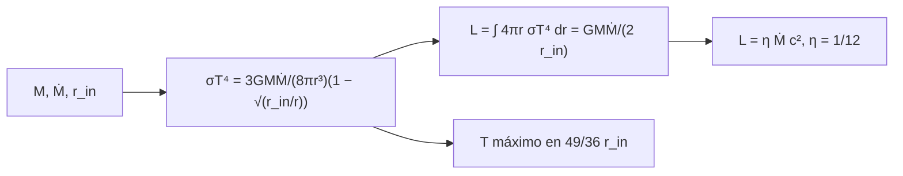

# B27-C10 — Discos de acreción

<!-- nav:top -->
[🏠 Programa](../../../../README.md) · [📚 Bloque B27](../../../tronco-comun/B27-objetos-compactos-y-altas-energias.md) · [← Anterior: B27-C09 — Órbitas en campos fuertes](../B27-C09-orbitas-en-campos-fuertes/CLASE.md) · [Siguiente: B27-C11 — Chorros relativistas →](../B27-C11-chorros-relativistas/CLASE.md)
<!-- /nav -->

## 1. Ubicación, nivel y alcance

Clase 10 del bloque B27. Nivel N3. La materia que cae a un objeto compacto no lo hace de golpe: forma un disco que irradia al perder energía. Aquí calculas el **perfil de temperatura** de un disco delgado, su **luminosidad** y la **tasa de acreción** que la sostiene, usando el ISCO de [C07](../B27-C07-metricas-de-agujeros-negros/CLASE.md) como borde interno. Usas la ley de Stefan–Boltzmann ([B24-C10](../../B24/B24-C10-espectros-y-clasificacion-estelar/CLASE.md)) y la integración ([B09-C11](../../B09/B09-C11-integrales-definidas/CLASE.md)). Se trata un disco delgado, estacionario y newtoniano.

## 2. Por qué esta clase existe

Un disco convierte hasta una fracción grande de `Ṁc²` en luz; su temperatura, que baja hacia fuera, decide en qué banda se ve (rayos X en un agujero estelar, ultravioleta en uno supermasivo). La decisión central: **¿cuánto vale la temperatura en cada radio y qué luminosidad produce una tasa de acreción dada?**

## 3. Lo que podrás hacer al terminar

1. Calcular `T(r)` de un disco delgado.
2. Calcular la luminosidad total por cuadratura y por fórmula cerrada `GMṀ/(2 r_in)`.
3. Localizar el máximo de temperatura en `r = (49/36) r_in`.
4. Calcular la luminosidad de Eddington y la tasa de acreción asociada.
5. Reconocer la ley `T ∝ r^{−3/4}` lejos del borde.
6. Estimar la energía de los fotones típicos.

La evidencia es el **perfil de temperatura de un disco** del ejercicio 12 (sección 20).

## 4. Con qué llegas y cómo comprobarlo

1. ¿Qué dice la ley de Stefan–Boltzmann?
2. ¿Qué es la luminosidad de Eddington?
3. ¿Qué es una cuadratura de Simpson?
4. ¿Qué es la eficiencia radiativa?
5. ¿Qué es un cambio de variable en una integral?

<details>
<summary>Ver respuestas</summary>

1. `F = σT⁴`. 2. La luminosidad a la que la presión de radiación iguala la gravedad: `L_Edd = 4πGM m_p c/σ_T`. 3. Una regla de integración con parábolas. 4. `η = L/(Ṁc²)`. 5. Sustituir la variable para simplificar el integrando.
</details>

Con cuatro o cinco aciertos, sigue; si no, repasa B24-C10 y B09-C11.

## 5. Un caso ilustrativo: un agujero de diez masas solares

No se cita aquí ninguna medición: el caso es sintético. Un agujero de `10 M☉` con borde interno en `6 GM/c²` y luminosidad `0,1 L_Edd` tiene `L_Edd = 1,257 × 10³² W`, `L = 1,257 × 10³¹ W` y una tasa de acreción `Ṁ = 1,678 × 10¹⁵ kg/s = 2,66 × 10⁻⁸ M☉/año`. Es el **ejemplo conductor**.

## 6. Vocabulario

El **disco delgado** es geométricamente delgado y estacionario. El **borde interno** `r_in` es el ISCO. La **temperatura efectiva** `T(r)` es la de un cuerpo negro con el flujo local. La **luminosidad de Eddington** `L_Edd`. La **tasa de acreción** `Ṁ`. La **eficiencia** `η = GM/(2 r_in c²)` en el modelo newtoniano.

## 7. Modelo mental: una cascada de calor

La materia desciende espiralando; en cada radio libera energía gravitatoria que el disco irradia desde sus dos caras. Cerca del borde, donde cae más, está más caliente.



*Descripción textual:* la masa, la tasa de acreción y el borde interno dan el perfil de temperatura; integrándolo se obtiene la luminosidad, que equivale a una eficiencia fija por el borde.

Analogía: una cascada con varios saltos. Límite: no incluye la turbulencia que transporta el momento angular.

## 8. La explicación, paso a paso

### 8.1 El perfil de temperatura

`σT⁴ = 3GMṀ/(8πr³) · (1 − √(r_in/r))`. Cerca del borde el factor `(1 − √(r_in/r))` anula el flujo (sin torque en el borde); lejos, `T ∝ r^{−3/4}`.

### 8.2 La luminosidad

Cada cara irradia `σT⁴`, por lo que `L = ∫ 2 · 2πr σT⁴ dr`. Con `x = r_in/r` queda `(3GMṀ/(2 r_in)) ∫₀¹ (1 − √x) dx = GMṀ/(2 r_in)`. El laboratorio lo calcula con Simpson (sustituyendo `x = s²` para suavizar el integrando) y coincide con la fórmula a `10⁻⁸`.

### 8.3 El máximo

La temperatura es máxima en `r = (49/36) r_in = 1,3611 r_in`; el laboratorio lo encuentra por razón áurea con error `< 10⁻⁶`. Para `10 M☉`, `T_max = 4,42 × 10⁶ K` y el pico del cuerpo negro cae en `h ν ≈ 1,07 keV`: rayos X blandos.

### 8.4 Eddington y la tasa de acreción

`L_Edd = 4πGM m_p c/σ_T = 1,257 × 10³² W` para `10 M☉`. Con `η = 1/12` y `L = 0,1 L_Edd`, `Ṁ = L/(η c²) = 1,678 × 10¹⁵ kg/s`, unos `2,66 × 10⁻⁸ M☉/año`.

### 8.5 La ley de potencia

Entre `10³ r_in` y `10⁴ r_in` la pendiente de `T` es `−0,7476` frente a `−0,75` esperada.

## 9. Magnitudes, símbolos y unidades

| Símbolo | Qué es | Unidad | Valor / nota |
|---|---|---|---|
| `T(r)` | temperatura efectiva | K | `4,42 × 10⁶` (máx.) |
| `r_in` | borde interno | m | `6 GM/c²` |
| `Ṁ` | tasa de acreción | kg/s | `1,678 × 10¹⁵` |
| `L` | luminosidad | W | `1,257 × 10³¹` |
| `L_Edd` | límite de Eddington | W | `1,257 × 10³²` |
| `η` | eficiencia | — | `1/12` |
| `σ`, `σ_T` | Stefan–Boltzmann, Thomson | — | NIST (S1) |

## 10. Convenciones y referencias

Disco delgado y estacionario, newtoniano, con borde interno en el ISCO de Schwarzschild; masa, `r_in` y la fracción de Eddington son **ilustrativos**.

## 11. De dónde sale lo que afirmamos

| ID | Fuente | Localizador | Respalda | Estado |
|---|---|---|---|---|
| S1 | NIST, *Fundamental Physical Constants — Complete Listing* (CODATA 2022) | https://physics.nist.gov/cuu/Constants/Table/allascii.txt | `G`, `c`, `σ`, `σ_T`, `m_p`, `k_B`, `h` | Consultada el 2026-11-09 |
| S2 | UAI, Resolución B3 de 2015 | https://arxiv.org/abs/1510.07674 | `GM_☉` nominal | Consultada el 2026-11-09 |

Límites: no se cita ninguna medición de un disco real; las fórmulas del disco delgado son estándar y se verifican en el laboratorio (luminosidad analítica, posición del máximo y pendiente); no se consultó el artículo original de Shakura y Sunyaev.

## 12. Cómo ver el perfil

| `r/r_in` | `T` (K) |
|---|---|
| 1,2 | `4,29 × 10⁶` |
| 1,361 | `4,42 × 10⁶` |
| 2 | `3,96 × 10⁶` |
| 5 | `2,34 × 10⁶` |
| 20 | `8,99 × 10⁵` |
| 100 | `2,79 × 10⁵` |

Descripción larga: la temperatura sube hasta `1,36 r_in` y luego baja como `r^{−3/4}`.

## 13. Ejemplo trabajado: ¿cuánta masa por año?

**Paso 1 · Datos.** `L = 1,257 × 10³¹ W`, `η = 1/12`.

**Paso 2 · Tasa.** `Ṁ = L/(η c²) = 1,257 × 10³¹ × 12/8,988 × 10¹⁶ = 1,678 × 10¹⁵ kg/s`.

**Paso 3 · Por año.** `× 3,156 × 10⁷ s = 5,3 × 10²² kg`.

**Paso 4 · Sentido.** `2,66 × 10⁻⁸ M☉` por año: una masa lunar cada dos años aproximadamente.

## 14. Distintas formas de describir el disco

**Por perfil `T(r)`:** local. **Por `L`:** global. **Por espectro:** suma de cuerpos negros (otra clase). **Por eficiencia:** `η = 1/12` frente a `0,057` relativista.

## 15. Práctica guiada

**Ejercicio 1 · con los pasos indicados.** `L_Edd` para `1 M☉` a partir de `10 M☉`. *Pasos:* proporcional a `M`.

<details><summary>Solución comentada</summary>

`1,257 × 10³¹ W`.
</details>

**Ejercicio 2 · con una pista.** Radio del máximo si `r_in = 88,6 km`. *Pista:* `49/36`.

<details><summary>Solución comentada</summary>

`120,6 km`.
</details>

**Ejercicio 3 · casi autónomo.** `η` de un disco con `r_in = 6 GM/c²`.

<details><summary>Solución comentada</summary>

`1/12 = 0,0833`.
</details>

## 16. Práctica autónoma, transferencia e integrador

**Ejercicio 4.** `L` si `Ṁ = 10¹⁵ kg/s`.

<details><summary>Solución comentada</summary>

`L = η Ṁ c² = 7,5 × 10³⁰ W`.
</details>

**Ejercicio 5.** Cociente `T(2 r_in)/T(r_in × 49/36)`.

<details><summary>Solución comentada</summary>

`3,96/4,42 = 0,897`.
</details>

**Ejercicio 6.** Pendiente de `T` entre `5 r_in` y `20 r_in`.

<details><summary>Solución comentada</summary>

`ln(8,99 × 10⁵/2,34 × 10⁶)/ln 4 = −0,69`, aún con efecto del borde.
</details>

**Ejercicio 7.** Energía del pico `h ν ≈ 2,82 k_B T` para `T = 4,42 × 10⁶ K`.

<details><summary>Solución comentada</summary>

`1,07 keV`.
</details>

**Ejercicio 8.** ¿Qué fracción de `Ṁc²` irradia el disco con `r_in = 6 GM/c²`?

<details><summary>Solución comentada</summary>

`8,33 %`.
</details>

**Ejercicio 9 · transferencia.** Un compañero dice que `T` es máxima en el borde. Responde con 8.3.

<details><summary>Solución comentada</summary>

No: la condición de ausencia de torque anula el flujo en el borde; el máximo está en `1,36 r_in`.
</details>

**Ejercicio 10 · transferencia.** ¿Por qué un agujero supermasivo emite a menor energía que uno estelar?

<details><summary>Solución comentada</summary>

A igual fracción de Eddington, `T ∝ M^{−1/4}`; la banda pasa de rayos X a ultravioleta.
</details>

**Ejercicio 11 · transferencia.** ¿Qué valida la comparación con `GMṀ/(2 r_in)`?

<details><summary>Solución comentada</summary>

Que la cuadratura es correcta; no que el disco real sea delgado ni estacionario.
</details>

**Ejercicio 12 · integrador.** Elabora tu *perfil de temperatura de un disco*: `L_Edd`, `Ṁ`, `T(r)` en seis radios, `T_max` y su posición, `L`.

<details><summary>Solución modelo</summary>

Tabla de la sección 12 y los ejercicios 4–7.
</details>

## 17. Laboratorio: disco delgado

El script [disco.py](disco.py) calcula `L` por Simpson y en forma cerrada (**comprueba** `10⁻⁸`), halla el máximo por razón áurea (**comprueba** `10⁻⁶`) y verifica la pendiente `−3/4`.

**Datos:** constantes de NIST/UAI; masa, `r_in`, fracción de Eddington **ilustrativas**. **Predice antes de ejecutar:** ¿en qué fracción de `r_in` cae el máximo? (≈`1,36`.) **Ejecución del 2026-11-09 (Python 3.12.9):**

```text
Python 3.12.9 (biblioteca estandar)
L_Edd(10 Msol) = 1.2571e+32 W ; L = 0.1 L_Edd = 1.2571e+31 W ; Mdot = 1.6784e+15 kg/s = 2.664e-08 Msol/anio
L por cuadratura = 1.2571e+31 W ; G M Mdot/(2 r_in) = 1.2571e+31 W ; L/(Mdot c^2) = 0.083333
maximo de T en r = 1.361111 r_in (49/36 = 1.361111) ; T_max = 4.4209e+06 K ; h nu pico ~ 1.07 keV
  r/r_in        T [K]
   1.200   4.2940e+06
   1.361   4.4209e+06
   2.000   3.9638e+06
   5.000   2.3368e+06
  20.000   8.9940e+05
 100.000   2.7910e+05
pendiente de T lejos del borde: -0.7476 (esperada -0.75)
Pruebas superadas.
```

```bash
python programa/clases/B27/B27-C10-discos-de-acrecion/disco.py
```

**Límites:** newtoniano, sin corrección relativista, sin atenuación por dispersión.

## 18. Errores frecuentes y cómo corregirlos

**Olvidar las dos caras del disco.** Se corrige con 8.2.

**Pensar que la temperatura es máxima en el borde.** Se corrige con el ejercicio 9.

**Confundir `η` newtoniano y relativista.** Se corrige con la sección 14.

**Mezclar kg/s y masas solares por año.** Se corrige con el ejemplo 13.

**Tomar la masa ilustrativa por una medida.** Se corrige con la sección 10.

## 19. Cómo sabrás que vas bien

Tras 8.2: ¿cuánto vale `L/(Ṁc²)`? Si dudas, ejercicio 3. Tras 8.3: ¿dónde cae el máximo? Ejercicio 9. Tras el laboratorio: ¿qué verifica la pendiente? (la ley `r^{−3/4}`).

## 20. Qué entregas y cómo se evalúa

El producto es tu **perfil de temperatura de un disco** (ejercicio 12).

| Criterio | Inicial | En desarrollo | Logrado | Destacado |
|---|---|---|---|---|
| Conceptos | Los confunde | Parciales | `T(r)`, `L`, `η` | Explica el borde sin torque |
| Cálculo | Sin unidades | Con errores | Todas las magnitudes | Compara masas |
| Numérico | Sin comprobar | Un caso | Tres comprobaciones | Interpreta la sustitución |
| Fuentes | Sin fuente | Sin fecha | S1–S2 con fecha | Declara que no hay datos reales |
| Límites | No los nombra | Uno | Tres | Discute el espesor del disco |

**Condiciones críticas (no se compensan con promedio):** rotular el caso como sintético; no citar un disco real sin fuente; citar solo lo consultado.

## 21. Ética, seguridad y límites

Clase educativa: no es un modelo para ajustar datos. Accesibilidad: tablas equivalentes a las gráficas, fórmulas en texto, ejercicios sin conexión.

## 22. Para cerrar y seguir

Un disco delgado irradia `L = GMṀ/(2 r_in)` con un máximo de temperatura en `1,36 r_in` y una ley `r^{−3/4}` hacia fuera. Queda una pregunta: ¿cómo expulsan algunos objetos parte de esa energía en forma de chorros?

**Glosario español–inglés.** disco de acreción · *accretion disc*; tasa de acreción · *accretion rate*; luminosidad de Eddington · *Eddington luminosity*; borde interno · *inner edge*; temperatura efectiva · *effective temperature*; disco delgado · *thin disc*.

**Continuidad.** [B27-C11](../B27-C11-chorros-relativistas/CLASE.md) estudia los chorros relativistas.

**Referencias:** ver sección 11.

<!-- nav:bottom -->
---

[← Anterior: B27-C09 — Órbitas en campos fuertes](../B27-C09-orbitas-en-campos-fuertes/CLASE.md) · [📚 Bloque B27](../../../tronco-comun/B27-objetos-compactos-y-altas-energias.md) · [Siguiente: B27-C11 — Chorros relativistas →](../B27-C11-chorros-relativistas/CLASE.md)
<!-- /nav -->
