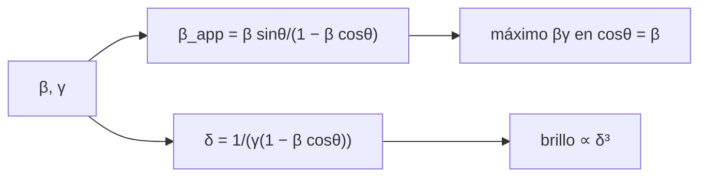

# B27-C11 — Chorros relativistas

<!-- nav:top -->
[🏠 Programa](../../../../README.md) · [📚 Bloque B27](../../../tronco-comun/B27-objetos-compactos-y-altas-energias.md) · [← Anterior: B27-C10 — Discos de acreción](../B27-C10-discos-de-acrecion/CLASE.md) · [Siguiente: B27-C12 — Radiación sincrotrón →](../B27-C12-radiacion-sincrotron/CLASE.md)
<!-- /nav -->

## 1. Ubicación, nivel y alcance

Clase 11 del bloque B27. Nivel N3. Muchos objetos compactos lanzan chorros de plasma a velocidades próximas a la de la luz. Aquí calculas tres efectos que dependen del ángulo con la visual: la **velocidad aparente superlumínica**, la **aberración** de la emisión y la **amplificación Doppler**. Usas relatividad especial ([B26-C03](../../B26/B26-C03-dilatacion-temporal-y-contraccion/CLASE.md)) y trigonometría. El disco que alimenta el chorro está en [C10](../B27-C10-discos-de-acrecion/CLASE.md). Se trata una fuente puntual con velocidad constante.

## 2. Por qué esta clase existe

Un chorro que se acerca puede parecer más rápido que la luz sin violar nada, y su brillo cambia en órdenes de magnitud según el ángulo. Sin estos efectos no se pueden comparar chorros ni inferir su velocidad. La decisión central: **¿qué velocidad aparente y qué amplificación tiene un chorro de factor de Lorentz y ángulo dados?**

## 3. Lo que podrás hacer al terminar

1. Calcular `β_app = β sinθ/(1 − β cosθ)`.
2. Demostrar y verificar que su máximo es `βγ` en `cosθ = β`.
3. Calcular el factor Doppler `δ = 1/(γ(1 − β cosθ))`.
4. Aplicar la aberración de la emisión.
5. Estimar la razón de brillos entre el chorro y el contrachorro.
6. Reconocer qué efectos son geométricos y cuáles físicos.

La evidencia es la **ficha de un chorro relativista** del ejercicio 12 (sección 20).

## 4. Con qué llegas y cómo comprobarlo

1. ¿Qué es el factor de Lorentz?
2. ¿Qué es el efecto Doppler relativista?
3. ¿Qué es la aberración de la luz?
4. ¿Cómo se maximiza una función?
5. ¿Qué es un retardo de propagación de la luz?

<details>
<summary>Ver respuestas</summary>

1. `γ = 1/√(1 − β²)`. 2. Cambio de frecuencia por el movimiento de la fuente. 3. Cambio de dirección aparente por el movimiento. 4. Derivando o por búsqueda numérica. 5. La diferencia de tiempo de llegada por trayectorias de distinta longitud.
</details>

Con cuatro o cinco aciertos, sigue; si no, repasa B26-C03.

## 5. Un caso ilustrativo: `γ = 10`

No se cita aquí ninguna medición de un chorro real: los valores son sintéticos. Con `γ = 10`, `β = 0,994 987`, el máximo de `β_app` es `9,9499` a `5,7392°` de la visual (`1/γ = 5,7296°`); la amplificación Doppler va de `δ = 19,95` si el chorro apunta hacia nosotros a `δ = 0,1` si lo vemos de lado. Es el **ejemplo conductor**.

## 6. Vocabulario

La **velocidad aparente** `β_app` es la que se deduce de la posición proyectada y los tiempos de llegada. El **movimiento superlumínico aparente** es `β_app > 1`. El **factor Doppler** `δ`. El **cono de emisión** tiene semiángulo `1/γ`. El **contrachorro** es el que se aleja. La **amplificación** escala como `δ^{2+α}` para un chorro continuo y `δ^{3+α}` para un blob, con `α` el índice espectral.

## 7. Modelo mental: alcanzar a la propia luz

La fuente avanza casi con su propia luz: los fotones emitidos en instantes distintos llegan casi juntos. El tiempo observado se acorta por `(1 − β cosθ)` y la velocidad aparente se dispara.



*Descripción textual:* la velocidad y el factor de Lorentz dan la velocidad aparente y el factor Doppler; el máximo de la primera ocurre cuando `cosθ = β`, donde `δ = γ`.

Analogía: un corredor que lanza pelotas hacia delante mientras avanza. Límite: es geometría de propagación, no un movimiento mayor que `c`.

## 8. La explicación, paso a paso

### 8.1 Velocidad aparente

Si la fuente recorre `β c Δt` y emite en dos instantes separados `Δt`, la diferencia de llegada es `Δt(1 − β cosθ)` y la proyección transversal `β c Δt sinθ`. De ahí `β_app = β sinθ/(1 − β cosθ)`.

### 8.2 El máximo

Se anula la derivada en `cosθ = β`, donde `β_app = βγ`. El laboratorio lo encuentra por razón áurea y coincide a `10⁻⁹`: `1,7321` (`γ = 2`), `4,8990` (`5`), `9,9499` (`10`), `29,9833` (`30`). Con `γ ≥ 1,41`, `βγ > 1`.

### 8.3 El factor Doppler

`δ = 1/(γ(1 − β cosθ))`. En `cosθ = β`, `δ = γ`. Para `γ = 10`: `19,95` a `0°`, `11,37` a `5°`, `0,100` a `90°`.

### 8.4 Aberración

`cosθ′ = (cosθ − β)/(1 − β cosθ)`. La emisión isótropa en el sistema de reposo (`θ′ = 90°`) se ve a `θ = arccos β ≈ 1/γ`; la luz se concentra en un cono de semiángulo `1/γ`.

### 8.5 Chorro y contrachorro

Para un blob, el brillo escala como `δ³`; el cociente entre el chorro que se acerca (`θ = 0`) y el que se aleja (`θ = 180°`) es `6,30 × 10⁷` para `γ = 10`. Por eso casi siempre se ve un solo chorro.

## 9. Magnitudes, símbolos y unidades

| Símbolo | Qué es | Unidad | Valor / nota |
|---|---|---|---|
| `β` | velocidad en unidades de `c` | — | `0,994 987` (`γ = 10`) |
| `γ` | factor de Lorentz | — | 10 (ilustrativo) |
| `θ` | ángulo con la visual | grados | `5,74°` (máximo) |
| `β_app` | velocidad aparente | `c` | `9,9499` (máx.) |
| `δ` | factor Doppler | — | `19,95` (`θ = 0`) |
| `c` | velocidad de la luz | m/s | `299 792 458` (S1) |

## 10. Convenciones y referencias

Blob puntual; velocidad constante; los factores de Lorentz y los ángulos son **ilustrativos**. El índice espectral no se usa en el laboratorio.

## 11. De dónde sale lo que afirmamos

| ID | Fuente | Localizador | Respalda | Estado |
|---|---|---|---|---|
| S1 | NIST, *Fundamental Physical Constants — Complete Listing* (CODATA 2022) | https://physics.nist.gov/cuu/Constants/Table/allascii.txt | `c` | Consultada el 2026-11-09 |

Límites: no se cita ninguna medición de un chorro real; las fórmulas son estándar y se verifican en el laboratorio contra `βγ` y `δ = γ`; no se consultó un texto de relatividad ni un artículo sobre movimiento superlumínico.

## 12. Cómo ver la tabla

| `γ` | `β_app` máx. | `θ_max` (°) | `1/γ` (°) |
|---|---|---|---|
| 2 | 1,7321 | 30,00 | 28,65 |
| 5 | 4,8990 | 11,54 | 11,46 |
| 10 | 9,9499 | 5,74 | 5,73 |
| 30 | 29,9833 | 1,91 | 1,91 |

Descripción larga: a mayor `γ`, el máximo de la velocidad aparente crece como `γ` y ocurre a un ángulo cada vez más próximo a `1/γ`.

## 13. Ejemplo trabajado: ¿qué ángulo da la velocidad máxima?

**Paso 1 · Datos.** `γ = 10`.

**Paso 2 · Velocidad.** `β = √(1 − 1/100) = 0,994 987`.

**Paso 3 · Ángulo.** `θ_max = arccos β = 5,74°`.

**Paso 4 · Valor.** `β_app = βγ = 9,95`.

**Paso 5 · Sentido.** A `5,7°` de la visual, un chorro con `γ = 10` parece moverse a casi `10 c`.

## 14. Distintas formas de describir el efecto

**Por `β_app`:** cinemático. **Por `δ`:** de intensidad y frecuencia. **Por `θ′`:** en el sistema de reposo. **Por cociente chorro/contrachorro:** observacional.

## 15. Práctica guiada

**Ejercicio 1 · con los pasos indicados.** `β` para `γ = 5`. *Pasos:* `√(1 − 1/γ²)`.

<details><summary>Solución comentada</summary>

`√(1 − 0,04) = 0,9798`.
</details>

**Ejercicio 2 · con una pista.** `β_app` en `θ = 90°` con `γ = 10`. *Pista:* `cos 90° = 0`.

<details><summary>Solución comentada</summary>

`β_app = β = 0,995`.
</details>

**Ejercicio 3 · casi autónomo.** `δ` a `θ = 0` con `γ = 10`.

<details><summary>Solución comentada</summary>

`1/(10 × (1 − 0,995)) = 19,95`.
</details>

## 16. Práctica autónoma, transferencia e integrador

**Ejercicio 4.** `δ` a `θ = 90°`.

<details><summary>Solución comentada</summary>

`1/γ = 0,1`.
</details>

**Ejercicio 5.** Cociente de brillos entre `θ = 0` y `θ = 90°` para un blob con `γ = 10`.

<details><summary>Solución comentada</summary>

`(19,95/0,1)³ = 7,94 × 10⁶`.
</details>

**Ejercicio 6.** Semiángulo del cono de emisión para `γ = 30`.

<details><summary>Solución comentada</summary>

`1/30 rad = 1,91°`.
</details>

**Ejercicio 7.** Cociente de `β_app` máximo entre `γ = 30` y `γ = 5`.

<details><summary>Solución comentada</summary>

`29,98/4,90 = 6,12`.
</details>

**Ejercicio 8.** `δ` en `θ_max` para `γ = 5`.

<details><summary>Solución comentada</summary>

`δ = γ = 5`.
</details>

**Ejercicio 9 · transferencia.** Un compañero dice que un movimiento aparente de `10 c` viola la relatividad. Responde con 8.1.

<details><summary>Solución comentada</summary>

La velocidad real es `β < 1`; el valor aparente sale de que la fuente casi alcanza a su propia luz y acorta el tiempo de llegada.
</details>

**Ejercicio 10 · transferencia.** ¿Por qué casi no se ve el contrachorro?

<details><summary>Solución comentada</summary>

Porque su `δ` es del orden de `1/(2γ)` y el brillo del blob escala como `δ³` (8.5).
</details>

**Ejercicio 11 · transferencia.** ¿Qué te dice `β_app > 1` sobre el factor de Lorentz mínimo?

<details><summary>Solución comentada</summary>

Que `βγ > 1`, es decir `γ > √2 = 1,41`.
</details>

**Ejercicio 12 · integrador.** Elabora tu *ficha de un chorro relativista*: para dos `γ`, `β`, `θ_max`, `β_app` máx., `δ` en tres ángulos y la razón chorro/contrachorro.

<details><summary>Solución modelo</summary>

Tabla de la sección 12 y los ejercicios 3–5.
</details>

## 17. Laboratorio: velocidad aparente y Doppler

El script [chorro.py](chorro.py) maximiza `β_app` por razón áurea (**comprueba** `10⁻⁹` contra `βγ`), verifica `cosθ_max = β`, `δ(θ_max) = γ` y la aberración `θ′ = 90°`.

**Datos:** `c` de NIST; `γ` y ángulos **ilustrativos**. **Predice antes de ejecutar:** ¿cuánto vale el máximo de `β_app` para `γ = 10`? (≈`9,95`.) **Ejecución del 2026-11-09 (Python 3.12.9):**

```text
Python 3.12.9 (biblioteca estandar)
 gamma      beta  theta_max [deg]  1/gamma [deg]  beta_app max  beta gamma  delta(theta_max)
   2.0  0.866025          30.0000        28.6479        1.7321      1.7321            2.0000
   5.0  0.979796          11.5370        11.4592        4.8990      4.8990            5.0000
  10.0  0.994987           5.7392         5.7296        9.9499      9.9499           10.0000
  30.0  0.999444           1.9102         1.9099       29.9833     29.9833           30.0000
gamma = 10: theta' = 90 grados en reposo <-> theta = 5.7392 grados (5.7296 = 1/gamma)
theta =   0.0 grados: delta =  19.9499 ; delta^3 =    7939.9999 ; delta^2 =   397.9975
theta =   5.0 grados: delta =  11.3652 ; delta^3 =    1468.0170 ; delta^2 =   129.1677
theta =  90.0 grados: delta =   0.1000 ; delta^3 =       0.0010 ; delta^2 =     0.0100
cociente de flujos blob entre el chorro que se acerca y el que se aleja (theta = 0 y 180): 6.3044e+07
Pruebas superadas.
```

```bash
python programa/clases/B27/B27-C11-chorros-relativistas/chorro.py
```

**Límites:** blob puntual, sin curvatura, sin dependencia espectral.

## 18. Errores frecuentes y cómo corregirlos

**Creer que `β_app > 1` es velocidad real.** Se corrige con el ejercicio 9.

**Usar `δ` sin `γ`.** Se corrige con 8.3.

**Olvidar el contrachorro.** Se corrige con el ejercicio 10.

**Confundir `θ` y `θ′`.** Se corrige con 8.4.

**Tomar `γ` ilustrativo por medida.** Se corrige con la sección 10.

## 19. Cómo sabrás que vas bien

Tras 8.2: ¿cuánto vale el máximo? Si dudas, ejercicio 7. Tras 8.5: ¿por qué un solo chorro? Ejercicio 10. Tras el laboratorio: ¿qué verifica `δ(θ_max) = γ`? (consistencia entre las dos fórmulas).

## 20. Qué entregas y cómo se evalúa

El producto es tu **ficha de un chorro relativista** (ejercicio 12).

| Criterio | Inicial | En desarrollo | Logrado | Destacado |
|---|---|---|---|---|
| Conceptos | Los confunde | Parciales | `β_app`, `δ`, aberración | Explica el origen geométrico |
| Cálculo | Sin unidades | Con errores | Valores y ángulos | Compara `γ` |
| Numérico | Sin comprobar | Un caso | Máximo y relación | Interpreta tolerancias |
| Fuentes | Sin fuente | Sin fecha | S1 con fecha | Declara que no hay datos reales |
| Límites | No los nombra | Uno | Tres | Discute chorros curvados |

**Condiciones críticas (no se compensan con promedio):** rotular el caso como sintético; no confundir velocidad aparente con real; citar solo lo consultado.

## 21. Ética, seguridad y límites

Clase educativa: no sirve para deducir parámetros de un chorro observado sin los demás supuestos. Accesibilidad: tablas equivalentes a las gráficas, fórmulas en texto, ejercicios sin conexión.

## 22. Para cerrar y seguir

La velocidad aparente máxima es `βγ`, el factor Doppler en ese ángulo es `γ` y el brillo del chorro que se acerca domina al del que se aleja. Queda una pregunta: ¿qué mecanismo hace brillar al plasma que va por el chorro?

**Glosario español–inglés.** chorro relativista · *relativistic jet*; velocidad aparente · *apparent velocity*; movimiento superlumínico · *superluminal motion*; factor Doppler · *Doppler factor*; aberración · *aberration*; contrachorro · *counter-jet*.

**Continuidad.** [B27-C12](../B27-C12-radiacion-sincrotron/CLASE.md) estudia la radiación sincrotrón.

**Referencias:** ver sección 11.

<!-- nav:bottom -->
---

[← Anterior: B27-C10 — Discos de acreción](../B27-C10-discos-de-acrecion/CLASE.md) · [📚 Bloque B27](../../../tronco-comun/B27-objetos-compactos-y-altas-energias.md) · [Siguiente: B27-C12 — Radiación sincrotrón →](../B27-C12-radiacion-sincrotron/CLASE.md)
<!-- /nav -->
