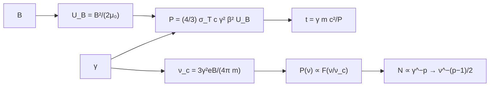

# B27-C12 — Radiación sincrotrón

<!-- nav:top -->
[🏠 Programa](../../../../README.md) · [📚 Bloque B27](../../../tronco-comun/B27-objetos-compactos-y-altas-energias.md) · [← Anterior: B27-C11 — Chorros relativistas](../B27-C11-chorros-relativistas/CLASE.md) · [Siguiente: B27-C13 — Binarias compactas →](../../../tronco-comun/B27-objetos-compactos-y-altas-energias.md#b27-c13)
<!-- /nav -->

## 1. Ubicación, nivel y alcance

Clase 12 del bloque B27. Nivel N3. El plasma de un chorro ([C11](../B27-C11-chorros-relativistas/CLASE.md)) o de un púlsar emite sobre todo por **radiación sincrotrón**: electrones ultrarrelativistas que giran en un campo magnético. Aquí calculas la potencia radiada, la frecuencia crítica, el tiempo de enfriamiento y el espectro de una población con ley de potencias. Usas campos magnéticos ([B05-C17](../../B05/B05-C17-campos-magneticos/CLASE.md)), integrales ([B09-C11](../../B09/B09-C11-integrales-definidas/CLASE.md)) y los campos de [C06](../B27-C06-magnetares-y-campos-extremos/CLASE.md). Se trata un campo uniforme y una población sin absorción.

## 2. Por qué esta clase existe

El índice espectral de una fuente sincrotrón entrega el índice de energía de sus electrones; la frecuencia crítica entrega `γ²B`. Sin estas relaciones no se puede leer un espectro de radio o rayos X. La decisión central: **¿qué potencia, qué frecuencia y qué pendiente espectral produce una población de electrones en un campo dado?**

## 3. Lo que podrás hacer al terminar

1. Calcular la potencia `P = (4/3) σ_T c γ² β² U_B`.
2. Calcular la frecuencia crítica `ν_c = 3γ²eB/(4π m_e)`.
3. Calcular el tiempo de enfriamiento `γ m_e c²/P`.
4. Calcular la integral del núcleo `F(x)` y verificarla contra `8π/(9√3)`.
5. Obtener el índice espectral `(p − 1)/2` numéricamente.
6. Reconocer los supuestos de la ley de potencias.

La evidencia es la **ficha de radiación sincrotrón** del ejercicio 12 (sección 20).

## 4. Con qué llegas y cómo comprobarlo

1. ¿Qué es la densidad de energía magnética?
2. ¿Qué es la sección eficaz de Thomson?
3. ¿Qué es una función de Bessel modificada?
4. ¿Qué es una ley de potencias?
5. ¿Qué es la frecuencia ciclotrónica?

<details>
<summary>Ver respuestas</summary>

1. `U_B = B²/(2μ₀)`. 2. La sección eficaz de la dispersión de la luz por un electrón libre. 3. Solución de una ecuación diferencial que decae exponencialmente. 4. Una función de la forma `x^{−p}`. 5. La frecuencia de giro `eB/(2πm)` de la carga.
</details>

Con cuatro o cinco aciertos, sigue; si no, repasa B05-C17 y B09-C11.

## 5. Un caso ilustrativo: 10 microgauss

No se cita aquí ninguna medición: el campo y los factores de Lorentz son sintéticos. Con `B = 10⁻⁹ T` (`U_B = 3,979 × 10⁻¹³ J/m³`) y `γ = 10⁷`, `P = 1,058 × 10⁻¹⁸ W`, `ν_c = 4,199 × 10¹⁵ Hz` y un tiempo de enfriamiento de `2,45 × 10⁴ años`. Es el **ejemplo conductor**.

## 6. Vocabulario

La **radiación sincrotrón** es la emitida por electrones relativistas en un campo magnético. La **frecuencia crítica** `ν_c` es la que acota el espectro de un electrón. El **núcleo** `F(x) = x ∫ₓ^∞ K_{5/3}(y) dy` da la forma del espectro. El **índice del electrón** `p` en `N(γ) ∝ γ^{−p}`. El **índice espectral** `α = (p − 1)/2` con `S_ν ∝ ν^{−α}`. El **tiempo de enfriamiento** `γ m_e c²/P`.

## 7. Modelo mental: un faro en un círculo

Un electrón que gira emite un cono estrecho de semiángulo `1/γ`; el observador solo ve un destello breve cada vuelta, y un destello breve tiene un espectro ancho que llega hasta `ν_c ∝ γ²B`.



*Descripción textual:* el campo y el factor de Lorentz fijan la potencia, la frecuencia crítica y el tiempo de enfriamiento; el núcleo `F` integrado sobre una población da una ley de potencias.

Analogía: un faro que gira. Límite: la ley de potencias requiere población extendida y sin absorción.

## 8. La explicación, paso a paso

### 8.1 La potencia

Un electrón con ángulo de paso de 90° radia `P = (4/3) σ_T c γ² β² U_B`. Con `B = 10⁻⁹ T`, `P` pasa de `1,058 × 10⁻²⁶ W` (`γ = 10³`) a `1,058 × 10⁻¹⁸ W` (`γ = 10⁷`): crece como `γ²`.

### 8.2 La frecuencia crítica

`ν_c = 3γ²eB/(4πm_e)`: `4,199 × 10⁷ Hz` (`γ = 10³`), `4,199 × 10⁹ Hz` (`10⁴`), `4,199 × 10¹¹ Hz` (`10⁵`) y `4,199 × 10¹⁵ Hz` (`10⁷`). Crece como `γ²`.

### 8.3 El tiempo de enfriamiento

`t = γ m_e c²/P` decrece como `1/γ`: `2,45 × 10⁸` años para `γ = 10³` y `2,45 × 10⁴` para `10⁷`. Los electrones más energéticos se enfrían primero.

### 8.4 El núcleo espectral

`F(x) = x ∫ₓ^∞ K_{5/3}(y) dy`. Su integral total vale `8π/(9√3) = 1,612 266`; el laboratorio la calcula con `K_{5/3}` definida como integral y coincide con el valor analítico a `10⁻⁴` (resultado `1,612 266`). El máximo de `F` está cerca de `x = 0,29` con `F ≈ 0,918`.

### 8.5 Una población con ley de potencias

Con `N(γ) ∝ γ^{−p}` y `ν_c ∝ γ²`, `P(ν) ∝ ν^{−(p−1)/2}`. El laboratorio integra sobre `γ` de `10²` a `10⁶` y mide, entre `10⁶` y `10⁹` Hz relativos: `−0,5006` (`p = 2`), `−0,7501` (`2,5`) y `−1,0000` (`3`), con tolerancia `0,03`.

## 9. Magnitudes, símbolos y unidades

| Símbolo | Qué es | Unidad | Valor / nota |
|---|---|---|---|
| `B` | campo magnético | T | `10⁻⁹` (ilustrativo) |
| `U_B` | densidad de energía magnética | J/m³ | `3,979 × 10⁻¹³` |
| `γ` | factor de Lorentz del electrón | — | `10³`–`10⁷` |
| `P` | potencia por electrón | W | `1,058 × 10⁻¹⁸` (`10⁷`) |
| `ν_c` | frecuencia crítica | Hz | `4,199 × 10¹⁵` (`10⁷`) |
| `σ_T` | sección eficaz de Thomson | m² | `6,6524587051 × 10⁻²⁹` (S1) |

## 10. Convenciones y referencias

Ángulo de paso de 90°; campo uniforme; el espectro se normaliza con el núcleo `F`; `B` y `γ` son **ilustrativos**. Para un ángulo de paso `α` se multiplica por `sin² α` (no se calcula aquí).

## 11. De dónde sale lo que afirmamos

| ID | Fuente | Localizador | Respalda | Estado |
|---|---|---|---|---|
| S1 | NIST, *Fundamental Physical Constants — Complete Listing* (CODATA 2022) | https://physics.nist.gov/cuu/Constants/Table/allascii.txt | `c`, `e`, `m_e`, `μ₀`, `σ_T` | Consultada el 2026-11-09 |

Límites: no se cita ninguna medición; las fórmulas de potencia, frecuencia crítica y núcleo son estándar y se verifican en el laboratorio (integral analítica `8π/(9√3)` y pendiente `(p−1)/2`); no se consultó un texto de radiación sincrotrón.

## 12. Cómo ver la tabla

| `γ` | `P` (W) | `ν_c` (Hz) | `t` (años) |
|---|---|---|---|
| `10³` | `1,058 × 10⁻²⁶` | `4,199 × 10⁷` | `2,45 × 10⁸` |
| `10⁴` | `1,058 × 10⁻²⁴` | `4,199 × 10⁹` | `2,45 × 10⁷` |
| `10⁵` | `1,058 × 10⁻²²` | `4,199 × 10¹¹` | `2,45 × 10⁶` |
| `10⁷` | `1,058 × 10⁻¹⁸` | `4,199 × 10¹⁵` | `2,45 × 10⁴` |

Descripción larga: la potencia y la frecuencia crecen como `γ²`; el tiempo de enfriamiento decrece como `1/γ`.

## 13. Ejemplo trabajado: ¿en qué banda emite?

**Paso 1 · Datos.** `B = 10⁻⁹ T`, `γ = 10⁷`.

**Paso 2 · Frecuencia.** `ν_c = 4,2 × 10¹⁵ Hz`.

**Paso 3 · Longitud de onda.** `c/ν_c = 71 nm`.

**Paso 4 · Sentido.** Ultravioleta lejano. Con `γ = 10³`, `ν_c = 42 MHz`: radio.

## 14. Distintas formas de describir el espectro

**Por `ν_c`:** extremo del espectro de un electrón. **Por `α`:** pendiente de la población. **Por `t`:** edad de la población (rupturas). **Por polarización:** otra clase.

## 15. Práctica guiada

**Ejercicio 1 · con los pasos indicados.** `U_B` para `10⁻⁹ T`. *Pasos:* `B²/(2μ₀)`.

<details><summary>Solución comentada</summary>

`10⁻¹⁸/(2 × 1,2566 × 10⁻⁶) = 3,98 × 10⁻¹³ J/m³`.
</details>

**Ejercicio 2 · con una pista.** `P` para `γ = 10³`. *Pista:* `(4/3)σ_T c γ² U_B`.

<details><summary>Solución comentada</summary>

`1,058 × 10⁻²⁶ W`.
</details>

**Ejercicio 3 · casi autónomo.** `ν_c` para `γ = 10⁴`.

<details><summary>Solución comentada</summary>

`4,2 × 10⁹ Hz`.
</details>

## 16. Práctica autónoma, transferencia e integrador

**Ejercicio 4.** Tiempo de enfriamiento de `γ = 10⁴`.

<details><summary>Solución comentada</summary>

`2,45 × 10⁷` años.
</details>

**Ejercicio 5.** Índice espectral para `p = 2,2`.

<details><summary>Solución comentada</summary>

`(2,2 − 1)/2 = 0,6`.
</details>

**Ejercicio 6.** `p` si `α = 0,75`.

<details><summary>Solución comentada</summary>

`p = 2α + 1 = 2,5`.
</details>

**Ejercicio 7.** ¿Cuánto crece `ν_c` si `γ` se multiplica por 10?

<details><summary>Solución comentada</summary>

Se multiplica por 100.
</details>

**Ejercicio 8.** ¿Y el tiempo de enfriamiento?

<details><summary>Solución comentada</summary>

Se divide por 10.
</details>

**Ejercicio 9 · transferencia.** Un compañero dice que un solo electrón emite una ley de potencias. Responde con 8.4.

<details><summary>Solución comentada</summary>

Un electrón emite `F(x)`, con corte exponencial sobre `ν_c`; la ley de potencias aparece al sumar una población de ley de potencias.
</details>

**Ejercicio 10 · transferencia.** ¿Por qué un espectro puede curvarse hacia abajo en frecuencias altas?

<details><summary>Solución comentada</summary>

Porque los electrones más energéticos se enfrían primero (8.3) y se acumula una ruptura en el espectro.
</details>

**Ejercicio 11 · transferencia.** ¿Qué valida la integral `8π/(9√3)`?

<details><summary>Solución comentada</summary>

Que el núcleo se calculó correctamente; no que la población real tenga ley de potencias.
</details>

**Ejercicio 12 · integrador.** Elabora tu *ficha de radiación sincrotrón*: `U_B`, `P`, `ν_c`, `t` para cuatro `γ`, el índice espectral para tres `p` y la banda en que emite cada `γ`.

<details><summary>Solución modelo</summary>

Tabla de la sección 12 y la sección 8.5.
</details>

## 17. Laboratorio: potencia y espectro

El script [sincrotron.py](sincrotron.py) calcula `P`, `ν_c` y `t`; integra `F` con `K_{5/3}` definida por su integral (**comprueba** `10⁻⁴` contra `8π/(9√3)`) y mide la pendiente espectral para tres `p` (**comprueba** `0,03`).

**Datos:** constantes de NIST; campo y `γ` **ilustrativos**. **Predice antes de ejecutar:** ¿qué pendiente da `p = 2,5`? (`−0,75`.) **Ejecución del 2026-11-09 (Python 3.12.9):**

```text
Python 3.12.9 (biblioteca estandar)
U_B(1e-9 T) = 3.9789e-13 J/m3
   gamma        P [W]    nu_c [Hz]  t_enfr [anios]
   1e+03   1.0580e-26   4.1989e+07      2.4520e+08
   1e+04   1.0580e-24   4.1989e+09      2.4520e+07
   1e+05   1.0580e-22   4.1989e+11      2.4520e+06
   1e+07   1.0580e-18   4.1989e+15      2.4520e+04
Int_0^inf F(x) dx = 1.612266 (analitico 8 pi/(9 sqrt 3) = 1.612266)
F(0.29) = 0.9180 (maximo cercano a x = 0.29, F_max ~ 0.918)
p = 2.0: pendiente espectral = -0.5006 (esperada -0.5000)
p = 2.5: pendiente espectral = -0.7501 (esperada -0.7500)
p = 3.0: pendiente espectral = -1.0000 (esperada -1.0000)
Pruebas superadas.
```

```bash
python programa/clases/B27/B27-C12-radiacion-sincrotron/sincrotron.py
```

**Límites:** campo uniforme, sin autoabsorción, sin enfriamiento acumulado.

## 18. Errores frecuentes y cómo corregirlos

**Confundir potencia y frecuencia.** Se corrige con la sección 12.

**Olvidar el ángulo de paso.** Se corrige con la sección 10.

**Aplicar la ley de potencias a un solo electrón.** Se corrige con el ejercicio 9.

**Olvidar el enfriamiento.** Se corrige con el ejercicio 10.

**Tomar el campo ilustrativo por una medida.** Se corrige con la sección 10.

## 19. Cómo sabrás que vas bien

Tras 8.2: ¿cómo escala `ν_c`? Si dudas, ejercicio 7. Tras 8.5: ¿qué índice da `p = 3`? `−1`. Tras el laboratorio: ¿qué valida la integral? (el núcleo).

## 20. Qué entregas y cómo se evalúa

El producto es tu **ficha de radiación sincrotrón** (ejercicio 12).

| Criterio | Inicial | En desarrollo | Logrado | Destacado |
|---|---|---|---|---|
| Conceptos | Los confunde | Parciales | `P`, `ν_c`, `α` | Explica la ley de potencias |
| Cálculo | Sin unidades | Con errores | Todas las magnitudes | Compara bandas |
| Numérico | Sin comprobar | Un caso | Integral y pendiente | Interpreta tolerancias |
| Fuentes | Sin fuente | Sin fecha | S1 con fecha | Declara que no hay datos reales |
| Límites | No los nombra | Uno | Tres | Discute autoabsorción |

**Condiciones críticas (no se compensan con promedio):** rotular el caso como sintético; no citar una fuente real sin fuente; citar solo lo consultado.

## 21. Ética, seguridad y límites

Clase educativa: no sirve para ajustar espectros reales. Accesibilidad: tablas equivalentes a las gráficas, fórmulas en texto, ejercicios sin conexión.

## 22. Para cerrar y seguir

La potencia sincrotrón crece como `γ²`, el enfriamiento como `1/γ` y una población `γ^{−p}` produce un espectro `ν^{−(p−1)/2}`. Queda una pregunta: ¿qué ocurre cuando dos objetos compactos orbitan y se funden?

**Glosario español–inglés.** radiación sincrotrón · *synchrotron radiation*; frecuencia crítica · *critical frequency*; tiempo de enfriamiento · *cooling time*; índice espectral · *spectral index*; ley de potencias · *power law*; núcleo · *kernel*.

**Continuidad.** [B27-C13](../B27-C13-binarias-compactas/CLASE.md) estudia las binarias compactas.

**Referencias:** ver sección 11.

<!-- nav:bottom -->
---

[← Anterior: B27-C11 — Chorros relativistas](../B27-C11-chorros-relativistas/CLASE.md) · [📚 Bloque B27](../../../tronco-comun/B27-objetos-compactos-y-altas-energias.md) · [Siguiente: B27-C13 — Binarias compactas →](../../../tronco-comun/B27-objetos-compactos-y-altas-energias.md#b27-c13)
<!-- /nav -->
