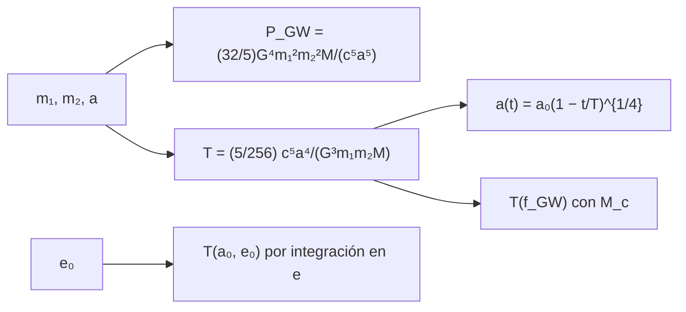

# B27-C13 — Binarias compactas

<!-- nav:top -->
[🏠 Programa](../../../../README.md) · [📚 Bloque B27](../../../tronco-comun/B27-objetos-compactos-y-altas-energias.md) · [← Anterior: B27-C12 — Radiación sincrotrón](../B27-C12-radiacion-sincrotron/CLASE.md) · [Siguiente: B27-C14 — Supernovas termonucleares →](../B27-C14-supernovas-termonucleares/CLASE.md)
<!-- /nav -->

## 1. Ubicación, nivel y alcance

Clase 13 del bloque B27. Nivel N3. Dos objetos compactos en órbita pierden energía en forma de ondas gravitacionales, se acercan y acaban fundiéndose. Aquí calculas la potencia radiada, el tiempo hasta la fusión para órbitas circulares y excéntricas, y la relación entre frecuencia y tiempo restante. Usas órbitas keplerianas ([B02-C14](../../B02/B02-C14-kepler-y-reconstruccion-de-orbitas/CLASE.md)), el ajuste de ecuaciones diferenciales ([B11-C08](../../B11/B11-C08-integradores-de-paso-adaptativo/CLASE.md)) y los objetos de [C03](../B27-C03-estrellas-de-neutrones/CLASE.md) y [C07](../B27-C07-metricas-de-agujeros-negros/CLASE.md). Se trata el orden de cuadrupolo de Peters.

## 2. Por qué esta clase existe

La fusión de dos estrellas de neutrones fue el primer evento detectado en ondas gravitacionales y en luz. Saber cuánto falta para una fusión, a qué frecuencia, y cómo la excentricidad la acelera, es la base de toda búsqueda. La decisión central: **¿cuánto tarda una binaria en fundirse y qué señal emite mientras tanto?**

## 3. Lo que podrás hacer al terminar

1. Calcular el semieje desde el periodo con la tercera ley de Kepler.
2. Calcular la potencia gravitacional y el tiempo de fusión circular.
3. Verificar `a(t) = a₀(1 − t/T)^{1/4}` con RK4.
4. Calcular la masa de chirrido y el tiempo hasta la fusión desde una frecuencia.
5. Evaluar el efecto de la excentricidad.
6. Reconocer los límites del orden de cuadrupolo.

La evidencia es la **ficha de una binaria compacta** del ejercicio 12 (sección 20).

## 4. Con qué llegas y cómo comprobarlo

1. ¿Qué dice la tercera ley de Kepler?
2. ¿Qué es la masa reducida?
3. ¿Qué es un integrador RK4?
4. ¿Qué es la excentricidad?
5. ¿Qué es una onda gravitacional?

<details>
<summary>Ver respuestas</summary>

1. `a³ = GMP²/(4π²)`. 2. `m₁m₂/(m₁+m₂)`. 3. Un método de cuarto orden para ecuaciones diferenciales. 4. El parámetro que mide cuánto se aparta una órbita de un círculo. 5. Una perturbación de la métrica que se propaga a la velocidad de la luz.
</details>

Con cuatro o cinco aciertos, sigue; si no, repasa B02-C14.

## 5. Un caso real: PSR J0348+0432 y GW170817

Antoniadis y colaboradores midieron en PSR J0348+0432 una estrella de neutrones de `2,01 ± 0,04 M☉` con una enana blanca de `0,172 ± 0,003 M☉` y un periodo orbital de `2,46 h` (S3, resumen). Con eso, el semieje es `0,8317 Gm` y el tiempo de fusión por ondas gravitacionales, `406,7 Ma`. En GW170817 la masa total fue `2,74 M☉` a `40 Mpc` (S4, resumen); aquí se usan masas iguales de `1,37 M☉` (ilustrativo). Es el **ejemplo conductor**.

## 6. Vocabulario

La **masa de chirrido** `M_c = (m₁m₂)^{3/5}/(m₁+m₂)^{1/5}`. La **frecuencia gravitacional** `f_GW = 2/P`. El **tiempo de fusión** `T`. El **orden de cuadrupolo** es la primera aproximación de la emisión. El **chirrido** es el aumento conjunto de frecuencia y amplitud. La **circularización** es la pérdida de excentricidad por emisión.

## 7. Modelo mental: una espiral que se acelera

Cada órbita pierde energía, se acerca, orbita más rápido y pierde energía aún más rápido. El tiempo restante cae como `a⁴`, así que la mayor parte de la vida es lenta y los últimos segundos son vertiginosos.



*Descripción textual:* las masas y el semieje dan la potencia gravitacional y el tiempo de fusión; la solución es una potencia fraccionaria del tiempo restante; la excentricidad acorta el tiempo.

Analogía: una bola que gira atada con una cuerda que se acorta. Límite: el modelo vale lejos de la fusión.

## 8. La explicación, paso a paso

### 8.1 Potencia y tiempo

`P_GW = (32/5) G⁴ m₁²m₂²M/(c⁵a⁵)` y `T = (5/256) c⁵a⁴/(G³m₁m₂M)`. La tasa de cambio del semieje es `ȧ = −K/a³`, con `K = (64/5)G³m₁m₂M/c⁵`, y `T = a⁴/(4K)`.

### 8.2 La solución con RK4

Con `y = a/a₀` y `τ = t/T`, `y′ = −1/(4y³)`. El laboratorio integra con RK4 hasta `τ = 0,9` y obtiene `0,562 341 33`, igual al analítico `(0,1)^{1/4}` a `10⁻⁶`.

### 8.3 PSR J0348+0432

Para `2,01 + 0,172 M☉` y `P = 2,46 h`: `a = 0,8317 Gm = 1,195 R☉`, `P_GW = 1,068 × 10²⁴ W` y `T = 406,7 Ma`. La estrella de neutrones y la enana blanca se fundirían en unos cuatrocientos millones de años (en este modelo circular).

### 8.4 De la frecuencia al tiempo

Con masas iguales de `1,37 M☉` (`M_c = 1,1927 M☉`), el tiempo restante desde `f_GW` es `T = (5/256)(πf)^{−8/3}(GM_c/c³)^{−5/3}`: `1039,258 s` a `10 Hz`, `55,514 s` a `30 Hz` y `2,239 s` a `100 Hz`. El laboratorio lo calcula por dos caminos (desde `a` y desde `M_c`) y coinciden a `10⁻⁹`.

### 8.5 Excentricidad

Con `1,4 + 1,4 M☉` y `a₀ = 10⁹ m`, el tiempo respecto del circular vale `0,999 996` (`e₀ = 10⁻³`, límite correcto), `0,96400` (`0,1`), `0,71064` (`0,3`), `0,20597` (`0,6`) y `0,00341` (`0,9`). Una órbita muy excéntrica se funde mucho antes.

## 9. Magnitudes, símbolos y unidades

| Símbolo | Qué es | Unidad | Valor / nota |
|---|---|---|---|
| `a` | semieje | m | `0,8317 × 10⁹` (J0348) |
| `P_GW` | potencia gravitacional | W | `1,068 × 10²⁴` |
| `T` | tiempo de fusión | s o Ma | `406,7 Ma` |
| `M_c` | masa de chirrido | `M☉` | `1,1927` |
| `f_GW` | frecuencia gravitacional | Hz | 10, 30, 100 |
| `e₀` | excentricidad inicial | — | 0,1–0,9 (ilustrativa) |

## 10. Convenciones y referencias

Orden de cuadrupolo; órbita circular salvo en 8.5; las masas de GW170817 son **ilustrativas** (iguales); `a₀ = 10⁹ m` y `e₀` son **ilustrativos**.

## 11. De dónde sale lo que afirmamos

| ID | Fuente | Localizador | Respalda | Estado |
|---|---|---|---|---|
| S1 | NIST, *Fundamental Physical Constants — Complete Listing* (CODATA 2022) | https://physics.nist.gov/cuu/Constants/Table/allascii.txt | `G`, `c` | Consultada el 2026-11-09 |
| S2 | UAI, Resolución B3 de 2015 | https://arxiv.org/abs/1510.07674 | `GM_☉`, `R_☉` nominal | Consultada el 2026-11-09 |
| S3 | Antoniadis et al., arXiv:1304.6875 | https://arxiv.org/abs/1304.6875 | masas `2,01` y `0,172 M☉`; `P = 2,46 h` | Solo resumen, consultado el 2026-11-09 |
| S4 | LIGO Scientific y Virgo, GW170817, arXiv:1710.05832 | https://arxiv.org/abs/1710.05832 | masa total `2,74 M☉`; `40 Mpc` | Solo resumen, consultado el 2026-11-09 |

Límites: S3 y S4 solo resumen; las fórmulas de Peters (1964) se implementan y verifican entre sí y en el límite `e → 0`, pero no se consultó el artículo original.

## 12. Cómo ver el tiempo restante

| `f_GW` (Hz) | `a` (km) | `T` (s) |
|---|---|---|
| 10 | 716,89 | 1039,258 |
| 30 | 344,65 | 55,514 |
| 100 | 154,45 | 2,239 |

Descripción larga: al triplicar la frecuencia, el tiempo restante cae a una veintiunava parte; escala como `f^{−8/3}`.

## 13. Ejemplo trabajado: ¿cuánto falta desde 30 Hz?

**Paso 1 · Datos.** `M_c = 1,1927 M☉`.

**Paso 2 · Fórmula.** `T = (5/256)(π × 30)^{−8/3}(GM_c/c³)^{−5/3}`.

**Paso 3 · Resultado.** `55,5 s`.

**Paso 4 · Sentido.** Del orden del minuto: una señal que un detector puede seguir.

## 14. Distintas formas de describir la binaria

**Por semieje:** `T ∝ a⁴`. **Por frecuencia:** `T ∝ f^{−8/3}`. **Por masa de chirrido:** `T ∝ M_c^{−5/3}`. **Por excentricidad:** integración en `e`.

## 15. Práctica guiada

**Ejercicio 1 · con los pasos indicados.** Si se duplica `a`, ¿cuánto crece `T`? *Pasos:* `T ∝ a⁴`.

<details><summary>Solución comentada</summary>

`2⁴ = 16` veces.
</details>

**Ejercicio 2 · con una pista.** Semieje de J0348+0432. *Pista:* tercera ley con `M = 2,182 M☉`.

<details><summary>Solución comentada</summary>

`0,8317 Gm`.
</details>

**Ejercicio 3 · casi autónomo.** `M_c` de dos masas iguales de `1,37 M☉`.

<details><summary>Solución comentada</summary>

`2^{−1/5} × 1,37 = 0,8706 × 1,37 = 1,1927 M☉`.
</details>

## 16. Práctica autónoma, transferencia e integrador

**Ejercicio 4.** Cociente `T(30 Hz)/T(100 Hz)`.

<details><summary>Solución comentada</summary>

`55,514/2,239 = 24,8 = (100/30)^{8/3}`.
</details>

**Ejercicio 5.** Semieje a `100 Hz`.

<details><summary>Solución comentada</summary>

`154,45 km`.
</details>

**Ejercicio 6.** Tiempo restante para `e₀ = 0,6` como fracción del circular.

<details><summary>Solución comentada</summary>

`0,20597`.
</details>

**Ejercicio 7.** Fracción de `T` que ha pasado cuando `a/a₀ = 0,5623`.

<details><summary>Solución comentada</summary>

`1 − 0,5623⁴ = 0,9`.
</details>

**Ejercicio 8.** Si `M_c` se duplica, ¿cómo cambia `T` a igual `f`?

<details><summary>Solución comentada</summary>

Se divide por `2^{5/3} = 3,17`.
</details>

**Ejercicio 9 · transferencia.** Un compañero dice que 406,7 Ma garantiza que J0348+0432 se fundirá en ese plazo. Responde con 8.3 y la sección 10.

<details><summary>Solución comentada</summary>

Es un cálculo con el modelo circular y masas medias; la incertidumbre de las masas y de la inclinación lo modifica.
</details>

**Ejercicio 10 · transferencia.** ¿Por qué una binaria excéntrica se funde antes?

<details><summary>Solución comentada</summary>

Pierde más energía en el periastro, donde la separación es pequeña (8.5).
</details>

**Ejercicio 11 · transferencia.** ¿Qué valida la coincidencia de las dos formas de `T` a `10⁻⁹`?

<details><summary>Solución comentada</summary>

La coherencia algebraica entre `a` y `M_c`; no la física del modelo.
</details>

**Ejercicio 12 · integrador.** Elabora tu *ficha de una binaria compacta*: semieje, `P_GW`, `T`, `M_c`, tiempo desde tres frecuencias y efecto de la excentricidad.

<details><summary>Solución modelo</summary>

Secciones 8.3–8.5 y 12.
</details>

## 17. Laboratorio: tiempo hasta la fusión

El script [binaria.py](binaria.py) integra `a(t)` con RK4 (**comprueba** `10⁻⁶`), compara dos formas de `T` (**comprueba** `10⁻⁹`) e integra en `e` el caso excéntrico (**comprueba** `10⁻⁴` en el límite circular).

**Datos:** constantes de NIST/UAI; masas de J0348 de S3; masas de GW170817 **ilustrativas**. **Predice antes de ejecutar:** ¿cuántos segundos faltan desde `30 Hz`? (decenas.) **Ejecución del 2026-11-09 (Python 3.12.9):**

```text
Python 3.12.9 (biblioteca estandar)
RK4: a(0.9 T)/a0 = 0.56234133 ; analitico (0.1)^(1/4) = 0.56234133
J0348+0432: a = 0.8317 Gm (1.195 R_sol) ; P_GW = 1.0684e+24 W ; T_fusion = 406.7 Ma
GW170817 (masas iguales 1.37 Msol): masa de chirrido = 1.1927 Msol
f_GW =  10.0 Hz: a =   716.89 km ; T_fusion =  1039.258 s
f_GW =  30.0 Hz: a =   344.65 km ; T_fusion =    55.514 s
f_GW = 100.0 Hz: a =   154.45 km ; T_fusion =     2.239 s
T(e0 = 1e-3)/T_circular = 0.999996
e0 = 0.1: T/T_circular =  0.96400
e0 = 0.3: T/T_circular =  0.71064
e0 = 0.6: T/T_circular =  0.20597
e0 = 0.9: T/T_circular =  0.00341
Pruebas superadas.
```

```bash
python programa/clases/B27/B27-C13-binarias-compactas/binaria.py
```

**Límites:** orden de cuadrupolo, sin efectos post-newtonianos ni espines, sin mareas.

## 18. Errores frecuentes y cómo corregirlos

**Confundir `f_GW` con la frecuencia orbital.** Se corrige con la sección 6.

**Olvidar que `T ∝ a⁴`.** Se corrige con el ejercicio 1.

**Usar el circular con `e` alta.** Se corrige con 8.5.

**Tomar el tiempo como una predicción.** Se corrige con el ejercicio 9.

**Tomar las masas iguales por medidas.** Se corrige con la sección 10.

## 19. Cómo sabrás que vas bien

Tras 8.1: ¿cómo escala `T`? Si dudas, ejercicio 1. Tras 8.4: ¿cuánto falta desde `100 Hz`? `2,2 s`. Tras el laboratorio: ¿qué verifica el límite `e → 0`? (la integración excéntrica).

## 20. Qué entregas y cómo se evalúa

El producto es tu **ficha de una binaria compacta** (ejercicio 12).

| Criterio | Inicial | En desarrollo | Logrado | Destacado |
|---|---|---|---|---|
| Conceptos | Los confunde | Parciales | `P_GW`, `T`, `M_c` | Explica el chirrido |
| Cálculo | Sin unidades | Con errores | Todo en SI | Compara frecuencias |
| Numérico | Sin comprobar | Un caso | Tres comprobaciones | Interpreta la excentricidad |
| Fuentes | Sin fuente | Sin fecha | S1–S4 con fecha | Declara S3 y S4 como resumen |
| Límites | No los nombra | Uno | Tres | Discute efectos post-newtonianos |

**Condiciones críticas (no se compensan con promedio):** rotular las masas iguales como ilustrativas; no presentar el tiempo como predicción; citar solo lo consultado.

## 21. Ética, seguridad y límites

Clase educativa: no es un análisis de datos de detectores. Accesibilidad: tablas equivalentes a las gráficas, fórmulas en texto, ejercicios sin conexión.

## 22. Para cerrar y seguir

El tiempo de fusión crece como `a⁴`, cae como `f^{−8/3}` y se acorta mucho con la excentricidad. Queda una pregunta: ¿qué ocurre cuando una enana blanca explota y deja de ser binaria?

**Glosario español–inglés.** binaria compacta · *compact binary*; masa de chirrido · *chirp mass*; tiempo de fusión · *merger time*; orden de cuadrupolo · *quadrupole order*; onda gravitacional · *gravitational wave*; excentricidad · *eccentricity*.

**Continuidad.** [B27-C14](../B27-C14-supernovas-termonucleares/CLASE.md) estudia las supernovas termonucleares.

**Referencias:** ver sección 11.

<!-- nav:bottom -->
---

[← Anterior: B27-C12 — Radiación sincrotrón](../B27-C12-radiacion-sincrotron/CLASE.md) · [📚 Bloque B27](../../../tronco-comun/B27-objetos-compactos-y-altas-energias.md) · [Siguiente: B27-C14 — Supernovas termonucleares →](../B27-C14-supernovas-termonucleares/CLASE.md)
<!-- /nav -->
